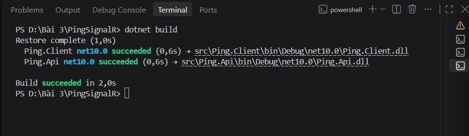
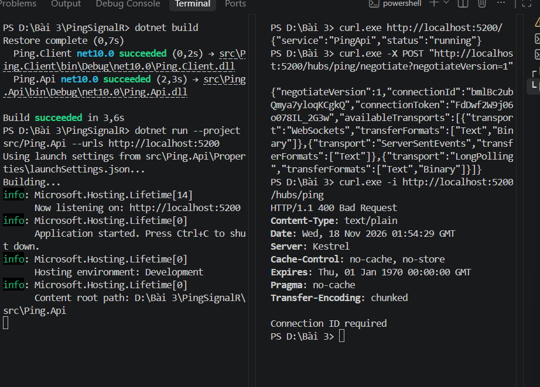
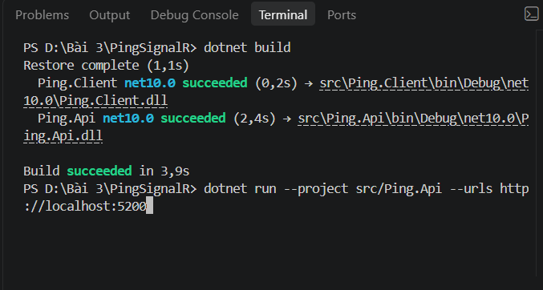
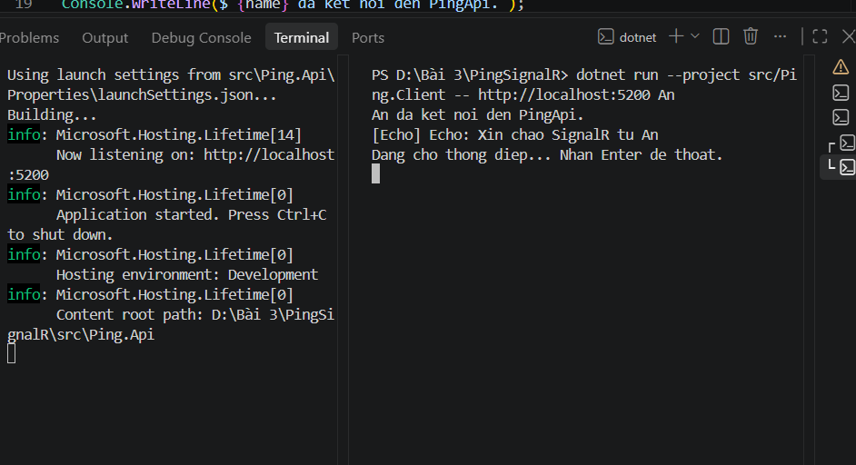
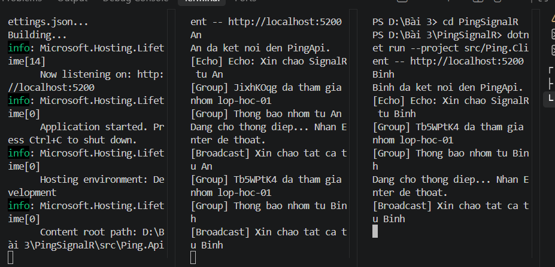
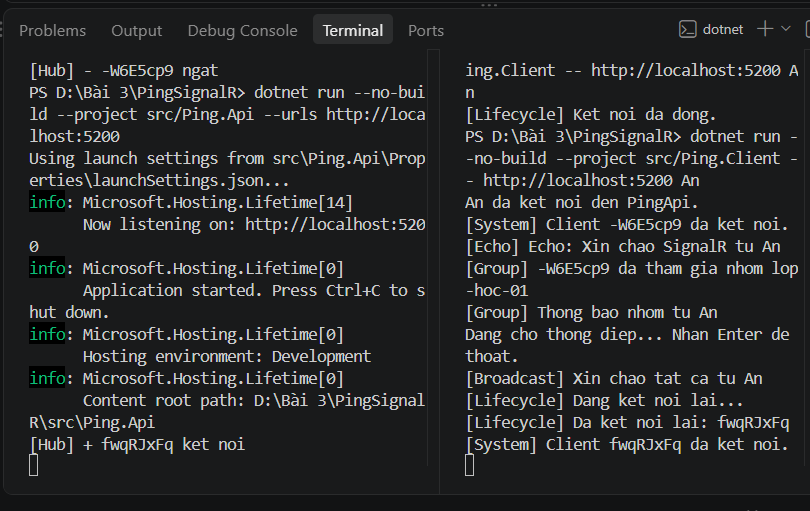
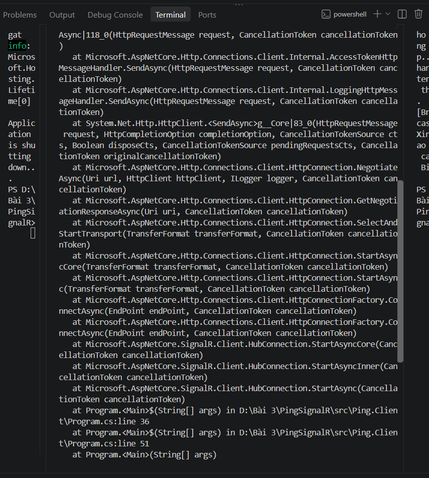
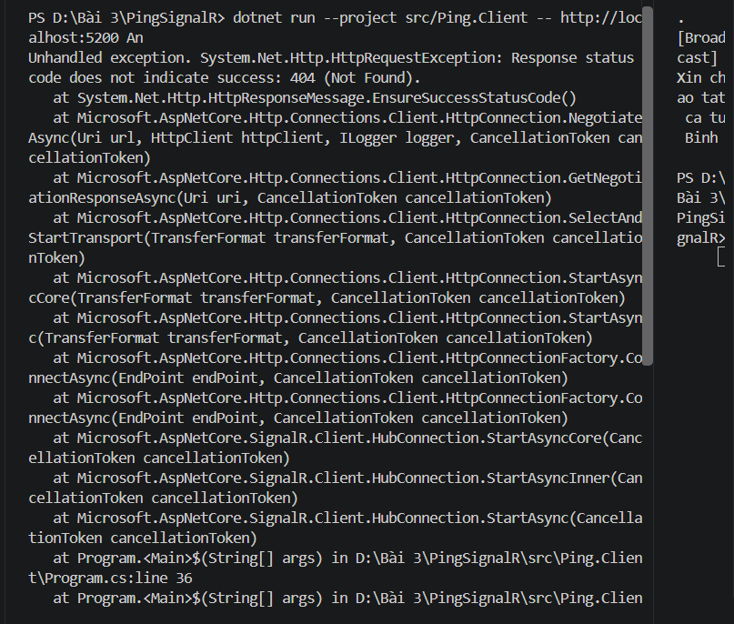
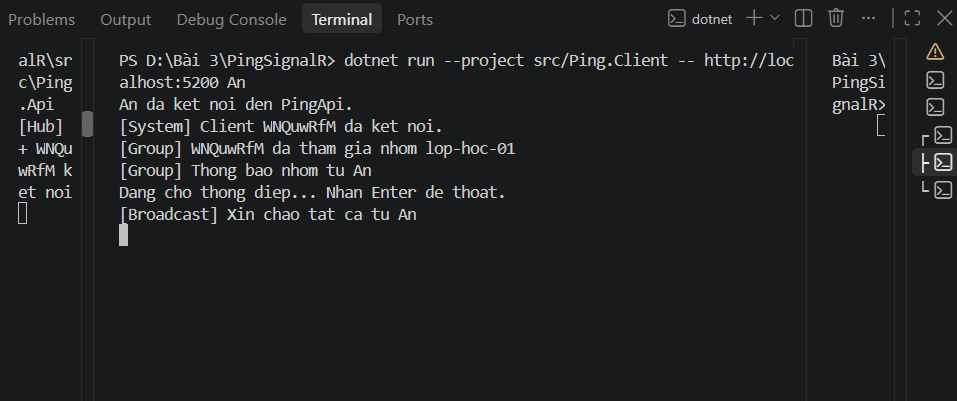

## Bước 1.2: Ghi danh project, thêm gói SignalR và build thử

Thấy: Lệnh dotnet build báo Build succeeded (Ping.Client và Ping.Api đều succeeded).
Giải thích: Đã thêm 2 project vào solution, cài đặt gói Microsoft.AspNetCore.SignalR.Client (10.0.15) cho Ping.Client và biên dịch thành công.
## Bước 2: Cấu hình Hub SignalR trên máy chủ

Thấy: Lệnh dotnet build báo Build succeeded với 0 Error(s).
Giải thích: Đã đăng ký dịch vụ SignalR (AddSignalR), định nghĩa lớp PingHub kế thừa Hub và ánh xạ vào đường dẫn /hubs/ping trên máy chủ Ping.Api.
## Bước 2 kiểm tra: Gọi bước bắt tay negotiate bằng curl

Thấy: Lệnh GET / trả về JSON trạng thái running; POST /hubs/ping/negotiate trả về connectionId và danh sách WebSockets, ServerSentEvents, LongPolling; GET trực tiếp /hubs/ping báo lỗi 400 Connection ID required.
Giải thích: Endpoint REST thông thường chạy song song với SignalR Hub; để kết nối vào Hub, client bắt buộc phải thực hiện bước bắt tay negotiate để lấy mã định danh phiên trước.
## Bước 3: Thêm phương thức Echo vào PingHub

Thấy: Lệnh dotnet build báo Build succeeded với 0 Error(s), máy chủ Ping.Api khởi động lại và lắng nghe tại cổng 5200.
Giải thích: Đã định nghĩa phương thức Echo trong PingHub; khi client gọi InvokeAsync("Echo", ...), server sử dụng Clients.Caller.SendAsync("EchoResponse", ...) để gửi phản hồi riêng cho duy nhất client vừa gọi.## Bước 3: Thêm phương thức Echo vào PingHub

Thấy: Lệnh dotnet build báo Build succeeded với 0 Error(s), máy chủ Ping.Api khởi động lại và lắng nghe tại cổng 5200.
Giải thích: Đã định nghĩa phương thức Echo trong PingHub; khi client gọi InvokeAsync("Echo", ...), server sử dụng Clients.Caller.SendAsync("EchoResponse", ...) để gửi phản hồi riêng cho duy nhất client vừa gọi.
## Bước 4: Xây dựng máy khách SignalR và gọi phương thức Echo

Thấy: Máy khách (An) kết nối thành công tới PingApi và in ra dòng "[Echo] Echo: Xin chao SignalR tu An" ngay sau khi gọi InvokeAsync.
Giải thích: Client khởi tạo HubConnectionBuilder, đăng ký lắng nghe sự kiện "EchoResponse" bằng connection.On, mở kết nối StartAsync và gọi phương thức "Echo" trên Hub để nhận phản hồi hai chiều thời gian thực.
## Bước 5.3: Chạy đồng thời 3 Terminal kiểm chứng phạm vi Echo, Group và Broadcast

Thấy: Khi Bình kết nối sau An, Terminal của An nhận được thông báo [Group] và [Broadcast] từ Bình nhưng không nhận được [Echo] của Bình; Terminal của Bình chỉ nhận được các thông điệp phát sinh sau khi Bình tham gia.
Giải thích: Clients.Caller chỉ phản hồi riêng cho kết nối vừa gọi (Echo), Clients.Group gửi tới tất cả thành viên đang có mặt trong nhóm (lop-hoc-01), và Clients.All phát rộng tới toàn bộ client đang kết nối tại thời điểm gửi.
## Bước 6: Theo dõi vòng đời kết nối (Lifecycle) và tự động kết nối lại

Thấy: Khi máy khách mở kết nối, Terminal 1 in "[Hub] + ... ket noi". Khi tắt máy chủ bằng Ctrl+C rồi chạy lại, Terminal 2 (An) tự động in "[Lifecycle] Dang ket noi lai...", sau đó in "[Lifecycle] Da ket noi lai: fwqRJxFq" với ConnectionId mới và nhận "[System] Client fwqRJxFq da ket noi.".
Giải thích: Ghi đè OnConnectedAsync/OnDisconnectedAsync giúp Hub theo dõi trạng thái kết nối của client; phía client cấu hình WithAutomaticReconnect() cùng các sự kiện Reconnecting, Reconnected, Closed giúp duy trì và phục hồi kết nối tự động khi gián đoạn.
## Bước 7: Ba thí nghiệm lỗi về kết nối phân tán

### 7.1. Máy chủ chưa chạy

- **Thấy:** `StartAsync` ném ngoại lệ `HttpRequestException: Connection refused (localhost:5200)` ngay lập tức.
- **Giải thích:** `WithAutomaticReconnect()` chỉ tự động phục hồi các kết nối **đã thiết lập thành công** trước đó, không tự thử lại nếu kết nối thất bại ngay từ lần `StartAsync()` đầu tiên.

### 7.2. Sai đường dẫn Hub

- **Thấy:** Xuất hiện lỗi `HttpRequestException: Response status code does not indicate success: 404 (Not Found)`.
- **Giải thích:** Lỗi xảy ra ngay ở pha thương lượng (`negotiate`) do đường dẫn phía client (`/hub/ping`) không khớp với endpoint đã ánh xạ bằng `MapHub("/hubs/ping")` trên server.

### 7.3. Sai tên thông điệp

- **Thấy:** Chương trình chạy bình thường, không báo lỗi ngoại lệ nhưng hoàn toàn không hiển thị dòng `[Echo]`.
- **Giải thích:** SignalR định tuyến thông điệp theo chuỗi tên sự kiện; khi tên đăng ký ở client (`"EchoRespone"`) lệch với tên server gửi (`"EchoResponse"`), thông điệp bị bỏ qua một cách im lặng.
## Trả lời câu hỏi tổng kết

### 1. Máy chủ có thể chủ động báo cho máy khách mà không cần máy khách hỏi không?
- **Có.** Nhờ duy trì kênh giao tiếp hai chiều liên tục (thường qua **WebSockets**), máy chủ có thể chủ động đẩy dữ liệu (Server Push) xuống một máy khách cụ thể (`Clients.Caller` / `Clients.Client`), một nhóm (`Clients.Group`), hoặc toàn bộ máy khách đang kết nối (`Clients.All`) thông qua `SendAsync` mà không cần phía máy khách phải gửi yêu cầu hỏi thăm (polling) liên tục.

### 2. Đã có REST rồi, vì sao còn cần thêm SignalR? Hai thứ chia việc thế nào?
- **Vì sao cần thêm SignalR:** REST hoạt động theo mô hình *Request – Response* một chiều (máy khách phải chủ động hỏi thì máy chủ mới trả lời). Nếu dùng REST cho các tác vụ thời gian thực (chat, thông báo trạng thái, tiến trình chấm bài), máy khách buộc phải gọi API liên tục (polling) gây tốn băng thông, tăng độ trễ và quá tải máy chủ.
- **Cách chia việc giữa hai công nghệ:**
  - **REST API** phụ trách các nghiệp vụ CRUD, xác thực, tải dữ liệu khởi tạo, nộp bài, và truy vấn trạng thái chuẩn xác theo yêu cầu.
  - **SignalR** phụ trách kênh thông báo thời gian thực (Real-time Notification), đẩy sự kiện thay đổi trạng thái tức thì từ máy chủ xuống máy khách để kích hoạt giao diện cập nhật (hoặc gọi lại REST để lấy chi tiết dữ liệu).

### 3. Nếu đứt mạng đúng lúc máy chủ báo "đã chấm xong" thì sao?
- **Hậu quả:** SignalR là cơ chế truyền thông điệp trực tiếp (không tự lưu hàng đợi bền vững cho client đang offline), nên thông điệp *"đã chấm xong"* sẽ bị **mất (rơi)** và máy khách bỏ lỡ thông báo ngay thời điểm đó.
- **Cách khắc phục thực tế:**
  1. Phía **Server** phải lưu trạng thái `"Đã chấm xong"` kèm điểm số vào cơ sở dữ liệu (Database) trước khi phát tín hiệu qua SignalR.
  2. Phía **Client** cấu hình `WithAutomaticReconnect()` và lắng nghe sự kiện `Reconnected`: ngay khi tự động kết nối lại thành công, client sẽ chủ động gọi một **REST API** (hoặc phương thức đồng bộ trên Hub) để truy vấn và đồng bộ lại trạng thái mới nhất từ Database, đảm bảo không bao giờ bị kẹt ở trạng thái chờ.