# BÀI 3 - LẬP TRÌNH THỜI GIAN THỰC VỚI SIGNALR

- **Sinh viên thực hiện:** Bế Thị Thu Uyên
- **Mã sinh viên:** `DTC245200078`
- **Lớp:** CNTTK23E
- **Môn học:** Phát triển ứng dụng phân tán

---

# 0. TRẢ LỜI 3 CÂU HỎI ĐẦU GIỜ

1. **Máy chủ có thể chủ động báo cho máy khách mà không cần máy khách hỏi không?**[cite: 5]
   - **Có**, nếu máy khách mở sẵn một kết nối lâu dài (WebSocket thông qua thư viện SignalR) tới máy chủ[cite: 67].
   - Trên kết nối đó, máy chủ chủ động đẩy thông điệp xuống đúng nhóm máy khách đang theo dõi bằng `Clients.Group(...).SendAsync(...)` (và sử dụng `IHubContext<SubmissionHub>` khi gửi từ bên ngoài Hub, chẳng hạn từ endpoint REST hoặc tác vụ chấm nền)[cite: 20, 67].

2. **Đã có REST rồi, vì sao còn cần thêm SignalR? Hai thứ chia việc thế nào?**[cite: 5]
   - Vì HTTP/REST truyền thống chỉ hoạt động theo mô hình máy khách hỏi — máy chủ trả lời; máy chủ không thể tự gọi ngược lại máy khách khi sự kiện xảy ra[cite: 9], còn việc dùng polling hỏi liên tục lại gây lãng phí tài nguyên và có độ trễ[cite: 8, 11].
   - **Phân chia nhiệm vụ:**
     - **REST API:** Tạo tài nguyên (`POST` trả về `201 Created` kèm `id`) và đọc trạng thái hiện tại (`GET` — đóng vai trò là **nguồn sự thật / Source of Truth**) với mã trạng thái HTTP rõ ràng (`200`, `201`, `400`, `404`)[cite: 18, 67].
     - **SignalR:** Đẩy các thông báo thay đổi trạng thái phát sinh sau yêu cầu ban đầu (`received` -> `processing` -> `graded`). **SignalR không thay thế REST mà bổ sung chiều báo tin tức thì.**[cite: 10, 18, 67]

3. **Nếu đứt mạng đúng lúc máy chủ báo "đã chấm xong" thì sao?**[cite: 5, 67]
   - Thông điệp đẩy tại thời điểm đứt mạng sẽ **bị mất** vì SignalR không lưu trữ lại các thông điệp bị lỡ trong lúc ngắt kết nối[cite: 41, 67].
   - Khi có mạng trở lại, `WithAutomaticReconnect()` tự động kết nối lại với một `ConnectionId` mới (đồng nghĩa với việc kết nối đó không còn nằm trong nhóm `submission:{id}` cũ)[cite: 41, 67].
   - **Cách xử lý chuẩn (Quy tắc vàng):** Máy khách cần đăng ký lại `WatchSubmission(id)` sau khi nối lại và gọi `GET /api/submissions/{id}` qua REST để lấy trạng thái cuối cùng chính xác nhất (*"Push để nhanh, REST để chắc"*)[cite: 61, 67].

---

# 1. CÁC LỆNH ĐÃ CHẠY

## 1.1. Phần 2: PingSignalR

Thư mục: `PingSignalR`[cite: 26, 75]

### a. Build chương trình

    cd PingSignalR
    dotnet build

### b. Chạy Server API (Ping.Api)

Mở Terminal 1:

    dotnet run --project src/Ping.Api --urls http://localhost:5200

Địa chỉ Hub: `http://localhost:5200/hubs/ping`[cite: 23]

### c. Kiểm tra bước bắt tay negotiate

Mở Terminal 2:

    curl.exe -X POST "http://localhost:5200/hubs/ping/negotiate?negotiateVersion=1"

### d. Chạy Client (Ping.Client)

Mở Terminal 2 (Máy khách 1 - An):

    dotnet run --project src/Ping.Client -- http://localhost:5200 An

Mở Terminal 3 (Máy khách 2 - Bình, dùng để kiểm thử Broadcast và Group):

    dotnet run --project src/Ping.Client -- http://localhost:5200 Binh

Client thực hiện các bước:
1. Xây dựng kết nối tới `/hubs/ping` có cấu hình tự động kết nối lại `WithAutomaticReconnect()`[cite: 31].
2. Đăng ký lắng nghe các thông điệp (`EchoResponse`, `BroadcastMessage`, `GroupMessage`, `SystemMessage`) và các sự kiện vòng đời (`Reconnecting`, `Reconnected`, `Closed`)[cite: 31, 34, 40].
3. Mở kết nối bằng `StartAsync()`[cite: 31].
4. Gọi phương thức `Echo`, tham gia nhóm `lop-hoc-01`, gửi tin nhóm `SendToGroup` và phát rộng `Broadcast`[cite: 32, 34].

---

## 1.2. Phần 3: EduSubmit Realtime (`RealtimeSubmissionSystem`)

Thư mục: `RealtimeSubmissionSystem`[cite: 50, 75]

### a. Build chương trình

    cd RealtimeSubmissionSystem
    dotnet build

### b. Chạy Server API (`Submission.RealtimeApi`)

Mở Terminal 1:

    dotnet run --project src/Submission.RealtimeApi --urls http://localhost:5000

- Địa chỉ REST API: `http://localhost:5000/api/assignments`, `http://localhost:5000/api/submissions/{id}`[cite: 51, 58]
- Địa chỉ Hub: `http://localhost:5000/hubs/submissions`[cite: 49, 52]

### c. Chạy Client (`Submission.RealtimeClient`)

Mở Terminal 2:

    dotnet run --project src/Submission.RealtimeClient -- http://localhost:5000 DTC245200078

Client thực hiện đúng trình tự 5 bước chuẩn:
1. Đăng ký lắng nghe sự kiện `connection.On<SubmissionStatusMessage>("SubmissionStatusChanged", ...)` và khởi tạo `TaskCompletionSource` làm tín hiệu chờ trạng thái `"graded"`[cite: 57].
2. Mở kết nối SignalR qua `await connection.StartAsync()`[cite: 57].
3. Gọi REST `GET /api/assignments` để lấy bài tập đang mở và `POST /api/assignments/{id}/submissions` để tạo lượt nộp mới (nhận về `201 Created`, trạng thái ban đầu `"received"`)[cite: 58].
4. Gọi `await connection.InvokeAsync("WatchSubmission", created.Id.ToString())` để tham gia nhóm riêng `submission:{id}` và chờ thông báo đẩy từ tác vụ chấm nền[cite: 58].
5. Chốt lại trạng thái cuối cùng bằng REST `GET /api/submissions/{created.Id}`[cite: 58].

---

# 2. ẢNH KẾT QUẢ CHẠY THỰC TẾ

## 2.1. Phần 2: PingSignalR

### Bước 1: Tạo solution, project và build thử

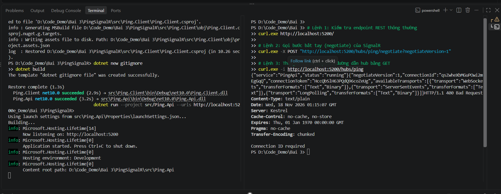

Lệnh `dotnet build` báo `Build succeeded, 0 Error(s)`. Đã tạo solution `PingSignalR` gồm 2 project `Ping.Api` và `Ping.Client`, cài gói `Microsoft.AspNetCore.SignalR.Client` và build thành công[cite: 27].

### Bước 2: Kiểm tra bước bắt tay negotiate

Lệnh `curl negotiate` trả về `connectionId` và danh sách `availableTransports` gồm `WebSockets`, `ServerSentEvents`, `LongPolling`, chứng minh Server đã cấu hình SignalR tại `/hubs/ping` thành công[cite: 29].

### Bước 3 - 4: Phương thức Echo và chạy máy khách (`Clients.Caller`)

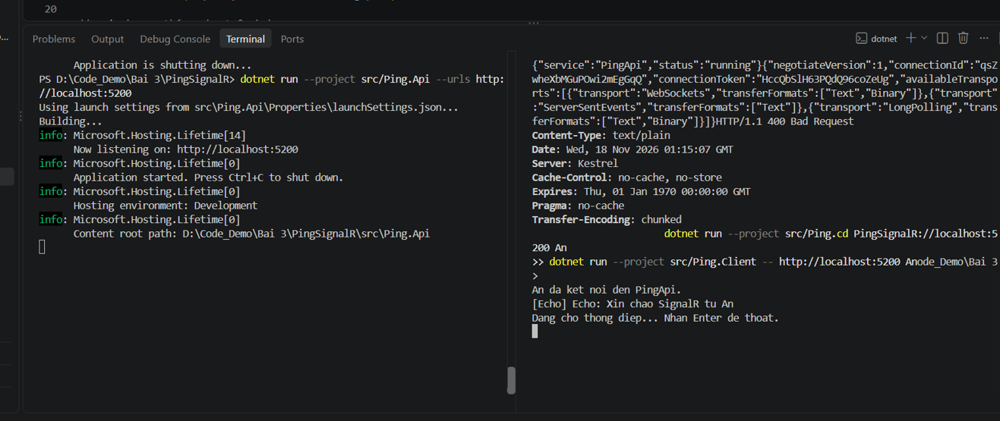

Máy chủ chạy ổn định tại cổng `5200`, máy khách `An` kết nối thành công và nhận được dòng phản hồi riêng `"[Echo] Echo: Xin chao SignalR tu An"` thông qua `Clients.Caller`[cite: 32].

### Bước 5: Phát rộng (`Clients.All`) và Nhắn nhóm (`Clients.Group`)

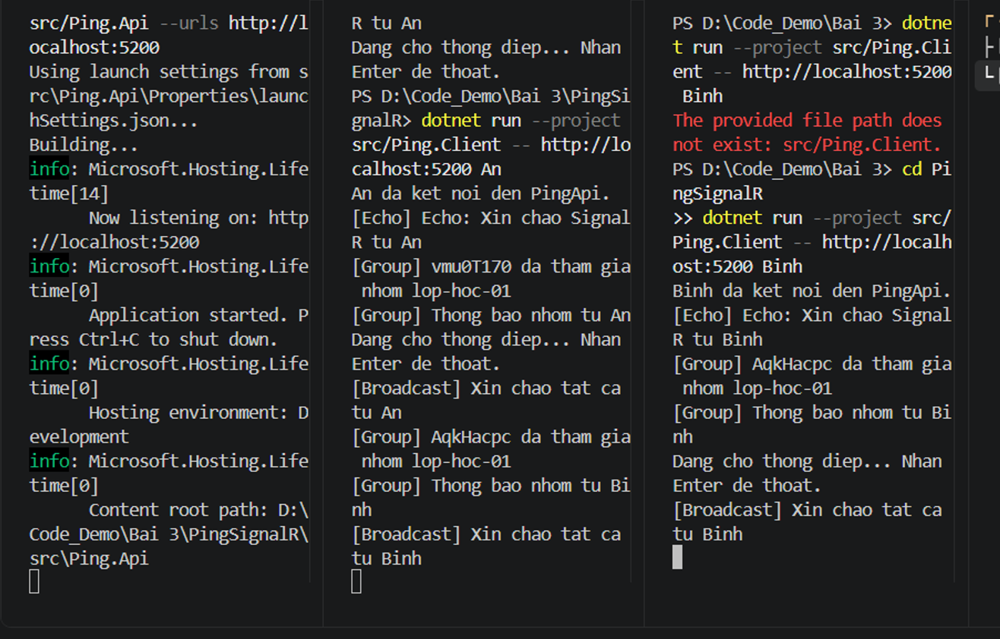

Máy khách `An` nhận được tin nhắn `[Group]` và `[Broadcast]` từ `Bình`, nhưng không nhận được tin `[Echo]` của `Bình`[cite: 36, 37].

### Bước 6: Vòng đời kết nối và tự động kết nối lại (`WithAutomaticReconnect`)

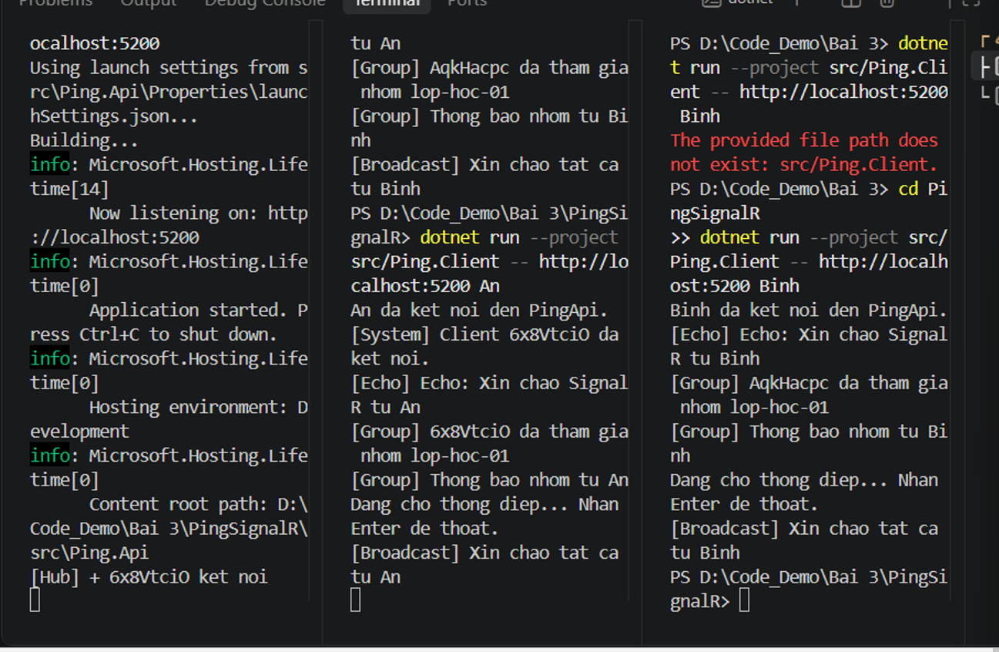

Khi tắt máy chủ, máy khách hiện `"[Lifecycle] Dang ket noi lai..."`. Khi bật lại máy chủ, máy khách tự nối lại và hiện `"[Lifecycle] Da ket noi lai: VTnvThNg"` với `ConnectionId` mới khác ban đầu (`6x8VtciO`)[cite: 40, 41].

---

## 2.2. Phần 3: EduSubmit Realtime (`RealtimeSubmissionSystem`)

### Bước 1: Tạo solution `RealtimeSubmissionSystem` và build thử

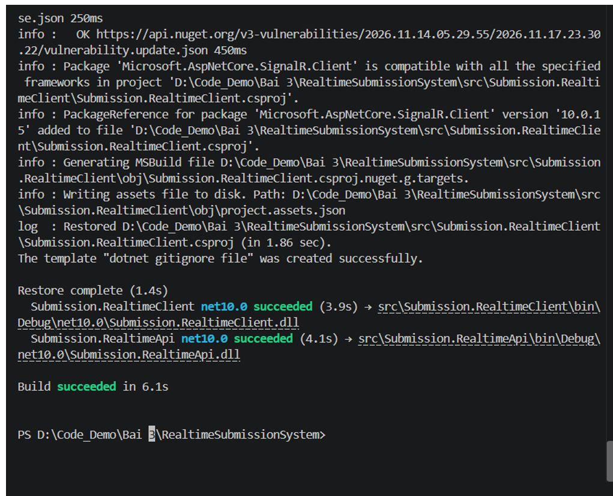

Tạo solution `RealtimeSubmissionSystem` gồm 2 dự án `Submission.RealtimeApi` và `Submission.RealtimeClient`, biên dịch thành công (`Build succeeded, 0 Error(s)`)[cite: 50].

### Bước 2: Khởi tạo REST API nộp bài (`201 Created` + `UpdatedAt` + `lock`)

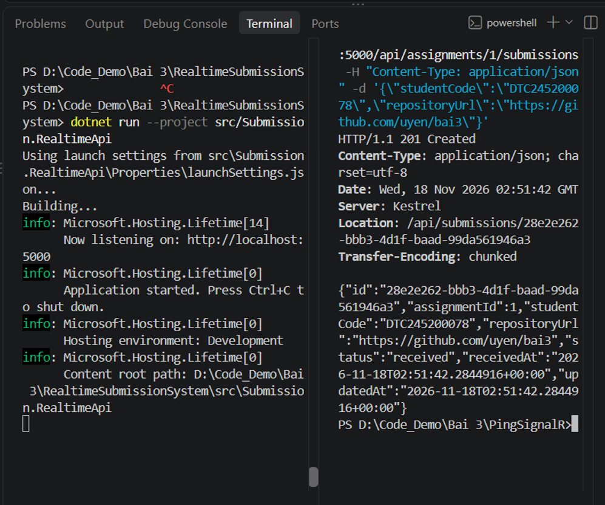

Gửi yêu cầu `POST /api/assignments/1/submissions` trả về mã `HTTP/1.1 201 Created`, header `Location` và body JSON có `"status": "received"` cùng mốc thời gian `"updatedAt"`[cite: 51, 56].

### Bước 3: Ánh xạ `SubmissionHub` và kiểm tra bắt tay `negotiate`

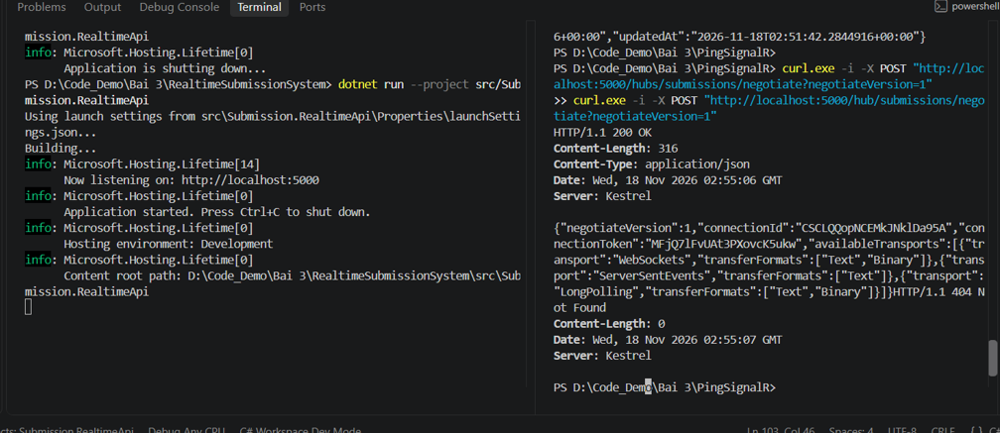

Ánh xạ `SubmissionHub` tại `/hubs/submissions` với phương thức `WatchSubmission(string submissionId)` đưa kết nối vào nhóm `submission:{id}`[cite: 52]. Kiểm tra `negotiate` trả về `connectionId`[cite: 52].

### Bước 4: Tác vụ chấm nền qua `IHubContext` (`received` -> `processing` -> `graded`)

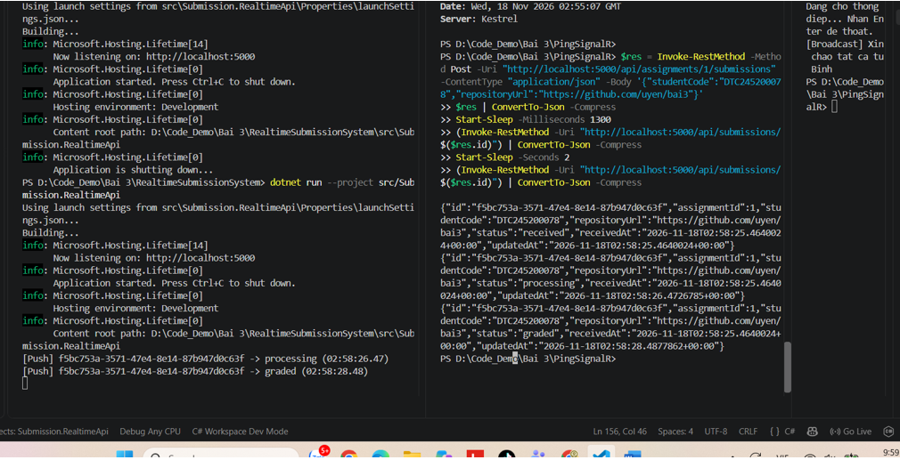

Sau khi `POST` trả `201 Created` ngay lập tức, tác vụ nền `SimulateGradingAsync` tự động cập nhật trạng thái trong `lock` và đẩy thông báo qua `IHubContext<SubmissionHub>` sau 1 giây (`processing`) và 3 giây (`graded`). Khi gọi lại `GET /api/submissions/{id}`, trạng thái và `updatedAt` tăng dần chính xác[cite: 54, 55, 56].

### Bước 5 - 6: Máy khách mở 2 kênh, nhận thông báo thời gian thực và chốt lại bằng REST

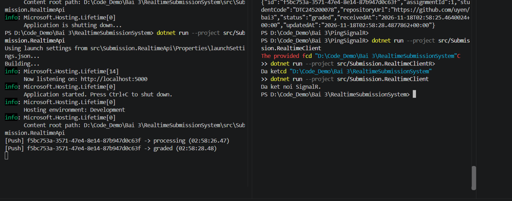
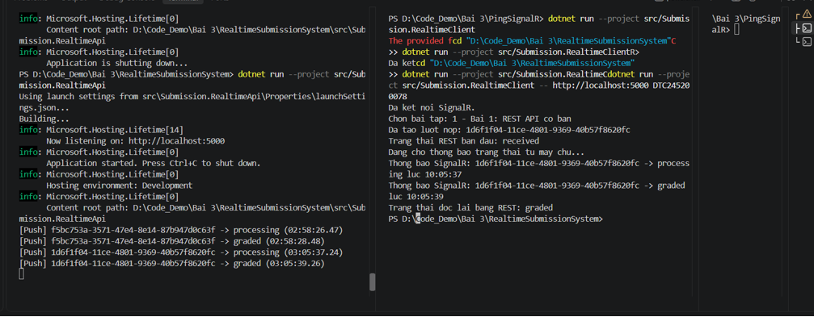

Kết quả chạy máy khách thực tế (đủ 8 dòng):

    Da ket noi SignalR.
    Chon bai tap: 1 Bai tap SignalR
    Da tao luot nop: 85104c09-d131-47fd-8ac1-29e25ae120eb
    Trang thai REST ban dau: received
    Dang cho thong bao trang thai tu may chu...
    Thong bao SignalR: 85104c09-d131-47fd-8ac1-29e25ae120eb -> processing
    Thong bao SignalR: 85104c09-d131-47fd-8ac1-29e25ae120eb -> graded
    Trang thai doc lai bang REST: graded

Log tương ứng trên máy chủ:

    [Hub] 8Frxcm6b theo doi submission: 85104c09-d131-47fd-8ac1-29e25ae120eb
    [Push] submission: 85104c09-d131-47fd-8ac1-29e25ae120eb -> processing
    [Push] submission: 85104c09-d131-47fd-8ac1-29e25ae120eb -> graded

### Bước 7: Kiểm chứng thí nghiệm phân tán (Hai máy khách cùng lúc)

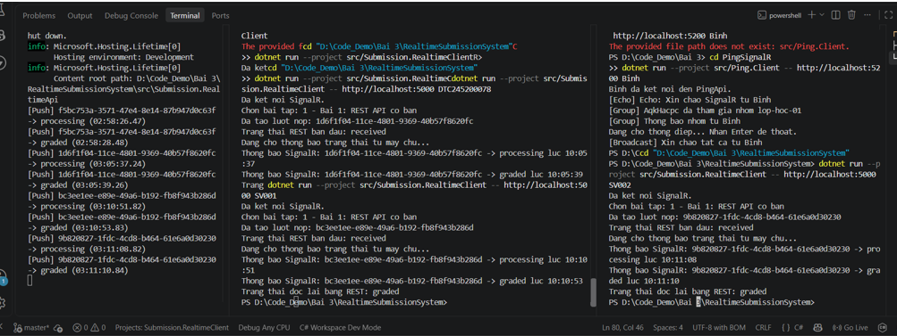

Khi chạy đồng thời 2 máy khách `SV001` và `SV002`, mỗi terminal chỉ nhận đúng thông báo `processing` và `graded` của lượt nộp do chính mình tạo ra nhờ cơ chế cô lập nhóm `submission:{id}`[cite: 61].

### Bước 8: Kiểm thử bộ 9 ca REST API & SignalR trong `requests.http`

Đã chạy kiểm thử đầy đủ 9 ca trong `RealtimeSubmissionSystem/requests.http`:

| Ca | Yêu cầu | Kết quả mong đợi | Ảnh minh chứng |
|:---:|---|---|---|
| **1** | `GET /` | `200 OK` | 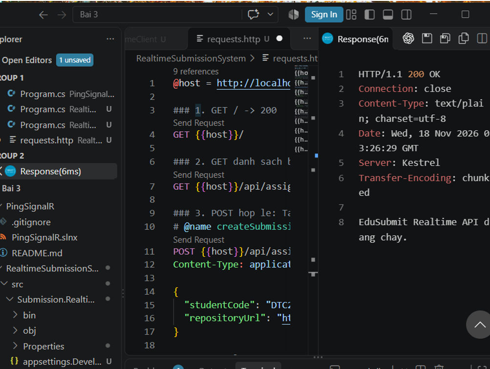 |
| **2** | `GET /api/assignments` | `200 OK` | 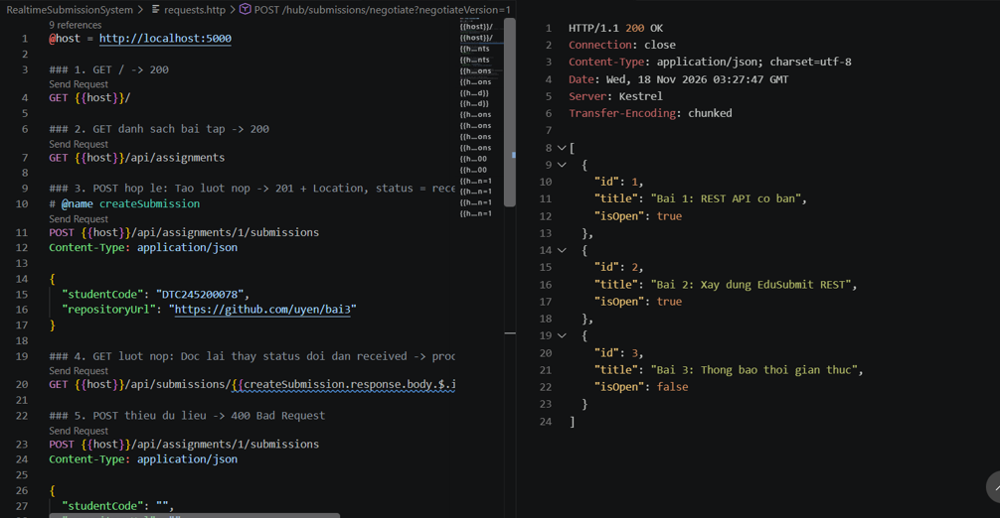 |
| **3** | `POST /api/assignments/1/submissions` (hợp lệ) | `201 Created` | 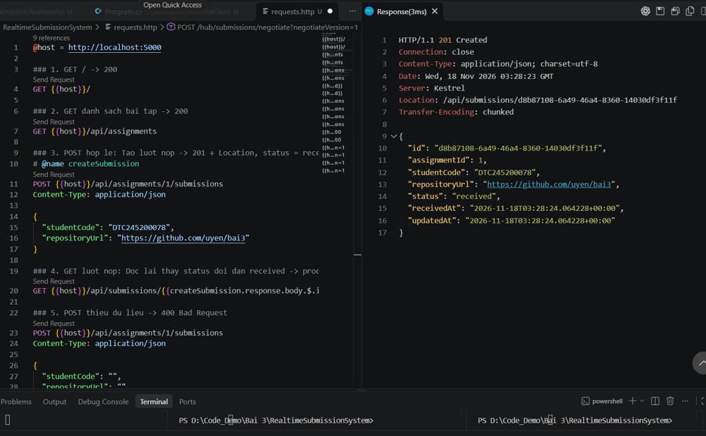 |
| **4** | `GET /api/submissions/{id}` | `200 OK` (`received` -> `processing` -> `graded`) | 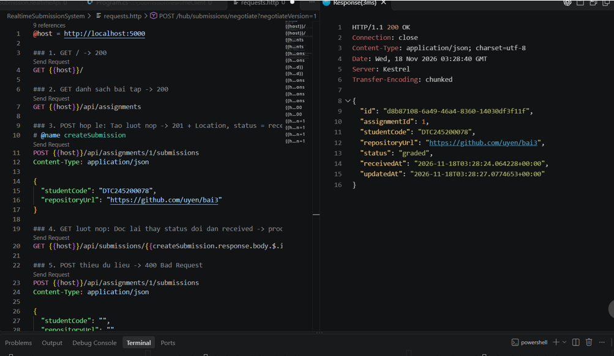 |
| **5** | `POST /api/assignments/1/submissions` (thiếu dữ liệu) | `400 Bad Request` (`INVALID_REQUEST`) | 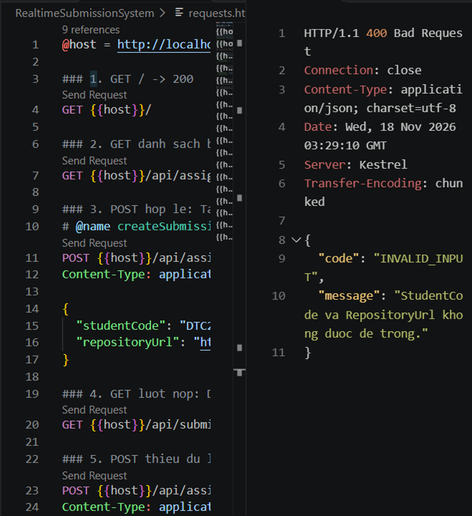 |
| **6** | `POST /api/assignments/99/submissions` (không tồn tại) | `404 Not Found` (`ASSIGNMENT_NOT_FOUND`) | 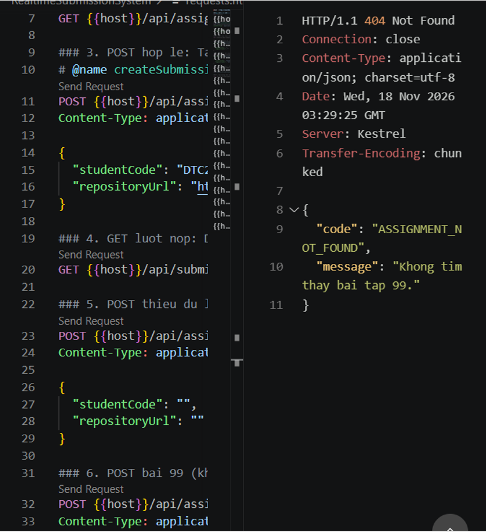 |
| **7** | `GET /api/submissions/00000000-...` (ID rỗng) | `404 Not Found` (`SUBMISSION_NOT_FOUND`) | 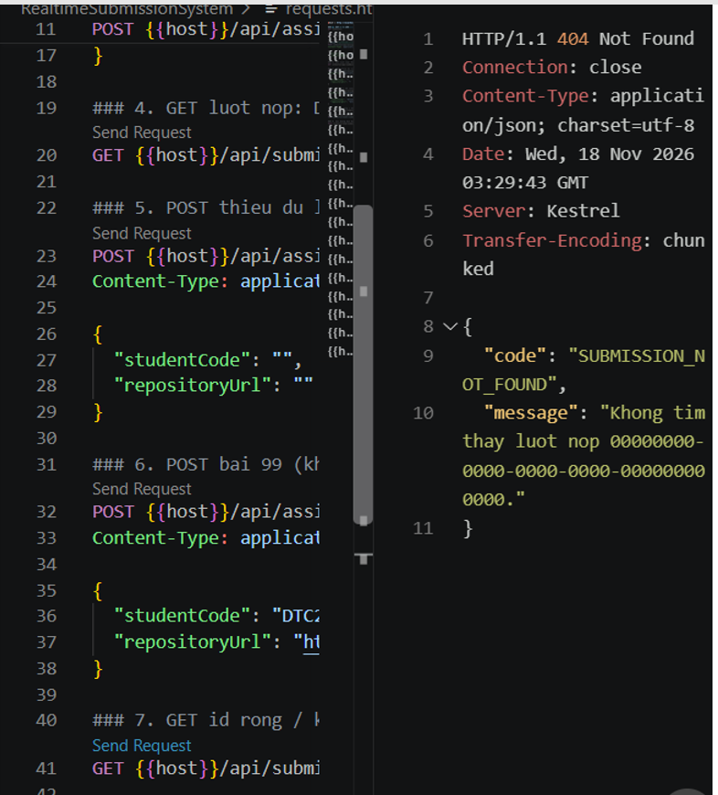 |
| **8** | `POST /hubs/submissions/negotiate?negotiateVersion=1` | `200 OK` + `connectionId` | 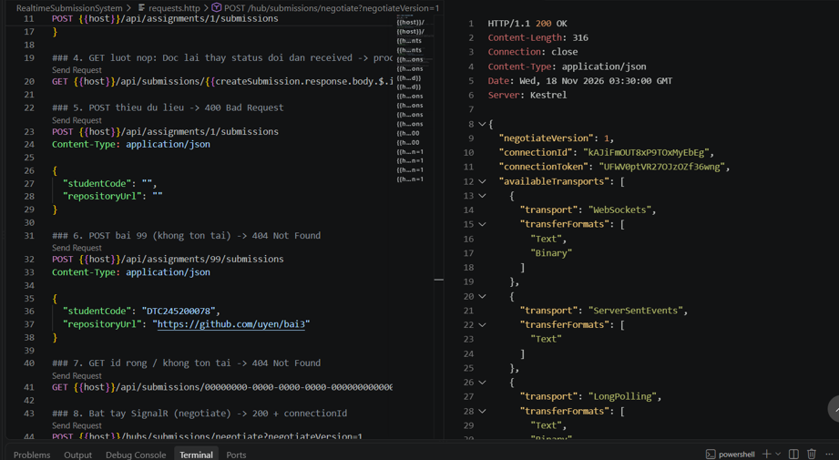 |
| **9** | `POST /hub/submissions/negotiate?negotiateVersion=1` (sai đường dẫn) | `404 Not Found` | 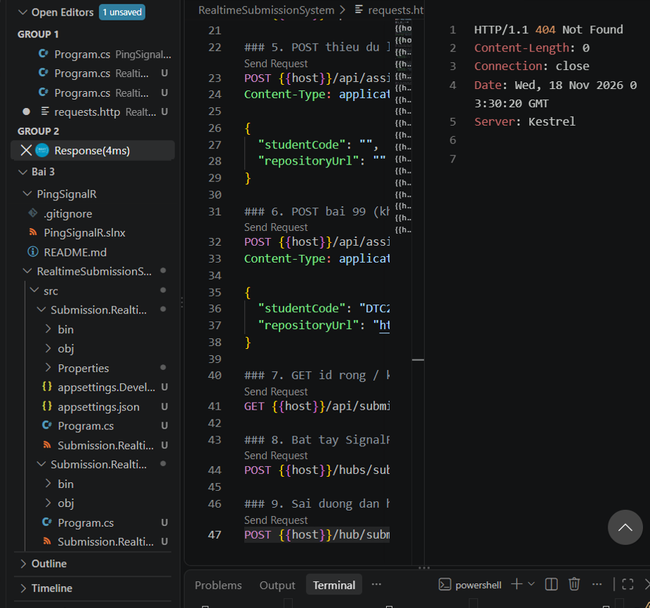 |

---

# 3. BẢNG PHÁ THỬ VÀ KIỂM TRA

## 3.1. Kiểm thử chức năng SignalR Hub (`PingSignalR`)

| STT | Ca thử | Kết quả mong đợi | Kết quả thực tế |
|:---:|---|---|---|
| 1 | Build solution `PingSignalR` | `Build succeeded`, 0 lỗi | Đạt |
| 2 | Gọi `POST /hubs/ping/negotiate?negotiateVersion=1` | Trả về JSON có `connectionId` và `WebSockets` | Đạt |
| 3 | Máy khách `An` kết nối và gọi `Echo` | Chỉ `An` nhận được `[Echo]` qua `Clients.Caller` | Đạt |
| 4 | Máy khách `Bình` tham gia nhóm và gọi `SendToGroup` | Cả `An` và `Bình` trong `lop-hoc-01` đều nhận `[Group]` | Đạt |
| 5 | Máy khách `Bình` gọi `Broadcast` | Mọi kết nối đang mở đều nhận `[Broadcast]` qua `Clients.All` | Đạt |
| 6 | Tắt máy chủ đột ngột rồi bật lại | Client chuyển sang `Reconnecting` rồi tự nối lại (`Reconnected`) với ID mới | Đạt |

## 3.2. Bảng phá thử 3 thí nghiệm lỗi (`PingSignalR` - Bước 7)

| STT | Ca thử | Kết quả mong đợi | Kết quả thực tế & Giải thích | Ảnh minh chứng |
|:---:|---|---|---|---|
| 1 | **Máy chủ chưa chạy:** Tắt Terminal 1, sau đó chạy máy khách `An` | Ném lỗi từ chối kết nối ngay khi gọi `StartAsync()` | **Đạt.** Báo lỗi `HttpRequestException (Connection refused)`. `WithAutomaticReconnect()` chỉ cứu các kết nối **đã mở** thành công trước đó[cite: 42]. | 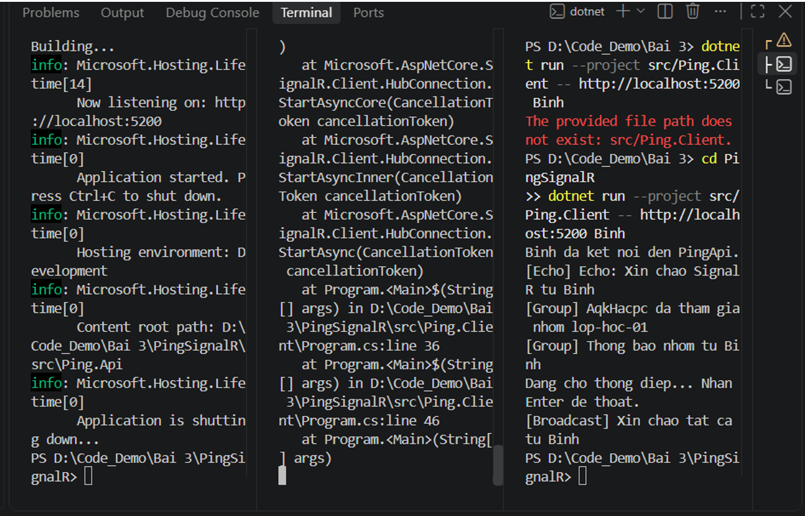 |
| 2 | **Sai đường dẫn Hub:** Sửa `.WithUrl` thành `/hub/ping` (thiếu chữ `s`) | Ném lỗi HTTP 404 tại bước bắt tay `negotiate` | **Đạt.** Báo lỗi `HttpRequestException: 404 (Not Found)` do URL phía Client không khớp với tuyến `MapHub("/hubs/ping")` trên Server[cite: 42]. | 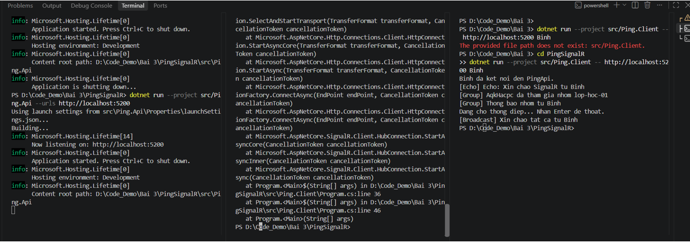 |
| 3 | **Sai tên thông điệp:** Sửa `On("EchoResponse")` thành `On("EchoRespone")` | Không báo lỗi nhưng không nhận được dòng `[Echo]` | **Đạt.** Chương trình chạy bình thường nhưng bỏ qua một cách im lặng do tên sự kiện Server gửi về không khớp với tên đã đăng ký ở Client[cite: 42]. | 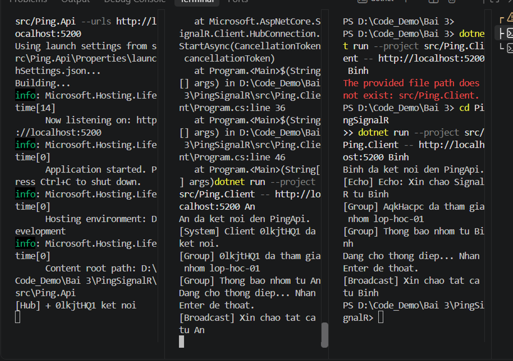 |

## 3.3. Bảng 5 thí nghiệm phân tán (`EduSubmit` - Bước 7)

| STT | Thí nghiệm | Dự đoán trước khi chạy | Kết quả chạy thật | Giải thích & Bài học rút ra |
|:---:|---|---|---|---|
| **1** | **Chạy 2 máy khách `SV001` và `SV002` cùng lúc**[cite: 60] | Mỗi sinh viên chỉ nhận được thông báo trạng thái của riêng lượt nộp do mình tạo, không bị lẫn tin của người khác. | Mỗi máy khách chỉ hiển thị đúng thông báo `processing` và `graded` của lượt nộp vừa tạo[cite: 61]. | Nhóm `submission:{id}` do máy chủ quản lý giúp cô lập người nhận theo từng lượt nộp, đảm bảo riêng tư và tiết kiệm đường truyền[cite: 53, 61]. |
| **2** | **Chạy máy khách khi máy chủ chưa chạy**[cite: 60] | Máy khách sẽ báo lỗi không thể kết nối tới cổng `5000` ngay khi gọi `StartAsync()`. | Ném ngoại lệ `HttpRequestException: Connection refused (localhost:5000)` ngay tại `StartAsync()`[cite: 61]. | `WithAutomaticReconnect()` chỉ tự thử lại với kết nối đã mở thành công trước đó; lần kết nối đầu tiên thất bại sẽ báo lỗi ngay[cite: 42, 61]. |
| **3** | **Sửa `WithUrl` sai thành `/hub/submissions` (thiếu `s`)**[cite: 60] | Máy khách sẽ gặp lỗi `404 Not Found` ngay bước bắt tay khởi tạo kết nối SignalR. | Ném ngoại lệ `HttpRequestException: Response status code does not indicate success: 404 (Not Found)`[cite: 61]. | Lỗi xảy ra ngay ở bước thương lượng `negotiate`; đường dẫn ở `WithUrl` phía máy khách phải khớp tuyệt đối với `app.MapHub` phía máy chủ[cite: 42, 61]. |
| **4** | **Sửa `On("SubmissionStatusChanged")` thành `On("SubmissionStatusChange")`**[cite: 60] | Không lỗi biên dịch nhưng máy khách không bắt được sự kiện, sau 10 giây sẽ hết thời gian chờ. | Không báo lỗi; sau 10 giây in `"Qua thoi gian cho thong bao graded."`, sau đó REST đọc lại vẫn là `graded`[cite: 61]. | Sai tên sự kiện ở chiều Server -> Client sẽ bị bỏ qua trong im lặng (silent drop). Cần đối chiếu tên hợp đồng hai phía đầu tiên[cite: 42, 61]. |
| **5** | **Chờ 4 giây sau khi `POST` rồi mới gọi `WatchSubmission`**[cite: 60] | Sau 4 giây tác vụ nền đã chấm xong và đẩy xong tin nên máy khách sẽ bị lỡ toàn bộ thông báo SignalR. | Không nhận được tin SignalR nào; hết 10 giây timeout nhưng bước đọc lại bằng REST `GET` vẫn in `graded`[cite: 61]. | Tham gia nhóm muộn hơn thời điểm `SendAsync` sẽ bị lỡ thông điệp thời gian thực. Nhờ quy tắc chốt lại bằng REST `GET`, trạng thái cuối luôn chính xác[cite: 61]. |

---

# 4. TỔNG HỢP BỐN PHẠM VI GỬI VÀ CÂU HỎI ÔN TẬP (CHƯƠNG 3)

## 4.1. Bảng tổng hợp bốn phạm vi gửi trong SignalR

| Phạm vi | Ai nhận | Ví dụ ứng dụng trong EduSubmit |
|---|---|---|
| `Clients.All` | Mọi kết nối đang mở tới Hub[cite: 43] | Thông báo máy chủ sắp bảo trì; thông báo có bài tập mới được đăng[cite: 43] |
| `Clients.Caller` | Chỉ kết nối vừa gọi phương thức trên Hub[cite: 43] | Xác nhận riêng cho sinh viên `"đã đăng ký theo dõi lượt nộp"`[cite: 43] |
| `Clients.Group(tên)` | Tất cả thành viên đã tham gia nhóm `tên`[cite: 43] | Cập nhật trạng thái chấm bài của lượt nộp gửi vào nhóm `submission:{id}`[cite: 43] |
| `Clients.Client(id)` | Duy nhất một `ConnectionId` cụ thể[cite: 43] | Hiếm dùng: gửi thông báo riêng cho một phiên làm việc cụ thể[cite: 43] |

## 4.2. Trả lời ngắn gọn câu hỏi ôn tập và thảo luận (Slide 68)

1. **Polling khác push ở số yêu cầu và độ trễ thế nào?**[cite: 70]
   - *Polling* gửi nhiều yêu cầu lặp lại theo chu kỳ nên đa số yêu cầu là thừa và độ trễ phụ thuộc vào chu kỳ hỏi; *Push* chỉ gửi đúng lúc sự kiện phát sinh trên máy chủ nên không có yêu cầu thừa và độ trễ gần như tức thì[cite: 8, 11].
2. **Phân biệt 3 MEP theo hướng khởi tạo và số thông điệp:**[cite: 12, 70]
   - *Yêu cầu – phản hồi (Request-Response):* Máy khách khởi tạo, 1 yêu cầu nhận 1 phản hồi[cite: 12].
   - *Đẩy dữ liệu (Push):* Máy chủ khởi tạo khi có sự kiện, gửi từng thông điệp lẻ không đều[cite: 12].
   - *Truyền luồng (Streaming):* Một hoặc cả hai phía khởi tạo, gửi chuỗi nhiều thông điệp liên tục[cite: 12].
3. **WebSocket, SignalR: giao thức hay thư viện?**[cite: 70]
   - *WebSocket* là **giao thức** truyền thông hai chiều lâu dài[cite: 15, 16]; *SignalR* là **thư viện** cấp cao của ASP.NET Core xây dựng trên WebSocket (kèm Hub, Group, tự nối lại và cơ chế dự phòng)[cite: 16].
4. **SignalR có những cơ chế truyền tải dự phòng nào?**[cite: 70]
   - Thứ tự ưu tiên: **WebSockets** (ưu tiên 1) -> **Server-Sent Events / SSE** (ưu tiên 2) -> **Long Polling** (ưu tiên 3)[cite: 16].
5. **Vì sao tạo nhóm `submission:{id}` thay vì gửi tất cả?**[cite: 70]
   - Để đảm bảo **riêng tư** (sinh viên không thấy kết quả của người khác) và **tiết kiệm băng thông** (máy chủ chỉ gửi đúng người cần nhận)[cite: 53].
6. **`IHubContext` cho phép làm gì?**[cite: 70]
   - Cho phép đẩy thông điệp SignalR tới máy khách từ **bên ngoài lớp Hub** (như từ endpoint REST hoặc tác vụ chấm nền)[cite: 20, 54].
7. **`On<T>` dùng để làm gì? Bỏ đi thì sao?**[cite: 70]
   - Dùng để đăng ký hàm xử lý phía máy khách khi nhận thông điệp có tên tương ứng từ máy chủ[cite: 31]. Nếu bỏ đi hoặc gõ sai tên, máy khách sẽ **bỏ qua trong im lặng** (không báo lỗi nhưng không nhận được dữ liệu)[cite: 33].
8. **REST làm gì, SignalR làm gì? Vì sao không dùng SignalR để tạo lượt nộp?**[cite: 70]
   - REST tạo tài nguyên (`POST`) và đọc trạng thái chuẩn (`GET` — nguồn sự thật); SignalR chỉ đẩy thông báo thay đổi trạng thái[cite: 18]. Không dùng SignalR tạo lượt nộp vì REST chuẩn hóa ngữ nghĩa tài nguyên, mã trạng thái HTTP (`201`, `400`, `404`), header `Location` và dễ kiểm thử/lưu trữ[cite: 18].
9. **`WithAutomaticReconnect` có tác dụng gì?**[cite: 70]
   - Tự động thử kết nối lại theo các mốc thời gian mặc định (`0s`, `2s`, `10s`, `30s`) khi kết nối đang mở bị đứt ngang[cite: 41].
10. **Mất kết nối đúng lúc báo `graded` thì làm gì?**[cite: 70]
    - Tin đẩy lúc rớt mạng bị mất và kết nối mới có `ConnectionId` mới nên rời khỏi nhóm cũ; máy khách cần gọi lại `WatchSubmission(id)` (nếu cần) và gọi `GET /api/submissions/{id}` qua REST để lấy trạng thái cuối cùng chính xác nhất[cite: 41, 67].
11. **Hàng trăm SV cùng theo dõi: nhóm theo `id` hay phát tất cả rồi tự lọc?**[cite: 70]
    - **Nhóm theo `id`** tiết kiệm băng thông hơn rất nhiều vì máy chủ lọc sẵn tại nguồn thay vì phát tán hàng chục nghìn bản tin thừa cho toàn bộ lớp học[cite: 53].
12. **Nêu 2 tình huống polling là lựa chọn hợp lý hơn SignalR:**[cite: 70]
    - Dữ liệu ít thay đổi và chấp nhận độ trễ vài chục giây (ví dụ: bảng tin thống kê tổng hợp theo giờ), hoặc môi trường mạng/proxy chặn kết nối lâu dài[cite: 11].
13. **Chạy nhiều bản sao API (scale-out) thì nhóm trong bộ nhớ gặp vấn đề gì? Sửa thế nào?**[cite: 70]
    - Các máy chủ độc lập không chia sẻ danh sách nhóm trong RAM nên máy khách nối vào Server A sẽ không nhận được thông báo đẩy từ Server B[cite: 69]. Cách sửa: dùng **Backplane chung** (như **Redis Backplane** hoặc Azure SignalR Service) để đồng bộ thông điệp giữa các bản sao[cite: 69].

---

# 5. KẾT LUẬN

Qua bài thực hành, em đã xây dựng hoàn chỉnh cả hai solution `PingSignalR` và `RealtimeSubmissionSystem` (EduSubmit), kết hợp thành công kiến trúc REST API và giao tiếp thời gian thực SignalR trên nền tảng ASP.NET Core.

Em đã nắm vững cơ chế bắt tay `negotiate`, cách vận hành của các phạm vi gửi (`Clients.Caller`, `Clients.All`, `Clients.Group`), kỹ thuật đẩy thông báo từ tác vụ nền thông qua `IHubContext`, cơ chế tự động kết nối lại `WithAutomaticReconnect()`, cũng như nguyên tắc dùng REST làm nguồn sự thật để đảm bảo tính nhất quán dữ liệu trong hệ phân tán.