# Bài 3: Giao tiếp thời gian thực với SignalR

## Phần 1: Nhật ký thực hành PingSignalR

### Bước 1: Tạo solution, hai project, thêm gói SignalR Client và build
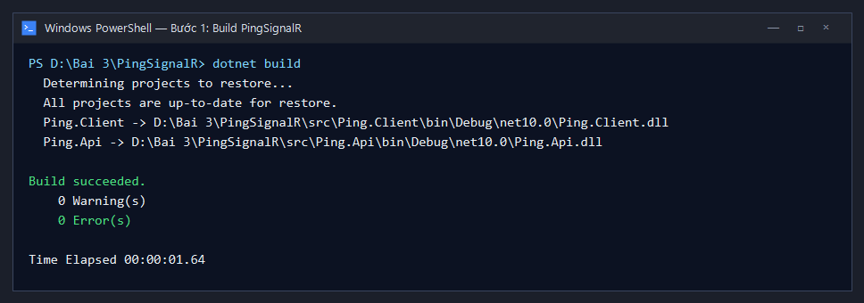
- **Thấy:** `dotnet build` báo `Build succeeded. 0 Warning(s), 0 Error(s)`. `Ping.Client.csproj` có `PackageReference Microsoft.AspNetCore.SignalR.Client` bản `10.0.15`.
- **Giải thích:** Máy chủ dùng ASP.NET Core đã tích hợp sẵn SignalR; chỉ máy khách console cần cài thêm gói `Microsoft.AspNetCore.SignalR.Client`.

### Bước 2: negotiate
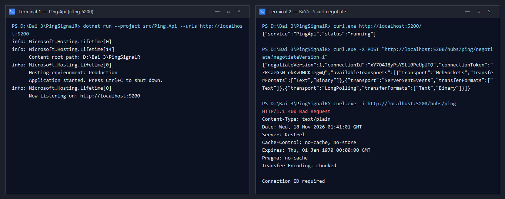
- **Thấy:** `curl.exe -X POST "http://localhost:5200/hubs/ping/negotiate?negotiateVersion=1"` trả về `connectionId` và danh sách `availableTransports` gồm `WebSockets`, `ServerSentEvents`, `LongPolling`.
- **Giải thích:** Máy chủ thực hiện bước bắt tay negotiate và báo các cơ chế truyền tải được hỗ trợ (ưu tiên WebSocket, dự phòng SSE và Long Polling).

### Bước 3–4: Echo (Clients.Caller)
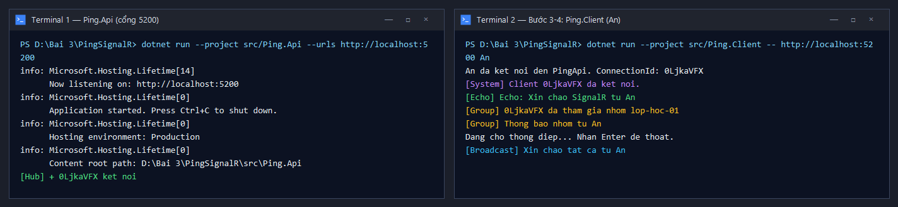
- **Thấy:** Máy chủ chạy ở cổng `5200`; máy khách `An` kết nối thành công và in `[Echo] Echo: Xin chao SignalR tu An`.
- **Giải thích:** Máy khách gọi `InvokeAsync("Echo", ...)` lên `PingHub`, máy chủ trả lời riêng người gọi qua `Clients.Caller.SendAsync("EchoResponse", ...)` và hàm `On<string>("EchoResponse", ...)` trên máy khách nhận và in ra.

### Bước 5: Broadcast (Clients.All) và nhóm (Clients.Group)
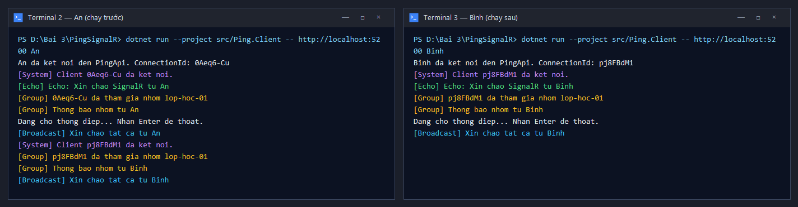
- **Thấy:** Mở 2 máy khách `An` (chạy trước) và `Binh` (chạy sau). Cửa sổ `An` nhận được `[Group]` và `[Broadcast]` của `Binh`, nhưng **không** nhận `[Echo]` của `Binh`.
- **Giải thích:** `Clients.Caller` chỉ trả lời riêng người gọi; `Clients.Group("lop-hoc-01")` gửi cho thành viên trong nhóm; `Clients.All` gửi cho mọi kết nối đang mở.

### Bước 6: Vòng đời kết nối và tự kết nối lại
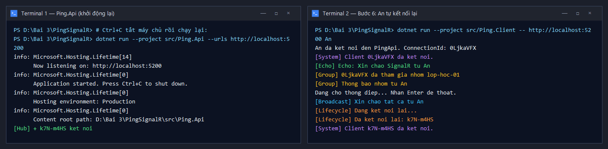
- **Thấy:** Khi dừng máy chủ (`Ctrl+C`) rồi chạy lại, máy khách in `[Lifecycle] Dang ket noi lai...` rồi `[Lifecycle] Da ket noi lai: <ConnectionId mới>`.
- **Giải thích:** `WithAutomaticReconnect()` tự động thử kết nối lại theo lịch mặc định 0s, 2s, 10s, 30s. Sau khi kết nối lại, máy chủ cấp `ConnectionId` mới (nhóm cũ bị mất nếu không gọi lại `JoinGroup`).

### Bước 7: Ba thí nghiệm lỗi trên PingSignalR

#### Lỗi 1: Máy chủ chưa chạy
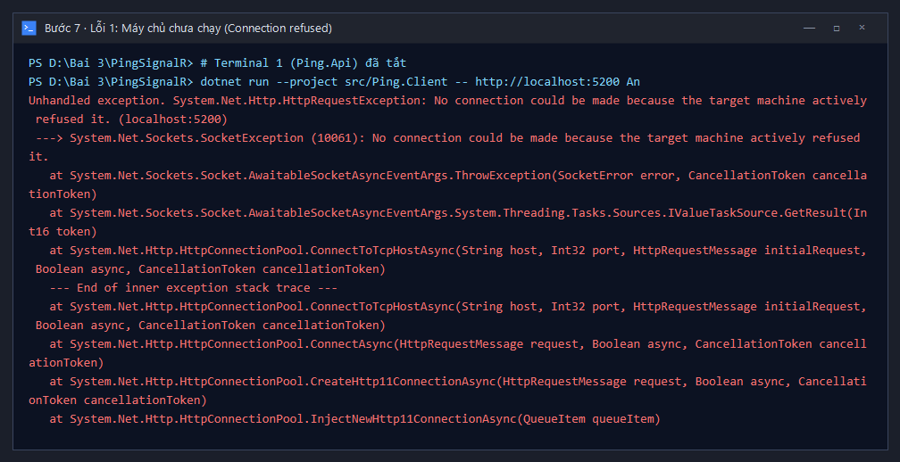
- **Làm gì:** Tắt Terminal 1 (máy chủ) rồi chạy `Ping.Client`.
- **Thấy gì:** `HttpRequestException: Connection refused (localhost:5200)`.
- **Giải thích:** `StartAsync()` ném lỗi ngay khi kết nối ban đầu thất bại; `WithAutomaticReconnect()` chỉ cứu các kết nối **đã mở** trước đó.

#### Lỗi 2: Sai đường dẫn hub
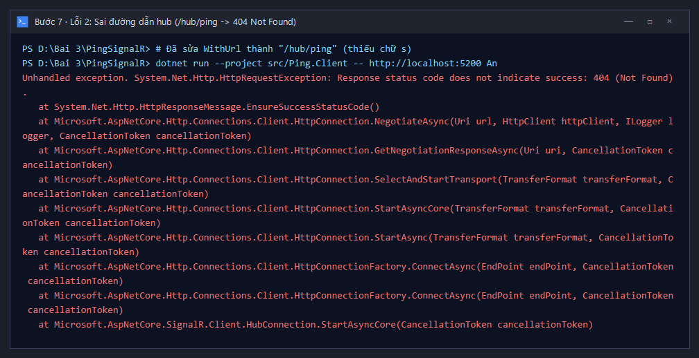
- **Làm gì:** Sửa `.WithUrl($"{serverUrl}/hubs/ping")` thành `/hub/ping` (thiếu chữ `s`).
- **Thấy gì:** `HttpRequestException: Response status code does not indicate success: 404 (Not Found)`.
- **Giải thích:** Lỗi xảy ra ngay ở bước bắt tay `negotiate` vì đường dẫn không khớp với `app.MapHub<PingHub>("/hubs/ping")`.

#### Lỗi 3: Sai tên thông điệp
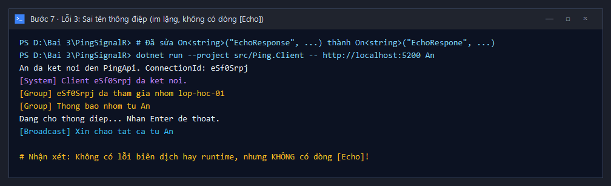
- **Làm gì:** Sửa `connection.On<string>("EchoResponse", ...)` thành `On<string>("EchoRespone", ...)` (thiếu chữ `s`).
- **Thấy gì:** Không có lỗi biên dịch, không có lỗi khi chạy, nhưng **không in dòng `[Echo]`**.
- **Giải thích:** Hợp đồng SignalR dựa trên tên chuỗi khớp chính xác từng chữ. Sai tên ở chiều máy chủ gửi xuống sẽ im lặng hoàn toàn.

> **So sánh sai tên ở 2 chiều (Slide 31):**
> - **Chiều lên (máy khách gọi hub):** Sửa `InvokeAsync("Echo", ...)` thành `InvokeAsync("Ech0", ...)` → ném ngay `HubException: Failed to invoke 'Ech0' due to an error on the server. Method does not exist.` Chương trình dừng, rất dễ phát hiện.
> - **Chiều xuống (hub gửi máy khách):** Sửa `On("EchoResponse", ...)` thành `On("EchoRespone", ...)` → **im lặng**, không báo lỗi biên dịch hay runtime, chỉ không nhận được tin.

---

## Phần 2: EduSubmit Realtime (`EduSubmitRealtime`)

### Thiết kế kênh thời gian thực — 4 câu hỏi (Slide 44–46)

| Câu hỏi | Thiết kế cho EduSubmit | Ánh xạ vào code |
|---|---|---|
| **① Sự kiện nào kích hoạt thông điệp?** | Mỗi lần trạng thái lượt nộp đổi: `received` → `processing` → `graded` (và `failed` ở Bài tập 2) | `UpdateStatusAsync(id, status, ...)` |
| **② Gửi cho ai?** | Chỉ máy khách đang theo dõi đúng lượt nộp đó (đảm bảo riêng tư & tiết kiệm băng thông) | `Clients.Group("submission:{id}")` qua `SubmissionGroups.ForSubmission(id)` |
| **③ Gửi kèm dữ liệu gì (tối thiểu)?** | Mã lượt nộp, trạng thái mới, thời điểm đổi gần nhất | `record SubmissionStatusMessage(Guid SubmissionId, string Status, DateTimeOffset UpdatedAt)` |
| **④ Mất kết nối thì lấy lại trạng thái thế nào?** | Gọi lại REST `GET /api/submissions/{id}` (REST là nguồn sự thật) | `http.GetFromJsonAsync<SubmissionDto>($"/api/submissions/{created.Id}")` |

### Ảnh chụp kiểm thử `requests.http` và máy khách EduSubmit
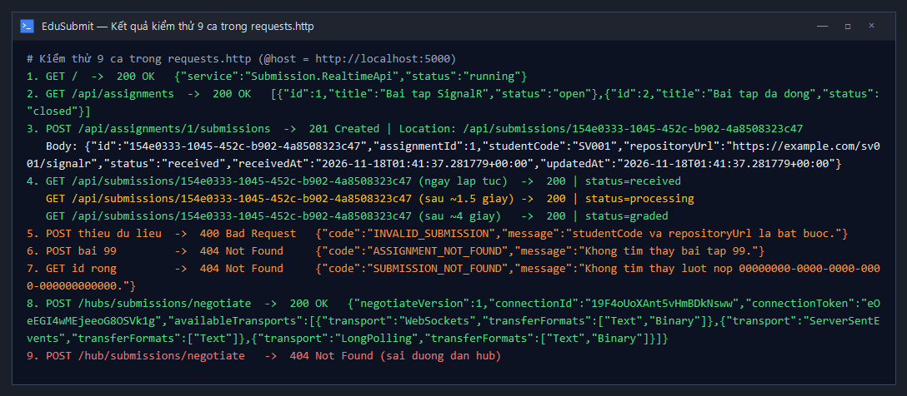
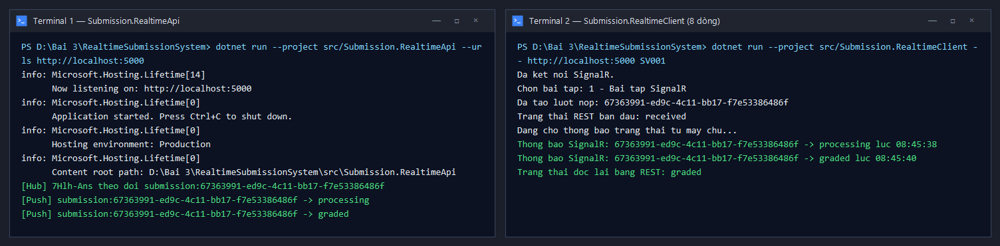

### Kết quả chạy máy khách EduSubmit (8 dòng)
```text
Da ket noi SignalR.
Chon bai tap: 1 - Bai tap SignalR
Da tao luot nop: 67363991-ed9c-4c11-bb17-f7e53386486f
Trang thai REST ban dau: received
Dang cho thong bao trang thai tu may chu...
Thong bao SignalR: 67363991-ed9c-4c11-bb17-f7e53386486f -> processing luc 08:45:38
Thong bao SignalR: 67363991-ed9c-4c11-bb17-f7e53386486f -> graded luc 08:45:40
Trang thai doc lai bang REST: graded
```

### Bảng 5 thí nghiệm Bước 7 (EduSubmit)

| # | Thí nghiệm | Dự đoán | Kết quả thật | Giải thích |
|---|------------|---------|--------------|------------|
| 1 | Chạy 2 máy khách `SV001` và `SV002` cùng lúc | Mỗi máy khách chỉ nhận thông báo của đúng lượt nộp mình tạo | Mỗi máy khách chỉ thấy lượt nộp vừa tạo của chính nó | Mỗi lượt nộp có nhóm riêng `submission:{id}`, máy chủ dùng `Clients.Group(...)` nên tách biệt người nhận. |
| 2 | Chạy máy khách khi máy chủ chưa chạy | Lỗi không kết nối được tới cổng `5000` | `HttpRequestException: Connection refused (localhost:5000)` | Lần kết nối đầu tiên (`StartAsync`) không được `WithAutomaticReconnect` tự thử lại. |
| 3 | Sửa `WithUrl` thành `/hub/submissions` | Trả về lỗi `404 Not Found` | `HttpRequestException: ... 404 (Not Found)` | Lỗi xảy ra ở bước `negotiate` do đường dẫn không khớp `MapHub<SubmissionHub>("/hubs/submissions")`. |
| 4 | Sửa `On("SubmissionStatusChanged")` thành `On("SubmissionStatusChange")` | Không báo lỗi nhưng không nhận được thông báo | Không lỗi; sau 10 giây in `Qua thoi gian cho thong bao graded.` rồi REST đọc lại là `graded` | Sai tên thông điệp chiều từ máy chủ xuống sẽ im lặng; hết timeout 10s máy khách đọc lại bằng REST vẫn thấy trạng thái đúng. |
| 5 | Chờ 4 giây rồi mới gọi `WatchSubmission` | Lỡ thông báo từ SignalR nhưng REST vẫn đọc được `graded` | Không nhận được tin SignalR nào; REST đọc lại: `graded` | Tác vụ chấm nền chạy xong sau 3 giây; vào nhóm muộn sẽ lỡ toàn bộ tin đã đẩy vì SignalR không lưu tin cũ. REST là nguồn sự thật. |

### Bài tập vận dụng 2 & 3 (`EduSubmitRealtime/LoiGiai/`, điểm cộng)
- **Bài tập 2 (trạng thái `failed`):** Máy chủ kiểm tra `RepositoryUrl` — nếu không bắt đầu bằng `https://` thì trạng thái cuối là `failed` thay vì `graded` (ảnh hưởng câu hỏi khung ① và ③). Máy khách nhận `failed` sẽ in cảnh báo màu đỏ (`ConsoleColor.Red`).
- **Bài tập 3 (theo dõi 2 lượt nộp cùng lúc):** Máy khách tạo 2 lượt nộp (`SV001` dùng `https://...` và `SV002` dùng `http://...`), gọi `WatchSubmission` cả 2 trên **cùng 1 kết nối SignalR**, dùng `ConcurrentDictionary<Guid, TaskCompletionSource<string>>` tách biệt theo `SubmissionId` và đối chiếu lại bằng REST.
- *(Thư mục `EduSubmitRealtime/LoiGiai/` để tách riêng ngoài `EduSubmitRealtime.slnx` theo hướng dẫn Slide 62 để không ảnh hưởng bài chính.)*

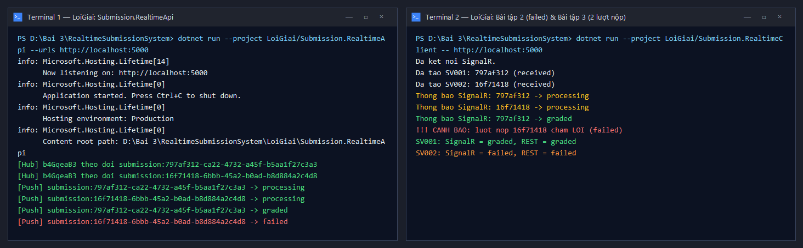

```text
Da ket noi SignalR.
Da tao SV001: 797af312 (received)
Da tao SV002: 16f71418 (received)
Thong bao SignalR: 797af312 -> processing
Thong bao SignalR: 16f71418 -> processing
Thong bao SignalR: 797af312 -> graded
!!! CANH BAO: luot nop 16f71418 cham LOI (failed)
SV001: SignalR = graded, REST = graded
SV002: SignalR = failed, REST = failed
```

---

## Phần 3: Trả lời 3 câu hỏi đầu giờ

1. **Máy chủ có thể chủ động báo cho máy khách mà không cần máy khách hỏi không?**
   - **Có**, nếu máy khách mở sẵn một kết nối lâu dài (WebSocket thông qua thư viện SignalR). Khi có sự kiện xảy ra trên máy chủ, máy chủ chủ động đẩy thông điệp về bằng `Clients.Group(...).SendAsync(...)` (hoặc qua `IHubContext<THub>` khi gửi từ bên ngoài Hub như endpoint REST hoặc tác vụ nền).

2. **Đã có REST rồi, vì sao còn cần thêm SignalR? Hai thứ chia việc thế nào?**
   - HTTP/REST chỉ hỗ trợ chiều máy khách hỏi – máy chủ trả lời; nếu dùng polling liên tục sẽ gây nhiều yêu cầu thừa hoặc độ trễ cao.
   - **Chia việc:** REST tạo và đọc tài nguyên với mã trạng thái rõ ràng (`200`, `201`, `400`, `404`), đóng vai trò **nguồn sự thật**. SignalR bổ sung chiều đẩy thời gian thực để báo các thay đổi phát sinh sau yêu cầu ban đầu (`processing` → `graded`). SignalR không thay thế REST.

3. **Nếu đứt mạng đúng lúc máy chủ báo "đã chấm xong" (`graded`) thì sao?**
   - Thông điệp đó bị **mất hẳn** vì SignalR không lưu trữ tin chờ gửi lại.
   - Khi có mạng trở lại, `WithAutomaticReconnect()` tự nối lại với `ConnectionId` mới (nhóm cũ không còn); máy khách cần đăng ký `WatchSubmission` lại và gọi **`GET /api/submissions/{id}`** qua REST để lấy trạng thái mới nhất. (*Push để nhanh, REST để chắc.*)

---

## Phần 4: Trả lời ngắn gọn câu hỏi ôn tập và thảo luận

### Ôn tập
- **Polling khác push:** Polling gửi nhiều yêu cầu định kỳ (đa số thừa, tốn băng thông và trễ theo chu kỳ); Push chỉ gửi khi có sự kiện nên không thừa yêu cầu và độ trễ thấp nhất.
- **Phân biệt 3 MEP:** Yêu cầu–phản hồi (client khởi tạo, 1 yêu cầu → 1 phản hồi); Đẩy dữ liệu/Push (server chủ động gửi khi có sự kiện, từng thông điệp lẻ); Truyền luồng/Streaming (1 hoặc 2 phía khởi tạo, chuỗi thông điệp liên tục).
- **WebSocket vs SignalR:** WebSocket là **giao thức** giữ kết nối hai chiều sau bắt tay HTTP; SignalR là **thư viện** cấp cao của ASP.NET Core xây trên WebSocket, hỗ trợ Hub, Group, tự kết nối lại và cơ chế dự phòng.
- **Cơ chế truyền tải dự phòng của SignalR:** Ưu tiên 1: `WebSockets` → ưu tiên 2: `Server-Sent Events (SSE)` → ưu tiên 3: `Long Polling`.
- **Vì sao tạo nhóm `submission:{id}`:** Đảm bảo **quyền riêng tư** (không lộ trạng thái bài của sinh viên khác) và **tiết kiệm băng thông** (chỉ gửi đúng người đang theo dõi).
- **`IHubContext`:** Cho phép đẩy thông điệp SignalR từ **bên ngoài lớp Hub** (ví dụ từ endpoint REST hoặc tác vụ chấm nền).
- **`On<T>`:** Đăng ký hàm lắng nghe tên thông điệp từ máy chủ. Nếu bỏ đi hoặc gõ sai tên, máy khách vẫn chạy bình thường nhưng sẽ không nhận được thông điệp (im lặng).
- **REST vs SignalR:** REST tạo/đọc tài nguyên chuẩn hóa mã lỗi; SignalR chỉ báo thay đổi. Không dùng SignalR tạo lượt nộp vì thiếu ngữ nghĩa HTTP chuẩn (URI, status code `201/400/404`, cache, idempotency).
- **`WithAutomaticReconnect`:** Tự động kết nối lại khi kết nối đã mở bị gián đoạn (mặc định sau 0s, 2s, 10s, 30s).
- **Mất kết nối đúng lúc báo `graded`:** Tin bị mất → sau khi nối lại phải gọi REST `GET /api/submissions/{id}` để đồng bộ trạng thái cuối.

### Thảo luận
- **Hàng trăm SV cùng theo dõi:** Nên dùng nhóm `submission:{id}` trên máy chủ thay vì phát `Clients.All` rồi client tự lọc, giúp giảm số thông điệp từ $O(N^2)$ xuống $O(N)$ và bảo vệ dữ liệu riêng tư.
- **2 tình huống polling hợp lý hơn SignalR:** (1) Dữ liệu ít thay đổi và chấp nhận độ trễ vài chục giây/vài phút (ví dụ tỷ giá, thời tiết, bảng xếp hạng cập nhật theo giờ); (2) Môi trường mạng/firewall/proxy chặn kết nối lâu dài (WebSocket).
- **Scale-out nhiều bản sao API:** Danh sách `Group` mặc định nằm trong bộ nhớ (in-memory) của từng máy chủ nên client nối vào máy chủ A sẽ không nhận tin đẩy từ máy chủ B. **Cách sửa:** Dùng **backplane** dùng chung như **Redis** (hoặc Azure SignalR Service) để đồng bộ thông điệp giữa các bản sao.
