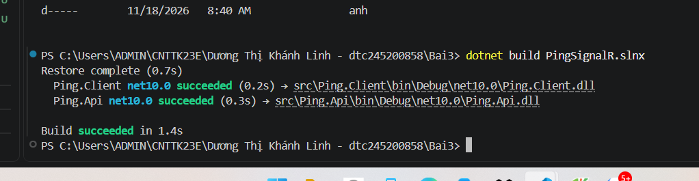
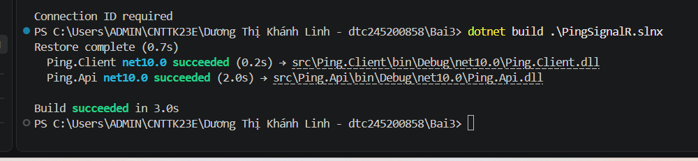
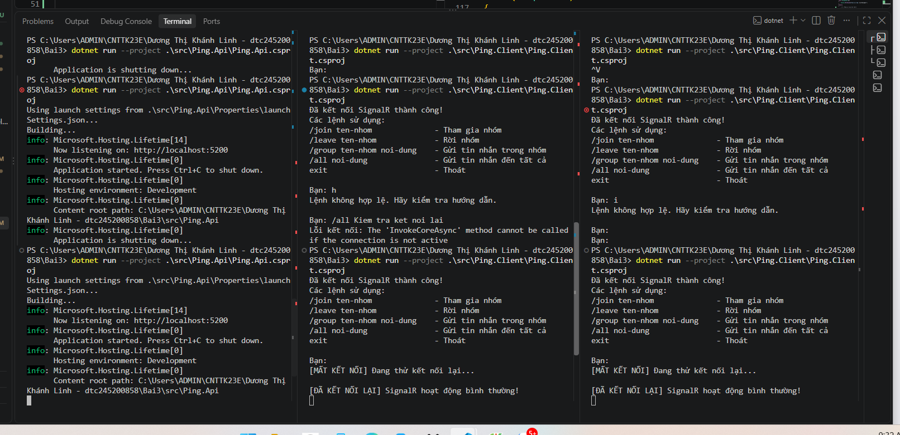
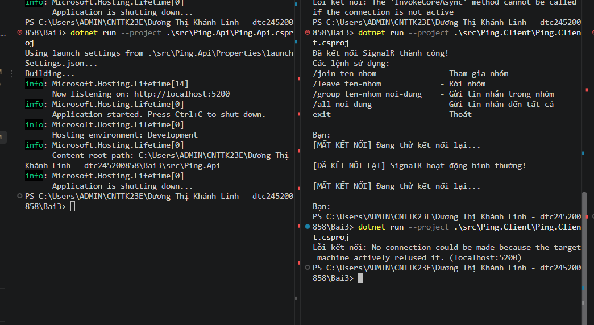
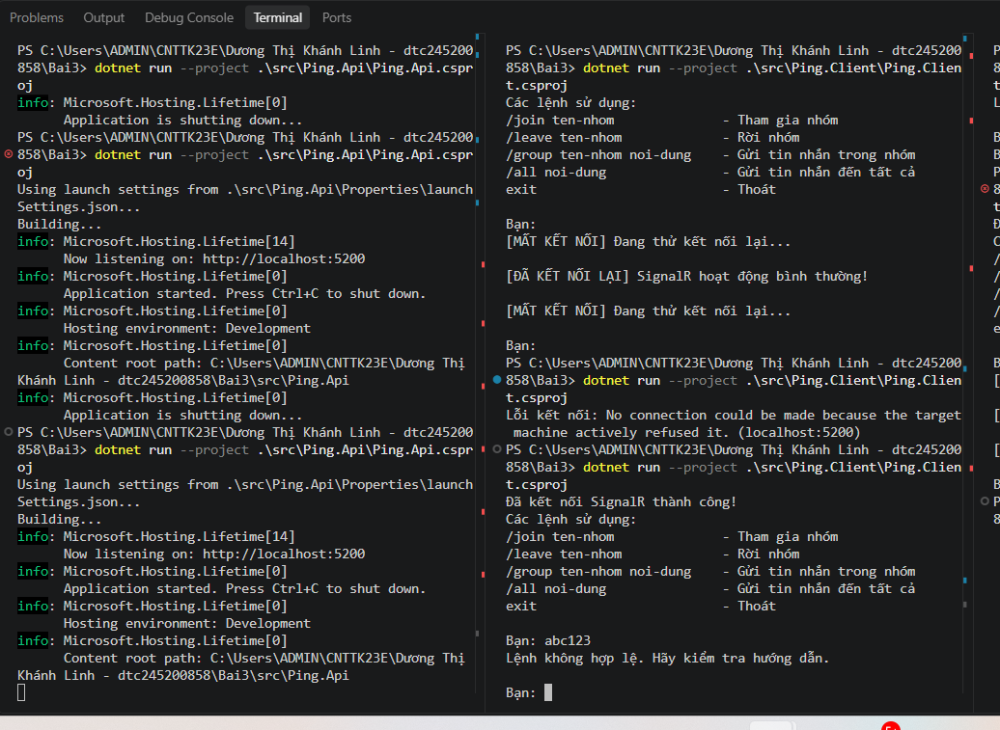
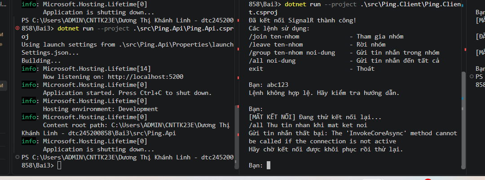

# BÀI 3 - XÂY DỰNG ỨNG DỤNG SIGNALR

## 1. Thông tin sinh viên

- **Họ và tên:** Dương Thị Khánh Linh
- **Mã sinh viên:** 245200858
- **Tên bài tập:** Xây dựng ứng dụng thời gian thực với SignalR.

## 2. PingSignalR

### Bước 1: Build solution

**Lệnh thực hiện:**

```powershell
dotnet build PingSignalR.slnx
```

**Kết quả:** Build succeeded, hai project `Ping.Api` và `Ping.Client` biên dịch thành công.

**Ảnh minh chứng:**


### Bước 2: Kiểm tra kết nối SignalR (Negotiation)

**Bước 1: Khởi động máy chủ API**

```powershell
dotnet run --project .\src\Ping.Api\Ping.Api.csproj
```

Máy chủ chạy tại địa chỉ `http://localhost:5200`.

**Bước 2: Kiểm tra API**

```powershell
curl.exe http://localhost:5200/
```

Kết quả: API phản hồi thông báo `Ping SignalR API is running!`.

**Bước 3: Kiểm tra quá trình Negotiation**

```powershell
curl.exe -X POST "http://localhost:5200/pingHub/negotiate?negotiateVersion=1"
```

Kết quả: Máy chủ trả về `connectionId`, `connectionToken` và danh sách `availableTransports`, bao gồm WebSockets, ServerSentEvents và LongPolling.

**Bước 4: Kiểm tra truy cập Hub trực tiếp**

```powershell
curl.exe -i http://localhost:5200/pingHub
```

Kết quả: Máy chủ có thể trả về `400 Bad Request` vì Hub SignalR cần thực hiện quy trình kết nối phù hợp, không hoạt động như một API REST thông thường.

**Ảnh minh chứng:**


### Bước 3: Xây dựng phương thức Echo

Trong file `src/Ping.Api/Program.cs`, bổ sung phương thức `Echo` vào lớp `PingHub`.

```csharp
public async Task Echo(string message)
{
    await Clients.Caller.SendAsync(
        "EchoResponse",
        $"Echo: {message}"
    );
}
```

**Giải thích:**

- `Echo(string message)`: Nhận nội dung tin nhắn từ máy khách.
- `Clients.Caller`: Chỉ gửi phản hồi đến máy khách vừa gọi phương thức.
- `SendAsync("EchoResponse", ...)`: Gửi thông điệp có tên `EchoResponse` về máy khách.

**Kết quả:** Phương thức Echo được bổ sung vào PingHub, giúp máy chủ phản hồi riêng máy khách gửi yêu cầu.

**Kiểm tra:** Build solution thành công, không có lỗi biên dịch.
**Kết quả build:**

```text
Ping.Client net10.0 succeeded
Ping.Api net10.0 succeeded

Build succeeded in 3.0s
```

**Ảnh minh chứng:**


### Bước 4: Kiểm thử chức năng Echo

**Mục tiêu:** Kiểm tra khả năng gửi yêu cầu từ Client đến Server và nhận phản hồi riêng từ Server.

**Thực hiện:**
1. Khởi động SignalR API tại `http://localhost:5200`.
2. Khởi động hai Client.
3. Tại Client 1, nhập lệnh `/echo Xin chao SignalR`.
4. Kiểm tra kết quả phản hồi từ Server.

**Kết quả:** Client 1 nhận được thông báo `Echo: Xin chao SignalR`. Client 2 không nhận thông báo này vì Server sử dụng `Clients.Caller` để phản hồi riêng cho Client gửi yêu cầu.

**Ảnh minh chứng:**


### Bước 5: Kiểm thử chức năng gửi tin nhắn nhóm

**Mục tiêu:** Kiểm tra khả năng cho Client tham gia nhóm và gửi tin nhắn đến các Client trong cùng nhóm.

**Thực hiện:**
1. Khởi động API và hai Client.
2. Tại Client 1, nhập `/join NhomA`.
3. Tại Client 2, nhập `/join NhomA`.
4. Tại Client 1, nhập `/group NhomA Xin chao nhom`.
5. Quan sát kết quả tại hai Client.

**Kết quả:** Hai Client cùng tham gia nhóm `NhomA` đều nhận được tin nhắn gửi đến nhóm.

**Ảnh minh chứng:**


### Bước 6: Kiểm thử khả năng kết nối lại

**Mục tiêu:** Kiểm tra khả năng tự động kết nối lại của Client khi máy chủ SignalR khởi động lại.

**Thực hiện:**
1. Khởi động API và hai Client.
2. Dừng API để tạo tình huống mất kết nối.
3. Khởi động lại API.
4. Quan sát thông báo trạng thái kết nối trên Client.

**Kết quả:** Client phát hiện mất kết nối và thực hiện kết nối lại khi máy chủ hoạt động trở lại.

**Ảnh minh chứng:**



### Bước 7: Kiểm thử các trường hợp lỗi

**Mục tiêu:** Kiểm tra cách ứng dụng xử lý các tình huống không hợp lệ hoặc mất kết nối.

**Các trường hợp kiểm thử:**

| Trường hợp | Kết quả mong đợi |
|---|---|
| API chưa chạy, khởi động Client | Client thông báo không thể kết nối |
| Nhập lệnh không hợp lệ | Client thông báo lệnh không hợp lệ |
| API dừng khi Client đang chạy | Client thông báo trạng thái mất kết nối |

**Kết quả:** Ứng dụng hiển thị thông báo phù hợp với các tình huống kiểm thử.

**Ảnh minh chứng:**

- **API chưa chạy:**



- **Lệnh không hợp lệ:**



- **Mất kết nối khi đang sử dụng:**


## 3. Kết luận

Sau khi hoàn thành bài tập, em đã xây dựng và kiểm thử thành công ứng dụng thời gian thực sử dụng SignalR với hai thành phần `Ping.Api` và `Ping.Client`.

Các chức năng đã thực hiện:
- Thiết lập kết nối giữa Client và Server thông qua SignalR Hub.
- Kiểm tra quá trình Negotiation.
- Xây dựng chức năng Echo, phản hồi riêng cho Client gửi yêu cầu.
- Gửi tin nhắn đến các Client trong cùng một nhóm.
- Hỗ trợ tự động kết nối lại khi mất kết nối.
- Xử lý và kiểm thử các trường hợp lỗi.

**Kết quả:** Hai project biên dịch thành công và các chức năng chính đã được kiểm thử. Qua bài tập, em hiểu rõ hơn về giao tiếp thời gian thực giữa Client và Server bằng SignalR trong .NET.