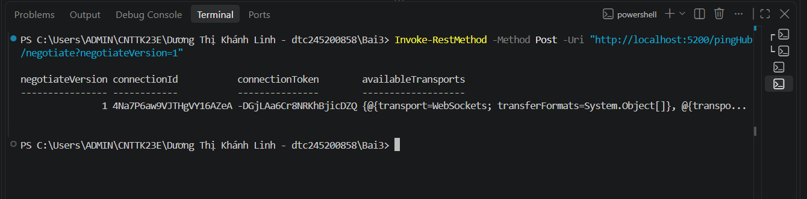

# BÀI 3 - XÂY DỰNG ỨNG DỤNG SIGNALR

## 1. Thông tin sinh viên

- **Họ và tên:** Dương Thị Khánh Linh
- **Mã sinh viên:** 245200858
- **Tên bài tập:** Xây dựng ứng dụng thời gian thực với SignalR.

## 2. PingSignalR

### Bước 1: Build solution

**Lệnh thực hiện:**

```powershell
dotnet build PingSignalR.slnx
```

**Kết quả:** Build succeeded, hai project `Ping.Api` và `Ping.Client` biên dịch thành công.

**Ảnh minh chứng:**


### Bước 2: Kiểm tra kết nối SignalR (Negotiation)

**Bước 1: Khởi động máy chủ API**

```powershell
dotnet run --project .\src\Ping.Api\Ping.Api.csproj
```

Máy chủ chạy tại địa chỉ `http://localhost:5200`.

**Bước 2: Kiểm tra API**

```powershell
curl.exe http://localhost:5200/
```

Kết quả: API phản hồi thông báo `Ping SignalR API is running!`.

**Bước 3: Kiểm tra quá trình Negotiation**

```powershell
curl.exe -X POST "http://localhost:5200/pingHub/negotiate?negotiateVersion=1"
```

Kết quả: Máy chủ trả về `connectionId`, `connectionToken` và danh sách `availableTransports`, bao gồm WebSockets, ServerSentEvents và LongPolling.

**Bước 4: Kiểm tra truy cập Hub trực tiếp**

```powershell
curl.exe -i http://localhost:5200/pingHub
```

Kết quả: Máy chủ có thể trả về `400 Bad Request` vì Hub SignalR cần thực hiện quy trình kết nối phù hợp, không hoạt động như một API REST thông thường.

**Ảnh minh chứng:**


### Bước 3: Xây dựng phương thức Echo

Trong file `src/Ping.Api/Program.cs`, bổ sung phương thức `Echo` vào lớp `PingHub`.

```csharp
public async Task Echo(string message)
{
    await Clients.Caller.SendAsync(
        "EchoResponse",
        $"Echo: {message}"
    );
}
```

**Giải thích:**

- `Echo(string message)`: Nhận nội dung tin nhắn từ máy khách.
- `Clients.Caller`: Chỉ gửi phản hồi đến máy khách vừa gọi phương thức.
- `SendAsync("EchoResponse", ...)`: Gửi thông điệp có tên `EchoResponse` về máy khách.

**Kết quả:** Phương thức Echo được bổ sung vào PingHub, giúp máy chủ phản hồi riêng máy khách gửi yêu cầu.

**Kiểm tra:** Build solution thành công, không có lỗi biên dịch.
**Kết quả build:**

```text
Ping.Client net10.0 succeeded
Ping.Api net10.0 succeeded

Build succeeded in 3.0s
```

**Ảnh minh chứng:**


### Bước 4: Kiểm thử chức năng Echo

**Mục tiêu:** Kiểm tra khả năng gửi yêu cầu từ Client đến Server và nhận phản hồi riêng từ Server.

**Thực hiện:**
1. Khởi động SignalR API tại `http://localhost:5200`.
2. Khởi động hai Client.
3. Tại Client 1, nhập lệnh `/echo Xin chao SignalR`.
4. Kiểm tra kết quả phản hồi từ Server.

**Kết quả:** Client 1 nhận được thông báo `Echo: Xin chao SignalR`. Client 2 không nhận thông báo này vì Server sử dụng `Clients.Caller` để phản hồi riêng cho Client gửi yêu cầu.

**Minh chứng:** 