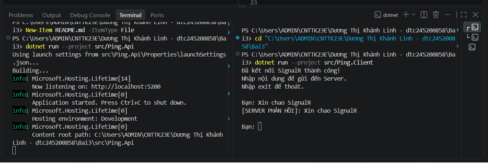
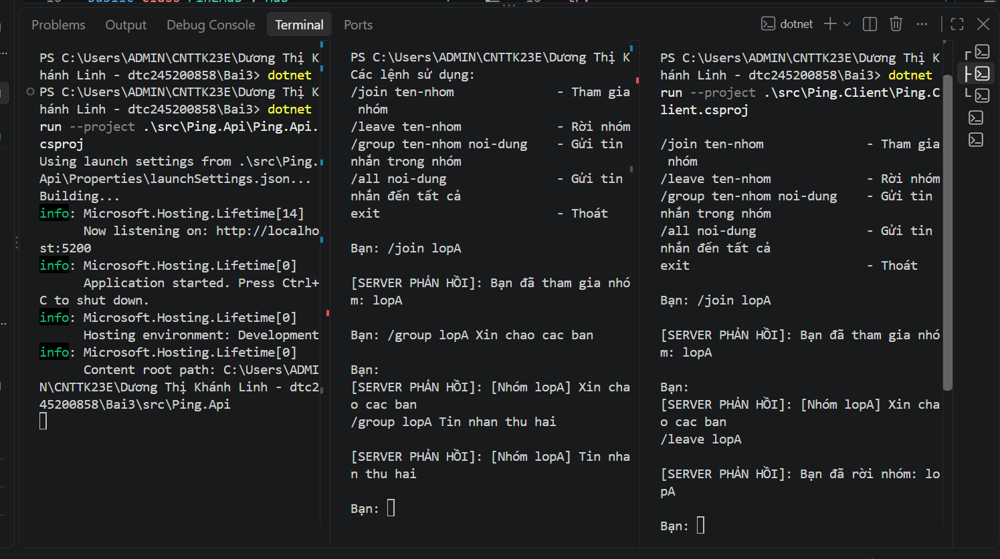

# BÀI 3 - XÂY DỰNG ỨNG DỤNG SIGNALR

## 1. Thông tin sinh viên

- **Họ và tên:** Dương Thị Khánh Linh
- **Mã sinh viên:** 245200858
- **Tên bài tập:** Xây dựng ứng dụng thời gian thực với SignalR.

## 2. PingSignalR

### Bước 1: Build solution

**Lệnh thực hiện:**

```powershell
dotnet build .\PingSignalR\PingSignalR.slnx
```

**Kết quả:** Build succeeded, hai project `Ping.Api` và `Ping.Client` biên dịch thành công.

**Ảnh minh chứng:**


### Bước 2: Kiểm tra kết nối SignalR (Negotiation)

**Bước 1: Khởi động máy chủ API**

```powershell
dotnet run --project .\PingSignalR\src\Ping.Api\Ping.Api.csproj
```

Máy chủ chạy tại địa chỉ `http://localhost:5200`.

**Bước 2: Kiểm tra API**

```powershell
curl.exe http://localhost:5200/
```

Kết quả: API phản hồi thông báo `Ping SignalR API is running!`.

**Bước 3: Kiểm tra quá trình Negotiation**

```powershell
curl.exe -X POST "http://localhost:5200/hubs/ping/negotiate?negotiateVersion=1"
```

Kết quả: Máy chủ trả về `connectionId`, `connectionToken` và danh sách `availableTransports`, bao gồm WebSockets, ServerSentEvents và LongPolling.

**Bước 4: Kiểm tra truy cập Hub trực tiếp**

```powershell
curl.exe -i http://localhost:5200/hubs/ping
```

Kết quả: Máy chủ có thể trả về `400 Bad Request` vì Hub SignalR cần thực hiện quy trình kết nối phù hợp, không hoạt động như một API REST thông thường.

**Ảnh minh chứng:**


### Bước 3: Xây dựng phương thức Echo

Trong file `PingSignalR/src/Ping.Api/Program.cs`, bổ sung phương thức `Echo` vào lớp `PingHub`.

```csharp
public async Task Echo(string message)
{
    await Clients.Caller.SendAsync(
        "EchoResponse",
        $"Echo: {message}"
    );
}
```

**Giải thích:**

- `Echo(string message)`: Nhận nội dung tin nhắn từ máy khách.
- `Clients.Caller`: Chỉ gửi phản hồi đến máy khách vừa gọi phương thức.
- `SendAsync("EchoResponse", ...)`: Gửi thông điệp có tên `EchoResponse` về máy khách.

**Kết quả:** Phương thức Echo được bổ sung vào PingHub, giúp máy chủ phản hồi riêng máy khách gửi yêu cầu.

**Kiểm tra:** Build solution thành công, không có lỗi biên dịch.
**Kết quả build:**

```text
Ping.Client net10.0 succeeded
Ping.Api net10.0 succeeded

Build succeeded in 3.0s
```

**Ảnh minh chứng:**


### Bước 4: Kiểm thử chức năng Echo

**Mục tiêu:** Kiểm tra khả năng gửi yêu cầu từ Client đến Server và nhận phản hồi riêng từ Server.

**Thực hiện:**
1. Khởi động SignalR API tại `http://localhost:5200`.
2. Khởi động hai Client.
3. Tại Client 1, nhập lệnh `/echo Xin chao SignalR`.
4. Kiểm tra kết quả phản hồi từ Server.

**Kết quả:** Client 1 nhận được thông báo `Echo: Xin chao SignalR`. Client 2 không nhận thông báo này vì Server sử dụng `Clients.Caller` để phản hồi riêng cho Client gửi yêu cầu.

**Ảnh minh chứng:**


### Bước 5: Kiểm thử chức năng gửi tin nhắn nhóm

**Mục tiêu:** Kiểm tra khả năng cho Client tham gia nhóm và gửi tin nhắn đến các Client trong cùng nhóm.

**Thực hiện:**
1. Khởi động API và hai Client.
2. Tại Client 1, nhập `/join NhomA`.
3. Tại Client 2, nhập `/join NhomA`.
4. Tại Client 1, nhập `/group NhomA Xin chao nhom`.
5. Quan sát kết quả tại hai Client.

**Kết quả:** Hai Client cùng tham gia nhóm `NhomA` đều nhận được tin nhắn gửi đến nhóm.

**Ảnh minh chứng:**



### Bước 6: Kiểm thử khả năng kết nối lại

**Mục tiêu:** Kiểm tra khả năng tự động kết nối lại của Client khi máy chủ SignalR khởi động lại.

**Thực hiện:**
1. Khởi động API và hai Client.
2. Dừng API để tạo tình huống mất kết nối.
3. Khởi động lại API.
4. Quan sát thông báo trạng thái kết nối trên Client.

**Kết quả:** Client phát hiện mất kết nối và thực hiện kết nối lại khi máy chủ hoạt động trở lại.

**Ảnh minh chứng:**


### Bước 7: Kiểm thử các trường hợp lỗi

**Mục tiêu:** Kiểm tra cách ứng dụng xử lý các tình huống không hợp lệ hoặc mất kết nối.

**Các trường hợp kiểm thử:**

| Trường hợp | Kết quả mong đợi |
|---|---|
| API chưa chạy, khởi động Client | Client thông báo không thể kết nối |
| Nhập lệnh không hợp lệ | Client thông báo lệnh không hợp lệ |
| API dừng khi Client đang chạy | Client thông báo trạng thái mất kết nối |

**Kết quả:** Ứng dụng hiển thị thông báo phù hợp với các tình huống kiểm thử.

**Ảnh minh chứng:**

- **API chưa chạy:**


- **Lệnh không hợp lệ:**


- **Mất kết nối khi đang sử dụng:**


## 3. Kết luận

Sau khi hoàn thành bài tập, em đã xây dựng và kiểm thử thành công ứng dụng thời gian thực sử dụng SignalR với hai thành phần `Ping.Api` và `Ping.Client`.

Các chức năng đã thực hiện:
- Thiết lập kết nối giữa Client và Server thông qua SignalR Hub.
- Kiểm tra quá trình Negotiation.
- Xây dựng chức năng Echo, phản hồi riêng cho Client gửi yêu cầu.
- Gửi tin nhắn đến các Client trong cùng một nhóm.
- Hỗ trợ tự động kết nối lại khi mất kết nối.
- Xử lý và kiểm thử các trường hợp lỗi.

**Kết quả:** Hai project biên dịch thành công và các chức năng chính đã được kiểm thử. Qua bài tập, em hiểu rõ hơn về giao tiếp thời gian thực giữa Client và Server bằng SignalR trong .NET.

# PHẦN 2 - EDUSUBMIT REALTIME

## 1. Mục tiêu

Xây dựng ứng dụng tiếp nhận bài nộp và thông báo trạng thái chấm bài theo thời gian thực bằng SignalR.

## 2. Công nghệ sử dụng

- .NET 10
- ASP.NET Core Minimal API
- SignalR
- HttpClient
- REST API
- Visual Studio Code
- Git

## 3. Cấu trúc dự án

RealtimeSubmissionSystem/
├── RealtimeSubmissionSystem.slnx
├── requests.http
├── anh/
└── src/
    ├── Submission.RealtimeApi/
    └── Submission.RealtimeClient/

## 4. Các chức năng

- GET /api/assignments: Lấy danh sách bài tập.
- POST /api/assignments/{assignmentId}/submissions: Gửi bài nộp.
- GET /api/submissions/{id}: Tra cứu bài nộp.
- GET /api/submissions: Xem danh sách bài nộp.
- SignalR Hub: /hubs/submissions.
- WatchSubmission(id): Theo dõi một bài nộp.
- SubmissionStatusChanged: Nhận thông báo trạng thái.

## 5. Quy trình xử lý

1. Client lấy danh sách bài tập bằng REST API.
2. Client kết nối SignalR Hub.
3. Client gửi bài nộp bằng POST.
4. API lưu bài nộp với trạng thái received và trả HTTP 201.
5. Client gọi WatchSubmission(id).
6. API chuyển trạng thái sang processing.
7. API chuyển trạng thái sang graded.
8. SignalR gửi thông báo đến đúng nhóm theo dõi bài nộp.
9. Client gọi REST API để lấy trạng thái cuối cùng.

Các trạng thái:

- received: Đã tiếp nhận.
- processing: Đang xử lý.
- graded: Đã chấm xong.

## 6. Kiểm thử REST API

Các trường hợp đã thực hiện trong requests.http:

| STT | Trường hợp | Kết quả |
|---|---|---|
| 1 | GET trang chủ | 200 |
| 2 | GET danh sách bài tập | 200 |
| 3 | POST bài nộp hợp lệ | 201 |
| 4 | Thiếu StudentCode | 400 |
| 5 | Thiếu RepositoryUrl | 400 |
| 6 | Assignment không tồn tại | 404 |
| 7 | Submission không tồn tại | 404 |
| 8 | SignalR negotiate đúng | 200 |
| 9 | SignalR negotiate sai đường dẫn | 404 |

## 7. Kiểm thử SignalR

Đã chạy hai Client đồng thời:

- Client 1 sử dụng mã sinh viên SV001.
- Client 2 sử dụng mã sinh viên SV002.

Kết quả: Hai Client nhận được thông báo trạng thái bài nộp tương ứng. Mỗi Client chỉ nhận thông báo của bài nộp mình theo dõi.

Các trạng thái nhận được:
received → processing → graded.

## 8. Trả lời câu hỏi lý thuyết

### Câu 1. Server có thể chủ động thông báo cho Client không?

Có. SignalR duy trì kết nối hai chiều giữa Server và Client. Server có thể chủ động gửi thông báo đến Client thông qua Clients.Group(...).SendAsync(...).

Khi cần gửi thông báo từ bên ngoài Hub, có thể sử dụng IHubContext.

### Câu 2. REST API và SignalR khác nhau như thế nào? SignalR có thay thế REST API không?

REST API xử lý các yêu cầu HTTP theo mô hình Request-Response, phù hợp với việc tạo, đọc và cập nhật tài nguyên.

SignalR hỗ trợ giao tiếp thời gian thực, cho phép Server chủ động gửi dữ liệu đến Client khi có thay đổi.

SignalR không thay thế REST API mà bổ sung cho REST API.

### Câu 3. Nếu Client mất kết nối khi Server gửi thông báo graded thì sao?

Client có thể bỏ lỡ thông báo khi mất kết nối. Khi kết nối lại, SignalR có thể tạo ConnectionId mới nên Client cần đăng ký lại nhóm theo dõi bằng WatchSubmission(id).

Sau đó Client gọi GET /api/submissions/{id} để lấy trạng thái mới nhất từ Server.
## 9. NĂM THÍ NGHIỆM KIỂM CHỨNG

### Thí nghiệm 1: Gửi bài nộp hợp lệ

- **Dự đoán:** Khi gửi bài nộp với mã sinh viên và đường dẫn repository hợp lệ, API trả về HTTP 201 Created và trạng thái ban đầu là `received`.
- **Kết quả thực tế:** API trả về HTTP 201 Created, tạo bài nộp thành công với trạng thái `received`.
- **Giải thích:** Máy chủ tiếp nhận dữ liệu, tạo mã định danh cho bài nộp và lưu thông tin vào danh sách quản lý.

### Thí nghiệm 2: Gửi bài nộp thiếu thông tin

- **Dự đoán:** Nếu thiếu `StudentCode` hoặc `RepositoryUrl`, API trả về HTTP 400 Bad Request.
- **Kết quả thực tế:** Các trường hợp gửi thiếu thông tin được kiểm thử và trả về HTTP 400.
- **Giải thích:** API thực hiện kiểm tra dữ liệu đầu vào trước khi tạo bài nộp, tránh tiếp nhận dữ liệu không hợp lệ.

### Thí nghiệm 3: Gửi bài nộp với mã bài tập không tồn tại

- **Dự đoán:** Khi gửi bài cho assignment không tồn tại, API trả về HTTP 404 Not Found.
- **Kết quả thực tế:** Gửi bài với mã assignment 999 trả về HTTP 404.
- **Giải thích:** Máy chủ kiểm tra sự tồn tại của bài tập trước khi tiếp nhận bài nộp.

### Thí nghiệm 4: Hai Client theo dõi hai bài nộp khác nhau

- **Dự đoán:** Hai Client theo dõi hai bài nộp khác nhau sẽ chỉ nhận thông báo trạng thái thuộc bài nộp mà mình đăng ký theo dõi.
- **Kết quả thực tế:** Hai Client sử dụng mã sinh viên SV001 và SV002 đã nhận thông báo riêng cho bài nộp tương ứng.
- **Giải thích:** SignalR sử dụng Group theo mã bài nộp (`submission:{id}`), vì vậy thông báo được gửi đúng nhóm Client đã đăng ký.

### Thí nghiệm 5: Lấy trạng thái bài nộp sau khi xử lý

- **Dự đoán:** Sau khi hệ thống hoàn tất quá trình chấm bài, gọi GET `/api/submissions/{id}` sẽ trả về trạng thái cuối cùng là `graded`.
- **Kết quả thực tế:** Bài nộp ban đầu có trạng thái `received`. Sau 5 giây, gọi GET theo ID bài nộp và nhận được trạng thái `graded`.
- **Giải thích:** Quá trình xử lý diễn ra bất đồng bộ. Trạng thái được cập nhật trên máy chủ trước khi gửi thông báo SignalR. REST API vẫn có thể truy vấn trạng thái cuối cùng.


## 10. Kết luận

Qua bài tập, em đã xây dựng được ứng dụng sử dụng SignalR để gửi thông báo trạng thái bài nộp theo thời gian thực.

Em hiểu được cách kết hợp REST API và SignalR, cách sử dụng Hub, Group, IHubContext và cách xử lý khi Client mất kết nối.
