# Bài 3: Giao tiếp thời gian thực với SignalR (`PingSignalR` & `EduSubmit realtime`)

Môn học: **Phát triển ứng dụng phân tán**  
Thư mục bài làm: `E:\Bai3`

---

## 1. Cấu trúc thư mục và hướng dẫn chạy

```text
Bai3/
├── .gitignore
├── README.md
├── anh/
│   ├── buoc1-build.png
│   ├── buoc2-negotiate.png
│   ├── buoc4-echo.png
│   ├── buoc5-nhom.png
│   ├── buoc6-noilai.png
│   ├── buoc7-loi1.png
│   ├── buoc7-loi2.png
│   ├── buoc7-loi3.png
│   ├── edusubmit-requests.png
│   ├── edusubmit-client.png
│   ├── edusubmit-th7-2clients.png
│   └── edusubmit-bt2-bt3.png
├── PingSignalR/
│   ├── .gitignore
│   ├── PingSignalR.slnx
│   └── src/
│       ├── Ping.Api/        (máy chủ SignalR, cổng cố định 5200, hub /hubs/ping)
│       └── Ping.Client/     (máy khách console, thoát khi nhấn Enter)
└── RealtimeSubmissionSystem/
    ├── .gitignore
    ├── RealtimeSubmissionSystem.slnx
    ├── requests.http        (đủ 9 ca chính + 3 ca bổ sung cho bài đóng & Bài tập 2)
    └── src/
        ├── Submission.RealtimeApi/    (REST + SignalR, cổng cố định 5000, hub /hubs/submissions)
        └── Submission.RealtimeClient/ (máy khách REST + SignalR, tự thoát sau khi nhận graded)
```

### Lệnh biên dịch và chạy nhanh

```powershell
# 1. Build cả 2 solution (4 project, 0 Error)
dotnet build PingSignalR/PingSignalR.slnx
dotnet build RealtimeSubmissionSystem/RealtimeSubmissionSystem.slnx

# 2. Chạy PingSignalR (cổng 5200)
# Terminal 1:
dotnet run --project PingSignalR/src/Ping.Api --urls http://localhost:5200
# Terminal 2 & 3:
dotnet run --project PingSignalR/src/Ping.Client -- http://localhost:5200 An
dotnet run --project PingSignalR/src/Ping.Client -- http://localhost:5200 Binh

# 3. Chạy EduSubmit realtime (cổng 5000)
# Terminal 1:
dotnet run --project RealtimeSubmissionSystem/src/Submission.RealtimeApi --urls http://localhost:5000
# Terminal 2 (luồng chuẩn 1 lượt nộp - tự thoát sau khi nhận graded):
dotnet run --project RealtimeSubmissionSystem/src/Submission.RealtimeClient -- http://localhost:5000 SV001
# Terminal 2 (Bài tập 2 & 3 - theo dõi 2 lượt nộp cùng lúc, gồm 1 lượt graded và 1 lượt failed):
dotnet run --project RealtimeSubmissionSystem/src/Submission.RealtimeClient -- http://localhost:5000 SV001 --multi
```

---

## 2. Trả lời 3 câu hỏi đầu giờ

### Câu 1: Máy chủ có thể chủ động báo cho máy khách mà không cần máy khách hỏi không?
**Có**, với điều kiện máy khách mở sẵn một kết nối lâu dài, hai chiều tới máy chủ (giao thức WebSocket thông qua thư viện SignalR, có cơ chế dự phòng Server-Sent Events và Long Polling). Khi có sự kiện xảy ra trên máy chủ, máy chủ chủ động đẩy thông điệp xuống bằng `Clients.Group(...).SendAsync(...)` (trong Hub) hoặc thông qua `IHubContext<THub>` khi đẩy từ bên ngoài Hub (như endpoint REST hoặc tác vụ chấm nền).

### Câu 2: Đã có REST rồi, vì sao còn cần thêm SignalR? Hai thứ chia việc thế nào?
HTTP REST hoạt động theo mô hình yêu cầu–phản hồi (chỉ máy khách hỏi, máy chủ mới trả lời). Nếu dùng REST để biết khi nào bài chấm xong thì phải tải lại thủ công (F5) hoặc thăm dò định kỳ (polling) gây tốn băng thông (nhiều yêu cầu thừa) hoặc độ trễ cao. Vì vậy cần thêm **SignalR** để bổ sung chiều máy chủ chủ động đẩy tin khi trạng thái thay đổi.  
Hai cơ chế chia việc rõ ràng, **SignalR không thay thế REST**:
- **REST**: Tạo tài nguyên (`POST /api/assignments/{id}/submissions` với mã trạng thái rõ ràng `201`, `400`, `404`) và đọc trạng thái hiện tại (`GET /api/submissions/{id}`) — đóng vai trò **nguồn sự thật (source of truth)**.
- **SignalR**: Đăng ký theo dõi đúng lượt nộp (`WatchSubmission(id)` vào nhóm `submission:{id}`) và đẩy các thay đổi phát sinh sau yêu cầu ban đầu (`processing`, `graded` / `failed`) về máy khách tức thì.

### Câu 3: Nếu đứt mạng đúng lúc máy chủ báo `"đã chấm xong"` (`graded`) thì sao?
Thông điệp đẩy qua SignalR tại thời điểm đứt mạng sẽ **bị mất hẳn**, vì SignalR không lưu hàng đợi thông điệp để gửi lại cho kết nối đã rớt. Khi mạng có lại, `WithAutomaticReconnect()` sẽ tự động nối lại theo lịch mặc định (`0s, 2s, 10s, 30s`) với một **`ConnectionId` mới** (nên cũng mất tư cách thành viên nhóm cũ). Để không mất trạng thái cuối, máy khách cần **gọi lại `WatchSubmission(id)`** trong sự kiện `Reconnected` và áp dụng **quy tắc vàng**: gọi lại REST `GET /api/submissions/{id}` để đồng bộ trạng thái chính xác nhất từ máy chủ (**Push để nhanh, REST để chắc**).

---

## 3. Nhật ký thực hành Phần 2: `PingSignalR` (Bước 1–7)

### Bước 1: Tạo solution, 2 project, thêm gói `Microsoft.AspNetCore.SignalR.Client` và build
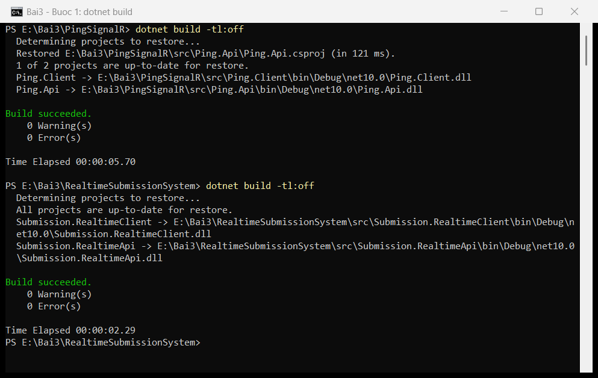
- **Thấy**: Cả hai solution `PingSignalR` (`Ping.Api`, `Ping.Client`) và `RealtimeSubmissionSystem` (`Submission.RealtimeApi`, `Submission.RealtimeClient`) biên dịch thành công: `Build succeeded. 0 Warning(s), 0 Error(s)`.
- **Giải thích**: Máy chủ ASP.NET Core đã tích hợp sẵn SignalR trong `Microsoft.AspNetCore.App`, chỉ máy khách console cần thêm gói NuGet `Microsoft.AspNetCore.SignalR.Client` phiên bản `10.0.15`.

### Bước 2: Máy chủ `AddSignalR` + `MapHub("/hubs/ping")` và kiểm tra `negotiate`
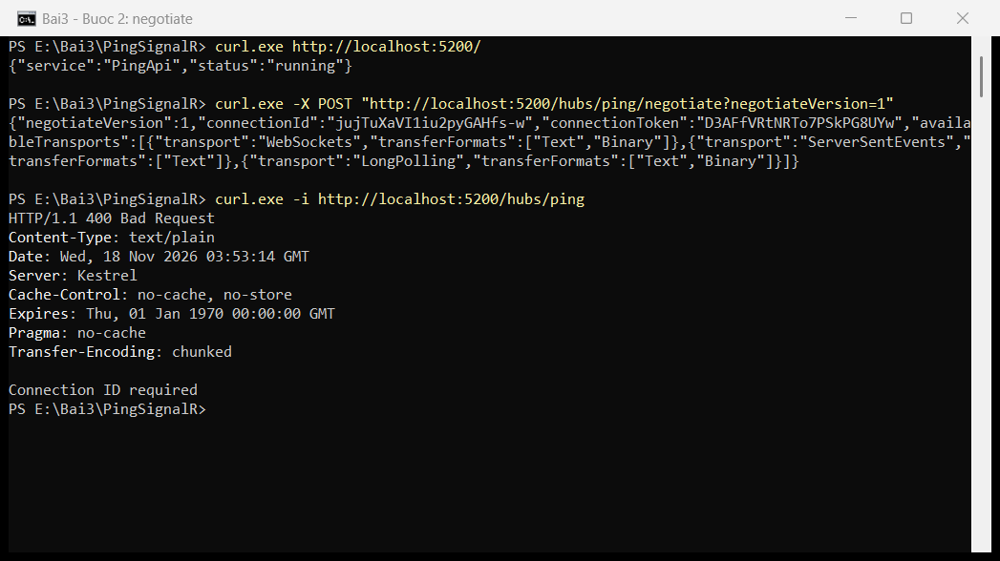
- **Thấy**: `GET /` trả về `{"service":"PingApi","status":"running"}`; `POST /hubs/ping/negotiate?negotiateVersion=1` trả về `connectionId`, `connectionToken` và đủ 3 cơ chế `WebSockets`, `ServerSentEvents`, `LongPolling`; `GET /hubs/ping` trả `400 Bad Request - Connection ID required`.
- **Giải thích**: Endpoint REST và SignalR Hub chạy song song trên cùng cổng `5200`. Bước bắt tay `negotiate` giúp máy khách nhận `connectionId` và thương lượng cơ chế truyền tải ưu tiên (WebSocket trước tiên).

### Bước 3–4: Phương thức `Echo` (`Clients.Caller`) và máy khách `HubConnection`
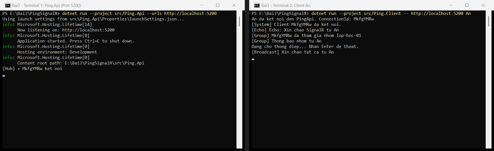
- **Thấy**: Terminal 1 (`Ping.Api`) in `[Hub] + MkfgYMRw ket noi`; Terminal 2 (`An`) kết nối thành công và in `[Echo] Echo: Xin chao SignalR tu An`.
- **Giải thích**: Máy khách đăng ký `On<string>("EchoResponse", ...)` trước `StartAsync()`, rồi gọi `InvokeAsync("Echo", ...)`. Hub trả lời riêng người gọi qua `Clients.Caller.SendAsync("EchoResponse", ...)`.

### Bước 5: Phát rộng (`Clients.All`) và nhóm (`Clients.Group`) giữa 2 máy khách `An` và `Bình`
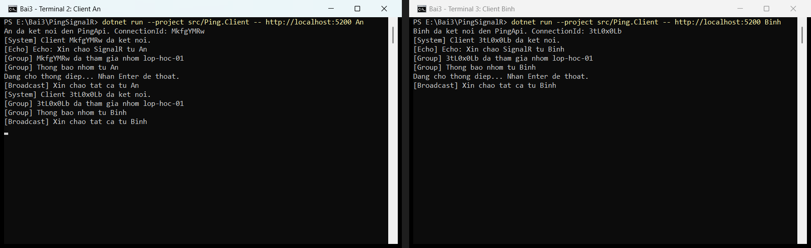
- **Thấy**: Cửa sổ `An` (chạy trước) nhận được `[System] Client 3tL0x0Lb da ket noi.`, `[Group] 3tL0x0Lb da tham gia nhom lop-hoc-01`, `[Group] Thong bao nhom tu Binh`, `[Broadcast] Xin chao tat ca tu Binh`, và **không** thấy dòng `[Echo]` của `Bình`.
- **Giải thích**:
  - `Clients.Caller`: chỉ gửi cho kết nối vừa gọi (`Echo`).
  - `Clients.Group("lop-hoc-01")`: chỉ gửi cho các kết nối đã tham gia nhóm (`JoinGroup`, `SendToGroup`).
  - `Clients.All`: gửi tới mọi kết nối đang mở, bao gồm cả người gửi (`Broadcast`, `SystemMessage`).
  - `Clients.Client(id)`: gửi đích danh một `ConnectionId` cụ thể.

### Bước 6: Vòng đời kết nối (`OnConnectedAsync`, `OnDisconnectedAsync`, `WithAutomaticReconnect`)
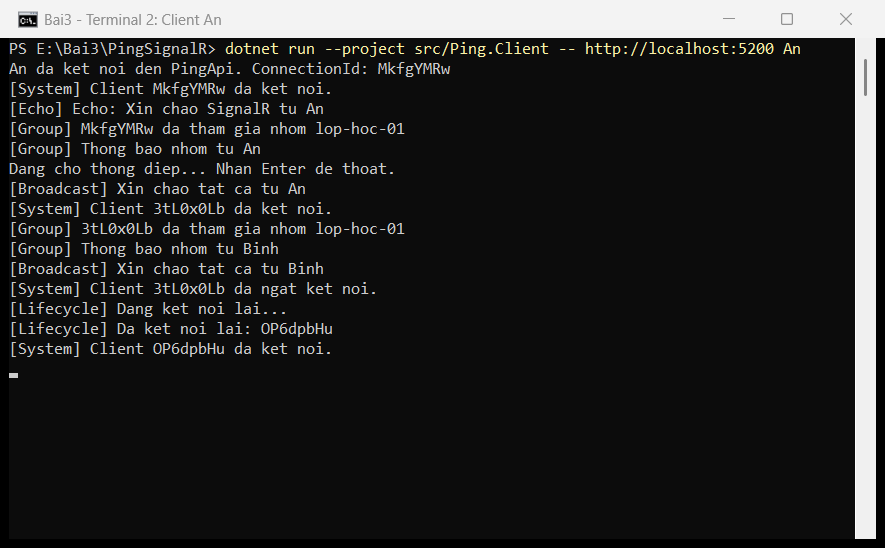
- **Thấy**: Khi tắt và chạy lại `Ping.Api`, cửa sổ `An` in `[Lifecycle] Dang ket noi lai...`, sau đó in `[Lifecycle] Da ket noi lai: OP6dpbHu` và `[System] Client OP6dpbHu da ket noi.` (khác với `ConnectionId` ban đầu `MkfgYMRw`).
- **Giải thích**: `WithAutomaticReconnect()` tự động kết nối lại sau khi kết nối đã mở bị rớt (lịch mặc định 0s, 2s, 10s, 30s). Kết nối mới có `ConnectionId` mới nên máy chủ xem như kết nối mới và không còn nằm trong nhóm cũ cho tới khi gọi lại `JoinGroup`.

### Bước 7: Ba thí nghiệm lỗi trên `PingSignalR`

| # | Làm gì | Thấy gì | Giải thích vì sao |
|---|---|---|---|
| **Lỗi 1** | Tắt `Ping.Api`, chạy `Ping.Client` | Ném ngay `HttpRequestException: No connection could be made because the target machine actively refused it. (localhost:5200)` | `StartAsync()` thất bại ngay ở lần nối đầu. `WithAutomaticReconnect()` chỉ cứu kết nối **đã mở**, không tự thử lại khi khởi tạo thất bại. |
| **Lỗi 2** | Sửa `WithUrl` thành `/hub/ping` (thiếu `s`) | Ném `HttpRequestException: Response status code does not indicate success: 404 (Not Found)` | Lỗi xảy ra ngay ở bước `POST /hub/ping/negotiate`. Đường dẫn phía máy khách phải khớp chính xác với `MapHub<PingHub>("/hubs/ping")`. |
| **Lỗi 3** | Sửa `On<string>("EchoResponse")` thành `On<string>("EchoRespone")` | Chương trình chạy bình thường, **không báo lỗi nào**, vẫn hiện `[Group]` và `[Broadcast]` nhưng **mất hoàn toàn dòng `[Echo]`** | Hợp đồng chiều xuống (`SendAsync` ↔ `On`) dựa vào khớp chuỗi tên sự kiện. Sai tên chiều xuống sẽ im lặng, cần kiểm tra tên hai phía đầu tiên khi không nhận được tin. |

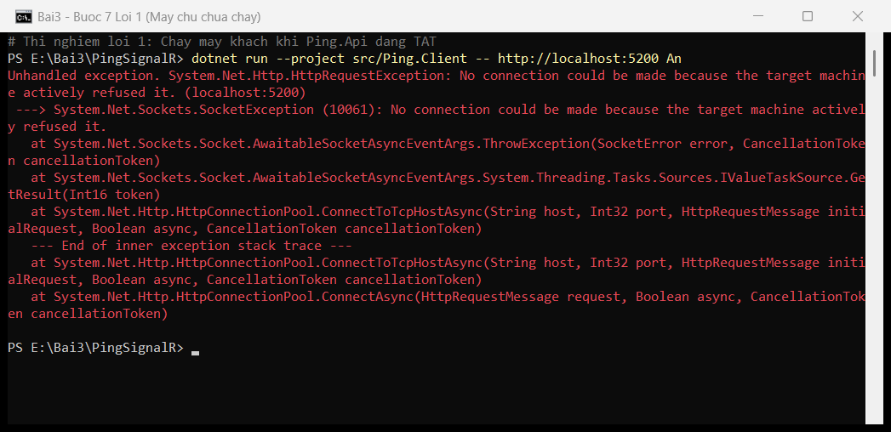
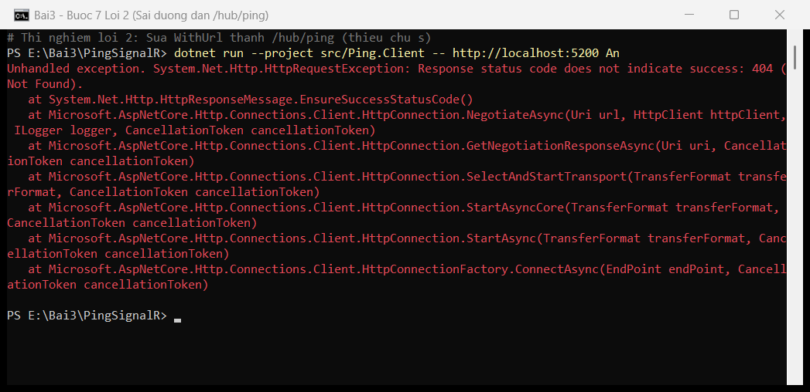
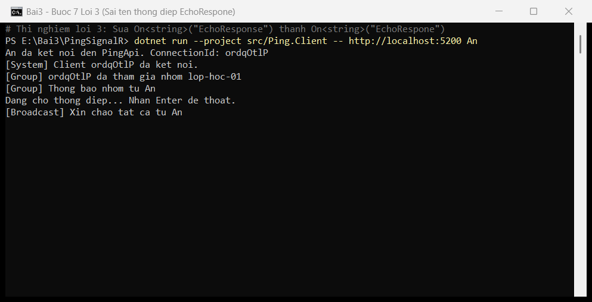

---

## 4. Nhật ký thực hành Phần 3: `EduSubmit realtime` (`RealtimeSubmissionSystem`)

### 4.1. Bản thiết kế kênh thời gian thực theo khung 4 câu hỏi
1. **Sự kiện nào kích hoạt thông điệp?** Mỗi lần trạng thái lượt nộp thay đổi trong tác vụ chấm nền: `received` → `processing` → `graded` (hoặc `failed`).
2. **Gửi cho ai?** Chỉ máy khách đang theo dõi đúng lượt nộp đó: `Clients.Group("submission:{id}")`, đảm bảo riêng tư dữ liệu sinh viên và tiết kiệm băng thông so với `Clients.All`.
3. **Gửi kèm dữ liệu gì (tối thiểu)?** `record SubmissionStatusMessage(Guid SubmissionId, string Status, DateTimeOffset UpdatedAt)` — đủ để máy khách cập nhật đúng lượt nộp và mốc thời gian mà không gửi thừa cả `SubmissionDto`.
4. **Mất kết nối thì lấy lại trạng thái thế nào?** Gọi lại REST `GET /api/submissions/{id}` vì dữ liệu luôn được cập nhật trong danh sách có `lock (submissionsLock)` **trước** khi đẩy SignalR.

### 4.2. Kiểm thử `requests.http` (9 ca chuẩn + 7 yêu cầu chấm điểm)
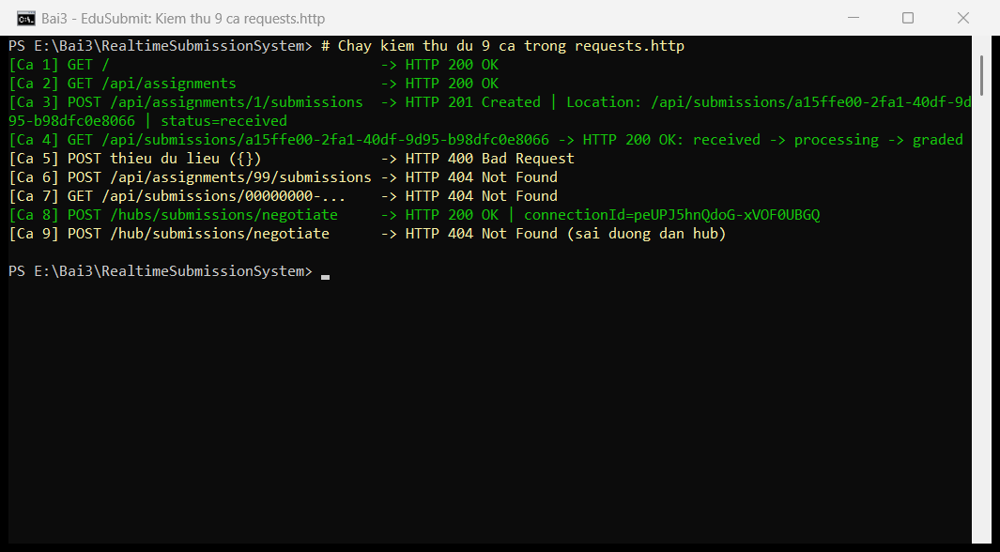
- **Thấy**: Toàn bộ 9 ca trong [requests.http](file:///e:/Bai3/RealtimeSubmissionSystem/requests.http) trả đúng mã trạng thái mong đợi:
  1. `GET /` → `200 OK`
  2. `GET /api/assignments` → `200 OK`
  3. `POST /api/assignments/1/submissions` (hợp lệ) → `201 Created` + header `Location`, `status = received`
  4. `GET /api/submissions/{id}` gọi nhiều lần → `200 OK`, chuyển đúng thứ tự `received` → `processing` → `graded`
  5. `POST` thiếu `studentCode` / `repositoryUrl` → `400 Bad Request`
  6. `POST /api/assignments/99/submissions` (và `999`) → `404 Not Found`
  7. `GET /api/submissions/00000000-0000-0000-0000-000000000000` → `404 Not Found`
  8. `POST /hubs/submissions/negotiate?negotiateVersion=1` → `200 OK` + `connectionId`
  9. `POST /hub/submissions/negotiate?negotiateVersion=1` → `404 Not Found`
- **Giải thích**: REST đảm nhận tạo/đọc tài nguyên và kiểm tra nghiệp vụ (`404` không thấy bài tập, `400` bài đóng/dữ liệu trống, `201` tạo mới); tác vụ chấm nền chạy bất đồng bộ nên `POST` trả `201` ngay lập tức.

### 4.3. Kết quả chạy máy khách `EduSubmit` (đủ 8 dòng, tự thoát sau khi nhận `graded`)
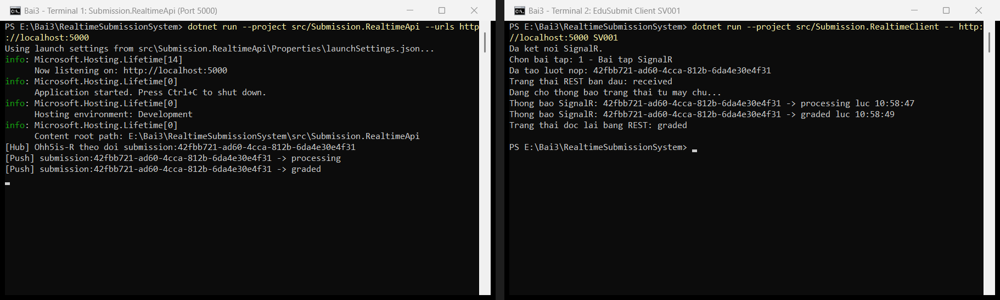

Kết quả chạy thực tế đủ 8 dòng ở máy khách:
```text
Da ket noi SignalR.
Chon bai tap: 1 - Bai tap SignalR
Da tao luot nop: 42fbb721-ad60-4cca-812b-6da4e30e4f31
Trang thai REST ban dau: received
Dang cho thong bao trang thai tu may chu...
Thong bao SignalR: 42fbb721-ad60-4cca-812b-6da4e30e4f31 -> processing luc 10:58:47
Thong bao SignalR: 42fbb721-ad60-4cca-812b-6da4e30e4f31 -> graded luc 10:58:49
Trang thai doc lai bang REST: graded
```
- **Thấy**: Hai dòng `Thong bao SignalR` đến cách nhau đúng ~2 giây (`10:58:47` → `10:58:49`), sau đó máy khách đọc lại bằng REST (`graded`) và tự thoát. Terminal máy chủ in đúng thứ tự `[Hub] Ohh5is-R theo doi` → `[Push] ... -> processing` → `[Push] ... -> graded`.
- **Giải thích**: Trình tự bắt buộc là **nghe (`On`) → nối (`StartAsync`) → tạo (`POST`) → theo dõi (`WatchSubmission`) → đọc lại (`GET`)**.

### 4.4. Bảng 5 thí nghiệm phân tán (Bước 7 EduSubmit)

| # | Thí nghiệm | Dự đoán trước khi chạy | Kết quả thật khi chạy | Giải thích |
|---|---|---|---|---|
| **1** | Chạy 2 máy khách `SV001` và `SV002` cùng lúc | Mỗi máy khách chỉ nhận thông báo của đúng lượt nộp mình vừa tạo, không thấy bài của người kia | Đúng như dự đoán: `SV001` chỉ nhận thông báo cho `85a62fac-...`, `SV002` chỉ nhận cho `affb573e-...` (dù cả hai chuyển `processing` và `graded` cùng giây `10:54:27` và `10:54:29`) | Nhóm `submission:{id}` do máy chủ quản lý tách biệt hoàn toàn người nhận theo từng lượt nộp. |
| **2** | Chạy máy khách khi máy chủ chưa chạy | Máy khách lỗi ngay ở bước `StartAsync()`, không thể kết nối | Ném `HttpRequestException: No connection could be made because the target machine actively refused it. (localhost:5000)` | `WithAutomaticReconnect()` chỉ có tác dụng sau khi kết nối đã mở thành công; lần kết nối đầu thất bại sẽ ném ngoại lệ ngay. |
| **3** | Sửa `WithUrl` thành `/hub/submissions` (thiếu `s`) | Lỗi HTTP `404 Not Found` khi bắt tay SignalR | Ném `HttpRequestException: Response status code does not indicate success: 404 (Not Found)` | Bước `negotiate` gọi sai tuyến HTTP không khớp với `MapHub<SubmissionHub>("/hubs/submissions")`. |
| **4** | Sửa `On("SubmissionStatusChanged")` thành `On("SubmissionStatusChange")` | Không báo lỗi nhưng không nhận được thông báo nào, chờ hết 10 giây timeout rồi REST đọc ra `graded` | Không có ngoại lệ; không in dòng `Thong bao SignalR`; sau 10 giây in `Qua thoi gian cho thong bao graded.`, sau đó REST vẫn in `Trang thai doc lai bang REST: graded` | Sai tên sự kiện chiều xuống (`SendAsync` ↔ `On`) gây im lặng. Nhờ `Task.WhenAny` với timeout 10s và đọc lại REST nên chương trình không treo vĩnh viễn và vẫn biết kết quả cuối. |
| **5** | Chờ 4 giây sau `POST` rồi mới gọi `WatchSubmission` | Do chấm nền chỉ mất 3 giây nên vào nhóm muộn sẽ lỡ cả `processing` và `graded`, nhưng REST vẫn đọc được `graded` | Không nhận được thông báo SignalR nào (timeout sau 10s), nhưng `GET /api/submissions/{id}` vẫn trả về `Trang thai doc lai bang REST: graded` | SignalR chỉ đẩy sự kiện phát sinh **sau** khi kết nối đã vào nhóm, không phát lại lịch sử. REST luôn là nguồn sự thật đáng tin cậy. |

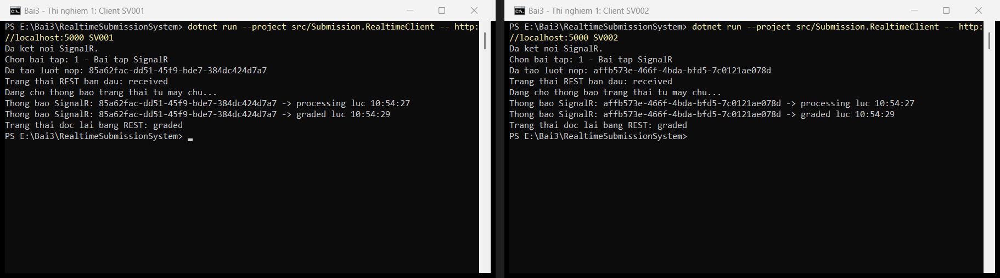

### 4.5. Bài tập vận dụng 2 & 3 (Trạng thái `failed` và theo dõi 2 lượt nộp cùng lúc)
- **Bài tập 2**: Máy chủ kiểm tra `RepositoryUrl` — nếu không bắt đầu bằng `https://` thì trạng thái cuối là `failed`. Máy khách khi nhận `failed` in cảnh báo màu đỏ `!!! CANH BAO: luot nop ... cham LOI (failed)`.
- **Bài tập 3**: Khi chạy với cờ `--multi`, máy khách tạo 2 lượt nộp (`SV001` dùng `https://...` và `SV002` dùng `http://...`), gọi `WatchSubmission` cho cả hai trên **cùng một `HubConnection`**, theo dõi bằng `ConcurrentDictionary<Guid, TaskCompletionSource<string>>` và đối chiếu lại bằng REST cho từng lượt nộp.

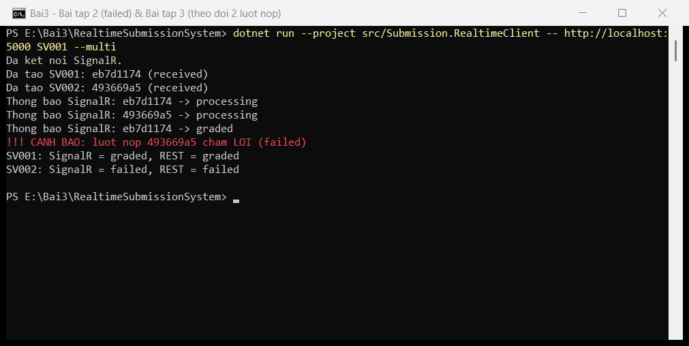

---

## 5. Trả lời câu hỏi ôn tập và thảo luận (Slide 68)

### A. Câu hỏi ôn tập
1. **Polling khác Push ở số yêu cầu và độ trễ thế nào?**  
   Polling gửi nhiều yêu cầu lặp lại theo chu kỳ nên đa số là thừa và luôn có độ trễ bằng tối đa 1 chu kỳ thăm dò; Push chỉ gửi đúng khi có sự kiện nên không có yêu cầu thừa và độ trễ gần như tức thì.
2. **Phân biệt 3 MEP theo hướng khởi tạo và số thông điệp:**  
   - *Yêu cầu–phản hồi (Request–Response)*: Máy khách khởi tạo, 1 yêu cầu → 1 phản hồi (ví dụ REST).  
   - *Đẩy dữ liệu (Push)*: Máy chủ chủ động gửi khi có sự kiện, từng thông điệp lẻ không đều (ví dụ SignalR).  
   - *Truyền luồng (Streaming)*: Một hoặc cả hai phía gửi chuỗi nhiều thông điệp liên tục (ví dụ log build, tiến độ %, SignalR/gRPC stream).
3. **WebSocket, SignalR: giao thức hay thư viện?**  
   WebSocket là **giao thức** tầng truyền tải giữ kênh hai chiều sau bắt tay HTTP (`101 Switching Protocols`); SignalR là **thư viện cấp cao** của ASP.NET Core xây trên WebSocket, bổ sung Hub, Group, ConnectionId, tự kết nối lại và truyền tải dự phòng.
4. **SignalR có những cơ chế truyền tải dự phòng nào?**  
   Theo thứ tự ưu tiên giảm dần: (1) **WebSockets** → (2) **Server-Sent Events (SSE)** → (3) **Long Polling**.
5. **Vì sao tạo nhóm `submission:{id}` thay vì gửi tất cả (`Clients.All`)?**  
   Hai lý do chính: **bảo mật/riêng tư** (sinh viên không nhìn thấy trạng thái bài của người khác) và **tiết kiệm băng thông** (chỉ gửi cho người đang theo dõi lượt nộp đó thay vì phát rộng $N$ lần).
6. **`IHubContext` cho phép làm gì?**  
   Cho phép đẩy thông điệp SignalR tới các client (`Clients.All`, `Clients.Group(...)`, ...) từ **bên ngoài lớp Hub** (ví dụ từ Minimal API endpoint hoặc tác vụ chạy nền), vì đối tượng `Hub` chỉ sống trong phạm vi một lời gọi.
7. **`On<T>` dùng để làm gì? Bỏ đi thì sao?**  
   `On<T>("TenSuKien", handler)` đăng ký hàm xử lý phía máy khách khi máy chủ gọi `SendAsync("TenSuKien", payload)`. Nếu bỏ đi (hoặc đặt sai tên), máy khách vẫn kết nối nhưng im lặng bỏ qua thông điệp đó mà không báo lỗi.
8. **REST làm gì, SignalR làm gì? Vì sao không dùng SignalR để tạo lượt nộp?**  
   REST tạo và đọc tài nguyên với ngữ nghĩa HTTP rõ ràng (URI, mã `201 Created`, header `Location`, `400`, `404`, dễ cache/log/kiểm thử bằng curl hoặc `requests.http`); SignalR chỉ đẩy thông báo thay đổi trạng thái phát sinh sau đó.
9. **`WithAutomaticReconnect` có tác dụng gì?**  
   Tự động thử kết nối lại khi một kết nối **đã mở** bị ngắt đột ngột (mặc định thử lại sau `0s, 2s, 10s, 30s`), đồng thời phát các sự kiện vòng đời `Reconnecting`, `Reconnected`, `Closed`.
10. **Mất kết nối đúng lúc báo `graded` thì làm gì?**  
    Tin bị mất; sau khi kết nối lại (có `ConnectionId` mới), gọi lại `WatchSubmission(id)` nếu cần theo dõi tiếp và gọi REST `GET /api/submissions/{id}` để đọc trạng thái mới nhất.

### B. Câu hỏi thảo luận
1. **Hàng trăm sinh viên cùng theo dõi: nhóm theo `id` hay phát tất cả rồi tự lọc? Cách nào tiết kiệm băng thông?**  
   Nhóm theo `submission:{id}` trên máy chủ tiết kiệm băng thông hơn rất nhiều: với $N$ sinh viên (mỗi bài đổi trạng thái 2 lần), dùng nhóm chỉ gửi $2N$ thông điệp, trong khi `Clients.All` gửi tới $2N^2$ thông điệp (ví dụ 100 SV = 200 tin so với 20.000 tin) và còn làm lộ dữ liệu người khác.
2. **Nêu 2 tình huống Polling là lựa chọn hợp lý hơn SignalR:**  
   (1) Dữ liệu ít thay đổi và chấp nhận độ trễ vài chục giây đến vài phút (như báo cáo thống kê tổng hợp, bảng tin ít cập nhật); (2) Môi trường mạng/proxy doanh nghiệp chặn kết nối lâu dài hoặc tài nguyên máy chủ hạn chế không muốn giữ hàng nghìn kết nối mở thường trực.
3. **Chạy nhiều bản sao API (scale-out) thì nhóm trong bộ nhớ gặp vấn đề gì? Sửa thế nào?**  
   Danh sách kết nối và nhóm mặc định nằm trong RAM của từng máy chủ riêng lẻ: nếu máy khách nối vào Server A nhưng tác vụ chấm/API lại gọi `IHubContext` trên Server B thì Server B không biết kết nối ở Server A nên thông điệp không tới được máy khách. **Cách sửa**: dùng **backplane dùng chung** như **Redis Backplane** (`AddStackExchangeRedis`) hoặc dịch vụ quản lý như **Azure SignalR Service** để đồng bộ thông điệp giữa mọi bản sao API.
