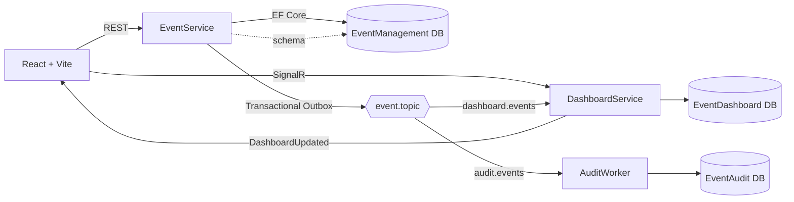

# Eventory — Hệ thống đăng ký sự kiện và check-in

Ứng dụng mẫu cho đề tài Phát triển ứng dụng phân tán: người tham dự khám phá sự kiện, đăng ký và nhận QR; nhân viên xác minh và check-in; quản trị theo dõi báo cáo realtime. Nền tảng dùng .NET 10 Minimal API, EF Core, SQL Server, RabbitMQ Topic Exchange, SignalR và React/TypeScript.

## Chức năng

- Danh sách sự kiện có tìm kiếm, lọc, phân trang; chi tiết, tạo, sửa, đóng hoặc xóa an toàn.
- Đăng ký có kiểm tra đầu vào, email trùng, trạng thái sự kiện và sức chứa trong transaction Serializable; mã đăng ký cùng QR có thể xác minh.
- Hủy đăng ký trước check-in; check-in từ mã/QR, chặn đăng ký đã hủy và check-in lặp.
- DashboardService giữ projection độc lập, cung cấp tổng quan, thống kê sự kiện, biểu đồ, hoạt động gần đây và SignalR.
- AuditWorker có queue và database riêng; lưu sự kiện cùng correlation ID và chống ghi trùng.
- Giao diện responsive tiếng Việt: trang công khai, vé, tra cứu, quản trị sự kiện/người tham dự/đăng ký/check-in/báo cáo/nhật ký; báo cáo xuất CSV.
- 8 sự kiện demo và 24 người tham dự được seed khi tạo database trống.

## Kiến trúc



Exchange `event.topic` dùng durable queues riêng `dashboard.events` and `audit.events`; both bind `event.event.created`, `event.event.updated`, `event.event.deleted`, `event.participant.registered`, `event.participant.cancelled`, and `event.participant.checkedin`.participant.registered`, `event.participant.cancelled`, `event.participant.checkedin`. Mỗi event có `EventId`, `EventType`, `OccurredAt`, `CorrelationId`, `EventVersion` và `EventData`. Giao dịch nghiệp vụ thêm outbox record trước commit; publisher retry các record chưa phát. Consumer ACK sau khi ghi projection/audit, kiểm tra EventId đã xử lý, NACK/requeue khi lỗi và reconnect RabbitMQ.

## Công nghệ và cổng

| Thành phần | Công nghệ | Cổng host mặc định |
|---|---|---:|
| Web | React 19, TypeScript, Vite, Tailwind CSS, React Router, Axios, Lucide, Recharts, qrcode.react | 8080 (Compose), 5173 (dev) |
| EventService | ASP.NET Core Minimal API, .NET 10, EF Core, SQL Server, Swagger | 5001 |
| DashboardService | ASP.NET Core, EF Core, SignalR, RabbitMQ | 5002 |
| AuditWorker | .NET Worker, EF Core, RabbitMQ | nội bộ |
| SQL Server | SQL Server 2022 Developer | 1433 |
| RabbitMQ | RabbitMQ 4 Management | 5672; UI 15672 |

## Chạy nhanh với Docker Desktop

Cài Docker Desktop hỗ trợ Linux containers và khởi động Docker Engine. Tại thư mục repository, chạy PowerShell:

```powershell
Copy-Item .env.example .env
notepad .env # đặt các mật khẩu local riêng
docker version
docker compose config
docker compose up -d --build
docker compose ps
```

Truy cập web tại <http://localhost:8080>, EventService Swagger tại <http://localhost:5001/swagger>, health tại <http://localhost:5001/health/ready> và RabbitMQ Management tại <http://localhost:15672> (dùng `RABBITMQ_USER`/`RABBITMQ_PASSWORD` trong `.env`). SQL Server tạo riêng ba database. EF Core migrations chạy tự động khi service khởi động. Database và broker giữ dữ liệu bằng named volumes `sql_data` và `rabbit_data`; `docker compose down` không xóa volume. Không dùng `docker compose down -v` nếu muốn giữ dữ liệu.

```powershell
docker compose logs -f eventservice dashboardservice auditworker
docker compose down
```

Compose yêu cầu Docker Engine đang chạy. Nếu `docker` không được nhận diện, cài/khởi động Docker Desktop rồi mở lại PowerShell; không thể xác nhận runtime hoặc dữ liệu RabbitMQ/SQL cho tới khi Engine chạy.

## Chạy frontend và services riêng để phát triển

Yêu cầu .NET 10 SDK, Node.js 22+ và SQL Server 2022 cùng RabbitMQ chạy cục bộ. Dùng ba PowerShell terminals:

```powershell
# Terminal 1 — EventService
$env:ConnectionStrings__Events='Server=localhost,1433;Database=EventManagement;User Id=sa;Password=<your-password>;TrustServerCertificate=True;Encrypt=False'
$env:RabbitMq__Uri='amqp://eventapp:<your-rabbit-password>@localhost:5672/'
dotnet run --project backend/EventService/EventService.Api
```

```powershell
# Terminal 2 — DashboardService
$env:ConnectionStrings__Dashboard='Server=localhost,1433;Database=EventDashboard;User Id=sa;Password=<your-password>;TrustServerCertificate=True;Encrypt=False'
$env:ConnectionStrings__AuditRead='Server=localhost,1433;Database=EventAudit;User Id=sa;Password=<your-password>;TrustServerCertificate=True;Encrypt=False'
$env:RabbitMq__Uri='amqp://eventapp:<your-rabbit-password>@localhost:5672/'
dotnet run --project backend/DashboardService/DashboardService.Api
```

```powershell
# Terminal 3 — AuditWorker
$env:ConnectionStrings__Audit='Server=localhost,1433;Database=EventAudit;User Id=sa;Password=<your-password>;TrustServerCertificate=True;Encrypt=False'
$env:RabbitMq__Uri='amqp://eventapp:<your-rabbit-password>@localhost:5672/'
dotnet run --project backend/AuditWorker
```

```powershell
# Terminal 4 — frontend
Set-Location frontend
npm.cmd ci
npm.cmd run dev
```

Mở <http://localhost:5173>. Vite proxy chuyển `/api` sang `localhost:5001`, `/dashboard-api` và `/hubs` sang `localhost:5002`. Có thể cấu hình `VITE_API_URL`, `VITE_DASHBOARD_API_URL`, `VITE_DASHBOARD_HUB_URL` trong `frontend/.env.local` khi đổi môi trường.

## Migration, seed và test

Mỗi service sở hữu DbContext/database/migration riêng. Startup gọi `Database.MigrateAsync()`; EventService thêm dữ liệu demo một lần khi Events còn trống. Thêm migration EventService:

```powershell
dotnet ef migrations add <MigrationName> --project backend/EventService/EventService.Api --startup-project backend/EventService/EventService.Api --output-dir Data/Migrations
dotnet ef database update --project backend/EventService/EventService.Api --startup-project backend/EventService/EventService.Api
```

DashboardService/AuditWorker migrations nằm trong `Data/Migrations` tương ứng. Kiểm tra build/test:

```powershell
dotnet build EventManagementSystem.sln
dotnet test EventManagementSystem.sln
Set-Location frontend
npm.cmd ci
npm.cmd run build
```

## REST API

EventService (base `<http://localhost:5001>`):

| Method | Path | Mục đích |
|---|---|---|
| GET | `/events?search=&status=&category=&page=&pageSize=&sort=` | Danh sách và lọc |
| GET | `/events/{id}` | Chi tiết sự kiện |
| POST/PUT/DELETE | `/events[/{id}]` | Tạo/cập nhật/đóng hoặc xóa sự kiện |
| POST | `/events/{id}/registrations` | Đăng ký, trả mã và QR data |
| POST | `/registrations/lookup` | Tra cứu vé bằng email hoặc mã đăng ký |
| GET | `/events/{id}/registrations` | Danh sách đăng ký theo sự kiện |
| GET | `/registrations/{id}` | Chi tiết/vé |
| GET | `/registrations/{id}/qrcode` | Tải QR PNG |
| POST | `/checkin/verify` | Xác minh mã hoặc QR data |
| POST | `/registrations/{id}/checkin` | Xác nhận check-in |
| DELETE | `/registrations/{id}` | Hủy nếu đủ điều kiện |
| GET | `/admin/events`, `/admin/participants`, `/admin/registrations` | Quản trị |
| POST/PUT/DELETE | `/admin/events[/{id}]` | Alias CRUD quản trị sự kiện |
| GET | `/health`, `/health/live`, `/health/ready` | Health checks |

DashboardService (base `<http://localhost:5002>`): `GET /dashboard/overview`, `GET /dashboard/chart`, `GET /dashboard/report`, `GET /dashboard/top-events`, `GET /dashboard/events/{eventId}`, `GET /dashboard/events/{eventId}/statistics`, `GET /dashboard/events/{eventId}/chart`, `GET /dashboard/recent-activities`, `GET /admin/audit-logs`, SignalR `/hubs/dashboard` (events `RegistrationCreated`, `RegistrationCancelled`, `ParticipantCheckedIn`, `DashboardUpdated`, `RecentActivityCreated`).

## Database

`EventManagement`: Events, Participants, Registrations, OutboxMessages. `EventDashboard`: DashboardStatistics, DashboardRegistrations, DashboardActivities, ProcessedMessages. `EventAudit`: AuditLogs, ProcessedMessages. Unique index bảo vệ email, registration code, EventId consumer dedupe; transaction Serializable cùng kiểm tra sức chứa/trạng thái bảo vệ ghi nhận đăng ký và check-in.

## Ghi chú vận hành

- Giá trị `.env.example` chỉ dùng phát triển local; thay mật khẩu trước khi chia sẻ máy hoặc mở cổng ra Internet. Cấu hình authentication/roles và TLS là bước cần thiết trước triển khai công khai; chức năng demo hiện chưa bật JWT.
- QR chứa registration code có thể kiểm tra qua `/checkin/verify`; QR không phải credential ký số và không thay thế xác thực nhân viên.
- Nếu RabbitMQ tạm thời mất kết nối, outbox giữ lại message chưa phát; dashboard/audit queue bền vững lưu message cho subscriber khởi động lại. NACK hiện requeue ngay; lỗi poison message lặp lại cần đưa vào dead-letter queue khi vận hành production.
- Dữ liệu seed chỉ thêm vào database Events trống; không ghi đè các database đã có dữ liệu.
- Trang check-in hỗ trợ quét QR bằng camera trên localhost/HTTPS khi người dùng cho phép truy cập camera; nếu không có camera, nhập mã thủ công hoặc dùng đầu đọc QR nhận bàn phím.
- Xóa sự kiện đã phát sinh đăng ký chỉ chuyển trạng thái Closed để giữ nguyên hồ sơ.
