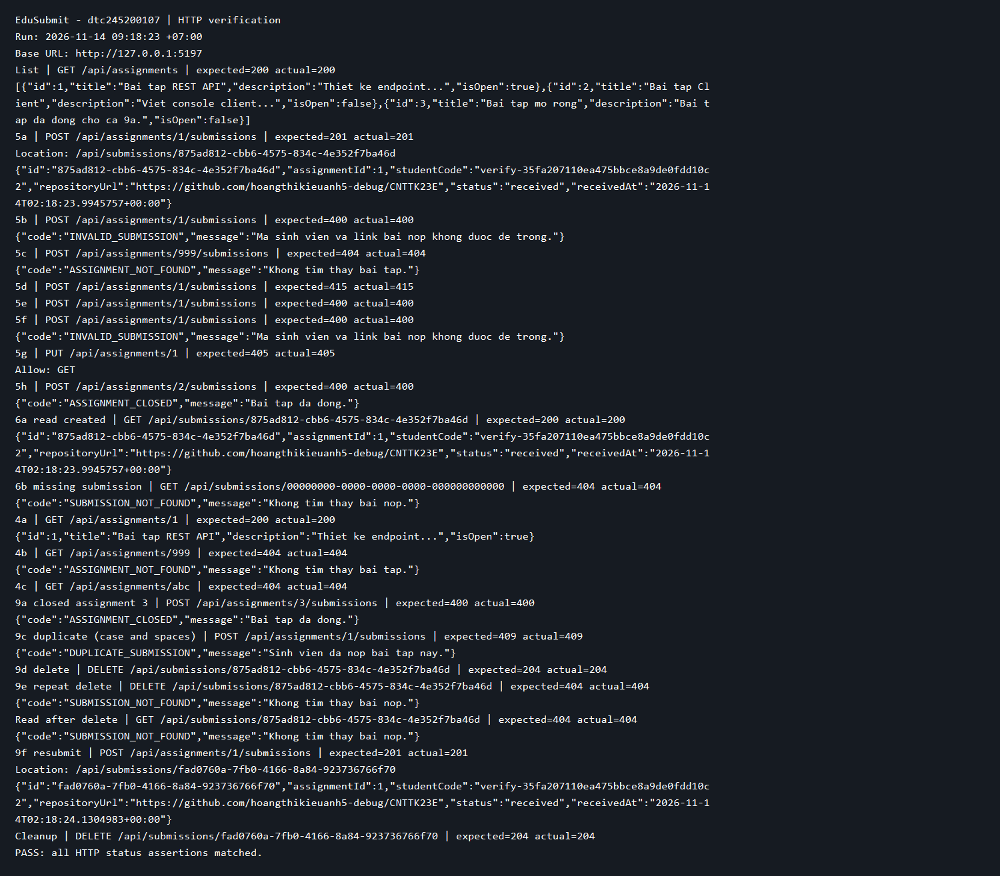

# Bài 2 — EduSubmit: RESTful Client–Server

Sinh viên: **Hoàng Thị Kiều Anh — dtc245200107**, lớp CNTTK23E.

## 1. Cấu trúc và cách chạy

- `src/Submission.Api`: ASP.NET Core Minimal API, lưu bài nộp trong bộ nhớ.
- `src/Submission.Client`: console client gọi API qua `HttpClient`.
- `requests.http`: các yêu cầu để chạy bằng REST Client trong VS Code.
- `docs/verify.ps1`: kiểm thử HTTP và xuất log, ảnh kết quả.

Cần .NET SDK 10. Mở PowerShell tại thư mục chứa README này:

```powershell
dotnet --version
dotnet restore ./RestfulClientServer.slnx
dotnet build ./RestfulClientServer.slnx --no-restore
dotnet run --project ./src/Submission.Api --no-build --no-launch-profile --urls http://localhost:5000
```

Giữ API chạy, mở terminal thứ hai tại cùng thư mục:

```powershell
dotnet run --project ./src/Submission.Client --no-build -- http://localhost:5000
powershell -NoProfile -ExecutionPolicy Bypass -File ./docs/verify.ps1 -BaseUrl http://localhost:5000
```

Script dùng mã sinh viên thử nghiệm ngẫu nhiên để chạy lại không bị trùng; không thay đổi execution policy toàn máy. Nếu dùng `requests.http`, chạy API mới để dữ liệu ban đầu rỗng. Gửi 5a trước 6a; gửi 9b trước 9c–9f. Riêng 6c cần khởi động lại API rồi GET ID cũ, không tạo lại trước khi thử. Ca 5a và client đều nộp bài 1 bằng cùng MSSV nên chạy liên tiếp sẽ nhận 409; khởi động lại API nếu muốn lặp lại luồng tạo mới 201.

Đối chiếu tài liệu `Bai2_RESTful-API_Send.pdf`: trang 78–82 (POST và 5a–5h), 83–89 (client, đọc lại, lỗi framework), 90 (hồ sơ nộp), 102–103 (mở rộng 409/204). Dữ liệu hiện để **bài 2 đóng** theo ca 5h; thêm **bài 3 đóng** theo ca mở rộng 9a. Vì vậy client chỉ in bài 1 đang mở. Muốn trở lại dữ liệu ban đầu trang 74, đặt bài 2 `IsOpen = true` rồi khởi động lại API; khi đó ca 5h không còn áp dụng.

## 2. Lệnh đã chạy và kết quả thực tế

Ngày kiểm tra: **14/11/2026**; SDK **10.0.302**.

```powershell
dotnet build "Bai2/EduSubmit - dtc245200107/RestfulClientServer.slnx" --no-restore
dotnet run --project "Bai2/EduSubmit - dtc245200107/src/Submission.Api" --no-build --no-launch-profile --urls http://127.0.0.1:5197
dotnet run --project "Bai2/EduSubmit - dtc245200107/src/Submission.Client" --no-build -- http://127.0.0.1:5197
powershell -NoProfile -ExecutionPolicy Bypass -File "Bai2/EduSubmit - dtc245200107/docs/verify.ps1" -BaseUrl http://127.0.0.1:5197
```

Các lệnh trên chạy từ thư mục workspace `Code_demo`; cổng 5197 dùng riêng cho lần kiểm tra. Build thành công, **0 warning, 0 error**. Client liệt kê bài tập đang mở, tạo bài nộp với trạng thái `received`, đọc lại đúng MSSV và URL; gửi trường rỗng nhận `400 BadRequest` và `INVALID_SUBMISSION`. Client kiểm tra mã HTTP trước khi đọc DTO ở cả GET và POST, đọc lại theo `Location`, và có xử lý lỗi body không phải `ApiError`.

Kiểm thử HTTP xác nhận luồng danh sách 200 → tạo 201 (có header `Location`) → đọc lại 200, và toàn bộ ca trong bảng bên dưới đều khớp mã mong đợi. [Log HTTP đầy đủ](docs/results.txt).

Ảnh dưới được dựng từ log HTTP thực tế bằng script kiểm thử, không phải ảnh chụp IDE:



## 3. Bảng phá thử 5a–5h

Bảng theo đúng nhãn và thứ tự trang 81–82 của slide. Mã sinh viên trong script dùng giá trị ngẫu nhiên thay cho SV001 để có thể chạy lại.

| Ca | Thao tác / dữ liệu | Mong đợi | Thực tế | Giải thích |
| --- | --- | --- | --- | --- |
| 5a | POST bài 1, đủ mã SV và repositoryUrl | 201 + Location | 201 + Location | Handler tạo lượt nộp và tự sinh ID, trạng thái, thời điểm |
| 5b | POST bài 1 với hai trường rỗng | 400 | 400, `INVALID_SUBMISSION` | Handler kiểm tra dữ liệu bắt buộc |
| 5c | POST `/api/assignments/999/submissions`, JSON hợp lệ | 404 | 404, `ASSIGNMENT_NOT_FOUND` | Tài nguyên cha không tồn tại |
| 5d | POST bài 1, có body JSON nhưng không có Content-Type | 415 | 415 | Framework không nhận diện body là JSON |
| 5e | POST bài 1, Content-Type JSON nhưng body `{broken` | 400 | 400 | Framework không phân tích được JSON |
| 5f | POST bài 1, body chỉ có `studentCode` | 400 | 400, `INVALID_SUBMISSION` | Trường thiếu thành null; handler bắt được |
| 5g | PUT `/api/assignments/1` | 405, Allow: GET | 405, Allow: GET | Framework: URI khớp nhưng method không được hỗ trợ |
| 5h | POST bài 2 sau khi đặt `IsOpen = false` | 400 | 400, `ASSIGNMENT_CLOSED` | Handler: bài đã đóng, không dùng 409 |

Lỗi 400 do JSON sai và 415 do Content-Type do framework trả về, không nhất thiết có body `ApiError`. Không dùng kết quả đó để khẳng định mọi lỗi đều có cùng cấu trúc JSON.

Slide ghi body JSON hỏng trả text; lần chạy thực tế với môi trường Production ở đây trả body rỗng. Mã 400 vẫn khớp; nội dung lỗi framework phụ thuộc môi trường. Ca 5d trong script gỡ hẳn Content-Type để thử đúng trường hợp thiếu header.

Ngoài 5a–5h, script kiểm tra 4a–4c, 6a–6b, bài 3 đóng, nộp trùng 409, DELETE 204, DELETE lặp lại 404 và nộp lại 201 với ID mới. Ca nộp trùng còn kiểm tra khác hoa/thường và khoảng trắng. `requests.http` có hướng dẫn ca 6c (mất dữ liệu sau restart); ca 7a/7b thử client khi API tắt hoặc sai cổng, ca 7c thêm bài mở rồi restart, ca 9g chạy client hai lần trên cùng API. Những thao tác cần restart/thay dữ liệu này không nằm trong script HTTP tự động.

## 4. Trả lời ba câu hỏi

### Vì sao URI dùng danh từ?

URI định danh tài nguyên: `/api/assignments` là tập bài tập, `/api/submissions/{id}` là một bài nộp. Hành động được biểu diễn bằng HTTP method: GET để đọc, POST để tạo, DELETE để xóa. Ví dụ `POST /api/assignments/1/submissions` tạo bài nộp thuộc bài tập 1, nên không cần động từ như `/submitAssignment` trong URI. Cách này làm giao diện nhất quán và dễ hiểu.

### Stateless thể hiện ở đâu?

Mỗi request mang đủ thông tin cần xử lý: method, URI chứa ID, Content-Type và JSON khi tạo. GET một bài nộp chỉ cần ID trong URI; server không cần nhớ client trước đó đã chọn bài tập nào hoặc lưu một phiên hội thoại bằng session/cookie. Một client khác biết ID cũng có thể đọc cùng tài nguyên.

Danh sách `submissions` là **trạng thái tài nguyên**, không phải trạng thái phiên của client; lưu tài nguyên không vi phạm stateless. Hiện dữ liệu chỉ nằm trong RAM nên mất khi API dừng; đây là giới hạn lưu trữ của bản demo, không phải định nghĩa của stateless.

### Vì sao mỗi bên khai báo DTO riêng?

Client và server là hai tiến trình độc lập, trao đổi qua hợp đồng HTTP/JSON. Server dùng `CreateSubmissionRequest` để nhận dữ liệu và `SubmissionDto` để trả dữ liệu; client khai báo kiểu tương ứng để serialize/deserialize mà không phải tham chiếu mã triển khai server. Hai bên có thể triển khai riêng, nhưng vẫn phải thống nhất tên trường, kiểu dữ liệu và ý nghĩa theo hợp đồng. DTO riêng không có nghĩa được tự ý đổi hợp đồng gây lỗi phía còn lại. Với hệ thống lớn có thể dùng OpenAPI để sinh client và giảm sai lệch.

## 5. Giới hạn và hồ sơ nộp

- Dữ liệu lưu RAM; chưa có cơ sở dữ liệu hay xác thực. `List` chưa an toàn khi nhiều request đồng thời, đúng giới hạn demo nêu ở trang 95; không dùng để triển khai thực tế.
- `repositoryUrl` hiện chỉ được kiểm tra không rỗng, chưa kiểm tra URL hợp lệ.
- Khi nộp, đưa cả README, `docs`, mã nguồn và `requests.http` vào fork; không đưa `bin/obj`.
- Commit và push vào nhánh đang mở PR để PR cập nhật. Sau đó báo cô xem lại; việc gửi thông báo cần sinh viên thực hiện.
