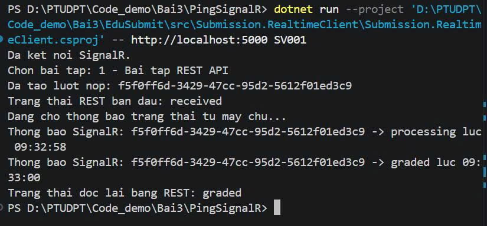

# Bài 3 — SignalR

**Hoàng Thị Kiều Anh · dtc245200107 · CNTTK23E**

Hai solution dùng .NET SDK 10. Các lệnh bên dưới chạy từ thư mục `Bai3`. Mỗi API và client chạy trong terminal riêng.

## PingSignalR

```powershell
dotnet build ./PingSignalR/PingSignalR.slnx
dotnet run --project ./PingSignalR/src/Ping.Api --no-launch-profile --urls http://localhost:5200
```

Khi API lắng nghe ở cổng 5200, mở terminal khác để chạy client. Dùng tên khác ở terminal thứ ba để quan sát thông báo nhóm. Nhấn Enter để thoát client.

```powershell
dotnet run --project ./PingSignalR/src/Ping.Client -- http://localhost:5200 Client1
```

Client đã nhận `Echo` từ hub `/hubs/ping`. Các ảnh ghi lại từng bước thực hành.

- [Build](PingSignalR/anh/buoc1-build.png), [negotiate](PingSignalR/anh/buoc2-negotiate.png) và [Echo](PingSignalR/anh/buoc4-echo.png).
- [Thông báo nhóm](PingSignalR/anh/buoc5-nhom.png), [theo dõi nhóm](PingSignalR/anh/buoc5.1-nhom.png.jpg) và [kết nối lại](PingSignalR/anh/buoc6-noilai.png).
- Thí nghiệm lỗi [1](PingSignalR/anh/buoc7-loi1.png), [2](PingSignalR/anh/buoc7-loi2.png) và [3](PingSignalR/anh/buoc7-loi3.png).

## EduSubmit Realtime

```powershell
dotnet build ./EduSubmit/RealtimeSubmissionSystem.slnx
dotnet run --project ./EduSubmit/src/Submission.RealtimeApi --no-launch-profile --urls http://localhost:5000
```

Khi API lắng nghe ở cổng 5000, chạy client ở terminal khác. Dùng mã sinh viên khác khi thử lại trên cùng một phiên API.

```powershell
dotnet run --project ./EduSubmit/src/Submission.RealtimeClient -- http://localhost:5000 SV001
```

Ảnh terminal cho thấy client tạo lượt nộp qua REST với `received`, nhận `processing` và `graded` qua SignalR, đọc lại `graded` qua REST rồi tự thoát.



| Kiểm tra | Ảnh kết quả |
| --- | --- |
| REST 200 OK | [200](PingSignalR/anh/edusubmit-200.png) |
| Tạo lượt nộp | [201 Created](PingSignalR/anh/edusubmit-201.png) |
| Yêu cầu thiếu dữ liệu | [400 Bad Request](PingSignalR/anh/edusubmit-400.png) |
| Tài nguyên không tồn tại | [404 Not Found](PingSignalR/anh/edusubmit-404.png) |
| Bắt tay SignalR | [Negotiate](PingSignalR/anh/edusubmit-negotiate.png) |

[requests.http](EduSubmit/requests.http) có chín yêu cầu để kiểm tra lại. [README EduSubmit](EduSubmit/README.md) ghi luồng chi tiết và dự đoán cho năm thí nghiệm. Các ảnh trên xác nhận các ca được chụp. Kết quả thực tế của cả năm thí nghiệm EduSubmit chưa được ghi nhận đầy đủ.

## Kết quả build

Đã build hai solution bằng .NET SDK 10.0.302. EduSubmit có 0 cảnh báo và 0 lỗi. PingSignalR có 0 lỗi và 2 cảnh báo `NU1900` do phiên kiểm tra không truy cập được dịch vụ kiểm tra lỗ hổng của NuGet.

## Ba câu hỏi đầu giờ

1. **Máy chủ chủ động báo bằng cách nào?** Khi client mở kết nối và vào nhóm `submission:{id}`, API dùng `IHubContext` để đẩy sự kiện thay đổi tới nhóm.
2. **REST và SignalR chia việc thế nào?** REST tạo lượt nộp và đọc trạng thái hiện tại. SignalR gửi thông báo khi trạng thái đổi.
3. **Nếu mất mạng đúng lúc có `graded`?** Client có thể bỏ lỡ thông báo. Sau khi kết nối lại, client đăng ký theo dõi lại nhóm. REST GET cung cấp trạng thái đã lưu khi client đọc lại lượt nộp.
