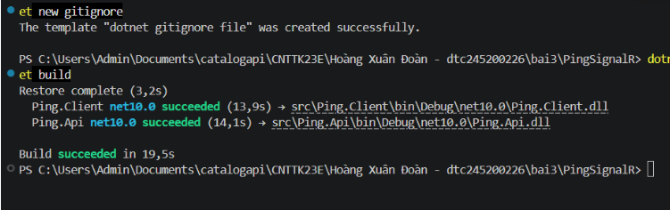
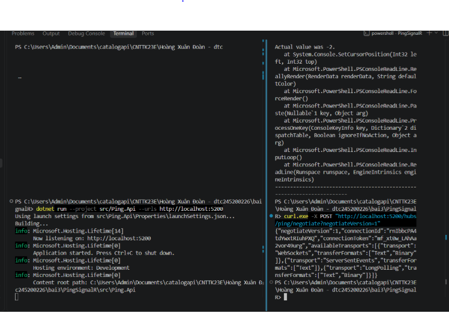
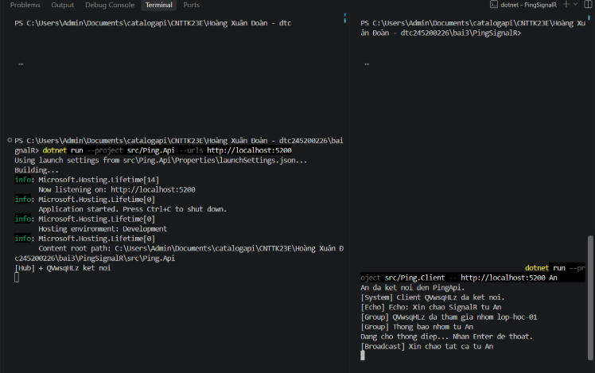
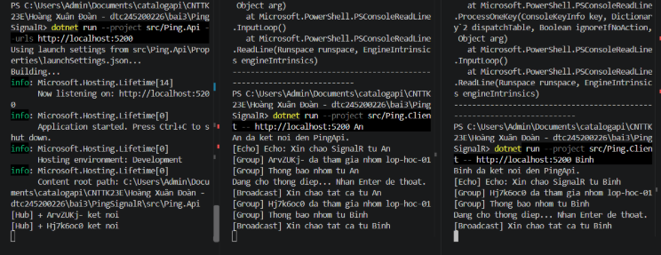
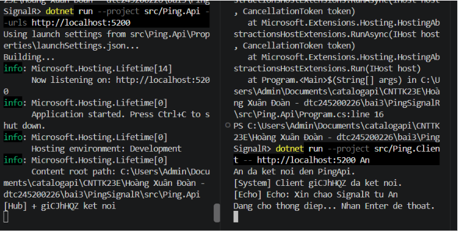
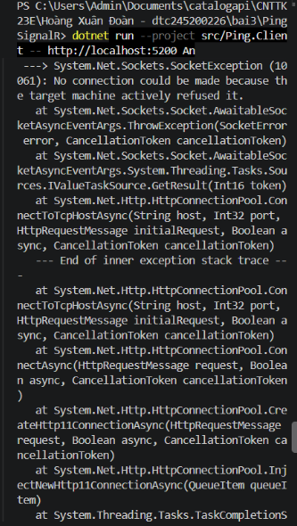
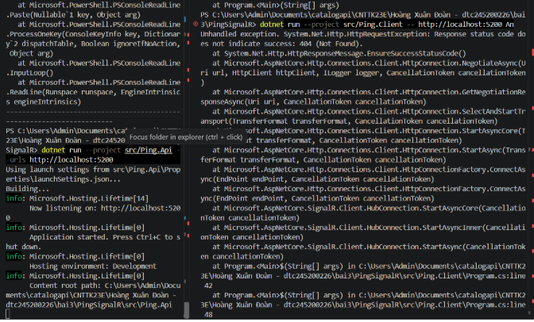
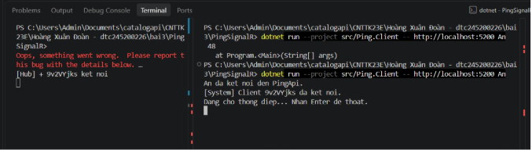

## Bước 1: Tạo solution và build

Thấy: Build succeeded, 0 Warning(s), 0 Error(s).
Giải thích: Khởi tạo thành công solution gồm 2 project Ping.Api và Ping.Client.

## Bước 2: negotiate

Thấy: curl trả về connectionId.
Giải thích: máy chủ báo các cách truyền tải (WebSockets, ServerSentEvents, LongPolling).

## Bước 4: Echo

Thấy: máy khách in dòng `[Echo] Echo: Xin chao SignalR tu An`.
Giải thích: Clients.Caller chỉ gửi phản hồi về cho đúng kết nối vừa gọi phương thức Echo.

## Bước 5: Broadcast và Group

Thấy: An nhận được tin `[Group]` và `[Broadcast]` từ Bình, không nhận `[Echo]` của Bình.
Giải thích: Clients.Group gửi cho thành viên trong nhóm, Clients.All gửi cho tất cả kết nối đang mở.

## Bước 6: Vòng đời và tự kết nối lại

Thấy: hiện `Dang ket noi lai...` và `Da ket noi lai` với ConnectionId mới sau khi bật lại server.
Giải thích: WithAutomaticReconnect tự động kết nối lại khi rớt mạng nhưng sẽ được cấp ConnectionId mới.

## Bước 7: Ba thí nghiệm lỗi

- **Lỗi 1 (Tắt server):** Ném ngoại lệ `Connection refused` ngay tại `StartAsync()` vì lần kết nối đầu chưa mở được.
- **Lỗi 2 (Sai URL `/hub/ping`):** Báo lỗi `404 Not Found` ở bước negotiate do không khớp với `MapHub("/hubs/ping")`.
- **Lỗi 3 (Sai tên `EchoRespone`):** Không báo lỗi biên dịch hay runtime nhưng không in gì vì tên thông điệp hai phía không khớp.