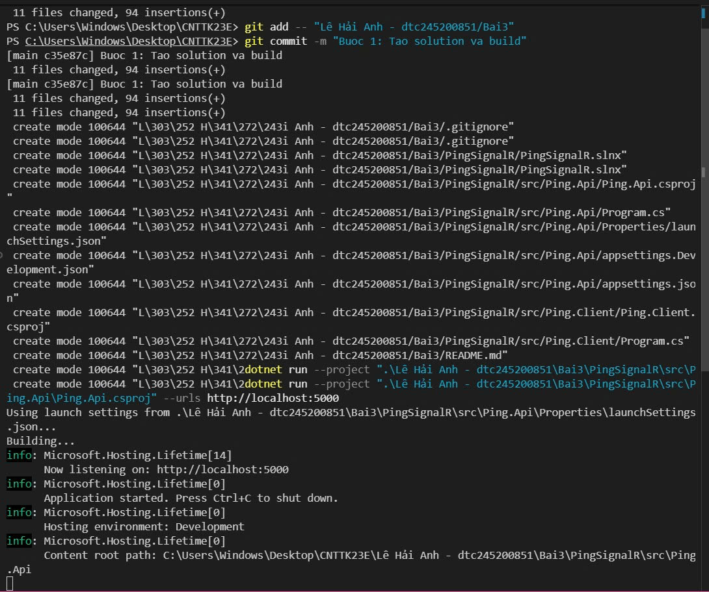

# Bài 3 — SignalR

Lê Hải Anh — dtc245200851

## Bước 1 — Tạo solution và build

Hai project Ping.Api và Ping.Client đã build thành công. Gói SignalR Client được cố định ở 10.0.15 theo slide 25.

## Bước 2 — Negotiate

PingApi chạy cổng 5200, hub tại /hubs/ping. POST negotiate cấp connectionId và công bố WebSockets, ServerSentEvents, LongPolling.
Ảnh negotiate cũ dùng cổng 5000 và /ping. Cần chụp lại theo lệnh cuối tài liệu sau khi sửa đúng slide.

