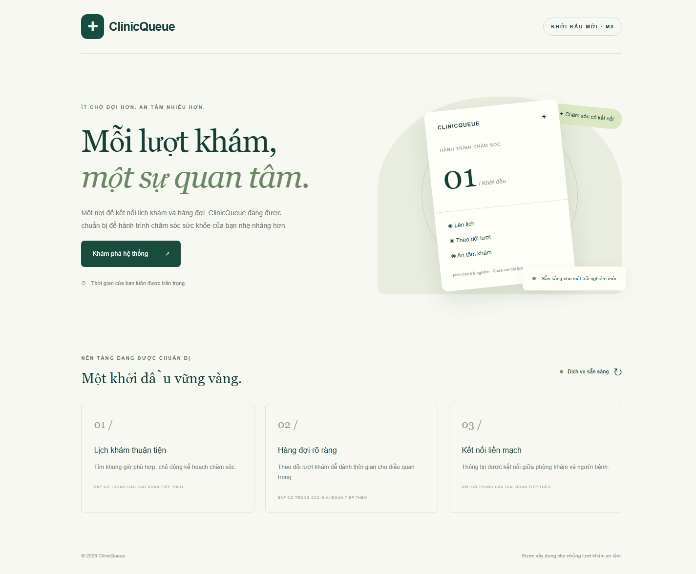

# Báo cáo tiến độ dự án — Tuần 1

- Sinh viên: **Lê Hải Anh**
- MSSV: **dtc245200851**
- Đề tài 09: **Hệ thống đặt lịch khám và quản lý hàng đợi**
- Tên ứng dụng: **ClinicQueue**
- Phạm vi đã thực hiện: **M0 — Khởi tạo hệ thống**.

## Nội dung đã thực hiện

Giữ nguyên solution và 4 project .NET 10: API, Worker, Notification và Contracts. Ba backend cùng tham chiếu Contracts. API và Worker có DbContext riêng, cùng sử dụng database SQL Server ClinicQueue, có migration skeleton và bảng lịch sử migration độc lập trong schema api/worker.

API kiểm tra kết nối database qua /health; /health/live kiểm tra tiến trình. Notification có health endpoint. Worker giữ nguyên tiến trình nền, kiểm tra database và cập nhật heartbeat cho Docker health check; chưa có consumer nghiệp vụ.

Tạo frontend React, TypeScript, Vite và Tailwind CSS với giao diện khởi đầu responsive và nút kiểm tra trạng thái API/Notification. Tạo Dockerfiles, Compose riêng cho ClinicQueue, SQL Server và RabbitMQ; khai báo durable exchange, queues và DLQ. Thông tin nhạy cảm lấy từ biến môi trường, bản nộp chỉ kèm .env.example.

Sửa thiết kế kỹ thuật: SQL Server dùng UPDLOCK/HOLDLOCK; số thứ tự được thiết kế cấp qua bộ đếm tăng đơn điệu, không tái sử dụng số đã hủy; chỉ Worker ghi trạng thái hàng đợi. Những nghiệp vụ này mới ở mức thiết kế, chưa triển khai trong M0.

## Kiểm thử đã thực hiện

- dotnet restore: đạt; dotnet build --no-restore: 0 warning, 0 error.
- EF Core và EF CLI: 10.0.14; không sử dụng EF Core 11.
- npm run build: đạt.
- docker compose config --quiet: đạt.
- Khởi động Docker thực tế: SQL Server, RabbitMQ, API, Worker, Notification, web đều healthy; hai migration job Exited (0).
- Truy vấn SQL xác nhận database ClinicQueue với hai bảng lịch sử migration api/worker, phiên bản 10.0.14.
- Smoke test HTTP: API, Notification, web và health proxy trả 200. Khi thiếu SQL, API readiness trả 503, liveness trả 200, Worker không ghi heartbeat.
- RabbitMQ: đăng nhập Management thành công, 6 durable queue, 0 consumer; event TicketAssigned có hai binding riêng cho API và Notification.
- Edge headless: giao diện qua nginx ở viewport 390px và 1440px không có JavaScript exception; mobile không tràn ngang.

Lệnh chạy và script kiểm thử có trong [README](README.md). Kết quả trên được kiểm thử tại môi trường phát triển ngày 17–18/11/2026; không khẳng định thời điểm nộp trước hạn.

## Minh chứng giao diện

[Ảnh giao diện mobile](docs/images/frontend-mobile.png)

## Chưa thực hiện và kế hoạch tiếp theo

M0 chưa có đăng nhập/đăng ký, CRUD quản trị, đặt lịch, cấp số, RabbitMQ consumer, outbox publisher hay SignalR nghiệp vụ. Vì vậy trang khởi đầu chưa có chức năng đăng nhập hoặc đặt lịch.

Bước tiếp theo theo DESIGN.md là M1: Identity/JWT, quản trị danh mục và các phần nền tảng sự kiện. Các milestone tiếp theo bổ sung đặt lịch, hàng đợi, realtime và kiểm thử tích hợp.
