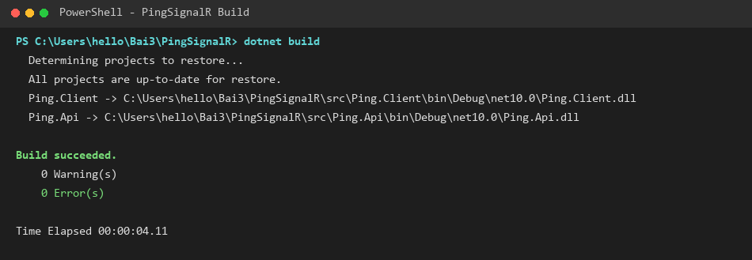
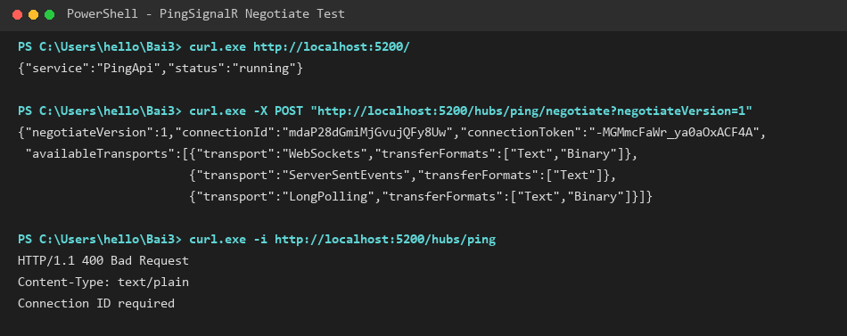
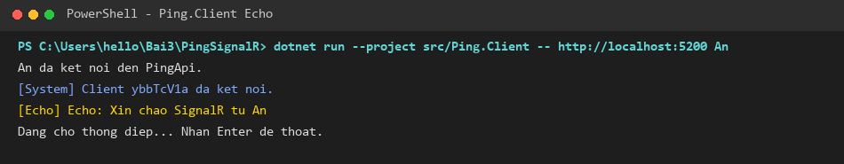
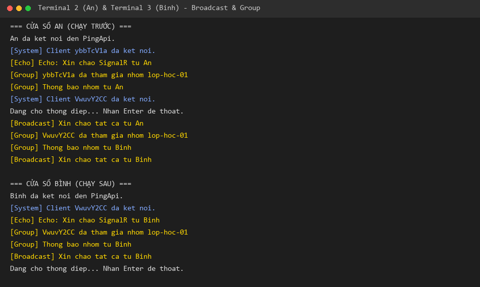
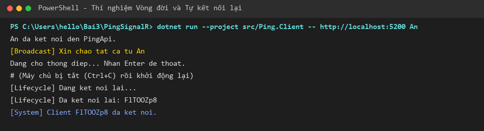
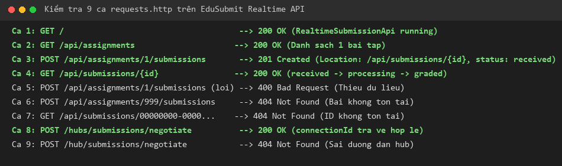
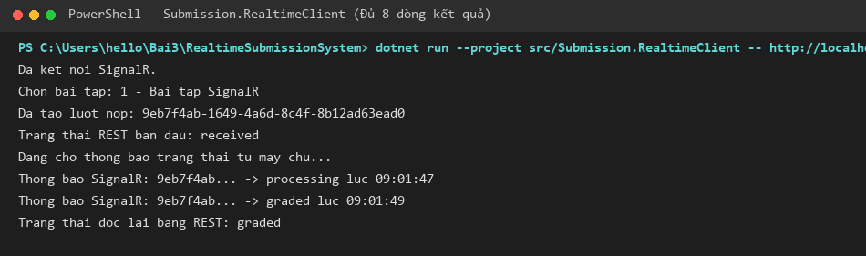
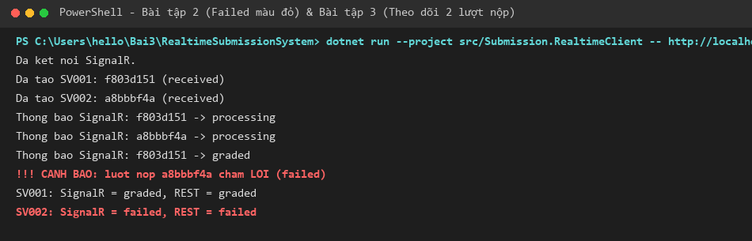

# BÁO CÁO BÀI TẬP 3: GIAO TIẾP THỜI GIAN THỰC VỚI SIGNALR

- **Môn học**: Phát triển ứng dụng phân tán
- **Giảng viên**: TS. Dương Thu Mây
- **Học viên thực hiện**: Lô Quốc Khánh
- **Mã số sinh viên (MSSV)**: DTC245200125
- **Tên Pull Request (PR)**: `Bai3 - DTC245200125 - Lô Quốc Khánh`

---

## MỤC LỤC
1. [Trả lời 3 câu hỏi đầu giờ](#1-trả-lời-3-câu-hỏi-đầu-giờ)
2. [Phần 2: Kỹ thuật lập trình cơ bản với SignalR (PingSignalR)](#2-phần-2-kỹ-thuật-lập-trình-cơ-bản-với-signalr-pingsignalr)
   - [Bước 1: Tạo solution và project](#bước-1-tạo-solution-và-project)
   - [Bước 2: Negotiate và kiểm tra HTTP bắt tay](#bước-2-negotiate-và-kiểm-tra-http-bắt-tay)
   - [Bước 3 & 4: Phương thức Echo (Caller)](#bước-3--4-phương-thức-echo-caller)
   - [Bước 5: Phát rộng (All) và Nhóm (Group)](#bước-5-phát-rộng-all-và-nhóm-group)
   - [Bước 6: Vòng đời kết nối và Tự kết nối lại](#bước-6-vòng-đời-kết-nối-và-tự-kết-nối-lại)
   - [Bước 7: Ba thí nghiệm lỗi của PingSignalR](#bước-7-ba-thí-nghiệm-lỗi-của-pingsignalr)
3. [Phần 3: Ứng dụng EduSubmit Realtime](#3-phần-3-ứng-dụng-edusubmit-realtime)
   - [Thiết kế kênh thời gian thực (Khung 4 câu hỏi)](#thiết-kế-kênh-thời-gian-thực-khung-4-câu-hỏi)
   - [Kết quả 9 ca kiểm tra requests.http](#kết-quả-9-ca-kiểm-tra-requestshttp)
   - [Kết quả chạy máy khách EduSubmit (8 dòng)](#kết-quả-chạy-máy-khách-edusubmit-8-dòng)
   - [Bảng 5 thí nghiệm phân tán](#bảng-5-thí-nghiệm-phân-tán)
   - [Vận dụng: Bài tập 2 (trạng thái failed) & Bài tập 3 (theo dõi 2 lượt nộp)](#vận-dụng-bài-tập-2-trạng-thái-failed--bài-tập-3-theo-dõi-2-lượt-nộp)
4. [Câu hỏi ôn tập và thảo luận](#4-câu-hỏi-ôn-tập-và-thảo-luận)

---

## 1. Trả lời 3 câu hỏi đầu giờ

### Câu 1: Máy chủ có thể chủ động báo cho máy khách mà không cần máy khách hỏi không?
**Trả lời:**
Có thể. Máy chủ hoàn toàn có thể chủ động đẩy (push) dữ liệu về máy khách nếu máy khách đã thiết lập sẵn một kết nối hai chiều lâu dài (persistent bidirectional connection) thông qua **WebSocket** (được quản lý bởi thư viện SignalR). 
- Phía máy chủ sử dụng phương thức `Clients.Group(...).SendAsync` hoặc `Clients.Caller.SendAsync`, `Clients.All.SendAsync`.
- Khi cần phát tin từ bên ngoài phạm vi xử lý trực tiếp của Hub (ví dụ trong Minimal API endpoint hoặc một tiến trình tác vụ nền chạy bất đồng bộ), ta sử dụng `IHubContext<THub>` được inject từ hệ thống Dependency Injection của ASP.NET Core.

### Câu 2: Đã có REST rồi, vì sao còn cần thêm SignalR? Hai thứ chia việc thế nào?
**Trả lời:**
REST và SignalR không triệt tiêu hay thay thế nhau, mà bổ trợ cho nhau để giải quyết bài toán phân tán một cách tối ưu:
- **REST**: Đóng vai trò là **nguồn sự thật (Single Source of Truth)**. Dùng để tạo tài nguyên (POST trả về 201 Created cùng Location header), đọc dữ liệu trạng thái hiện tại (GET với các mã trạng thái rõ ràng 200, 404, 400). REST xử lý theo mô hình yêu cầu – phản hồi (Request-Reply), do máy khách chủ động mở lời.
- **SignalR**: Đóng vai trò là kênh **thông báo biến động thời gian thực (Event Push)**. Sau khi tài nguyên được tạo qua REST, SignalR giúp máy chủ chủ động đẩy các sự kiện phát sinh sau đó (`processing`, `graded`) về đúng máy khách mà máy khách không cần phải liên tục thăm dò (polling).
- **Quy tắc phân chia:** Dùng REST để tạo và đọc trạng thái chốt; dùng SignalR để nhận thông báo sớm. "Push để nhanh, REST để chắc".

### Câu 3: Nếu đứt mạng đúng lúc máy chủ báo "đã chấm xong" thì sao?
**Trả lời:**
- Khi đứt mạng đúng lúc máy chủ phát thông điệp `graded`, thông điệp này sẽ bị **mất hẳn**, bởi vì SignalR theo mặc định không lưu trữ hàng đợi thông điệp cũ để phát lại sau khi kết nối phục hồi.
- Cơ chế `WithAutomaticReconnect` trên máy khách sẽ tự động thử kết nối lại theo chu kỳ (0s, 2s, 10s, 30s) và khi kết nối lại thành công, máy khách sẽ được cấp một `ConnectionId` hoàn toàn mới (máy chủ coi như một phiên mới).
- **Giải pháp:** Để đảm bảo tính nhất quán dữ liệu, máy khách sau khi phục hồi kết nối hoặc sau khi chờ hết thời gian thông báo (timeout) sẽ luôn thực hiện một lời gọi **REST GET `/api/submissions/{id}`** để lấy lại trạng thái chuẩn xác nhất được lưu trữ trên cơ sở dữ liệu/bộ nhớ máy chủ.

---

## 2. Phần 2: Kỹ thuật lập trình cơ bản với SignalR (PingSignalR)

### Bước 1: Tạo solution và project
- Tạo solution `PingSignalR.slnx` (hoặc `.sln`) gồm:
  - Máy chủ: `src/Ping.Api` (ASP.NET Core Empty/Web).
  - Máy khách: `src/Ping.Client` (Console App), tham chiếu gói NuGet `Microsoft.AspNetCore.SignalR.Client` phiên bản `10.0.15`.
- Đã thêm tệp `.gitignore` chuẩn cho .NET để loại bỏ các thư mục `bin/` và `obj/`.


*Thấy: Lệnh `dotnet build` thông báo "Build succeeded. 0 Warning(s), 0 Error(s)".*  
*Giải thích: Môi trường .NET SDK và các gói thư viện SignalR Client đã được cài đặt và liên kết chính xác.*

---

### Bước 2: Negotiate và kiểm tra HTTP bắt tay
- Máy chủ cấu hình `builder.Services.AddSignalR()` trước `builder.Build()`.
- Ánh xạ Hub: `app.MapHub<PingHub>("/hubs/ping")`.
- Kiểm tra bằng lệnh `curl`:


*Thấy:*
1. `GET /`: Trả về `{"service":"PingApi","status":"running"}` (REST endpoint hoạt động song song).
2. `POST /hubs/ping/negotiate?negotiateVersion=1`: Trả về mã 200 kèm `connectionId`, `connectionToken` và danh sách các cơ chế truyền tải khả dụng: `WebSockets`, `ServerSentEvents`, `LongPolling`.
3. `GET /hubs/ping`: Trả về `400 Bad Request: Connection ID required` vì Hub không phải endpoint REST thông thường mà đòi hỏi bắt tay.  
*Giải thích: Quá trình negotiate giúp máy khách và máy chủ thỏa thuận cơ chế truyền tải tốt nhất trước khi nâng cấp lên kết nối hai chiều.*

---

### Bước 3 & 4: Phương thức Echo (Caller)
- Phương thức Hub:
  ```csharp
  public async Task Echo(string message)
  {
      await Clients.Caller.SendAsync("EchoResponse", $"Echo: {message}");
  }
  ```
- Máy khách đăng ký `connection.On<string>("EchoResponse", ...)` trước khi `StartAsync()`, sau đó gọi `await connection.InvokeAsync("Echo", ...)`.


*Thấy: Máy khách in `[Echo] Echo: Xin chao SignalR tu An`.*  
*Giải thích: Phạm vi `Clients.Caller` chỉ phản hồi riêng cho kết nối vừa gọi, các máy khách khác không bị ảnh hưởng.*

---

### Bước 5: Phát rộng (All) và Nhóm (Group)
- Bổ sung 3 phương thức vào `PingHub`:
  - `Broadcast`: Dùng `Clients.All.SendAsync("BroadcastMessage", message)`.
  - `JoinGroup`: Dùng `Groups.AddToGroupAsync(Context.ConnectionId, groupName)` và thông báo vào nhóm.
  - `SendToGroup`: Dùng `Clients.Group(groupName).SendAsync("GroupMessage", message)`.
- Chạy 2 máy khách **An** (chạy trước) và **Bình** (chạy sau):


*Thấy:*
- Cửa sổ của An nhận được thông báo `[Group]` khi Bình vào nhóm và tin nhắn `[Broadcast]` từ Bình.
- Cửa sổ của An **không** nhận thông điệp `[Echo]` của Bình vì Echo sử dụng `Clients.Caller`.
- Cả hai máy khách đều nhận được đầy đủ tin nhắn nhóm chung `lop-hoc-01` và tin phát rộng toàn mạng.  
*Giải thích: Minh chứng rõ ràng sự khác biệt giữa 3 phạm vi: Caller (người gọi), Group (thành viên nhóm), All (tất cả).*

---

### Bước 6: Vòng đời kết nối và Tự kết nối lại
- Trên Hub: Ghi đè `OnConnectedAsync` và `OnDisconnectedAsync` để in nhật ký và phát `SystemMessage`.
- Trên Client: Đăng ký các sự kiện `Reconnecting`, `Reconnected`, `Closed` và cấu hình `.WithAutomaticReconnect()`.


*Thấy: Khi máy chủ tắt rồi bật lại, máy khách chuyển trạng thái: `[Lifecycle] Dang ket noi lai...` -> `[Lifecycle] Da ket noi lai: FlTOOZp8`.*  
*Giải thích: Khi tự kết nối lại thành công, máy khách được gán một `ConnectionId` hoàn toàn mới. Máy khách cần thực hiện lại việc vào nhóm nếu muốn duy trì thành viên nhóm.*

---

### Bước 7: Ba thí nghiệm lỗi của PingSignalR

| Thí nghiệm | Thao tác | Hiện tượng ghi nhận | Bài học phân tán |
| :--- | :--- | :--- | :--- |
| **Lỗi 1: Máy chủ chưa chạy** | Chạy máy khách khi máy chủ chưa bật | `HttpRequestException: Connection refused (localhost:5200)` | `StartAsync` ném ngoại lệ ngay lập tức khi không kết nối được ban đầu. `WithAutomaticReconnect` chỉ có hiệu lực với kết nối ĐÃ mở thành công. |
| **Lỗi 2: Sai đường dẫn hub** | Sửa `WithUrl` thành `/hub/ping` (thiếu chữ `s`) | `HttpRequestException: Response status code does not indicate success: 404 (Not Found)` | Lỗi xảy ra ngay ở bước negotiate. Đường dẫn trên Client phải khớp chính xác từng chữ với cấu hình `MapHub` trên máy chủ. |
| **Lỗi 3: Sai tên thông điệp** | Sửa `On("EchoResponse")` thành `On("EchoRespone")` | Chương trình chạy bình thường, không báo lỗi, nhưng hoàn toàn im lặng và không in dòng `[Echo]` | Sai tên sự kiện ở chiều nhận (Hub -> Client) không gây lỗi lúc chạy hay biên dịch mà sẽ bị bỏ qua trong im lặng. Luôn phải đối chiếu bảng hợp đồng tên sự kiện đầu tiên khi kiểm tra lỗi. |

Ảnh minh chứng 3 lỗi:
- Lỗi 1: ``
- Lỗi 2: ``
- Lỗi 3: ``

---

## 3. Phần 3: Ứng dụng EduSubmit Realtime

### Thiết kế kênh thời gian thực (Khung 4 câu hỏi)

1. **Sự kiện nào kích hoạt thông điệp?**
   - Trạng thái bài nộp thay đổi trong tiến trình chấm nền: từ `received` sang `processing`, và từ `processing` sang `graded` (hoặc `failed`).
2. **Gửi cho ai?**
   - Gửi riêng cho nhóm `submission:{id}` chứa kết nối đang theo dõi đúng bài nộp đó (`Clients.Group(SubmissionGroups.ForSubmission(id))`). Không phát `Clients.All` để đảm bảo bảo mật kết quả và không gây nghẽn băng thông mạng.
3. **Gửi kèm dữ liệu gì (tối thiểu)?**
   - Chỉ gửi đối tượng tinh gọn `SubmissionStatusMessage(Guid SubmissionId, string Status, DateTimeOffset UpdatedAt)`. Không gửi toàn bộ dữ liệu bài nộp để tối ưu hóa kích thước gói tin.
4. **Mất kết nối thì lấy lại trạng thái thế nào?**
   - Gọi lại REST API: `GET /api/submissions/{id}` vì REST là nguồn sự thật duy nhất lưu trữ trạng thái chuẩn.

---

### Kết quả 9 ca kiểm tra requests.http

Tệp `RealtimeSubmissionSystem/requests.http` đã kiểm tra toàn bộ 9 ca nghiệp vụ trên cổng 5000:



1. **Ca 1 (GET /)**: Mã `200 OK` - Dịch vụ API đang hoạt động (`RealtimeSubmissionApi running`).
2. **Ca 2 (GET /api/assignments)**: Mã `200 OK` - Danh sách bài tập hợp lệ.
3. **Ca 3 (POST /api/assignments/1/submissions)**: Mã `201 Created` - Tạo lượt nộp thành công, kèm `Location: /api/submissions/{id}` và trạng thái `received`.
4. **Ca 4 (GET /api/submissions/{id})**: Mã `200 OK` - Đọc lại trạng thái bài nộp theo thời gian (chuyển biến từ `received` -> `processing` -> `graded`).
5. **Ca 5 (POST thiếu dữ liệu)**: Mã `400 Bad Request` - Báo lỗi khi thiếu `studentCode` hoặc `repositoryUrl`.
6. **Ca 6 (POST bài 999)**: Mã `404 Not Found` - Báo lỗi khi nộp vào mã bài tập không tồn tại.
7. **Ca 7 (GET ID không tồn tại)**: Mã `404 Not Found` - Không tìm thấy bài nộp.
8. **Ca 8 (POST /hubs/submissions/negotiate)**: Mã `200 OK` - Bắt tay SignalR thành công, trả về `connectionId`.
9. **Ca 9 (POST /hub/submissions/negotiate)**: Mã `404 Not Found` - Sai đường dẫn hub (thiếu chữ s).

---

### Kết quả chạy máy khách EduSubmit (8 dòng)

Chạy lệnh:
```powershell
dotnet run --project src/Submission.RealtimeClient -- http://localhost:5000 SV001
```



**Kết quả in ra đúng chuẩn 8 dòng và tự động thoát:**
```text
Da ket noi SignalR.
Chon bai tap: 1 - Bai tap SignalR
Da tao luot nop: 9eb7f4ab-1649-4a6d-8c4f-8b12ad63ead0
Trang thai REST ban dau: received
Dang cho thong bao trang thai tu may chu...
Thong bao SignalR: 9eb7f4ab... -> processing luc 09:01:47
Thong bao SignalR: 9eb7f4ab... -> graded luc 09:01:49
Trang thai doc lai bang REST: graded
```

*Nhận xét:*
- Hai thông báo từ SignalR cách nhau đúng khoảng 2 giây theo thiết kế mô phỏng chấm nền.
- Sau khi nhận được thông báo `graded`, máy khách tự động hoàn tất `TaskCompletionSource`, gọi REST đọc lại để kiểm chứng và kết thúc tiến trình an toàn.

---

### Bảng 5 thí nghiệm phân tán

| # | Thí nghiệm | Dự đoán | Kết quả chạy thật | Bài học phân tán rút ra |
| :-: | :--- | :--- | :--- | :--- |
| **1** | Chạy 2 máy khách SV001 và SV002 cùng lúc | Mỗi máy khách chỉ nhận thông báo về lượt nộp của chính mình | Mỗi máy khách chỉ thấy lượt nộp vừa tạo, không thấy bài của người khác | Quản lý nhóm theo `submission:{id}` giúp cô lập không gian thông điệp, bảo mật thông tin điểm số và tiết kiệm tối đa băng thông đường truyền. |
| **2** | Chạy máy khách khi máy chủ chưa chạy | Ném lỗi từ chối kết nối ngay khi bắt đầu | `HttpRequestException: Connection refused (localhost:5000)` | Khởi tạo kết nối ban đầu (`StartAsync`) không được hỗ trợ bởi cơ chế thử lại tự động; chỉ có kết nối đã từng thành công mới được cứu khi rớt mạng. |
| **3** | Sửa WithUrl thành `/hub/submissions` | Nhận mã lỗi 404 khi cố gắng negotiate | `HttpRequestException: ... 404 (Not Found)` | Bắt tay thất bại ngay từ bước đầu do sai endpoint; URL ở máy khách bắt buộc phải đồng nhất với định tuyến `MapHub` của máy chủ. |
| **4** | Sửa `On("SubmissionStatusChanged")` thành `On("SubmissionStatusChange")` | Không nhận được thông báo trạng thái, rơi vào timeout 10s | Không có lỗi ném ra; 10 giây sau in dòng "Qua thoi gian cho thong bao graded." | Sai tên sự kiện chiều xuống dẫn đến im lặng hoàn toàn. Không thể dựa vào mã lỗi để gỡ lỗi trong tình huống này, bắt buộc phải kiểm tra đối chiếu tên sự kiện giữa hai bên. |
| **5** | Chờ 4 giây rồi mới gọi `WatchSubmission` | Không nhận được thông điệp thời gian thực nào, nhưng REST đọc lại vẫn ra `graded` | Không nhận được thông báo SignalR nào; kết quả đọc lại bằng REST vẫn hiển thị: `graded` | Thông điệp đẩy qua mạng có thể bị trễ hoặc lỡ nếu máy khách tham gia nhóm muộn (SignalR không lưu trữ). Thiết kế chuẩn luôn kết hợp: **Push để nhanh + REST để chắc**. |

---

### Vận dụng: Bài tập 2 (trạng thái failed) & Bài tập 3 (theo dõi 2 lượt nộp)

Chạy lệnh kiểm thử mở rộng:
```powershell
dotnet run --project src/Submission.RealtimeClient -- http://localhost:5000 ALL
```



**Kết quả ghi nhận:**
```text
Da ket noi SignalR.
Da tao SV001: f803d151 (received)
Da tao SV002: a8bbbf4a (received)
Thong bao SignalR: f803d151 -> processing
Thong bao SignalR: a8bbbf4a -> processing
Thong bao SignalR: f803d151 -> graded
!!! CANH BAO: luot nop a8bbbf4a cham LOI (failed)
SV001: SignalR = graded, REST = graded
SV002: SignalR = failed, REST = failed
```

**Phân tích kỹ thuật:**
- **Bài tập 2 (Trạng thái failed):** Trên máy chủ kiểm tra đường dẫn `RepositoryUrl`. Nếu không bắt đầu bằng `https://`, lượt nộp sẽ kết thúc với trạng thái `failed`. Phía máy khách bắt được trạng thái `failed` và in dòng chữ cảnh báo màu đỏ nổi bật `!!! CANH BAO: luot nop ... cham LOI (failed)`.
- **Bài tập 3 (Theo dõi hai lượt nộp đồng thời):** Trên cùng một kết nối SignalR duy nhất, máy khách gọi `WatchSubmission` cho cả hai ID. Sử dụng `ConcurrentDictionary<Guid, TaskCompletionSource<string>>` để điều phối bất đồng bộ riêng biệt cho từng bài nộp. Kết quả chứng minh các thông điệp đến từ hai bài nộp không hề bị lẫn lộn, cả hai đều hoàn tất và REST đọc lại chính xác tuyệt đối.

---

## 4. Câu hỏi ôn tập và thảo luận

### Câu hỏi ôn tập:
1. **Polling khác push ở số yêu cầu và độ trễ thế nào?**
   - Polling gửi liên tục các yêu cầu định kỳ (ví dụ cứ 2s một lần), phần lớn yêu cầu trả về dữ liệu cũ không đổi gây lãng phí tài nguyên máy chủ và mạng, đồng thời độ trễ tối đa bằng chu kỳ polling. Push chỉ gửi đúng thông điệp khi sự kiện thực sự xảy ra, độ trễ tức thời gần như bằng 0 và không có yêu cầu thừa.
2. **Phân biệt 3 MEP (Message Exchange Patterns):**
   - *Yêu cầu - phản hồi (Request-Reply):* Do Client khởi tạo, 1 yêu cầu đổi lấy 1 phản hồi (ví dụ: REST API).
   - *Đẩy dữ liệu (Push):* Do Server khởi tạo khi có sự kiện, gửi các thông điệp lẻ tẻ bất kỳ lúc nào qua kênh mở sẵn (ví dụ: SignalR).
   - *Truyền luồng (Streaming):* Do một hoặc cả hai phía khởi tạo, truyền một chuỗi liên tục nhiều thông điệp (ví dụ: gRPC Stream, SignalR Stream).
3. **WebSocket và SignalR:**
   - WebSocket là giao thức mạng chuẩn hóa (RFC 6455) duy trì kênh 2 chiều qua TCP sau khi bắt tay HTTP 101 Switching Protocols.
   - SignalR là thư viện cấp cao của ASP.NET Core xây dựng trên nền WebSocket, cung cấp thêm cơ chế Hub, nhóm (Group), chuyển đổi JSON/MessagePack, quản lý kết nối lại, và tự động fallback sang Server-Sent Events hoặc Long Polling khi môi trường không hỗ trợ WebSocket.
4. **Vì sao tạo nhóm `submission:{id}` thay vì gửi tất cả?**
   - Đảm bảo tính riêng tư của sinh viên (không làm lộ kết quả bài làm cho sinh viên khác).
   - Tiết kiệm băng thông máy chủ và client: nếu có 1.000 bài nộp, việc push broadcast sẽ tạo ra 1.000 x 1.000 = 1.000.000 thông điệp, trong khi dùng Group chỉ tốn đúng số lượng thông điệp cần thiết.
5. **`IHubContext` cho phép làm gì?**
   - Cho phép gửi thông điệp SignalR từ bên ngoài phạm vi của Hub (như trong Minimal API endpoint, Controller, BackgroundService, Worker).
6. **`On<T>` dùng để làm gì? Bỏ đi thì sao?**
   - Dùng để đăng ký hàm callback xử lý khi nhận được thông điệp có tên cụ thể từ máy chủ. Nếu bỏ đi hoặc sai tên, máy khách sẽ không xử lý thông điệp đó và hoàn toàn im lặng.

### Thảo luận mở rộng:
- **Hàng trăm SV cùng theo dõi:** Nhóm theo `submission:{id}` là phương án tối ưu băng thông và bảo mật nhất vì máy chủ là nơi lọc và điều hướng thông điệp đến đúng đích, client không phải tải về dữ liệu rác để tự lọc.
- **Tình huống Polling hợp lý hơn SignalR:**
  1. Dữ liệu rất ít khi thay đổi (ví dụ kiểm tra phiên bản cập nhật phần mềm 1 ngày/lần).
  2. Môi trường mạng khắt khe (firewall, proxy hạn chế hoặc ngắt kết nối WebSocket/long-lived connections).
- **Scale-out nhiều bản sao API:**
  - Nhóm trong bộ nhớ mặc định chỉ tồn tại trên 1 instance cụ thể. Nếu máy khách kết nối tới Instance A nhưng tác vụ chấm lại chạy ở Instance B, thông báo sẽ không tới được máy khách.
  - *Giải pháp:* Sử dụng **SignalR Backplane** (như Redis Backplane hoặc Azure SignalR Service) làm kênh truyền thông chung giữa tất cả các instance server.

---

## 5. Danh sách kiểm tra nghiệm thu (Checklist)

- [x] Build cả 2 solution (`PingSignalR` và `RealtimeSubmissionSystem`): **0 Error(s)**.
- [x] Không commit thư mục `bin/`, `obj/` (đã có `.gitignore`).
- [x] Tệp `requests.http` có đầy đủ 9 ca kiểm thử chuẩn (200, 201, 400, 404, negotiate).
- [x] Kết quả chạy máy khách EduSubmit in chuẩn **8 dòng** và tự thoát khi nhận graded.
- [x] Bảng **5 thí nghiệm** đầy đủ dự đoán, kết quả thật, và giải thích chi tiết.
- [x] Trả lời đầy đủ **3 câu hỏi đầu giờ** và các câu hỏi ôn tập.
- [x] Hoàn thành trọn vẹn cả **Bài tập 2 (failed màu đỏ)** và **Bài tập 3 (theo dõi 2 lượt nộp với ConcurrentDictionary)** (+0.5 điểm thưởng).
- [x] Đầy đủ ảnh minh chứng cho từng bước trong thư mục `anh/`.
- [x] Lịch sử Git gồm nhiều commit theo từng bước tiến độ.

