# Bài 3: Giao tiếp thời gian thực với SignalR (PingSignalR & EduSubmit Realtime)

- **Môn học:** Phát triển ứng dụng phân tán
- **Cấu trúc thư mục:**
  - `PingSignalR/` — Solution thực hành Phần 2 (`Ping.Api` cổng `5200`, `Ping.Client`)
  - `RealtimeSubmissionSystem/` — Solution thực hành Phần 3 (`Submission.RealtimeApi` cổng `5000`, `Submission.RealtimeClient`, `requests.http`, và `LoiGiai/` cho Bài tập vận dụng 2 & 3)
  - `anh/` — Ảnh chụp minh chứng kết quả chạy thật từng bước

---

## 1. Trả lời 3 câu hỏi đầu giờ

### Câu 1: Máy chủ có thể chủ động báo cho máy khách mà không cần máy khách hỏi không?
**Có**, với điều kiện máy khách mở sẵn một **kết nối lâu dài hai chiều** (ví dụ WebSocket thông qua thư viện **SignalR**). Sau khi kết nối đã mở, máy chủ có thể chủ động đẩy thông điệp xuống máy khách bất kỳ lúc nào có sự kiện bằng `Clients.Caller / Clients.All / Clients.Group(...).SendAsync(...)`. Khi cần phát thông điệp từ bên ngoài Hub (như endpoint REST hoặc tác vụ chấm bài nền), máy chủ dùng `IHubContext<THub>` được ASP.NET Core tiêm qua DI.

### Câu 2: Đã có REST rồi, vì sao còn cần thêm SignalR? Hai thứ chia việc thế nào?
HTTP/REST hoạt động theo mô hình **yêu cầu–phản hồi (request–response)**: chỉ máy khách được mở lời, nếu muốn biết bài chấm xong hay chưa bằng REST thuần thì máy khách phải **polling** (hỏi lặp đi lặp lại), vừa gây nhiều yêu cầu thừa vừa có độ trễ. SignalR bổ sung chiều **đẩy dữ liệu (push)** để máy chủ báo ngay khi trạng thái thay đổi.

Hai cơ chế **không thay thế nhau mà bổ sung cho nhau**:
- **REST (nguồn sự thật):** Tạo tài nguyên (`POST /api/assignments/{id}/submissions` trả mã rõ ràng `201`, `400`, `404`) và đọc trạng thái mới nhất (`GET /api/submissions/{id}`).
- **SignalR (kênh báo thay đổi):** Máy khách đăng ký theo dõi đúng lượt nộp (`WatchSubmission(id)` vào nhóm `submission:{id}`) và nhận thông báo tức thì (`SubmissionStatusChanged`: `processing` → `graded`) phát sinh sau yêu cầu ban đầu.

### Câu 3: Nếu đứt mạng đúng lúc máy chủ báo "đã chấm xong" (`graded`) thì sao?
**Thông điệp `graded` đó bị mất hẳn** vì SignalR **không lưu trữ** tin nhắn chờ gửi lại khi máy khách mất kết nối.
- Nhờ `WithAutomaticReconnect()`, máy khách sẽ tự động kết nối lại theo lịch mặc định (`0s, 2s, 10s, 30s`) và nhận một **`ConnectionId` mới** (máy chủ coi đây là kết nối mới nên cũng mất tư cách thành viên các nhóm cũ).
- Để không bỏ sót trạng thái, sau khi nối lại (hoặc khi hết thời gian chờ / mở lại trang), máy khách phải **đăng ký lại nhóm** (`WatchSubmission`) nếu cần theo dõi tiếp và **gọi lại REST `GET /api/submissions/{id}`** để đọc trạng thái cuối cùng từ nguồn sự thật (*Push để nhanh, REST để chắc*).

---

## 2. Nhật ký thực hành Phần 2: `PingSignalR` (Bước 1 → Bước 7)

### Bước 1: Tạo solution, 2 project, thêm gói `Microsoft.AspNetCore.SignalR.Client` và build
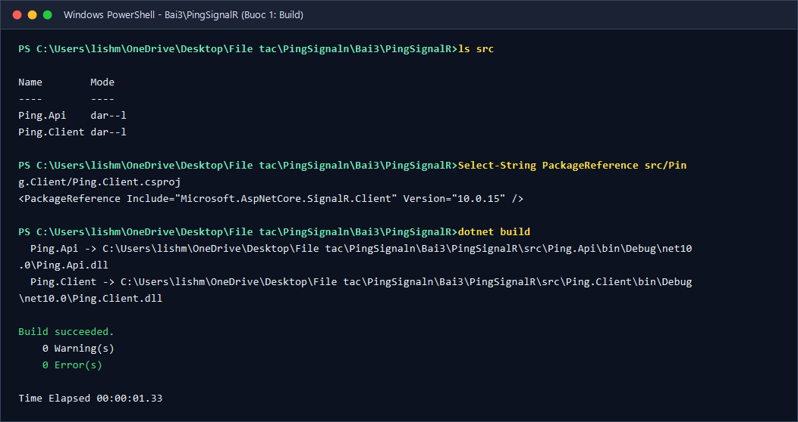
- **Thấy:** `ls src` có đúng 2 thư mục `Ping.Api` và `Ping.Client`; `Ping.Client.csproj` có `<PackageReference Include="Microsoft.AspNetCore.SignalR.Client" Version="10.0.15" />`; lệnh `dotnet build` báo `Build succeeded. 0 Warning(s), 0 Error(s)`.
- **Giải thích:** Máy chủ dùng framework `Microsoft.AspNetCore.App` đã tích hợp sẵn SignalR nên không cần cài thêm gói, còn máy khách Console cần cài gói `Microsoft.AspNetCore.SignalR.Client` phiên bản `10.0.15`.

### Bước 2: Máy chủ `AddSignalR`, `MapHub<PingHub>("/hubs/ping")` và kiểm tra `negotiate`
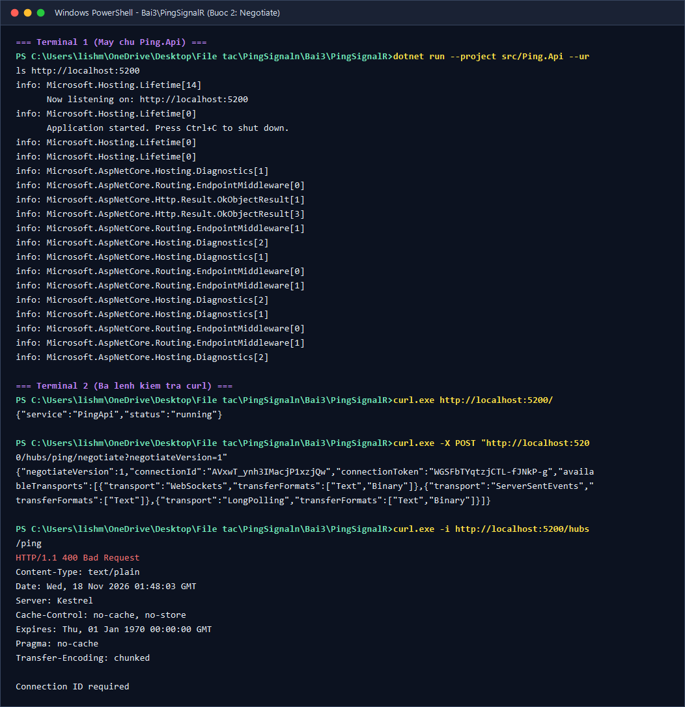
- **Thấy:** `GET http://localhost:5200/` trả `{"service":"PingApi","status":"running"}`; `POST /hubs/ping/negotiate?negotiateVersion=1` trả về JSON chứa `connectionId`, `connectionToken` và `availableTransports` có đủ `WebSockets`, `ServerSentEvents`, `LongPolling`; `GET /hubs/ping` trả `400 Bad Request` (`Connection ID required`).
- **Giải thích:** Endpoint REST vẫn hoạt động song song với Hub. Bước `negotiate` là bước bắt tay đầu tiên để máy chủ cấp định danh kết nối và liệt kê 3 cơ chế truyền tải theo thứ tự ưu tiên.

### Bước 3 & Bước 4: Phương thức `Echo` (`Clients.Caller`) và máy khách `HubConnection`
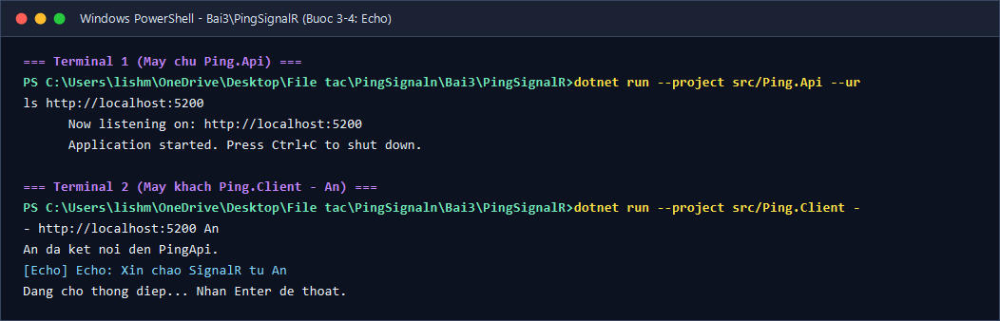
- **Thấy:** Máy chủ lắng nghe ở `http://localhost:5200`; máy khách `An` kết nối thành công và in `[Echo] Echo: Xin chao SignalR tu An`.
- **Giải thích:** Máy khách thực hiện đúng thứ tự `Build()` → đăng ký `On<string>("EchoResponse", ...)` → `StartAsync()` → `InvokeAsync("Echo", ...)`. Máy chủ nhận lời gọi và trả lời riêng cho người gọi thông qua `Clients.Caller`.

### Bước 5: Phát rộng (`Clients.All`) và Nhóm (`Clients.Group`)
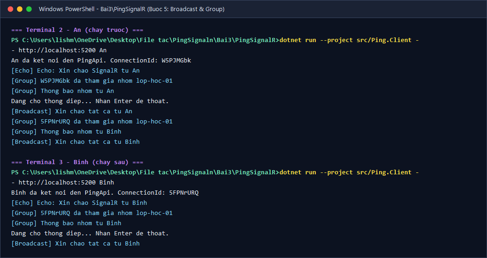
- **Thấy:** Chạy `An` trước rồi chạy `Binh` sau: cửa sổ `An` nhận được `[Group] ... da tham gia nhom lop-hoc-01`, `[Group] Thong bao nhom tu Binh`, và `[Broadcast] Xin chao tat ca tu Binh`, nhưng **không** nhận `[Echo]` của `Binh`.
- **Giải thích:**
  - `Clients.Caller`: chỉ trả về kết nối vừa gọi (`Echo`).
  - `Clients.Group("lop-hoc-01")`: chỉ gửi tới các kết nối đã tham gia nhóm qua `Groups.AddToGroupAsync`.
  - `Clients.All`: gửi tới mọi kết nối đang mở, bao gồm cả người gửi (`Broadcast`).
  - `Clients.Client(id)`: gửi riêng cho một `ConnectionId` cụ thể.

### Bước 6: Vòng đời kết nối và thí nghiệm tự kết nối lại (`WithAutomaticReconnect`)
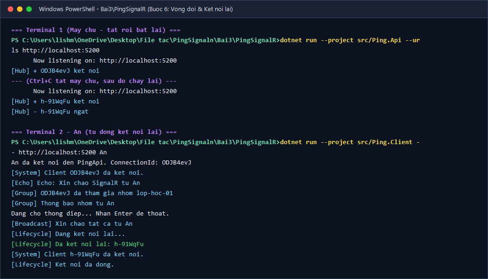
- **Thấy:** Máy chủ in `[Hub] + ODJB4evJ ket noi`. Khi tắt máy chủ rồi khởi động lại, máy khách `An` tự động in `[Lifecycle] Dang ket noi lai...`, sau đó `[Lifecycle] Da ket noi lai: h-91WqFu` (một `ConnectionId` mới khác `ODJB4evJ`) và `[System] Client h-91WqFu da ket noi.`.
- **Giải thích:** `WithAutomaticReconnect()` tự thử kết nối lại sau `0s, 2s, 10s, 30s`. Khi kết nối lại thành công, máy chủ cấp `ConnectionId` mới và không giữ lại trạng thái nhóm cũ hay các tin nhắn gửi lúc bị rớt.

### Bước 7: Ba thí nghiệm lỗi trên `PingSignalR`

| # | Làm gì | Kết quả thấy được | Giải thích vì sao |
|---|---|---|---|
| 1 | Tắt máy chủ, chạy `Ping.Client` | `HttpRequestException: No connection could be made because the target machine actively refused it. (localhost:5200)` | `StartAsync()` ném ngoại lệ ngay ở lần kết nối đầu tiên; `WithAutomaticReconnect()` chỉ cứu kết nối **đã mở** trước đó. |
| 2 | Sửa `WithUrl` thành `/hub/ping` (thiếu chữ `s`) | `HttpRequestException: Response status code does not indicate success: 404 (Not Found)` tại `HttpConnection.NegotiateAsync` | Lỗi xảy ra ngay ở bước bắt tay `negotiate` vì đường dẫn không khớp tuyến đã `MapHub<PingHub>("/hubs/ping")`. |
| 3 | Sửa `On<string>("EchoResponse", ...)` thành `On<string>("EchoRespone", ...)` | Không có lỗi biên dịch hay lỗi chạy; các dòng `[System]`, `[Group]`, `[Broadcast]` vẫn hiện, nhưng **không có dòng `[Echo]`** | Hợp đồng chiều xuống (`SendAsync` ↔ `On`) dựa trên chuỗi tên; sai một chữ sẽ bị bỏ qua im lặng nên khi "không nhận được gì" phải so tên hai phía đầu tiên. |

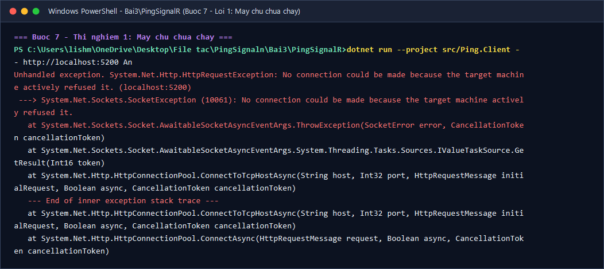
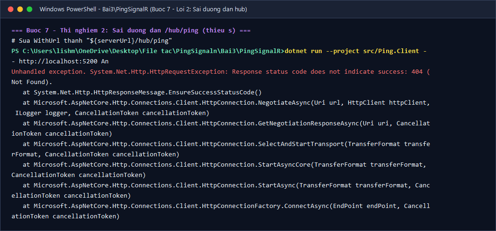
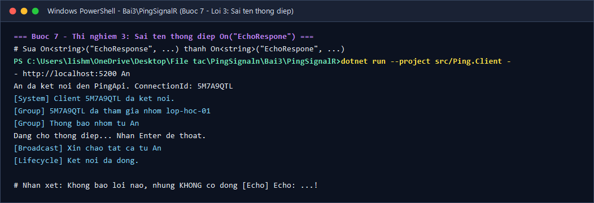

*(Đã khôi phục lại `src/Ping.Client/Program.cs` đúng sau khi hoàn thành thí nghiệm.)*

---

## 3. Nhật ký thực hành Phần 3: `RealtimeSubmissionSystem` (EduSubmit Realtime)

### 3.1. Thiết kế kênh thời gian thực theo khung 4 câu hỏi

| Câu hỏi | Thiết kế cho EduSubmit Realtime | Đoạn code tương ứng |
|---|---|---|
| ① Sự kiện nào kích hoạt thông điệp? | Mỗi lần trạng thái lượt nộp thay đổi: `received` → `processing` → `graded` | `SimulateGradingAsync` gọi `UpdateStatusAsync(id, status, ...)` |
| ② Gửi cho ai? | Chỉ các máy khách đang theo dõi đúng lượt nộp đó (tránh lộ dữ liệu và tiết kiệm băng thông) | `hub.Clients.Group($"submission:{id}")` |
| ③ Gửi kèm dữ liệu gì (tối thiểu)? | Mã lượt nộp, trạng thái mới, thời điểm cập nhật | `record SubmissionStatusMessage(Guid SubmissionId, string Status, DateTimeOffset UpdatedAt)` |
| ④ Mất kết nối thì lấy lại trạng thái thế nào? | Đọc lại từ nguồn sự thật REST | `GET /api/submissions/{id}` (`http.GetFromJsonAsync<SubmissionDto>(...)`) |

### 3.2. Kết quả chạy máy khách `Submission.RealtimeClient` (đủ 8 dòng)

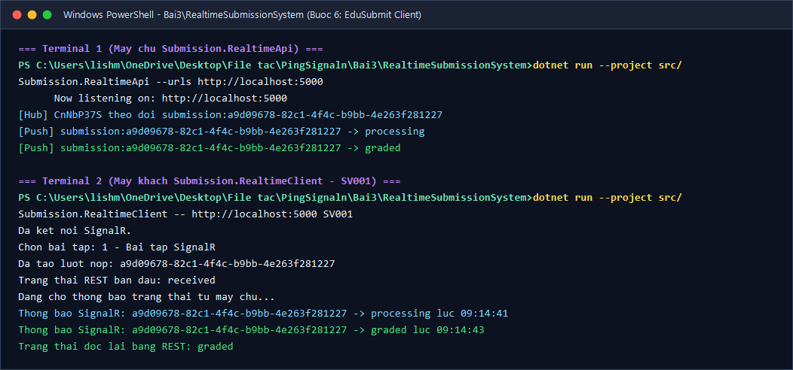

Kết quả thực tế (8 dòng chuẩn, 2 thông báo SignalR cách nhau 2 giây, máy khách tự thoát sau khi nhận `graded`):

```text
Da ket noi SignalR.
Chon bai tap: 1 - Bai tap SignalR
Da tao luot nop: a9d09678-82c1-4f4c-b9bb-4e263f281227
Trang thai REST ban dau: received
Dang cho thong bao trang thai tu may chu...
Thong bao SignalR: a9d09678-82c1-4f4c-b9bb-4e263f281227 -> processing luc 09:14:41
Thong bao SignalR: a9d09678-82c1-4f4c-b9bb-4e263f281227 -> graded luc 09:14:43
Trang thai doc lai bang REST: graded
```

Log phía máy chủ `Submission.RealtimeApi`:
```text
Now listening on: http://localhost:5000
[Hub] CnNbP37S theo doi submission:a9d09678-82c1-4f4c-b9bb-4e263f281227
[Push] submission:a9d09678-82c1-4f4c-b9bb-4e263f281227 -> processing
[Push] submission:a9d09678-82c1-4f4c-b9bb-4e263f281227 -> graded
```

### 3.3. Kiểm thử `requests.http` (đủ 9 ca + 1 ca bổ sung bài tập đã đóng)

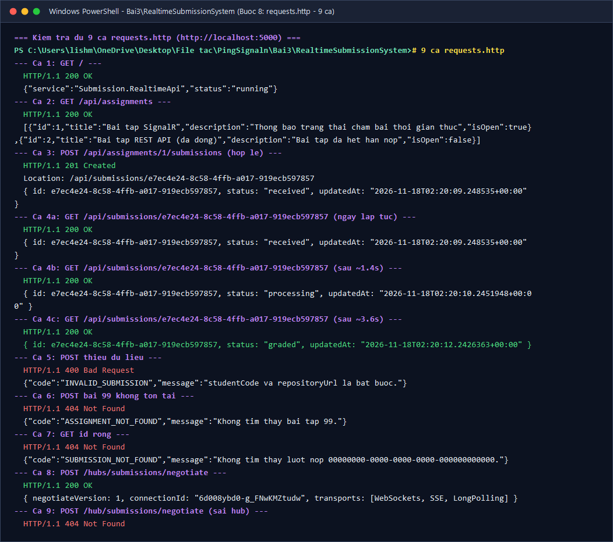

- Ca 1 (`GET /`): `200 OK`
- Ca 2 (`GET /api/assignments`): `200 OK`
- Ca 3 (`POST /api/assignments/1/submissions` hợp lệ): `201 Created` + header `Location`, `status: "received"`
- Ca 4 (`GET /api/submissions/{id}`): `200 OK`, gọi nhiều lần thấy trạng thái đổi dần `received` → `processing` (~1s) → `graded` (~3s) kèm `updatedAt` tăng dần
- Ca 5 (`POST` thiếu `studentCode`/`repositoryUrl`): `400 Bad Request` (`INVALID_SUBMISSION`)
- Ca 6 (`POST` bài tập 99 không tồn tại): `404 Not Found` (`ASSIGNMENT_NOT_FOUND`)
- Ca 7 (`GET /api/submissions/00000000-0000-0000-0000-000000000000`): `404 Not Found` (`SUBMISSION_NOT_FOUND`)
- Ca 8 (`POST /hubs/submissions/negotiate?negotiateVersion=1`): `200 OK` trả về `connectionId` và 3 transport
- Ca 9 (`POST /hub/submissions/negotiate?negotiateVersion=1` sai hub): `404 Not Found`

### 3.4. Bước 7: Bảng 5 thí nghiệm phân tán (Dự đoán – Kết quả thật – Giải thích)

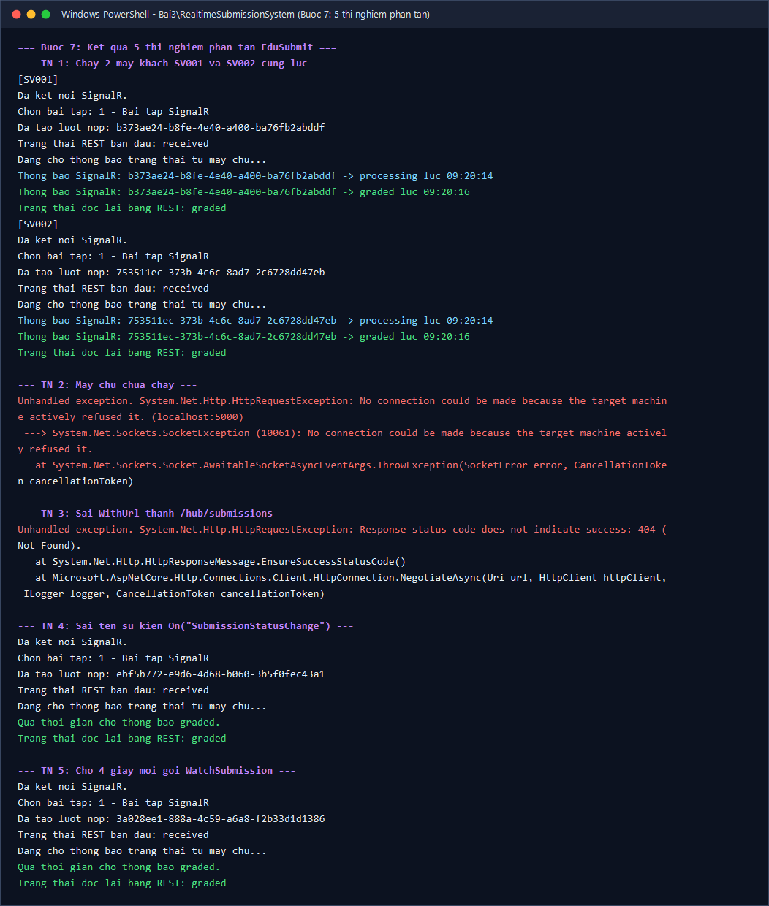

| # | Thí nghiệm | Dự đoán | Kết quả thật | Giải thích |
|---|---|---|---|---|
| 1 | Chạy 2 máy khách `SV001` và `SV002` cùng lúc | Mỗi máy khách chỉ nhận thông báo của lượt nộp do chính mình tạo | `SV001` chỉ nhận `processing`/`graded` của `b373ae24-...`; `SV002` chỉ nhận của `753511ec-...` | Mỗi lượt nộp có nhóm riêng `submission:{id}`, máy chủ định tuyến đúng người nhận qua `Clients.Group(...)` nên không lẫn thông báo. |
| 2 | Chạy máy khách khi máy chủ chưa chạy | Lỗi từ chối kết nối ngay ở `StartAsync()` | `HttpRequestException: No connection could be made because the target machine actively refused it. (localhost:5000)` | Lần kết nối đầu tiên thất bại sẽ ném lỗi ngay; `WithAutomaticReconnect()` chỉ hoạt động sau khi đã từng kết nối thành công. |
| 3 | Sửa `WithUrl` thành `/hub/submissions` | Báo lỗi `404 Not Found` khi bắt tay | `HttpRequestException: Response status code does not indicate success: 404 (Not Found)` tại `NegotiateAsync` | Đường dẫn hub không khớp `app.MapHub<SubmissionHub>("/hubs/submissions")` nên bước `negotiate` trả về 404. |
| 4 | Sửa `On("SubmissionStatusChanged")` thành `On("SubmissionStatusChange")` | Không báo lỗi, hết 10 giây in quá thời gian chờ, sau đó REST vẫn đọc được `graded` | Không có ngoại lệ; sau 10 giây in `Qua thoi gian cho thong bao graded.`; dòng cuối: `Trang thai doc lai bang REST: graded` | Sai tên sự kiện ở chiều máy chủ → máy khách sẽ bị bỏ qua im lặng; nhờ bước chốt bằng REST nên vẫn đọc được trạng thái cuối cùng đúng. |
| 5 | Chờ 4 giây rồi mới gọi `WatchSubmission` | Lỡ toàn bộ tin SignalR (chấm xong sau 3s), hết 10 giây báo timeout, REST vẫn đọc được `graded` | Không nhận tin SignalR nào; in `Qua thoi gian cho thong bao graded.`; dòng cuối: `Trang thai doc lai bang REST: graded` | Vào nhóm muộn sau khi máy chủ đã phát sự kiện thì bị lỡ tin (SignalR không phát lại tin cũ); chứng minh REST luôn là nguồn sự thật. |

### 3.5. Bài tập vận dụng (BT2, BT3, BT4)

- **Bài tập 2 (trạng thái `failed`) & Bài tập 3 (theo dõi 2 lượt nộp cùng lúc):** được cài đặt đầy đủ trong thư mục độc lập `RealtimeSubmissionSystem/LoiGiai/` (không nằm trong file `.slnx`, đúng yêu cầu Slide 62).
  - Phía máy chủ (`LoiGiai/Submission.RealtimeApi`): nếu `RepositoryUrl` không bắt đầu bằng `https://` thì trạng thái cuối sau chấm nền là `failed` thay vì `graded` (ảnh hưởng câu hỏi ① và ③ trong khung 4 câu hỏi).
  - Phía máy khách (`LoiGiai/Submission.RealtimeClient`): tạo 2 lượt nộp (`SV001` dùng `https://...` → `graded`, `SV002` dùng `http://...` → `failed`), đăng ký `WatchSubmission` cho cả hai trên **cùng một kết nối SignalR**, dùng `ConcurrentDictionary<Guid, TaskCompletionSource<string>>` để theo dõi độc lập từng lượt nộp mà không trộn lẫn, và in cảnh báo màu đỏ (`ConsoleColor.Red`) khi nhận trạng thái `failed`.
  - **Bài tập 4 (chạy khi API tắt và giải thích):** Khi `Submission.RealtimeApi` chưa chạy, `Submission.RealtimeClient` thất bại ngay tại `await connection.StartAsync()` với `HttpRequestException` (`SocketException 10061` – `Connection refused`), không chạy tiếp sang bước gọi REST. Điều này chứng minh `WithAutomaticReconnect()` chỉ phục hồi kết nối đã từng thiết lập thành công, còn lần kết nối khởi tạo cần cơ chế retry/xử lý lỗi rõ ràng phía ứng dụng.

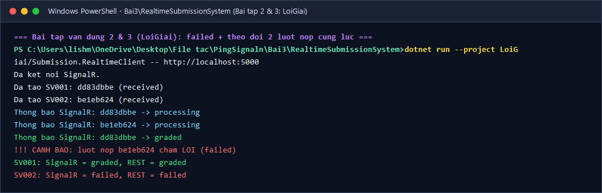

---

## 4. Trả lời câu hỏi ôn tập và thảo luận (Slide 68)

### Phần ôn tập
1. **Polling khác push ở số yêu cầu và độ trễ thế nào?**
   Polling gửi yêu cầu định kỳ nên phần lớn yêu cầu trả về dữ liệu cũ (tốn tài nguyên) và luôn có độ trễ tối đa bằng chu kỳ hỏi; còn Push chỉ gửi khi máy chủ phát sinh sự kiện (100% thông điệp có ích) và gần như tức thì.
2. **Phân biệt 3 MEP theo hướng khởi tạo và số thông điệp:**
   - *Yêu cầu–phản hồi (Request–Response):* máy khách khởi tạo; 1 yêu cầu → 1 phản hồi (REST).
   - *Đẩy dữ liệu (Push):* máy chủ khởi tạo khi có sự kiện; từng thông điệp lẻ, không đều (SignalR).
   - *Truyền luồng (Streaming):* một hoặc cả hai phía khởi tạo; chuỗi nhiều thông điệp liên tục (SignalR stream, gRPC stream).
3. **WebSocket, SignalR: giao thức hay thư viện?**
   **WebSocket** là *giao thức* (RFC 6455) giữ kênh hai chiều sau bắt tay HTTP; **SignalR** là *thư viện* cấp cao của ASP.NET Core xây trên WebSocket, cung cấp Hub, Group, ConnectionId, tự kết nối lại và truyền tải dự phòng.
4. **SignalR có những cơ chế truyền tải dự phòng nào?**
   Theo thứ tự ưu tiên: (1) **WebSockets** → (2) **Server-Sent Events (SSE)** → (3) **Long Polling**.
5. **Vì sao tạo nhóm `submission:{id}` thay vì gửi tất cả?**
   Hai lý do: **riêng tư** (không để lộ trạng thái bài của sinh viên này cho sinh viên khác) và **tiết kiệm băng thông** (chỉ gửi đúng người cần nhận thay vì phát rộng tới mọi kết nối).
6. **`IHubContext` cho phép làm gì?**
   Cho phép đẩy thông điệp SignalR tới các client/nhóm từ **bên ngoài lớp Hub** (ví dụ từ Minimal API endpoint, background service, worker), vì bản thân đối tượng `Hub` chỉ tồn tại trong một lời gọi.
7. **`On<T>` dùng để làm gì? Bỏ đi thì sao?**
   `On<T>("TenSuKien", handler)` đăng ký hàm xử lý khi máy chủ gọi `SendAsync("TenSuKien", payload)`. Nếu bỏ đi (hoặc đặt sai tên), máy khách không báo lỗi nhưng hoàn toàn không xử lý/hiển thị thông điệp gửi xuống.
8. **REST làm gì, SignalR làm gì? Vì sao không dùng SignalR để tạo lượt nộp?**
   REST dùng để tạo và đọc tài nguyên (có chuẩn HTTP status code `201/400/404`, header `Location`, dễ cache/retry/kiểm thử bằng HTTP client); SignalR chỉ đẩy thông báo thay đổi phát sinh sau đó. Không dùng SignalR tạo lượt nộp vì mất ngữ nghĩa tài nguyên HTTP và khó tái sử dụng hạ tầng REST chuẩn.
9. **`WithAutomaticReconnect` có tác dụng gì?**
   Tự động thử thiết lập lại kết nối khi kênh SignalR đang mở bị gián đoạn (mặc định sau `0s, 2s, 10s, 30s`) và phát các sự kiện vòng đời `Reconnecting`, `Reconnected`, `Closed`.
10. **Mất kết nối đúng lúc báo `graded` thì làm gì?**
    Thông điệp push đó bị mất; khi nối lại thành công (`Reconnected`), máy khách có `ConnectionId` mới nên cần gọi lại `WatchSubmission` (nếu còn theo dõi) và gọi REST `GET /api/submissions/{id}` để đồng bộ trạng thái thật mới nhất.

### Phần thảo luận
1. **Hàng trăm SV cùng theo dõi: nhóm theo `id` hay phát tất cả rồi tự lọc? Cách nào tiết kiệm băng thông?**
   **Nhóm theo `id` (`submission:{id}`)** tốt hơn hẳn: với 100 sinh viên và mỗi bài đổi trạng thái 2 lần, nhóm theo `id` chỉ tốn `100 × 2 = 200` thông điệp và đảm bảo riêng tư; còn phát tất cả (`Clients.All`) rồi máy khách tự lọc tốn `100 × 100 × 2 = 20.000` thông điệp và làm lộ dữ liệu lượt nộp của sinh viên khác.
2. **Nêu 2 tình huống polling là lựa chọn hợp lý hơn SignalR:**
   - Dữ liệu ít thay đổi và chấp nhận độ trễ vài chục giây đến vài phút (ví dụ: bảng tin thông báo chung, tỷ giá/thời tiết cập nhật theo phút).
   - Môi trường mạng/proxy/tường lửa nghiêm ngặt chặn kết nối lâu dài (WebSocket/SSE) hoặc thiết bị tài nguyên hạn chế không muốn giữ kết nối thường trực.
3. **Chạy nhiều bản sao API (scale-out) thì nhóm trong bộ nhớ gặp vấn đề gì? Sửa thế nào?**
   Mặc định danh sách kết nối và nhóm nằm trong bộ nhớ của từng tiến trình máy chủ; nếu sinh viên A nối tới **Instance 1** nhưng tác vụ chấm nền đẩy tin từ **Instance 2**, sinh viên A sẽ **không nhận được thông báo**. Cách khắc phục: cấu hình **backplane dùng chung** như **Redis Backplane** (`AddStackExchangeRedis`) hoặc dịch vụ quản lý như **Azure SignalR Service** để đồng bộ thông điệp và nhóm giữa mọi bản sao.

---

## 5. Hướng dẫn build & chạy nhanh

```powershell
# 1. PingSignalR (cong 5200)
cd Bai3/PingSignalR
dotnet build
# Terminal 1:
dotnet run --project src/Ping.Api --urls http://localhost:5200
# Terminal 2:
dotnet run --project src/Ping.Client -- http://localhost:5200 An

# 2. RealtimeSubmissionSystem (cong 5000)
cd ../RealtimeSubmissionSystem
dotnet build
# Terminal 1:
dotnet run --project src/Submission.RealtimeApi --urls http://localhost:5000
# Terminal 2:
dotnet run --project src/Submission.RealtimeClient -- http://localhost:5000 SV001

# 3. Bai tap van dung 2 & 3 (LoiGiai)
# Terminal 1:
dotnet run --project LoiGiai/Submission.RealtimeApi --urls http://localhost:5000
# Terminal 2:
dotnet run --project LoiGiai/Submission.RealtimeClient -- http://localhost:5000
```

