# Bài 3 · Giao tiếp thời gian thực với SignalR

- **Sinh viên** Lý Huy Hiệu
- **Mã sinh viên** DTC245200767
- **Lớp** CNTT K23E
- **Học phần** Phát triển ứng dụng phân tán

## 1. Build và chạy trên Windows

Dùng .NET 10 SDK. Mở PowerShell trong thư mục `Bai3`. Hai máy khách dùng gói Microsoft.AspNetCore.SignalR.Client 10.0.15 theo bài giảng. Lần build đầu cần truy cập NuGet.

```powershell
dotnet --version
dotnet build .\PingSignalR\PingSignalR.slnx
dotnet build .\RealtimeSubmissionSystem\RealtimeSubmissionSystem.slnx
```

### PingSignalR

Mở ba cửa sổ PowerShell tại `Bai3`. Chạy dòng thứ nhất ở cửa sổ máy chủ, dòng thứ hai ở cửa sổ An, rồi chạy dòng thứ ba ở cửa sổ Bình.

```powershell
dotnet run --project .\PingSignalR\src\Ping.Api
dotnet run --project .\PingSignalR\src\Ping.Client -- http://localhost:5200 An
dotnet run --project .\PingSignalR\src\Ping.Client -- http://localhost:5200 Binh
```

An và Bình nhận tin `Group` và `Broadcast` của Bình. Mỗi người có đúng một dòng `[Echo]` từ lời gọi riêng. Nhấn Enter để thoát máy khách. Muốn quan sát kết nối lại, giữ máy khách đang chạy, nhấn Ctrl+C để tắt máy chủ rồi chạy máy chủ lại cùng cổng. Máy khách sẽ gọi lại `JoinGroup` sau khi kết nối lại.

| Thí nghiệm Ping | Cách thực hiện | Giải thích |
|---|---|---|
| Máy chủ tắt | Dừng Ping.Api rồi chạy An bình thường. | `StartAsync` thất bại ngay với `Connection refused`. Tự kết nối lại áp dụng sau khi đã mở kết nối. |
| Sai đường dẫn hub | Giữ máy chủ chạy, thêm `--wrong-hub` ở cuối lệnh An. | Máy khách gọi negotiate trên `/hub/ping` và nhận 404. |
| Sai tên sự kiện | Giữ máy chủ chạy, thêm `--wrong-event` ở cuối lệnh An. | Lời gọi Echo thành công. Máy khách đăng ký `EchoRespone` nên dòng `[Echo]` vắng mặt. |
| Sai tên phương thức | Giữ máy chủ chạy, thêm `--wrong-method` ở cuối lệnh An. | `InvokeAsync` gọi `Ech` nên máy chủ trả lỗi phương thức không tồn tại. |

### EduSubmit realtime

Mở cửa sổ máy chủ và cửa sổ máy khách tại `Bai3`. Máy khách tự thoát sau khi nhận trạng thái cuối và đối chiếu bằng GET.

```powershell
dotnet run --project .\RealtimeSubmissionSystem\src\Submission.RealtimeApi
dotnet run --project .\RealtimeSubmissionSystem\src\Submission.RealtimeClient -- http://localhost:5000 SV001
```

Máy chủ trả `201 Created` với trạng thái `received`, chuyển sang `processing` sau khoảng 1 giây và sang `graded` hoặc `failed` sau khoảng 2 giây nữa. API cập nhật trạng thái trong bộ nhớ trước khi phát thông báo. Dữ liệu của lần chạy hiện tại mất khi khởi động lại API.

Mở `RealtimeSubmissionSystem/requests.http` trong VS Code có REST Client. Chạy ca 3 trước ca 4 để dùng lại ID từ phản hồi POST. Ca 4 có thể chạy nhiều lần để xem trạng thái đổi. Mã mong đợi của chín ca theo thứ tự là `200, 200, 201, 200, 400, 404, 404, 200, 404`.

## 2. Bài vận dụng

| Bài | Cách chạy | Cách kiểm tra |
|---|---|---|
| **2 · Trạng thái failed** | Giữ API chạy, thêm `--failed` sau `SV001`. | Máy khách gửi URL bắt đầu bằng `http://`. SignalR trả `failed` và console in cảnh báo đỏ. GET đọc lại `failed`. |
| **3 · Theo dõi hai lượt nộp** | Giữ API chạy, thêm `--two` sau `SV001`. | Một kết nối gọi `WatchSubmission` cho hai ID. `ConcurrentDictionary<Guid, TaskCompletionSource<string>>` giữ một tác vụ chờ riêng cho mỗi lượt. SV001 dùng HTTPS và có kết quả `graded`, SV002 dùng HTTP và có kết quả `failed`. Mỗi dòng tóm tắt ghi ID và hai kết quả SignalR/REST để đối chiếu. |
| **4 · Chạy khi API tắt** | Dừng EduSubmit API bằng Ctrl+C rồi chạy lệnh máy khách bình thường. | `StartAsync` ngay đầu chương trình báo `HttpRequestException: Connection refused`. Không có kết nối đang hoạt động để `WithAutomaticReconnect` khôi phục. Máy khách thoát mã 1. Mở API và chạy lại máy khách để thử từ đầu. |

## 3. Nhật ký năm thí nghiệm EduSubmit

Các tùy chọn dưới đây đứng sau `SV001` trong lệnh máy khách. Với phép thử hai máy khách, mở hai cửa sổ, chạy máy khách thường với `SV001` và `SV002` trong lúc API đang chạy.

| # | Thí nghiệm | Dự đoán trước khi chạy | Kết quả thực tế | Giải thích |
|---|---|---|---|---|
| 1 | Hai máy khách SV001 và SV002 | Mỗi máy khách chỉ nhận thông báo của ID riêng. | Cả hai nhận processing và graded. Mỗi cửa sổ chỉ in ID của lượt vừa tạo. | Mỗi kết nối vào một nhóm `submission:{id}`. |
| 2 | API tắt | Máy khách lỗi ngay lần kết nối đầu. | HttpRequestException với Connection refused tại cổng 5000. Mã thoát 1. | `StartAsync` thất bại trước khi máy khách gọi POST. |
| 3 | `--wrong-hub` | Bước negotiate gặp 404. | HttpRequestException với 404 (Not Found). Mã thoát 1. | `/hub/submissions` không trùng đường dẫn `MapHub`. |
| 4 | `--wrong-event` | Máy khách không nhận được sự kiện và phải đọc kết quả bằng REST. | Không có dòng thông báo SignalR. Hết 10 giây chờ, REST trả graded. | Tên đăng ký thiếu chữ `d` cuối của `SubmissionStatusChanged`. |
| 5 | `--late-watch` | Vào nhóm sau khi trạng thái đã đổi nên lỡ cả hai thông báo. | Không có dòng thông báo SignalR sau khi Watch muộn 4 giây. REST trả graded. | SignalR không phát lại thông báo cũ. GET trả trạng thái đã lưu. |

### Minh chứng chạy chương trình

Hai solution đã build trên Linux với 0 cảnh báo và 0 lỗi. Cả 9 ca trong requests.http và 7 ca chấm chạy được theo mã phản hồi mong đợi. Các ảnh trong thư mục anh được dựng từ đầu ra chạy thật trên Linux, với những dòng liên quan được trích để dễ đọc. Đây là kết quả mẫu để đối chiếu khi chạy lại trên Windows.

<details>
<summary>PingSignalR · build, negotiate, Echo, nhóm và kết nối lại</summary>

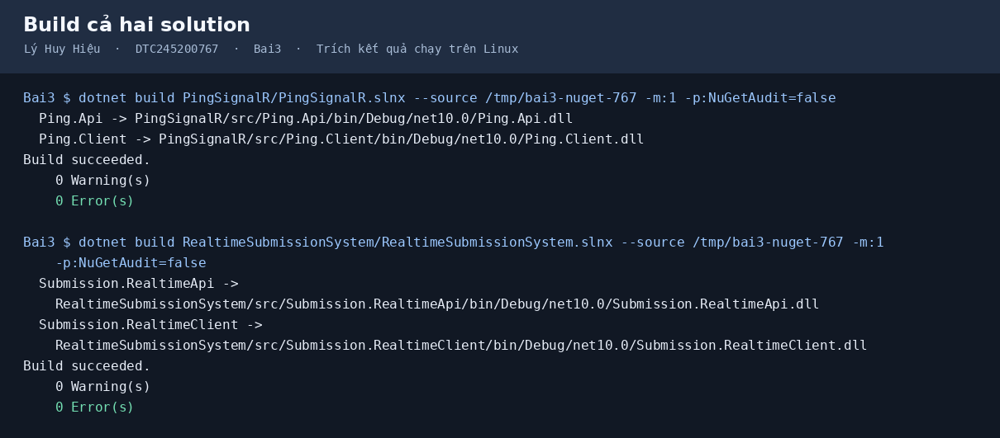

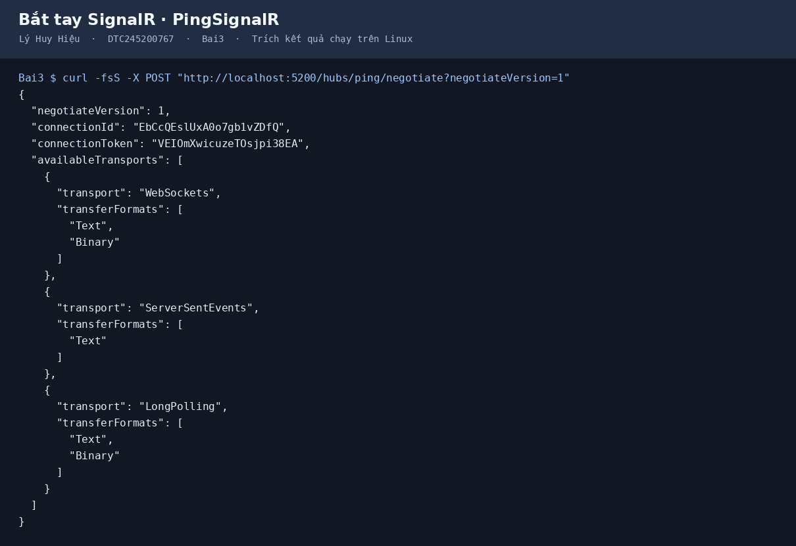

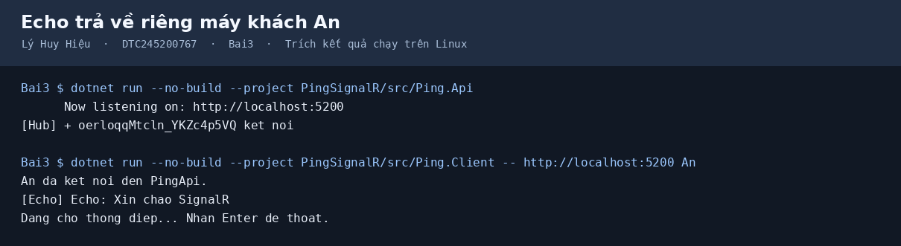

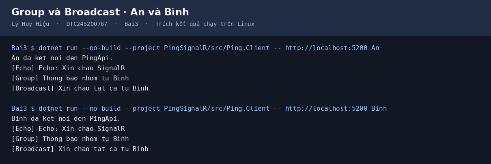

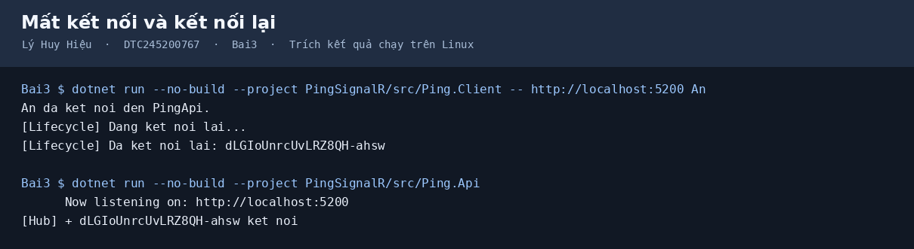

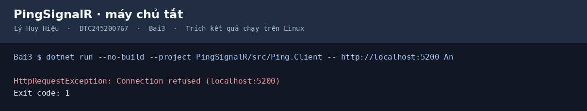

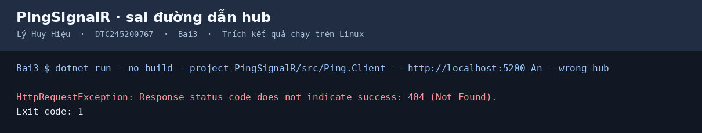

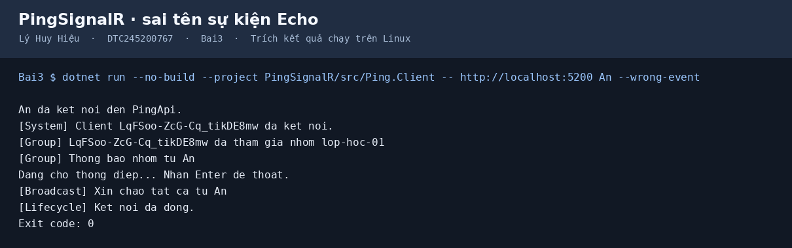

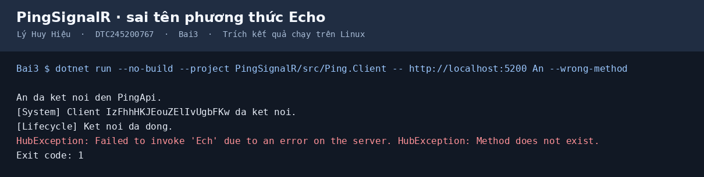

</details>

<details>
<summary>EduSubmit · HTTP và năm thí nghiệm</summary>

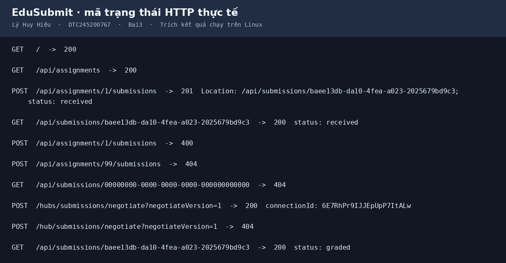

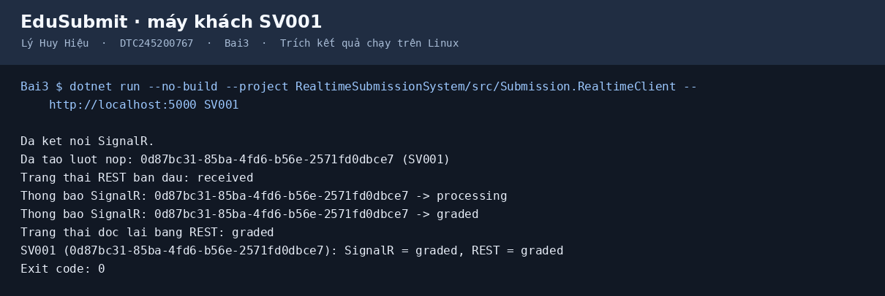

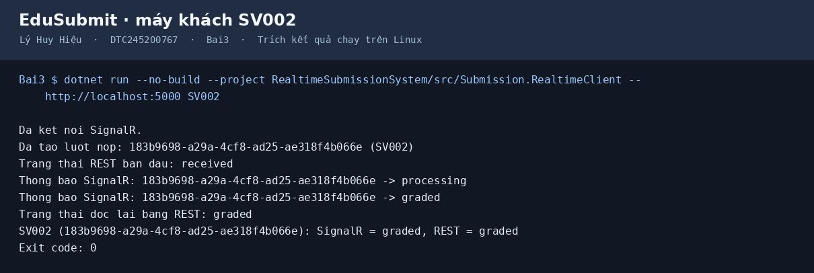

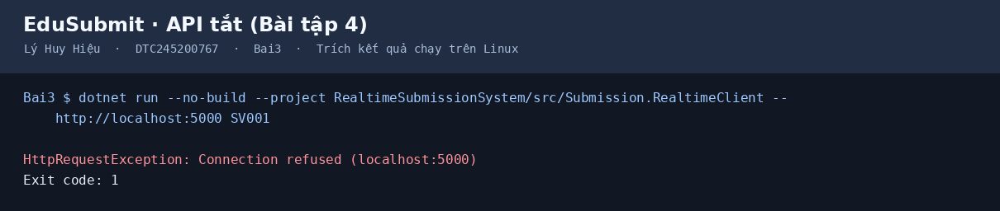

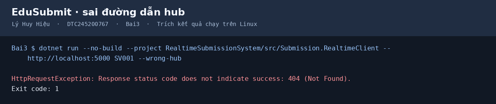

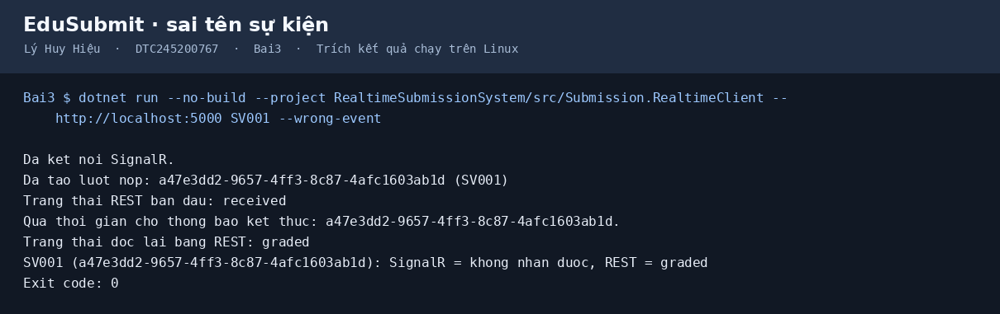

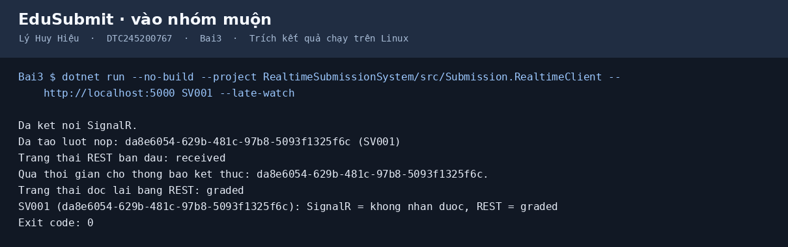

</details>

<details>
<summary>Bài tập 2–3 · failed và hai lượt nộp</summary>

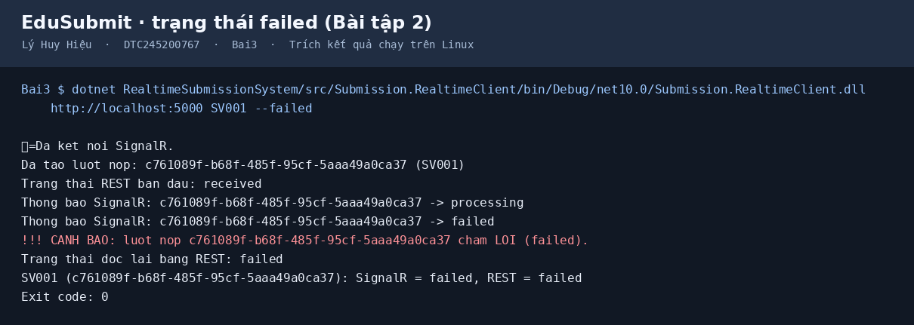

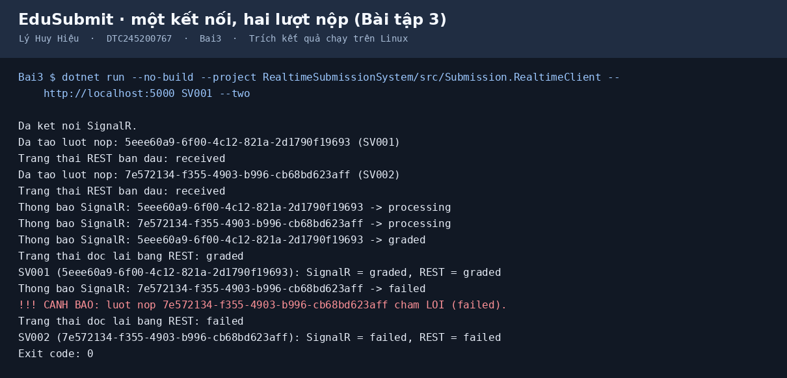

</details>

## 4. Ba câu hỏi đầu giờ

1. **Máy chủ có thể chủ động báo cho máy khách không?** Có. Máy khách giữ kết nối SignalR đang mở. Khi có sự kiện, máy chủ gọi `SendAsync` đến nhóm cần nhận.
2. **REST và SignalR chia việc thế nào?** REST tạo lượt nộp qua POST và đọc dữ liệu qua GET, với mã trạng thái và `Location`. SignalR gửi thông báo khi trạng thái thay đổi.
3. **Đứt mạng đúng lúc báo `graded` thì làm gì?** Sau khi kết nối lại, máy khách vào lại nhóm bằng `WatchSubmission` và đọc `GET /api/submissions/{id}` để xác định trạng thái cuối đã lưu.

## 5. Bài trên lớp và ôn tập

- **Trang 5** chọn C, máy chủ chủ động báo. Máy chủ biết kết quả ngay lúc trạng thái đổi. Máy khách tránh phải hỏi định kỳ. Theo ví dụ 100 sinh viên, polling mỗi 2 giây tạo 3.000 yêu cầu mỗi phút, còn push phát 200 thông báo nếu mỗi lượt đổi hai lần.
- **Trang 11** (1) R, đọc danh sách và nhận một phản hồi. (2) P, có lượt nộp mới thì báo giảng viên. (3) R, POST tạo lượt nộp và trả mã. (4) S, nhiều mốc tiến độ chấm liên tiếp. (5) P, máy chủ phát một thông báo bảo trì. (6) S, các dòng nhật ký build xuất hiện liên tục.
- **Trang 31** sai tên phương thức ở `InvokeAsync` làm lời gọi thất bại. Sai tên sự kiện ở `On<T>` làm máy khách bỏ lỡ thông báo. Hai chế độ thử tương ứng là `--wrong-method` và `--wrong-event` của Ping.
- **Trang 36** An gọi Echo thì chỉ An nhận. Chi gọi gửi tới nhóm thì An và Bình nhận vì cả hai trong nhóm. Bình phát rộng thì An, Bình và Chi đều nhận.
- **Trang 44** sự kiện là lượt nộp đổi trạng thái. Người nhận là `Clients.Group("submission:{id}")`. Payload gồm `SubmissionId`, `Status` và `UpdatedAt`. Nếu mất kết nối, gia nhập lại nhóm rồi dùng GET để đọc trạng thái.
- **Trang 58** dự đoán và đối chiếu ở bảng năm thí nghiệm phía trên.

### Câu hỏi trang 68

1. Polling gửi yêu cầu định kỳ nên có thể đọc trùng kết quả và chờ đến lần hỏi tiếp theo. Push gửi ngay khi có sự kiện.
2. Với yêu cầu–phản hồi, máy khách hỏi và máy chủ đáp một lần. Với push, máy chủ chủ động gửi thông điệp theo sự kiện. Với streaming, một phiên truyền nhiều thông điệp liên tiếp.
3. WebSocket là giao thức hai chiều. ASP.NET Core SignalR là thư viện cung cấp Hub, nhóm, xử lý sự kiện và kết nối lại.
4. Ngoài WebSocket, SignalR có thể dùng Server-Sent Events hoặc Long Polling khi máy khách và máy chủ hỗ trợ phương thức tương ứng.
5. Nhóm `submission:{id}` gửi đến những kết nối đang theo dõi đúng lượt nộp, giảm số thông điệp và giới hạn phạm vi nhận.
6. `IHubContext<SubmissionHub>` cho phép mã bên ngoài lớp Hub, ví dụ tác vụ chấm bài, gửi thông điệp cho các kết nối hoặc nhóm.
7. `On<T>` đăng ký hàm xử lý một tên sự kiện và chuyển payload sang kiểu `T`. Bỏ đăng ký thì máy khách không chạy hàm xử lý sự kiện đó.
8. REST làm POST và GET để tạo và xác nhận trạng thái bằng HTTP. SignalR phụ trách thông báo trạng thái theo nhóm.
9. `WithAutomaticReconnect` thử nối lại sau khi kết nối đang mở bị mất. Sau khi nối lại, cần đăng ký lại nhóm.
10. Lỡ thông báo `graded` thì gọi GET để đọc trạng thái đã lưu.

**Thảo luận**

- Khi nhiều sinh viên đang theo dõi, nhóm theo ID tiết kiệm băng thông vì chỉ gửi đến các kết nối liên quan.
- Polling hợp lý khi chỉ cần cập nhật một bảng tổng hợp mỗi vài phút, hoặc khi hạ tầng chỉ hỗ trợ các yêu cầu HTTP ngắn và dữ liệu ít đổi.
- Khi chạy nhiều bản sao máy chủ, nhóm và kết nối trong bộ nhớ của mỗi bản sao là cục bộ. Có thể dùng Azure SignalR Service hoặc Redis backplane để phân phối thông báo và một kho dữ liệu chung để lưu trạng thái lượt nộp.

## 6. Nộp Pull Request

Trong gói ZIP có mã nguồn và `Bai3.bundle` chứa lịch sử commit. Nếu cần giữ từng commit khi nộp, mở PowerShell tại bản clone sạch của repo lớp, tạo nhánh, rồi thay đường dẫn bên dưới bằng vị trí file bundle sau khi giải nén.

```powershell
git switch -c bai3-dtc245200767
git fetch "C:\DuongDan\Bai3.bundle" refs/heads/bai3
$commits = @(git rev-list --reverse FETCH_HEAD)
git cherry-pick $commits
```

Kiểm tra thư mục sinh viên khớp đúng tên trong repo lớp và kiểm tra `git status`. Sau khi đẩy nhánh lên remote được cấp quyền, mở PR với tiêu đề **Bai3 - DTC245200767 - Lý Huy Hiệu**. Có thể dùng trực tiếp thư mục `Bai3` để chạy và xem mã sau khi giải nén.
