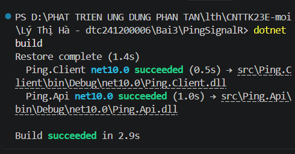
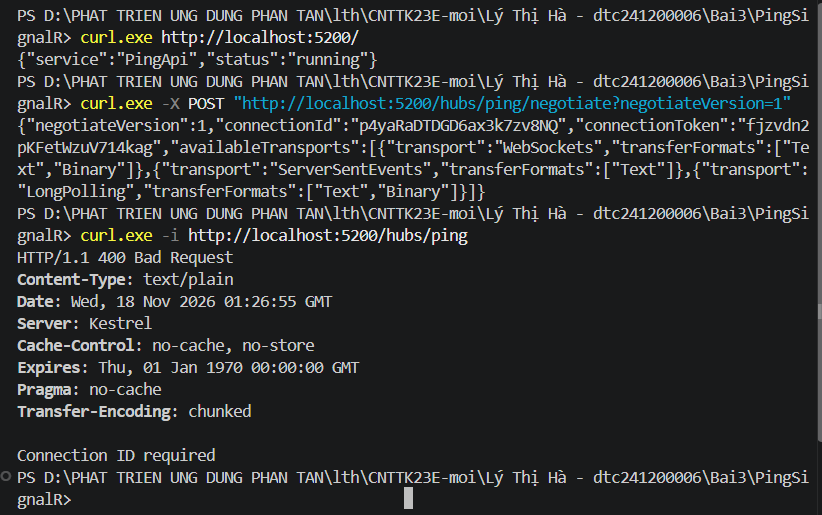
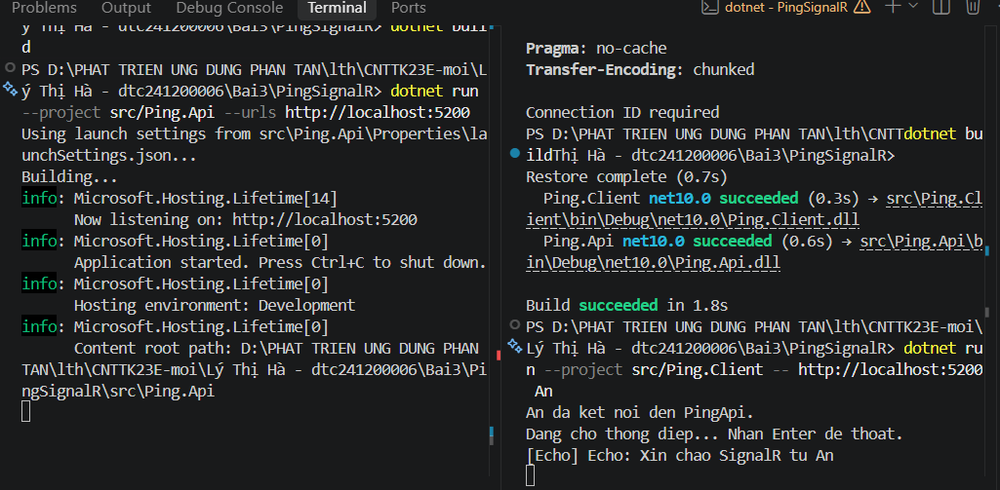
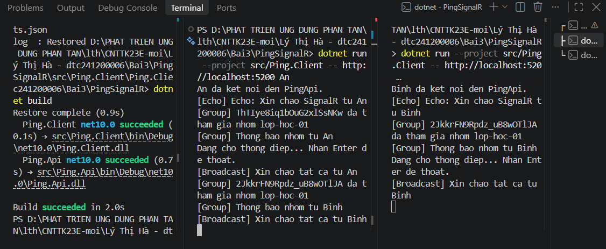
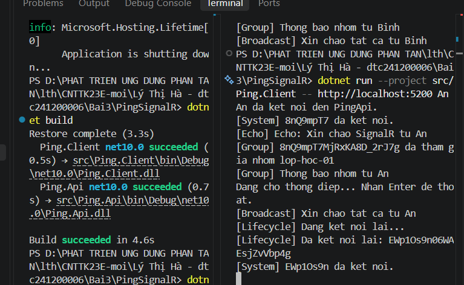
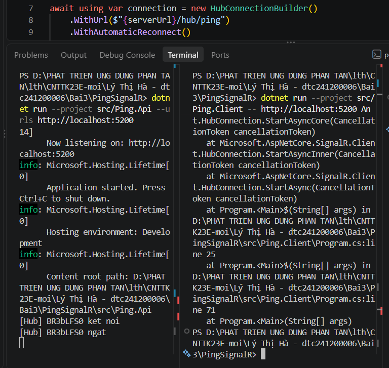
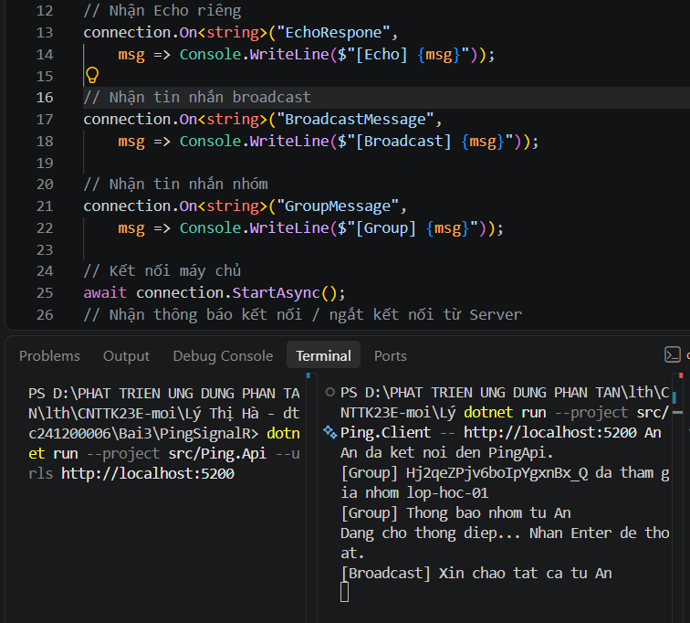

## Kết quả thực hành

### 1. Build Solution thành công
Chạy lệnh `dotnet build` biên dịch thành công hai project `Ping.Api` và `Ping.Client`:

---

### 2. Kiểm tra Endpoint và quy trình Negotiate bằng cURL
Kiểm tra trạng thái dịch vụ tại `/` và thực hiện handshake lấy `connectionToken` tại `/hubs/ping/negotiate`:

---

### 3. Kết nối Client - Server và kiểm thử Echo
Khởi chạy máy chủ `Ping.Api` tại cổng `5200` và máy khách `An` gửi nhận tin nhắn Echo:

---

### 4. Giao tiếp Nhóm (Group) và Quảng bá (Broadcast) giữa 2 Client
Hai người dùng `An` và `Binh` cùng tham gia nhóm `lop-hoc-01`, trao đổi tin nhắn nhóm và nhận thông báo Broadcast:

---

### 5. Kiểm thử cơ chế tự động kết nối lại (Automatic Reconnect)
Khi máy chủ khởi động lại, Client tự động phát hiện mất kết nối và khôi phục phiên làm việc mới:

---

### 6. Ghi nhận log kết nối / ngắt kết nối tại Server Hub
Phía máy chủ theo dõi trạng thái `ket noi` và `ngat` theo từng `ConnectionId` của Client:

---

### 7. Cấu hình lắng nghe sự kiện phía Client
Đăng ký các handler `EchoRespone`, `BroadcastMessage`, `GroupMessage` trên `HubConnection`:

