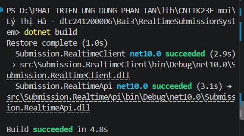
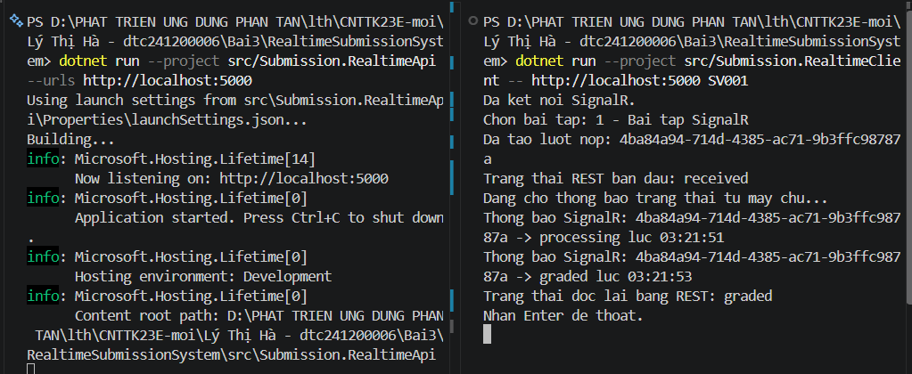

## Thực hành EduSubmit Realtime

### 1. Build Solution thành công

* **Kết quả:** `dotnet build` báo `Build succeeded, 0 Error(s)` cho cả hai project `Submission.RealtimeApi` và `Submission.RealtimeClient`.

---

### 2. Chạy hệ thống và nhận thông báo thời gian thực

* **Kết quả:** Máy khách tạo lượt nộp qua REST (trạng thái ban đầu `received`), sau đó nhận liên tiếp thông báo đẩy `processing` rồi `graded` qua SignalR, và cuối cùng chốt lại trạng thái bằng REST `graded`.
### Chạy hệ thống Realtime EduSubmit (Máy chủ & Máy khách)

* **Terminal 1 (Máy chủ - Trái):** Khởi động REST API và SignalR Hub, ghi nhận kết nối `[Hub]` từ máy khách theo dõi vào nhóm `submission:{id}`, đồng thời tác vụ nền chủ động đẩy các thông báo `[Push]` trạng thái `processing` rồi `graded` qua `IHubContext`.
* **Terminal 2 (Phải):** Máy khách gọi REST tạo bài (`received`), lắng nghe sự kiện SignalR theo thời gian thực (nhận hai thông báo cách nhau khoảng 2 giây), và cuối cùng gọi REST `GET` để chốt lại trạng thái đồng nhất (`graded`).

### 3. Chạy hệ thống Realtime EduSubmit (Máy chủ & Máy khách)

.png)

* **Terminal 1 (Máy chủ - Trái):** Khởi động REST API và SignalR Hub, ghi nhận kết nối `[Hub]` từ máy khách theo dõi vào nhóm `submission:{id}`, đồng thời tác vụ nền chủ động đẩy các thông báo `[Push]` trạng thái `processing` rồi `graded` qua `IHubContext`.
* **Terminal 2 (Phải):** Máy khách gọi REST tạo bài (`received`), lắng nghe sự kiện SignalR theo thời gian thực (nhận hai thông báo cách nhau khoảng 2 giây), và cuối cùng gọi REST `GET` để chốt lại trạng thái đồng nhất (`graded`).

## 4. Nhật ký thực nghiệm 5 thí nghiệm EduSubmit

| STT | Tên thí nghiệm | Dự đoán kết quả | Kết quả thực tế | Bài học rút ra |
| :--- | :--- | :--- | :--- | :--- |
| **1** | Chạy 2 máy khách SV001 và SV002 cùng lúc | Cả hai nhận đúng thông báo riêng biệt | Đúng như dự đoán, không bị chéo dữ liệu | Sử dụng `Groups` giúp cô lập thông điệp theo từng tài nguyên |
| **2** | Chạy máy khách khi máy chủ chưa chạy | Lỗi kết nối, chương trình dừng | Báo lỗi kết nối HTTP/SignalR | Máy chủ phải luôn sẵn sàng trước khi client hoạt động |
| **3** | Sửa `WithUrl` thành `/hub/submissions` | Lỗi 404 Not Found / Kết nối thất bại | Không thể thiết lập kết nối Hub | Đường dẫn endpoint định tuyến phải khớp tuyệt đối giữa Server và Client |
| **4** | Sai tên sự kiện ở hàm `On(...)` | Không bắt được thông điệp đẩy về | Máy khách chạy xong nhưng im lặng, không in thông báo | Tên sự kiện Hub (`SendAsync` và `On`) là định danh cứng, không được sai lệch |
| **5** | Chờ 4 giây rồi mới gọi `WatchSubmission` | Bỏ lỡ các thông báo realtime | Không nhận được thông báo `processing` | Đăng ký lắng nghe kênh realtime (vào Group) phải được thực hiện ngay trước hoặc ngay sau khi tạo tài nguyên |

### 5. Kết quả thực nghiệm EduSubmit Realtime (Mới nhất)
.png)

* **Mô tả:** Hệ thống chạy thành công đồng bộ giữa Máy chủ (`Submission.RealtimeApi`) và Máy khách (`Submission.RealtimeClient`). Máy khách gọi REST tạo lượt nộp, đăng ký theo dõi nhóm qua SignalR Hub, nhận các thông báo `[Push]` trạng thái `processing` rồi `graded` theo thời gian thực từ máy chủ, và chốt lại trạng thái đồng nhất bằng REST `GET`.

## Tra loi cau hoi
### Cau 1: Chỉ ra đúng 1 dòng "mới" trong bảng và giải thích vì sao cần nó?

- 1 dòng "mới" quan trọng nhất trong bảng là: "Ai kích hoạt gửi: Tác vụ chấm nền, qua IHubContext" (ở cột EduSubmit realtime).   
- Giải thích vì sao cần nó:
  - Ở bài PingSignalR cũ, thông điệp toàn do máy khách gọi trực tiếp vào Hub rồi Hub gửi đi ngay (Máy khách gọi phương thức hub).   
  - Sang EduSubmit, việc chấm bài diễn ra ở tác vụ nền (SimulateGradingAsync) – đây là nơi nằm bên ngoài lớp Hub và nằm ngoài các request HTTP thông thường. Vì đối tượng Hub chỉ sống trong một lời gọi ngắn ngủi và không thể tự chủ động gọi từ trong tiến trình nền ra được, nên ta bắt buộc phải dùng IHubContext<SubmissionHub> (đóng vai trò như chiếc "loa phát thanh" của hub) để đẩy thông báo trạng thái processing hoặc graded đến đúng nhóm sinh viên.

### Cau 2: Thiết kế kênh thời gian thực EduSubmit (EduSubmit trước khi code)

1. **Sự kiện nào kích hoạt thông điệp?**
   * **Trả lời:** Mỗi khi trạng thái của lượt nộp thay đổi ở phía máy chủ: `received` $\rightarrow$ `processing` $\rightarrow$ `graded` (thông qua hàm cập nhật trạng thái trong tác vụ chấm nền).

2. **Gửi cho ai? (Ghi rõ phạm vi Clients và tên nhóm)**
   * **Trả lời:** Chỉ gửi cho những máy khách đang theo dõi đúng lượt nộp đó thông qua phạm vi **`Clients.Group("submission:{id}")`** (ví dụ: `Clients.Group($"submission:{submissionId}")`) để đảm bảo tính riêng tư và tiết kiệm băng thông mạng.

3. **Gửi kèm dữ liệu gì (tối thiểu)?**
   * **Trả lời:** Chỉ gửi dữ liệu tối thiểu đủ để máy khách cập nhật giao diện, gồm 3 trường: **Mã lượt nộp (`SubmissionId`)**, **Trạng thái mới (`Status`)**, và **Thời điểm cập nhật (`UpdatedAt`)** (đóng gói trong `record SubmissionStatusMessage`).

4. **Mất kết nối thì lấy lại trạng thái thế nào?**
   * **Trả lời:** Vì SignalR không lưu trữ lại các thông điệp đã lỡ khi rớt mạng và mỗi lần nối lại sẽ cấp một `ConnectionId` mới, máy khách cần tham gia lại vào nhóm theo dõi và gọi lại REST API **`GET /api/submissions/{id}`** để lấy trạng thái mới nhất (vì REST luôn là nguồn sự thật).

### Cau 3: Bản thiết kế kênh thời gian thực EduSubmit (4 câu hỏi cốt lõi)

| Câu hỏi / Vấn đề | Trả lời sai lầm hay gặp | Sửa thành đúng chuẩn thiết kế | Đoạn code tương ứng trong hệ thống |
| :--- | :--- | :--- | :--- |
| **1. Sự kiện nào kích hoạt?** | Khi sinh viên bấm nộp bài | **Mỗi lần trạng thái đổi:** `received` $\rightarrow$ `processing` $\rightarrow$ `graded` | `UpdateStatusAsync(id, status, ...)` |
| **2. Gửi cho ai?** | Dùng `Clients.All` (gửi tất cả) | **Chỉ gửi đúng người:** `Clients.Group("submission:{id}")` | `Clients.Group("submission:{id}")` |
| **3. Gửi kèm dữ liệu gì?** | Chỉ gửi mỗi chữ `"graded"` | **Dữ liệu tối thiểu đủ dùng:** Mã lượt nộp, trạng thái mới, thời điểm đổi | `record SubmissionStatusMessage(Guid SubmissionId, string Status, DateTimeOffset UpdatedAt)` |
| **4. Mất kết nối thì sao?** | Tin tưởng SignalR tự gửi lại tin đã lỡ | **REST là nguồn sự thật:** Gọi lại `GET /api/submissions/{id}` sau khi kết nối lại | `http.GetFromJsonAsync<SubmissionDto>(...)` |

