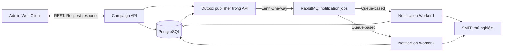
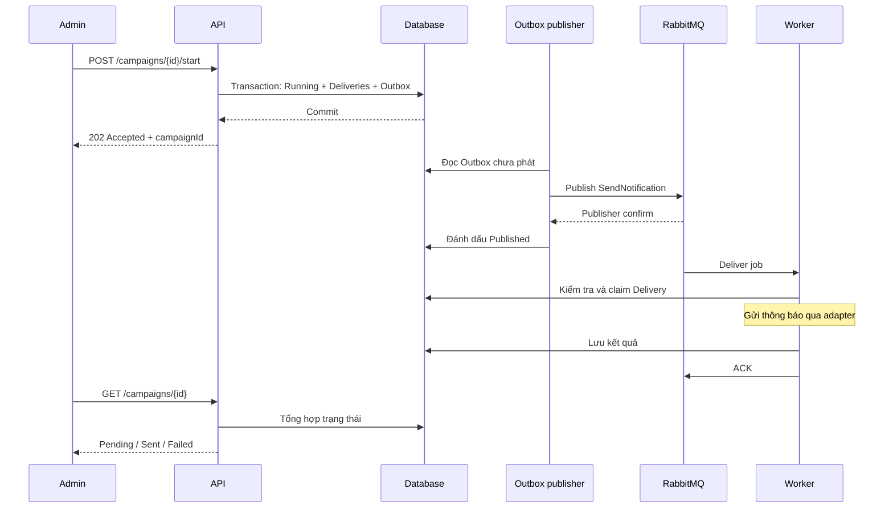

# Phân tích và thiết kế hệ thống gửi thông báo hàng loạt

## 1. Căn cứ và phạm vi

Tài liệu dựa trên `HUONG-DAN-CHUNG.md.pdf`, `11-he-thong-gui-thong-bao-hang-loat.md.pdf` và ảnh slide “Bản đồ 5 MEP” do người học cung cấp. Hai PDF xác định yêu cầu bài tập; slide cung cấp cách phân loại MEP của học phần. Các lựa chọn PostgreSQL, thiết kế bảng, chính sách retry và sơ đồ dưới đây là đề xuất thiết kế, không phải yêu cầu nguyên văn của giảng viên.

Đây là bản phân tích và thiết kế ban đầu. Mã nguồn nằm trong `src/`, cách chạy ở [README](README.md), thiết kế hiện thực ở [báo cáo kỹ thuật](docs/BAO-CAO.md) và kết quả chạy thật ở [kiểm thử](docs/KIEM-THU.md). Bản hiện tại lưu snapshot người nhận trong Delivery, tạo Delivery lúc tạo Draft và tạo Outbox khi start. Phần mở rộng Publish–subscribe đã được triển khai cho service audit. Giao diện vẫn cập nhật bằng polling.

## 2. Yêu cầu cần đáp ứng

### Yêu cầu bắt buộc từ tài liệu

- C#, .NET 10, ASP.NET Core Minimal API; Client dạng Console hoặc Web.
- Campaign API tiếp nhận chiến dịch; RabbitMQ phân phối job; Notification Workers xử lý bất đồng bộ, chạy độc lập.
- Tạo chiến dịch, nhập hoặc chọn người nhận, sinh job, ghi nhận kết quả từng thông báo, xem Pending/Sent/Failed và chi tiết gửi.
- Có cơ chế chạy lại job thất bại phù hợp.
- Chọn cơ sở dữ liệu; quản lý mã nguồn bằng Git; mỗi service .NET có Dockerfile riêng và toàn hệ thống có Docker Compose.
- Container giao tiếp bằng service name trên Docker network; cấu hình môi trường tách khỏi mã nguồn.
- Có logging để theo dõi luồng và cơ chế phục hồi khi thành phần tạm dừng.
- Sản phẩm nộp gồm báo cáo, mã nguồn GitHub có lịch sử commit thực tế và hướng dẫn cài đặt/build/chạy. Máy dùng bảo vệ phải chạy được phiên bản tương ứng trên GitHub.

Hướng dẫn chung xếp retry/DLQ, idempotent consumer, correlation ID, health check, structured logging, xác thực và subscriber bổ sung vào phần mở rộng. Tuy vậy, đề tài riêng vẫn yêu cầu chạy lại job thất bại: cần đáp ứng chức năng đó, dù không nhất thiết triển khai toàn bộ cơ chế mở rộng.

### Phạm vi đề xuất

Chọn một kênh email cho bản đầu, dùng máy chủ SMTP thử nghiệm để quan sát thư mà không gửi tới người thật. Nếu chỉ mô phỏng thao tác gửi, phải ghi rõ là mô phỏng trong báo cáo. Chọn Admin Web Client để quản lý chiến dịch, PostgreSQL lưu dữ liệu và tối thiểu hai bản sao Worker để minh họa xử lý phân tán. Chưa cần đa kênh SMS/push hoặc lịch gửi.

## 3. Bản đồ 5 MEP theo slide và quyết định áp dụng

| MEP trên slide | Ý nghĩa trên slide | Áp dụng vào đề tài | Quyết định |
|---|---|---|---|
| Yêu cầu–phản hồi — Request–response | Hỏi – chờ – đáp | Admin gọi REST API để tạo, bắt đầu chiến dịch và truy vấn kết quả | Chọn cho phần chính |
| Thông điệp một chiều — One-way | Gửi đi rồi làm tiếp | Bên phát giao lệnh gửi thông báo, không chờ Worker trả kết quả nghiệp vụ trên cùng lời gọi | Dùng để mô tả ngữ nghĩa của lệnh gửi bất đồng bộ |
| Qua hàng đợi — Queue-based | Giao việc, xử lý sau | RabbitMQ lưu job, nhiều Worker cùng tiêu thụ một work queue | Chọn làm MEP chủ đạo |
| Phát hành–đăng ký — Publish–subscribe | Phát một, nhiều bên nghe | Sự kiện kết quả gửi được audit và thống kê nhận độc lập | Mở rộng khi thực sự có nhiều bên sử dụng sự kiện |
| Truyền luồng/đẩy — Streaming/push | Dữ liệu chảy liên tục | Đẩy tiến độ chiến dịch đến dashboard bằng SignalR hoặc SSE | Mở rộng trải nghiệm giao diện |

**Kết luận lựa chọn:** phần chính sử dụng Request–response và Queue-based. Lệnh gửi qua queue có tính chất One-way ở tầng nghiệp vụ. Không cần tạo thêm một đường truyền riêng chỉ để tính đủ ba MEP; các cách phân loại này có thể cùng mô tả một luồng ở những khía cạnh khác nhau.

One-way không có nghĩa là bỏ qua xác nhận giao nhận. Publisher vẫn có thể chờ broker xác nhận đã tiếp nhận; Worker vẫn ACK sau khi xử lý. Những xác nhận này không phải phản hồi nghiệp vụ “đã gửi thành công đến người nhận”.

Không dùng Publish–subscribe để phát cùng một lệnh gửi cho tất cả Worker. Trong đề tài, mỗi người nhận cần một job logic; nhiều Worker chia nhau xử lý. Nếu mỗi Worker có queue riêng cùng nhận một lệnh, một người có thể nhận nhiều thông báo trùng. Work queue cũng có thể giao lại message khi lỗi, vì vậy vẫn cần xử lý trùng.

HTTP `POST /campaigns/{id}/start` trả `202 Accepted` vẫn là Request–response giữa Client và API. Việc gửi bên trong diễn ra bất đồng bộ không biến lời gọi HTTP này thành One-way.

Polling bằng GET định kỳ thuộc Request–response. Chỉ khi server chủ động đẩy cập nhật qua kết nối duy trì mới mô tả luồng đó là push. Slide chưa cho thấy yêu cầu phải sử dụng đủ cả năm MEP.

## 4. Kiến trúc đề xuất



Outbox publisher là tác vụ nền trong tiến trình API cho bản đầu, không bắt buộc tách thành service mới. API và Worker có Dockerfile riêng. PostgreSQL và RabbitMQ dùng volume để dữ liệu tồn tại sau khi container được tạo lại. Chọn triển khai một node broker cho phạm vi môn học; đây là khả năng phục hồi sau khởi động lại, chưa phải kiến trúc sẵn sàng cao.

| Thành phần | Trách nhiệm |
|---|---|
| Admin Client | Nhập chiến dịch và danh sách người nhận, bắt đầu gửi, xem kết quả, yêu cầu gửi lại |
| Campaign API | Kiểm tra đầu vào, lưu dữ liệu, tạo job logic và outbox, cung cấp API truy vấn |
| Outbox publisher | Đọc lệnh chưa phát, publish có xác nhận, đánh dấu đã phát và thử lại khi mất kết nối |
| RabbitMQ | Đệm job, phân phối công việc và giữ message chưa được xác nhận |
| Notification Worker | Nhận job, kiểm tra trạng thái, gửi qua adapter, lưu kết quả và ACK |
| PostgreSQL | Nguồn dữ liệu chuẩn cho chiến dịch, người nhận, delivery, lịch sử thử gửi và outbox |

## 5. Luồng nghiệp vụ

1. Admin tạo chiến dịch, nội dung và danh sách người nhận. API kiểm tra định dạng, loại người nhận trùng theo quy tắc đã công bố và lưu chiến dịch Draft.
2. Admin gọi start. API chuyển Draft sang Running bằng cập nhật có điều kiện để hai yêu cầu đồng thời không khởi chạy hai lần.
3. Trong giao dịch DB, tạo các Delivery và bản ghi Outbox tương ứng. Với bản đầu, đặt giới hạn kích thước danh sách; mở rộng mới chia lô và dùng bộ sinh job có checkpoint.
4. API trả `202` cùng campaignId và đường dẫn theo dõi. Phản hồi này chỉ xác nhận chấp nhận xử lý.
5. Publisher đọc Outbox, phát lệnh vào exchange/queue được cấu hình trước, dùng publisher confirms và kiểm tra message không định tuyến được. Chỉ đánh dấu Published sau khi thành công.
6. Hai Worker cùng tiêu thụ `notification.jobs`, dùng manual ACK và prefetch hữu hạn. Mỗi lần giao message được phân cho một consumer; vẫn có thể có redelivery khi lỗi.
7. Worker kiểm tra deliveryId và phiên xử lý, chiếm quyền xử lý bằng thao tác DB nguyên tử, gọi adapter gửi, ghi kết quả rồi mới ACK.
8. Client gọi API xem tiến độ. Chiến dịch hoàn tất khi mọi Delivery đạt trạng thái kết thúc; có thể hoàn tất với một số Delivery thất bại.



## 6. Thiết kế dữ liệu

| Bảng | Trường chính đề xuất |
|---|---|
| Campaigns | Id, Name, Subject, Body, Status, CreatedAt, StartedAt, CompletedAt |
| Recipients | Id, Address, DisplayName |
| Deliveries | Id, CampaignId, RecipientId, DestinationSnapshot, Status, AttemptCount, Generation, NextAttemptAt, LeaseUntil, SentAt, LastError |
| DeliveryAttempts | Id, DeliveryId, Generation, StartedAt, FinishedAt, WorkerId, Outcome, ErrorCode |
| OutboxMessages | Id, DeliveryId, Generation, Payload, CreatedAt, PublishedAt |

Đặt khóa duy nhất `(CampaignId, RecipientId)` cho bản một kênh; nếu đa kênh thì bổ sung Channel. Khóa duy nhất outbox theo delivery và generation ngăn tạo lặp cùng lệnh logic. Giữ snapshot địa chỉ và nội dung bất biến sau start để việc sửa hồ sơ người nhận không làm thay đổi chiến dịch đang chạy.

Trạng thái nội bộ Delivery: Pending → Processing → Sent; Processing có thể chuyển RetryScheduled hoặc Failed. RetryScheduled đến hạn trở lại Pending. Processing bị treo phải có lease hết hạn và cơ chế phục hồi, không khóa vĩnh viễn.

Ở màn hình theo yêu cầu đề bài: Pending gồm Pending, Processing và RetryScheduled; Sent là gửi thành công; Failed là lỗi kết thúc. Khi danh sách đã chốt, luôn kiểm tra `Total = Pending + Sent + Failed`. Tổng hợp từ Delivery để tránh bộ đếm cộng trùng do redelivery.

Sent trong bản SMTP có nghĩa là máy chủ SMTP đã chấp nhận thư, không khẳng định người nhận đã đọc hoặc thư chắc chắn vào hộp thư đến.

## 7. Thiết kế API

| Endpoint | Mục đích và phản hồi đề xuất |
|---|---|
| POST /campaigns | Tạo Draft với nội dung và người nhận; 201 + id |
| GET /campaigns | Danh sách chiến dịch, có phân trang |
| GET /campaigns/{id} | Chi tiết và số lượng Pending/Sent/Failed |
| POST /campaigns/{id}/start | Bắt đầu xử lý; 202; không tạo job trùng khi gọi lại |
| GET /campaigns/{id}/deliveries | Kết quả từng người nhận; lọc status và phân trang |
| POST /campaigns/{id}/retry-failed | API bổ sung để chạy lại các Delivery đang Failed |

Đầu vào sai trả 400, tài nguyên không tồn tại trả 404, chuyển trạng thái không hợp lệ trả 409. Quy định cụ thể start lặp: trả trạng thái hiện tại nếu đã Running, không sinh thêm Delivery. Retry-failed dùng giao dịch và cập nhật có điều kiện để hai yêu cầu không cùng tạo một lần gửi lại.

Ví dụ hợp đồng message (giá trị minh họa):

```json
{
  "messageId": "outbox-id",
  "type": "SendNotification",
  "schemaVersion": 1,
  "campaignId": "campaign-id",
  "deliveryId": "delivery-id",
  "generation": 1,
  "correlationId": "campaign-id"
}
```

Worker đọc snapshot cần gửi từ DB. Generation dùng để bỏ qua message cũ sau khi đã tạo phiên gửi lại mới; messageId dùng truy vết. Không ghi nội dung nhạy cảm, thông tin đăng nhập hay toàn bộ địa chỉ người nhận vào log.

## 8. Tin cậy và phục hồi

- **Broker tạm dừng:** dữ liệu và Outbox đã commit vẫn còn. Publisher kết nối lại và phát tiếp. API có thể nhận chiến dịch nếu DB còn hoạt động và giới hạn tồn đọng cho phép.
- **API chết sau commit:** publisher khi khởi động lại tìm thấy Outbox chưa phát. Nếu chết sau publish nhưng trước đánh dấu Published, có thể phát trùng; consumer phải xử lý được.
- **Worker chết trước ACK:** broker có thể giao lại message. Worker bỏ qua Delivery đã Sent; các Delivery đang Processing dùng lease và token sở hữu để tránh Worker cũ cập nhật đè kết quả của Worker mới.
- **DB không hoạt động:** API không trả thành công khi chưa lưu bền vững. Worker chưa xác minh được quyền xử lý thì không gửi; khi chưa lưu được kết quả thì không ACK như thể đã hoàn tất.
- **Lỗi tạm thời:** đề xuất tối đa ba lần thử tự động tính cả lần đầu, nghỉ 10 giây rồi 30 giây. Lưu RetryScheduled và thời điểm thử tiếp trong DB; tác vụ nền tạo outbox đến hạn. Không requeue tức thì vô hạn.
- **Lỗi vĩnh viễn/hết lượt:** ghi Failed và lý do. Admin có thể retry-failed sau khi xử lý nguyên nhân; lưu lịch sử cũ và tăng Generation.
- **Message không hợp lệ:** cô lập vào dead-letter queue nếu triển khai phần mở rộng, kèm log; không để một message lỗi làm Worker lặp vô hạn.

Durable queue, persistent message, publisher confirm và manual ACK hỗ trợ bảo toàn công việc. Cần cả phát hiện message không định tuyến được; confirm riêng lẻ không có nghĩa là thông báo đã được gửi tới người nhận.

Không cam kết exactly-once cho gửi email: Worker có thể gửi thành công rồi chết trước khi ghi DB. Nếu nhà cung cấp hỗ trợ idempotency key, dùng DeliveryId làm khóa ổn định. Với SMTP thông thường, kiểm tra trạng thái trong DB chỉ giảm trùng và không loại bỏ hoàn toàn cửa sổ lỗi này. Báo cáo phải nêu giới hạn đó.

## 9. MEP mở rộng

### Publish–subscribe

Sau khi lưu kết quả, phát `NotificationSent` hoặc `NotificationFailed` bằng outbox. Audit và Statistics mỗi service có queue riêng nhận sự kiện. Đây là phát một sự kiện cho nhiều trách nhiệm khác nhau; Worker gửi thông báo vẫn dùng chung work queue. Mỗi subscriber cũng phải xử lý sự kiện trùng.

### Streaming/push

Nếu cần dashboard thời gian thực, dùng SignalR hoặc SSE để đẩy tổng tiến độ, có thể gộp cập nhật theo khoảng thời gian thay vì đẩy từng job. Khi kết nối lại, Client GET snapshot hiện tại để bù các cập nhật đã bỏ lỡ. Bản đầu dùng polling là đủ; không tính polling là Streaming/push.

Ưu tiên hoàn thành luồng chính và phục hồi trước khi thêm hai MEP này. Không thêm service chỉ để đủ số lượng MEP.

## 10. Triển khai và kịch bản nghiệm thu

Cấu trúc dự kiến: `src/Campaign.Api`, `src/Notification.Worker`, `src/Contracts`, `src/Admin.Client`, `docs`, `docker-compose.yml`, `.env.example`, `README.md`. Nếu Web Client được API phục vụ tĩnh thì không cần một service .NET riêng cho Client. Mọi service .NET thực sự chạy độc lập đều phải có Dockerfile riêng.

Compose khai báo `campaign-api`, `notification-worker`, `rabbitmq`, `postgres` và SMTP thử nghiệm; dùng service name làm hostname. Không đặt container_name cố định cho Worker nếu muốn scale bằng Compose. README phải ghi lệnh build, chạy hai Worker, xem log, dừng và khôi phục; ghi rõ lệnh xóa volume làm mất dữ liệu.

| Kịch bản kiểm thử dự kiến | Tiêu chí đạt |
|---|---|
| Tạo chiến dịch 100 người nhận hợp lệ | Có đúng 100 Delivery logic và xem được kết quả từng người |
| Hai Worker hoạt động | Log có hai WorkerId cùng xử lý các job khác nhau |
| Gọi start đồng thời hai lần | Không tăng gấp đôi số Delivery hoặc lệnh logic |
| Tắt Worker trong lúc xử lý | Công việc chưa hoàn tất được tiếp tục sau phục hồi; ghi nhận rủi ro gửi trùng tại cửa sổ lỗi ngoài DB |
| Tắt RabbitMQ rồi bật lại | Outbox được phát tiếp, chiến dịch không mất job đã lưu |
| Gửi lỗi tạm thời | Có số lần thử hữu hạn và thời gian chờ đúng chính sách |
| Gửi lỗi vĩnh viễn | Delivery chuyển Failed, có nguyên nhân và lịch sử |
| Retry-failed | Chỉ xử lý lại bản ghi Failed được chọn; không gửi lại bản ghi Sent |
| Message trùng hoặc generation cũ | Không tăng sai thống kê; bỏ qua kết quả đã hoàn tất hoặc phiên cũ |
| Kiểm tra tổng trạng thái | Total bằng Pending + Sent + Failed |
| Tạo lại container với volume giữ nguyên | Dữ liệu vẫn tồn tại và xử lý có thể tiếp tục |

Các dòng trên là kế hoạch kiểm thử, chưa phải kết quả đã chạy. Khi hoàn thiện báo cáo cần bổ sung số liệu đo, ảnh minh họa và log thực tế. Thử hiệu năng với cùng dữ liệu, cùng môi trường, so sánh một và hai Worker; không mặc định hai Worker nhanh gấp đôi.

## 11. Đoạn giải thích lựa chọn dùng khi bảo vệ

“Hệ thống chọn Queue-based làm mẫu trao đổi thông điệp chủ đạo vì việc gửi thông báo hàng loạt cần được tách khỏi thời gian phản hồi của API và chia cho nhiều Worker xử lý. Request–response được dùng giữa Client và API cho các thao tác quản lý và truy vấn. Lệnh gửi thông báo có ngữ nghĩa One-way ở tầng nghiệp vụ: bên phát không chờ kết quả gửi trên cùng lời gọi, còn kết quả được lưu để tra cứu sau. Publish–subscribe phù hợp khi bổ sung audit và thống kê độc lập; Streaming/push phù hợp khi cần đẩy tiến độ tới giao diện. Bản chính ưu tiên hai mẫu đầu tiên để đáp ứng yêu cầu với độ phức tạp phù hợp.”

## 12. Tài liệu tham khảo

- Hướng dẫn chung bài tập lớn, PDF người học cung cấp, 2 trang.
- Đề tài 11 – Hệ thống gửi thông báo hàng loạt, PDF người học cung cấp, 1 trang.
- Slide “Bản đồ 5 MEP”, ảnh người học cung cấp, số trang hiển thị 14.
- RabbitMQ, [Work Queues](https://www.rabbitmq.com/tutorials/tutorial-two-go): chia việc giữa consumer và giao lại khi consumer mất kết nối.
- RabbitMQ, [Publish/Subscribe](https://www.rabbitmq.com/tutorials/tutorial-three-java): phân phối bản sao đến các queue subscriber.
- RabbitMQ, [Consumer Acknowledgements and Publisher Confirms](https://www.rabbitmq.com/docs/confirms): phân biệt xác nhận từ consumer và xác nhận tới publisher.
- RabbitMQ, [Publishers](https://www.rabbitmq.com/docs/publishers): xác nhận phát và xử lý định tuyến message.
