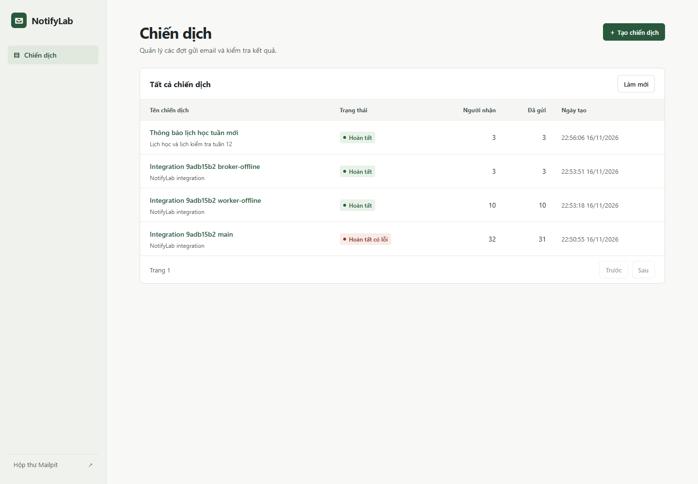
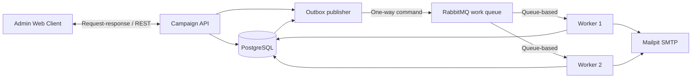

# NotifyLab — Hệ thống gửi thông báo hàng loạt

Bài tập lớn đề tài 11, học phần **Phát triển ứng dụng phân tán**. Hệ thống tạo chiến dịch email, phân chia công việc qua RabbitMQ và xử lý bằng nhiều Worker .NET chạy độc lập. Giao diện và báo lỗi bằng tiếng Việt.

**Stack:** C# / .NET 10, ASP.NET Core Minimal API, PostgreSQL 17, RabbitMQ 4.1, SMTP Mailpit, Docker Compose. Web Client dùng HTML/CSS/JavaScript thuần, được API phục vụ tĩnh.



## Chạy nhanh

Cần Docker Desktop đang chạy ở chế độ Linux containers, Docker Compose v2 và kết nối Internet cho lần tải image đầu tiên. Không cần cài .NET trên máy nếu chạy toàn bộ bằng Docker.

**Windows:** Nhấp đúp `Chay-NotifyLab.cmd` trong thư mục dự án. Tệp khởi động Docker Desktop nếu cần, chạy hai Worker, chờ API kết nối PostgreSQL và mở hai trang NotifyLab, Mailpit trong trình duyệt. Tệp giữ chế độ gửi của các container hiện có. Khi tạo mới container, tệp dùng SMTP thật nếu `.env` có cấu hình SMTP đầy đủ, hoặc dùng Mailpit nếu chưa cấu hình.

Bạn cũng có thể chạy từ terminal bằng lệnh sau.

```sh
docker compose up -d --build --scale notification-worker=2
```

Lần đầu cần chờ tải image, build .NET và kiểm tra sức khỏe PostgreSQL/RabbitMQ. Nếu muốn đổi cổng hoặc mật khẩu, sao chép `.env.example` thành `.env` trước khi chạy. Compose đã có giá trị mặc định cho demo cục bộ.

| Thành phần | Địa chỉ | Đăng nhập demo |
|---|---|---|
| Giao diện và API | http://localhost:5080 | `admin` / `notifylab_demo_admin` |
| Hộp thư Mailpit | http://localhost:8025 | Không cần |
| RabbitMQ Management | http://localhost:15672 | `notifylab` / `notifylab_local_demo` |
| Readiness DB | http://localhost:5080/health/ready | HTTP 200 khi API truy vấn DB được |

Các cổng chỉ bind `127.0.0.1`. Mật khẩu mặc định là dữ liệu demo công khai, **không dùng cho triển khai Internet**. `.env` được Git bỏ qua. Mailpit giữ email trong môi trường thử nghiệm, không chuyển thư tới địa chỉ bên ngoài.

## Demo trong vài phút

1. Mở giao diện và đăng nhập. Bấm **Tạo chiến dịch**, nhập tên, tiêu đề, nội dung rồi bấm **Điền ví dụ** hoặc nhập `samples/recipients.txt`.
2. Bấm **Tạo bản nháp**, kiểm tra danh sách rồi **Bắt đầu gửi**.
3. Quan sát Pending/Sent/Failed và bấm **Xem** để thấy lịch sử xử lý, WorkerId, số lần thử. Bấm **Nhật ký audit** để xem các sự kiện do service audit ghi nhận.
4. Mở Mailpit để đọc email đã gửi.
5. Với cấu hình mặc định, địa chỉ `retry+…` giả lập lỗi hai lần rồi thành công ở lần thứ ba; địa chỉ `fail+…` giả lập lỗi vĩnh viễn. Các địa chỉ khác đi qua SMTP bình thường.
6. Bấm **Gửi lại thư lỗi** để đưa các bản ghi Failed vào lượt mới. `fail+…` vẫn thất bại nếu cờ demo còn bật. Muốn gửi thành công nhóm này, đặt `ENABLE_DEMO_FAILURES=false` trong `.env`, chạy lại lệnh Compose rồi thử lại.

Demo lỗi là chức năng kiểm thử có chủ đích. Tắt bằng `ENABLE_DEMO_FAILURES=false` để bỏ mô phỏng lỗi. Compose mặc định vẫn gửi qua Mailpit.

## Đăng nhập quản trị

Trong cấu hình Mailpit mặc định, đăng nhập với tên `admin` và mật khẩu demo `notifylab_demo_admin`. Để đổi, đặt `ADMIN_USERNAME` và `ADMIN_PASSWORD` trong `.env` rồi chạy lại Compose. SMTP thật yêu cầu mật khẩu quản trị riêng, dài từ 12 đến 256 ký tự. Đây là tài khoản ứng dụng, khác với tài khoản SMTP.

API yêu cầu phiên đăng nhập có vai trò Admin để quản lý chiến dịch, tra cứu người nhận và xem audit. Phiên đăng nhập có thời hạn bốn giờ. Các endpoint health vẫn cho phép kiểm tra kết nối mà không cần đăng nhập. Với API client, đăng nhập tại `POST /auth/login`, giữ cookie phiên và gửi header `X-NotifyLab-Request: 1` trong mọi yêu cầu POST.

## Gửi email thật bằng SMTP

Chế độ này dùng cấu hình bổ sung `compose.smtp.yml`. Gmail cá nhân dùng `smtp.gmail.com:587` với STARTTLS. Bật [Xác minh 2 bước](https://support.google.com/mail/answer/185839), rồi tạo [Mật khẩu ứng dụng](https://myaccount.google.com/apppasswords) nếu tài khoản hỗ trợ. Tài khoản trường hoặc cơ quan có thể chặn tính năng này. Tham khảo [cài đặt SMTP Gmail](https://support.google.com/mail/answer/7104828) và [điều kiện dùng mật khẩu ứng dụng](https://support.google.com/accounts/answer/185833).

Tạo `.env` ở thư mục dự án nếu chưa có. Thêm các dòng dưới đây vào tệp đó và thay giá trị mẫu bằng thông tin của bạn. Với Gmail, dán mật khẩu ứng dụng 16 ký tự, bỏ khoảng trắng. Giữ mật khẩu trong `.env` cục bộ. `.env` nằm trong `.gitignore`.

```dotenv
SMTP_RELAY_HOST=smtp.gmail.com
SMTP_RELAY_PORT=587
SMTP_RELAY_USERNAME=ten-cua-ban@gmail.com
SMTP_RELAY_PASSWORD=MAT_KHAU_UNG_DUNG
SMTP_RELAY_FROM=ten-cua-ban@gmail.com
ADMIN_PASSWORD=MAT_KHAU_QUAN_TRI_RIENG
```

Nếu dùng nhà cung cấp khác, nhập host, cổng STARTTLS, thông tin xác thực và địa chỉ người gửi được phép. Chế độ này dùng STARTTLS (thường là cổng 587).

Chờ các chiến dịch đã khởi chạy xử lý xong trước khi đổi chế độ vì Worker vẫn đọc những job đang chờ. Sau đó chạy trong terminal VS Code:

```powershell
docker compose -f docker-compose.yml -f compose.smtp.yml up -d --build --scale notification-worker=2
```

Mở lại giao diện và tạo chiến dịch mới với **một địa chỉ thật của bạn**. Bấm **Bắt đầu gửi**, kiểm tra hộp thư đến và thư rác. Sau khi thử thành công, nhập danh sách người nhận thực đã đồng ý nhận thông báo. Tính cả các thư đã gửi trong hạn mức của tài khoản và xem [giới hạn Gmail](https://support.google.com/mail/answer/22839) nếu dùng Gmail. Danh sách mẫu `example.test` chỉ dành cho Mailpit.

Để trở về Mailpit sau khi các job đã hoàn tất, chạy lại lệnh ở mục **Chạy nhanh**. Compose sẽ cập nhật các container dùng cấu hình thay đổi.

```sh
docker compose ps
docker compose logs -f campaign-api notification-worker
docker compose stop notification-worker
docker compose start notification-worker
docker compose down
```

`down` giữ các volume. Không dùng `docker compose down -v` trừ khi chủ đích xóa toàn bộ dữ liệu chiến dịch, hàng đợi và thư demo. Đổi mật khẩu PostgreSQL/RabbitMQ trong `.env` không tự đổi mật khẩu đã được khởi tạo trong volume cũ.

## Kiến trúc và MEP



| MEP theo slide học phần | Quyết định |
|---|---|
| Request–response | Client tạo/khởi chạy/truy vấn chiến dịch bằng HTTP. `202 Accepted` vẫn là phản hồi HTTP. |
| Queue-based | Mẫu chủ đạo: một work queue, nhiều competing consumers, mỗi lần giao job cho một Worker. |
| One-way | Ngữ nghĩa lệnh giao việc: publisher không chờ kết quả gửi email; xác nhận broker/ACK vẫn được dùng. |
| Publish–subscribe | API phát sự kiện kết quả qua topic exchange `notifications.events`. Service audit theo dõi queue riêng `notification.audit`. |
| Streaming/push | Chưa triển khai; giao diện hiện polling REST mỗi 3 giây, không gọi là push. |

Xem [phân tích và lựa chọn MEP](PHAN-TICH-VA-LUA-CHON-MEP.md), [báo cáo kỹ thuật](docs/BAO-CAO.md) và [kết quả kiểm thử](docs/KIEM-THU.md).

## Chức năng và độ tin cậy

- Tạo Draft, nhập nhiều email hoặc tệp TXT; chuẩn hóa, loại trùng không phân biệt hoa/thường; giới hạn 5.000 người nhận.
- Start idempotent nhờ khóa dòng chiến dịch và giao dịch DB. Nội dung/người nhận bất biến sau khi tạo trong phiên bản này.
- Ghi Outbox cùng giao dịch start; publisher xác nhận trước khi đánh dấu đã phát. Broker mất kết nối thì Outbox còn trong DB.
- Durable queue, persistent messages, publisher confirms, mandatory routing và manual ACK.
- Claim Delivery bằng cập nhật DB nguyên tử, kiểm tra generation/owner; message cũ hoặc đã Sent không phát sinh lần gửi mới.
- Lỗi tạm thời thử tối đa 3 lần/lượt, chờ 10 rồi 30 giây. Lỗi SMTP 5xx được coi là vĩnh viễn. Gửi lại thủ công giữ lịch sử và mở lượt mới.
- Worker chết sau khi claim: lease 60 giây hết hạn, scheduler trong API tạo phiên mới hoặc kết thúc Failed nếu đã hết lượt. SMTP timeout 15 giây.
- Message sai định dạng/schema vào `notification.dead`. Lỗi nghiệp vụ gửi email nằm trong DB để retry qua API, không mặc định đưa vào DLQ.
- Structured JSON logs có CampaignId/DeliveryId/WorkerId. PostgreSQL, RabbitMQ và Mailpit có volume riêng.
- Audit có outbox riêng được ghi cùng kết quả gửi. Subscriber lưu sự kiện theo EventId và ACK sau khi PostgreSQL ghi thành công. Nhật ký chỉ chứa ID, phiên, thời điểm và kết quả, bắt đầu từ khi chạy bản có audit.

**Giới hạn:** SMTP không hỗ trợ giao dịch chung với DB, vì vậy vẫn có cửa sổ “đã gửi thư nhưng chết trước khi lưu Sent”. Hệ thống không cam kết exactly-once. Đây là demo một node DB/broker với một tài khoản quản trị, chưa có HA, quản lý nhiều tài khoản, giới hạn tốc độ nhà cung cấp hoặc benchmark tải lớn. Khi API tắt, Worker vẫn xử lý job có sẵn; phát Outbox và lịch retry tiếp tục khi API trở lại. Readiness kiểm tra DB, không cam kết broker đang online, vì API được thiết kế nhận công việc lúc broker tạm dừng.

## API

| Method | Route | Mô tả |
|---|---|---|
| POST | `/campaigns` | Tạo Draft, trả 201 và id |
| GET | `/campaigns?page=1&pageSize=20` | Danh sách phân trang |
| GET | `/campaigns/{id}` | Chi tiết, số lượng trạng thái |
| POST | `/campaigns/{id}/start` | 202; gọi lại không tạo thêm job |
| GET | `/campaigns/{id}/deliveries?status=Failed&page=1&pageSize=20` | Chi tiết người nhận; status bỏ trống/Pending/Sent/Failed |
| POST | `/campaigns/{id}/retry-failed` | 202 và số job được xếp lại |
| GET | `/campaigns/{id}/deliveries/{deliveryId}/attempts` | Tối đa 100 lần thử mới nhất; danh sách rỗng nếu chưa có |
| GET | `/campaigns/{id}/audit?page=1&pageSize=20` | Nhật ký sự kiện do subscriber lưu, có phân trang |
| POST | `/auth/login`, `/auth/logout` | Tạo hoặc xóa phiên quản trị |
| GET | `/health/live`, `/health/ready` | Liveness và readiness DB |

pageSize tối đa 100. `Pending` trên thống kê/bộ lọc bao gồm Pending, Processing và RetryScheduled. `Sent` nghĩa là SMTP chấp nhận, không phải xác nhận người dùng đã đọc. Kiểm tra `Total = Pending + Sent + Failed`.

Tạo dữ liệu bằng PowerShell:

```powershell
$body = Get-Content samples/campaign.json -Raw -Encoding utf8
$headers = @{ 'X-NotifyLab-Request' = '1' }
$login = @{ username = 'admin'; password = 'notifylab_demo_admin' } | ConvertTo-Json
Invoke-RestMethod http://localhost:5080/auth/login -Method Post -Headers $headers -ContentType 'application/json' -Body $login -SessionVariable notifyLabSession
$campaign = Invoke-RestMethod http://localhost:5080/campaigns -Method Post -Headers $headers -WebSession $notifyLabSession -ContentType 'application/json; charset=utf-8' -Body ([Text.Encoding]::UTF8.GetBytes($body))
Invoke-RestMethod "http://localhost:5080/campaigns/$($campaign.id)/start" -Method Post -Headers $headers -WebSession $notifyLabSession
Invoke-RestMethod "http://localhost:5080/campaigns/$($campaign.id)" -WebSession $notifyLabSession
```

## Build và kiểm thử

Build ngoài Docker cần .NET SDK 10 ổn định. `global.json` cho phép các feature band .NET 10 mới hơn; package NuGet có lock file để tái lập dependency.

```sh
dotnet restore NotifyLab.sln --locked-mode
dotnet build NotifyLab.sln -c Release --no-restore
dotnet run --project tests/Notification.Tests -c Release --no-build
```

`Notification.Tests` là chương trình tự kiểm tra 11 quy tắc nghiệp vụ, trả exit code khác 0 nếu lỗi; chạy bằng `dotnet run`, không phải `dotnet test`.

Kiểm thử tích hợp cần stack đã chạy với hai Worker, cờ demo bật và Python 3.10+ (không cần pip):

```sh
python scripts/integration.py
python scripts/integration.py --faults
```

`--faults` tạm dừng/khởi động các container của dự án để kiểm chứng phục hồi; không chạy đồng thời với buổi demo đang dùng hệ thống. Script giữ dữ liệu kiểm thử để xem lại, không xóa DB. Nếu đổi cổng dùng `--url` và `--rabbit-url`; nếu đổi mật khẩu broker, đặt biến môi trường `RABBITMQ_PASSWORD` cho script (Python không tự đọc `.env`).

GitHub Actions trong `.github/workflows/ci.yml` sẽ restore locked, build, chạy self-test và integration/fault tests. Kết quả workflow chỉ có sau khi bạn push lên GitHub; log Compose được lưu làm artifact.

## Chạy .NET trực tiếp để debug

Khởi động hạ tầng:

```sh
docker compose up -d postgres rabbitmq mailpit
```

Đặt các biến sau trong **mỗi** terminal PowerShell dùng chạy API, Worker và Audit (điều chỉnh nếu đổi cổng/mật khẩu):

```powershell
$env:ConnectionStrings__Database = 'Host=localhost;Port=5432;Database=notifylab;Username=notifylab;Password=notifylab_local_demo'
$env:RabbitMQ__Host = 'localhost'
$env:RabbitMQ__Username = 'notifylab'
$env:RabbitMQ__Password = 'notifylab_local_demo'
$env:Delivery__EnableDemoFailures = 'true'
$env:Delivery__MaxAttempts = '3'
$env:Smtp__Host = 'localhost'
$env:Smtp__Port = '1025'
```

Terminal API: `dotnet run --project src/Campaign.Api --urls http://localhost:5080`.

Hai terminal Worker: `dotnet run --project src/Notification.Worker`.

Terminal audit: `dotnet run --project src/Notification.Audit`.

Không chạy API container và API local cùng cổng. Các biến SMTP tùy chọn: `Smtp__From`, `Smtp__EnableSsl`, `Smtp__Username`, `Smtp__Password`. Bản mặc định chỉ dùng Mailpit nội bộ; khi cấu hình nhà cung cấp thực cần xem xét chống gửi trùng, hạn mức và xác thực phù hợp.

## Cấu trúc repository

```text
src/
  Campaign.Api/           Minimal API, publisher, retry scheduler, Web Client, Dockerfile
  Notification.Worker/    Consumer, SMTP sender, Dockerfile
  Notification.Audit/     Subscriber audit, Dockerfile
  Notification.Shared/    DTO, validation, PostgreSQL repository, schema, RabbitMQ topology
tests/Notification.Tests/ Self-test nghiệp vụ không cần DB
scripts/integration.py   Integration + fault tests
samples/                 JSON chiến dịch và TXT người nhận
docs/                    Báo cáo và kết quả kiểm thử
.github/workflows/       CI cho GitHub
docker-compose.yml       Toàn bộ ứng dụng và hạ tầng
```

Schema v1 và hai bảng audit của v2 được tạo tự động bằng SQL nhúng dưới advisory lock. Bản v2 giữ dữ liệu chiến dịch hiện có. Nhật ký audit nhận sự kiện mới sau khi nâng cấp.

## Đưa lên GitHub

Tạo một repository trống trên GitHub, sau đó ở thư mục dự án:

```sh
git init
git add .
git commit -m "Implement distributed notification system"
git branch -M main
git remote add origin https://github.com/YOUR_USERNAME/YOUR_REPOSITORY.git
git push -u origin main
```

Thay URL bằng repository thật. Nếu thư mục đã là Git repository thì bỏ `git init`; nếu đã có origin thì kiểm tra `git remote -v` trước khi đổi. Nếu Git yêu cầu danh tính, cấu hình tên/email thật của bạn. Không có thao tác push tự động hay thông tin tài khoản GitHub được nhúng trong mã nguồn.

`.gitignore` loại `.env`, thư viện tạm, bin/obj, log, thư mục tmp và hai PDF đề bài lưu trên máy. Tiếp tục commit các thay đổi thực tế của bạn.

## Xử lý lỗi thường gặp

- **Cannot connect to Docker daemon:** mở Docker Desktop, chờ Engine chạy và chọn Linux containers.
- **Port is already allocated:** đổi cổng tương ứng trong `.env`; các service trong Docker vẫn gọi nhau bằng service name/cổng nội bộ.
- **Email đứng Pending:** xem `docker compose ps`, log API/Worker và queue `notification.jobs`; kiểm tra broker/DB. Job Processing bị ngắt cần tối đa khoảng 60 giây để lease hết hạn.
- **NuGet/image download lỗi:** kiểm tra Internet/proxy; chạy lại restore/build khi kết nối hoạt động.
- **Đổi mật khẩu nhưng không đăng nhập được:** volume đã có tài khoản cũ; cập nhật tài khoản trong dịch vụ hoặc quay lại cấu hình tương ứng. Không xóa volume nếu cần giữ dữ liệu.
- **UI không thấy thư ngoài Internet:** Mailpit là hộp thư thử nghiệm, không chuyển tiếp email ra ngoài.

## Nguồn kỹ thuật

- [RabbitMQ .NET API Guide](https://www.rabbitmq.com/client-libraries/dotnet-api-guide)
- [Publisher confirms với .NET](https://www.rabbitmq.com/tutorials/tutorial-seven-dotnet)
- [Consumer acknowledgements và publisher confirms](https://www.rabbitmq.com/docs/confirms)
- [Npgsql](https://www.npgsql.org/)

Thông tin sinh viên, lớp, giảng viên và nhóm cần được điền bằng dữ liệu thật trước khi nộp báo cáo.
