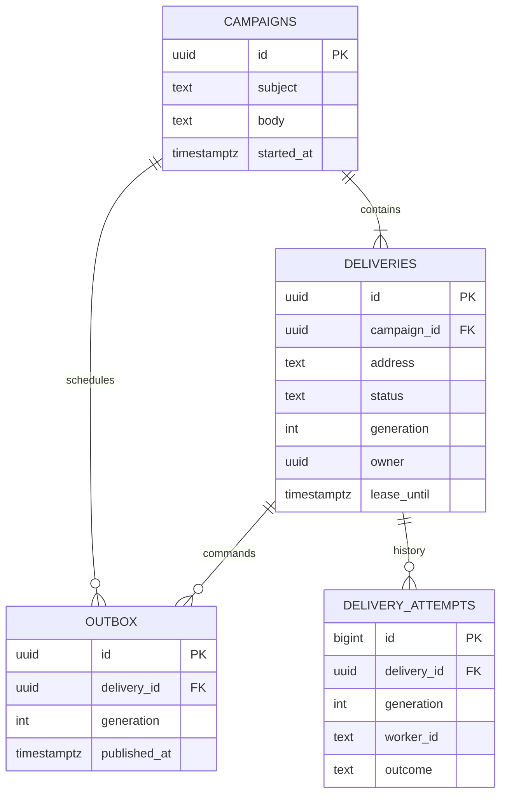

# Báo cáo kỹ thuật — Đề tài 11

**Tên đề tài:** Hệ thống gửi thông báo hàng loạt.

**Học phần:** Phát triển ứng dụng phân tán.

**Sinh viên / MSSV / lớp / giảng viên:** bổ sung thông tin thật trước khi nộp.

## 1. Bài toán và mục tiêu

Khi cần gửi cùng nội dung đến nhiều người, xử lý toàn bộ ngay trong một HTTP request làm tăng thời gian chờ và khó phục hồi nếu kết nối bị ngắt. Hệ thống tách thao tác quản lý chiến dịch khỏi công việc gửi: API lưu yêu cầu, RabbitMQ đệm công việc, nhiều Worker thực hiện độc lập.

Mục tiêu là quản lý chiến dịch, nhập người nhận, ghi kết quả từng thông báo, theo dõi Pending/Sent/Failed, chạy lại lỗi và minh họa khả năng phục hồi thành phần. Phạm vi triển khai là email thử nghiệm qua Mailpit, tối đa 5.000 địa chỉ/chiến dịch; chưa phục vụ Internet công khai.

## 2. Phân tích yêu cầu

Actor chính là Admin. Các ca sử dụng gồm tạo chiến dịch, nhập/chọn danh sách người nhận, bắt đầu gửi, xem chiến dịch, xem kết quả, xem lịch sử thử và gửi lại thất bại. Worker và SMTP là các thành phần thực hiện nghiệp vụ nền.

| Yêu cầu | Hiện thực |
|---|---|
| C#/.NET 10/Minimal API | Campaign.Api và các project net10.0 |
| Client | Web Client HTML/CSS/JS do API phục vụ |
| RabbitMQ và nhiều Worker | Work queue chung, hai container Worker mặc định |
| Lưu kết quả và thống kê | PostgreSQL, tổng hợp từ Delivery tránh cộng trùng |
| Chạy lại job thất bại | Retry tự động hữu hạn + API retry-failed |
| Chạy độc lập, Docker | Dockerfile riêng cho API, Worker và Audit. Docker Compose chạy cả ba service |
| Cấu hình tách khỏi code | Environment variables và .env.example |
| Logging, phục hồi | JSON logs, Outbox, lease, retry, ACK/confirm |
| GitHub, lịch sử commit | Có .gitignore và CI; người học push và tiếp tục commit thực tế |

## 3. Kiến trúc và MEP

Kiến trúc chi tiết và sơ đồ sequence nằm trong [bản phân tích](../PHAN-TICH-VA-LUA-CHON-MEP.md). Client dùng Request–response. API giao lệnh One-way qua RabbitMQ; Queue-based là mẫu chủ đạo. ACK/confirm xác nhận giao nhận không đồng nghĩa với kết quả gửi email. Hai Worker cùng queue chia việc, không phải hai subscriber nhận bản sao cùng lệnh.

Publish–subscribe được dùng để phát sự kiện kết quả gửi tới service audit. Campaign API phát vào topic exchange `notifications.events`, còn `Notification.Audit` đọc queue riêng `notification.audit`. Giao diện cập nhật bằng polling 3 giây theo Request–response.

## 4. Thiết kế dữ liệu và thông điệp

`campaigns` lưu tên, tiêu đề, nội dung và thời điểm bắt đầu. `deliveries` chứa snapshot email, trạng thái, số lượt thử, generation và lease. Bản đầu lưu người nhận trực tiếp trong deliveries, chưa có sổ địa chỉ Recipients riêng. Danh sách người nhận được chuẩn hóa và loại trùng trong một chiến dịch.

`outbox` lưu lệnh đã commit nhưng chưa được broker xác nhận. `delivery_attempts` giữ lịch sử mỗi generation. `schema_versions` ghi schema v1. Khóa duy nhất `(campaign_id,address)` ngăn lặp người nhận; `(delivery_id,generation)` ngăn tạo lệnh/lịch sử trùng cho cùng phiên.

Schema v2 bổ sung `audit_outbox` để lưu sự kiện cùng giao dịch cập nhật kết quả gửi và `audit_events` để lưu kết quả từ subscriber. EventId là khóa chính để sự kiện phát lại không làm trùng nhật ký. Nhật ký bắt đầu từ các lượt gửi sau khi nâng cấp.

Delivery được tạo lúc tạo Draft; Outbox chỉ được tạo khi start. Đây là chi tiết hiện thực để có thể xem người nhận trước khi chạy. Message gồm MessageId, CampaignId, DeliveryId, Generation và SchemaVersion; nội dung email được đọc từ DB. CorrelationId trên AMQP bằng CampaignId.

## 5. Thuật toán và các tình huống lỗi

**Start:** khóa dòng campaign, kiểm tra started_at; nếu chưa start thì ghi started_at và Outbox trong cùng transaction. Các yêu cầu start đồng thời sau đó đọc lại cùng trạng thái, không nhân đôi công việc.

**Publish:** chọn một Outbox chưa phát bằng `FOR UPDATE SKIP LOCKED`, publish mandatory với publisher confirm, cập nhật published_at rồi commit. Nếu chết sau publish trước commit, message có thể được phát lại; consumer cần bảo vệ bằng DB.

**Consume:** Worker chỉ claim Delivery khi Pending, generation khớp và campaign đã start. Cập nhật trạng thái Processing, owner và lease trong transaction cùng lịch sử attempt. Sau SMTP, cập nhật kết quả với điều kiện owner/generation còn khớp, rồi ACK. Message trùng/phiên cũ không mở thêm lần gửi.

**Retry:** lỗi tạm thời chuyển RetryScheduled; scheduler tạo generation mới sau 10/30 giây. Tối đa 3 lần trong một lượt. Retry-failed chỉ cập nhật Failed, đặt lại attempt_count nhưng giữ total_attempts và lịch sử. Lỗi vĩnh viễn không tự lặp vô hạn.

**Worker chết:** lease hết hạn sau 60 giây. Scheduler đánh dấu attempt Interrupted, tăng generation rồi đưa lại vào Outbox nếu chưa hết lượt. Worker cũ không được ghi đè DB của phiên mới. Cơ chế này không loại bỏ mọi tác dụng phụ SMTP ngoài DB.

**Broker dừng:** API vẫn nhận được công việc nếu DB hoạt động. **DB dừng:** API trả lỗi, không báo lưu thành công; Worker không gửi khi không claim được. **API dừng:** Worker tiếp tục job trong broker; Outbox/scheduler tiếp tục sau khi API trở lại.

## 6. Triển khai

Docker Compose tạo network chung; API/Worker gọi `postgres`, `rabbitmq`, `mailpit`. Dữ liệu dùng named volumes. Port host chỉ mở localhost. API và Worker dùng tài khoản không phải root trong image .NET. Secrets thật đưa qua cấu hình môi trường, không commit.

Hướng dẫn lệnh đầy đủ nằm trong [README](../README.md). Cơ sở dữ liệu được tạo bằng SQL nhúng có advisory lock để nhiều tiến trình không tạo schema đồng thời. Schema thay đổi trong tương lai cần migration có phiên bản.

## 7. Kiểm thử và đánh giá

Self-test kiểm tra validation, retry và quy tắc tổng hợp. Integration test kiểm tra hệ thống thật gồm API, PostgreSQL, RabbitMQ, hai Worker và Mailpit. Fault test tạm dừng Worker/broker và khởi động lại DB. Kết quả thực tế được ghi riêng tại [KIEM-THU.md](KIEM-THU.md); không coi thiết kế kiểm thử là số liệu đã đo.

Ưu điểm: thao tác API không chờ gửi toàn bộ; có thể mở rộng số Worker; giữ công việc khi broker gián đoạn; tra cứu lịch sử và nguyên nhân lỗi. Đổi lại cần quản lý nhiều tiến trình, chấp nhận nhất quán cuối cùng của tiến độ và giải quyết thông điệp trùng.

Chưa đo throughput, p95 latency hoặc so sánh tốc độ một/hai Worker. Hai Worker chứng minh phân phối việc, không chứng minh tăng tốc tuyến tính.

## 8. Kiểm soát truy cập và hướng phát triển

API dùng phiên cookie có thời hạn bốn giờ với vai trò Admin. Chỉ Admin truy cập dữ liệu chiến dịch hoặc audit. Các thao tác POST yêu cầu header riêng, đăng nhập có giới hạn số lần thử và mật khẩu SMTP thật được cấu hình tách với mật khẩu Admin. Bản hiện tại hỗ trợ một tài khoản quản trị cục bộ.

SMTP có cửa sổ gửi thành công nhưng DB chưa ghi nhận. Hệ thống hướng tới at-least-once và giảm trùng, không exactly-once. Một node broker/DB có thể phục hồi sau restart nhưng không đảm bảo HA. DLQ dùng classic queue không cấu hình replicated/quorum at-least-once dead-lettering; không tuyên bố DLQ là kho lưu tuyệt đối khi broker gặp sự cố.

Các hướng phát triển: quản lý nhiều tài khoản và vai trò, hạn mức gửi theo nhà cung cấp, idempotency key phía nhà cung cấp, backup PostgreSQL, quorum queues, dọn Outbox định kỳ và đẩy tiến độ qua SignalR/SSE.

## 9. Chuẩn bị bảo vệ

Mở giao diện và RabbitMQ Management; tạo một chiến dịch có địa chỉ thường, retry+ và fail+; chỉ ra hai WorkerId trong lịch sử. Dừng Worker, tạo chiến dịch rồi quan sát queue; bật lại để xử lý. Dừng broker trong lúc tạo chiến dịch và giải thích vai trò Outbox. Trình bày rõ HTTP 202 khác kết quả Sent, polling khác push và work queue khác publish–subscribe.

Điền thông tin sinh viên, thêm ảnh minh họa từ lần chạy của chính nhóm, ghi commit/tag dùng bảo vệ và bảo đảm mã trên máy trùng repository GitHub.
