# Bài 3 — Giao tiếp thời gian thực với SignalR

**Lưu Quang Lực — dtc245200349**

Thực hành theo bài giảng của TS. Dương Thu Mây, học phần Phát triển ứng dụng phân tán.

## 1. Nội dung bàn giao

Hai solution độc lập, bốn project .NET 10. Máy khách dùng `Microsoft.AspNetCore.SignalR.Client` **10.0.15**.

```text
Bai3/
├── PingSignalR/
│   ├── PingSignalR.slnx
│   └── src/ → Ping.Api, Ping.Client
├── RealtimeSubmissionSystem/
│   ├── RealtimeSubmissionSystem.slnx
│   ├── requests.http
│   └── src/ → Submission.RealtimeApi, Submission.RealtimeClient
├── scripts/kiem-tra.ps1
├── anh/ → PNG và TXT kết quả chạy
├── thi-nghiem-du-doan.md
└── README.md
```

**Bộ minh chứng gồm 15 ảnh gốc do sinh viên chụp trực tiếp trong Windows Terminal**, giữ nguyên độ phân giải và nội dung. Bấm vào ảnh để mở bản gốc, phóng to khi đọc chữ. Xem [chỉ mục 15 ảnh](anh/CHI-MUC-ANH.md). Một ảnh có thể chứng minh nhiều mốc nên một số tên PNG dùng chung ảnh. Tệp TXT lưu các lần chạy kiểm thử; mã kết nối, mã lượt nộp và thời gian có thể khác giữa các lần. Các lệnh `dotnet ...dll` chạy assembly đã build, tương đương `dotnet run --no-build --project ...`.

## 2. Chạy trong VS Code

Cần .NET SDK 10; mở terminal PowerShell tại thư mục `Bai3`. Không cần Docker hoặc cơ sở dữ liệu ngoài cho bài thực hành này.

**Trước khi build lại:** nhấn Enter để thoát các Ping.Client và Ctrl+C để dừng các API. Nếu để chương trình cũ chạy, Windows có thể khóa DLL/EXE và báo MSB3021/MSB3027. Đóng API không tự kết thúc client đang chờ `Console.ReadLine()`. `--tl:off` hiển thị rõ `Build succeeded`, `0 Warning(s)`, `0 Error(s)`.

```powershell
dotnet build PingSignalR/PingSignalR.slnx -m:1 --tl:off
dotnet build RealtimeSubmissionSystem/RealtimeSubmissionSystem.slnx -m:1 --tl:off
```

**Ping:** terminal 1 chạy máy chủ; terminal 2 chạy An; terminal 3 chạy Bình sau khi An đã kết nối.

```powershell
# Terminal 1
dotnet run --project PingSignalR/src/Ping.Api --urls http://localhost:5200
# Terminal 2
dotnet run --project PingSignalR/src/Ping.Client -- http://localhost:5200 An
# Terminal 3
dotnet run --project PingSignalR/src/Ping.Client -- http://localhost:5200 Binh
```

Nhấn Enter để thoát từng Ping.Client. Nhấn Ctrl+C trong terminal máy chủ để dừng. Thử kết nối lại bằng cách giữ An chạy, dừng Ping.Api rồi chạy lại máy chủ trong vài giây. Nhóm gắn với kết nối cũ; ví dụ Ping giữ đúng bài giảng nên **không tự vào lại nhóm** sau reconnect.

**EduSubmit:** mở hai terminal khác.

```powershell
# Terminal máy chủ
dotnet run --project RealtimeSubmissionSystem/src/Submission.RealtimeApi --urls http://localhost:5000
# Terminal máy khách
dotnet run --project RealtimeSubmissionSystem/src/Submission.RealtimeClient -- http://localhost:5000 SV001
```

Máy khách tự thoát sau khi nhận trạng thái cuối và đọc lại REST. Mã thoát `0`: REST cuối là graded; `2`: đã chạy nhưng kết quả cuối không graded (ví dụ failed); `1`: lỗi kết nối/HTTP/tham số. Các thời điểm in từ `UpdatedAt` theo UTC.

Kiểm tra nhanh tự động, khi **đã thoát các client và tắt các API ở cổng 5000/5200**:

```powershell
powershell -NoProfile -ExecutionPolicy Bypass -File scripts/kiem-tra.ps1
```

Script build, tự mở hai API nền, kiểm tra HTTP, chạy client nhận graded rồi dừng các tiến trình do chính script tạo. Không cần sửa mã nguồn để chạy ca bình thường. `requests.http` có 12 request; với VS Code REST Client, chạy request có tên `createSubmission` trước rồi chờ 5 giây mới chạy request đọc theo ID. Nếu dùng công cụ HTTP khác, thay biến ID bằng ID/Location trả về từ POST.

## 3. Nhật ký PingSignalR

| Bước | Đã thực hiện và quan sát | Giải thích |
|---|---|---|
| 1.1–1.2 | Tạo solution, hai project, gói client; build 0 lỗi | Server SignalR có sẵn trong ASP.NET Core; client cần package |
| 2 | AddSignalR, MapHub; negotiate trả 200 và connectionId | Negotiate chọn phương thức truyền tải; truy cập hub trực tiếp không phải trang web |
| 3 | Thêm Echo trả EchoResponse bằng Clients.Caller | Chỉ người gọi nhận phản hồi |
| 4 | An in `[Echo] Echo: Xin chao SignalR tu An` | On đăng ký trước StartAsync, InvokeAsync gọi phương thức hub |
| 5 | An thấy Group/Broadcast của Bình; không có Echo của Bình | Caller chỉ người gọi; Group chỉ thành viên; All mọi kết nối đang mở |
| 6 | Tắt/chạy lại API: có cả Dang ket noi lai và Da ket noi lai; ConnectionId đổi | WithAutomaticReconnect mở kết nối mới, không giữ nhóm cũ |
| 7.1 | API tắt: HttpRequestException, actively refused (5200) | Reconnect không tự thử lại lần StartAsync đầu tiên |
| 7.2 | Tạm đổi `/hubs/ping` thành `/hub/ping`: 404 | Đường dẫn negotiate không khớp MapHub |
| 7.3 | Tạm đổi On thành EchoRespone: không có Echo, không exception | Tên sự kiện chiều xuống sai thì không có handler xử lý |

Mã chính giữ URL `/hubs/ping` và tên `EchoResponse`. Khi chụp lỗi 2 và 3, các bản client thử nghiệm riêng được tạo dưới `.work/PingFaults/`, nằm ngoài Git; mã chính không bị đổi sang phiên bản lỗi. Sau thí nghiệm đã dừng các tiến trình cũ và build lại cả bốn project thành công.

[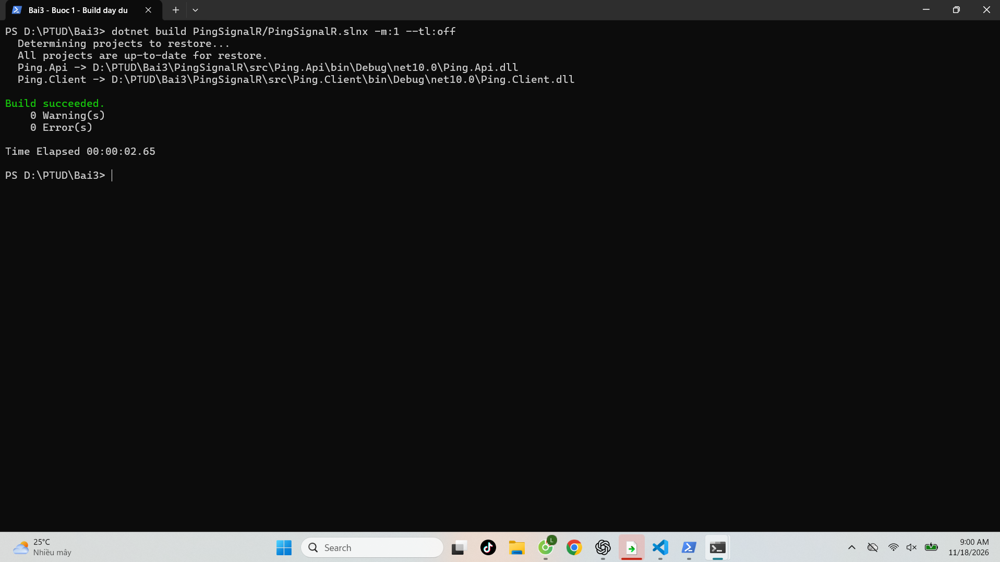](anh/buoc1-build.png)
[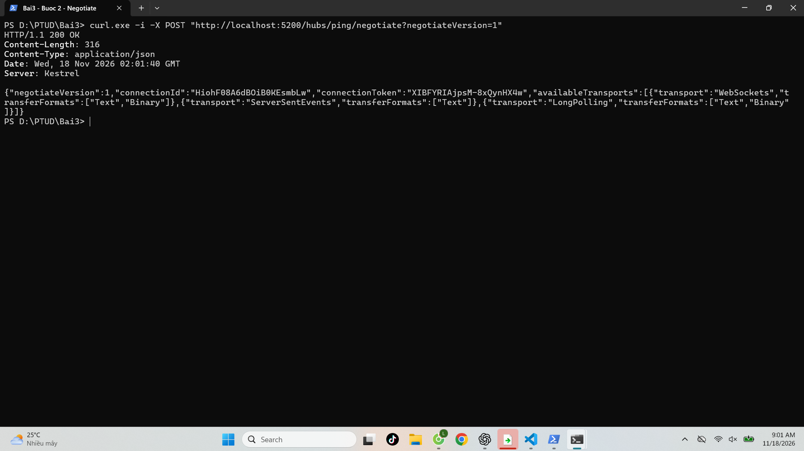](anh/buoc2-negotiate.png)
[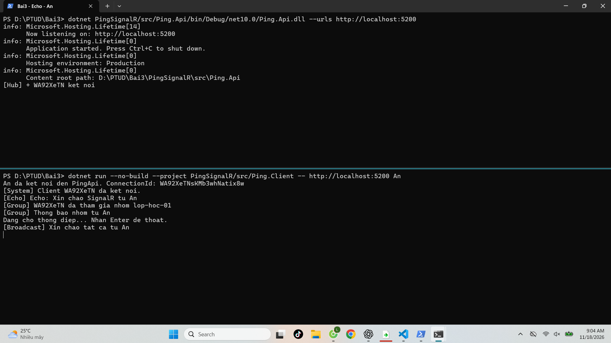](anh/buoc4-echo.png)
[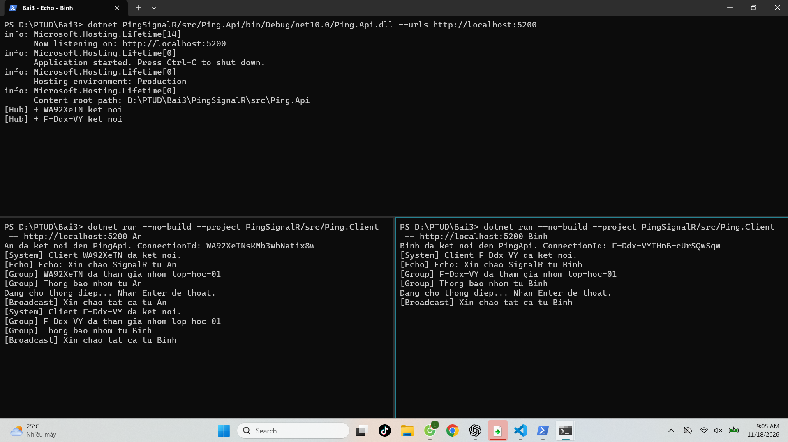](anh/buoc5-nhom.png)
[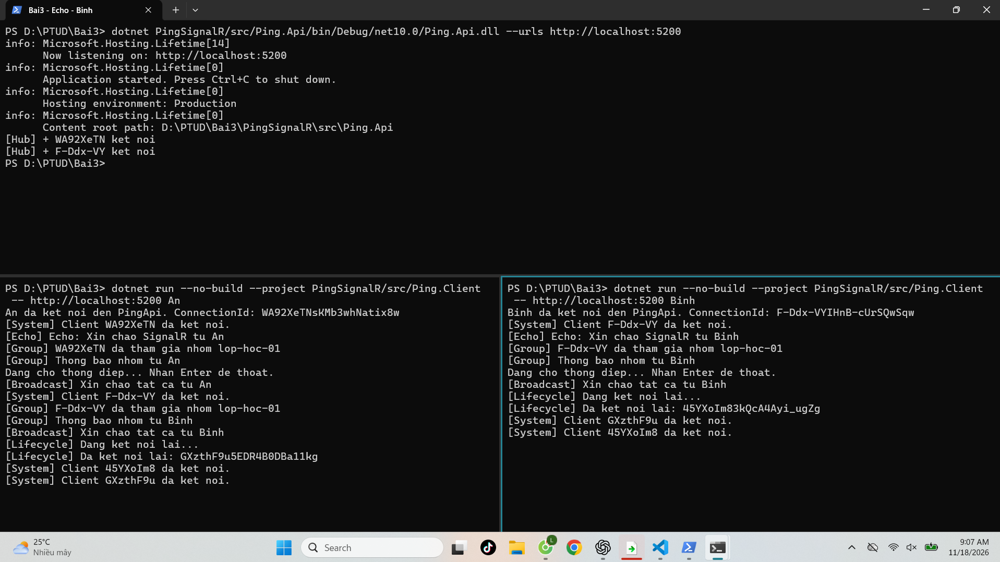](anh/buoc6-noilai.png)
[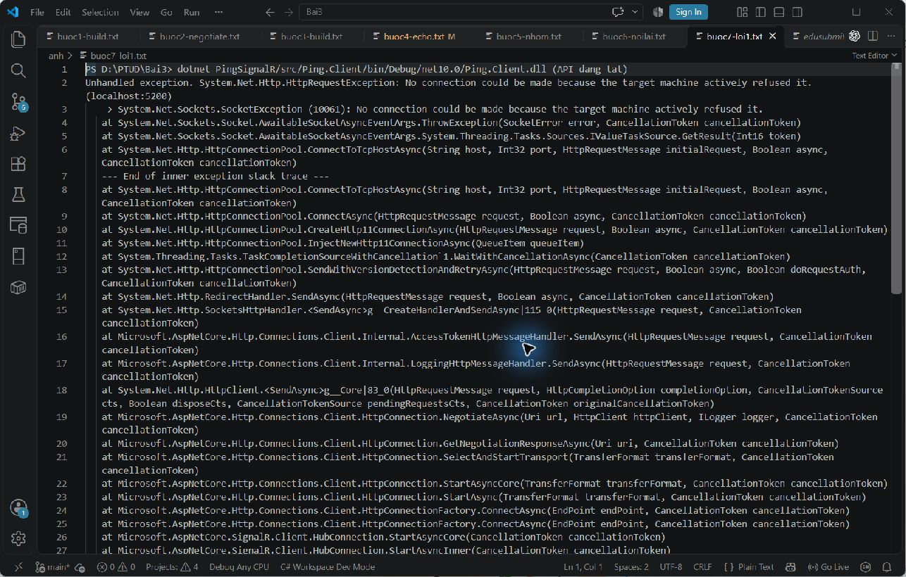](anh/buoc7-loi1.png)
[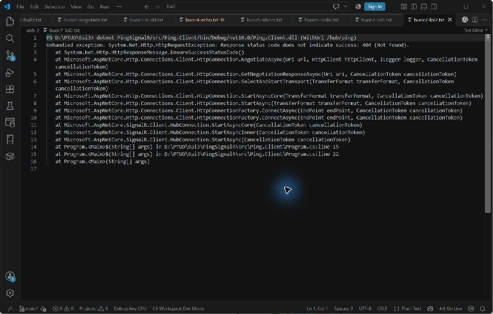](anh/buoc7-loi2.png)
[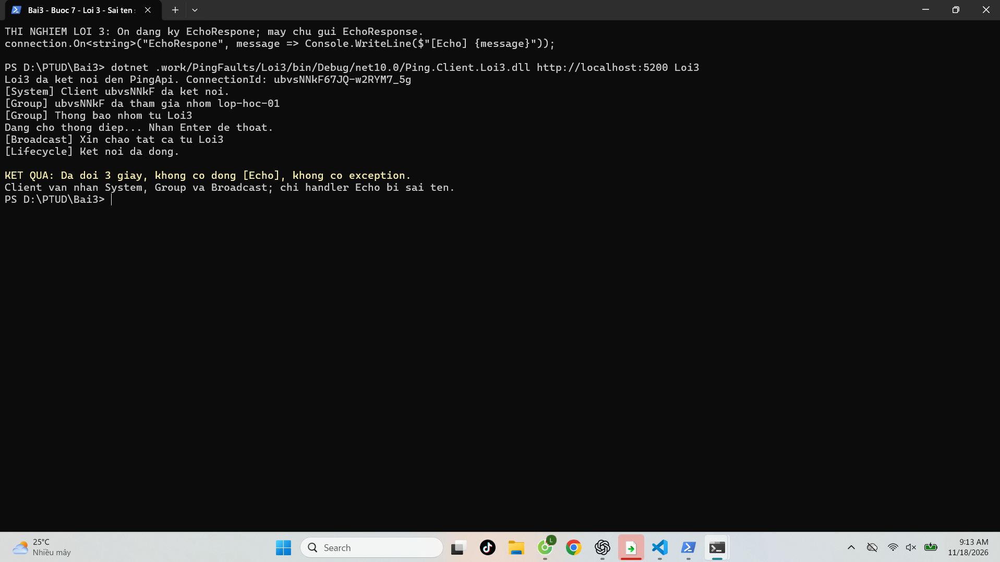](anh/buoc7-loi3.png)

Thử thách ba máy khách: An/Bình ở nhóm, Chi không ở nhóm. An gọi Echo: chỉ An nhận. Chi gửi tới nhóm: An và Bình nhận, Chi không nhận vì không là thành viên. Bình Broadcast: cả ba nhận. Ví dụ hub không kiểm tra quyền người gửi nên người ngoài nhóm vẫn gọi được SendToGroup.

## 4. EduSubmit: REST kết hợp push

REST tạo và đọc tài nguyên. POST trả `201 Created`, `Location`, trạng thái `received` ngay; tác vụ nền chờ 1 giây đổi `processing`, thêm 2 giây đổi `graded`. Mỗi lần đổi, dữ liệu được lưu dưới lock trước khi `IHubContext<SubmissionHub>` phát `SubmissionStatusChanged` tới `submission:{id}`. Payload chỉ gồm `SubmissionId`, `Status`, `UpdatedAt`.

Hub mỏng: `WatchSubmission` đưa ConnectionId vào nhóm; không tạo và không chấm lượt nộp. Máy khách đăng ký On trước StartAsync, POST để có ID rồi Watch đúng ID. Chờ thông báo tối đa 10 giây, sau đó GET REST để chốt trạng thái. Bản mở rộng rejoin và đọc REST trong Reconnected để đồng bộ lại các ID đang theo dõi.

**Tám dòng kết quả chạy thật của máy khách:**

```text
Da ket noi SignalR.
Chon bai tap: 1 - Bai tap SignalR
Da tao luot nop: 7457f21b-ba93-4ae7-ad50-2d2d4d02d1cb
Trang thai REST ban dau: received
Dang cho thong bao trang thai tu may chu...
Thong bao SignalR: 7457f21b-ba93-4ae7-ad50-2d2d4d02d1cb -> processing luc 02:18:48
Thong bao SignalR: 7457f21b-ba93-4ae7-ad50-2d2d4d02d1cb -> graded luc 02:18:50
Trang thai doc lai bang REST: graded
```

[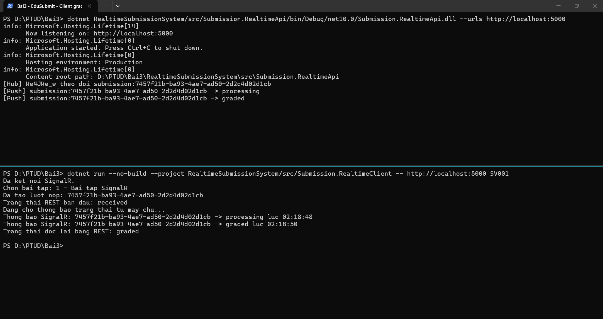](anh/edusubmit-graded.png)

Ảnh HTTP và ảnh build cả bốn project nằm ở mục 7.

## 5. Năm thí nghiệm phân tán

Dự đoán đã được ghi trước khi chạy trong [thi-nghiem-du-doan.md](thi-nghiem-du-doan.md). Kết quả bên dưới được ghi nhận từ các lần chạy thực tế, không chép kết quả mẫu trong slide.

| Thí nghiệm | Dự đoán | Kết quả thực tế | Giải thích |
|---|---|---|---|
| Hai sinh viên song song | Mỗi bên chỉ nhận ID mình Watch | SV001 và SV002 có hai UUID khác nhau, mỗi bên nhận đúng hai tin processing/graded của mình | Máy chủ phát tới nhóm theo ID, không phát All |
| API tắt trước khi chạy client | Báo connection refused | `[Loi] ... actively refused ... (localhost:5000)` | Chưa có kết nối đầu tiên nên AutomaticReconnect không xử lý |
| Sai `/hub/submissions` | 404 | `[Loi] ... 404 (Not Found)` | Lỗi xảy ra khi negotiate ở đường dẫn không được map |
| Sai tên On: SubmissionStatusChange | Không có push, hết 10 giây thì REST vẫn graded | Không có dòng Thong bao SignalR; có Qua thoi gian cho và REST: graded | Sự kiện đã gửi nhưng không có handler cùng tên |
| Watch trễ 4000 ms | Bỏ lỡ cả processing và graded | Không có push, chờ timeout rồi REST: graded | Tại thời điểm vào nhóm, hai sự kiện đã được phát; không có phát lại mặc định |

```powershell
# Giữ API 5000 chạy, mở hai terminal chạy SV001 và SV002 để thử nhóm.
# Sai hub:
dotnet run --project RealtimeSubmissionSystem/src/Submission.RealtimeClient -- http://localhost:5000 SV001 --hub /hub/submissions
# Sai sự kiện:
dotnet run --project RealtimeSubmissionSystem/src/Submission.RealtimeClient -- http://localhost:5000 SV001 --event SubmissionStatusChange
# Theo dõi muộn:
dotnet run --project RealtimeSubmissionSystem/src/Submission.RealtimeClient -- http://localhost:5000 SV001 --watch-delay-ms 4000
```

[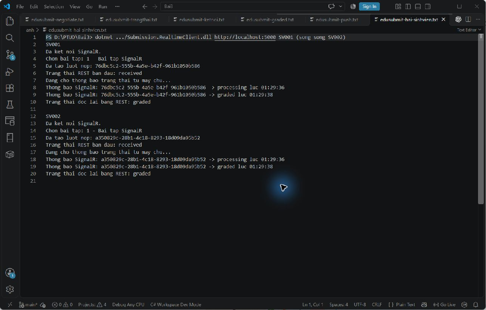](anh/edusubmit-hai-sinhvien.png)

[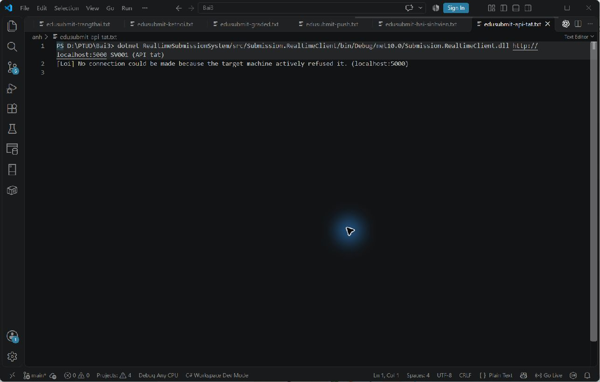](anh/edusubmit-api-tat.png)

[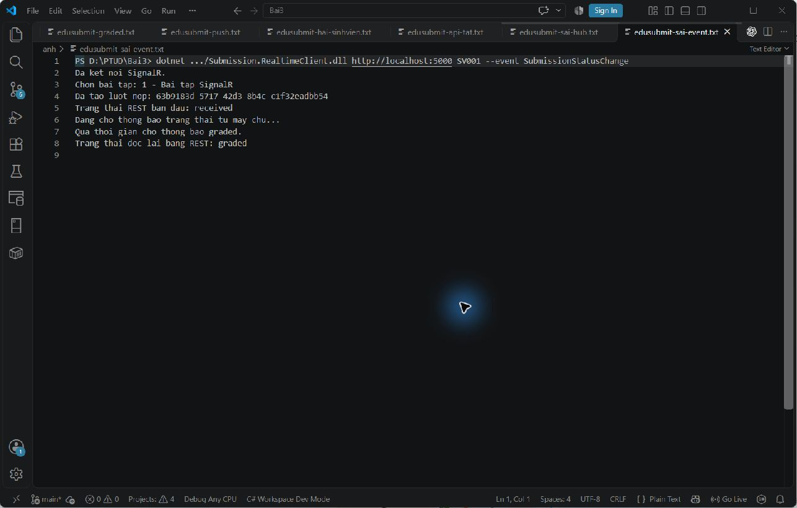](anh/edusubmit-sai-event.png)

## 6. Bài tập mở rộng 2, 3 và 4

**Bài 2 — failed:** chấm giả lập cho repository HTTPS thành graded; URL khác/không hợp lệ thành failed. POST vẫn trả 201 received để minh họa lỗi khi chấm, không phải lỗi tạo tài nguyên. Client in cảnh báo đỏ và hoàn tất chờ khi gặp failed.

**Bài 3 — hai lượt trên một kết nối:** `--count 2` tạo hai lượt, Watch hai nhóm, mỗi ID có TaskCompletionSource riêng trong ConcurrentDictionary. Đợi cả hai trạng thái cuối rồi GET từng ID. Đã thử một lượt graded và một lượt failed:

```powershell
dotnet run --project RealtimeSubmissionSystem/src/Submission.RealtimeClient -- http://localhost:5000 SV001 --count 2 --second-repository http://example.com/invalid
```

[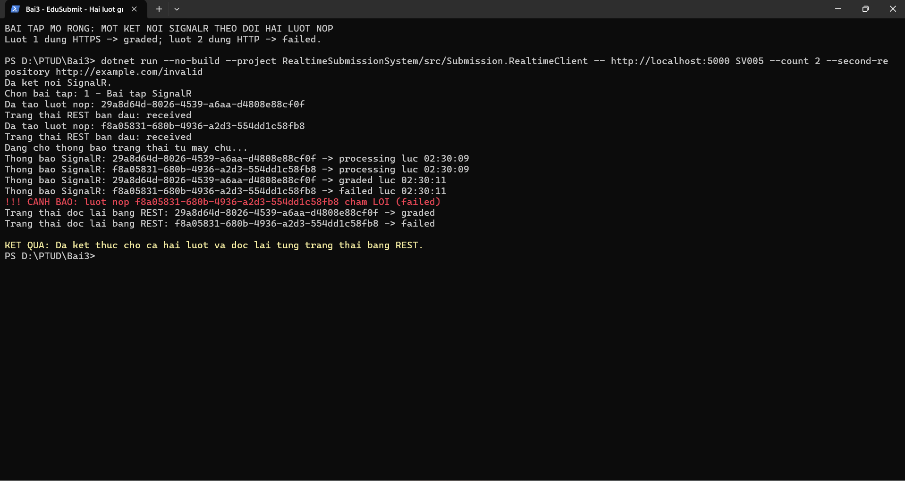](anh/edusubmit-hai-luot-failed.png)

**Bài 4 — API tắt:** đã thực hiện ở thí nghiệm 2: StartAsync thất bại và client báo lỗi rồi thoát mã 1; chưa POST nên không tạo lượt nộp. Reconnect không tự giải quyết lần mở kết nối đầu tiên.

## 7. Kiểm tra HTTP và build cuối

`requests.http` có 12 request gồm: root 200; assignments 200; tạo 201 + Location; đọc 200; thiếu trường 400; bài không tồn tại 404; lượt không tồn tại 404; negotiate 200; sai hub 404; bài đóng 400; Ping negotiate 200; mở rộng failed. Ca đọc trạng thái chạy sau POST ít nhất 5 giây. Đã kiểm tra 11 ca HTTP cốt lõi và kiểm tra failed bằng client riêng.

[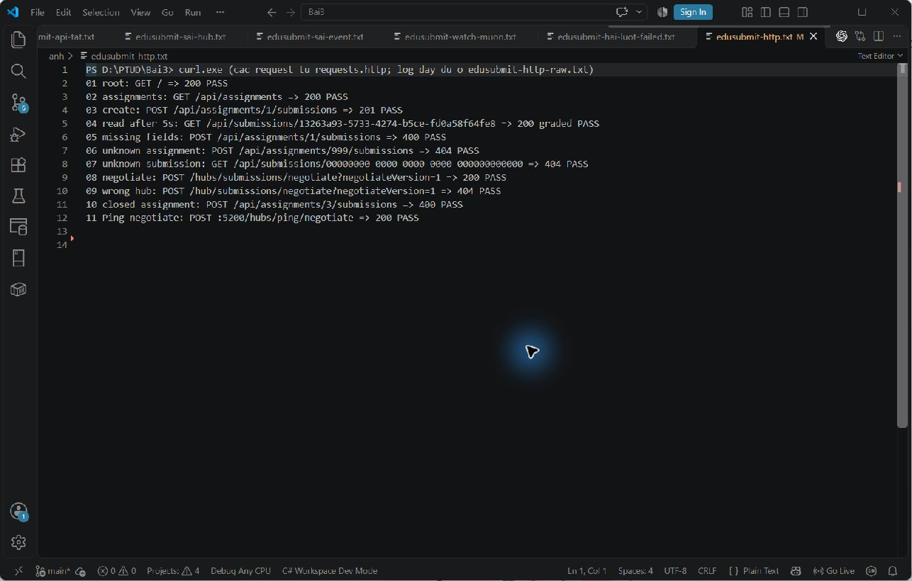](anh/edusubmit-http.png)
[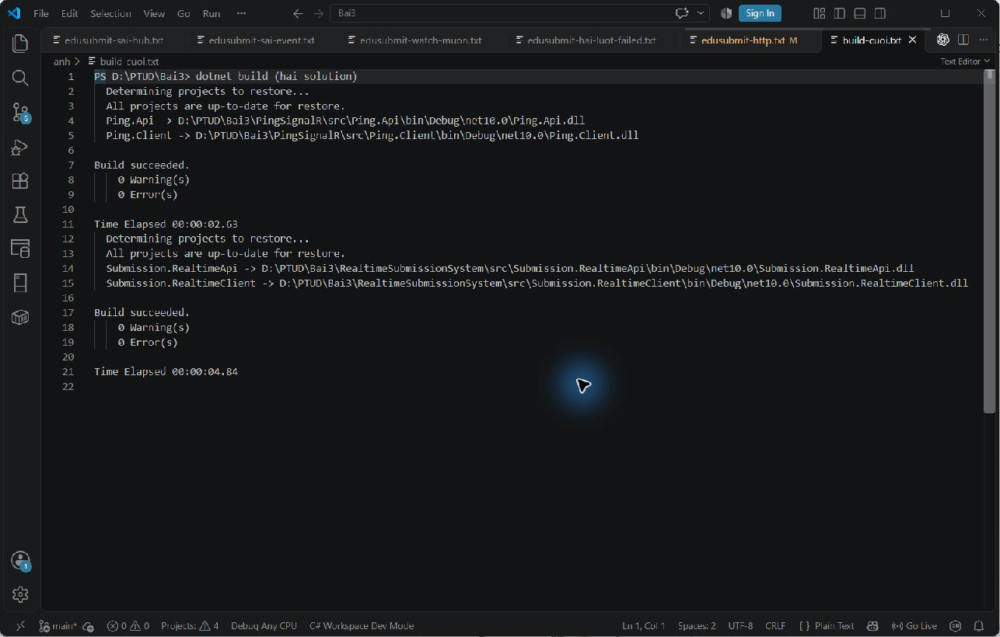](anh/build-cuoi.png)

Chi tiết header/body HTTP nằm trong [edusubmit-http-raw.txt](anh/edusubmit-http-raw.txt). Git có commit theo từng bước, vượt tối thiểu 8 commit; bin/ và obj/ được loại bằng .gitignore. Khi nộp, đặt cả Bai3 trong thư mục cá nhân ở repo lớp; tiêu đề PR: **Bai3 - dtc245200349 - Lưu Quang Lực**.

## 8. Trả lời ba câu hỏi đầu giờ

1. **Máy chủ chủ động báo được không?** Có, khi client đã mở kết nối SignalR. Trong hub dùng Clients; ngoài hub dùng IHubContext để đẩy sự kiện tới kết nối/nhóm đang theo dõi.
2. **REST và SignalR chia việc thế nào?** REST tạo lượt nộp, trả 201/Location và đọc trạng thái bằng GET. SignalR báo những thay đổi phát sinh sau yêu cầu ban đầu. REST là nguồn dữ liệu để đối chiếu.
3. **Đứt mạng đúng lúc graded?** Thông báo có thể bị lỡ. Sau reconnect, Watch lại ID và GET trạng thái cuối. Nếu API cũng khởi động lại trong bản lưu RAM này, lượt nộp mất và GET trả 404; hệ thực cần lưu trữ bền vững.

## 9. Ôn tập và thảo luận

| Câu hỏi ôn tập | Trả lời |
|---|---|
| Polling và push khác nhau? | Polling gửi yêu cầu định kỳ dù chưa đổi, độ trễ phụ thuộc chu kỳ. Push giữ kết nối và gửi khi đổi, giảm hỏi lặp nhưng cần quản lý kết nối. |
| Ba MEP? | Request–response: client yêu cầu, server trả kết quả; push: server gửi sự kiện trên kênh đã mở; streaming: một phiên trao đổi chuỗi phần dữ liệu liên tiếp. |
| WebSocket và SignalR? | WebSocket là giao thức hai chiều lâu dài; SignalR là thư viện có hub, nhóm, protocol thông điệp, reconnect và lựa chọn transport. |
| Transport dự phòng? | WebSockets, Server-Sent Events, Long Polling; negotiate công bố các khả năng. |
| Vì sao nhóm submission:{id}? | Chỉ đưa tin tới kết nối theo dõi lượt đó, giảm dữ liệu gửi dư. Nhóm không thay thế xác thực/ủy quyền. |
| IHubContext? | Gửi sự kiện từ ngoài đối tượng hub, ví dụ tác vụ chấm nền. |
| On<T>? | Đăng ký handler theo tên sự kiện, chuyển JSON thành T. Bỏ/sai tên thì client không xử lý thông báo đó. |
| REST/SignalR chia việc? | REST tạo/đọc tài nguyên với status code và Location. SignalR bổ sung cập nhật sau đó; bài này giữ REST để thao tác rõ ràng và truy vấn lại khi mất tin. |
| AutomaticReconnect? | Với kết nối đã mở, thử lại sau 0, 2, 10, 30 giây; không tự retry StartAsync ban đầu. |
| Mất tin graded? | Rejoin nhóm và GET lại; không giả định SignalR tự lưu/phát lại sự kiện đã mất. |

**Hàng trăm sinh viên:** nhóm theo ID tiết kiệm băng thông hơn Clients.All rồi lọc tại client, đồng thời tránh phát dữ liệu không cần thiết sang người khác. Để bảo mật thực sự phải xác thực và kiểm tra người sở hữu trước khi cho Watch.

**Hai trường hợp polling hợp lý:** số người dùng ít, dữ liệu đổi hiếm và chấp nhận trễ; hoặc tác vụ đồng bộ định kỳ/báo cáo không cần giữ kết nối thời gian thực.

**Nhiều bản sao API:** nhóm và dữ liệu RAM trên các máy chủ tách biệt; client nối bản sao A có thể không nhận sự kiện do B phát. Cần backplane như Redis/Azure SignalR và nơi lưu dữ liệu dùng chung; tùy transport/topology cần cấu hình sticky session.

## 10. Giới hạn của bài thực hành

Dữ liệu và nhóm lưu trong RAM, mất khi API tắt. Task.Delay mô phỏng chấm, chưa có worker/hàng đợi; chưa có xác thực, nên biết ID vẫn có thể Watch. Đây là phạm vi học SignalR theo bài giảng, chưa phải hệ chấm bài vận hành thật. Không gửi email thật trong Bài 3.

## Tài liệu

- Bài giảng `Bai3_SignalR_Bai-giang.pdf`, các trang 24–63 (thực hành), 65–71 (ôn tập và tiêu chí).
- [Microsoft Learn — SignalR .NET client](https://learn.microsoft.com/en-us/aspnet/core/signalr/dotnet-client?view=aspnetcore-10.0): StartAsync, On, reconnect.
- [Microsoft Learn — Users and groups](https://learn.microsoft.com/en-us/aspnet/core/signalr/groups?view=aspnetcore-10.0): nhóm không được giữ khi reconnect, nhóm không thay thế quyền truy cập.
