# BÀI 3 - LẬP TRÌNH THỜI GIAN THỰC VỚI SIGNALR

- **Sinh viên thực hiện:** Lường Thị Giang
- **Mã sinh viên:** `dtc245200988`
- **Lớp:** CNTTK23E
- **Môn học:** Phát triển ứng dụng phân tán

---

# 0. TRẢ LỜI 3 CÂU HỎI ĐẦU GIỜ

1. **Máy chủ có thể chủ động báo cho máy khách mà không cần máy khách hỏi không?**
   - **Có**, nếu máy khách mở sẵn một kết nối lâu dài (WebSocket thông qua thư viện SignalR) tới máy chủ.
   - Trên kết nối đó, máy chủ chủ động đẩy thông điệp xuống đúng nhóm máy khách đang theo dõi bằng `Clients.Group(...).SendAsync(...)` (và sử dụng `IHubContext<SubmissionHub>` khi gửi từ bên ngoài Hub, chẳng hạn từ endpoint REST hoặc tác vụ chấm nền).

2. **Đã có REST rồi, vì sao còn cần thêm SignalR? Hai thứ chia việc thế nào?**
   - Vì HTTP/REST truyền thống chỉ hoạt động theo mô hình máy khách hỏi — máy chủ trả lời; máy chủ không thể tự gọi ngược lại máy khách khi sự kiện xảy ra, còn việc dùng polling hỏi liên tục lại gây lãng phí tài nguyên và có độ trễ.
   - **Phân chia nhiệm vụ:**
     - **REST API:** Tạo tài nguyên (`POST` trả về `201 Created` kèm `id`) và đọc trạng thái hiện tại (`GET` — đóng vai trò là **nguồn sự thật / Source of Truth**) với mã trạng thái HTTP rõ ràng (`200`, `201`, `400`, `404`).
     - **SignalR:** Đẩy các thông báo thay đổi trạng thái phát sinh sau yêu cầu ban đầu (`received` -> `processing` -> `graded`). **SignalR không thay thế REST mà bổ sung chiều báo tin tức thì.**

3. **Nếu đứt mạng đúng lúc máy chủ báo "đã chấm xong" thì sao?**
   - Thông điệp đẩy tại thời điểm đứt mạng sẽ **bị mất** vì SignalR không lưu trữ lại các thông điệp bị lỡ trong lúc ngắt kết nối.
   - Khi có mạng trở lại, `WithAutomaticReconnect()` tự động kết nối lại với một `ConnectionId` mới (đồng nghĩa với việc kết nối đó không còn nằm trong nhóm `submission:{id}` cũ).
   - **Cách xử lý chuẩn (Quy tắc vàng):** Máy khách cần đăng ký lại `WatchSubmission(id)` sau khi nối lại và gọi `GET /api/submissions/{id}` qua REST để lấy trạng thái cuối cùng chính xác nhất.

---

# 1. CÁC LỆNH ĐÃ CHẠY

## 1.1. Phần 2: PingSignalR

Thư mục: `PingSignalR`

### a. Build chương trình

```powershell
cd PingSignalR
dotnet build
```

### b. Chạy Server API (Ping.Api)

Mở Terminal 1:

```powershell
dotnet run --project src/Ping.Api --urls http://localhost:5200
```

Địa chỉ Hub: `http://localhost:5200/hubs/ping`

### c. Kiểm tra bước bắt tay negotiate

Mở Terminal 2:

```powershell
curl.exe -X POST "http://localhost:5200/hubs/ping/negotiate?negotiateVersion=1"
```

### d. Chạy Client (Ping.Client)

Mở Terminal 2 (Máy khách 1 - Giang):

```powershell
dotnet run --project src/Ping.Client -- http://localhost:5200 Giang
```

Mở Terminal 3 (Máy khách 2 - SV002, dùng để kiểm thử Broadcast và Group):

```powershell
dotnet run --project src/Ping.Client -- http://localhost:5200 SV002
```

Client thực hiện các bước:

1. Xây dựng kết nối tới `/hubs/ping` có cấu hình tự động kết nối lại `WithAutomaticReconnect()`.
2. Đăng ký lắng nghe các thông điệp (`EchoResponse`, `BroadcastMessage`, `GroupMessage`, `SystemMessage`) và các sự kiện vòng đời (`Reconnecting`, `Reconnected`, `Closed`).
3. Mở kết nối bằng `StartAsync()`.
4. Gọi phương thức `Echo`, tham gia nhóm `lop-hoc-01`, gửi tin nhóm `SendToGroup` và phát rộng `Broadcast`.

---

## 1.2. Phần 3: EduSubmit Realtime (`RealtimeSubmissionSystem`)

Thư mục: `RealtimeSubmissionSystem`

### a. Build chương trình

```powershell
cd RealtimeSubmissionSystem
dotnet build
```

### b. Chạy Server API (`Submission.RealtimeApi`)

Mở Terminal 1:

```powershell
dotnet run --project src/Submission.RealtimeApi --urls http://localhost:5000
```

- Địa chỉ REST API: `http://localhost:5000/api/assignments`, `http://localhost:5000/api/submissions/{id}`
- Địa chỉ Hub: `http://localhost:5000/hubs/submissions`

### c. Chạy Client (`Submission.RealtimeClient`)

Mở Terminal 2:

```powershell
dotnet run --project src/Submission.RealtimeClient -- http://localhost:5000 dtc245200988
```

Client thực hiện đúng trình tự 5 bước chuẩn:

1. Đăng ký lắng nghe sự kiện `connection.On<SubmissionStatusMessage>("SubmissionStatusChanged", ...)` và khởi tạo `TaskCompletionSource` làm tín hiệu chờ trạng thái `"graded"`.
2. Mở kết nối SignalR qua `await connection.StartAsync()`.
3. Gọi REST `GET /api/assignments` để lấy bài tập đang mở và `POST /api/assignments/{id}/submissions` để tạo lượt nộp mới (nhận về `201 Created`, trạng thái ban đầu `"received"`).
4. Gọi `await connection.InvokeAsync("WatchSubmission", created.Id.ToString())` để tham gia nhóm riêng `submission:{id}` và chờ thông báo đẩy từ tác vụ chấm nền.
5. Chốt lại trạng thái cuối cùng bằng REST `GET /api/submissions/{created.Id}`.

---

# 2. ẢNH KẾT QUẢ CHẠY THỰC TẾ

Các ảnh minh chứng được lưu trong thư mục `anh/`.

## 2.1. EduSubmit Realtime (`RealtimeSubmissionSystem`)

### Bước 1: Tạo solution, cài gói và build thử

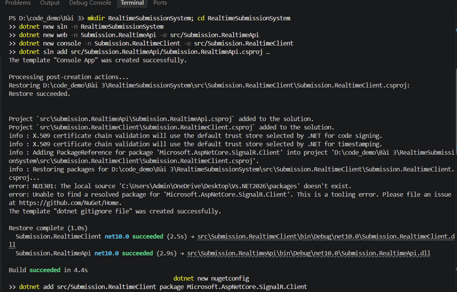

Lệnh `dotnet build` báo `Build succeeded in 1.9s`. Đã tạo solution `RealtimeSubmissionSystem` gồm 2 project `Submission.RealtimeApi` và `Submission.RealtimeClient`, cài gói `Microsoft.AspNetCore.SignalR.Client` và build thành công.

### Bước 2: Khởi tạo REST API nộp bài (`201 Created`)

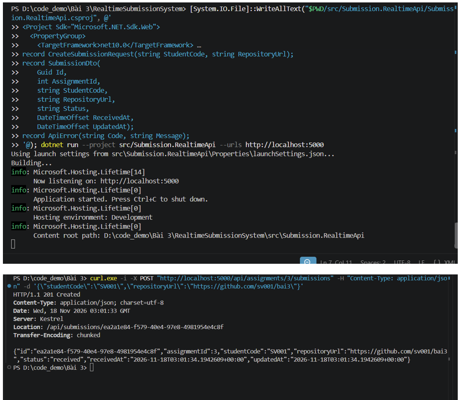

Gửi yêu cầu `POST /api/assignments/3/submissions` trả về mã `HTTP/1.1 201 Created`, header `Location` và body JSON có `"status": "received"` cùng mốc thời gian `"updatedAt"`.

### Bước 3: Tích hợp SignalR Hub và kiểm tra bước bắt tay `negotiate`

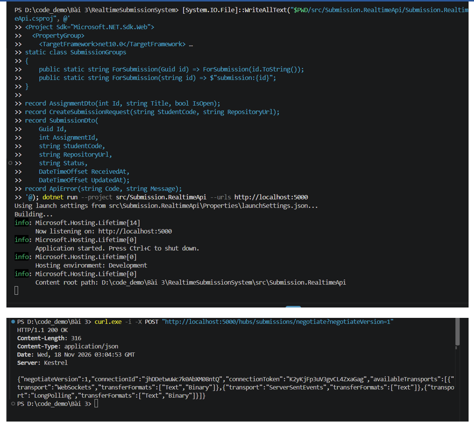

Lệnh `curl.exe -i -X POST "http://localhost:5000/hubs/submissions/negotiate?negotiateVersion=1"` trả về `HTTP/1.1 200 OK` cùng `connectionId` (`jhDDetwuWc7k0AbXM08ntQ`), `connectionToken` và danh sách `availableTransports` (`WebSockets`, `ServerSentEvents`, `LongPolling`).

### Bước 4: Tác vụ chấm nền qua `IHubContext` (`received` -> `processing` -> `graded`)

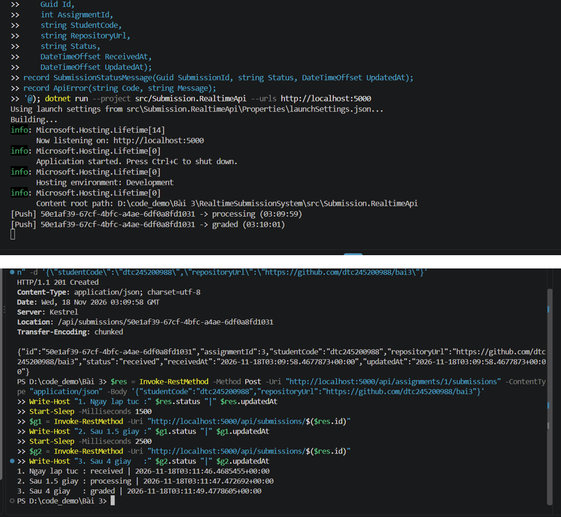

Sau khi `POST` trả `201 Created` ngay lập tức, tác vụ nền tự động cập nhật trạng thái và đẩy thông báo qua `IHubContext<SubmissionHub>` (`processing` sau 1.5s và `graded` sau 4s). Khi đối chiếu lại qua REST `GET /api/submissions/{id}`, trạng thái và mốc `updatedAt` tăng dần chính xác.

### Bước 5: Máy khách kết nối SignalR (`Submission.RealtimeClient`)

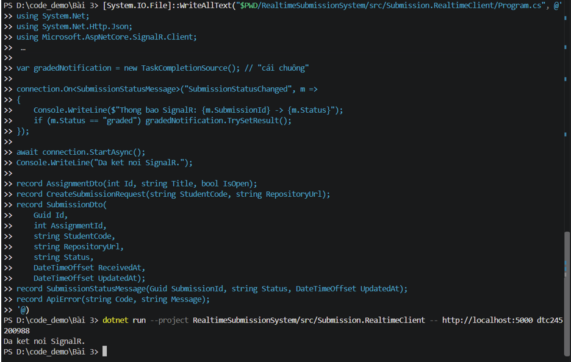

Máy khách `Submission.RealtimeClient` kết nối thành công tới `/hubs/submissions` và in ra thông báo `"Da ket noi SignalR."`.

### Bước 6: Theo dõi theo nhóm `submission:{id}` và chốt lại bằng REST

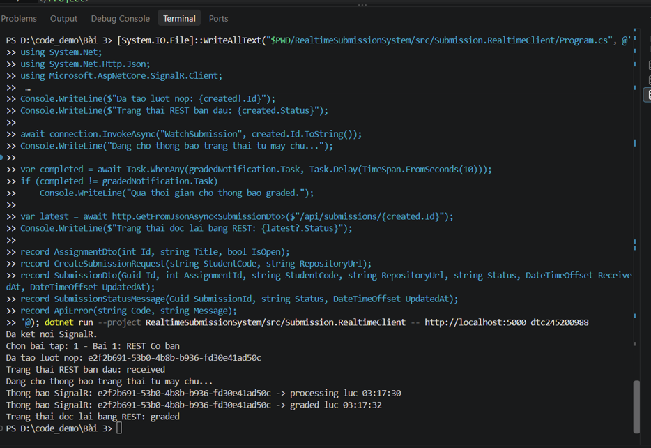

Kết quả chạy máy khách thực tế (đủ 8 dòng):

```text
Da ket noi SignalR.
Chon bai tap: 1 - Bai 1: REST Co ban
Da tao luot nop: e2f2b691-53b0-4b8b-b936-fd30e41ad50c
Trang thai REST ban dau: received
Dang cho thong bao trang thai tu may chu...
Thong bao SignalR: e2f2b691-53b0-4b8b-b936-fd30e41ad50c -> processing luc 03:17:30
Thong bao SignalR: e2f2b691-53b0-4b8b-b936-fd30e41ad50c -> graded luc 03:17:32
Trang thai doc lai bang REST: graded
```

Log tương ứng trên máy chủ:

```text
[Hub] qzZED-6McJOAXEglNqMrow theo doi submission:e2f2b691-53b0-4b8b-b936-fd30e41ad50c
[Push] submission:e2f2b691-53b0-4b8b-b936-fd30e41ad50c -> processing
[Push] submission:e2f2b691-53b0-4b8b-b936-fd30e41ad50c -> graded
```

### Bước 7: Thực hiện 5 thí nghiệm sự cố SignalR

- **Thí nghiệm 1 — Chạy 2 máy khách `dtc245200988` và `SV002` cùng lúc:** 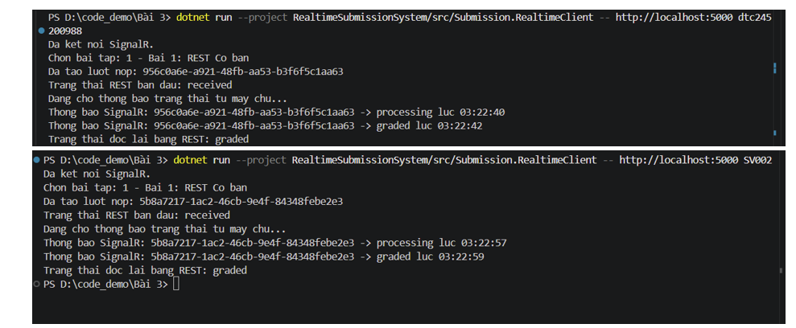
- **Thí nghiệm 2 — Chạy máy khách khi máy chủ chưa bật (`localhost:5000` tắt):** 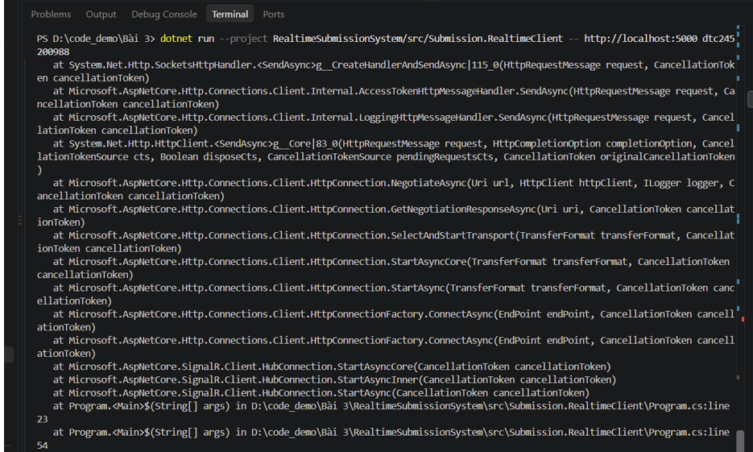
- **Thí nghiệm 3 — Đổi sai đường dẫn Hub thành `/hub/submissions` (`404 Not Found`):** 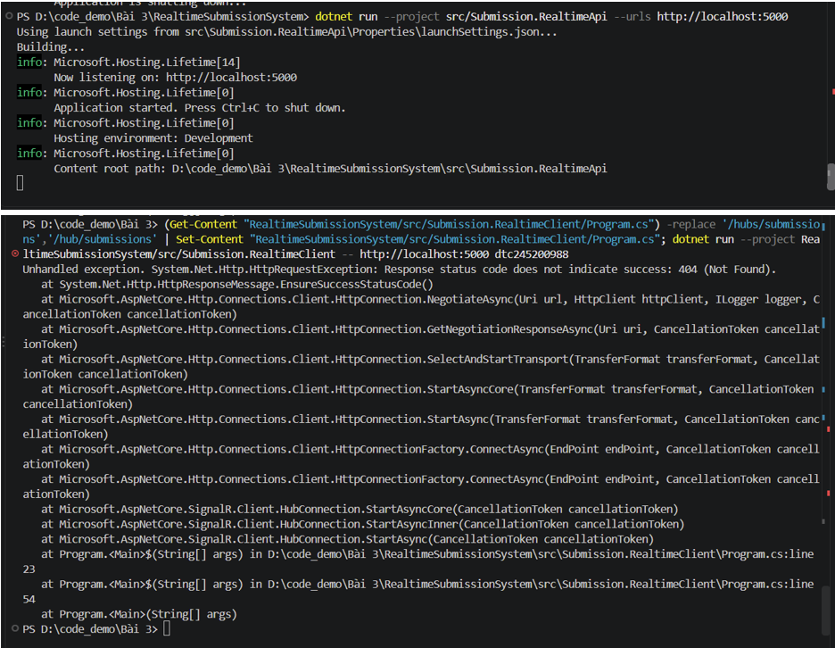
- **Thí nghiệm 4 — Đổi sai tên sự kiện `On("SubmissionChanged")`:** 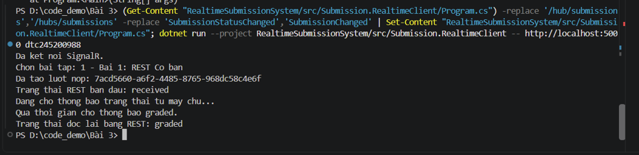
- **Thí nghiệm 5 — Trì hoãn gọi `WatchSubmission` muộn 4 giây:** 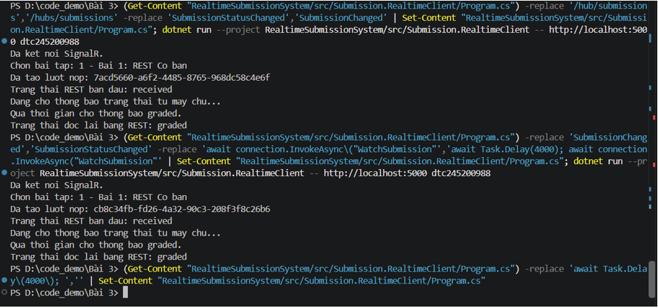

### Bước 8: Kiểm thử bộ 9 ca REST API & SignalR trong `requests.http`

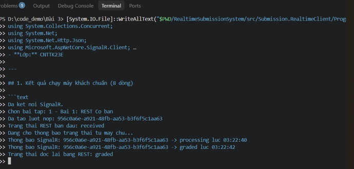

Đã chạy kiểm thử đầy đủ 9 ca trong `RealtimeSubmissionSystem/requests.http`:

|  Ca   | Yêu cầu                                                              | Kết quả mong đợi                                  | Kết quả thực tế         |
| :---: | -------------------------------------------------------------------- | ------------------------------------------------- | ----------------------- |
| **1** | `GET /`                                                              | `200 OK`                                          | Đạt (`200 OK`)          |
| **2** | `GET /api/assignments`                                               | `200 OK`                                          | Đạt (`200 OK`)          |
| **3** | `POST /api/assignments/1/submissions` (hợp lệ)                       | `201 Created`                                     | Đạt (`201 Created`)     |
| **4** | `GET /api/submissions/{id}`                                          | `200 OK` (`received` -> `processing` -> `graded`) | Đạt (`200 OK`)          |
| **5** | `POST /api/assignments/1/submissions` (thiếu dữ liệu)                | `400 Bad Request` (`INVALID_REQUEST`)             | Đạt (`400 Bad Request`) |
| **6** | `POST /api/assignments/99/submissions` (không tồn tại)               | `404 Not Found` (`ASSIGNMENT_NOT_FOUND`)          | Đạt (`404 Not Found`)   |
| **7** | `GET /api/submissions/00000000-...` (ID rỗng)                        | `404 Not Found` (`SUBMISSION_NOT_FOUND`)          | Đạt (`404 Not Found`)   |
| **8** | `POST /hubs/submissions/negotiate?negotiateVersion=1`                | `200 OK` + `connectionId`                         | Đạt (`200 OK`)          |
| **9** | `POST /hub/submissions/negotiate?negotiateVersion=1` (sai đường dẫn) | `404 Not Found`                                   | Đạt (`404 Not Found`)   |

---

# 3. BẢNG PHÁ THỬ VÀ KIỂM TRA

## 3.1. Kiểm thử chức năng SignalR Hub (`PingSignalR`)

| STT | Ca thử                                               | Kết quả mong đợi                                                            | Kết quả thực tế |
| :-: | ---------------------------------------------------- | --------------------------------------------------------------------------- | --------------- |
|  1  | Build solution `PingSignalR`                         | `Build succeeded`, 0 lỗi                                                    | Đạt             |
|  2  | Gọi `POST /hubs/ping/negotiate?negotiateVersion=1`   | Trả về JSON có `connectionId` và `WebSockets`                               | Đạt             |
|  3  | Máy khách `Giang` kết nối và gọi `Echo`              | Chỉ `Giang` nhận được `[Echo]` qua `Clients.Caller`                         | Đạt             |
|  4  | Máy khách `SV002` tham gia nhóm và gọi `SendToGroup` | Cả `Giang` và `SV002` trong `lop-hoc-01` đều nhận `[Group]`                 | Đạt             |
|  5  | Máy khách `SV002` gọi `Broadcast`                    | Mọi kết nối đang mở đều nhận `[Broadcast]` qua `Clients.All`                | Đạt             |
|  6  | Tắt máy chủ đột ngột rồi bật lại                     | Client chuyển sang `Reconnecting` rồi tự nối lại (`Reconnected`) với ID mới | Đạt             |

## 3.2. Bảng 5 thí nghiệm phân tán (`EduSubmit` - Bước 7)

|  STT  | Thí nghiệm                                                              | Dự đoán trước khi chạy                                                                                            | Kết quả chạy thật                                                                                                                        | Giải thích & Bài học rút ra                                                                                                                            |
| :---: | ----------------------------------------------------------------------- | ----------------------------------------------------------------------------------------------------------------- | ---------------------------------------------------------------------------------------------------------------------------------------- | ------------------------------------------------------------------------------------------------------------------------------------------------------ |
| **1** | **Chạy 2 máy khách `dtc245200988` và `SV002` cùng lúc**                 | Mỗi sinh viên chỉ nhận được thông báo trạng thái của riêng lượt nộp do mình tạo, không bị lẫn tin của người khác. | Mỗi máy khách chỉ hiển thị đúng thông báo `processing` và `graded` của lượt nộp vừa tạo.                                                 | Nhóm `submission:{id}` do máy chủ quản lý giúp cô lập người nhận theo từng lượt nộp, đảm bảo riêng tư và tiết kiệm đường truyền.                       |
| **2** | **Chạy máy khách khi máy chủ chưa chạy**                                | Máy khách sẽ báo lỗi không thể kết nối tới cổng `5000` ngay khi gọi `StartAsync()`.                               | Ném ngoại lệ `HttpRequestException` / `SocketException (10061): No connection could be made` ngay tại `NegotiateAsync` / `StartAsync()`. | `WithAutomaticReconnect()` chỉ tự thử lại với kết nối đã mở thành công trước đó; lần kết nối đầu tiên thất bại sẽ báo lỗi ngay.                        |
| **3** | **Sửa `WithUrl` sai thành `/hub/submissions` (thiếu `s`)**              | Máy khách sẽ gặp lỗi `404 Not Found` ngay bước bắt tay khởi tạo kết nối SignalR.                                  | Ném ngoại lệ `HttpRequestException: Response status code does not indicate success: 404 (Not Found)`.                                    | Lỗi xảy ra ngay ở bước thương lượng `negotiate`; đường dẫn ở `WithUrl` phía máy khách phải khớp tuyệt đối với `app.MapHub` phía máy chủ.               |
| **4** | **Sửa `On("SubmissionStatusChanged")` thành `On("SubmissionChanged")`** | Không lỗi biên dịch nhưng máy khách không bắt được sự kiện, sau 10 giây sẽ hết thời gian chờ.                     | Không báo lỗi; sau 10 giây in `"Qua thoi gian cho thong bao graded."`, sau đó REST đọc lại vẫn là `graded`.                              | Sai tên sự kiện ở chiều Server -> Client sẽ bị bỏ qua trong im lặng (silent drop). Cần đối chiếu tên hợp đồng hai phía đầu tiên.                       |
| **5** | **Chờ 4 giây sau khi `POST` rồi mới gọi `WatchSubmission`**             | Sau 4 giây tác vụ nền đã chấm xong và đẩy xong tin nên máy khách sẽ bị lỡ toàn bộ thông báo SignalR.              | Không nhận được tin SignalR nào; hết 10 giây timeout nhưng bước đọc lại bằng REST `GET` vẫn in `graded`.                                 | Tham gia nhóm muộn hơn thời điểm `SendAsync` sẽ bị lỡ thông điệp thời gian thực. Nhờ quy tắc chốt lại bằng REST `GET`, trạng thái cuối luôn chính xác. |

---

# 4. TỔNG HỢP BỐN PHẠM VI GỬI VÀ CÂU HỎI ÔN TẬP (CHƯƠNG 3)

## 4.1. Bảng tổng hợp bốn phạm vi gửi trong SignalR

| Phạm vi              | Ai nhận                                  | Ví dụ ứng dụng trong EduSubmit                                           |
| -------------------- | ---------------------------------------- | ------------------------------------------------------------------------ |
| `Clients.All`        | Mọi kết nối đang mở tới Hub              | Thông báo máy chủ sắp bảo trì; thông báo có bài tập mới được đăng        |
| `Clients.Caller`     | Chỉ kết nối vừa gọi phương thức trên Hub | Xác nhận riêng cho sinh viên `"đã đăng ký theo dõi lượt nộp"`            |
| `Clients.Group(tên)` | Tất cả thành viên đã tham gia nhóm `tên` | Cập nhật trạng thái chấm bài của lượt nộp gửi vào nhóm `submission:{id}` |
| `Clients.Client(id)` | Duy nhất một `ConnectionId` cụ thể       | Hiếm dùng: gửi thông báo riêng cho một phiên làm việc cụ thể             |

## 4.2. Trả lời ngắn gọn câu hỏi ôn tập và thảo luận (Slide 68)

1. **Polling khác push ở số yêu cầu và độ trễ thế nào?**
   - _Polling_ gửi nhiều yêu cầu lặp lại theo chu kỳ nên đa số yêu cầu là thừa và độ trễ phụ thuộc vào chu kỳ hỏi; _Push_ chỉ gửi đúng lúc sự kiện phát sinh trên máy chủ nên không có yêu cầu thừa và độ trễ gần như tức thì.
2. **Phân biệt 3 MEP theo hướng khởi tạo và số thông điệp:**
   - _Yêu cầu – phản hồi (Request-Response):_ Máy khách khởi tạo, 1 yêu cầu nhận 1 phản hồi.
   - _Đẩy dữ liệu (Push):_ Máy chủ khởi tạo khi có sự kiện, gửi từng thông điệp lẻ không đều.
   - _Truyền luồng (Streaming):_ Một hoặc cả hai phía khởi tạo, gửi chuỗi nhiều thông điệp liên tục.
3. **WebSocket, SignalR: giao thức hay thư viện?**
   - _WebSocket_ là **giao thức** truyền thông hai chiều lâu dài; _SignalR_ là **thư viện** cấp cao của ASP.NET Core xây dựng trên WebSocket (kèm Hub, Group, tự nối lại và cơ chế dự phòng).
4. **SignalR có những cơ chế truyền tải dự phòng nào?**
   - Thứ tự ưu tiên: **WebSockets** (ưu tiên 1) -> **Server-Sent Events / SSE** (ưu tiên 2) -> **Long Polling** (ưu tiên 3).
5. **Vì sao tạo nhóm `submission:{id}` thay vì gửi tất cả?**
   - Để đảm bảo **riêng tư** (sinh viên không thấy kết quả của người khác) và **tiết kiệm băng thông** (máy chủ chỉ gửi đúng người cần nhận).
6. **`IHubContext` cho phép làm gì?**
   - Cho phép đẩy thông điệp SignalR tới máy khách từ **bên ngoài lớp Hub** (như từ endpoint REST hoặc tác vụ chấm nền).
7. **`On<T>` dùng để làm gì? Bỏ đi thì sao?**
   - Dùng để đăng ký hàm xử lý phía máy khách khi nhận thông điệp có tên tương ứng từ máy chủ. Nếu bỏ đi hoặc gõ sai tên, máy khách sẽ **bỏ qua trong im lặng** (không báo lỗi nhưng không nhận được dữ liệu).
8. **REST làm gì, SignalR làm gì? Vì sao không dùng SignalR để tạo lượt nộp?**
   - REST tạo tài nguyên (`POST`) và đọc trạng thái chuẩn (`GET` — nguồn sự thật); SignalR chỉ đẩy thông báo thay đổi trạng thái. Không dùng SignalR tạo lượt nộp vì REST chuẩn hóa ngữ nghĩa tài nguyên, mã trạng thái HTTP (`201`, `400`, `404`), header `Location` và dễ kiểm thử/lưu trữ.
9. **`WithAutomaticReconnect` có tác dụng gì?**
   - Tự động thử kết nối lại theo các mốc thời gian mặc định (`0s`, `2s`, `10s`, `30s`) khi kết nối đang mở bị đứt ngang.
10. **Mất kết nối đúng lúc báo `graded` thì làm gì?**
    - Tin đẩy lúc rớt mạng bị mất và kết nối mới có `ConnectionId` mới nên rời khỏi nhóm cũ; máy khách cần gọi lại `WatchSubmission(id)` (nếu cần) và gọi `GET /api/submissions/{id}` qua REST để lấy trạng thái cuối cùng chính xác nhất.
11. **Hàng trăm SV cùng theo dõi: nhóm theo `id` hay phát tất cả rồi tự lọc?**
    - **Nhóm theo `id`** tiết kiệm băng thông hơn rất nhiều vì máy chủ lọc sẵn tại nguồn thay vì phát tán hàng chục nghìn bản tin thừa cho toàn bộ lớp học.
12. **Nêu 2 tình huống polling là lựa chọn hợp lý hơn SignalR:**
    - Dữ liệu ít thay đổi và chấp nhận độ trễ vài chục giây (ví dụ: bảng tin thống kê tổng hợp theo giờ), hoặc môi trường mạng/proxy chặn kết nối lâu dài.
13. **Chạy nhiều bản sao API (scale-out) thì nhóm trong bộ nhớ gặp vấn đề gì? Sửa thế nào?**
    - Các máy chủ độc lập không chia sẻ danh sách nhóm trong RAM nên máy khách nối vào Server A sẽ không nhận được thông báo đẩy từ Server B. Cách sửa: dùng **Backplane chung** (như **Redis Backplane** hoặc Azure SignalR Service) để đồng bộ thông điệp giữa các bản sao.

---

# 5. KẾT LUẬN

Qua bài thực hành, em đã xây dựng hoàn chỉnh cả hai solution `PingSignalR` và `RealtimeSubmissionSystem` (EduSubmit), kết hợp thành công kiến trúc REST API và giao tiếp thời gian thực SignalR trên nền tảng ASP.NET Core.

Em đã nắm vững cơ chế bắt tay `negotiate`, cách vận hành của các phạm vi gửi (`Clients.Caller`, `Clients.All`, `Clients.Group`), kỹ thuật đẩy thông báo từ tác vụ nền thông qua `IHubContext`, cơ chế tự động kết nối lại `WithAutomaticReconnect()`, cũng như nguyên tắc dùng REST làm nguồn sự thật để đảm bảo tính nhất quán dữ liệu trong hệ phân tán.
