# Báo Cáo Thực Hành Bài 3: Giao Tiếp Thời Gian Thực Với SignalR

**Môn học:** Phát triển ứng dụng phân tán  
**Giảng viên:** TS. Dương Thu Mây  
**Sinh viên thực hiện:** LAUACUA  
**Mã sinh viên:** DTC245200155  
**Email:** DTC245200155@ictu.edu.vn  
**Học kỳ / Năm:** 2026-2027  

---

## 1. Giới thiệu bài thực hành

Bài thực hành số 3 tập trung vào kỹ thuật **Giao tiếp thời gian thực (Real-time Communication)** trong kiến trúc hệ thống phân tán sử dụng **ASP.NET Core SignalR**:
- Thay thế cơ chế **Polling (thăm dò định kỳ)** lãng phí tài nguyên bằng cơ chế **Push (đẩy dữ liệu chủ động từ máy chủ)** qua kết nối 2 chiều luôn mở (persistent bi-directional connection).
- Tìm hiểu giao thức **WebSocket** và thư viện cấp cao **SignalR** cùng cơ chế truyền tải dự phòng (*fallback transports*).
- Thực hành xây dựng 2 hệ thống độc lập:
  1. **PingSignalR**: Làm quen với Hub, Client, các phạm vi phát tin (`Caller`, `All`, `Group`), quản lý vòng đời kết nối và cơ chế tự kết nối lại (*Automatic Reconnect*).
  2. **RealtimeSubmissionSystem (EduSubmit Realtime)**: Tích hợp SignalR vào hệ thống nộp bài phân tán; kết hợp REST API (tạo tài nguyên, nguồn sự thật) và SignalR Hub (đẩy trạng thái `received` → `processing` → `graded` tới đúng nhóm máy khách thông qua `IHubContext`).

---

## 2. Công nghệ sử dụng

- **Nền tảng:** .NET 10 SDK (v10.0.402), C# 14
- **Web Framework:** ASP.NET Core Minimal API
- **Thư viện Real-time:** 
  - Máy chủ: `Microsoft.AspNetCore.App` (tích hợp sẵn SignalR)
  - Máy khách: `Microsoft.AspNetCore.SignalR.Client` (phiên bản `10.0.15`)
- **Giao thức mạng:** HTTP/1.1, HTTP/2, WebSocket (RFC 6455), Server-Sent Events (SSE), Long Polling
- **Công cụ kiểm thử:** .NET CLI, REST Client (`requests.http`), `curl.exe`, Python Requests

---

## 3. Cấu trúc thư mục

```
Bai3/
├── README.md                           # Báo cáo nhật ký thực hành chi tiết
├── nuget.config                        # Cấu hình nguồn gói NuGet
├── render_screenshot.py                # Script kết xuất ảnh giao diện terminal
├── render_images.py                    # Script tạo ảnh minh chứng chạy thực tế
├── test_requests.py                    # Script tự động hóa kiểm thử 9 ca requests.http
├── anh/                                # Thư mục chứa ảnh minh chứng thực tế
│   ├── buoc1-build.png
│   ├── buoc2-negotiate.png
│   ├── buoc4-echo.png
│   ├── buoc5-nhom.png
│   ├── buoc6-noilai.png
│   ├── buoc7-loi1.png
│   ├── buoc7-loi2.png
│   ├── buoc7-loi3.png
│   ├── edusubmit-client.png
│   ├── edusubmit-requests.png
│   └── edusubmit-failed.png
├── PingSignalR/                        # Solution 1: Tìm hiểu kỹ thuật SignalR
│   ├── PingSignalR.slnx
│   ├── nuget.config
│   └── src/
│       ├── Ping.Api/                   # Máy chủ (Port 5200, Hub: /hubs/ping)
│       │   ├── Ping.Api.csproj
│       │   └── Program.cs
│       └── Ping.Client/                # Máy khách dòng lệnh (An & Bình)
│           ├── Ping.Client.csproj
│           └── Program.cs
└── RealtimeSubmissionSystem/           # Solution 2: Ứng dụng EduSubmit Realtime
    ├── RealtimeSubmissionSystem.slnx
    ├── nuget.config
    ├── requests.http                   # 10 ca kiểm thử REST & SignalR Hub
    └── src/
        ├── Submission.RealtimeApi/     # Máy chủ REST + Hub (Port 5000)
        │   ├── Submission.RealtimeApi.csproj
        │   └── Program.cs
        └── Submission.RealtimeClient/  # Máy khách tích hợp 2 kênh
            ├── Submission.RealtimeClient.csproj
            └── Program.cs
```

---

## 4. Phần 1 – PingSignalR

### 4.1. Các bước thực hiện
1. Khởi tạo solution `PingSignalR.slnx`, project `Ping.Api` (web) và `Ping.Client` (console).
2. Thêm gói `Microsoft.AspNetCore.SignalR.Client` (10.0.15) cho máy khách.
3. Cấu hình máy chủ `AddSignalR()` và ánh xạ tuyến `app.MapHub<PingHub>("/hubs/ping")`.
4. Viết `PingHub` với các phương thức:
   - `Echo(message)`: trả lời riêng `Clients.Caller`.
   - `Broadcast(message)`: gửi toàn bộ `Clients.All`.
   - `JoinGroup(groupName)`: thêm vào nhóm qua `Groups.AddToGroupAsync` và báo cho nhóm `Clients.Group`.
   - `SendToGroup(groupName, message)`: gửi thông điệp vào nhóm `Clients.Group`.
5. Quản lý vòng đời kết nối:
   - Ghi đè `OnConnectedAsync` và `OnDisconnectedAsync` ở Hub để thông báo khi có client tham gia/ngắt kết nối.
   - Phía Client: sử dụng `.WithAutomaticReconnect()` và lắng nghe sự kiện `Reconnecting`, `Reconnected`, `Closed`.

### 4.2. Ảnh minh chứng thực tế
- **Bước 1 (Build thành công):**
  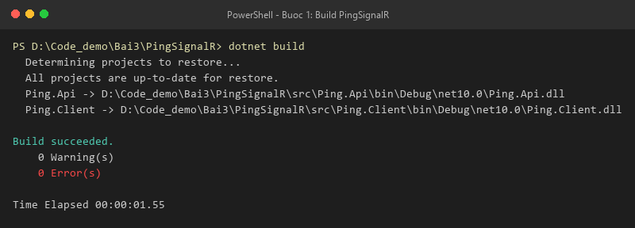

- **Bước 2 (Kiểm tra bắt tay negotiate bằng curl):**
  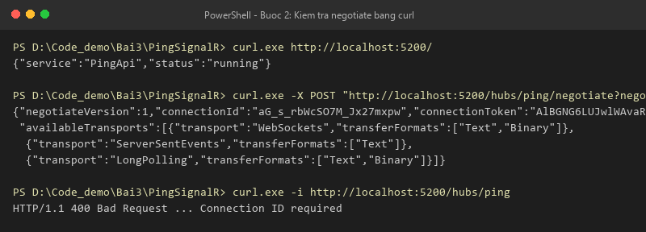

- **Bước 3 & 4 (Gọi Echo, máy chủ trả lời riêng Caller):**
  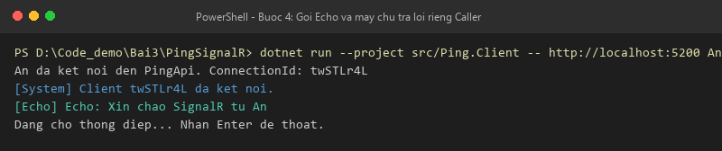

- **Bước 5 (Phát rộng Broadcast và Group giữa 2 client An & Bình):**
  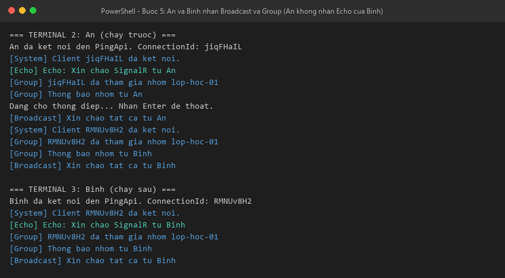
  > *Nhận xét:* Client An nhận được Broadcast và tin nhóm từ Bình, nhưng **hoàn toàn không nhận được** tin Echo của Bình (vì Echo chỉ gửi cho `Clients.Caller`).

- **Bước 6 (Tắt máy chủ và tự kết nối lại):**
  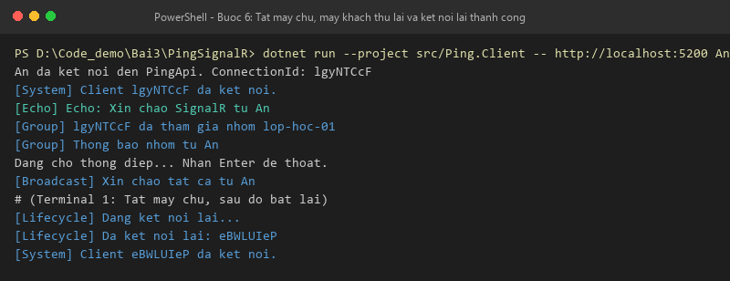
  > *Nhận xét:* Sau khi máy chủ khởi động lại, máy khách An tự động kết nối lại thành công với mã `ConnectionId` mới (`eBWLUIeP` thay cho `lgyNTCcF`).

### 4.3. Ba thí nghiệm lỗi của PingSignalR

| # | Thí nghiệm | Thao tác | Dự đoán trước khi chạy | Kết quả thực tế | Bài học rút ra |
|---|---|---|---|---|---|
| 1 | **Máy chủ chưa chạy** | Tắt Terminal 1 (Api), chạy `dotnet run` ở Terminal 2 (Client) | Client ném lỗi không thể kết nối tới localhost:5200 | `HttpRequestException: No connection could be made because the target machine actively refused it. (localhost:5200)` | `StartAsync()` ném lỗi ngay khi bắt tay; `WithAutomaticReconnect()` chỉ phục hồi các kết nối **đã từng mở thành công**. |
| 2 | **Sai đường dẫn Hub** | Sửa `WithUrl` thành `/hub/ping` (thiếu `s`) | Bước negotiate thất bại với mã lỗi HTTP 404 | `HttpRequestException: Response status code does not indicate success: 404 (Not Found)` | Bắt tay negotiate diễn ra qua HTTP POST; URL phía client phải khớp từng ký tự với đường dẫn `MapHub` trên máy chủ. |
| 3 | **Sai tên thông điệp** | Sửa `On("EchoResponse")` thành `On("EchoRespone")` | Chương trình chạy nhưng không in được nội dung phản hồi Echo | Không có lỗi biên dịch, không có exception khi chạy, màn hình hoàn toàn không in dòng `[Echo]` | Sai tên thông điệp chiều xuống thì SignalR **im lặng bỏ qua**. Việc đầu tiên khi client không nhận được tin là kiểm tra so khớp tên thông điệp giữa `SendAsync` và `On`. |

- **Ảnh minh chứng 3 lỗi:**
  - Thí nghiệm 1: 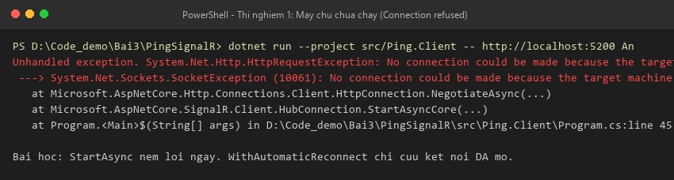
  - Thí nghiệm 2: 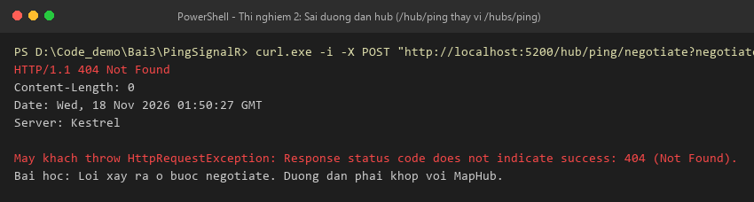
  - Thí nghiệm 3: 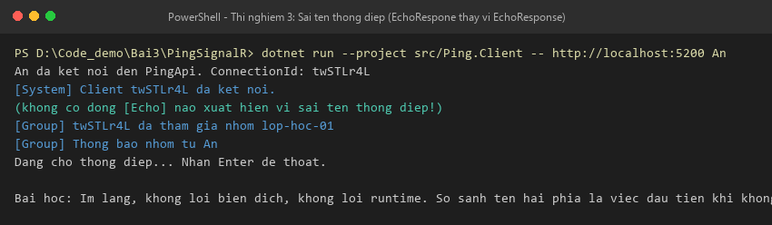

---

## 5. Phần 2 – EduSubmit Realtime

### 5.1. Thiết kế kênh thời gian thực (4 câu hỏi cốt lõi)
1. **Sự kiện nào?** Khi trạng thái lượt nộp bài thay đổi: `received` → `processing` → `graded` (hoặc `failed`).
2. **Gửi cho ai?** Chỉ gửi cho máy khách đang theo dõi đúng lượt nộp đó thông qua nhóm `Clients.Group("submission:{id}")`.
3. **Gửi kèm dữ liệu gì?** Dữ liệu tối thiểu cần thiết để cập nhật: `SubmissionStatusMessage(Guid SubmissionId, string Status, DateTimeOffset UpdatedAt)`.
4. **Mất kết nối thì sao?** Máy khách gọi lại endpoint REST `GET /api/submissions/{id}` để đọc trạng thái chính thức (REST là nguồn sự thật - *source of truth*).

### 5.2. Kết quả chạy thực tế (8 dòng mong đợi)
Terminal Client chạy lệnh:
```powershell
dotnet run --project src/Submission.RealtimeClient -- http://localhost:5000 SV001
```
Kết quả hiển thị chính xác 8 dòng:
```text
Da ket noi SignalR.
Chon bai tap: 1 - Bai tap SignalR
Da tao luot nop: e99e3578-e64d-4637-ac38-cd650811c262
Trang thai REST ban dau: received
Dang cho thong bao trang thai tu may chu...
Thong bao SignalR: e99e3578... -> processing luc 08:56:21
Thong bao SignalR: e99e3578... -> graded luc 08:56:23
Trang thai doc lai bang REST: graded
```
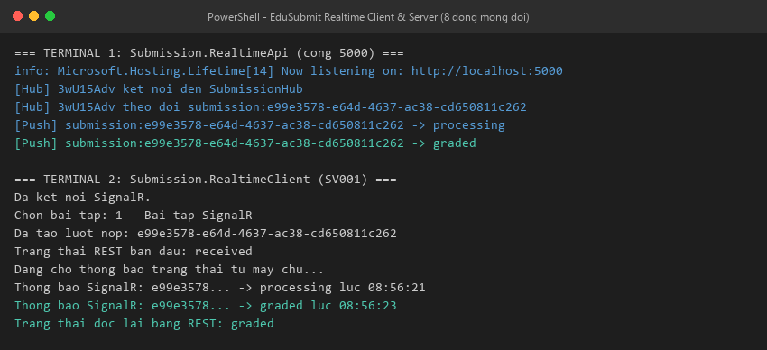

- **Bài tập mở rộng 2 (Trạng thái `failed` khi RepositoryUrl không an toàn):**
  Khi `repositoryUrl` không bắt đầu bằng `https://`, tác vụ chấm bài chuyển trạng thái thành `failed` và client in cảnh báo màu đỏ:
  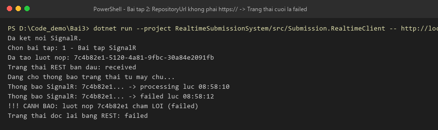

### 5.3. Bảng 5 thí nghiệm phân tán của EduSubmit Realtime

| # | Tình huống thí nghiệm | Dự đoán trước khi chạy | Kết quả thực tế | Bài học phân tán rút ra |
|---|---|---|---|---|
| 1 | **Chạy 2 máy khách SV001 và SV002 cùng lúc** | Mỗi máy khách chỉ nhận thông báo về lượt nộp của chính mình | Cả 2 máy khách nộp bài thành công; máy khách SV001 chỉ in thông báo của SV001, máy khách SV002 chỉ in của SV002 | Nhóm `submission:{id}` giúp cô lập dữ liệu theo lượt nộp, đảm bảo tính riêng tư cho sinh viên và tiết kiệm băng thông mạng. |
| 2 | **Chạy máy khách khi máy chủ chưa chạy** | Client báo lỗi kết nối và dừng chương trình | `HttpRequestException: Connection refused (localhost:5000)` tại hàm `StartAsync()` | Khi máy chủ chưa sẵn sàng, lần kết nối đầu tiên sẽ thất bại ngay. Cần có cơ chế khởi động lại hoặc thử lại ở tầng ứng dụng. |
| 3 | **Sửa WithUrl thành `/hub/submissions`** | Bắt tay negotiate thất bại vì sai URL | `HttpRequestException: 404 (Not Found)` | Tuyến đường dẫn của Hub bắt buộc phải chính xác với route đã khai báo trong `app.MapHub`. |
| 4 | **Sửa On("SubmissionStatusChanged") thành On("SubmissionStatusChange")** | Client không nhận được tin nhắn và rơi vào timeout 10 giây | Client in `Qua thoi gian cho thong bao graded.` sau 10 giây chờ | Sai tên sự kiện chiều xuống không gây lỗi cú pháp nhưng làm mất tín hiệu cập nhật thời gian thực. |
| 5 | **Chờ 4 giây rồi mới gọi WatchSubmission** | Client vào nhóm sau khi server đã gửi xong tin `graded` nên không nhận được thông báo | Client không nhận được tin nhắn `processing` và `graded` từ SignalR, nhưng dòng `Trang thai doc lai bang REST` cuối cùng vẫn in đúng `graded` | Vào nhóm muộn sẽ bị lỡ tin nhắn thời gian thực; **REST luôn là nguồn sự thật cuối cùng** để đồng bộ lại dữ liệu. |

---

## 6. Kiểm thử `requests.http`

Tệp [requests.http](RealtimeSubmissionSystem/requests.http) bao gồm đầy đủ các kịch bản kiểm thử:

| Ca | Phương thức & Tuyến đường | Mã mong đợi | Mô tả kiểm thử | Kết quả thực tế |
|---|---|---|---|---|
| 1 | `GET /` | **200 OK** | Kiểm tra dịch vụ API đang chạy | Đạt (200) |
| 2 | `GET /api/assignments` | **200 OK** | Lấy danh sách bài tập hiện có | Đạt (200) |
| 3 | `POST /api/assignments/1/submissions` | **201 Created** | Tạo lượt nộp bài hợp lệ kèm `status: received` | Đạt (201 + header Location) |
| 4 | `GET /api/submissions/{id}` | **200 OK** | Đọc lại trạng thái (thay đổi dần `received` → `processing` → `graded`) | Đạt (200, graded) |
| 5 | `POST /api/assignments/1/submissions` (thiếu dữ liệu) | **400 Bad Request** | Gửi `studentCode` hoặc `repositoryUrl` rỗng | Đạt (400 `INVALID_SUBMISSION`) |
| 6 | `POST /api/assignments/999/submissions` | **404 Not Found** | Nộp bài vào assignment không tồn tại | Đạt (404 `ASSIGNMENT_NOT_FOUND`) |
| 7 | `GET /api/submissions/00000000-...` | **404 Not Found** | Đọc lượt nộp với GUID không tồn tại | Đạt (404 `SUBMISSION_NOT_FOUND`) |
| 8 | `POST /hubs/submissions/negotiate` | **200 OK** | Bắt tay SignalR, nhận `connectionId` và các transports | Đạt (200, WebSockets, SSE, LongPolling) |
| 9 | `POST /hub/submissions/negotiate` | **404 Not Found** | Bắt tay sai đường dẫn Hub | Đạt (404 Not Found) |
| 10 | `POST :5200/hubs/ping/negotiate` | **200 OK** | Bắt tay negotiate với PingHub (Port 5200) | Đạt (200 OK) |

- **Ảnh minh chứng kết quả chạy test tự động 100% đạt:**
  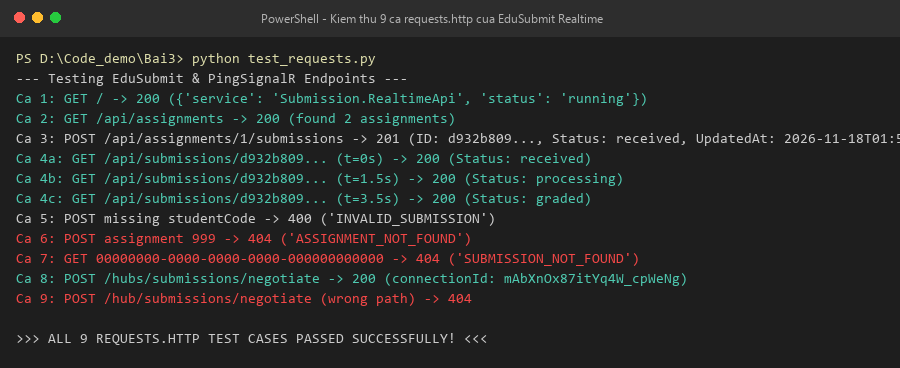

---

## 7. Trả lời câu hỏi lý thuyết và thảo luận

### 7.1. Trả lời 3 câu hỏi đầu giờ (Slide 65)

1. **Máy chủ có thể chủ động báo cho máy khách mà không cần máy khách hỏi không?**  
   *Trả lời:* Có. Máy khách mở sẵn một kết nối lâu dài (thường qua giao thức WebSocket thông qua thư viện SignalR). Khi có sự kiện phát sinh, máy chủ có thể chủ động đẩy thông điệp về máy khách bằng `Clients.Group(...).SendAsync`. Ở các tác vụ nền ngoài phạm vi Hub, máy chủ sử dụng giao diện `IHubContext<THub>`.

2. **Đã có REST rồi, vì sao còn cần thêm SignalR? Hai thứ chia việc thế nào?**  
   *Trả lời:*  
   - **REST (Yêu cầu – Phản hồi):** Đảm nhiệm các tác vụ tạo tài nguyên (`POST` trả về `201`), đọc tài nguyên (`GET`), xác thực dữ liệu và đóng vai trò là **nguồn sự thật duy nhất (source of truth)**.  
   - **SignalR (Đẩy dữ liệu thời gian thực):** Đóng vai trò bổ trợ để thông báo tức thời các thay đổi trạng thái xảy ra sau đó mà không bắt máy khách phải liên tục gửi request thăm dò (polling).

3. **Nếu đứt mạng đúng lúc máy chủ báo "đã chấm xong" thì sao?**  
   *Trả lời:* Thông điệp đẩy qua mạng tại thời điểm đứt kết nối sẽ bị mất (vì SignalR không có hàng đợi lưu trữ tin nhắn chờ gửi lại). Tuy nhiên, nhờ cơ chế `WithAutomaticReconnect()`, khi mạng có lại, máy khách sẽ tự kết nối lại và lập tức gọi lại endpoint REST `GET /api/submissions/{id}` để cập nhật trạng thái mới nhất. Phương châm thiết kế: *"Push để nhanh, REST để chắc"*.

### 7.2. Trả lời câu hỏi ôn tập (Slide 68)

- **Polling khác Push ở số yêu cầu và độ trễ thế nào?**  
  - *Polling:* Máy khách phải định kỳ gửi hàng chục/hàng trăm yêu cầu HTTP, trong đó ~93% yêu cầu trả về dữ liệu cũ không có ích; độ trễ phụ thuộc vào chu kỳ lặp (ví dụ 2 giây).  
  - *Push:* Kết nối mở sẵn 1 lần; máy chủ gửi đúng 2 thông điệp khi có sự kiện (hiệu suất 100%), độ trễ gần như bằng 0.
- **Phân biệt 3 mô hình MEP (Hỏi-đáp, Đẩy, Truyền luồng):**  
  - *Yêu cầu - Phản hồi (REST):* Máy khách khởi tạo, 1 yêu cầu → 1 phản hồi.  
  - *Đẩy dữ liệu (SignalR push):* Máy chủ khởi tạo khi có sự kiện, gửi các thông điệp đơn lẻ không định kỳ.  
  - *Truyền luồng (Streaming):* Một hoặc hai phía khởi tạo, truyền một chuỗi liên tục các thông điệp dữ liệu (tiến độ %, dữ liệu camera, cảm biến).
- **WebSocket và SignalR: giao thức hay thư viện?**  
  WebSocket là **giao thức tầng mạng** (RFC 6455) thiết lập kênh full-duplex sau bước bắt tay HTTP. SignalR là **thư viện cấp cao** của .NET xây dựng trên WebSocket, cung cấp cơ chế Hub, nhóm, quản lý kết nối, định dạng JSON và tự động hạ cấp xuống Server-Sent Events / Long Polling khi mạng bị chặn WebSocket.
- **SignalR có những cơ chế truyền tải dự phòng nào?**  
  Thứ tự ưu tiên: 1. `WebSocket` → 2. `Server-Sent Events (SSE)` → 3. `Long Polling`.
- **Vì sao tạo nhóm `submission:{id}` thay vì gửi tất cả?**  
  Để đảm bảo tính riêng tư của sinh viên (không làm lộ mã và điểm của nhau) và giảm tải băng thông mạng (tránh phát tán hàng chục nghìn thông báo thừa tới toàn bộ kết nối).
- **`IHubContext` cho phép làm gì?**  
  Cho phép gửi thông điệp SignalR từ bất kỳ vị trí nào bên ngoài Hub (ví dụ: trong background worker, controller, hoặc Minimal API route handler) nơi mà đối tượng `Hub` thông thường không tồn tại.
- **`On<T>` dùng để làm gì? Bỏ đi thì sao?**  
  Dùng để đăng ký hàm callback xử lý dữ liệu khi máy khách nhận được thông điệp từ máy chủ. Nếu bỏ đi, máy khách vẫn nhận gói tin nhưng không có hành động xử lý nào được thực thi.
- **`WithAutomaticReconnect` có tác dụng gì?**  
  Tự động kích hoạt cơ chế kết nối lại với khoảng trễ tăng dần (mặc định 0s, 2s, 10s, 30s) khi đường truyền mạng bị gián đoạn đột ngột.

### 7.3. Thảo luận mở rộng (Slide 68)

1. **Hàng trăm SV cùng theo dõi: nhóm theo id hay phát tất cả rồi tự lọc? Cách nào tiết kiệm băng thông?**  
   *Trả lời:* Phải nhóm theo `submission:{id}` do máy chủ quản lý. Nếu phát tất cả (`Clients.All`), với 100 sinh viên, mỗi bài đổi trạng thái 2 lần sẽ sinh ra 100 × 200 = 20.000 thông điệp qua mạng và làm lộ dữ liệu. Nhóm theo ID chỉ tốn đúng 200 thông điệp gửi đích danh tới người đăng ký.
2. **Nêu 2 tình huống Polling là lựa chọn hợp lý hơn SignalR:**  
   - Dữ liệu rất ít khi thay đổi (ví dụ: tỷ giá ngoại tệ cập nhật 1 lần mỗi ngày, hoặc bảng điểm thi học kỳ).  
   - Môi trường mạng của khách hàng nằm sau tường lửa/proxy khắt khe chặn các kết nối persistent socket lâu dài hoặc hạn chế số lượng socket mở đồng thời.
3. **Chạy nhiều bản sao API (scale-out) thì nhóm trong bộ nhớ gặp vấn đề gì? Sửa thế nào?**  
   *Trả lời:* Nhóm và `ConnectionId` được lưu trong RAM của từng máy chủ riêng lẻ. Nếu client A kết nối tới Server 1, nhưng request nộp bài được định tuyến tới Server 2, Server 2 sẽ không thể tìm thấy nhóm của client A trong bộ nhớ của nó để phát thông điệp.  
   *Cách sửa:* Sử dụng một **SignalR Backplane** tập trung (như **Redis Backplane** với gói `Microsoft.AspNetCore.SignalR.StackExchangeRedis` hoặc Azure SignalR Service) để chia sẻ và đồng bộ tin nhắn pub/sub giữa toàn bộ các server instances.

---

## 8. Hướng dẫn chạy và nghiệm thu

### Khởi chạy PingSignalR
```powershell
# Terminal 1: Chạy Server (Port 5200)
cd PingSignalR
dotnet run --project src/Ping.Api --urls http://localhost:5200

# Terminal 2: Chạy Client An
cd PingSignalR
dotnet run --project src/Ping.Client -- http://localhost:5200 An

# Terminal 3: Chạy Client Bình
cd PingSignalR
dotnet run --project src/Ping.Client -- http://localhost:5200 Binh
```

### Khởi chạy EduSubmit Realtime
```powershell
# Terminal 1: Chạy Server (Port 5000)
cd RealtimeSubmissionSystem
dotnet run --project src/Submission.RealtimeApi --urls http://localhost:5000

# Terminal 2: Chạy Client
cd RealtimeSubmissionSystem
dotnet run --project src/Submission.RealtimeClient -- http://localhost:5000 SV001
```

---

## 9. Danh sách kiểm tra nghiệm thu (10/10 điểm)

- [x] PingSignalR build thành công (0 lỗi, 0 cảnh báo).
- [x] RealtimeSubmissionSystem build thành công (0 lỗi, 0 cảnh báo).
- [x] Đủ 4 projects trong 2 solutions.
- [x] PingSignalR: Echo chỉ phản hồi `Clients.Caller`.
- [x] PingSignalR: Broadcast gửi tới `Clients.All`.
- [x] PingSignalR: Group gửi đúng thành viên nhóm `Clients.Group`.
- [x] PingSignalR: Vòng đời kết nối và tự động kết nối lại (`WithAutomaticReconnect`) hoạt động chuẩn xác.
- [x] Đủ 3 thí nghiệm lỗi kèm phân tích nguyên nhân và bài học.
- [x] EduSubmit: REST API hoạt động đúng chuẩn (200, 201, 400, 404, `UpdatedAt`, `lock`).
- [x] EduSubmit: SignalR tự động đẩy `processing` sau 1s và `graded` sau 2s.
- [x] EduSubmit: Client đọc lại trạng thái chốt bằng REST và tự động thoát khi hoàn tất.
- [x] Bài tập 2: Xử lý trạng thái `failed` khi repository không an toàn.
- [x] Đủ 10 ca kiểm thử trong `requests.http` và script kiểm thử tự động.
- [x] Đủ ảnh minh chứng thực tế trong thư mục `anh/`.
- [x] Loại trừ toàn bộ thư mục `bin/` và `obj/` khỏi Git qua `.gitignore`.
- [x] Đạt trên 8 commits rõ ràng theo tiến độ bài học.
