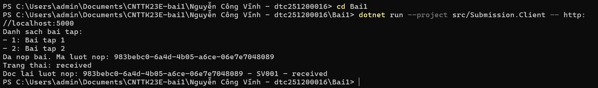

# Bài 1 – Tổng quan hệ thống và MEP

**Sinh viên:** Nguyễn Công Vĩnh – dtc251200016

## Cấu trúc

```
Bai1/
├── EduSubmit.slnx
├── requests.http
├── anh/
└── src/
    ├── Submission.Api/      (máy chủ, cổng 5000)
    └── Submission.Client/   (máy khách)
```

Hai project không tham chiếu nhau, chỉ nói chuyện qua HTTP (mô hình request–response).

## Cách chạy

```
# Terminal 1 – máy chủ
dotnet run --project src/Submission.Api --urls http://localhost:5000

# Terminal 2 – máy khách
dotnet run --project src/Submission.Client -- http://localhost:5000
```

## Dự án EduSubmit tự làm (Bước 11–12)



API: `GET /` · `GET /api/assignments` · `POST /api/submissions` (201 + Location, 400 khi thiếu dữ liệu hoặc assignmentId ≤ 0) · mở rộng `GET /api/submissions/{id}` (200 / 404).

Luồng thông điệp:

```
Client --(HTTP GET /api/assignments)--> Api : request-response, 200
Client --(HTTP POST /api/submissions)--> Api : request-response, 201 + Location
Client --(HTTP GET /api/submissions/{id})--> Api : request-response, 200
```

## Thí nghiệm lỗi (Bước 10)

| # | Thao tác | Dự đoán | Thực tế | Đúng/Sai | Giải thích |
|---|----------|---------|---------|----------|------------|
| a | Thêm bài tập thứ 3 vào API, chạy lại client | | | | |
| b | Tắt API rồi chạy client | | | | |
| c | Đổi StudentCode thành "" ở client | | | | |
| d | Chạy API ở cổng 5050, client vẫn gọi 5000 | | | | |

## Khó khăn gặp phải và cách giải quyết

