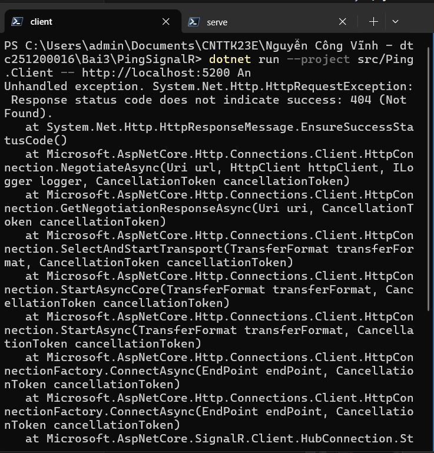
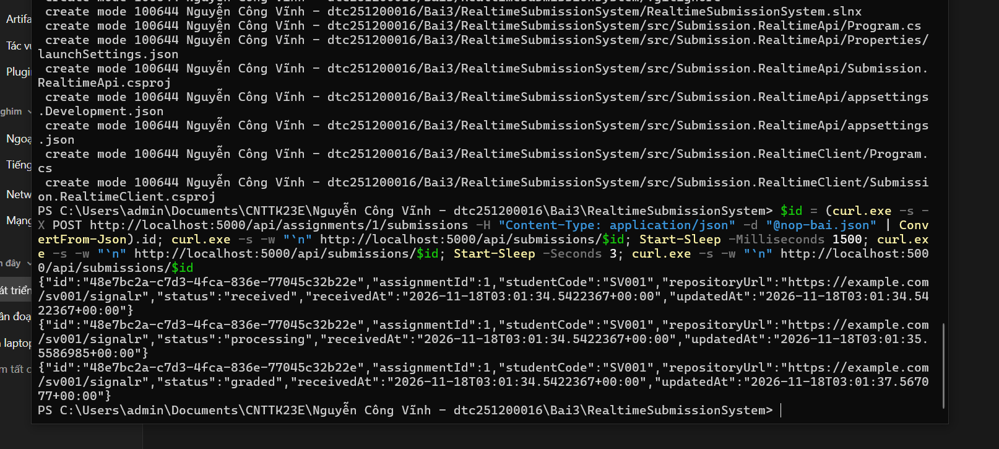
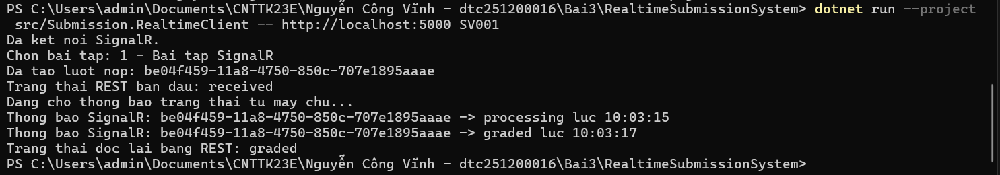
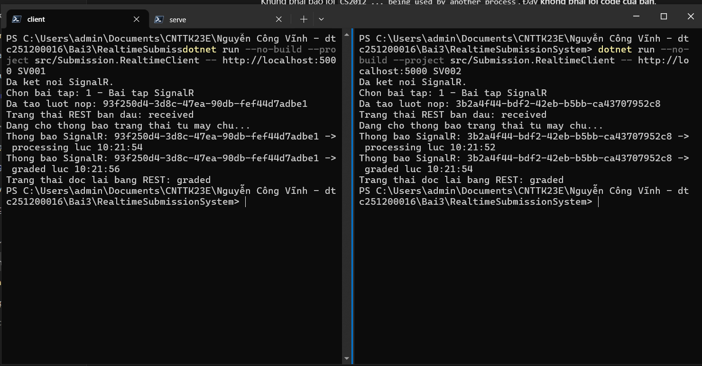

# Bài 3 - SignalR

**Sinh viên:** Nguyễn Công Vĩnh - dtc251200016

Nhật ký thực hành Bài 3. Mỗi bước gồm: ảnh kết quả, điều nhìn thấy, giải thích ngắn.

---

## Phần 1: PingSignalR

### Bước 1: tạo solution, hai project, thêm gói SignalR Client


- **Thấy:** 
        Chạy `dotnet build -tl:off` trong thư mục PingSignalR: cả hai project Ping.Api và Ping.Client đều build xong, kết quả Build succeeded, 0 Warning(s), 0 Error(s).

- **Giải thích:** 
        Solution PingSignalR gồm 2 project được ghi danh vào PingSignalR.slnx: Ping.Api là máy chủ (template web), Ping.Client là máy khách (template console). Chỉ máy khách phải thêm gói Microsoft.AspNetCore.SignalR.Client 10.0.15, vì máy chủ dùng Microsoft.AspNetCore.App đã có sẵn SignalR, còn chương trình console thì chưa có.

### Bước 2: máy chủ thêm AddSignalR + MapHub, kiểm tra negotiate


- **Thấy:** 
        GET / trả về {"service":"PingApi","status":"running"}. POST /hubs/ping/negotiate trả về connectionId, connectionToken và availableTransports gồm 3 cơ chế: WebSockets, ServerSentEvents, LongPolling. GET /hubs/ping trả về 400 Bad Request kèm "Connection ID required".

- **Giải thích:** 
        AddSignalR() đăng ký dịch vụ SignalR (quản lý kết nối, nhóm, chuyển thông điệp thành JSON), MapHub<PingHub>("/hubs/ping") mở địa chỉ cho hub. Negotiate là bước bắt tay đầu tiên: máy chủ cấp mã kết nối và báo các cách truyền tải nó hỗ trợ để máy khách chọn. Gọi thẳng /hubs/ping như REST bị 400 vì chưa có ConnectionId từ bước bắt tay; hub không trả lời như endpoint REST, còn endpoint REST "/" vẫn chạy song song bình thường.

### Bước 3–4: phương thức Echo và máy khách


- **Thấy:** 
        Máy khách An in "An da ket noi den PingApi.", "Dang cho thong diep..." và "[Echo] Echo: Xin chao SignalR tu An".

- **Giải thích:** 
        Máy khách xây kết nối tới /hubs/ping bằng HubConnectionBuilder, đăng ký On("EchoResponse") rồi StartAsync (negotiate + mở WebSocket). InvokeAsync("Echo") gọi phương thức Echo trên hub; hub dùng Clients.Caller.SendAsync("EchoResponse") trả lời riêng người gọi, hàm On in ra dòng [Echo]. Cả hai chiều đi trên cùng một kết nối; dòng [Echo] đến bất đồng bộ nên có thể in sau dòng "Dang cho...".

### Bước 5: phát rộng (All) và nhóm (Group)


- **Thấy:**
        An (chạy trước) thấy tin của chính mình, rồi thấy thêm tin của Bình: [Group] Bình vào nhóm, [Group] Thong bao nhom tu Binh, [Broadcast] Xin chao tat ca tu Binh, nhưng không có [Echo] của Bình. Bình chỉ thấy [Echo], [Group], [Broadcast] của chính mình, không thấy tin An gửi trước khi Bình vào.

- **Giải thích:** 
        Hub có 3 phạm vi gửi: Clients.Caller chỉ gửi người gọi (Echo), Clients.All gửi mọi kết nối đang mở (Broadcast), Clients.Group gửi các kết nối đã JoinGroup vào nhóm lop-hoc-01. SignalR chỉ đẩy tin tới kết nối đang mở tại thời điểm gửi, không lưu tin cũ, nên Bình vào sau không nhận được tin An đã gửi trước đó.

### Bước 6: vòng đời kết nối và kết nối lại


- **Thấy:** 
        Khi tắt máy chủ, An in "[Lifecycle] Dang ket noi lai..."; bật lại máy chủ thì An in "[Lifecycle] Da ket noi lai: chMEd3BW" và "[System] Client chMEd3BW da ket noi.". Máy chủ in [Hub] + nZEB_1Mj ket noi, [Hub] - nZEB_1Mj ngat, rồi [Hub] + chMEd3BW ket noi.

- **Giải thích:** 
        OnConnectedAsync/OnDisconnectedAsync cho máy chủ biết khi có kết nối mở hoặc ngắt; Reconnecting/Reconnected/Closed cho máy khách biết khi rớt mạng. WithAutomaticReconnect thử lại sau 0, 2, 10, 30 giây; nối lại được thì ConnectionId đổi (nZEB_1Mj → chMEd3BW), máy chủ coi là kết nối MỚI nên An mất nhóm lop-hoc-01 (muốn ở lại phải gọi JoinGroup trong Reconnected). Tin gửi lúc rớt mạng bị mất vì SignalR không lưu lại để gửi sau.

### Bước 7: ba thí nghiệm lỗi

| # | Làm gì | Thấy gì | Giải thích vì sao |
|---|--------|---------|-------------------|
| 1 | Chạy máy khách khi máy chủ chưa chạy | `HttpRequestException: No connection could be made because the target machine actively refused it. (localhost:5200)`, chương trình dừng ngay ở StartAsync | Lỗi xảy ra ngay bước negotiate vì không có máy chủ ở cổng 5200. WithAutomaticReconnect chỉ cứu kết nối ĐÃ mở, không giúp lần nối đầu tiên |
| 2 | Sửa `WithUrl` thành `/hub/ping` (thiếu s) | `HttpRequestException: Response status code does not indicate success: 404 (Not Found)` | Máy chủ vẫn chạy nhưng không có tuyến /hub/ping nên negotiate trả 404. Đường dẫn trong WithUrl phải khớp MapHub("/hubs/ping") |
| 3 | Sửa `On("EchoResponse")` thành `On("EchoRespone")` | Không có lỗi nào, chương trình chạy bình thường nhưng không có dòng [Echo] | Hub vẫn gửi "EchoResponse" nhưng máy khách không đăng ký tên đó nên tin bị bỏ qua, không báo lỗi. Khi "không nhận được gì", việc đầu tiên là so tên thông điệp hai phía |





---

## Phần 2: EduSubmit realtime (RealtimeSubmissionSystem)

Máy chủ `Submission.RealtimeApi` cổng 5000 (REST của Bài 2 + hub `/hubs/submissions`), máy khách `Submission.RealtimeClient`.

### Bước 1: tạo solution

- **Thấy:** 9 lệnh tạo `RealtimeSubmissionSystem.slnx` với 2 project `Submission.RealtimeApi` (web) và `Submission.RealtimeClient` (console + gói `Microsoft.AspNetCore.SignalR.Client` 10.0.15); `dotnet build` báo Build succeeded, 0 Error(s).
- **Giải thích:** Cùng khuôn với PingSignalR: một máy chủ, một máy khách, chạy thành 2 tiến trình. Máy khách cần cả HttpClient (REST) lẫn HubConnection (SignalR).

### Bước 2: REST của Bài 2 + UpdatedAt + lock

- **Thấy:** Giữ nguyên hợp đồng Bài 2: `GET /api/assignments`, `POST /api/assignments/{id}/submissions` (404 ASSIGNMENT_NOT_FOUND → 400 ASSIGNMENT_CLOSED → 400 INVALID_SUBMISSION → 201 + Location), `GET /api/submissions/{id}` (404 SUBMISSION_NOT_FOUND). `SubmissionDto` có thêm `UpdatedAt`.
- **Giải thích:** `UpdatedAt` là thời điểm đổi trạng thái gần nhất để máy khách biết tin nào mới hơn. `lock (submissionsLock)` vì tác vụ chấm nền và các yêu cầu HTTP cùng đọc/ghi một danh sách; khóa đảm bảo mỗi lúc chỉ một luồng sửa.

### Bước 3: SubmissionHub + nhóm submission:{id}

- **Thấy:** `AddSignalR()` + `MapHub<SubmissionHub>("/hubs/submissions")`; negotiate ở `/hubs/submissions` trả 200 + connectionId, còn `/hub/submissions` trả 404 (ca 8 và 9 của requests.http).
- **Giải thích:** Hub "mỏng" chỉ có `WatchSubmission(id)` để đưa kết nối vào nhóm `submission:{id}`; không tạo, không chấm bài. Tên nhóm sinh ở một chỗ duy nhất (`SubmissionGroups`) để hai phía không lệch tên. Dùng nhóm theo lượt nộp vì riêng tư (sinh viên không thấy bài người khác) và tiết kiệm đường truyền (không gửi cho tất cả).

### Bước 4: IHubContext + mô phỏng chấm nền


- **Thấy:** POST trả 201 ngay với `status: received`; GET cùng id sau ~1,5 giây là `processing`, sau ~4,5 giây là `graded`; `updatedAt` tăng dần (34.54 → 35.55 → 37.56). Máy chủ in `[Push] submission:... -> processing` rồi `-> graded`.
- **Giải thích:** POST nhận thêm `IHubContext<SubmissionHub>` (cái "loa" của hub dùng được ngoài hub) và gọi `SimulateGradingAsync` chạy nền không chờ, nên POST không phải đợi chấm. `UpdateStatusAsync` cập nhật dữ liệu TRƯỚC rồi mới đẩy `SubmissionStatusChanged` tới đúng nhóm, nên ai đọc REST ngay khi nhận tin cũng thấy đúng. Tin chỉ gồm 3 trường: SubmissionId, Status, UpdatedAt.

### Bước 5–6: máy khách hai kênh (REST + SignalR)


Kết quả chạy máy khách (8 dòng):

```
Da ket noi SignalR.
Chon bai tap: 1 - Bai tap SignalR
Da tao luot nop: be04f459-11a8-4750-850c-707e1895aaae
Trang thai REST ban dau: received
Dang cho thong bao trang thai tu may chu...
Thong bao SignalR: be04f459-11a8-4750-850c-707e1895aaae -> processing luc 10:03:15
Thong bao SignalR: be04f459-11a8-4750-850c-707e1895aaae -> graded luc 10:03:17
Trang thai doc lai bang REST: graded
```

- **Giải thích:** Thứ tự đúng: nghe (`On`) → nối (`StartAsync`) → tạo (POST) → theo dõi (`WatchSubmission(id)`) → đọc lại (GET). Hai dòng "Thong bao SignalR" do máy chủ tự đẩy, cách nhau 2 giây, máy khách không hề hỏi. `TaskCompletionSource` là "cái chuông" hoàn tất khi nhận graded; `Task.WhenAny` chờ chuông hoặc tối đa 10 giây. Trạng thái cuối luôn lấy lại bằng REST vì REST là nguồn sự thật.

### Bước 7: năm thí nghiệm phân tán


| # | Thí nghiệm | Dự đoán (ghi TRƯỚC khi chạy) | Kết quả thật | Giải thích |
|---|------------|------------------------------|--------------|------------|
| 1 | Chạy 2 máy khách SV001 và SV002 cùng lúc | Mỗi máy khách chỉ nhận thông báo về lượt nộp của chính mình, không thấy của người kia | Hai lượt nộp có id khác nhau (93f250d4…, 3b2a4f44…); mỗi máy khách chỉ nhận processing/graded của lượt nộp của mình | Nhóm `submission:{id}` tách người nhận: máy chủ chỉ đẩy tin tới kết nối đã Watch đúng id |
| 2 | Chạy máy khách khi máy chủ chưa chạy | Báo lỗi không kết nối được tới localhost:5000 và chương trình dừng ngay | `HttpRequestException: No connection could be made ... (localhost:5000)`, dừng ngay ở StartAsync | Lỗi ngay ở negotiate; lần nối đầu tiên không được WithAutomaticReconnect tự thử lại |
| 3 | Sửa `WithUrl` thành `/hub/submissions` | Báo lỗi 404 Not Found vì không có địa chỉ hub này | `HttpRequestException: ... 404 (Not Found)` ở NegotiateAsync | Máy chủ chạy nhưng không có tuyến này; đường dẫn phải khớp `MapHub("/hubs/submissions")` |
| 4 | Sửa `On("SubmissionStatusChanged")` thành `On("SubmissionStatusChange")` | Không báo lỗi nhưng không nhận được thông báo nào, hết 10 giây thì REST đọc lại vẫn là graded | Không lỗi, không có dòng "Thong bao SignalR"; 10 giây sau in "Qua thoi gian cho thong bao graded."; REST đọc lại: graded | Sai tên ở chiều xuống thì tin bị bỏ qua trong im lặng; nhờ đọc lại bằng REST vẫn biết đúng trạng thái |
| 5 | Chờ 4 giây rồi mới gọi `WatchSubmission` | Bị lỡ thông báo vì vào nhóm sau khi đã chấm xong, nhưng REST đọc lại vẫn là graded | Không nhận tin SignalR nào; "Qua thoi gian cho thong bao graded."; REST đọc lại: graded | Máy chủ chấm xong ở giây thứ 3, vào nhóm ở giây thứ 4 là lỡ tin; SignalR không lưu tin cũ. REST là nguồn sự thật |

Bài học: thông điệp thời gian thực có thể bị lỡ. Thiết kế đúng = push (SignalR) để nhanh + REST để chắc.

### Bước 8: requests.http


- **Thấy:** `requests.http` có 9 ca (thêm ca 10). Chạy thử: ca 1, 2, 4, 8 → 200; ca 3 → 201; ca 5 → 400; ca 6, 7, 9 → 404; ca 10 (bài tập đã đóng) → 400.
- **Giải thích:** requests.http là "máy khách thứ hai" dùng chung hợp đồng: bao phủ đủ 200, 201, 400, 404 và cả bước bắt tay negotiate của hub (đúng: 200, sai đường dẫn: 404).

---

## Trả lời 3 câu hỏi đầu giờ

**1. Máy chủ có thể chủ động báo cho máy khách không?**

Có, nếu máy khách mở sẵn một kết nối lâu dài (WebSocket qua SignalR). Với REST thuần thì không: máy chủ chỉ trả lời khi được hỏi. Trong EduSubmit, máy chủ chủ động gửi bằng `hubContext.Clients.Group("submission:{id}").SendAsync("SubmissionStatusChanged", ...)` mỗi khi trạng thái đổi.

**2. REST và SignalR chia việc với nhau thế nào?**

REST tạo và đọc tài nguyên với mã trạng thái rõ ràng (POST tạo lượt nộp → 201, GET đọc trạng thái). SignalR chỉ đẩy các thay đổi phát sinh SAU yêu cầu ban đầu (processing, graded) để máy khách biết sớm mà không phải hỏi liên tục. SignalR không thay thế REST; REST là nguồn sự thật.

**3. Nếu đứt mạng đúng lúc máy chủ báo "graded" thì sao?**

Tin đó bị mất vì SignalR không lưu tin để gửi lại. `WithAutomaticReconnect` nối lại với ConnectionId mới (đã thấy ở Phần 1 bước 6), lúc đó kết nối cũ không còn trong nhóm, nên máy khách phải gọi lại `WatchSubmission` và gọi `GET /api/submissions/{id}` để lấy trạng thái cuối (như thí nghiệm 4 và 5).
