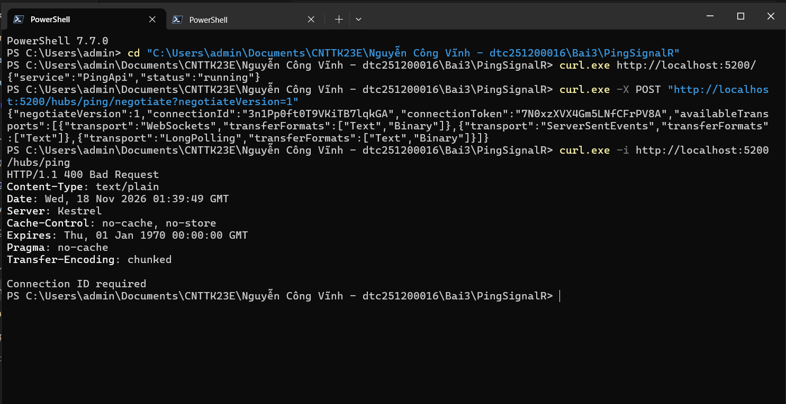
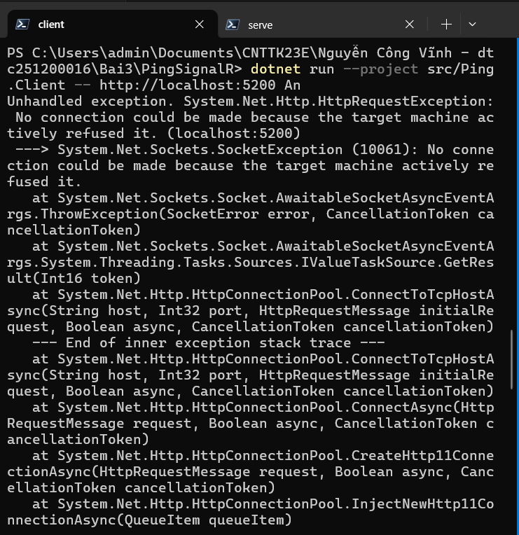

# Bài 3 - SignalR

**Sinh viên:** Nguyễn Công Vĩnh - dtc251200016

Nhật ký thực hành Bài 3. Mỗi bước gồm: ảnh kết quả, điều nhìn thấy, giải thích ngắn.

---

## Phần 1: PingSignalR

### Bước 1: tạo solution, hai project, thêm gói SignalR Client


- **Thấy:** 
- **Giải thích:** 

### Bước 2: máy chủ thêm AddSignalR + MapHub, kiểm tra negotiate


- **Thấy:** 
- **Giải thích:** 

### Bước 3–4: phương thức Echo và máy khách


- **Thấy:** 
- **Giải thích:** 

### Bước 5: phát rộng (All) và nhóm (Group)


- **Thấy:** 
- **Giải thích:** 

### Bước 6: vòng đời kết nối và kết nối lại


- **Thấy:** 
- **Giải thích:** 

### Bước 7: ba thí nghiệm lỗi

| # | Làm gì | Thấy gì | Giải thích vì sao |
|---|--------|---------|-------------------|
| 1 | Chạy máy khách khi máy chủ chưa chạy | | |
| 2 | Sửa `WithUrl` thành `/hub/ping` (thiếu s) | | |
| 3 | Sửa `On("EchoResponse")` thành `On("EchoRespone")` | | |




---

## Phần 2: EduSubmit realtime (RealtimeSubmissionSystem)

### Bước 1: tạo solution

- **Thấy:** 
- **Giải thích:** 

### Bước 2: REST của Bài 2 + UpdatedAt + lock

- **Thấy:** 
- **Giải thích:** 

### Bước 3: SubmissionHub + nhóm submission:{id}

- **Thấy:** 
- **Giải thích:** 

### Bước 4: IHubContext + mô phỏng chấm nền

- **Thấy:** 
- **Giải thích:** 

### Bước 5–6: máy khách hai kênh (REST + SignalR)

Kết quả chạy máy khách (8 dòng):

```
(dán kết quả máy khách vào đây)
```

- **Giải thích:** 

### Bước 7: năm thí nghiệm phân tán

| # | Thí nghiệm | Dự đoán (ghi TRƯỚC khi chạy) | Kết quả thật | Giải thích |
|---|------------|------------------------------|--------------|------------|
| 1 | Chạy 2 máy khách SV001 và SV002 cùng lúc | | | |
| 2 | Chạy máy khách khi máy chủ chưa chạy | | | |
| 3 | Sửa `WithUrl` thành `/hub/submissions` | | | |
| 4 | Sửa `On("SubmissionStatusChanged")` thành `On("SubmissionStatusChange")` | | | |
| 5 | Chờ 4 giây rồi mới gọi `WatchSubmission` | | | |

### Bước 8: requests.http


- **Thấy:** 

---

## Trả lời 3 câu hỏi đầu giờ

**1. Máy chủ có thể chủ động báo cho máy khách không?**

**2. REST và SignalR chia việc với nhau thế nào?**

**3. Nếu đứt mạng đúng lúc máy chủ báo "graded" thì sao?**

