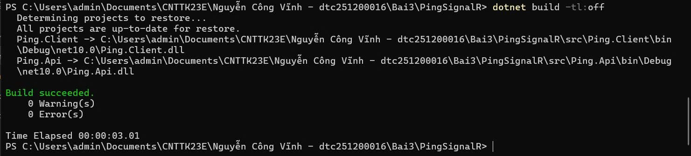
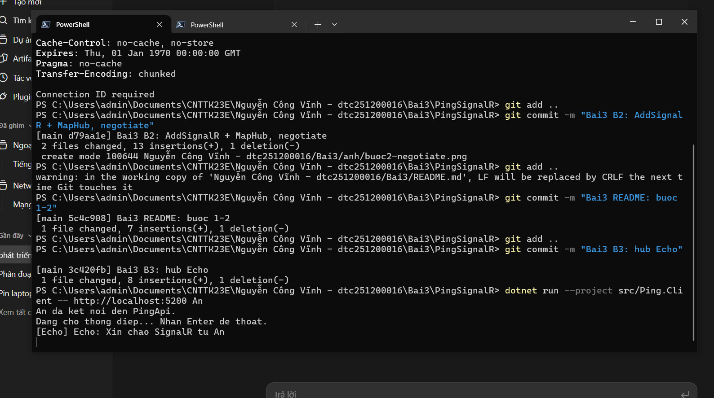
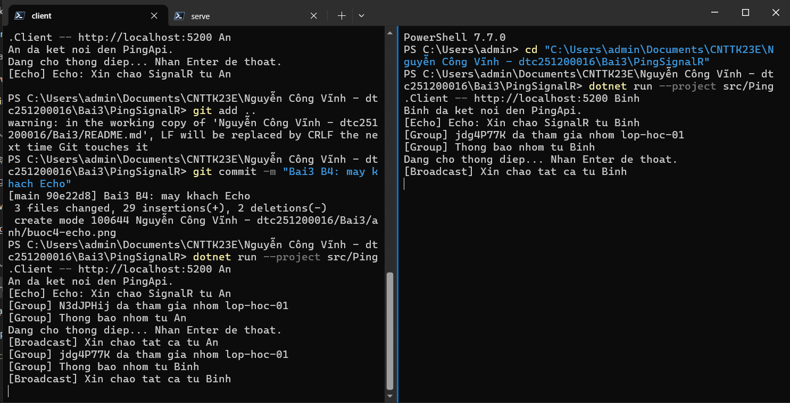
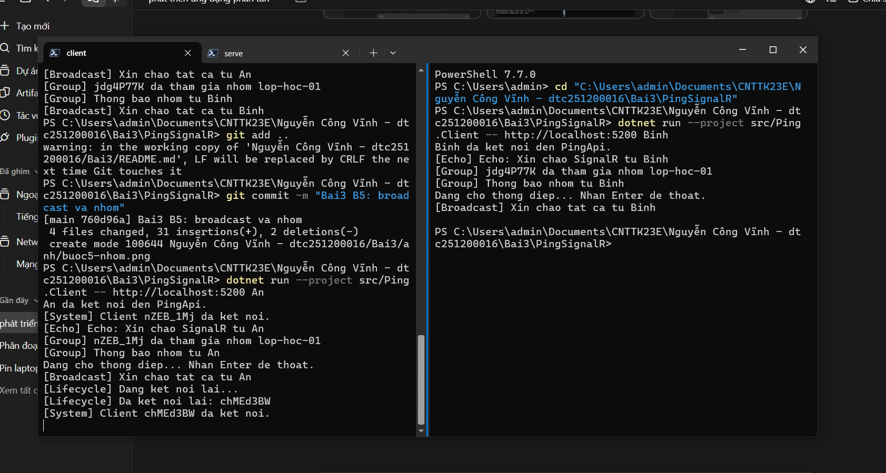
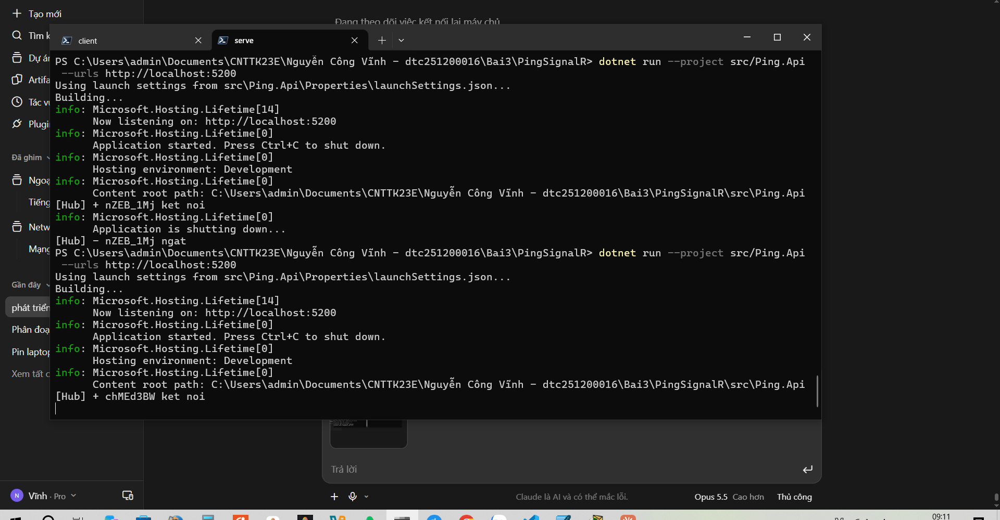
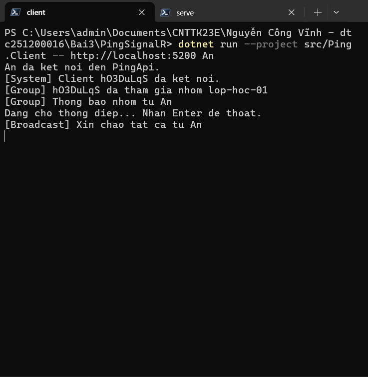
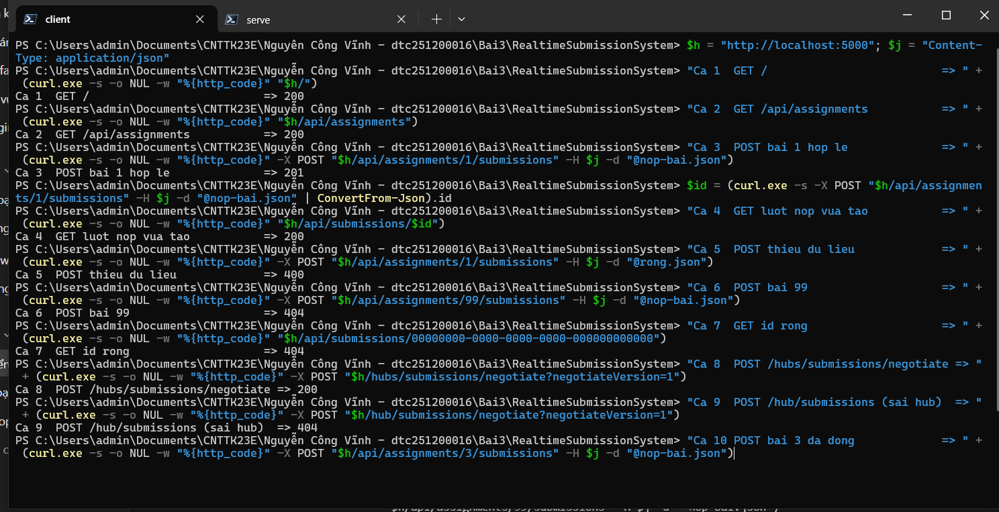

# Bài 3 - SignalR

**Sinh viên:** Nguyễn Công Vĩnh - dtc251200016

Nhật ký thực hành Bài 3. Mỗi bước gồm: ảnh kết quả, điều nhìn thấy, giải thích ngắn.

---

## Phần 1: PingSignalR

### Bước 1: tạo solution, hai project, thêm gói SignalR Client


- **Thấy:** 
        Chạy `dotnet build -tl:off` trong thư mục PingSignalR: cả hai project Ping.Api và Ping.Client đều build xong, kết quả Build succeeded, 0 Warning(s), 0 Error(s).

- **Giải thích:** 
        Solution PingSignalR gồm 2 project được ghi danh vào PingSignalR.slnx: Ping.Api là máy chủ (template web), Ping.Client là máy khách (template console). Chỉ máy khách phải thêm gói Microsoft.AspNetCore.SignalR.Client 10.0.15, vì máy chủ dùng Microsoft.AspNetCore.App đã có sẵn SignalR, còn chương trình console thì chưa có.

### Bước 2: máy chủ thêm AddSignalR + MapHub, kiểm tra negotiate


- **Thấy:** 
        GET / trả về {"service":"PingApi","status":"running"}. POST /hubs/ping/negotiate trả về connectionId, connectionToken và availableTransports gồm 3 cơ chế: WebSockets, ServerSentEvents, LongPolling. GET /hubs/ping trả về 400 Bad Request kèm "Connection ID required".

- **Giải thích:** 
        AddSignalR() đăng ký dịch vụ SignalR (quản lý kết nối, nhóm, chuyển thông điệp thành JSON), MapHub<PingHub>("/hubs/ping") mở địa chỉ cho hub. Negotiate là bước bắt tay đầu tiên: máy chủ cấp mã kết nối và báo các cách truyền tải nó hỗ trợ để máy khách chọn. Gọi thẳng /hubs/ping như REST bị 400 vì chưa có ConnectionId từ bước bắt tay; hub không trả lời như endpoint REST, còn endpoint REST "/" vẫn chạy song song bình thường.

### Bước 3–4: phương thức Echo và máy khách


- **Thấy:** 
        Máy khách An in "An da ket noi den PingApi.", "Dang cho thong diep..." và "[Echo] Echo: Xin chao SignalR tu An".

- **Giải thích:** 
        Máy khách xây kết nối tới /hubs/ping bằng HubConnectionBuilder, đăng ký On("EchoResponse") rồi StartAsync (negotiate + mở WebSocket). InvokeAsync("Echo") gọi phương thức Echo trên hub; hub dùng Clients.Caller.SendAsync("EchoResponse") trả lời riêng người gọi, hàm On in ra dòng [Echo]. Cả hai chiều đi trên cùng một kết nối; dòng [Echo] đến bất đồng bộ nên có thể in sau dòng "Dang cho...".

### Bước 5: phát rộng (All) và nhóm (Group)


- **Thấy:**
        An (chạy trước) thấy tin của chính mình, rồi thấy thêm tin của Bình: [Group] Bình vào nhóm, [Group] Thong bao nhom tu Binh, [Broadcast] Xin chao tat ca tu Binh, nhưng không có [Echo] của Bình. Bình chỉ thấy [Echo], [Group], [Broadcast] của chính mình, không thấy tin An gửi trước khi Bình vào.

- **Giải thích:** 
        Hub có 3 phạm vi gửi: Clients.Caller chỉ gửi người gọi (Echo), Clients.All gửi mọi kết nối đang mở (Broadcast), Clients.Group gửi các kết nối đã JoinGroup vào nhóm lop-hoc-01. SignalR chỉ đẩy tin tới kết nối đang mở tại thời điểm gửi, không lưu tin cũ, nên Bình vào sau không nhận được tin An đã gửi trước đó.

### Bước 6: vòng đời kết nối và kết nối lại



- **Thấy:** 
        Khi tắt máy chủ, An in "[Lifecycle] Dang ket noi lai..."; bật lại máy chủ thì An in "[Lifecycle] Da ket noi lai: chMEd3BW" và "[System] Client chMEd3BW da ket noi.". Máy chủ in [Hub] + nZEB_1Mj ket noi, [Hub] - nZEB_1Mj ngat, rồi [Hub] + chMEd3BW ket noi.

- **Giải thích:** 
        OnConnectedAsync/OnDisconnectedAsync cho máy chủ biết khi có kết nối mở hoặc ngắt; Reconnecting/Reconnected/Closed cho máy khách biết khi rớt mạng. WithAutomaticReconnect thử lại sau 0, 2, 10, 30 giây; nối lại được thì ConnectionId đổi (nZEB_1Mj → chMEd3BW), máy chủ coi là kết nối MỚI nên An mất nhóm lop-hoc-01 (muốn ở lại phải gọi JoinGroup trong Reconnected). Tin gửi lúc rớt mạng bị mất vì SignalR không lưu lại để gửi sau.

### Bước 7: ba thí nghiệm lỗi

| # | Làm gì | Thấy gì | Giải thích vì sao |
|---|--------|---------|-------------------|
| 1 | Chạy máy khách khi máy chủ chưa chạy | | |
| 2 | Sửa `WithUrl` thành `/hub/ping` (thiếu s) | | |
| 3 | Sửa `On("EchoResponse")` thành `On("EchoRespone")` | | |




---

## Phần 2: EduSubmit realtime (RealtimeSubmissionSystem)

### Bước 1: tạo solution

- **Thấy:** 
- **Giải thích:** 

### Bước 2: REST của Bài 2 + UpdatedAt + lock

- **Thấy:** 
- **Giải thích:** 

### Bước 3: SubmissionHub + nhóm submission:{id}

- **Thấy:** 
- **Giải thích:** 

### Bước 4: IHubContext + mô phỏng chấm nền

- **Thấy:** 
- **Giải thích:** 

### Bước 5–6: máy khách hai kênh (REST + SignalR)

Kết quả chạy máy khách (8 dòng):

```
(dán kết quả máy khách vào đây)
```

- **Giải thích:** 

### Bước 7: năm thí nghiệm phân tán

| # | Thí nghiệm | Dự đoán (ghi TRƯỚC khi chạy) | Kết quả thật | Giải thích |
|---|------------|------------------------------|--------------|------------|
| 1 | Chạy 2 máy khách SV001 và SV002 cùng lúc | | | |
| 2 | Chạy máy khách khi máy chủ chưa chạy | | | |
| 3 | Sửa `WithUrl` thành `/hub/submissions` | | | |
| 4 | Sửa `On("SubmissionStatusChanged")` thành `On("SubmissionStatusChange")` | | | |
| 5 | Chờ 4 giây rồi mới gọi `WatchSubmission` | | | |

### Bước 8: requests.http


- **Thấy:** 

---

## Trả lời 3 câu hỏi đầu giờ

**1. Máy chủ có thể chủ động báo cho máy khách không?**

**2. REST và SignalR chia việc với nhau thế nào?**

**3. Nếu đứt mạng đúng lúc máy chủ báo "graded" thì sao?**

