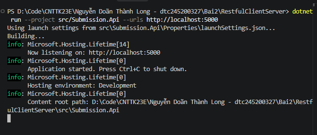
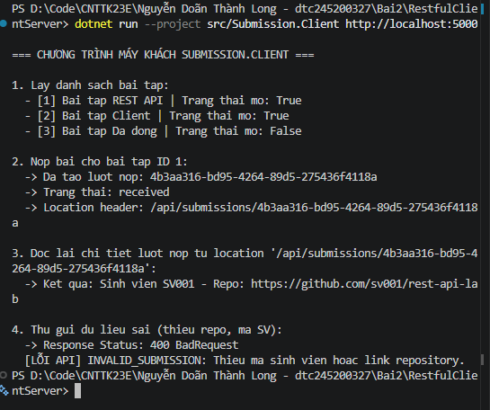

# BAI 2 - RESTFUL API CHO TUONG TAC CLIENT-SERVER

## 1. Thong tin sinh vien

- Ho ten: Nguyen Doan Thanh Long
- MSSV: DTC245200327
- Lop: CNTTK23E
- Mon hoc: Phat trien ung dung phan tan
- Ngay thuc hien: 15/11/2026

## 2. Gioi thieu

Bai 2 xay dung he thong **EduSubmit** – He thong nop bai tap qua RESTful API gom hai phan ung dung doc lap (`Submission.Api` va `Submission.Client`).

Du an su dung:
- .NET SDK (ASP.NET Core Minimal API)
- C#
- HTTP va JSON
- HttpClient
- REST Client trong VS Code (`requests.http`)

## 3. Cau truc thu muc

```text
Bai2/
├── images/
│   ├── api-running.png
│   └── client-output.png
├── RestfulClientServer/
│   ├── src/
│   │   ├── Submission.Api/
│   │   └── Submission.Client/
│   └── RestfulClientServer.sln
└── README.md
```

## 4. Chuc nang va Huong dan chay

### Chuc nang API (`Submission.Api`)

- `GET /` : Kiem tra trang thai hoat dong cua API.
- `GET /api/assignments` : Lay danh sach bai tap.
- `GET /api/assignments/{id}` : Xem chi tiet mot bai tap.
- `POST /api/assignments/{id}/submissions` : Nop bai tap moi.
- `GET /api/submissions/{id}` : Doc lai chi tiet mot luot nop.
- `DELETE /api/submissions/{id}` : Xoa/Huy mot luot nop.

### Huong dan chay

Mo Terminal thu nhat tai thu muc `RestfulClientServer`:

```powershell
dotnet build
dotnet run --project src/Submission.Api --urls http://localhost:5000
```

Mo Terminal thu hai tai thu muc `RestfulClientServer`:

```powershell
dotnet run --project src/Submission.Client http://localhost:5000
```

## 5. Ket qua kiem thu va Bang pha thu (Cac ca 5a - 5h)

| Ma ca | Chuc nang / Tinh huong | Phuong thuc & Duong dan | HTTP | Ket qua / Ma loi | Danh gia |
|---|---|---|---|---|---|
| **5a** | Nop bai hop le cho bai tap dang mo | `POST /api/assignments/1/submissions` | `201` | Created (Tra ve JSON + header `Location`) | Dat |
| **5b** | Doc lai luot nop qua ID vua tao | `GET /api/submissions/{id}` | `200` | Thanh cong (Tra ve thong tin luot nop) | Dat |
| **5c** | Truy van bai tap khong ton tai | `GET /api/assignments/999` | `404` | `ASSIGNMENT_NOT_FOUND` | Dat |
| **5d** | Nop bai vao bai tap khong ton tai | `POST /api/assignments/999/submissions` | `404` | `ASSIGNMENT_NOT_FOUND` | Dat |
| **5e** | Nop bai vao bai tap da dong | `POST /api/assignments/3/submissions` | `400` | `ASSIGNMENT_CLOSED` | Dat |
| **5f** | Nop thieu du lieu / du lieu rong | `POST /api/assignments/1/submissions` | `400` | `INVALID_SUBMISSION` | Dat |
| **5g** | Nop bai trung cho cung sinh vien | `POST /api/assignments/1/submissions` | `409` | `DUPLICATE_SUBMISSION` | Dat |
| **5h** | Xoa luot nop da tao | `DELETE /api/submissions/{id}` | `204` | No Content (Xoa thanh cong) | Dat |

## 6. Thi nghiem he thong phan tan

- Client va Server chay thanh hai tien trinh rieng biet.
- Client giao tiep voi Server qua giao thuc HTTP.
- Client gui du lieu dang JSON, Server tra ve ma trang thai HTTP va JSON tuong ung.
- Khi Server dung hoat dong, Client khong the ket noi va bao loi ket noi.
- Khi Server khoi dong lai, du lieu luu tam trong RAM (In-Memory) se bi mat.
- Phuong thuc POST tao ra tai nguyen moi kem dinh danh `Guid` va header `Location`.
- Co che kiem tra trung giup ngan chan mot sinh vien nop lap lai nhieu lan cho cung mot bai tap (`409 Conflict`).

## 7. Tra loi cau hoi ly thuyet

### Cau 1: Vi sao URI dung danh tu?

URI dung de dinh danh tai nguyen (vi du: `/api/assignments`, `/api/submissions`), con cac phuong thuc HTTP nhu `GET`, `POST`, `DELETE` the hien hanh dong tac dong len tai nguyen do. Thiet ke nay giup API ro rang, nhat quan va tuan thu dung chuan kien truc REST.

### Cau 2: Stateless the hien o dau?

Moi request tu Client gui len mang day du thong tin de Server xu ly doc lap. Vi du `assignmentId` nam tren duong dan URI, con `studentCode` va `repositoryUrl` nam trong JSON body. Server khong luu giu trang thai phien lam viec (session) giua cac lan goi yeu cau truoc do, du lieu bai nop chi duoc luu tru duoi dang tai nguyen trong bo nho Server.

### Cau 3: Vi sao Client va Server dung DTO rieng?

Client va Server la hai ung dung doc lap giao tiep qua mang bang JSON theo hop dong API (API Contract). Hai ben chi can thong nhat ten thuoc tinh va kieu du lieu de bo tuan tu hoa (`System.Text.Json`) tu dong anh xa, khong can phu thuoc hay dung chung thu vien class C# van trao doi du lieu chinh xac.

## 8. Minh chung ket qua chay

Anh ket qua chay thuc te duoc luu trong thu muc `Bai2/images/`:

### May chu Submission.Api chay tai cong 5000


### May khach Submission.Client chay kich ban 4 buoc


## 9. Ket luan

Bai thuc hanh minh hoa day du co che giao tiep client-server qua HTTP va JSON, nguyen tac thiet ke RESTful API, su dung DTO doc lap, xu ly cac ma trang thai HTTP chuan (`200`, `201`, `204`, `400`, `404`, `409`) va kiem thu he thong phan tan.