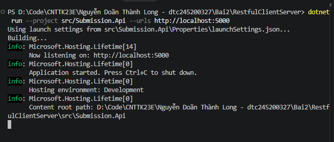
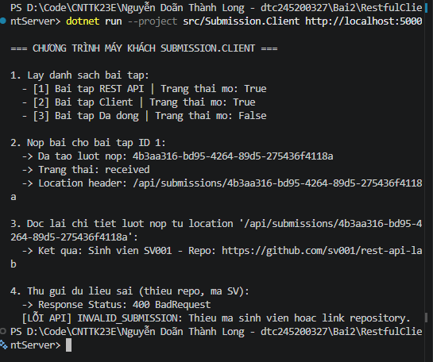

# Bài thực hành 2: EduSubmit – Xây dựng hệ thống RESTful API Client-Server

## 1. Các lệnh đã chạy

### 1.1. Khởi tạo cấu trúc Solution và Project
```powershell
dotnet new sln -n RestfulClientServer
dotnet new web -n Submission.Api -o src/Submission.Api
dotnet new console -n Submission.Client -o src/Submission.Client
dotnet sln add src/Submission.Api/Submission.Api.csproj
dotnet sln add src/Submission.Client/Submission.Client.csproj
dotnet new gitignore
dotnet build
```

### 1.2. Khởi chạy Máy chủ (Submission.Api)
Mở Terminal 1 tại thư mục gốc `RestfulClientServer`:
```powershell
dotnet run --project src/Submission.Api --urls http://localhost:5000
```

### 1.3. Khởi chạy Máy khách (Submission.Client)
Mở Terminal 2 tại thư mục gốc `RestfulClientServer`:
```powershell
dotnet run --project src/Submission.Client http://localhost:5000
```

---

## 2. Ảnh kết quả chạy thực tế

### 2.1. Máy chủ Submission.Api lắng nghe tại cổng 5000


### 2.2. Máy khách Submission.Client thực thi đầy đủ kịch bản 4 bước


---

## 3. Bảng phá thử và kiểm thử API (Các ca 5a – 5h)

Dưới đây là kết quả kiểm thử toàn diện các tình huống biên và xử lý lỗi thông qua tệp `requests.http`:

| Mã ca | Tình huống kiểm thử (Test Case) | Phương thức & Đường dẫn | Dữ liệu gửi lên (Payload / Header) | Mã HTTP kỳ vọng | Mã lỗi / Kết quả thực tế | Đánh giá |
| :--- | :--- | :--- | :--- | :--- | :--- | :--- |
| **5a** | Nộp bài hợp lệ cho bài tập đang mở | `POST /api/assignments/1/submissions` | `{"studentCode": "SV001", "repositoryUrl": "https://github.com/sv001/lab"}` | `201 Created` | Trả về JSON kèm `Guid Id`, trạng thái `"received"` và header `Location` | Đạt |
| **5b** | Đọc lại thông tin lượt nộp qua ID vừa tạo | `GET /api/submissions/{id}` | Không có body (Lấy ID từ header `Location`) | `200 OK` | Trả về đúng thông tin chi tiết lượt nộp của `SV001` | Đạt |
| **5c** | Truy vấn bài tập không tồn tại | `GET /api/assignments/999` | Không có | `404 Not Found` | `{"code": "ASSIGNMENT_NOT_FOUND", "message": "Khong tim thay bai tap."}` | Đạt |
| **5d** | Nộp bài vào bài tập không tồn tại | `POST /api/assignments/999/submissions` | `{"studentCode": "SV001", "repositoryUrl": "https://github.com/sv001/lab"}` | `404 Not Found` | `{"code": "ASSIGNMENT_NOT_FOUND", "message": "Khong tim thay bai tap."}` | Đạt |
| **5e** | Nộp bài vào bài tập đã đóng (`isOpen = false`) | `POST /api/assignments/3/submissions` | `{"studentCode": "SV002", "repositoryUrl": "https://github.com/sv002/lab"}` | `400 Bad Request` | `{"code": "ASSIGNMENT_CLOSED", "message": "Bai tap nay da dong nop bài."}` | Đạt |
| **5f** | Nộp dữ liệu rỗng / thiếu trường bắt buộc | `POST /api/assignments/1/submissions` | `{"studentCode": "", "repositoryUrl": ""}` | `400 Bad Request` | `{"code": "INVALID_SUBMISSION", "message": "Thieu ma sinh vien hoac link repository."}` | Đạt |
| **5g** | Nộp trùng bài tập cho cùng một sinh viên | `POST /api/assignments/1/submissions` | `{"studentCode": "SV001", "repositoryUrl": "https://github.com/sv001/lab"}` | `409 Conflict` | `{"code": "DUPLICATE_SUBMISSION", "message": "Sinh vien da nop bai tap nay roi."}` | Đạt |
| **5h** | Hủy / Xóa lượt nộp đã tạo | `DELETE /api/submissions/{id}` | Không có body | `204 No Content` | Xóa thành công khỏi danh sách, body phản hồi rỗng | Đạt |

---

## 4. Trả lời 3 câu hỏi kiến trúc REST

### Câu 1: Vì sao URI dùng danh từ, còn hành động do phương thức HTTP đảm nhận?
* **Nguyên lý REST:** REST xem mọi thông tin nghiệp vụ là các **tài nguyên (Resources)**, do đó URI phải là **danh từ số nhiều** để định danh tài nguyên đó (ví dụ: `/api/assignments`, `/api/submissions`).
* **Vai trò phương thức HTTP:** Các hành động thao tác lên tài nguyên được chuẩn hóa thông qua các động từ sẵn có của giao thức HTTP (`GET` để đọc, `POST` để tạo mới, `PUT/PATCH` để cập nhật, `DELETE` để xóa).
* **Lợi ích:** Giúp thiết kế API nhất quán, tránh tình trạng sinh ra hàng loạt đường dẫn lộn xộn chứa động từ (như `/getAssignments`, `/submitAssignment`), đồng thời tận dụng được các cơ chế chuẩn của HTTP như caching và tính lũy đẳng (idempotency).

### Câu 2: Tính "Stateless" (Phi trạng thái) thể hiện ở đâu trong code đã viết?
* **Bản chất:** Máy chủ `Submission.Api` không lưu giữ bất kỳ trạng thái phiên làm việc (session) hay ngữ cảnh giao tiếp nào của Client giữa các lần gọi HTTP.
* **Thể hiện trong mã nguồn:** Trong endpoint `POST /api/assignments/{assignmentId}/submissions`, mọi thông tin cần thiết để máy chủ xử lý yêu cầu (ID bài tập nằm trên đường dẫn URI, mã sinh viên và link repository nằm trong JSON Body) đều được gửi trọn vẹn trong một request duy nhất. Server xử lý độc lập từng request mà không cần biết Client đã gọi những API nào trước đó.

### Câu 3: Vì sao Client và Server mỗi bên khai báo DTO riêng mà vẫn khớp nhau?
* **Tính độc lập trong hệ phân tán:** Client (`Submission.Client`) và Server (`Submission.Api`) là hai tiến trình độc lập, giao tiếp qua mạng bằng bản tin trung gian **JSON** chứ không chia sẻ trực tiếp bộ nhớ hay thư viện mã nguồn C#.
* **Cơ chế khớp dữ liệu:** Hai bên giao tiếp thông qua **Hợp đồng API (API Contract)**. Miễn là tên các thuộc tính và kiểu dữ liệu khớp nhau theo quy tắc chuyển đổi JSON mặc định (không phân biệt hoa/thường giữa PascalCase của C# và camelCase của JSON), trình tuần tự hóa (`System.Text.Json`) ở hai đầu sẽ tự động ánh xạ dữ liệu chính xác mà vẫn giữ được tính lỏng lẻo (Loosely Coupled) giữa Client và Server.