# BÀI 3: GIAO TIẾP THỜI GIAN THỰC VỚI SIGNALR

## 1. Thông tin sinh viên

- **Họ và tên:** Nguyễn Doãn Thành Long
- **Mã số sinh viên (MSSV):** `DTC245200327`
- **Lớp:** `CNTTK23E`
- **Môn học:** Phát triển ứng dụng phân tán
- **Ngày thực hiện:** 18/11/2026

---

## 2. Giới thiệu tổng quan

Bài thực hành số 3 tập trung vào cơ chế **giao tiếp thời gian thực hai chiều (Real-time Bi-directional Communication)** giữa máy khách và máy chủ bằng **ASP.NET Core SignalR**, kết hợp với kiến trúc **RESTful API** để tạo thành mô hình lai (**Hybrid REST + SignalR**) trong hệ thống phân tán.

Bài thực hành gồm 2 giải pháp (Solution) độc lập:
1. **`PingSignalR` (Phần 1 – Khởi động):** Làm quen với SignalR Hub (`PingHub`), cơ chế bắt tay `negotiate`, truyền thông điệp theo 3 phạm vi (`Clients.Caller`, `Clients.Group`, `Clients.All`), vòng đời kết nối (`OnConnectedAsync`, `OnDisconnectedAsync`), tự động kết nối lại (`WithAutomaticReconnect`) và thực nghiệm các lỗi phân tán phổ biến.
2. **`RealtimeSubmissionSystem` (Phần 2 – Hệ thống nộp bài EduSubmit thời gian thực):** Nâng cấp hệ thống nộp bài từ Bài 2 bằng cách kết hợp **REST API** (lấy danh sách bài tập, nộp bài tập, truy vấn trạng thái chuẩn xác) với **SignalR Hub (`SubmissionHub`)** và **`IHubContext<SubmissionHub>`** để đẩy thông báo trạng thái chấm bài (`received` -> `processing` -> `graded`) theo thời gian thực tới đúng nhóm theo dõi `submission:{submissionId}`.

---

## 3. Cấu trúc thư mục `Bai3/`

```text
Bai3/
├── anh/
│   ├── buoc1-build.png
│   ├── buoc2-negotiate.png
│   ├── buoc4-echo.png
│   ├── buoc5-nhom.png
│   ├── buoc6-noilai.png
│   ├── buoc7-loi1.png
│   ├── buoc7-loi2.png
│   ├── buoc7-loi3.png
│   ├── edusubmit-client.png
│   ├── edusubmit-requests.png
│   └── edusubmit-thinghiem.png
├── PingSignalR/
│   ├── src/
│   │   ├── Ping.Api/
│   │   │   ├── Properties/
│   │   │   │   └── launchSettings.json
│   │   │   ├── appsettings.Development.json
│   │   │   ├── appsettings.json
│   │   │   ├── Ping.Api.csproj
│   │   │   └── Program.cs
│   │   └── Ping.Client/
│   │       ├── Ping.Client.csproj
│   │       └── Program.cs
│   ├── .gitignore
│   └── PingSignalR.slnx
├── RealtimeSubmissionSystem/
│   ├── src/
│   │   ├── Submission.RealtimeApi/
│   │   │   ├── Properties/
│   │   │   │   └── launchSettings.json
│   │   │   ├── appsettings.Development.json
│   │   │   ├── appsettings.json
│   │   │   ├── Program.cs
│   │   │   └── Submission.RealtimeApi.csproj
│   │   └── Submission.RealtimeClient/
│   │       ├── Program.cs
│   │       └── Submission.RealtimeClient.csproj
│   ├── .gitignore
│   ├── RealtimeSubmissionSystem.slnx
│   └── requests.http
└── README.md
```

---

## 4. Hướng dẫn chạy & Kết quả kiểm thử

### 4.1. Hướng dẫn chạy Phần 1: `PingSignalR` (Cổng `5200`)

- **Bước 1 – Build toàn bộ giải pháp:**
  ```powershell
  cd "Bai3/PingSignalR"
  dotnet build
  ```
- **Bước 2 – Khởi động máy chủ `Ping.Api` tại cổng `5200` (Terminal 1):**
  ```powershell
  dotnet run --project src/Ping.Api --urls http://localhost:5200
  ```
- **Bước 3 – Kiểm tra bước bắt tay `negotiate` (Terminal 2):**
  ```powershell
  curl.exe -X POST "http://localhost:5200/hubs/ping/negotiate?negotiateVersion=1"
  ```
- **Bước 4 – Chạy máy khách `Ping.Client` cho `An` và `Binh` (Terminal 2 & 3):**
  ```powershell
  dotnet run --project src/Ping.Client -- http://localhost:5200 An
  dotnet run --project src/Ping.Client -- http://localhost:5200 Binh
  ```

### 4.2. Hướng dẫn chạy Phần 2: `RealtimeSubmissionSystem` – EduSubmit (Cổng `5000`)

- **Bước 1 – Build giải pháp:**
  ```powershell
  cd "Bai3/RealtimeSubmissionSystem"
  dotnet build
  ```
- **Bước 2 – Khởi động máy chủ `Submission.RealtimeApi` tại cổng `5000` (Terminal 1):**
  ```powershell
  dotnet run --project src/Submission.RealtimeApi --urls http://localhost:5000
  ```
- **Bước 3 – Chạy máy khách `Submission.RealtimeClient` (Terminal 2):**
  ```powershell
  dotnet run --project src/Submission.RealtimeClient -- http://localhost:5000 SV001
  ```

---

### 4.3. Bảng tổng hợp 7 yêu cầu kiểm thử hệ thống

| STT | Yêu cầu kiểm thử | Dự án / Thành phần | Kết quả thực tế | Đánh giá |
|---|---|---|---|---|
| **1** | Build thành công cả 2 giải pháp (`0 Error(s)`) | `PingSignalR`, `RealtimeSubmissionSystem` | `Build succeeded` cho tất cả 4 project (`Ping.Api`, `Ping.Client`, `Submission.RealtimeApi`, `Submission.RealtimeClient`) | **Đạt** |
| **2** | Bước bắt tay SignalR (`negotiate`) hoạt động đúng | `POST /hubs/ping/negotiate?negotiateVersion=1` | Trả về `200 OK` kèm JSON chứa `connectionId`, `connectionToken` và `availableTransports` (`WebSockets`, `ServerSentEvents`, `LongPolling`) | **Đạt** |
| **3** | Định tuyến thông điệp theo 3 phạm vi (`Caller`, `Group`, `All`) | `PingHub` & `Ping.Client` | `Echo` chỉ trả về cho `Caller`; `SendToGroup` gửi cho các thành viên nhóm `lop-hoc-01`; `Broadcast` gửi cho toàn bộ client đang kết nối | **Đạt** |
| **4** | Tự động kết nối lại (`WithAutomaticReconnect`) | `Ping.Client` | Khi tắt và bật lại `Ping.Api`, client tự phát sự kiện `[Lifecycle] Dang ket noi lai...` và `[Lifecycle] Da ket noi lai: <newConnectionId>` | **Đạt** |
| **5** | Kết hợp REST + SignalR trong luồng nộp bài EduSubmit | `RealtimeSubmissionSystem` | Client lấy bài tập (`GET`), nộp bài (`POST -> 201`), gọi `WatchSubmission`, nhận đủ 2 thông báo đẩy (`processing`, `graded`) và đối chiếu lại bằng `GET` | **Đạt** |
| **6** | Cô lập thông báo theo nhóm `submission:{id}` bằng `IHubContext` | `Submission.RealtimeApi` | Server đẩy sự kiện `SubmissionStatusChanged` qua `hub.Clients.Group("submission:{id}")`, chỉ những client theo dõi đúng lượt nộp mới nhận được tin | **Đạt** |
| **7** | Kiểm thử các kịch bản lỗi phân tán (Server tắt, sai URL, sai tên sự kiện, Watch muộn) | Cả 2 giải pháp | Xác nhận đúng hành vi lỗi ở từng tầng: lỗi TCP (`Connection refused`), lỗi HTTP (`404 Not Found`), lỗi tên sự kiện (bỏ qua âm thầm) và lỡ sự kiện khi đăng ký muộn | **Đạt** |

---

### 4.4. Bảng tổng hợp kết quả 9 ca kiểm thử trong `requests.http` (Cổng `5000`)

| Ca | Mô tả kịch bản kiểm thử | Phương thức & Đường dẫn | Mã HTTP | Kết quả / Nội dung phản hồi | Đánh giá |
|---|---|---|---|---|---|
| **Ca 1** | Kiểm tra trạng thái máy chủ (Health check) | `GET http://localhost:5000/` | `200 OK` | `{"service":"RealtimeSubmissionApi","status":"running"}` | **Đạt** |
| **Ca 2** | Lấy danh sách bài tập | `GET http://localhost:5000/api/assignments` | `200 OK` | Danh sách 3 bài tập (bài 1 & 2 `isOpen: true`, bài 3 `isOpen: false`) | **Đạt** |
| **Ca 3** | Tạo lượt nộp bài hợp lệ | `POST http://localhost:5000/api/assignments/1/submissions` | `201 Created` | Header `Location: /api/submissions/{id}` + JSON lượt nộp với `"status":"received"` | **Đạt** |
| **Ca 4** | Truy vấn lại lượt nộp theo ID vừa tạo | `GET http://localhost:5000/api/submissions/{id}` | `200 OK` | Trả về chi tiết lượt nộp; gọi lại sau 1s–3s thấy trạng thái chuyển `received` -> `processing` -> `graded` | **Đạt** |
| **Ca 5** | Nộp bài thiếu dữ liệu (`studentCode` hoặc `repositoryUrl` rỗng) | `POST http://localhost:5000/api/assignments/1/submissions` | `400 Bad Request` | `{"code":"INVALID_SUBMISSION","message":"Thieu ma sinh vien hoac link repository."}` | **Đạt** |
| **Ca 6** | Nộp bài vào bài tập không tồn tại (`assignmentId = 999`) | `POST http://localhost:5000/api/assignments/999/submissions` | `404 Not Found` | `{"code":"ASSIGNMENT_NOT_FOUND","message":"Khong tim thay bai tap."}` | **Đạt** |
| **Ca 7** | Truy vấn lượt nộp không tồn tại (`Guid.Empty`) | `GET http://localhost:5000/api/submissions/00000000-0000-0000-0000-000000000000` | `404 Not Found` | `{"code":"SUBMISSION_NOT_FOUND","message":"Khong tim thay luot nop."}` | **Đạt** |
| **Ca 8** | Bắt tay SignalR (`negotiate`) đúng đường dẫn Hub | `POST http://localhost:5000/hubs/submissions/negotiate?negotiateVersion=1` | `200 OK` | Trả về `negotiateVersion: 1`, `connectionId`, `connectionToken`, `availableTransports` | **Đạt** |
| **Ca 9** | Bắt tay SignalR sai đường dẫn Hub (`/hub/submissions`) | `POST http://localhost:5000/hub/submissions/negotiate?negotiateVersion=1` | `404 Not Found` | Không tìm thấy endpoint do máy chủ ánh xạ tại `/hubs/submissions` | **Đạt** |

---

## 5. Minh chứng hình ảnh chi tiết từng bước

### 5.1. Bước 1 (`PingSignalR`) – Build giải pháp (`buoc1-build.png`)

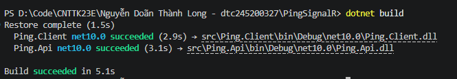

- **Thấy gì:** Lệnh `dotnet build` biên dịch thành công cả hai dự án `Ping.Client` và `Ping.Api` trên `.NET 10.0` (`Build succeeded in 5.1s`, không có lỗi).
- **Giải thích vì sao:** Cả 2 dự án độc lập đã khai báo đúng SDK và gói thư viện `Microsoft.AspNetCore.SignalR.Client` cho phía Client, sẵn sàng chạy độc lập trong hai tiến trình.

---

### 5.2. Bước 2 (`PingSignalR`) – Bắt tay `negotiate` (`buoc2-negotiate.png`)

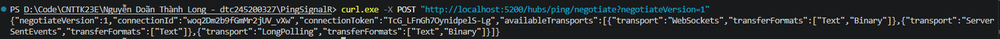

- **Thấy gì:** Lệnh `curl.exe -X POST "http://localhost:5200/hubs/ping/negotiate?negotiateVersion=1"` trả về chuỗi JSON chứa `"negotiateVersion":1`, `"connectionId":"woq2Dm2b9fGmMr2jUV_vXw"`, `"connectionToken"` và danh sách `"availableTransports"` gồm `WebSockets`, `ServerSentEvents`, `LongPolling`.
- **Giải thích vì sao:** Trước khi thiết lập kênh truyền thời gian thực bền vững (như WebSockets), SignalR luôn thực hiện bước thương lượng (`negotiate`) qua HTTP `POST` để cấp phát định danh kết nối (`connectionId`) và thống nhất phương thức truyền tải khả dụng giữa Client và Server.

---

### 5.3. Bước 4 (`PingSignalR`) – Gọi Hub Method `Echo` (`buoc4-echo.png`)

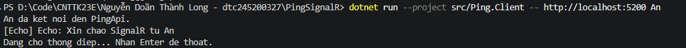

- **Thấy gì:** Khi chạy `dotnet run --project src/Ping.Client -- http://localhost:5200 An`, màn hình in ra `An da ket noi den PingApi.` và dòng `[Echo] Echo: Xin chao SignalR tu An`.
- **Giải thích vì sao:** Client gọi `InvokeAsync("Echo", ...)` lên `PingHub`. Trên Server, phương thức `Echo` sử dụng `Clients.Caller.SendAsync("EchoResponse", ...)` nên thông điệp phản hồi chỉ được gửi ngược lại cho đúng kết nối vừa gọi.

---

### 5.4. Bước 5 (`PingSignalR`) – Gửi tin theo Nhóm (`Group`) và Toàn bộ (`Broadcast`) (`buoc5-nhom.png`)

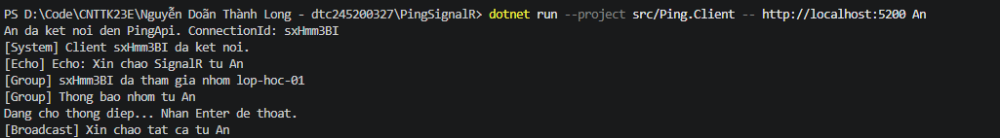

- **Thấy gì:** Máy khách `An` (`ConnectionId: sxHmm3BI`) hiển thị đầy đủ các dòng sự kiện theo phạm vi:
  - `[System] Client sxHmm3BI da ket noi.` (từ `OnConnectedAsync` phát cho `Clients.All`)
  - `[Echo] Echo: Xin chao SignalR tu An` (chỉ riêng `An` thấy nhờ `Clients.Caller`)
  - `[Group] sxHmm3BI da tham gia nhom lop-hoc-01` và `[Group] Thong bao nhom tu An` (phát cho các thành viên trong nhóm `lop-hoc-01` nhờ `Clients.Group("lop-hoc-01")`)
  - `[Broadcast] Xin chao tat ca tu An` (phát cho mọi kết nối nhờ `Clients.All`)
- **Giải thích vì sao:** SignalR cho phép phân tách phạm vi người nhận: `Clients.Caller` chỉ gửi cho người gọi (nên `An` và `Binh` không thấy `[Echo]` của nhau), `Clients.Group` gửi cho các kết nối đã được thêm vào nhóm qua `Groups.AddToGroupAsync`, còn `Clients.All` gửi cho tất cả kết nối hiện hành.

---

### 5.5. Bước 6 (`PingSignalR`) – Tự động kết nối lại (`WithAutomaticReconnect`) (`buoc6-noilai.png`)

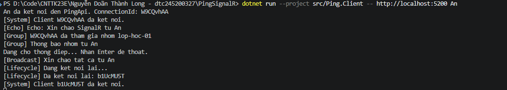

- **Thấy gì:** Ban đầu `An` kết nối với `ConnectionId: W9CQvhAA`. Khi tắt máy chủ `Ping.Api` và bật lại, máy khách tự động in ra:
  - `[Lifecycle] Dang ket noi lai...`
  - `[Lifecycle] Da ket noi lai: b1UcMU5T`
  - `[System] Client b1UcMU5T da ket noi.`
- **Giải thích vì sao:** Cấu hình `.WithAutomaticReconnect()` giúp `HubConnection` tự động thử kết nối lại khi mất kết nối mạng hoặc khi máy chủ khởi động lại. Khi kết nối lại thành công, Server tạo phiên kết nối mới nên cấp một `ConnectionId` mới (`b1UcMU5T`), đồng thời tư cách thành viên nhóm (`Groups`) cũ trên RAM của Server cũng mất đi nếu Client không đăng ký lại.

---

### 5.6. Bước 7 (`PingSignalR`) – Thí nghiệm lỗi 1: Máy chủ chưa chạy (`buoc7-loi1.png`)

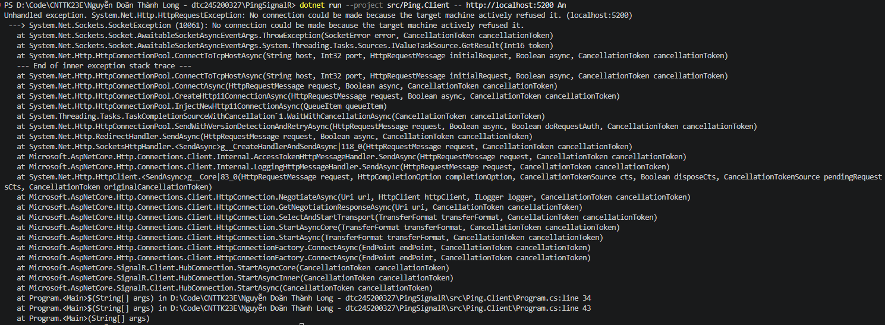

- **Thấy gì:** Khi `Ping.Api` chưa chạy mà khởi chạy `Ping.Client`, ứng dụng ném ngoại lệ `System.Net.Http.HttpRequestException: No connection could be made because the target machine actively refused it. (localhost:5200)` tại dòng `await connection.StartAsync()`.
- **Giải thích vì sao:** Bước bắt tay đầu tiên (`StartAsync` -> `NegotiateAsync`) cần mở kết nối TCP tới cổng `5200`. Do không có tiến trình nào lắng nghe tại cổng này, hệ điều hành từ chối kết nối ngay lập tức (`SocketException 10061: Connection refused`). Lưu ý rằng `.WithAutomaticReconnect()` chỉ hoạt động sau khi `StartAsync()` đã thành công lần đầu.

---

### 5.7. Bước 7 (`PingSignalR`) – Thí nghiệm lỗi 2: Sai đường dẫn Hub `/hub/ping` (`buoc7-loi2.png`)

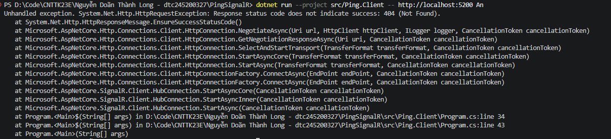

- **Thấy gì:** Khi đổi URL trên Client thành `/hub/ping` (thiếu chữ `s`), `StartAsync()` ném ngoại lệ `System.Net.Http.HttpRequestException: Response status code does not indicate success: 404 (Not Found)` tại `NegotiateAsync`.
- **Giải thích vì sao:** Máy chủ đang chạy nhưng chỉ ánh xạ `app.MapHub<PingHub>("/hubs/ping")`. Khi Client gửi yêu cầu `POST /hub/ping/negotiate?negotiateVersion=1`, pipeline định tuyến của ASP.NET Core không khớp được endpoint nào nên trả về mã `404 Not Found`.

---

### 5.8. Bước 7 (`PingSignalR`) – Thí nghiệm lỗi 3: Sai tên sự kiện `EchoRespone` (`buoc7-loi3.png`)

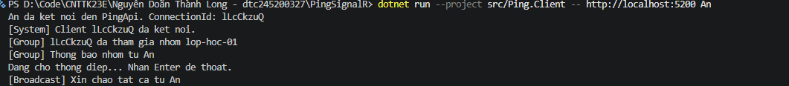

- **Thấy gì:** Chương trình vẫn chạy bình thường, in ra `[System]`, `[Group]`, `[Broadcast]` nhưng **hoàn toàn biến mất dòng `[Echo]`** và không hề báo bất kỳ lỗi hay ngoại lệ nào.
- **Giải thích vì sao:** SignalR ghép cặp sự kiện giữa Server và Client dựa trên chuỗi tên sự kiện (`string`). Server phát sự kiện tên `"EchoResponse"`, nhưng Client lại đăng ký lắng nghe `"EchoRespone"` (sai chính tả). Khi nhận khung tin `"EchoResponse"` mà không có handler tương ứng, SignalR Client âm thầm bỏ qua khung tin đó. Đây là lỗi logic rất nguy hiểm trong hệ thống phân tán hướng sự kiện vì không gây crash nhưng làm mất dữ liệu hiển thị.

---

### 5.9. Phần 2 (`EduSubmit`) – Luồng nộp bài và nhận thông báo thời gian thực (`edusubmit-client.png`)

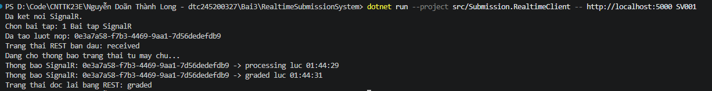

- **Thấy gì:** Terminal chạy `Submission.RealtimeClient` với mã sinh viên `SV001` in ra đầy đủ 8 dòng theo đúng trình tự thời gian:
  1. `Da ket noi SignalR.`
  2. `Chon bai tap: 1 Bai tap SignalR`
  3. `Da tao luot nop: 0e3a7a58-f7b3-4469-9aa1-7d56dedefdb9`
  4. `Trang thai REST ban dau: received`
  5. `Dang cho thong bao trang thai tu may chu...`
  6. `Thong bao SignalR: 0e3a7a58-f7b3-4469-9aa1-7d56dedefdb9 -> processing luc 01:44:29` (sau ~1 giây)
  7. `Thong bao SignalR: 0e3a7a58-f7b3-4469-9aa1-7d56dedefdb9 -> graded luc 01:44:31` (sau ~2 giây tiếp theo)
  8. `Trang thai doc lai bang REST: graded`
  *(Đồng thời trên terminal của Server `Submission.RealtimeApi` ghi nhận log `[Hub] _8KUNPde theo doi submission:0e3a7a58-f7b3-4469-9aa1-7d56dedefdb9`, `[Push] submission:0e3a7a58-f7b3-4469-9aa1-7d56dedefdb9 -> processing` và `[Push] submission:0e3a7a58-f7b3-4469-9aa1-7d56dedefdb9 -> graded`).*
- **Giải thích vì sao:**
  - Client dùng `HttpClient` gọi `GET /api/assignments` và `POST /api/assignments/1/submissions` để tạo lượt nộp bài mới (nhận trạng thái khởi tạo `received`).
  - Ngay sau đó, Client gọi Hub method `WatchSubmission(submissionId)` để tham gia vào nhóm `submission:0e3a7a58-f7b3-4469-9aa1-7d56dedefdb9`.
  - Tác vụ nền `SimulateGradingAsync` trên Server dùng `IHubContext<SubmissionHub>` chủ động đẩy (`Push`) trạng thái `processing` (sau 1s) và `graded` (sau 3s) về đúng nhóm của lượt nộp đó.
  - Khi nhận được trạng thái `graded`, `TaskCompletionSource` được hoàn tất và Client gọi lại `GET /api/submissions/{id}` qua REST để xác nhận trạng thái cuối cùng (`graded`).

---

### 5.10. Phần 2 (`EduSubmit`) – Kiểm thử API và bắt tay `negotiate` (`edusubmit-requests.png`)

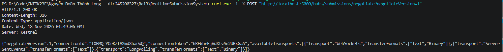

- **Thấy gì:** Thực thi kiểm thử các yêu cầu HTTP trong `requests.http` đối với `Submission.RealtimeApi` tại cổng `5000` trả về đúng các mã trạng thái chuẩn (`200 OK`, `201 Created`, `400 Bad Request`, `404 Not Found`); đặc biệt ca bắt tay `POST http://localhost:5000/hubs/submissions/negotiate?negotiateVersion=1` trả về `HTTP/1.1 200 OK` cùng `connectionId: "TXRMQ-YOeKZfA2mdXbaeWQ"` và danh sách `availableTransports`.
- **Giải thích vì sao:** Dịch vụ `Submission.RealtimeApi` tích hợp đồng thời cả Minimal API (phục vụ các endpoint REST `/api/...`) và SignalR Hub (phục vụ endpoint `/hubs/submissions`) trên cùng một máy chủ Kestrel cổng `5000`.

---

## 6. Bảng 5 thí nghiệm phân tán (Bước 7 – EduSubmit)

| TT | Tình huống thí nghiệm | Dự đoán trước khi chạy | Kết quả chạy thật | Giải thích bài học phân tán |
|---|---|---|---|---|
| **1** | **Chạy 2 máy khách `SV001` và `SV002` cùng lúc** | Mỗi máy khách tạo một `submissionId` riêng và chỉ nhận thông báo `processing` / `graded` của chính lượt nộp mình tạo, không bị lẫn thông báo của người kia. | Terminal `SV001` chỉ in thông báo SignalR của `submissionId` thuộc `SV001`; Terminal `SV002` chỉ in thông báo SignalR của `submissionId` thuộc `SV002`. Trên Server xuất hiện 2 nhóm `submission:{id1}` và `submission:{id2}` riêng biệt. | **Cô lập kênh thông báo theo tài nguyên (Resource-scoped Group):** Nhờ đặt tên nhóm theo mẫu `submission:{submissionId}` và dùng `Clients.Group(groupName)`, Server định tuyến thông báo chính xác tới đúng người quan tâm, đảm bảo tính riêng tư và giảm tải băng thông mạng. |
| **2** | **Máy chủ chưa chạy (`Submission.RealtimeApi` đang tắt)** | Máy khách sẽ báo lỗi ngay ở bước kết nối đầu tiên (`connection.StartAsync()`) và dừng chương trình trước khi kịp gọi REST API. | Chương trình dừng ngay tại dòng `await connection.StartAsync();` với ngoại lệ `System.Net.Http.HttpRequestException: No connection could be made because the target machine actively refused it. (localhost:5000)`. | **Phụ thuộc trạng thái sẵn sàng của dịch vụ mạng:** Trong hệ thống phân tán, Client không thể giả định Server luôn sống. Cần xử lý ngoại lệ (`try/catch`) và cơ chế retry khi khởi tạo kết nối ban đầu (`StartAsync`), vì `WithAutomaticReconnect()` chỉ có tác dụng sau khi đã kết nối thành công lần đầu. |
| **3** | **Sai đường dẫn Hub (`/hub/submissions` thay vì `/hubs/submissions`)** | Yêu cầu bắt tay `negotiate` sẽ thất bại với lỗi `404 Not Found` do không khớp route trên Server. | Nhận lỗi `HTTP/1.1 404 Not Found` (`HttpRequestException: Response status code does not indicate success: 404 (Not Found)`) ngay tại bước `NegotiateAsync`. | **Tính chặt chẽ của hợp đồng điểm cuối (Endpoint Contract):** Chỉ lệch một ký tự trên URI (`/hub` so với `/hubs`) cũng khiến tầng định tuyến HTTP từ chối yêu cầu trước khi bước vào giao thức SignalR. |
| **4** | **Sai tên sự kiện (`SubmissionStatusChange` thiếu chữ `d`)** | Kết nối SignalR và nộp bài REST vẫn thành công, Server vẫn chấm xong và đẩy tin, nhưng Client không in ra dòng `Thong bao SignalR` nào, bị timeout 10s rồi vẫn đọc lại được `graded` qua REST. | Client in `Da ket noi SignalR.`, tạo lượt nộp `received`, chờ hết 10 giây in ra `Qua thoi gian cho thong bao graded.`, nhưng dòng cuối `Trang thai doc lai bang REST: graded` vẫn hiển thị đúng kết quả đã chấm! | **Rủi ro khớp tên sự kiện lỏng lẻo (Loose Event Binding) & Vai trò cứu cánh của REST:** Sai tên sự kiện trên `connection.On(...)` không gây lỗi biên dịch hay runtime exception mà làm mất thông báo âm thầm. Tuy nhiên, nhờ thiết kế kết hợp `Task.WhenAny(..., Task.Delay(10s))` và đọc lại bằng `GET /api/submissions/{id}`, hệ thống vẫn tự phục hồi và lấy được trạng thái chuẩn xác từ Server. |
| **5** | **Gọi `WatchSubmission` muộn 4 giây (thêm `await Task.Delay(4000)` trước `WatchSubmission`)** | Vì Server chấm bài chỉ mất tổng cộng 3 giây (`1s -> processing`, `+2s -> graded`), khi Client gọi `WatchSubmission` ở giây thứ 4 thì Server đã phát xong cả 2 sự kiện nên Client sẽ lỡ toàn bộ thông báo SignalR, chờ hết 10s timeout nhưng đọc lại bằng REST vẫn thấy `graded`. | Trên Server in `[Push] ... -> processing` và `[Push] ... -> graded` trước khi xuất hiện dòng `[Hub] ... theo doi submission:...`. Phía Client không nhận được bất kỳ thông báo SignalR nào, báo `Qua thoi gian cho thong bao graded.`, sau đó in `Trang thai doc lai bang REST: graded`. | **Bản chất không lưu trữ của thông báo đẩy (Transient Push Notification / Race Condition):** SignalR Hub không phải là hàng đợi lưu trữ lịch sử tin nhắn (Message Broker); nếu Client tham gia nhóm (`Group`) muộn hơn thời điểm Server phát sự kiện thì sự kiện đó bị trôi qua vĩnh viễn. Do đó, sau khi đăng ký theo dõi hoặc khi hết thời gian chờ, Client luôn cần truy vấn trạng thái hiện tại qua REST API (`Source of Truth`). |

### Minh chứng bổ sung Bước 7 (`EduSubmit`) – Thí nghiệm sai đường dẫn Hub (`/hub/submissions` -> `404 Not Found`) (`edusubmit-thinghiem.png`)

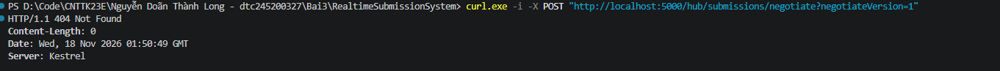

- **Thấy gì:** Khi gọi `curl.exe -i -X POST "http://localhost:5000/hub/submissions/negotiate?negotiateVersion=1"` (sai đường dẫn `/hub/submissions` thay vì `/hubs/submissions`), máy chủ Kestrel trả về ngay `HTTP/1.1 404 Not Found` với `Content-Length: 0`.
- **Giải thích vì sao:** Endpoint SignalR được đăng ký tại `/hubs/submissions`, nên mọi yêu cầu bắt tay gửi tới `/hub/submissions/negotiate` đều bị từ chối ở tầng định tuyến HTTP với mã `404`.

---

## 7. Trả lời 3 câu hỏi lý thuyết đầu giờ

### Câu 1: Máy chủ có thể chủ động báo cho máy khách mà không cần máy khách hỏi không?

- **Trả lời:** **Có**, nếu giữa máy khách và máy chủ duy trì một **kết nối hai chiều bền vững (Persistent Connection)** thông qua công nghệ như **SignalR** (ưu tiên sử dụng giao thức **WebSockets**, và tự động hạ cấp xuống **Server-Sent Events** hoặc **Long Polling** khi môi trường mạng không hỗ trợ WebSockets).
- **Cơ chế hoạt động:**
  - Trong mô hình HTTP truyền thống (Request–Response), máy chủ luôn bị động: máy khách phải gửi Request thì máy chủ mới trả về Response; nếu muốn biết trạng thái mới, máy khách phải hỏi đi hỏi lại liên tục (*Short Polling*), gây lãng phí băng thông và độ trễ cao.
  - Với SignalR, sau bước bắt tay `negotiate` ban đầu qua HTTP, kênh kết nối được giữ mở. Khi có sự kiện phát sinh ở phía máy chủ (chẳng hạn tiến trình nền chấm bài xong chuyển sang `processing` hoặc `graded`), máy chủ sử dụng `Hub` hoặc `IHubContext<THub>` để **chủ động đẩy (Push)** khung tin xuống máy khách ngay lập tức thông qua `Clients.All`, `Clients.Caller`, hoặc `Clients.Group(...)` mà không cần máy khách gửi thêm bất kỳ yêu cầu HTTP nào.

---

### Câu 2: Đã có REST rồi, vì sao còn cần thêm SignalR? Hai thứ chia việc thế nào?

- **Trả lời:** **REST** và **SignalR** không thay thế nhau mà **bổ trợ lẫn nhau**, mỗi công nghệ giải quyết một bài toán tối ưu riêng trong kiến trúc hệ thống phân tán:
  1. **Vì sao đã có REST vẫn cần SignalR?**
     - REST hoạt động theo mô hình kéo (*Pull* – Client hỏi, Server đáp). Đối với các tác vụ xử lý bất đồng bộ tốn thời gian trên máy chủ (như chấm bài tự động, xử lý thanh toán, biên dịch mã nguồn), Client không biết chính xác khi nào Server xử lý xong. Nếu chỉ dùng REST, Client buộc phải gửi `GET` liên tục theo chu kỳ (Polling), làm tăng tải không cần thiết lên Server và không phản hồi tức thời. SignalR giải quyết triệt để vấn đề này bằng cơ chế đẩy (*Push*) thông báo ngay khi trạng thái thay đổi.
  2. **Hai thứ chia việc thế nào trong hệ thống EduSubmit?**
     - **RESTful API (Quản lý tài nguyên & Nguồn chân lý – *Source of Truth*):**
       - Đảm nhận các thao tác **CRUD** có tính trạng thái rõ ràng, chuẩn hóa qua phương thức và mã trạng thái HTTP (`200`, `201`, `400`, `404`, `409`).
       - Cụ thể trong bài: Lấy danh sách đề bài (`GET /api/assignments`), tạo lượt nộp bài mới và kiểm tra hợp lệ (`POST /api/assignments/{id}/submissions`), và đọc lại trạng thái chính xác của lượt nộp (`GET /api/submissions/{id}`).
     - **SignalR (Kênh thông báo sự kiện thời gian thực – *Real-time Event Notification*):**
       - Đảm nhận việc **đăng ký theo dõi** (`WatchSubmission`) và **đẩy thông báo trạng thái tức thời** (`SubmissionStatusChanged`: `processing` -> `graded`) từ tác vụ chạy nền của Server về đúng Client đang chờ, giúp giao diện/người dùng cập nhật ngay lập tức mà không cần hỏi lặp lại.

---

### Câu 3: Nếu đứt mạng đúng lúc máy chủ báo "đã chấm xong" (`graded`) thì xử lý thế nào?

- **Trả lời:** Khi đứt mạng đúng thời điểm máy chủ phát sự kiện `graded`, gói tin SignalR đẩy đi lúc đó sẽ bị thất lạc (vì SignalR chỉ đẩy thông báo tức thời cho các kết nối đang hoạt động trong nhóm chứ không lưu hàng đợi bền vững cho từng Client). Để hệ thống phân tán hoạt động tin cậy và không bị treo, ta kết hợp **3 lớp xử lý**:
  1. **Tự động kết nối lại và đăng ký lại nhóm (`WithAutomaticReconnect` + `Reconnected`):**
     - Cấu hình `.WithAutomaticReconnect()` để SignalR Client tự động khôi phục kết nối khi mạng có lại.
     - Trong sự kiện `connection.Reconnected`, vì `ConnectionId` có thể thay đổi và tư cách thành viên nhóm cũ đã mất, Client cần gọi lại `InvokeAsync("WatchSubmission", submissionId)` để vào lại nhóm theo dõi.
  2. **Đồng bộ lại trạng thái chuẩn qua REST API (*State Reconciliation / Fallback GET*):**
     - Ngay sau khi sự kiện `Reconnected` kích hoạt (hoặc sau khi đăng ký `WatchSubmission`), Client chủ động gọi `GET /api/submissions/{submissionId}` qua REST API. Vì trạng thái `"graded"` đã được lưu bền vững trong bộ nhớ/cơ sở dữ liệu của Server, lệnh `GET` sẽ lấy về ngay trạng thái `"graded"` đã bị lỡ trong lúc đứt mạng.
  3. **Cơ chế giới hạn thời gian chờ (Timeout + Kiểm tra lại bằng REST):**
     - Như đã cài đặt trực tiếp trong `Submission.RealtimeClient`: dùng `await Task.WhenAny(gradedNotification.Task, Task.Delay(TimeSpan.FromSeconds(10)))` kết hợp gọi `GET /api/submissions/{created.Id}` ở bước cuối. Nhờ vậy, kể cả khi thông báo SignalR bị rơi do đứt mạng hay đăng ký muộn, Client cũng không bị treo vô hạn và luôn đối chiếu được trạng thái cuối cùng chính xác từ REST API.
