# BÀI 3 – GIAO TIẾP THỜI GIAN THỰC VỚI SIGNALR

**Học phần:** Phát triển ứng dụng phân tán  
**Sinh viên:** [Điền họ và tên]  
**Mã sinh viên:** [Điền MSSV]  
**Nội dung:** PingSignalR và RealtimeSubmissionSystem (EduSubmit Realtime)

## 1. Mục tiêu và cấu trúc bài làm

Bài 3 gồm hai solution .NET 10:

- **PingSignalR:** tìm hiểu kết nối SignalR, `Echo`, `Broadcast`, `Group`, vòng đời kết nối và các tình huống lỗi.
- **RealtimeSubmissionSystem:** kết hợp REST API và SignalR để tạo lượt nộp, theo dõi trạng thái `received → processing → graded` và đọc lại trạng thái cuối bằng REST.

```text
Bai3/
├── README.md
├── anh/
│   └── (các ảnh minh chứng bên dưới)
├── PingSignalR/
│   ├── PingSignalR.slnx
│   └── src/
│       ├── Ping.Api/
│       └── Ping.Client/
└── RealtimeSubmissionSystem/
    ├── RealtimeSubmissionSystem.slnx
    ├── requests.http
    └── src/
        ├── Submission.RealtimeApi/
        └── Submission.RealtimeClient/
```

**Lưu ý:** Không đưa `bin/` và `obj/` lên Git. Các ảnh trong README là ảnh chụp kết quả thực hiện, không phải ảnh minh họa.

## 2. Phần 1 – PingSignalR

### Bước 1 – Tạo solution và Build

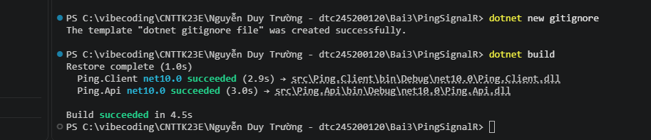

**Thấy:** Build thành công, không có lỗi.  
**Giải thích:** Solution gồm máy chủ `Ping.Api` và máy khách `Ping.Client`; hai project biên dịch thành công.

### Bước 2 – Kiểm tra negotiate

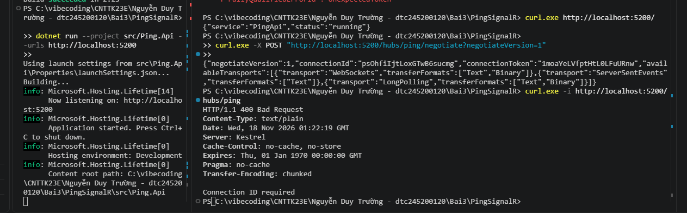

**Thấy:** `curl.exe` gọi `/hubs/ping/negotiate?negotiateVersion=1` nhận JSON có `connectionId` và các phương thức vận chuyển.  
**Giải thích:** Đây là bước bắt tay để SignalR tạo thông tin kết nối và chọn cơ chế truyền tải.

### Bước 3–4 – Tạo Echo và chạy máy khách

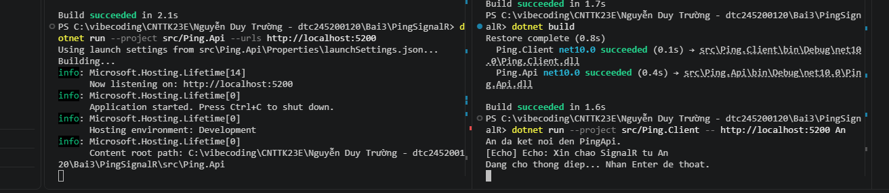

**Thấy:** Máy chủ chạy tại `http://localhost:5200`; máy khách An nhận `[Echo] Echo: Xin chao SignalR tu An`.  
**Giải thích:** Máy khách gọi `InvokeAsync("Echo", ...)`. Máy chủ sử dụng `Clients.Caller.SendAsync("EchoResponse", ...)` để phản hồi riêng người vừa gọi.

### Bước 5 – Broadcast và Group

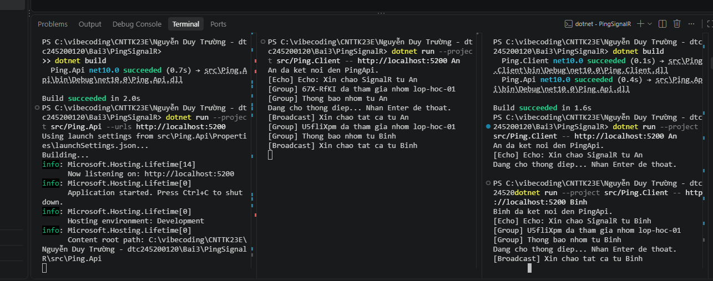

**Thấy:** Khi hai máy khách An và Bình tham gia nhóm, An nhận tin `Group` và `Broadcast` của Bình (và ngược lại khi cả hai đang kết nối), nhưng không nhận Echo của Bình.  
**Giải thích:** `Clients.All` gửi cho mọi kết nối; `Clients.Group` gửi cho thành viên nhóm; `Clients.Caller` gửi riêng người gọi.

### Bước 6 – Vòng đời kết nối và tự kết nối lại

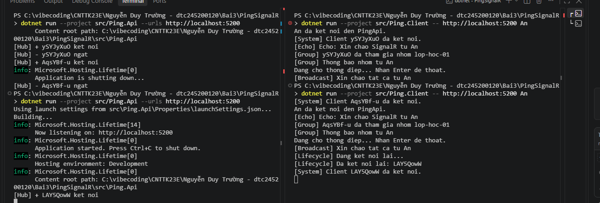

**Thấy:** Khi tắt máy chủ, máy khách in `[Lifecycle] Dang ket noi lai...`; khi máy chủ khởi động lại, máy khách in `[Lifecycle] Da ket noi lai: ...`.  
**Giải thích:** `WithAutomaticReconnect()` thử mở lại kết nối. Kết nối mới có thể có `ConnectionId` khác; tư cách thành viên nhóm cũ không được tự động khôi phục.

### Bước 7 – Ba thí nghiệm lỗi PingSignalR

**7.1. Máy chủ chưa chạy**

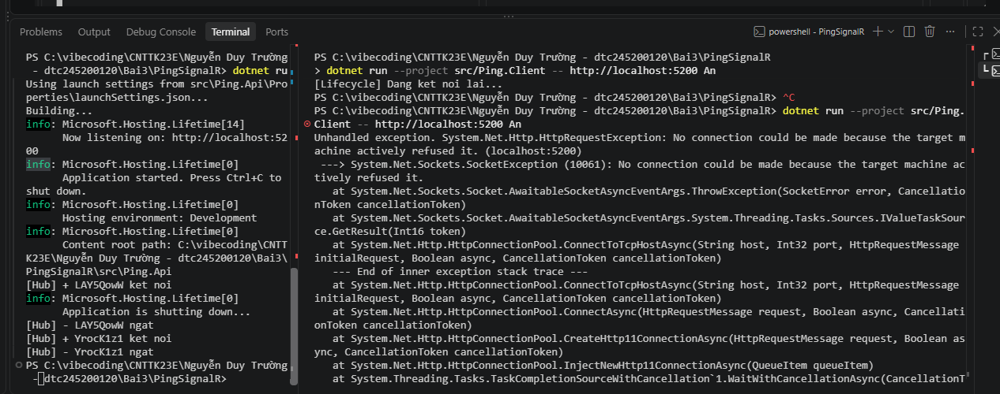

**Thực hiện:** Tắt máy chủ rồi chạy máy khách.  
**Thấy:** `HttpRequestException` với `Connection refused (localhost:5200)`.  
**Giải thích:** `StartAsync()` thất bại ở lần kết nối đầu tiên; `WithAutomaticReconnect()` không tự xử lý thất bại lúc mở kết nối ban đầu.

**7.2. Sai đường dẫn Hub**

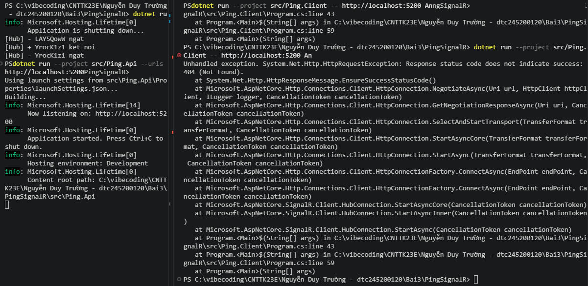

**Thực hiện:** Đổi đường dẫn từ `/hubs/ping` thành `/hub/ping`.  
**Kết quả cần đối chiếu với ảnh:** `404 (Not Found)` khi negotiate.  
**Giải thích:** Đường dẫn `.WithUrl(...)` không khớp với `MapHub` ở máy chủ.

**7.3. Sai tên thông điệp Echo**

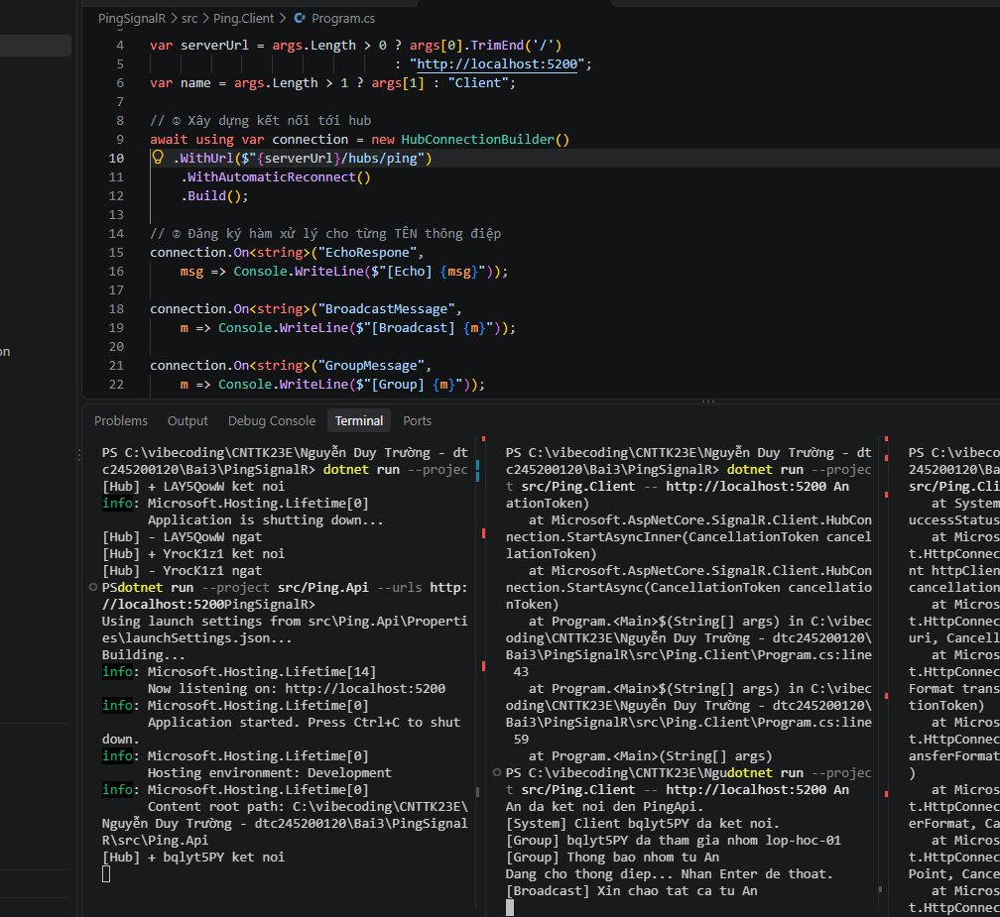

**Thực hiện:** Đổi `EchoResponse` thành `EchoRespone` ở máy khách.  
**Thấy:** Máy khách vẫn kết nối, nhận Group/Broadcast nhưng không có dòng `[Echo]`.  
**Giải thích:** Tên thông điệp đăng ký bằng `On(...)` phải khớp chính xác với tên máy chủ dùng trong `SendAsync(...)`.

**Sau khi chụp lỗi:** Đã khôi phục đúng đường dẫn `/hubs/ping` và tên sự kiện `EchoResponse` để nộp phiên bản hoạt động bình thường.

#### Cách chạy PingSignalR

Từ thư mục `Bai3/PingSignalR`:

```powershell
dotnet build
dotnet run --project src/Ping.Api --urls http://localhost:5200
```

Ở terminal khác:

```powershell
dotnet run --project src/Ping.Client -- http://localhost:5200 An
```

## 3. Phần 2 – EduSubmit Realtime

### Bước 1 – Tạo solution và Build

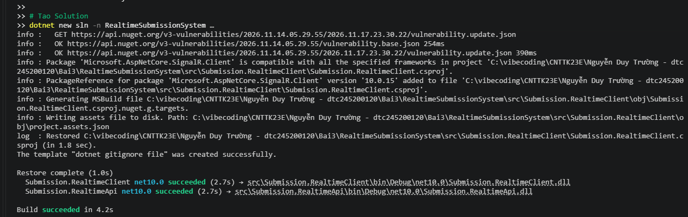

**Thấy:** `RealtimeSubmissionSystem` gồm `Submission.RealtimeApi`, `Submission.RealtimeClient` và build không lỗi.  
**Giải thích:** Máy chủ cung cấp REST API và SignalR Hub; máy khách dùng `HttpClient` cùng `HubConnection`.

### Bước 2 – REST API và trạng thái ban đầu

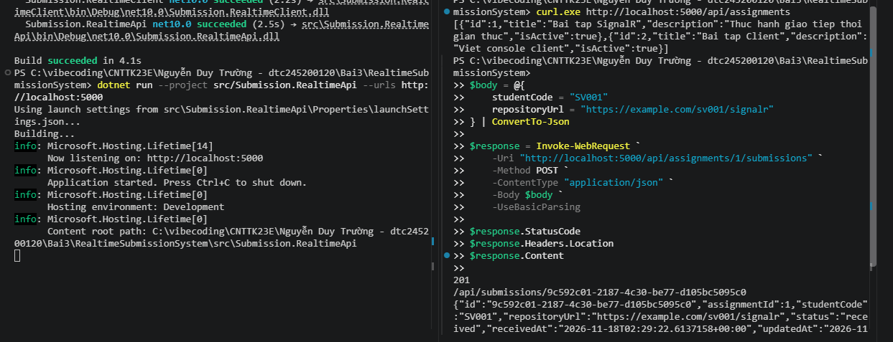

**Thấy:** POST tạo lượt nộp trả `201 Created`, `status = received`, có `receivedAt` và `updatedAt`.  
**Giải thích:** REST tạo tài nguyên lượt nộp; `UpdatedAt` ghi thời điểm thay đổi gần nhất và `lock` bảo vệ danh sách khi nhiều tác vụ cùng truy cập.

### Bước 3 – SubmissionHub và negotiate

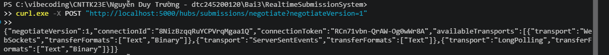

**Thấy:** Bắt tay tại `/hubs/submissions/negotiate` trả `connectionId`.  
**Giải thích:** Phương thức `WatchSubmission(id)` đưa kết nối vào nhóm `submission:{id}` để gửi thông báo đúng người theo dõi.

### Bước 4 – IHubContext và mô phỏng chấm bài nền

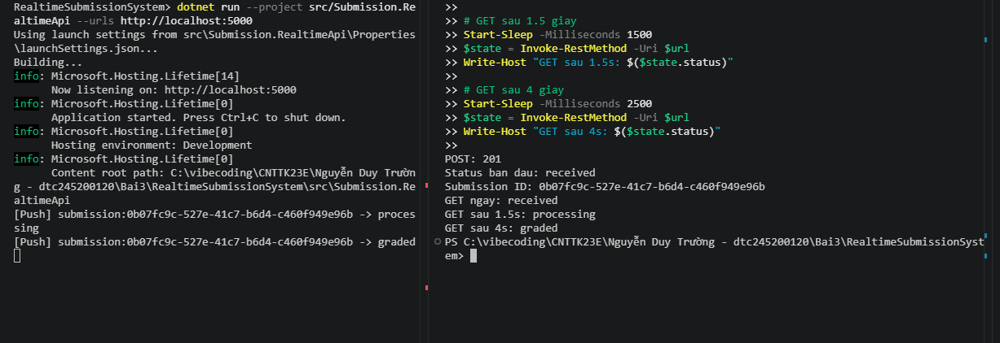

**Thấy:** POST trả `201`, GET ngay là `received`, sau khoảng 1,5 giây là `processing`, sau khoảng 4 giây là `graded`.  
**Giải thích:** `SimulateGradingAsync` dùng `Task.Delay` để mô phỏng chấm bài. `IHubContext<SubmissionHub>` phát `SubmissionStatusChanged` từ ngoài Hub. Dữ liệu REST được cập nhật **trước** khi gửi thông báo.

### Bước 5 – Máy khách kết nối SignalR

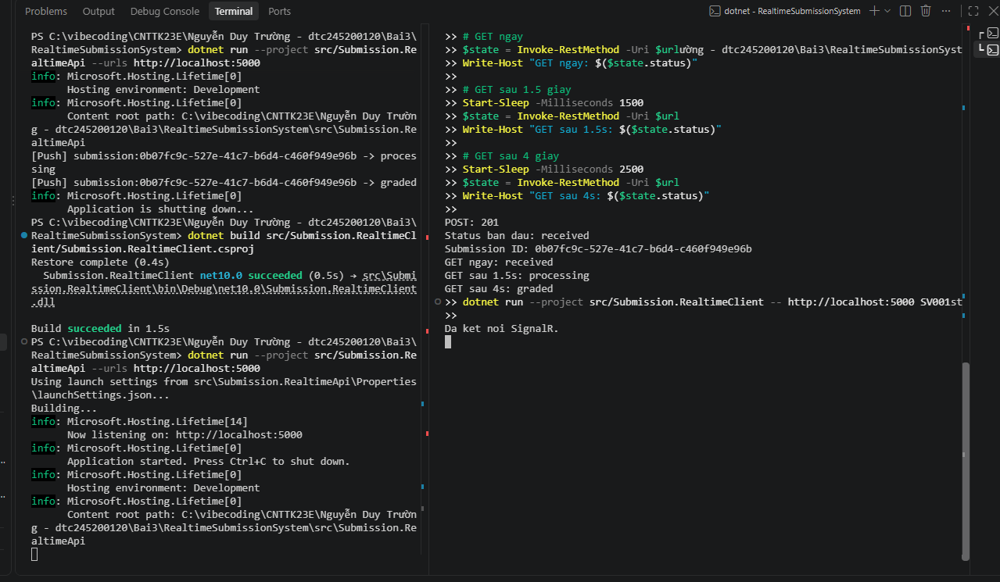

**Thấy:** Máy khách in `Da ket noi SignalR.`  
**Giải thích:** `HttpClient` dùng cho REST; `HubConnection` mở kênh SignalR; `On<SubmissionStatusMessage>` đăng ký hàm xử lý thông báo; `TaskCompletionSource` chờ sự kiện `graded`.

### Bước 6 – POST → Watch → chờ thông báo → GET

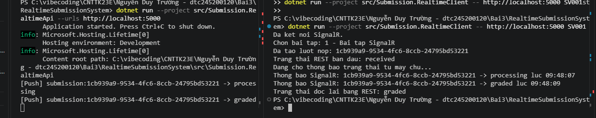

**Kết quả máy khách cần có (8 dòng, ví dụ; ID và giờ thay đổi theo lần chạy):**

```text
Da ket noi SignalR.
Chon bai tap: 1 - Bai tap SignalR
Da tao luot nop: <GUID moi>
Trang thai REST ban dau: received
Dang cho thong bao trang thai tu may chu...
Thong bao SignalR: <GUID> -> processing luc <HH:mm:ss>
Thong bao SignalR: <GUID> -> graded luc <HH:mm:ss>
Trang thai doc lai bang REST: graded
```

**Thấy:** Máy khách nhận `processing`, tiếp theo `graded` (hai thông báo cách nhau khoảng 2 giây), rồi dùng REST xác nhận trạng thái cuối `graded` và tự kết thúc.  
**Giải thích:** REST tạo và đọc lượt nộp; SignalR gửi trạng thái mới theo nhóm. REST là nguồn trạng thái chính xác khi có khả năng mất thông báo.

### Bước 7 – Năm thí nghiệm phân tán

| Thí nghiệm | Dự đoán trước khi chạy | Kết quả theo thí nghiệm | Giải thích |
|---|---|---|---|
| 1. Hai máy khách SV001 và SV002 | Mỗi máy nhận thông báo riêng của lượt nộp mình tạo | Mỗi lượt nộp có ID khác; `processing` và `graded` gắn đúng ID | Hai nhóm `submission:{id}` tách người nhận |
| 2. Máy chủ chưa chạy | Máy khách không kết nối được | `HttpRequestException`, `Connection refused (localhost:5000)` | Không thể hoàn thành lần kết nối đầu tiên |
| 3. Sai đường dẫn Hub | Negotiate trả lỗi 404 | `404 (Not Found)` | `/hub/submissions` không trùng `/hubs/submissions` |
| 4. Sai tên sự kiện | Không nhận tin, hết thời gian chờ | Không có `Thong bao SignalR`; sau 10 giây timeout; REST là `graded` | `On("SubmissionStatusChange")` không khớp `SendAsync("SubmissionStatusChanged")` |
| 5. Watch muộn 4 giây | Bỏ lỡ cả hai thông báo | Không nhận `processing`/`graded` qua SignalR; REST vẫn là `graded` | Đã vào nhóm sau khi sự kiện được gửi; SignalR không phát lại tin cũ |

**Thí nghiệm 1 – Hai máy khách**

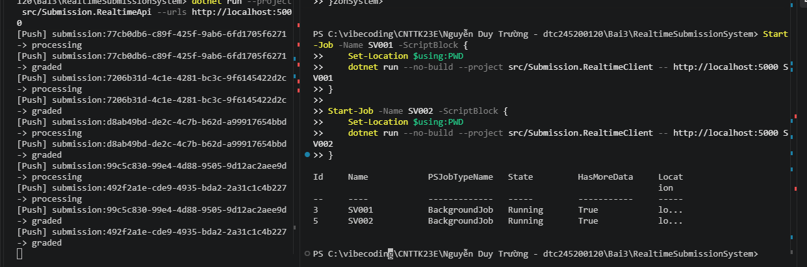

**Thí nghiệm 2 – Máy chủ chưa chạy**

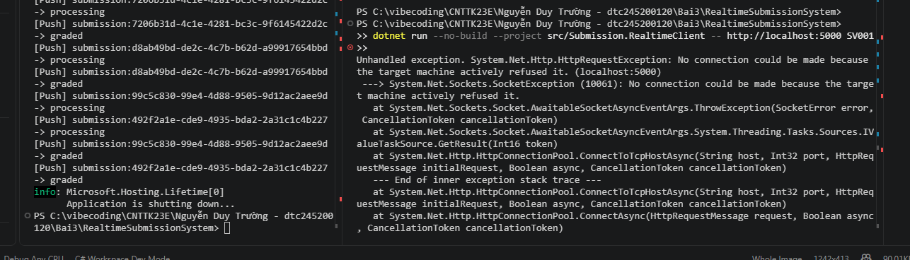

**Thí nghiệm 3 – Sai Hub**

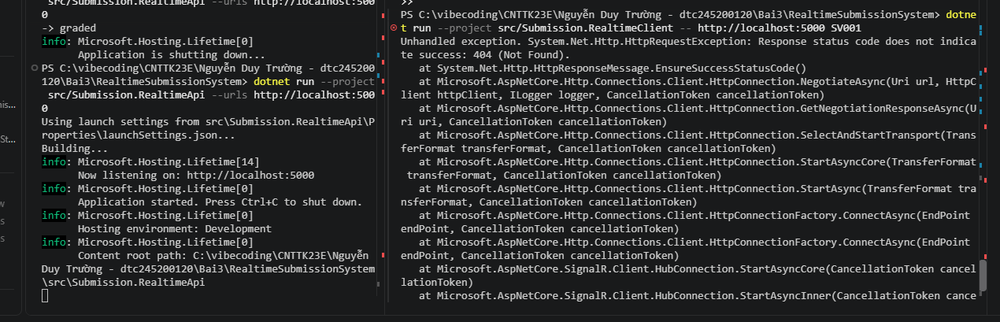

**Thí nghiệm 4 – Sai tên sự kiện**

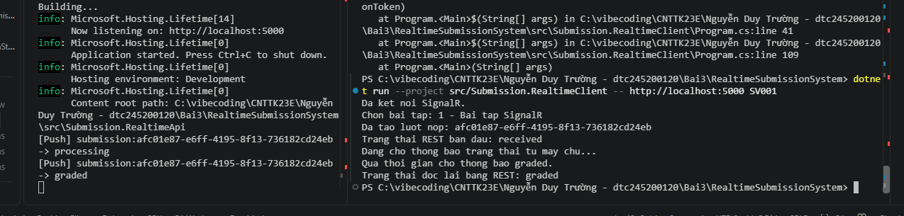

**Thí nghiệm 5 – Watch muộn**

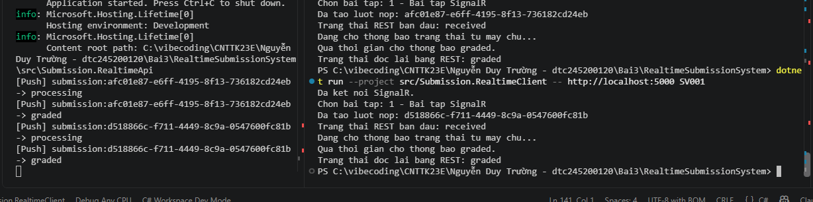

**Sau thí nghiệm:** Khôi phục `.WithUrl(".../hubs/submissions")`, `SubmissionStatusChanged` và bỏ dòng chờ 4 giây trước `WatchSubmission`.

### Bước 8 – Kiểm tra requests.http (9 ca)

File kiểm thử: [`RealtimeSubmissionSystem/requests.http`](RealtimeSubmissionSystem/requests.http).

| Ca | Yêu cầu | Mã HTTP mong đợi | Minh chứng chính |
|---|---|---|---|
| 1 | `GET /` | 200 | Máy chủ hoạt động |
| 2 | `GET /api/assignments` | 200 | Danh sách bài tập |
| 3 | `POST /api/assignments/1/submissions` | 201 | Có `Location`, `received` |
| 4 | `GET /api/submissions/{id}` | 200 | Sau >3 giây trả `graded` |
| 5 | POST thiếu `studentCode` và `repositoryUrl` | 400 | Báo dữ liệu không hợp lệ |
| 6 | POST bài tập không tồn tại (999) | 404 | `ASSIGNMENT_NOT_FOUND` |
| 7 | GET GUID lượt nộp không tồn tại | 404 | `SUBMISSION_NOT_FOUND` |
| 8 | POST `/hubs/submissions/negotiate?negotiateVersion=1` | 200 | Có `connectionId` |
| 9 | POST `/hub/submissions/negotiate?negotiateVersion=1` | 404 | Đường dẫn sai |

**Ảnh minh chứng requests.http:**

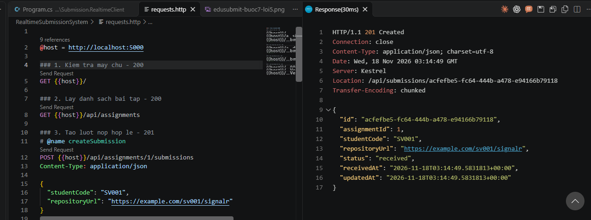

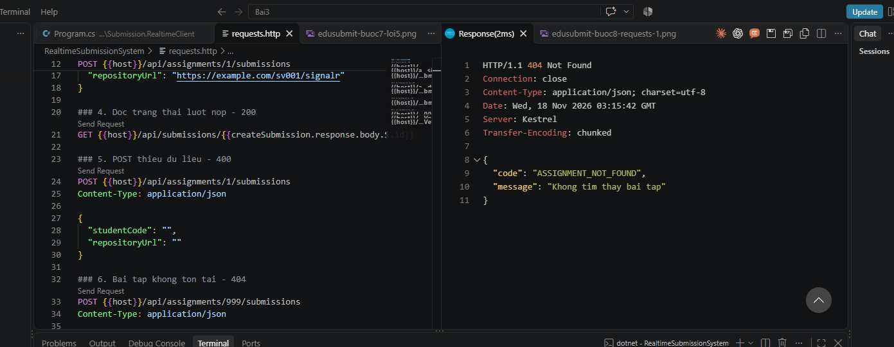

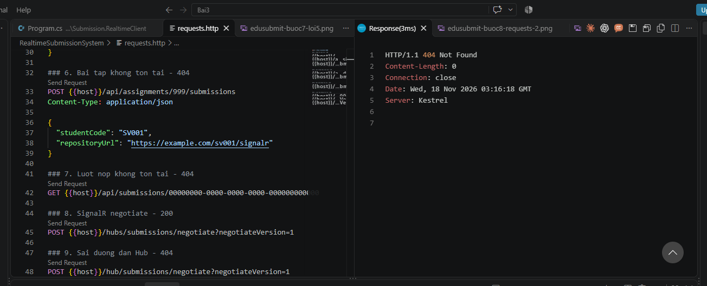

> **Đối chiếu trước khi nộp:** Bảng trên là bộ mã mong đợi theo đề. Hãy mở các ảnh chạy thực tế và sửa bất kỳ mô tả nào chưa khớp; không ghi một ca là đạt nếu chưa thử thành công.

#### Cách chạy EduSubmit Realtime

Từ `Bai3/RealtimeSubmissionSystem`:

```powershell
dotnet build
dotnet run --project src/Submission.RealtimeApi --urls http://localhost:5000
```

Trong terminal khác:

```powershell
dotnet run --project src/Submission.RealtimeClient -- http://localhost:5000 SV001
```

Để chạy `requests.http`, dùng extension **REST Client** trong VS Code và nhấn **Send Request** cho từng ca (ca 3 chạy trước ca 4).

## 4. Trả lời 3 câu hỏi đầu giờ

**Câu 1. Máy chủ có thể chủ động gửi thông báo không?**  
Có. Khi máy khách duy trì kết nối SignalR, máy chủ có thể đẩy thông báo bằng `Clients.Group(...).SendAsync(...)`. Tác vụ bên ngoài Hub dùng `IHubContext` để gửi.

**Câu 2. REST và SignalR chia công việc thế nào?**  
REST dùng để tạo, đọc tài nguyên và trả mã HTTP rõ ràng (200, 201, 400, 404). SignalR chủ động báo sự thay đổi trạng thái khi xảy ra. **REST không bị SignalR thay thế**: REST là nguồn dữ liệu chính xác, SignalR giúp biết tin sớm.

**Câu 3. Nếu mất mạng đúng lúc máy chủ báo `graded` thì sao?**  
Thông báo SignalR có thể bị lỡ, không được tự phát lại. Khi kết nối trở lại, máy khách cần đăng ký theo dõi lại (`WatchSubmission`) vì ConnectionId/nhóm có thể thay đổi, sau đó gọi `GET /api/submissions/{id}` để đọc trạng thái mới nhất.

## 5. Phạm vi gửi trong SignalR

| Cơ chế | Ai nhận? | Ví dụ |
|---|---|---|
| `Clients.All` | Tất cả các máy khách kết nối | Thông báo chung |
| `Clients.Caller` | Máy khách vừa gọi | Echo |
| `Clients.Group(name)` | Các máy khách thuộc một nhóm | Trạng thái `submission:{id}` |
| `Clients.Client(id)` | Một kết nối xác định | Gửi riêng một phiên kết nối |

## 6. Kiểm tra trước khi nộp GitHub

- [ ] `dotnet build` thành công cho cả PingSignalR và RealtimeSubmissionSystem (4 project).
- [ ] Ping.Client nhận `Echo`.
- [ ] Submission.RealtimeClient nhận `processing`, `graded`, sau đó REST trả `graded`.
- [ ] `requests.http` có đủ 9 ca, kiểm tra `200`, `201`, `400`, `404` và negotiate.
- [ ] Có đủ ảnh minh chứng; tên và đường dẫn ảnh trong README khớp thư mục `anh/`.
- [ ] Đã so sánh kết quả thật với bảng 5 thí nghiệm.
- [ ] Đã trả lời 3 câu hỏi đầu giờ.
- [ ] Git có ít nhất 8 commit **thực tế** theo từng giai đoạn, không đưa `bin/`, `obj/` vào commit.
- [ ] Đã tạo Pull Request vào repository lớp, chỉ sửa trong thư mục cá nhân.

**Tên PR theo mẫu đề:** `Bai3 - MSSV - Họ tên`.

---

**Kết luận:** PingSignalR minh họa các phạm vi gửi và vòng đời kết nối. EduSubmit kết hợp REST và SignalR để đẩy trạng thái mới tới đúng nhóm theo dõi; nếu mất thông báo, máy khách đọc lại bằng REST để có trạng thái cuối.
