# Bài 3 - Giao tiếp thời gian thực với SignalR

## Bước 1: Tạo solution và hai project

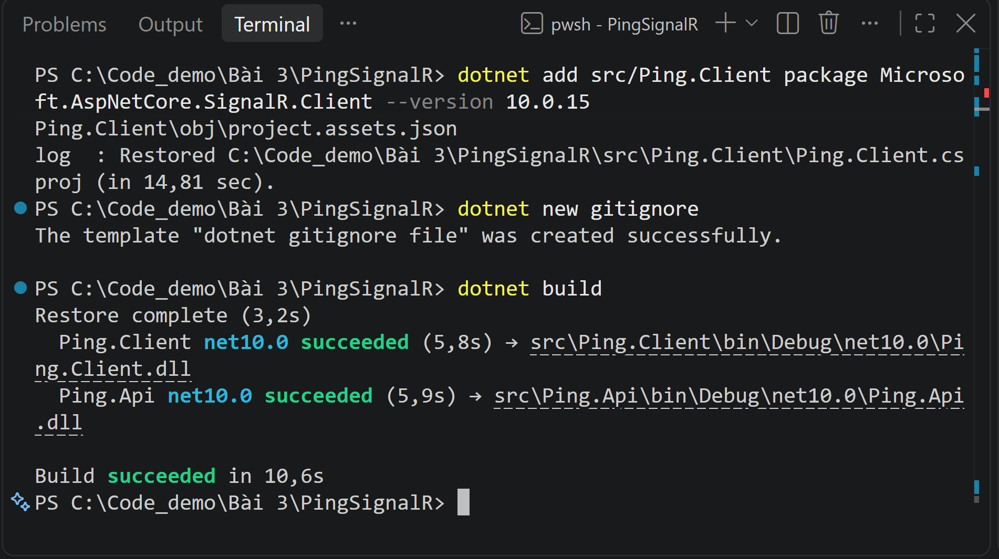

Kết quả: Tạo thành công solution PingSignalR
gồm Ping.Api và Ping.Client. Build thành công,
không có lỗi.

## Bước 2: Thêm SignalR và kiểm tra negotiate

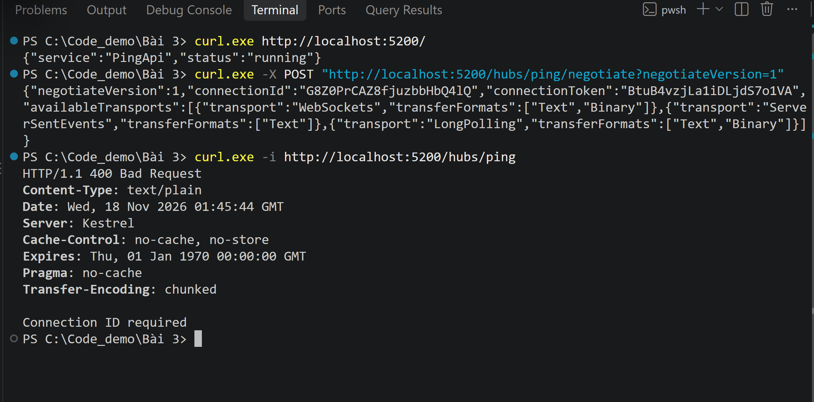

- Đã đăng ký dịch vụ SignalR bằng `AddSignalR()` và ánh xạ Hub tại `/hubs/ping`.
- Gọi API negotiate thành công, máy chủ trả về `connectionId` và các phương thức truyền tải được hỗ trợ.
## Bước 3: Xây dựng phương thức Echo

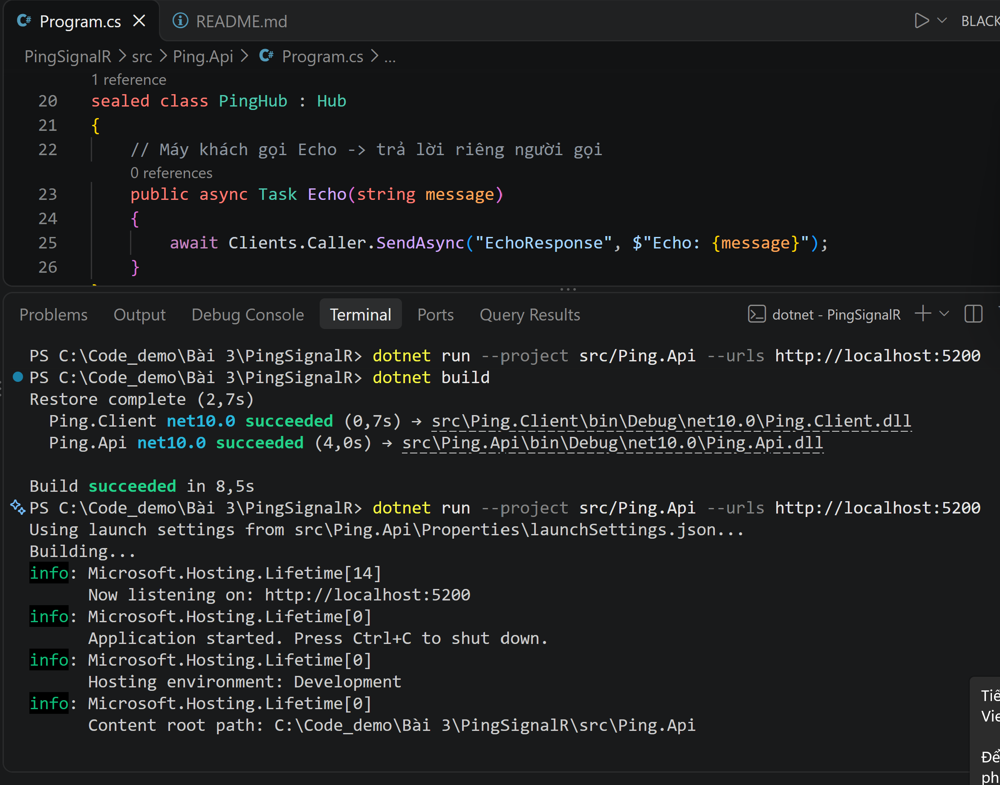

- Đã xây dựng phương thức Echo trong PingHub.
- Kiểm tra biên dịch thành công, không có lỗi.

## Bước 4: Kiểm tra giao tiếp Echo

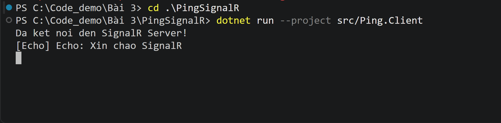

- Client kết nối thành công đến SignalR Hub.
- Client gửi nội dung `Xin chao SignalR`.
- Server phản hồi riêng Client với nội dung `Echo: Xin chao SignalR`.
## Bước 5: Mở rộng Broadcast và Group

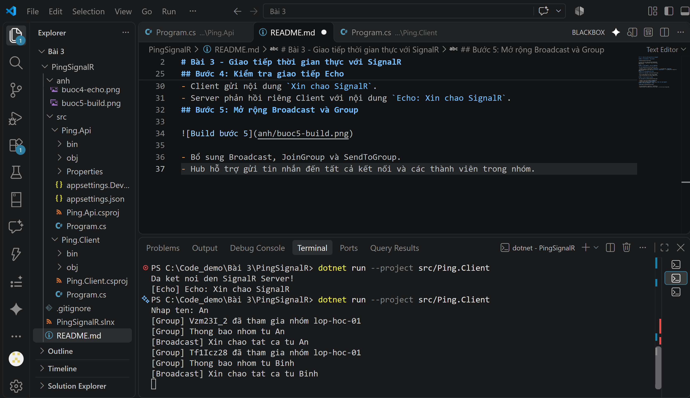

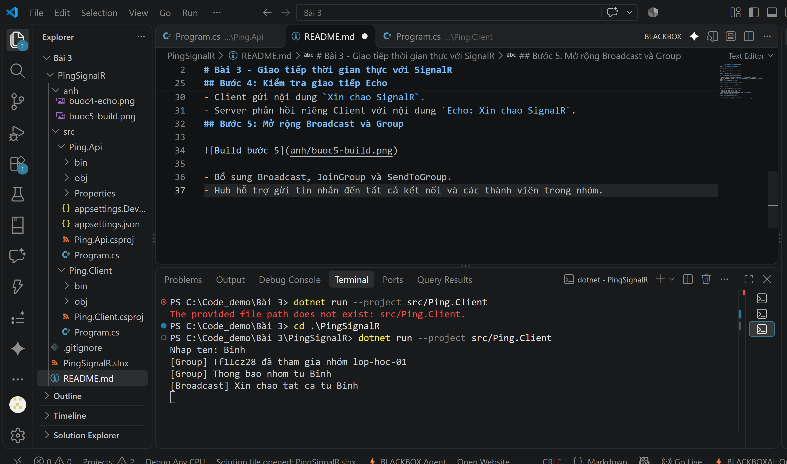

- Bổ sung Broadcast, JoinGroup và SendToGroup.
- Hub hỗ trợ gửi tin nhắn đến tất cả kết nối và các thành viên trong nhóm.
## Bước 6: Kiểm tra vòng đời kết nối

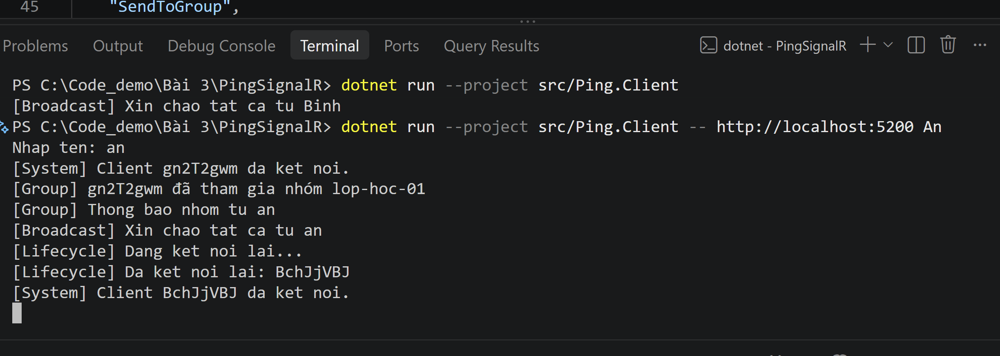

- Máy chủ ghi nhận sự kiện kết nối và ngắt kết nối.
- Máy khách tự động thử kết nối lại khi máy chủ khởi động lại.
- ConnectionId thay đổi sau khi kết nối lại thành công.
## Bước 7: Ba thí nghiệm lỗi có chủ đích

### Lỗi 1: Máy chủ chưa chạy

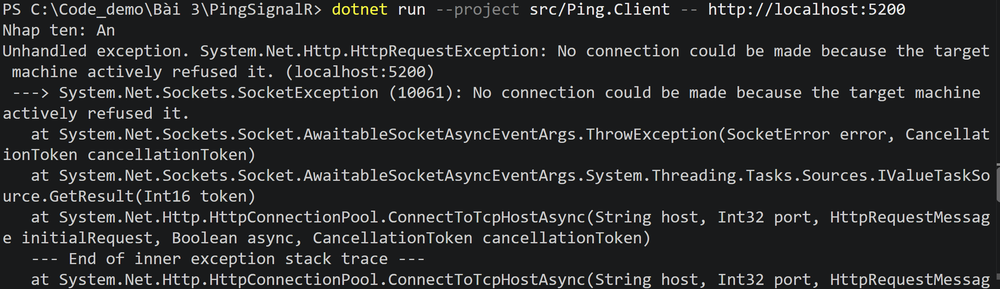

- Hiện tượng: HttpRequestException – Connection refused (localhost:5200).
- Giải thích: StartAsync ném lỗi ngay. WithAutomaticReconnect chỉ cứu kết nối đã mở.

### Lỗi 2: Sai đường dẫn Hub

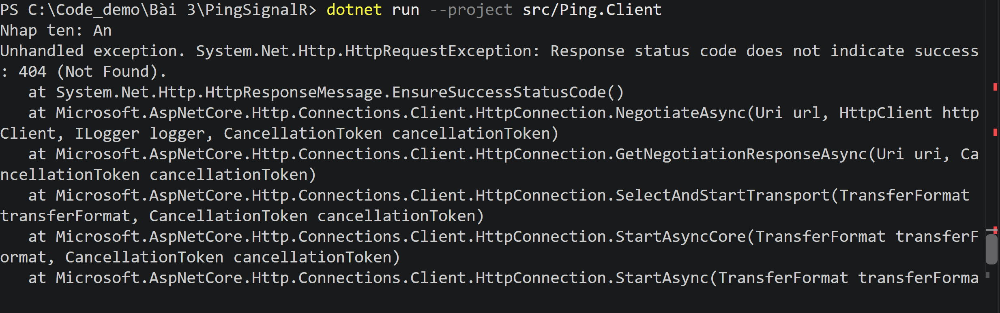

- Hiện tượng: HttpRequestException – 404 (Not Found).
- Giải thích: Đường dẫn Hub phải khớp với MapHub ở máy chủ.

### Lỗi 3: Sai tên thông điệp

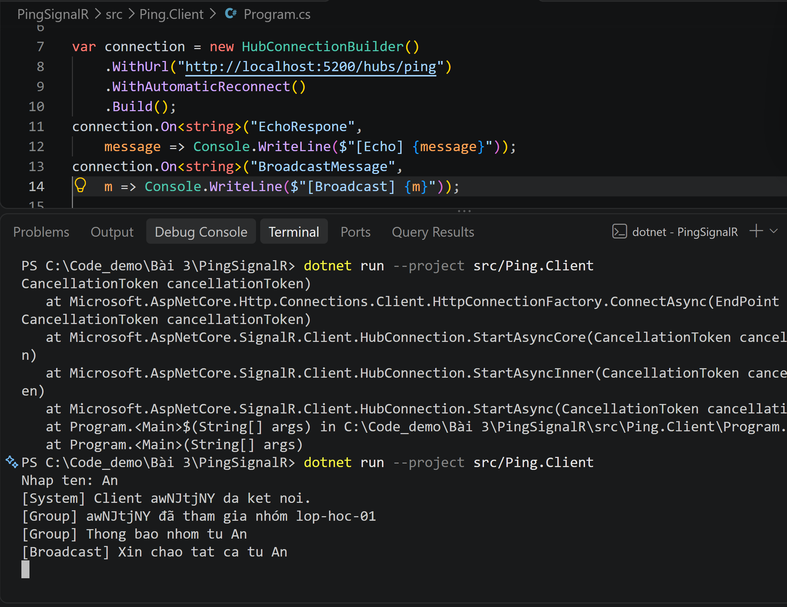

- Hiện tượng: Không có lỗi nhưng không xuất hiện dòng [Echo].
- Giải thích: Tên thông điệp đăng ký ở Client phải khớp với tên thông điệp Server gửi.
## EduSubmit – Bước 1: Tạo solution

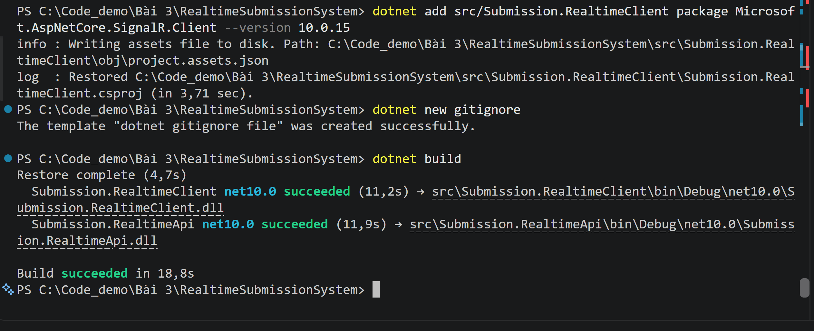

- Tạo solution RealtimeSubmissionSystem.
- Tạo hai project Submission.RealtimeApi và Submission.RealtimeClient.
- Thêm thư viện Microsoft.AspNetCore.SignalR.Client.
- Build thành công, 0 Error(s).
## EduSubmit – Bước 2: REST API và UpdatedAt

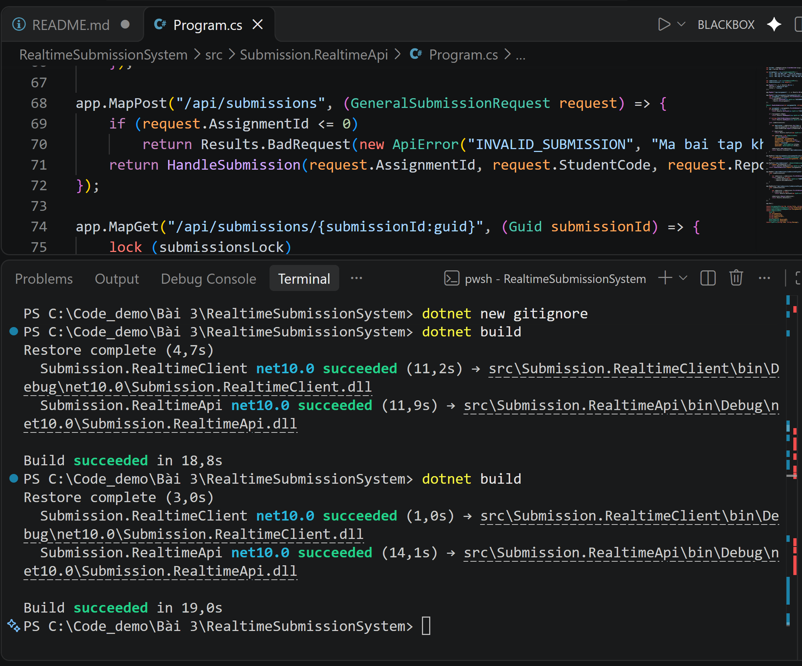

- Kế thừa các REST API quản lý bài tập và lượt nộp từ Bài 2.
- Bổ sung trường UpdatedAt để ghi nhận thời điểm cập nhật trạng thái.
- Sử dụng submissionsLock để đồng bộ thao tác đọc và ghi danh sách submissions.
## EduSubmit – Bước 3: Tạo SubmissionHub

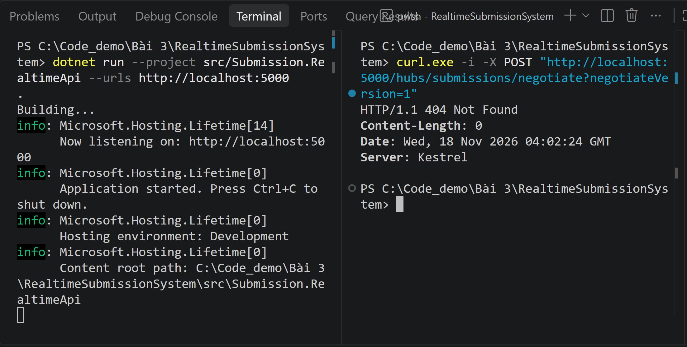

- Đăng ký SignalR bằng AddSignalR().
- Tạo SubmissionHub với đường dẫn /hubs/submissions.
- Tạo nhóm riêng submission:{id} cho từng lượt nộp.
- Kiểm tra negotiate và nhận connectionId.
## EduSubmit – Bước 4: Gửi bài nộp

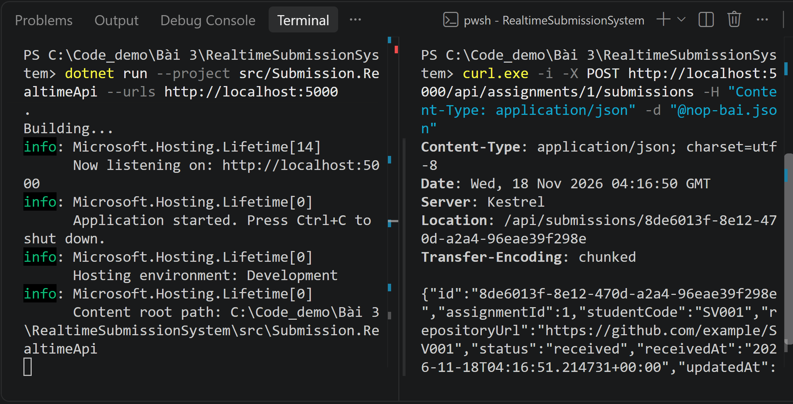

- Gửi bài nộp qua API.
- API trả về 201 Created và thông tin bài nộp.
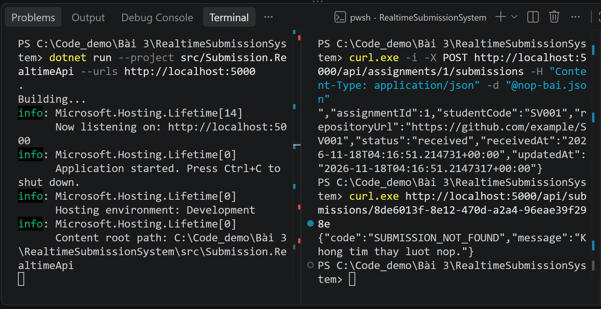

- Trạng thái bài nộp thay đổi lần lượt: received → processing → graded.
## EduSubmit – Bước 5: Tạo Realtime Client

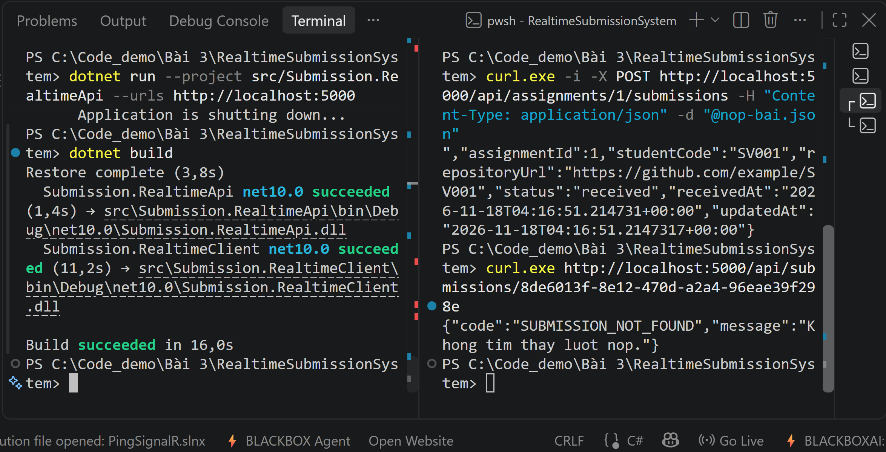

- Tạo Submission.RealtimeClient.
- Kết nối đến SubmissionHub bằng SignalR.
- Đăng ký nhận sự kiện SubmissionStatusChanged.
- Theo dõi bài nộp bằng WatchSubmission.
## EduSubmit – Bước 6: Kiểm tra thông báo Realtime

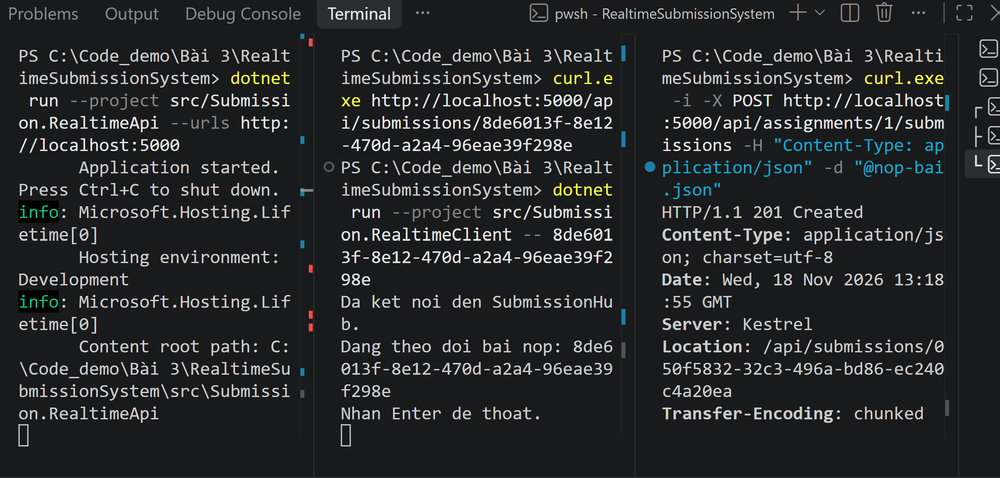

- Client kết nối thành công đến SubmissionHub.
- Nhận sự kiện SubmissionStatusChanged.
- Trạng thái bài nộp được cập nhật realtime: processing → graded.
@'

### Thí nghiệm 1: Hai máy khách cùng lúc

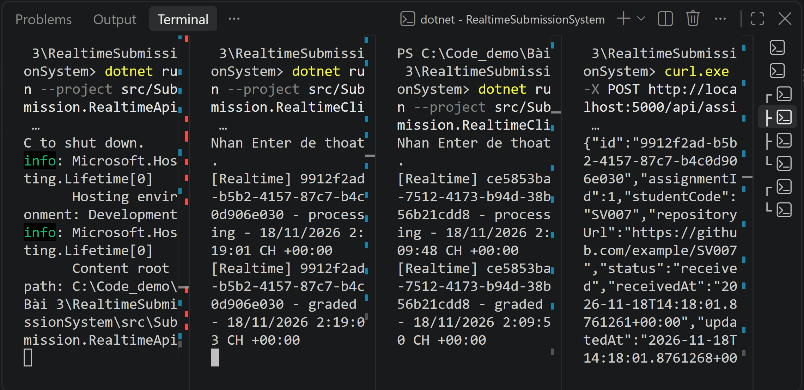

- Kết quả: Mỗi máy khách chỉ nhận thông báo trạng thái của lượt nộp mà mình đang theo dõi.
- Giải thích: SignalR sử dụng nhóm `submission:{id}` để tách biệt người nhận thông báo.
### Thí nghiệm 2: Máy chủ chưa chạy

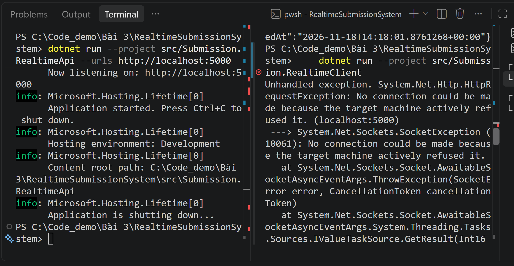

- Kết quả: HttpRequestException – Connection refused (localhost:5000).
- Giải thích: WithAutomaticReconnect chỉ hỗ trợ kết nối lại sau khi kết nối ban đầu đã thành công.
### Thí nghiệm 3: Sai đường dẫn Hub

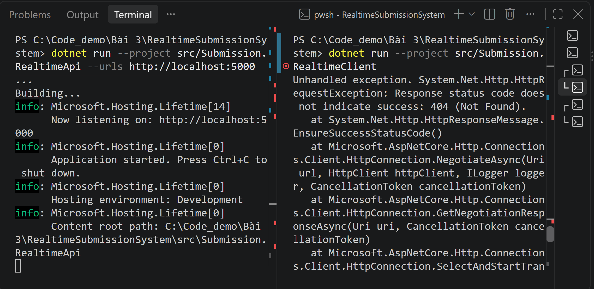

- Kết quả: HttpRequestException – 404 (Not Found).
- Giải thích: Đường dẫn WithUrl phải khớp với đường dẫn MapHub của máy chủ.
### Thí nghiệm 4: Sai tên sự kiện

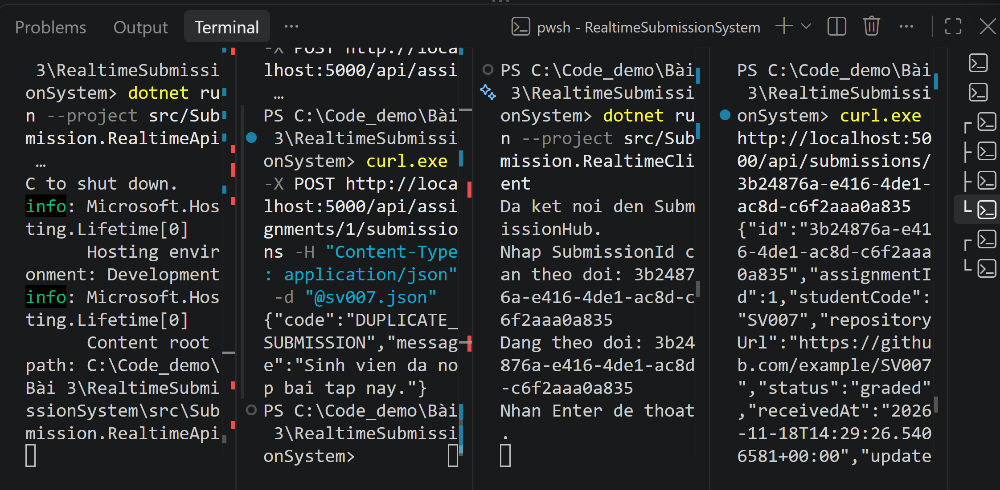

- Kết quả: Client không báo lỗi kết nối nhưng không nhận được thông báo Realtime.
- Giải thích: Tên sự kiện đăng ký ở Client phải khớp chính xác với tên sự kiện máy chủ gửi.
### Thí nghiệm 5: Gọi WatchSubmission muộn 4 giây

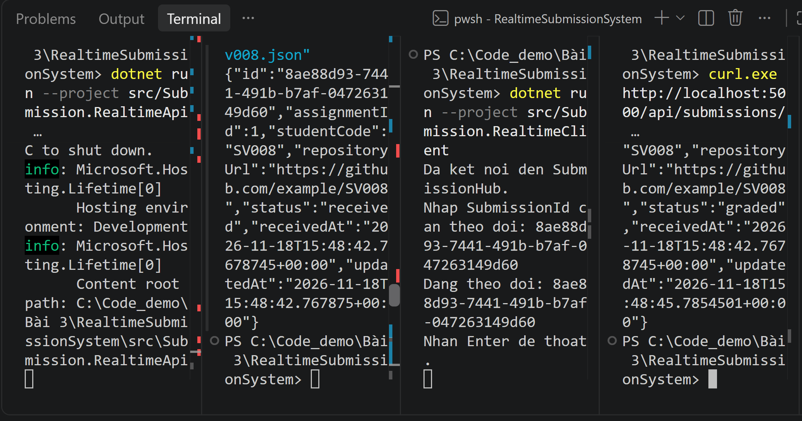

- Kết quả: Client không nhận được thông báo SignalR nhưng REST đọc lại được trạng thái graded.
- Giải thích: Client tham gia Group muộn nên bỏ lỡ các thông báo đã gửi. REST API vẫn cho phép đọc trạng thái mới nhất của bài nộp.