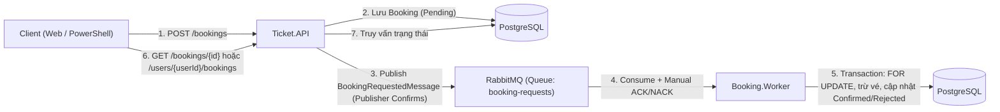

# HỆ THỐNG ĐẶT VÉ SỰ KIỆN PHÂN TÁN (EVENT BOOKING SYSTEM)

## Mục lục

1. [Giới thiệu đề tài](#1-giới-thiệu-đề-tài)
2. [Công nghệ sử dụng](#2-công-nghệ-sử-dụng)
3. [Kiến trúc hệ thống](#3-kiến-trúc-hệ-thống)
4. [Cấu trúc thư mục](#4-cấu-trúc-thư-mục)
5. [Hướng dẫn cài đặt và chạy dự án](#5-hướng-dẫn-cài-đặt-và-chạy-dự-án)
6. [Các API đã triển khai](#6-các-api-đã-triển-khai)
7. [Kết quả thực hiện Tuần 1](#7-kết-quả-thực-hiện-tuần-1)
8. [Kết quả thực hiện Tuần 2](#8-kết-quả-thực-hiện-tuần-2)
9. [Trạng thái hiện tại và hướng phát triển tiếp theo](#9-trạng-thái-hiện-tại-và-hướng-phát-triển-tiếp-theo)

---

## 1. Giới thiệu đề tài

**HỆ THỐNG ĐẶT VÉ SỰ KIỆN PHÂN TÁN (EVENT BOOKING SYSTEM)**

### Mô tả

Dự án xây dựng hệ thống đặt vé sự kiện theo kiến trúc phân tán. Hệ thống sử dụng ASP.NET Core Web API để tiếp nhận yêu cầu đặt vé, RabbitMQ để truyền thông điệp bất đồng bộ, Booking Worker để xử lý yêu cầu đặt vé và PostgreSQL để lưu trữ dữ liệu.

### Mục tiêu

* Hiển thị danh sách sự kiện và số vé còn lại.
* Tiếp nhận yêu cầu đặt vé.
* Lưu yêu cầu đặt vé với trạng thái `Pending`.
* Gửi yêu cầu xử lý qua RabbitMQ.
* Worker kiểm tra số lượng vé và xử lý xác nhận hoặc từ chối.
* Cập nhật trạng thái đặt vé và số vé còn lại.
* Tra cứu trạng thái đặt vé và danh sách đặt vé của người dùng.

---

## 2. Công nghệ sử dụng

| Thành phần | Công nghệ / Phiên bản thực tế trong dự án |
| :--- | :--- |
| Nền tảng | .NET 10 (`net10.0`) / ASP.NET Core |
| Web API | ASP.NET Core Web API (`Microsoft.AspNetCore.OpenApi` 10.0.14) |
| Web Client | ASP.NET Core MVC (`EventBooking.Web`) |
| Background Worker | .NET Worker Service (`Microsoft.Extensions.Hosting` 10.0.14) |
| Cơ sở dữ liệu | PostgreSQL (`postgres:16.8-alpine`) |
| ORM & Migration | Entity Framework Core (`10.0.4`) & Npgsql (`Npgsql.EntityFrameworkCore.PostgreSQL` `10.0.3`) |
| Message Broker | RabbitMQ (`rabbitmq:4-management`) |
| RabbitMQ Client | `RabbitMQ.Client` (`7.3.0`) |
| Hạ tầng container | Docker và Docker Compose |

---

## 3. Kiến trúc hệ thống

### Vai trò các project trong Solution `EventBooking.slnx`

* `EventBooking.Web`: Project giao diện ASP.NET Core MVC (đóng vai trò Client Web giao tiếp qua HTTP với `Ticket.API`).
* `Ticket.API`: Tiếp nhận và xử lý các yêu cầu API, lưu booking ban đầu với trạng thái `Pending` vào PostgreSQL và gửi thông điệp đặt vé vào RabbitMQ.
* `Booking.Worker`: Nhận message từ hàng đợi RabbitMQ và xử lý nghiệp vụ đặt vé bất đồng bộ trên PostgreSQL.
* `EventBooking.Infrastructure`: Chứa `AppDbContext`, các entity (`UserEntity`, `EventEntity`, `BookingEntity`), migration, cấu hình và các thành phần kết nối RabbitMQ dùng chung (`RabbitMqOptions`, `BookingRequestedMessage`, `IRabbitMqConnectionProvider`, `IBookingMessagePublisher`).

### Luồng xử lý phân tán



---

## 4. Cấu trúc thư mục

Cấu trúc thực tế tại `C:\Dự_án\EventBookingSystem`:

```text
EventBookingSystem/
├── docker-compose.yml
├── EventBooking.slnx
├── README.md
└── src/
    ├── Booking.Worker/
    │   ├── Properties/
    │   │   └── launchSettings.json
    │   ├── Services/
    │   │   ├── BookingProcessor.cs
    │   │   └── IBookingProcessor.cs
    │   ├── appsettings.Development.json
    │   ├── appsettings.json
    │   ├── Booking.Worker.csproj
    │   ├── Program.cs
    │   └── Worker.cs
    ├── EventBooking.Infrastructure/
    │   ├── Data/
    │   │   ├── Migrations/
    │   │   │   ├── 20261117032630_InitialCreate.cs
    │   │   │   ├── 20261117032630_InitialCreate.Designer.cs
    │   │   │   └── AppDbContextModelSnapshot.cs
    │   │   └── AppDbContext.cs
    │   ├── Entities/
    │   │   ├── BookingEntity.cs
    │   │   ├── EventEntity.cs
    │   │   └── UserEntity.cs
    │   ├── Messaging/
    │   │   ├── BookingPublishResult.cs
    │   │   ├── BookingRequestedMessage.cs
    │   │   ├── IBookingMessagePublisher.cs
    │   │   ├── IRabbitMqConnectionProvider.cs
    │   │   ├── RabbitMqBookingMessagePublisher.cs
    │   │   ├── RabbitMqConnectionProvider.cs
    │   │   └── RabbitMqOptions.cs
    │   ├── Class1.cs
    │   └── EventBooking.Infrastructure.csproj
    ├── EventBooking.Web/
    │   ├── Controllers/
    │   │   └── HomeController.cs
    │   ├── Models/
    │   │   └── ErrorViewModel.cs
    │   ├── Properties/
    │   │   └── launchSettings.json
    │   ├── Views/
    │   │   ├── Home/
    │   │   │   ├── Index.cshtml
    │   │   │   └── Privacy.cshtml
    │   │   ├── Shared/
    │   │   │   ├── _Layout.cshtml
    │   │   │   ├── _Layout.cshtml.css
    │   │   │   ├── _ValidationScriptsPartial.cshtml
    │   │   │   └── Error.cshtml
    │   │   ├── _ViewImports.cshtml
    │   │   └── _ViewStart.cshtml
    │   ├── wwwroot/
    │   ├── appsettings.Development.json
    │   ├── appsettings.json
    │   ├── EventBooking.Web.csproj
    │   └── Program.cs
    └── Ticket.API/
        ├── Controllers/
        │   ├── BookingsController.cs
        │   ├── EventsController.cs
        │   ├── UsersController.cs
        │   └── WeatherForecastController.cs
        ├── DTOs/
        │   ├── Bookings/
        │   │   ├── BookingResponseDto.cs
        │   │   └── CreateBookingRequestDto.cs
        │   ├── Events/
        │   │   └── EventResponseDto.cs
        │   └── Users/
        │       ├── UserBookingResponseDto.cs
        │       └── UserSummaryDto.cs
        ├── Properties/
        │   └── launchSettings.json
        ├── appsettings.Development.json
        ├── appsettings.json
        ├── Program.cs
        ├── Ticket.API.csproj
        ├── Ticket.API.http
        └── WeatherForecast.cs
```

---

## 5. Hướng dẫn cài đặt và chạy dự án

### Bước 1: Kiểm tra môi trường

Đảm bảo máy đã cài đặt:
* **.NET SDK 10** (hệ thống hiện tại sử dụng `10.0.403`).
* **Docker Desktop** và **Docker Compose**.

Kiểm tra nhanh trên PowerShell:

```powershell
dotnet --version
docker --version
docker compose version
```

### Bước 2: Khởi động PostgreSQL và RabbitMQ

Chạy Docker Compose tại thư mục gốc của dự án:

```powershell
cd "C:\Dự_án\EventBookingSystem"
docker compose up -d
docker compose ps
```

Các cổng (port) ánh xạ ra máy host theo [docker-compose.yml](docker-compose.yml):
* **PostgreSQL** (container `eventbooking_postgres`, database `event_booking`): cổng host **`15433`** (ánh xạ tới cổng `5432` trong container).
* **RabbitMQ AMQP** (container `eventbooking_rabbitmq`): cổng host **`5673`** (ánh xạ tới cổng `5672` trong container).
* **RabbitMQ Management UI**: truy cập tại `http://localhost:15673` (ánh xạ tới cổng `15672` trong container).

*(Lưu ý: các cổng `15433`, `5673`, `15673` được chọn để tránh trùng với các dịch vụ khác trên cùng máy).*

### Bước 3: Cấu hình Connection String và User Secrets

Cả `Ticket.API` và `Booking.Worker` đều đọc chuỗi kết nối `ConnectionStrings:DefaultConnection` từ cấu hình (trong môi trường `Development` được lưu bằng **User Secrets** của từng project) và cấu hình `RabbitMq` trong `appsettings.json` / `appsettings.Development.json`:

* **Ticket.API** (`UserSecretsId`: `8fdd7c70-993c-4a28-87f8-1503534f0a0a`)
* **Booking.Worker** (`UserSecretsId`: `dotnet-Booking.Worker-189d3452-d021-4c30-9685-7c6c58f25316`)

Nếu thiết lập trên máy mới, cấu hình User Secrets cho hai project bằng lệnh sau (thay `<user>` và `<password>` theo cấu hình PostgreSQL cục bộ của bạn):

```powershell
cd "C:\Dự_án\EventBookingSystem"

dotnet user-secrets set "ConnectionStrings:DefaultConnection" "Host=localhost;Port=15433;Database=event_booking;Username=<user>;Password=<password>" --project .\src\Ticket.API\Ticket.API.csproj

dotnet user-secrets set "ConnectionStrings:DefaultConnection" "Host=localhost;Port=15433;Database=event_booking;Username=<user>;Password=<password>" --project .\src\Booking.Worker\Booking.Worker.csproj
```

Cấu hình `RabbitMq` mặc định trong `appsettings.json` và `appsettings.Development.json` của `Ticket.API` và `Booking.Worker`:
* `HostName`: `localhost`
* `Port`: `5673`
* `VirtualHost`: `/`
* `BookingQueueName`: `booking-requests`

*(Nếu thay đổi thông tin xác thực RabbitMQ trên môi trường riêng, hãy cập nhật tương ứng qua User Secrets hoặc biến môi trường thay vì lưu thông tin nhạy cảm vào mã nguồn).*

### Bước 4: Chạy Ticket API

Mở cửa sổ PowerShell thứ nhất và chạy:

```powershell
cd "C:\Dự_án\EventBookingSystem"
dotnet run --project .\src\Ticket.API\Ticket.API.csproj
```

Theo `Properties\launchSettings.json`, profile mặc định `http` lắng nghe tại:
* **`http://localhost:5175`** (địa chỉ đã kiểm thử).
* Profile `https` (nếu chạy bằng `--launch-profile https`) lắng nghe tại `https://localhost:7075` và `http://localhost:5175`.

### Bước 5: Chạy Booking Worker

Mở **một cửa sổ PowerShell khác** (chạy tách biệt với cửa sổ của `Ticket.API`) và thực thi:

```powershell
cd "C:\Dự_án\EventBookingSystem"
dotnet run --project .\src\Booking.Worker\Booking.Worker.csproj
```

> **Lưu ý:** Phải chạy `Ticket.API` và `Booking.Worker` ở hai cửa sổ PowerShell riêng biệt để cả hai tiến trình cùng hoạt động song song.

### Bước 6: Kiểm tra RabbitMQ Management UI và các API endpoint

1. Mở trình duyệt truy cập RabbitMQ Management UI tại `http://localhost:15673` để quan sát queue `booking-requests` (trạng thái `running`, số lượng consumer và số lượng message `Ready` / `Unacked` / `Total`).
2. Kiểm thử các endpoint của `Ticket.API` trên PowerShell:

```powershell
# Lấy danh sách sự kiện
Invoke-RestMethod -Uri "http://localhost:5175/events" -Method Get

# Lấy chi tiết sự kiện ID = 1
Invoke-RestMethod -Uri "http://localhost:5175/events/1" -Method Get

# Lấy danh sách người dùng
Invoke-RestMethod -Uri "http://localhost:5175/users" -Method Get

# Tạo yêu cầu đặt vé mới (gửi kèm Idempotency-Key tùy chọn)
$body = @{ userId = 1; eventId = 1; quantity = 2 } | ConvertTo-Json
$booking = Invoke-RestMethod -Uri "http://localhost:5175/bookings" -Method Post -ContentType "application/json" -Headers @{ "Idempotency-Key" = [guid]::NewGuid().ToString() } -Body $body
$booking

# Tra cứu trạng thái booking vừa tạo
Invoke-RestMethod -Uri "http://localhost:5175/bookings/$($booking.id)" -Method Get

# Tra cứu danh sách booking của người dùng ID = 1
Invoke-RestMethod -Uri "http://localhost:5175/users/1/bookings" -Method Get
```

> **Lưu ý về `EventBooking.Web`:** Project `EventBooking.Web` hiện mới là khung ASP.NET Core MVC mặc định (lắng nghe tại `http://localhost:5147` / `https://localhost:7070` theo `launchSettings.json`) và chưa được triển khai phần gọi API hay giao diện đặt vé. Có thể chạy thử khung web bằng lệnh `dotnet run --project .\src\EventBooking.Web\EventBooking.Web.csproj`, nhưng luồng nghiệp vụ chính hiện đang kiểm thử thông qua `Ticket.API` và `Booking.Worker`.

---

## 6. Các API đã triển khai

### API cốt lõi

| Phương thức | Đường dẫn | Controller | Chức năng |
| :--- | :--- | :--- | :--- |
| `GET` | `/events` | `EventsController` | Lấy danh sách toàn bộ sự kiện kèm số vé còn lại |
| `GET` | `/events/{id}` | `EventsController` | Lấy thông tin chi tiết một sự kiện theo `id` |
| `POST` | `/bookings` | `BookingsController` | Tạo yêu cầu đặt vé (`Pending`) vào PostgreSQL và publish `BookingRequestedMessage` lên RabbitMQ |
| `GET` | `/bookings/{id}` | `BookingsController` | Tra cứu thông tin và trạng thái một booking theo `id` |
| `GET` | `/users` | `UsersController` | Lấy danh sách người dùng (`Id`, `FullName`, `Email`) |
| `GET` | `/users/{userId}/bookings` | `UsersController` | Lấy danh sách booking của người dùng theo `userId` (kèm `EventName`) |

### Chức năng bổ sung đã triển khai trong `BookingsController`

* **Header `Idempotency-Key` trên `POST /bookings`:** Khi client truyền header `Idempotency-Key`, API lưu ánh xạ tạm thời bằng `IMemoryCache` để tránh tạo bản ghi booking trùng nếu cùng một yêu cầu được gửi lại (tái sử dụng `BookingId` đã tạo khi publish lại hoặc trả về kết quả hiện tại nếu đã xử lý).
* **`POST /bookings/{id}/republish`:** Cho phép gửi lại `BookingRequestedMessage` lên RabbitMQ đối với một booking đang ở trạng thái `Pending` mà không tạo booking mới (trả về `409 Conflict` nếu booking đã sang `Confirmed` hoặc `Rejected`).

---

## 7. Kết quả thực hiện Tuần 1

Các công việc đã hoàn thành trong giai đoạn đầu:

* Khởi tạo solution `EventBooking.slnx` và 4 project (`EventBooking.Web`, `Ticket.API`, `Booking.Worker`, `EventBooking.Infrastructure`).
* Xây dựng cấu trúc dự án phân tán và thiết lập quan hệ tham chiếu giữa `Ticket.API`, `Booking.Worker` với `EventBooking.Infrastructure`.
* Thiết lập `docker-compose.yml` cho PostgreSQL (`15433`) và RabbitMQ (`5673` / `15673`).
* Khởi chạy thành công các container `eventbooking_postgres` và `eventbooking_rabbitmq`.
* Cấu hình Entity Framework Core và Npgsql (`Npgsql.EntityFrameworkCore.PostgreSQL`).
* Xây dựng các entity `UserEntity`, `EventEntity`, `BookingEntity`.
* Tạo `AppDbContext` với cấu hình quan hệ và ràng buộc dữ liệu.
* Tạo và áp dụng migration `InitialCreate` (`20261117032630_InitialCreate`).
* Tạo các bảng dữ liệu trong PostgreSQL.
* Kiểm tra kết nối cơ sở dữ liệu từ `Ticket.API` và `Booking.Worker`.

**Kết quả kiểm tra cơ sở dữ liệu:** Database `event_booking` đã có đầy đủ các bảng `Users`, `Events`, `Bookings` và `__EFMigrationsHistory`.

---

## 8. Kết quả thực hiện Tuần 2

### 8.1. Ticket API

* Triển khai API lấy danh sách sự kiện (`GET /events`).
* Triển khai API chi tiết sự kiện (`GET /events/{id}`).
* Triển khai API tạo booking (`POST /bookings`) với trạng thái `Pending`.
* Triển khai API tra cứu booking (`GET /bookings/{id}`).
* Triển khai API danh sách người dùng (`GET /users`) và tra cứu booking theo người dùng (`GET /users/{userId}/bookings`).

### 8.2. RabbitMQ Publisher

* Cấu hình kết nối RabbitMQ dùng chung qua `IRabbitMqConnectionProvider` và `RabbitMqOptions`.
* Khai báo tự động queue bền vững `booking-requests` (`durable: true`).
* `Ticket.API` gửi thông điệp `BookingRequestedMessage` vào queue `booking-requests`.
* Sử dụng **Publisher Confirms** của `RabbitMQ.Client` 7.3.0 (`PublisherConfirmationsEnabled = true`, `PublisherConfirmationTrackingEnabled = true`), cờ `mandatory: true`, `DeliveryModes.Persistent` và khóa đồng bộ channel qua `SemaphoreSlim`.
* Xử lý rõ các tình huống gửi thất bại, unroutable (`basic.return`), timeout hoặc kết quả chưa xác nhận (trả về `503 Service Unavailable`, không tự xóa booking `Pending`).

### 8.3. Booking Worker

* Xây dựng Worker nhận message bất đồng bộ bằng `AsyncEventingBasicConsumer` với `prefetchCount = 1`.
* Sử dụng manual ACK/NACK (`autoAck: false`).
* Tạo DI scope (`IServiceScopeFactory`) cho từng message khi sử dụng `AppDbContext`.
* Kiểm tra trạng thái booking trong transaction bằng `SELECT ... FOR UPDATE`, lấy `EventId` và `Quantity` từ `BookingEntity` trong PostgreSQL làm nguồn dữ liệu chuẩn.
* Kiểm tra số lượng vé còn lại và trừ vé nguyên tử bằng `ExecuteUpdateAsync` (`AvailableTickets >= Quantity`) để tránh bán vượt số vé khi có nhiều yêu cầu đồng thời.
* Cập nhật trạng thái booking thành `Confirmed` hoặc `Rejected`, chỉ ACK sau khi PostgreSQL transaction commit thành công.
* Xử lý message trùng (idempotent): nếu booking đã `Confirmed` hoặc `Rejected`, bỏ qua và ACK mà không trừ vé lần thứ hai.
* Phân loại ngoại lệ (lỗi tạm thời requeue có độ trễ, lỗi dữ liệu không hợp lệ `requeue: false`), xử lý đóng/lỗi channel an toàn và tự động reconnect RabbitMQ.

### 8.4. Kết quả kiểm thử thực tế (ngày 28/11/2026)

* API lấy danh sách sự kiện (`GET /events`) hoạt động thành công.
* API lấy danh sách người dùng (`GET /users`) hoạt động thành công.
* API tạo booking tạo **Booking ID = 2** với trạng thái `Pending`.
* Message được gửi thành công vào queue `booking-requests`.
* Worker nhận và xử lý message thành công.
* **Booking ID = 2** chuyển từ `Pending` sang `Confirmed`.
* Sự kiện **ID = 1** ban đầu có `500` vé; người dùng đặt `2` vé; sau khi Worker xử lý, số vé còn lại là **`498`**.
* Khi Worker nhận message trùng của **Booking ID = 2**, Worker nhận diện trạng thái `Confirmed` và bỏ qua, không trừ vé lần thứ hai.
* API truy vấn booking (`GET /bookings/2`) trả về trạng thái `Confirmed`.
* API truy vấn danh sách booking của **User ID = 1** (`GET /users/1/bookings`) hoạt động thành công.
* RabbitMQ Management UI hiển thị queue `booking-requests` ở trạng thái `running`, `Ready = 0`, `Unacked = 0`, `Total = 0` sau khi xử lý.
* Toàn bộ solution build thành công với **0 Warning** và **0 Error**.

> **Ghi chú dữ liệu kiểm thử:** **Booking ID = 1** trong dữ liệu kiểm thử vẫn đang ở trạng thái `Pending` (chưa được Worker xử lý).

---

## 9. Trạng thái hiện tại và hướng phát triển tiếp theo

* Các thành phần cốt lõi của luồng đặt vé bất đồng bộ (`Ticket.API` $\rightarrow$ `RabbitMQ` $\rightarrow$ `Booking.Worker` $\rightarrow$ `PostgreSQL`) đã được triển khai và kiểm thử thành công.
* Có thể tiếp tục kiểm thử bổ sung các kịch bản: đặt vé khi hết vé / vượt số vé còn lại (`Rejected`), dữ liệu đầu vào không hợp lệ, lỗi kết nối hạ tầng (PostgreSQL/RabbitMQ tạm gián đoạn) và tải đặt vé đồng thời.
* Tiếp tục hoàn thiện giao diện ASP.NET Core MVC trong project `EventBooking.Web` (kết nối `HttpClient` tới `Ticket.API`, danh sách sự kiện, chọn người dùng có sẵn để đặt vé và theo dõi trạng thái xử lý vé) theo kế hoạch phát triển tiếp theo.
