

Bước 1: Cài đặt .NET 10 SDK.

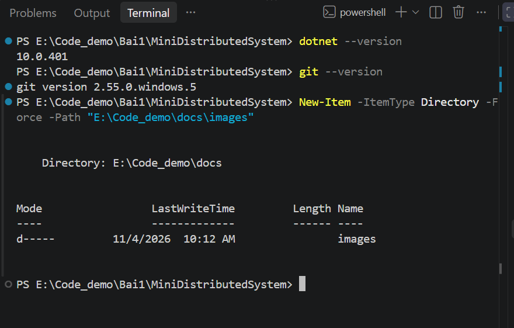

Bước 2: Cài đặt Visual Studio Code và
các tiện ích hỗ trợ

Mục đích: Thiết lập môi trường
lập trình C# và ASP.NET Core bằng Visual
Studio Code.

Thực hiện: Kiểm tra các tiện
ích C# Dev Kit, C#, .NET Install Tool và REST Client trong Visual
Studio Code.

Kết quả: Các tiện ích đã được
cài đặt thành công và
sẵn sàng phục vụ quá trình xây
dựng, chạy và kiểm thử
ứng dụng.

Hình 2.1: Các tiện ích hỗ trợ lập trình C# và kiểm thử
API trong Visual Studio Code.

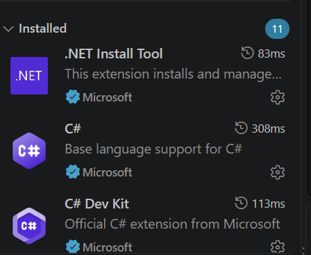

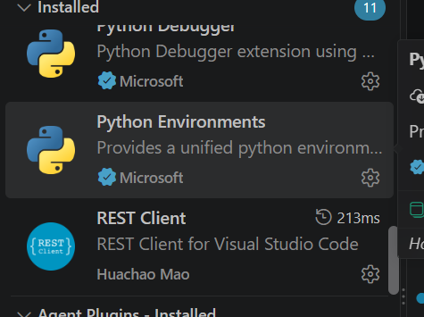

Bước 3: Cài đặt và cấu hình Git

Mục đích: Sử dụng Git để quản lý phiên
bản mã nguồn, lưu lịch sử thay đổi và chuẩn bị đưa dự án lên
GitHub.

Thực hiện: Kiểm tra Git đã được cài đặt trên máy tính bằng
lệnh git --version.

Kết quả: Git đã được cài đặt thành công, phiên bản
2.55.0.windows.5, đáp ứng yêu cầu
quản lý mã nguồn của bài thực
hành.

Hình 3.1: Kết quả kiểm tra phiên bản Git trên Terminal của VS Code.

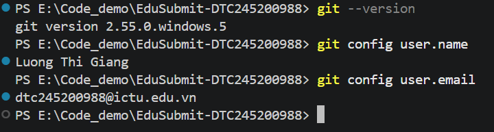

Bước 4: Kiểm tra môi trường lập trình .NET

Mục đích: Kiểm tra khả năng
tạo, biên dịch và chạy
chương trình C# bằng .NET SDK.

Thực hiện: Sử dụng lệnh dotnet new
console -n HelloPtudpt để
tạo ứng dụng Console và lệnh dotnet run để
chạy chương
trình.

Kết quả: Chương trình chạy thành công và
hiển thị dòng chữ Hello, World! trên Terminal.

Hình 4.1: Kết quả chạy chương trình HelloPtudpt bằng .NET SDK.

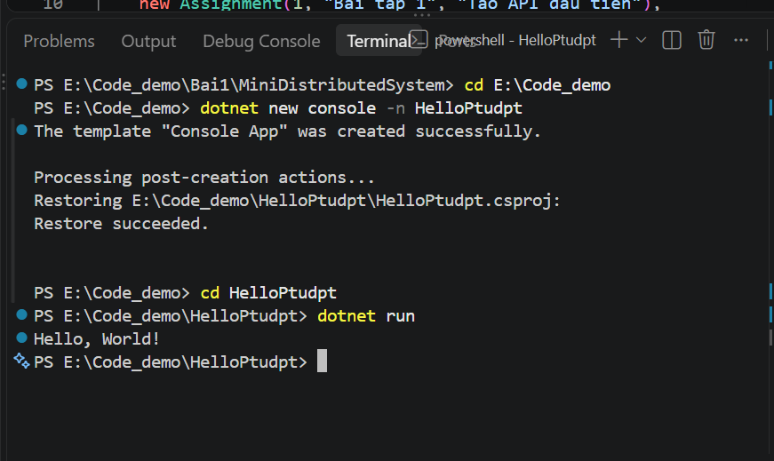

Bước 5–6: Chuẩn bị và kiểm tra
mã nguồn mẫu

Mục đích: Chuẩn bị các dự
án mẫu phục vụ thực hành mô hình trao
đổi thông điệp và giao tiếp giữa các ứng dụng phân tán.

Thực hiện: Sao chép và giải nén
mã nguồn mẫu được giảng viên cung cấp vào thư mục
E:\Code_demo\Bai1.

Các dự án gồm:

MepDemo: Minh họa
các mô hình trao đổi thông điệp (MEP).
BasicWebApi: Thực
hành xây dựng và kiểm thử REST
API.
MiniDistributedSystem: Minh họa giao tiếp giữa ứng dụng Client và Server.

Kết quả: Đã chuẩn bị đầy đủ ba dự án
mẫu trong thư mục thực hành, sẵn sàng cho các bước
chạy và kiểm thử tiếp theo.

Hình 5.1: Cấu trúc thư mục chứa ba dự
án mẫu của Bài 1.

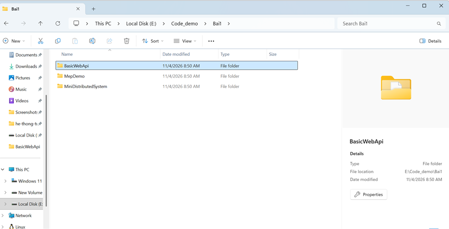

Bước 7: Thực hành các mô hình
trao đổi thông điệp (MEP)

Mục đích: Tìm hiểu cách các thành phần
trong hệ thống phân tán trao đổi
thông điệp thông qua các mô
hình MEP.

Thực hiện: Sử dụng dự án MepDemo do giảng
viên cung cấp, chạy chương trình bằng lệnh dotnet run và các lệnh
dotnet run -- 1, dotnet run -- 3, dotnet run -- 4.

Các mô hình
trao đổi thông điệp:

Request–Response:
Client gửi yêu cầu và nhận phản hồi từ Server.
One-Way:
Bên gửi truyền thông điệp mà không yêu cầu phản hồi.
Publish–Subscribe:
Một thông điệp được
phát đến nhiều thành phần đã đăng ký nhận.
Message
Queue: Thông điệp được đưa
vào hàng đợi để
một Worker tiếp
nhận và xử lý.
Streaming:
Dữ liệu được truyền
liên tục thành nhiều phần thay vì một lần duy nhất.

Nhận xét:

Với Message Queue, mỗi
thông điệp được một
Worker trong nhóm tiếp nhận và xử lý.
Với Publish–Subscribe, một
sự kiện có thể được gửi
đến nhiều
dịch vụ đăng ký nhận; trong chương trình mẫu có ba dịch vụ nhận sự kiện.

Kết quả: Đã chạy và quan
sát được cách trao đổi
thông điệp giữa các thành phần trong các mô
hình MEP.

Hình 7.1: Kết quả chạy toàn bộ mô hình
MEP.

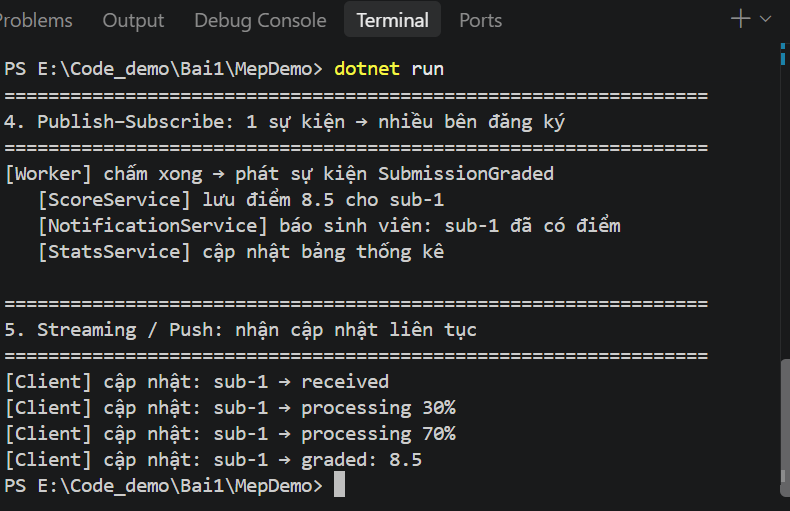

Hình 7.2: Kết quả chạy mô hình
số 1.

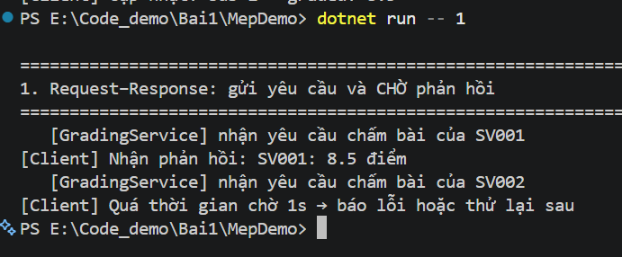

Hình 7.3: Kết quả chạy mô hình
số 3.

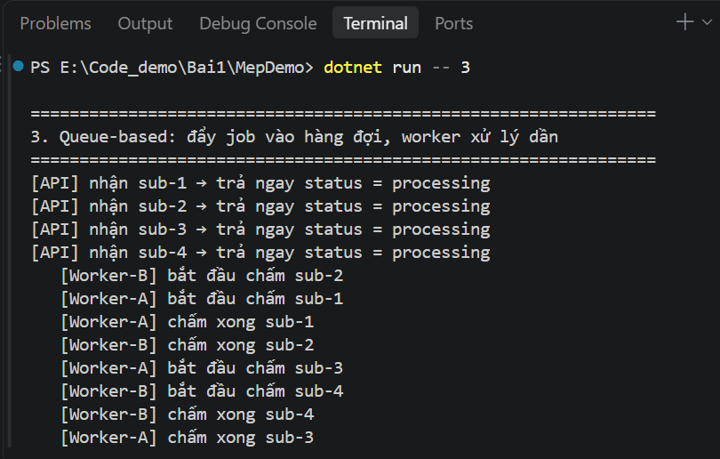

Hình 7.4: Kết quả chạy mô hình
số 4.

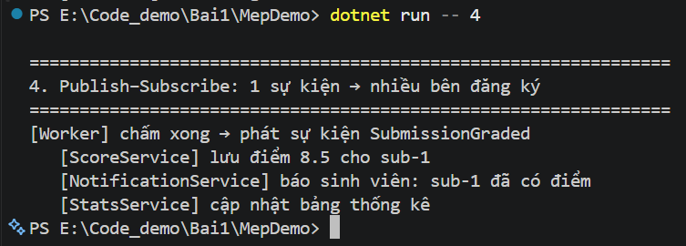

Bước 8: Xây dựng và kiểm thử
BasicWebApi

Mục đích: Tìm hiểu cách xây dựng REST API bằng ASP.NET Core và kiểm thử các phương thức HTTP.

Thực hiện: Khởi chạy dự án BasicWebApi trên địa chỉ http://localhost:5081 bằng
lệnh dotnet run.

Kết quả: API khởi động thành công và sẵn
sàng tiếp nhận yêu cầu HTTP.

Hình 8.1: Kết quả khởi động BasicWebApi trên cổng 5081.

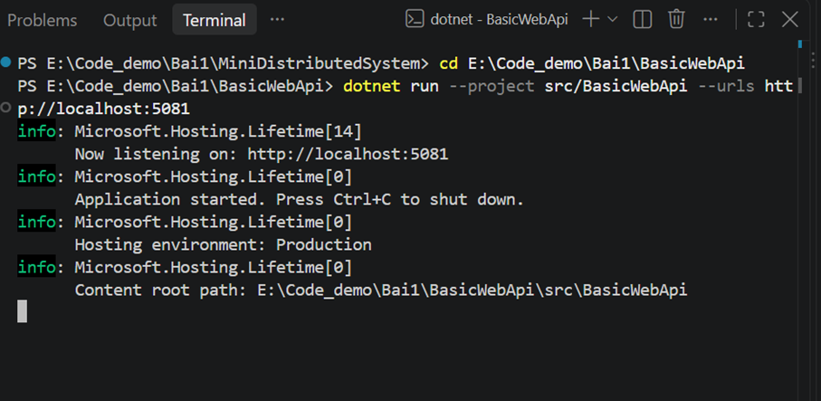

Kiểm thử API bằng REST
Client

Trường hợp 1:
HTTP 200 OK

Thực hiện
gửi yêu cầu GET đến API để lấy lời chào theo tên và
ngôn ngữ. Máy chủ xử
lý thành công và trả
về trạng thái HTTP 200 OK.

Hình 8.2: Kết quả kiểm thử yêu cầu GET với trạng thái HTTP 200 OK.

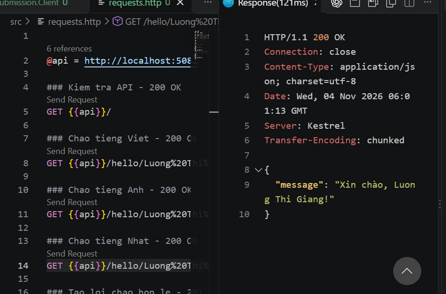

Trường hợp 2:
HTTP 201 Created

Thực hiện
gửi yêu cầu POST đến API
/greetings với tên hợp lệ "Nguyen Thi Hong Nhung". Máy chủ tạo tài nguyên lời
chào mới và trả về
trạng thái HTTP 201
Created.

Kết quả: API xử lý thành công
yêu cầu tạo mới, đồng thời trả về thông tin tài nguyên
đã được
tạo.

Hình 8.3: Kết quả kiểm thử yêu cầu POST với trạng thái HTTP 201 Created.

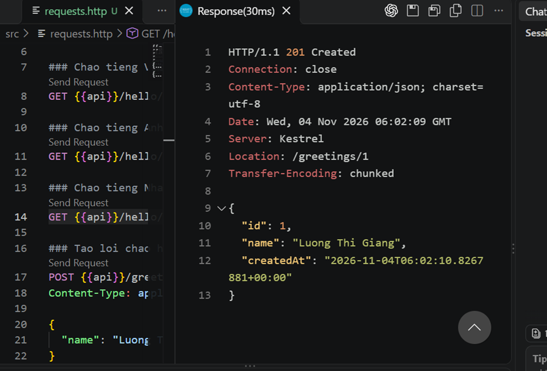

Trường hợp 3:
HTTP 400 Bad Request

Thực hiện
gửi yêu cầu POST đến API
/greetings với trường
name là chuỗi rỗng.

Kết quả: Máy chủ từ chối dữ liệu không hợp lệ và trả về
trạng thái HTTP 400
Bad Request. Điều này
cho thấy API đã thực hiện kiểm tra dữ liệu
đầu vào.

Hình 8.4: Kết quả kiểm thử yêu cầu POST với tên rỗng,
trả về HTTP 400
Bad Request.

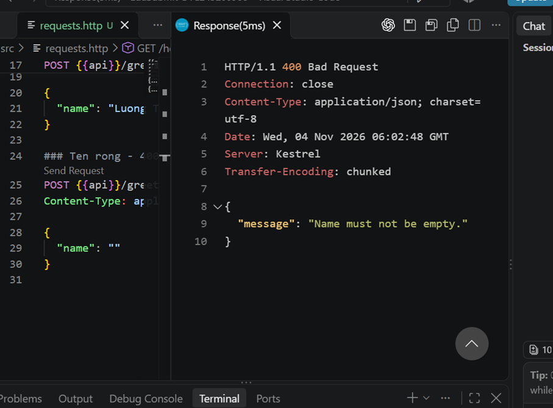

Trả lời câu hỏi
thực hành BasicWebApi

Câu 1: Vì sao builder.Services.AddSingleton() phải
đặt trước
builder.Build()?

Vì các dịch vụ cần được đăng ký vào hệ thống
Dependency Injection trước khi ứng dụng
được xây dựng.

Câu 2: Tham số name và language được lấy từ đâu?

name được lấy từ đường dẫn
URL (Route), còn language được
lấy từ chuỗi truy vấn (Query String).

Câu 3: Vì sao POST trả
về HTTP 201 Created thay
vì HTTP 200 OK?

Vì yêu cầu POST đã tạo thành công một tài nguyên mới,
nên máy chủ
trả về HTTP 201
Created.

Bước 9: Thực hành hệ thống phân tán MiniDistributedSystem

Mục đích: Tìm hiểu cơ chế giao tiếp giữa Client và Server thông qua giao thức HTTP và REST API.

Thực hiện: Sử dụng dự án MiniDistributedSystem do giảng viên cung cấp. Khởi động Submission.Api trên địa chỉ
http://localhost:5000 để tiếp nhận và xử lý
các yêu cầu
từ Client.

Kết quả: Server khởi động thành công và sẵn
sàng tiếp nhận yêu cầu HTTP.

Hình 9.1: Kết quả khởi động Submission.Api trên cổng 5000.

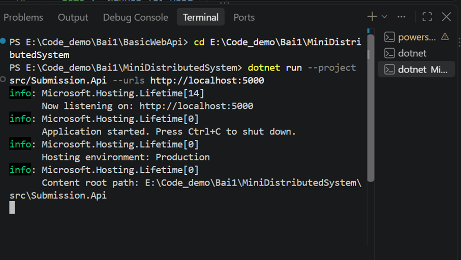

Bước 9.2: Chạy Client kết nối với Server

Mục đích: Kiểm tra khả năng
giao tiếp giữa hai ứng dụng độc lập thông qua HTTP.

Thực hiện: Chạy Submission.Client và truyền địa chỉ http://localhost:5000 để
Client kết nối đến Submission.Api.

Kết quả: Client gửi yêu cầu đến
Server, nhận danh sách bài tập
và thực hiện nộp bài thành công.
Server trả về mã lượt nộp và trạng
thái received.

Hình 9.2: Kết quả Client lấy danh sách bài tập
và nộp bài thành công
thông qua REST API.

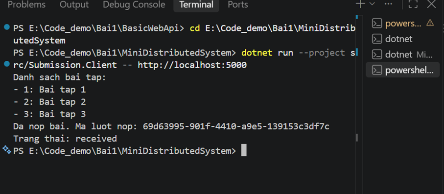

Bước 9.3: Kiểm thử MiniDistributedSystem bằng
REST Client

Mục đích: Kiểm tra khả năng
xử lý yêu cầu HTTP và xác thực
dữ liệu đầu vào của Submission.Api.

Thực hiện: Sử dụng REST Client gửi các yêu cầu
GET và POST đến
API tại địa
chỉ http://localhost:5000.

Các trường hợp kiểm thử:

GET
/api/assignments: Lấy
danh sách bài tập, trả về HTTP 200
OK.
POST
/api/submissions với
dữ liệu hợp lệ: Nộp bài thành công, trả về HTTP 201
Created.
POST
/api/submissions với
studentCode rỗng:
Máy chủ từ chối yêu cầu, trả về HTTP 400
Bad Request.

Kết quả: API xử lý đúng các
trường hợp
lấy dữ liệu, tạo lượt nộp và kiểm tra
thông tin sinh viên.

Hình 9.3: Kết quả lấy danh sách bài tập
– HTTP 200 OK.

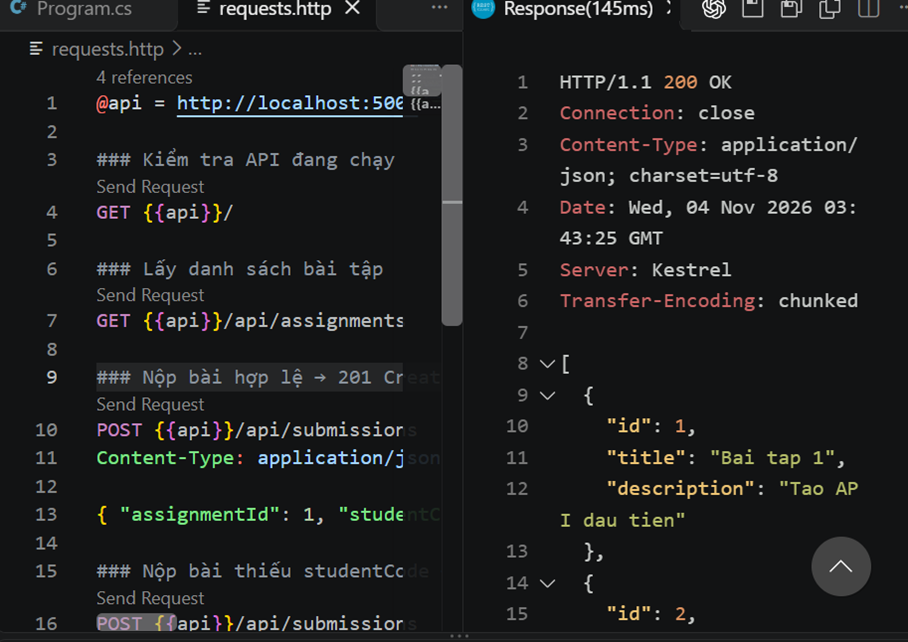

Hình 9.4: Kết quả nộp bài hợp
lệ – HTTP 201 Created.

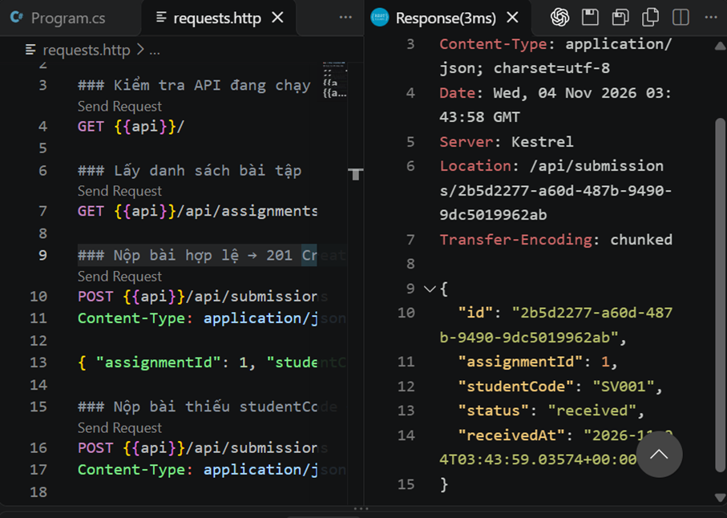

Hình 9.5: Kết quả nộp bài thiếu
mã sinh viên
– HTTP 400 Bad Request.

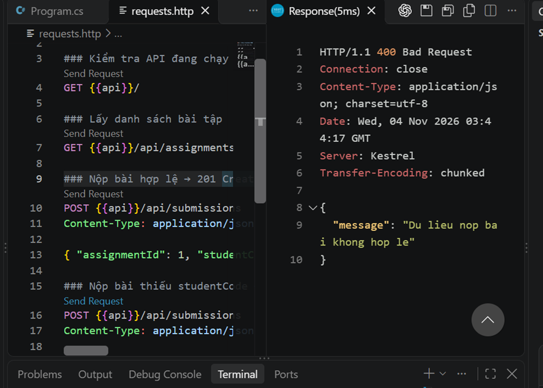

Bước 9.4: Trả lời câu hỏi

Câu 1: API sử dụng những endpoint, phương
thức HTTP và mã trạng thái nào?

API sử dụng
GET /, GET /api/assignments để
kiểm tra và lấy dữ
liệu; POST /api/submissions
để nộp bài. Các mã trạng
thái chính là 200 OK, 201 Created và 400 Bad
Request.

Câu 2: Client có cần dùng
chung mã nguồn với API không?

Không. Client và
API có thể hoạt động độc lập, giao tiếp với nhau thông qua HTTP và dữ liệu JSON theo giao diện
API đã thống nhất.

Câu 3: Vì sao địa
chỉ Server được
truyền qua tham số khi chạy
Client?

Để dễ
thay đổi địa chỉ Server khi triển khai ở các môi trường khác nhau mà
không cần sửa mã nguồn
Client.

Bước 10a: Thí nghiệm thêm bài tập
mới vào Server

Mục đích: Kiểm tra khả năng
cập nhật dữ liệu trên Server mà không cần sửa mã nguồn
Client.

Dự đoán: Khi thêm bài tập số
3 vào danh sách trên Server, Client sẽ tự động nhận được danh sách gồm 3 bài tập.

Thực hiện: Chỉnh sửa file Program.cs của Submission.Api để bổ sung bài tập số
3, sau đó khởi động lại Server và chạy Client.

Kết quả thực tế: Client hiển thị đầy đủ 3 bài tập: Bài tập 1, Bài tập 2 và Bài tập 3. Chức năng nộp bài vẫn
hoạt động và trả về
trạng thái received.

Nhận xét: Dự đoán đúng. Client lấy dữ liệu từ Server thông qua HTTP nên có thể nhận
danh sách bài tập mới
mà không cần thay đổi mã nguồn Client.

Hình 10.1: Kết quả Client hiển thị 3 bài tập sau
khi cập nhật dữ liệu trên Server.

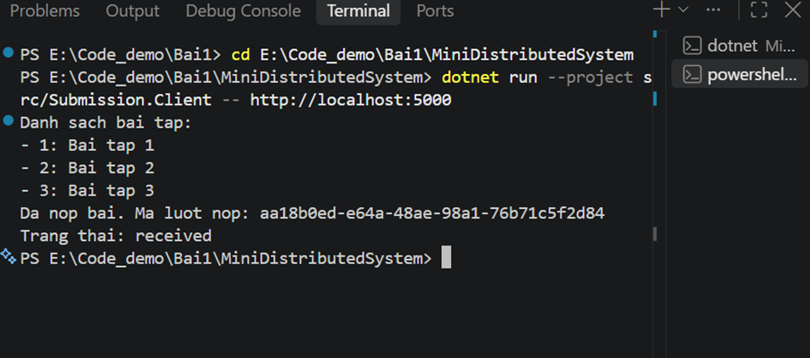

Bước 10b: Thí nghiệm tắt Server khi Client gửi yêu cầu

Mục đích: Quan sát hoạt động của Client khi Server không hoạt động.

Dự đoán: Khi Server bị
tắt, Client sẽ không thể kết nối và phát sinh
lỗi.

Thực hiện: Dừng Submission.Api bằng tổ hợp phím Ctrl + C, sau đó chạy Submission.Client kết nối đến địa chỉ
http://localhost:5000.

Kết quả dự kiến: Client phát sinh lỗi HttpRequestException do không thể kết nối đến Server.

Nhận xét: Thí nghiệm
cho thấy Client phụ thuộc vào khả năng
kết nối đến Server. Hệ thống cần có cơ chế
xử lý ngoại lệ khi Server không hoạt động.

Hình 10.2: Thông báo lỗi kết
nối khi chạy Client trong lúc Server đã dừng.

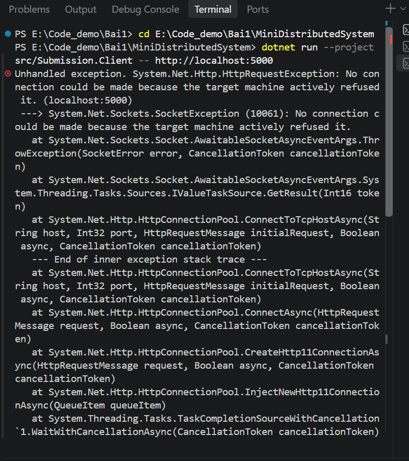

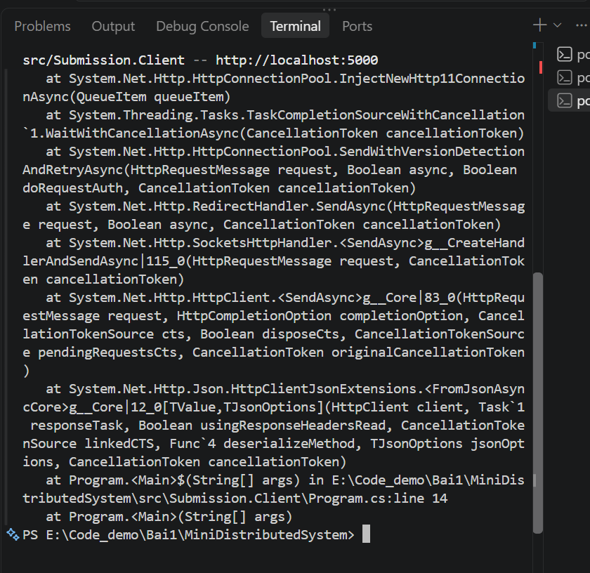

Bước 10c: Thí nghiệm gửi mã sinh
viên rỗng

Mục đích: Kiểm tra khả năng
xác thực dữ liệu đầu vào của Server.

Dự đoán: Server sẽ từ chối yêu cầu nộp
bài khi mã
sinh viên bị bỏ trống.

Thực hiện: Thay đổi
StudentCode từ
"SV001" thành "" trong file Submission.Client/Program.cs, sau đó chạy Client kết nối đến Server.

Kết quả thực tế: Client lấy được danh sách 3 bài tập
nhưng khi gửi yêu cầu
nộp bài, Server trả về HTTP 400 Bad
Request. Phương thức EnsureSuccessStatusCode() phát sinh
ngoại lệ HttpRequestException tại dòng 28.

Nhận xét: Dự đoán đúng. Server đã kiểm tra dữ liệu
đầu vào và từ chối
yêu cầu thiếu mã sinh viên.

Hình 10.3: Kết quả Client nhận lỗi HTTP 400 Bad
Request khi mã sinh viên để
trống.

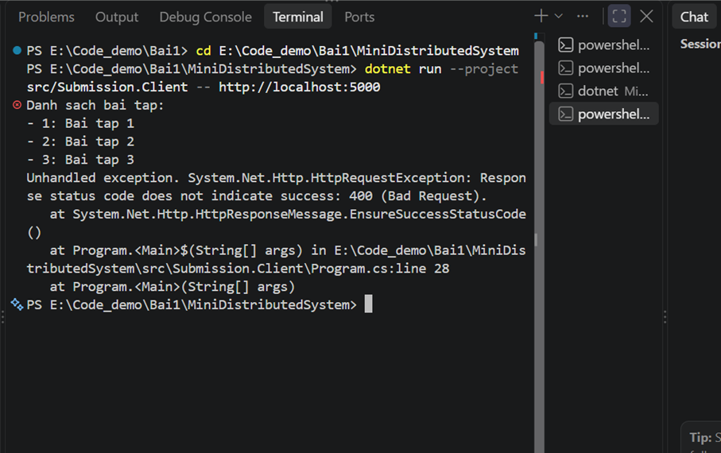

Bước 10d: Thí nghiệm thay đổi cổng Server

Mục đích:
Kiểm tra khả năng thay đổi địa chỉ kết nối của Client mà không cần chỉnh sửa mã nguồn.

Dự đoán:
Client kết nối đến cổng 5000 sẽ gặp lỗi, trong khi kết nối
đến cổng
5050 sẽ thành công.

Thực hiện:
Chạy Server trên cổng 5050, sau đó lần lượt chạy Client
với địa chỉ http://localhost:5000 và
http://localhost:5050.

Kết quả
thực tế:

Khi kết nối đến cổng
5000, Client xuất hiện
lỗi HttpRequestException
và SocketException
(10061).
Khi kết nối đến cổng
5050, Client nhận được
danh sách 3 bài tập, thực hiện nộp bài thành công và nhận trạng thái received.

Nhận xét:
Dự đoán đúng. Client có thể thay đổi địa chỉ Server bằng tham số dòng
lệnh mà không cần sửa mã nguồn.

Hình 10.4: Client gặp lỗi kết nối khi sử dụng
cổng 5000.

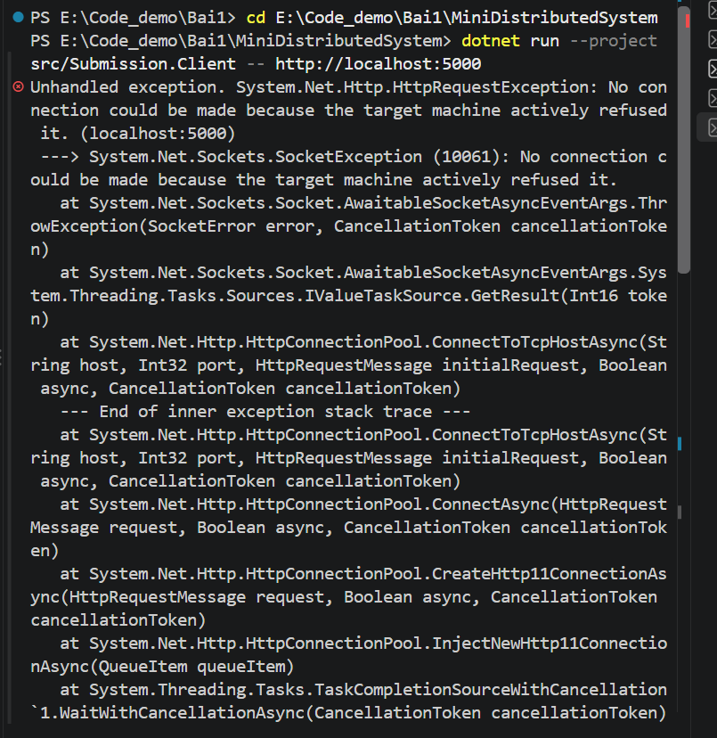

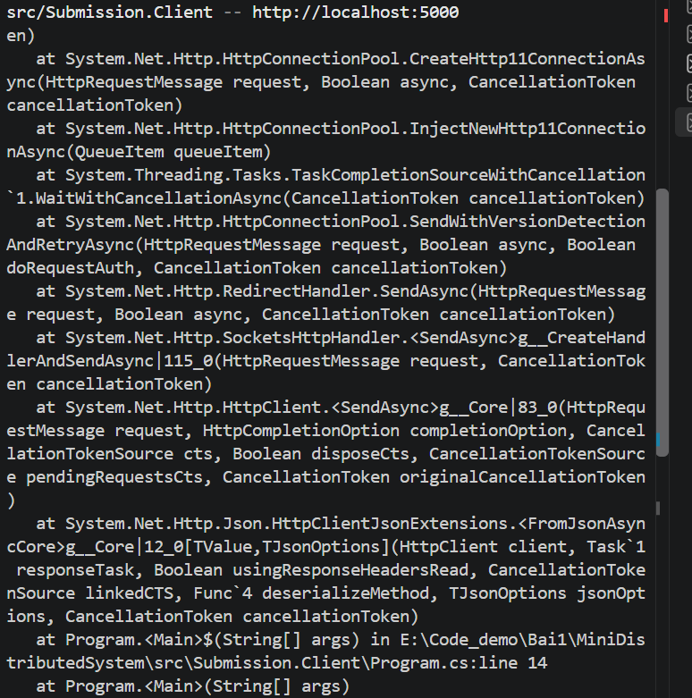

Hình 10.5: Client kết nối thành công với
Server trên cổng
5050.

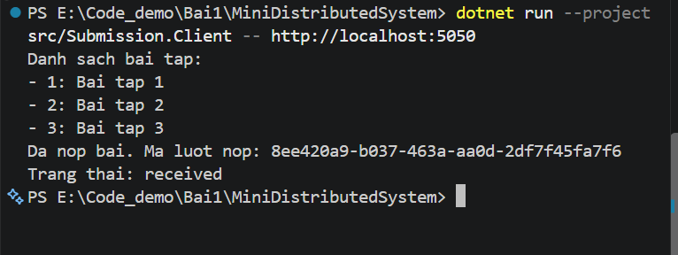

Bước 11: Xây dựng dự án EduSubmit
cá nhân

Mục đích: Xây dựng hệ thống phân tán gồm hai
ứng dụng độc lập là Submission.Api và Submission.Client.

Thực hiện: Tạo dự án
EduSubmit-DTC245200413, khởi tạo Git, tạo Solution
.NET và hai project ASP.NET
Core Web API và Console Client.

Kết quả: Khởi tạo thành công cấu trúc dự án
và biên dịch
Solution bằng lệnh
dotnet build.

Hình 11.1: Kết quả tạo Solution và biên dịch hai project của hệ thống EduSubmit.

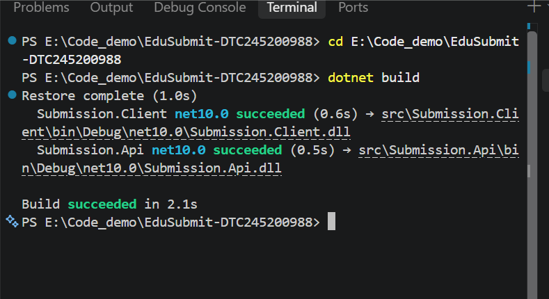

11.2. Xây dựng
và khởi động Submission.Api

Mục đích: Xây dựng API xử lý danh sách
bài tập và tiếp nhận
thông tin nộp bài của sinh
viên.

Thực hiện: Sử dụng ASP.NET Core Minimal API để
xây dựng các endpoint GET /, GET /api/assignments
và POST /api/submissions.

Kết quả: Xây dựng API với chức năng trả về danh sách bài
tập, kiểm tra dữ liệu
đầu vào và tạo lượt
nộp bài với trạng thái received. Khởi động API tại
http://localhost:5100.

Hình 11.2: Kết quả khởi động Submission.Api của dự án EduSubmit
trên cổng 5100.

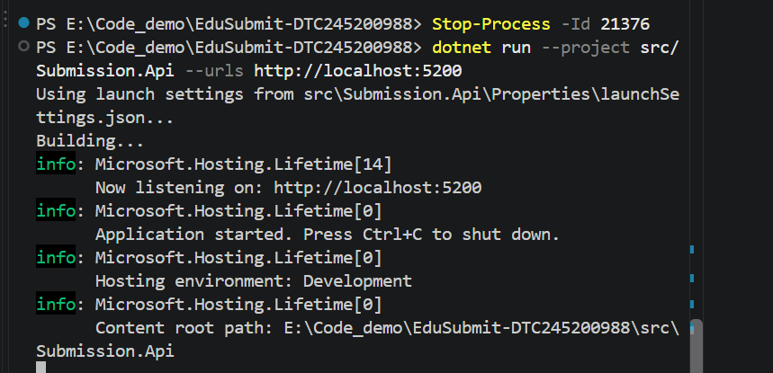

11.3. Xây dựng
và chạy Submission.Client

Mục đích: Xây dựng ứng dụng Client giao tiếp với Submission.Api thông qua HTTP.

Thực hiện: Sử dụng HttpClient để gửi yêu cầu GET lấy danh sách bài tập
và POST gửi thông tin nộp bài lên Server tại địa chỉ http://localhost:5100.

Kết quả: Client nhận được danh sách 2 bài tập,
gửi bài nộp thành công và nhận
mã lượt nộp cùng trạng thái received.

Hình 11.3: Kết quả chạy Submission.Client lấy danh sách bài tập
và nộp bài thành công.

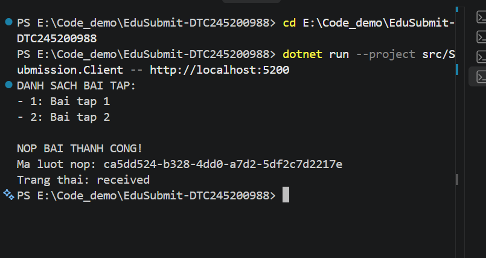

11.4. Kiểm thử các chức
năng của EduSubmit bằng REST Client

Mục đích: Xác minh khả năng xử lý yêu cầu
HTTP và kiểm tra dữ liệu
đầu vào của Submission.Api.

Thực hiện: Sử dụng REST Client gửi yêu cầu GET và POST đến
http://localhost:5100.

Các trường hợp kiểm thử:

HTTP
200 OK: Lấy danh
sách bài tập thành công bằng GET /api/assignments.
HTTP
201 Created: Nộp bài
thành công với mã sinh viên hợp lệ bằng POST /api/submissions.
HTTP
400 Bad Request: Từ chối yêu cầu nộp bài khi mã
sinh viên để trống.

Kết quả: API trả về các mã
trạng thái HTTP phù hợp với
từng trường
hợp kiểm thử.

Hình 11.4: Kết quả lấy danh sách bài tập
– HTTP 200 OK.

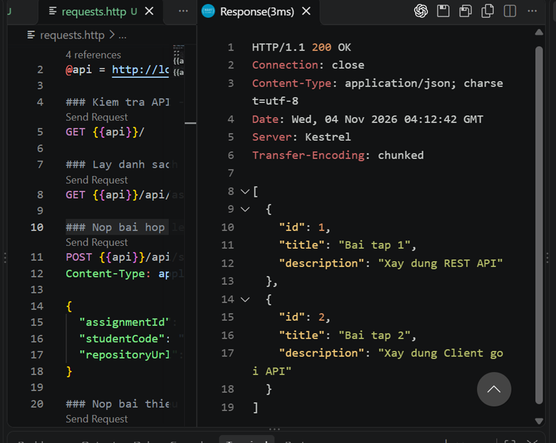

Hình 11.5: Kết quả nộp bài hợp
lệ – HTTP 201 Created.

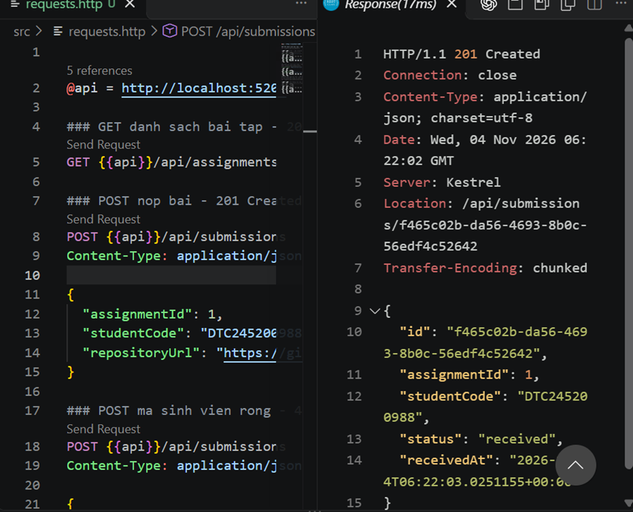

Hình 11.6: Kết quả từ chối mã sinh viên
rỗng – HTTP 400 Bad Request.

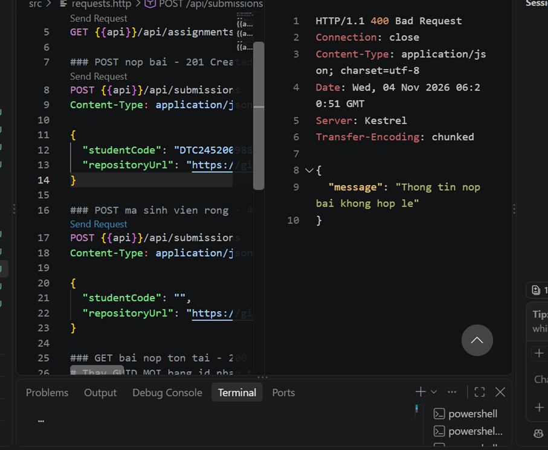

Bước 12: Mở rộng chức năng lưu và tra
cứu lượt nộp bài

Mục đích:
Bổ sung khả năng lưu trữ và tra
cứu thông tin lượt nộp bài theo mã
định danh GUID.

Thực hiện:
Sử dụng
Dictionary để lưu
thông tin bài nộp trong bộ nhớ Server. Bổ sung endpoint GET /api/submissions/{id:guid} để
tra cứu lượt nộp bài.

Kết quả
cần kiểm thử:

Khi
GUID tồn tại,
Server trả về
HTTP 200 OK cùng thông
tin bài nộp.
Khi
GUID không tồn tại, Server trả về HTTP 404 Not Found.

Nhận xét:
Chức năng này giúp truy
xuất thông tin bài nộp thông
qua mã định danh duy nhất.
Dữ liệu được lưu tạm thời trong bộ nhớ và không
được giữ
lại sau khi Server khởi động lại.

12.1. Kiểm thử tra cứu
bài nộp tồn tại – HTTP 200 OK

Mục đích: Kiểm tra khả năng
tra cứu thông tin bài nộp
bằng mã định danh GUID.

Thực hiện: Gửi yêu cầu POST /api/submissions để tạo lượt nộp bài. Sau đó sử dụng mã GUID được trả về để gửi yêu cầu
GET tra cứu thông tin.

Kết quả thực tế: API trả về HTTP 200 OK cùng thông tin bài nộp,
gồm mã GUID, mã bài tập,
mã sinh viên,
trạng thái received và thời gian
tiếp nhận.

Nhận xét: Chức năng tra cứu
hoạt động chính xác, cho
phép lấy lại thông tin bài nộp đã
lưu trong bộ nhớ Server.

Hình 12.1: Kết quả tra cứu bài
nộp thành công bằng mã GUID – HTTP 200 OK.

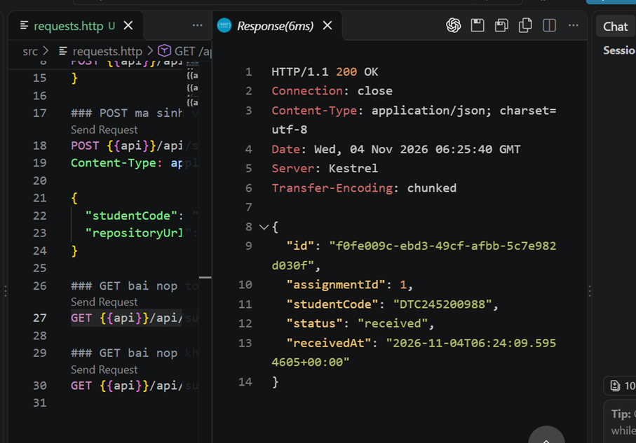

12.2. Kiểm thử tra cứu
bài nộp không tồn tại – HTTP 404 Not Found

Mục đích: Kiểm tra khả năng
xử lý của API khi tra cứu một
lượt nộp bài không tồn
tại.

Thực hiện: Sử dụng REST Client gửi yêu cầu GET /api/submissions/00000000-0000-0000-0000-000000000000 đến Server.

Kết quả mong đợi: API trả
về HTTP 404 Not Found và
thông báo "Khong tim thay luot
nop bai".

Nhận xét: API được
thiết kế để phát hiện trường hợp mã GUID không tồn tại và trả
về mã trạng thái HTTP phù hợp.

Hình 12.2: Kết quả tra cứu bài
nộp không tồn tại – HTTP 404
Not Found.

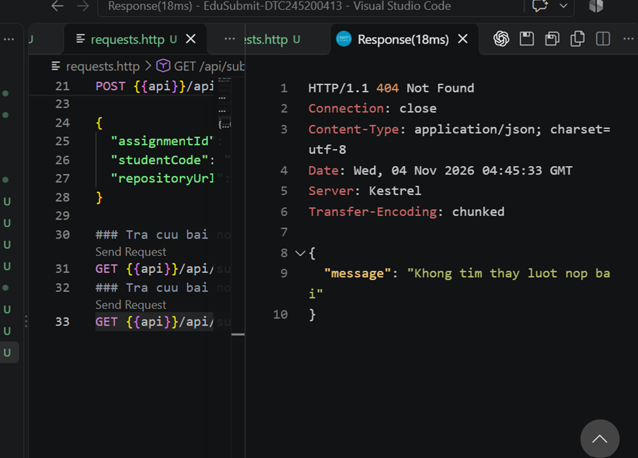

