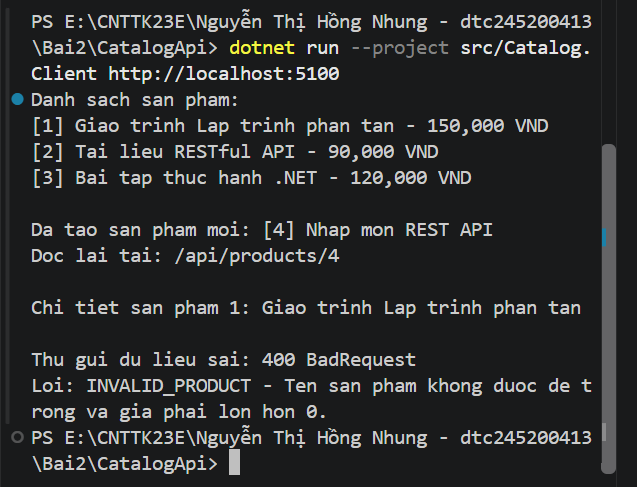
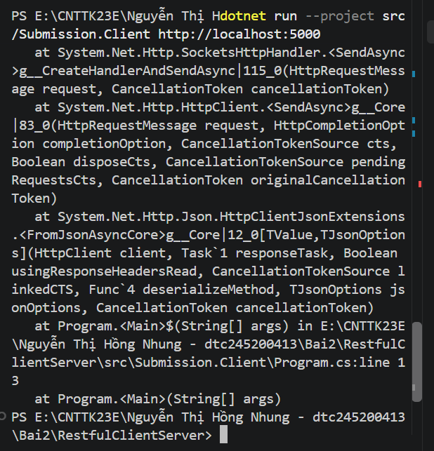
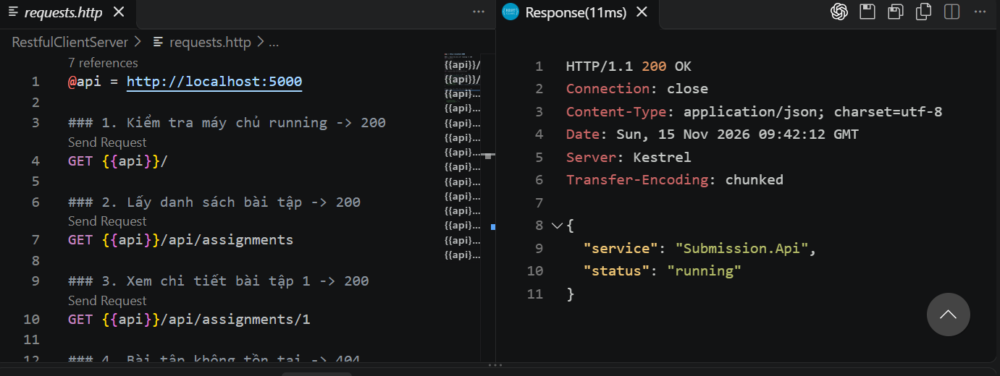
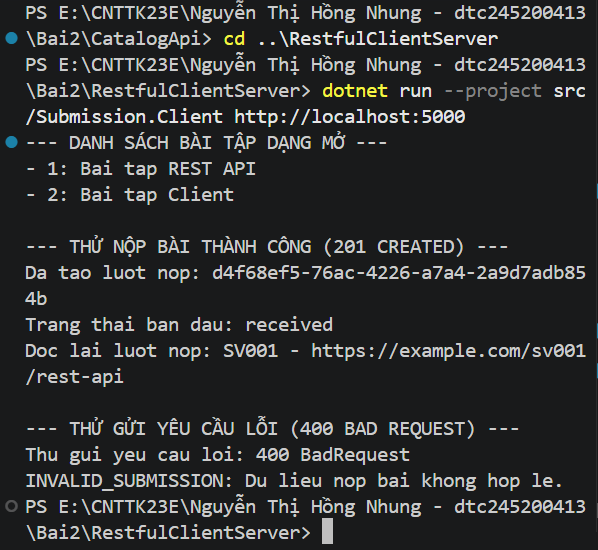

# BÀI 2 - RESTful API CHO TƯƠNG TÁC CLIENT - SERVER

- **Sinh viên thực hiện:** Nguyễn Thị Hồng Nhung
- **Mã sinh viên:** dtc245200413
- **Lớp:** CNTT K23E
- **Môn học:** Phát triển ứng dụng phân tán

---

# 1. CÁC LỆNH ĐÃ CHẠY

## 1.1. Phần 1: Catalog API

Thư mục: `CatalogApi`

### a. Build chương trình

```bash
cd CatalogApi
dotnet build CatalogApi.slnx
```

### b. Chạy Server API

Mở Terminal 1:

```bash
dotnet run --project src/Catalog.Api --urls http://localhost:5100
```

Địa chỉ API: `http://localhost:5100`

### c. Chạy Client

Mở Terminal 2:

```bash
cd CatalogApi
dotnet run --project src/Catalog.Client -- http://localhost:5100
```

Client thực hiện 4 bước:

1. Lấy danh sách sản phẩm từ Server.
2. Gửi yêu cầu POST tạo sản phẩm mới.
3. Đọc lại chi tiết sản phẩm.
4. Gửi dữ liệu không hợp lệ để kiểm tra lỗi 400.

## 1.2. Phần 2: RestfulClientServer (EduSubmit)

Thư mục: `RestfulClientServer`

### a. Build chương trình

```bash
cd RestfulClientServer
dotnet build RestfulClientServer.slnx
```

### b. Chạy Server API

Mở Terminal 1:

```bash
dotnet run --project src/Submission.Api --urls http://localhost:5000
```

Địa chỉ API: `http://localhost:5000`

### c. Chạy Client

Mở Terminal 2:

```bash
cd RestfulClientServer
dotnet run --project src/Submission.Client -- http://localhost:5000
```

Client thực hiện các bước:

1. Lấy danh sách bài tập.
2. Gửi yêu cầu nộp bài.
3. Nhận mã lượt nộp và trạng thái ban đầu.
4. Đọc lại thông tin lượt nộp.
5. Gửi thử dữ liệu không hợp lệ để kiểm tra lỗi 400.

---

# 2. ẢNH KẾT QUẢ CHẠY THỰC TẾ

Các ảnh minh chứng được lưu trong thư mục `images/`.

## 2.1. Kết quả chạy Catalog Client



## 2.2. Kết quả thử nghiệm lỗi kết nối



Client gửi yêu cầu đến Server tại `localhost:5000` nhưng không thể kết nối thành công, dẫn đến lỗi `HttpClient` trong quá trình gửi yêu cầu HTTP.

## 2.3. Kết quả thực hiện HTTP Requests


## 2.4. Kết quả chạy Submission Client


---

# 3. BẢNG PHÁ THỬ VÀ KIỂM TRA

## 3.1. Kiểm thử Catalog API

| STT | Ca thử | Kết quả mong đợi | Kết quả thực tế |
|---|---|---|---|
| 1 | Kiểm tra máy chủ `/` | 200 OK | Đạt |
| 2 | Lấy danh sách sản phẩm | 200 OK | Đạt |
| 3 | Lấy sản phẩm có ID = 1 | 200 OK | Đạt |
| 4 | Lấy sản phẩm ID = 999 | 404 + PRODUCT_NOT_FOUND | Đạt |
| 5 | Truyền ID không phải số (`abc`) | 404, body rỗng | Đạt |
| 6 | Tạo sản phẩm hợp lệ | 201 Created + Location | Đạt |
| 7 | Tạo sản phẩm có giá âm | 400 + INVALID_PRODUCT | Đạt |
| 8 | POST thiếu Content-Type | 415 Unsupported Media Type | Đạt |

## 3.2. Kiểm thử EduSubmit API

| STT | Ca thử | Kết quả mong đợi | Kết quả thực tế |
|---|---|---|---|
| 1 | Kiểm tra máy chủ `/` | 200 OK | Đạt |
| 2 | Lấy danh sách bài tập | 200 OK | Đạt |
| 3 | Xem chi tiết bài tập ID = 1 | 200 OK | Đạt |
| 4 | Xem bài tập không tồn tại ID = 999 | 404 + ASSIGNMENT_NOT_FOUND | Đạt |
| 5 | Nộp bài hợp lệ cho bài tập 1 | 201 Created + Location | Đạt |
| 6 | Đọc lại lượt nộp vừa tạo | 200 OK | Đạt |
| 7 | Nộp bài với dữ liệu rỗng | 400 + INVALID_SUBMISSION | Đạt |

---

# 4. TRẢ LỜI 3 CÂU HỎI

## Câu 1. Vì sao URI dùng danh từ, còn hành động do phương thức HTTP đảm nhận?

Trong RESTful API, URI dùng để xác định tài nguyên cần thao tác, vì vậy URI thường sử dụng danh từ. Các hành động được thể hiện bằng phương thức HTTP như GET, POST, PUT, DELETE.

Ví dụ:

- `GET /api/assignments`: lấy danh sách bài tập.
- `GET /api/assignments/1`: lấy thông tin bài tập có ID = 1.
- `POST /api/assignments/1/submissions`: tạo lượt nộp bài cho bài tập có ID = 1.

Cách thiết kế này giúp URI rõ ràng, thống nhất và dễ mở rộng. Không cần đưa các từ chỉ hành động như `get`, `create` vào URI.

## Câu 2. “Stateless” thể hiện ở đâu trong code đã viết?

Stateless có nghĩa là mỗi yêu cầu HTTP phải chứa đủ thông tin cần thiết để Server xử lý, không phụ thuộc vào trạng thái phiên làm việc được lưu từ yêu cầu trước của Client.

Trong chương trình đã xây dựng:

- Client gửi yêu cầu HTTP độc lập thông qua HttpClient.
- Địa chỉ API được truyền qua tham số dòng lệnh `args[0]`.
- Các thông tin cần thiết được gửi qua URI, route và JSON body.
- Server xử lý yêu cầu và trả về HTTP response.
- Không sử dụng session để ghi nhớ trạng thái giao tiếp của từng Client.

Ví dụ trong Submission.Client:

```csharp
var createResponse = await http.PostAsJsonAsync(
    $"/api/assignments/{selectedAssignmentId}/submissions",
    new CreateSubmissionRequest(
        "SV001",
        "https://example.com/sv001/rest-api"
    )
);
```

Mỗi request tự gửi thông tin cần thiết để Server xử lý. Tuy nhiên, Server vẫn lưu dữ liệu bài tập và lượt nộp trong các danh sách List ở bộ nhớ. Stateless không có nghĩa là Server không lưu dữ liệu tài nguyên.

## Câu 3. Vì sao Client và Server mỗi bên khai báo DTO riêng mà vẫn khớp nhau?

Client và Server là hai chương trình độc lập, không dùng chung bộ nhớ hoặc lớp C# với nhau. Hai bên giao tiếp thông qua HTTP và JSON.

Vì vậy, mỗi bên có thể khai báo DTO riêng nhưng cần thống nhất hợp đồng dữ liệu, bao gồm:

- Tên các thuộc tính.
- Kiểu dữ liệu.
- Cấu trúc JSON trao đổi.
- Quy tắc tuần tự hóa và giải tuần tự hóa dữ liệu.

Ví dụ, phía Server khai báo:

```csharp
record AssignmentDto(
    int Id,
    string Title,
    string Description,
    bool IsOpen
);
```

Phía Client cũng khai báo DTO tương ứng:

```csharp
record AssignmentDto(
    int Id,
    string Title,
    string Description,
    bool IsOpen
);
```

Khi Server trả JSON, Client sử dụng `GetFromJsonAsync` hoặc `ReadFromJsonAsync` để chuyển JSON thành DTO tương ứng.

Hai bên không cần dùng chung mã nguồn C#, chỉ cần thống nhất hợp đồng JSON thì vẫn trao đổi dữ liệu chính xác.

---

# 5. PHẦN MỞ RỘNG (BƯỚC 9 - XỬ LÝ XUNG ĐỘT 409 VÀ XÓA 204)

Bổ sung các tính năng nâng cao cho `Submission.Api`:
1. **Chặn nộp bài trùng (`409 Conflict`):** Nếu `StudentCode` đã nộp cho `AssignmentId` đó thì từ chối với mã `409 Conflict` (`DUPLICATE_SUBMISSION`).
2. **Xóa lượt nộp (`DELETE` trả `204 No Content`):** Thêm endpoint `DELETE /api/submissions/{submissionId:guid}` cho phép xóa lượt nộp.

| STT | Ca thử | Yêu cầu | Kết quả mong đợi | Kết quả thực tế |
|---|---|---|---|---|
| 9a | Nộp vào bài tập đã đóng | `POST /api/assignments/3/submissions` | `400 Bad Request` (`ASSIGNMENT_CLOSED`) | Đạt |
| 9b | Nộp hợp lệ cho `SV002` | `POST /api/assignments/1/submissions` | `201 Created` + `Location` | Đạt |
| 9c | Nộp trùng lại ca `9b` | Gửi lại y hệt request `9b` | `409 Conflict` (`DUPLICATE_SUBMISSION`) | Đạt |
| 9d | Xóa lượt nộp `9b` | `DELETE /api/submissions/{id}` | `204 No Content` (không body) | Đạt |
| 9e | Xóa lại lượt nộp vừa xóa | Gửi lại `DELETE` với `{id}` cũ | `404 Not Found` (`SUBMISSION_NOT_FOUND`) | Đạt |
| 9f | Nộp lại sau khi rút bài | Gửi lại request `9b` sau khi đã xóa | `201 Created` (cấp `Id` mới) | Đạt |
| 9g | Chạy `Submission.Client` 2 lần liên tiếp | Lần 1 thành công, lần 2 trùng `SV001` | Lần 1: `201 Created`, Lần 2: `409 Conflict` | Đạt |

---

# 6. KẾT LUẬN

Qua bài thực hành, em đã xây dựng được mô hình giao tiếp Client - Server bằng RESTful API sử dụng ASP.NET Core và HttpClient.

Em đã thực hiện các thao tác GET, POST, kiểm tra dữ liệu đầu vào, xử lý mã trạng thái HTTP, trao đổi dữ liệu JSON và kiểm thử các trường hợp thành công cũng như thất bại.

Qua đó, em hiểu hơn về cách thiết kế API theo hướng tài nguyên, nguyên tắc Stateless và vai trò của DTO trong giao tiếp giữa Client và Server.