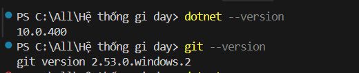
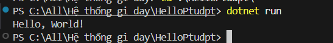
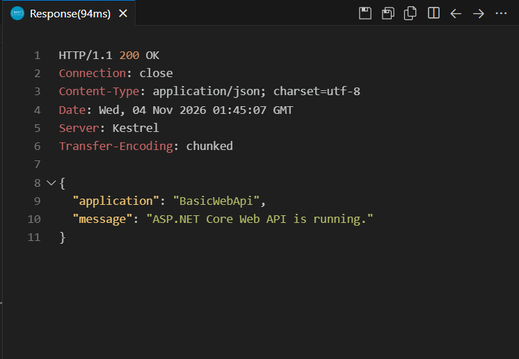
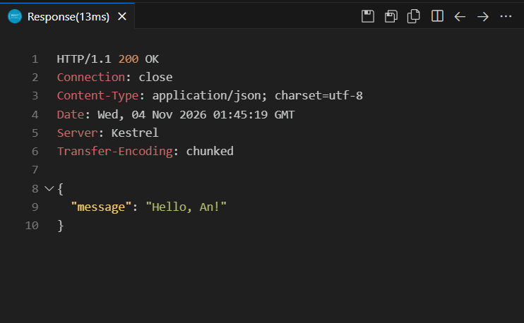
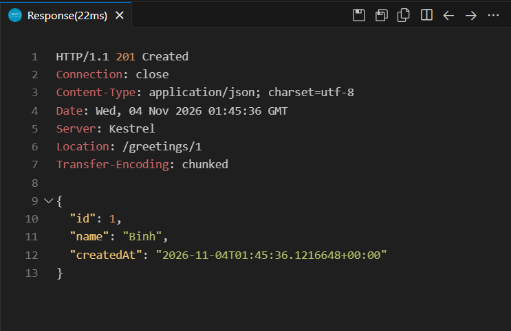
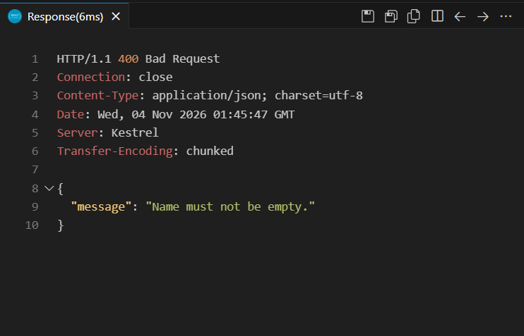
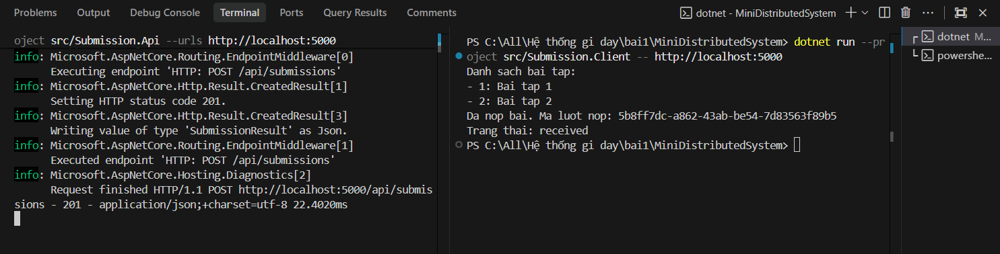

# Bài 1 – Tổng quan hệ thống và MEP

**Họ tên:** Phan Quang Tùng &nbsp;&nbsp;&nbsp;&nbsp;&nbsp;&nbsp;&nbsp;&nbsp; **MSSV:** DTC245200250 &nbsp;&nbsp;&nbsp;&nbsp;&nbsp;&nbsp;&nbsp;&nbsp; **Lớp:** CNTT K23E

---

## 1. Cài đặt

Môi trường thực hành trên máy đã được cài đặt và kiểm tra đầy đủ:
- **.NET SDK:** Phiên bản `10.0.400` (đáp ứng yêu cầu .NET 10).
- **Git:** Phiên bản `2.53.0.windows.2`, đã cấu hình `user.name` và `user.email`.
- **VS Code:** Đã cài đặt C# Dev Kit, C#, .NET Install Tool.

### Ảnh chụp kết quả kiểm tra môi trường (Bước 4):





---

## 2. MepDemo (Bước 7)

### 2.1. Trả lời các câu hỏi:
1. **Ở MEP 3 (Queue-based), mỗi bài nộp `sub-x` được mấy worker xử lý?**
   - **Trả lời:** Mỗi bài nộp `sub-x` chỉ được **duy nhất 1 worker** xử lý. Hai worker cạnh tranh nhận việc từ Channel (`competing consumers`) để chia sẻ tải công việc, không có bài nộp nào bị xử lý trùng lặp.
2. **Ở MEP 4 (Publish–Subscribe), một sự kiện được gửi tới mấy dịch vụ?**
   - **Trả lời:** Một sự kiện phát ra được gửi tới **tất cả 3 dịch vụ** (`NotificationService`, `ActivityLogService`, `AnalyticsService`). Đây là cơ chế broadcast/fan-out: mọi bên đăng ký đều nhận được bản sao sự kiện.
3. **Mô tả 1 câu cho mỗi MEP:**
   - **MEP 1 (Request–Response):** Bên gửi phát yêu cầu tới bên nhận và tạm dừng chờ phản hồi (có giới hạn thời gian chờ timeout).
   - **MEP 2 (One-Way):** Bên gửi đẩy thông điệp đi và lập tức tiếp tục công việc mà không cần chờ hay kỳ vọng nhận kết quả phản hồi.
   - **MEP 3 (Queue-based):** Thông điệp được đưa vào một hàng đợi trung gian và được phân phối cho duy nhất một worker trong nhóm worker cạnh tranh xử lý.
   - **MEP 4 (Publish–Subscribe):** Bên phát (Publisher) gửi sự kiện lên kênh trung gian, hệ thống tự động nhân bản và chuyển giao sự kiện tới tất cả các bên đăng ký (Subscribers).
   - **MEP 5 (Streaming / Push):** Thiết lập một luồng kết nối liên tục cho phép đẩy một chuỗi dữ liệu theo thời gian thực từ nguồn tới đích mà không cần thiết lập lại kết nối cho từng gói tin.

---

## 3. BasicWebApi (Bước 8)

### 3.1. Ảnh chụp kết quả kiểm thử bằng REST Client:
- **GET / (200 OK):**
  

- **GET /hello/An?language=en (200 OK):**
  

- **POST /greetings hợp lệ (201 Created):**
  

- **POST /greetings không hợp lệ (400 Bad Request):**
  

### 3.2. Trả lời 3 câu hỏi mục 8.4:
1. **Hai dòng `builder.Services.AddSingleton…` và `var app = builder.Build();` – dòng nào phải đứng trước? Vì sao?**
   - **Trả lời:** Dòng `builder.Services.AddSingleton…` bắt buộc phải đứng **trước** dòng `var app = builder.Build();`.
   - **Giải thích:** Phương thức `builder.Build()` sẽ hoàn tất việc cấu hình và đóng băng container chứa các dịch vụ (Dependency Injection Container). Sau khi `app` đã được build, vùng đăng ký dịch vụ của `builder` không thể chỉnh sửa hay thêm dịch vụ mới được nữa.
2. **Trong `/hello/{name}?language=en`, tham số `name` lấy từ đâu, `language` lấy từ đâu?**
   - **Trả lời:**
     - Tham số `name` được lấy từ **Route Parameter** (đường dẫn URL theo mẫu định tuyến `{name}`).
     - Tham số `language` được lấy từ **Query String** (chuỗi tham số truy vấn nằm sau dấu `?` trong URL).
3. **Vì sao POST hợp lệ trả `Results.Created` (201) chứ không phải `Results.Ok` (200)?**
   - **Trả lời:** Theo chuẩn kiến trúc RESTful và giao thức HTTP, khi một tài nguyên mới được tạo ra trên máy chủ, mã trạng thái chuẩn cần trả về là `201 Created` kèm theo header `Location` chỉ rõ đường dẫn truy cập tài nguyên vừa tạo (`/greetings/{id}`). Mã `200 OK` chỉ dùng cho các thao tác thành công thông thường mà không sinh ra tài nguyên mới.

---

## 4. MiniDistributedSystem (Bước 9)

### 4.1. Ảnh chụp 2 terminal chạy song song:


### 4.2. Trả lời 3 câu hỏi:
1. **Client gọi những endpoint nào của API? Mỗi lần gọi là một cặp request–response gồm method, URL, mã trạng thái gì?**
   - **Lần 1:** Method `GET`, URL `/api/assignments` $\rightarrow$ Trả về mã `200 OK` kèm danh sách bài tập.
   - **Lần 2:** Method `POST`, URL `/api/submissions` $\rightarrow$ Gửi body JSON thông tin bài nộp, nhận về mã `201 Created` kèm mã lượt nộp GUID và thời gian ghi nhận.
2. **Client có tham chiếu (dùng chung) code của API không? Hai bên "thống nhất" với nhau bằng gì?**
   - **Trả lời:** Client hoàn toàn **không** tham chiếu (Project Reference) hay chia sẻ thư viện nhị phân nào với API.
   - Hai bên thống nhất với nhau thông qua **Hợp đồng giao tiếp (Contract)** độc lập trên nền tảng:
     - Giao thức chuẩn: HTTP.
     - Định dạng dữ liệu trao đổi: JSON.
     - Cấu trúc endpoint URL và các trường dữ liệu (Schema: `assignmentId`, `studentCode`, `repositoryUrl`, ...).
3. **Vì sao địa chỉ API được truyền qua tham số `-- http://localhost:5000` mà không viết cứng trong code?**
   - **Trả lời:** Để tách biệt cấu hình khỏi mã nguồn (Config externalization). Trong thực tế, máy chủ API có thể thay đổi địa chỉ IP, cổng lắng nghe hoặc chuyển đổi giữa các môi trường (Dev, Staging, Production). Việc truyền qua tham số dòng lệnh giúp triển khai linh hoạt mà không cần phải chỉnh sửa và biên dịch lại mã nguồn của máy khách.

---

## 5. Thí nghiệm lỗi (Bước 10)

| # | Thao tác | Dự đoán (ghi TRƯỚC khi chạy) | Kết quả thực tế (mã lỗi / thông báo) | Đúng/Sai | Giải thích |
|---|---|---|---|:---:|---|
| **a** | Trong `Submission.Api`, thêm bài tập thứ 3 vào mảng `assignments`. Chạy lại API rồi chạy Client. | Client vẫn chạy bình thường và tự động in thêm bài tập thứ 3 mà không cần sửa code. | Client in đủ cả 3 bài tập: Bài 1, Bài 2 và Bài tập thứ 3. Không có lỗi xảy ra. | **Đúng** | Client phân giải JSON thành `List<Assignment>` động, không viết cứng số lượng phần tử nên hệ thống tương thích tốt khi server cập nhật dữ liệu. |
| **b** | Tắt API (`Ctrl + C` ở Terminal 1), rồi chạy Client. | Client sẽ không kết nối được và báo lỗi ngắt kết nối mạng. | Quăng ngoại lệ `HttpRequestException`: *"No connection could be made because the target machine actively refused it. (localhost:5000)"*. | **Đúng** | Giao tiếp mạng có tính không tin cậy (`unreliable network`). Gọi hàm nội bộ luôn nằm trong cùng tiến trình bộ nhớ nên không gặp tình trạng từ chối kết nối, còn gọi qua mạng phụ thuộc trạng thái của cổng kết nối và server từ xa. |
| **c** | Trong `Submission.Client`, đổi `StudentCode` thành `""`. Chạy lại Client. | Server từ chối và trả về `400 Bad Request`. Client bị văng lỗi do phương thức `EnsureSuccessStatusCode()`. | API trả `400 Bad Request`. Client ném lỗi `HttpRequestException: Response status code does not indicate success: 400 (Bad Request)`. | **Đúng** | `EnsureSuccessStatusCode()` kích hoạt lỗi nếu mã HTTP không thuộc dải thành công `2xx`. Server luôn phải kiểm tra dữ liệu đầu vào để bảo đảm toàn vẹn hệ thống, không tin tưởng mù quáng vào Client. |
| **d** | Chạy API ở cổng 5050 (`--urls http://localhost:5050`), client vẫn gọi 5000, sau đó sửa lại mà không sửa code. | Client gọi 5000 sẽ báo lỗi kết nối. Để chạy được mà không sửa code, chỉ cần truyền tham số URL cổng 5050 vào lệnh chạy client. | Lệnh `dotnet run --project ... -- http://localhost:5050` giúp client kết nối và hoàn thành nộp bài thành công. | **Đúng** | Client đọc URL từ tham số `args[0]`, do đó có thể linh hoạt đổi đích gọi ngay trên dòng lệnh chạy mà không cần sửa mã nguồn. |

---

## 6. Dự án EduSubmit tự làm (Bước 11-12)

### 6.1. Tổ chức mã nguồn và tính năng:
- Tạo solution độc lập `EduSubmit.slnx` gồm 2 project riêng biệt:
  - `src/Submission.Api`: ASP.NET Core Minimal API (.NET 10).
  - `src/Submission.Client`: .NET Console Client giao tiếp qua `HttpClient`.
- Tự hoàn thành đầy đủ các endpoint theo đặc tả:
  - `GET /`: Trả về trạng thái hoạt động của API.
  - `GET /api/assignments`: Trả về danh sách bài tập.
  - `POST /api/submissions`: Tiếp nhận bài nộp, xác thực dữ liệu chặt chẽ (kiểm tra `assignmentId > 0`, chuỗi rỗng của `studentCode`, `repositoryUrl`), trả về `201 Created` kèm header `Location`.
- **Hoàn thành bài tập mở rộng (Bước 12):**
  - Quản lý danh sách lượt nộp trong bộ nhớ `List<SubmissionResult>`.
  - Bổ sung endpoint `GET /api/submissions/{id:guid}` trả `200 OK` nếu tìm thấy, hoặc `404 Not Found` nếu ID không tồn tại.
  - Phía Client tự động gọi endpoint này ngay sau khi nộp bài để xác nhận và in thông tin lượt nộp ra màn hình.
  - Viết file `requests.http` kiểm thử đầy đủ các kịch bản (200, 201, 400, 404).

### 6.2. Luồng thông điệp trong hệ thống:
```text
Client --(HTTP GET /api/assignments)----------> Api  : Request-Response (Lấy danh sách bài tập)
Client --(HTTP POST /api/submissions)---------> Api  : Request-Response (Gửi lượt nộp bài, nhận 201 Created)
Client --(HTTP GET /api/submissions/{id})-----> Api  : Request-Response (Truy vấn xác nhận lại lượt nộp)
```

### 6.3. Mức độ tham khảo code mẫu:
- Cấu trúc thư mục và cách cấu hình lệnh .NET CLI: Thực hiện theo trình tự hướng dẫn ở Bước 11.
- Logic lập trình: Tự xây dựng code cho cả Api và Client dựa trên kiến thức đúc kết từ `BasicWebApi` và `MiniDistributedSystem`, đặc biệt tự viết logic kiểm tra dữ liệu và endpoint mở rộng Bước 12.

---

## 7. Khó khăn gặp phải và cách giải quyết

1. **Khó khăn về trùng lặp cổng kết nối:**
   - *Hiện tượng:* Khi khởi chạy lại API nếu tiến trình cũ chưa kết thúc hẳn, gặp lỗi `address already in use`.
   - *Cách giải quyết:* Dùng tổ hợp phím `Ctrl + C` để giải phóng tiến trình cũ, hoặc cấu hình tham số `--urls` sang cổng khác.
2. **Khó khăn về định dạng Header khi kiểm thử API:**
   - *Hiện tượng:* Khi gửi POST request qua REST Client nếu thiếu header `Content-Type: application/json` thì server trả về lỗi `415 Unsupported Media Type`.
   - *Cách giải quyết:* Luôn thêm dòng `Content-Type: application/json` trước phần nội dung body JSON.
3. **Hiểu về bản chất của ứng dụng phân tán:**
   - *Nhận thức:* Khác với ứng dụng nguyên khối nơi các hàm gọi trực tiếp qua bộ nhớ, ứng dụng phân tán phải luôn dự phòng các lỗi mạng, độ trễ và sự thay đổi độc lập của từng phía (như minh họa rõ qua 4 thí nghiệm lỗi ở Bước 10).
