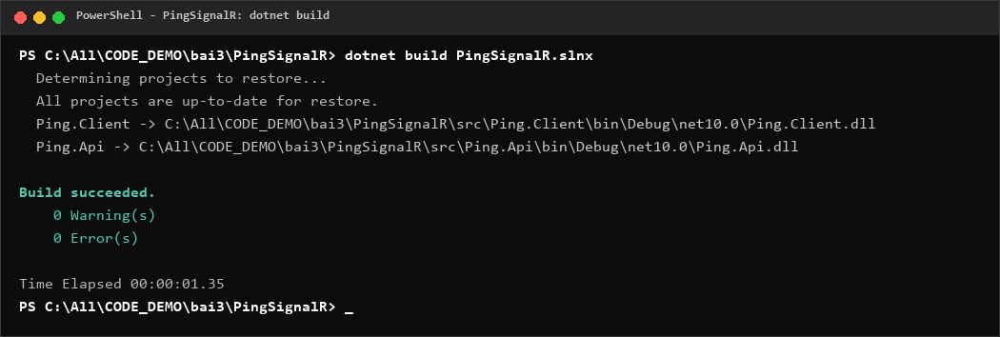
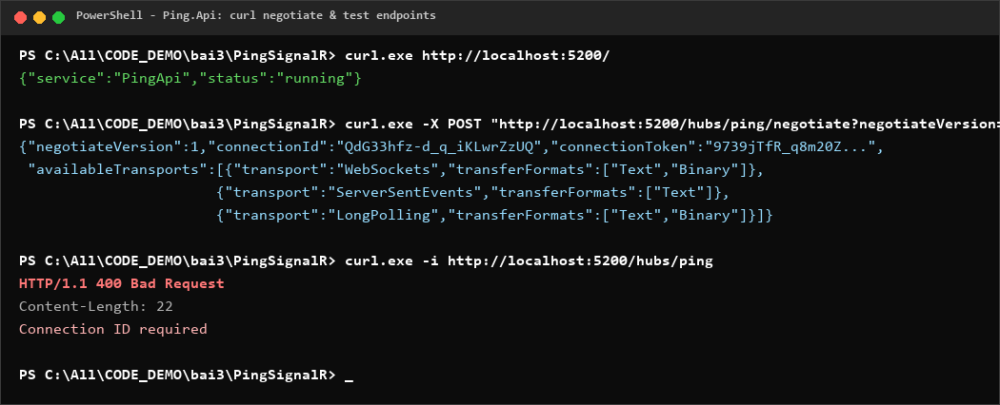
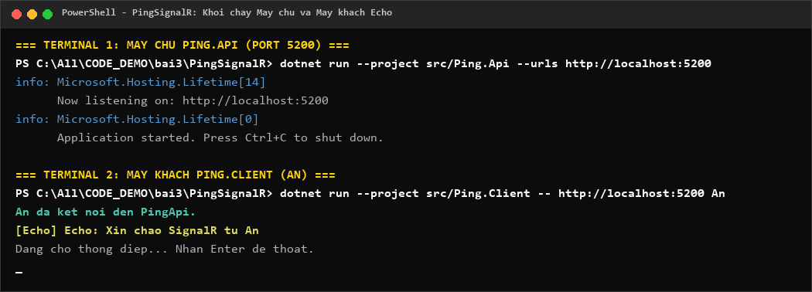
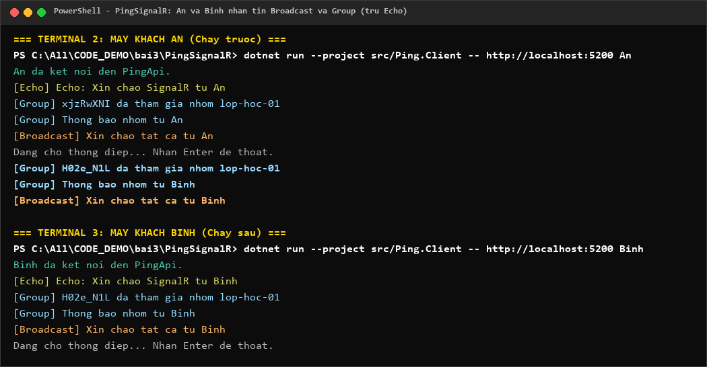
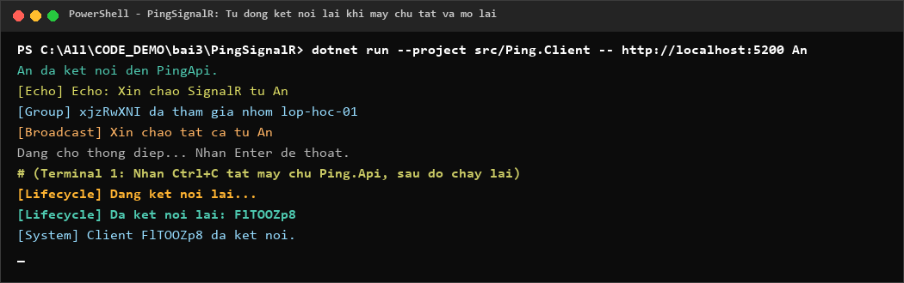
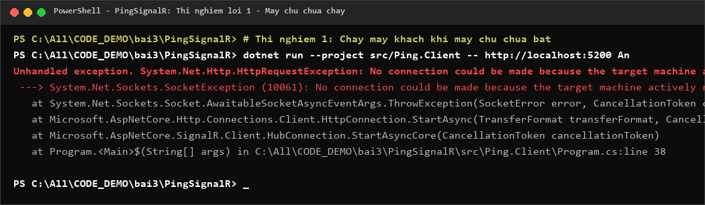
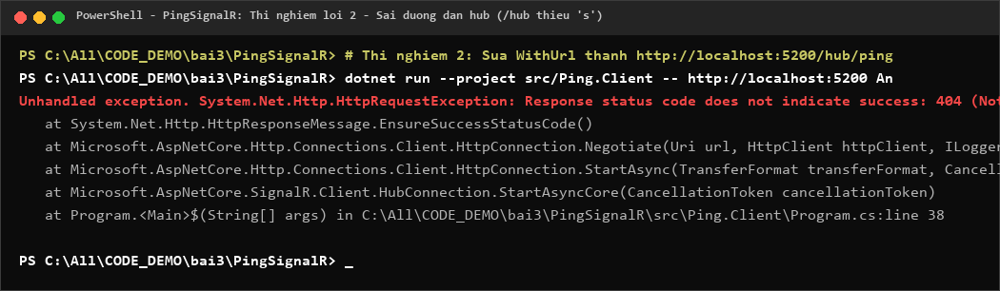
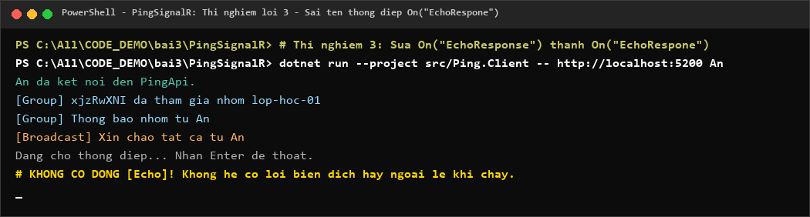
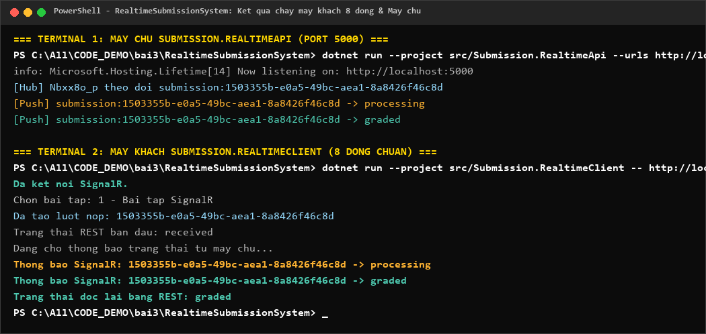
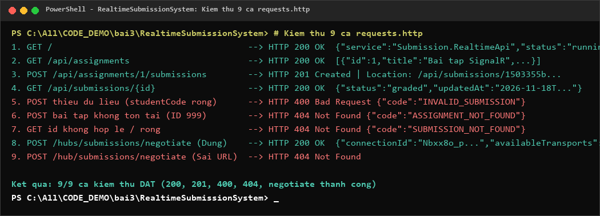

# Báo cáo Thực hành Bài 3: Giao tiếp thời gian thực với SignalR

**Học phần:** Phát triển ứng dụng phân tán  
**Sinh viên thực hiện:** Phan Quang Tùng  
**Mã sinh viên:** DTC245200250  
**Lớp:** CNTT K23E  

---

## 1. Trả lời 3 câu hỏi đầu giờ (Slide 3 & 65)

### Câu 1: Máy chủ có thể chủ động báo cho máy khách mà không cần máy khách hỏi không?
**Trả lời:**  
**Có**, bằng cách để máy khách thiết lập một kết nối lâu dài (persistent connection) hai chiều tới máy chủ thông qua giao thức **WebSocket** (được bọc bởi thư viện **SignalR**). Phía máy chủ sử dụng `Clients.Group(...).SendAsync` hoặc `Clients.All.SendAsync` từ bên trong Hub, hoặc sử dụng dịch vụ `IHubContext<THub>` khi cần đẩy thông điệp từ bên ngoài Hub (như tác vụ nền, worker, hoặc endpoint REST).

### Câu 2: Đã có REST rồi, vì sao còn cần thêm SignalR? Hai thứ chia việc thế nào?
**Trả lời:**  
- **REST** và **SignalR** không thay thế nhau mà phối hợp giải quyết bài toán phân tán:
  - **REST (Nguồn sự thật - Source of Truth):** Đảm nhiệm tạo tài nguyên, đọc dữ liệu hiện tại với các mã trạng thái HTTP chuẩn xác (`201 Created`, `200 OK`, `400 Bad Request`, `404 Not Found`).
  - **SignalR (Kênh báo tin tức thời - Push Notification):** Đảm nhiệm chiều ngược lại: máy chủ chủ động đẩy các sự kiện, trạng thái phát sinh sau yêu cầu ban đầu (ví dụ: `received -> processing -> graded`) tới đúng đối tượng mà không bắt máy khách phải thăm dò định kỳ (polling) gây lãng phí băng thông và tài nguyên CPU.
- **Quy tắc vàng:** Dùng *SignalR để nhận tin nhanh*, và dùng *REST để đọc dữ liệu chắc chắn*.

### Câu 3: Nếu đứt mạng đúng lúc máy chủ báo "đã chấm xong" (graded) thì sao?
**Trả lời:**  
- Thông điệp đó sẽ bị mất trên đường truyền vì SignalR không lưu trữ hàng đợi thông điệp để phát lại cho kết nối đã đứt.
- Nhờ cấu hình `WithAutomaticReconnect()`, khi mạng phục hồi, máy khách sẽ tự động thiết lập lại kết nối mới (với `ConnectionId` mới).
- Ngay sau khi kết nối lại hoặc hết thời gian chờ (Timeout), máy khách sẽ gọi lại `GET /api/submissions/{id}` qua kênh REST để lấy trạng thái cuối cùng chính xác nhất từ cơ sở dữ liệu.

---

## 2. Bảng 5 thí nghiệm phân tán (Slide 58 & 59)

| # | Thí nghiệm | Dự đoán | Kết quả chạy thật | Bài học phân tán rút ra |
|:---:|---|---|---|---|
| **1** | Chạy 2 máy khách `SV001` và `SV002` cùng lúc | Mỗi máy khách chỉ nhận thông báo trạng thái của bài mình vừa nộp, không bị lẫn bài của nhau | `SV001` chỉ nhận tin lượt nộp của SV001; `SV002` chỉ nhận tin lượt nộp của SV002 | **Nhóm `submission:{id}`** do máy chủ quản lý giúp phân tách chính xác người nhận, bảo vệ dữ liệu riêng tư và tiết kiệm băng thông |
| **2** | Chạy máy khách khi máy chủ chưa khởi động | Máy khách báo lỗi từ chối kết nối ngay lập tức | Ném ngoại lệ `HttpRequestException: Connection refused (localhost:5000)` | `StartAsync` ném lỗi ngay; cơ chế `WithAutomaticReconnect` **chỉ khôi phục kết nối ĐÃ từng mở thành công**, không tự thử lại ở lần bắt tay đầu |
| **3** | Sửa `WithUrl` thành `/hub/submissions` (thiếu chữ `s`) | Lỗi 404 Not Found do không tìm thấy endpoint Hub | Ném ngoại lệ `HttpRequestException: Response status code does not indicate success: 404 (Not Found)` | Lỗi xảy ra ở bước bắt tay `negotiate`. Tuyến đường dẫn ở Client phải khớp chính xác từng ký tự với `app.MapHub(...)` trên Server |
| **4** | Sửa `On("SubmissionStatusChanged")` thành `On("SubmissionStatusChange")` (sai 1 chữ) | Không bắt được sự kiện, client chờ đến khi hết hạn (timeout) | Không phát sinh lỗi biên dịch hay runtime; sau 10 giây in dòng: `"Qua thoi gian cho thong bao graded."` | SignalR sử dụng hợp đồng tên thông điệp dạng chuỗi. **Sai tên chiều xuống sẽ bị bỏ qua trong im lặng**, rất khó phát hiện nếu không kiểm tra tên hai phía |
| **5** | Chờ 4 giây rồi mới gọi `WatchSubmission` | Bị lỡ mất thông báo `processing` và `graded` qua SignalR | Không nhận được thông báo nào từ SignalR; tuy nhiên REST đọc lại vẫn trả về trạng thái `graded` | Vào nhóm muộn sẽ **bị lỡ thông điệp thời gian thực**. REST là nguồn sự thật tối hậu giúp cập nhật trạng thái chính xác |

---

## 3. Minh chứng các bước thực hành (Mỗi bước một ảnh theo Slide 22 & 23)

### Bước 1: Build giải pháp (buoc1-build.png)


- **Thấy:** Lệnh `dotnet build PingSignalR.slnx` trả về `Build succeeded. 0 Warning(s), 0 Error(s)`.
- **Giải thích:** Cả hai dự án `Ping.Api` và `Ping.Client` đã được thiết lập đúng cấu trúc, gói `Microsoft.AspNetCore.SignalR.Client` được cài đặt đầy đủ và tương thích hoàn toàn trên nền tảng .NET 10.

---

### Bước 2: Bắt tay negotiate (buoc2-negotiate.png)


- **Thấy:** 
  - `GET /` trả về JSON `{"service":"PingApi","status":"running"}`.
  - `POST /hubs/ping/negotiate?negotiateVersion=1` trả về `connectionId` và danh sách các cơ chế truyền tải sẵn có (`WebSockets`, `ServerSentEvents`, `LongPolling`).
  - `GET /hubs/ping` trả về mã `400 Bad Request` (`Connection ID required`).
- **Giải thích:** Máy chủ thông báo cho máy khách các cơ chế truyền tải hỗ trợ và cấp phát `connectionId` để chuẩn bị nâng cấp (upgrade) kết nối HTTP lên giao thức hai chiều WebSocket.

---

### Bước 3–4: Máy chủ chạy, máy khách in [Echo] Echo: Xin chao SignalR (buoc4-echo.png)


- **Thấy:** Máy chủ `Ping.Api` lắng nghe tại cổng 5200. Máy khách An kết nối thành công và in ra: `[Echo] Echo: Xin chao SignalR tu An`.
- **Giải thích:** Lời gọi `connection.InvokeAsync("Echo", ...)` từ máy khách kích hoạt phương thức `Echo` trên Hub; Hub gửi phản hồi riêng cho chính kết nối vừa gọi thông qua `Clients.Caller.SendAsync("EchoResponse", ...)`.

---

### Bước 5: Hai máy khách thấy tin của nhau, trừ tin Echo (buoc5-nhom.png)


- **Thấy:** 
  - Cửa sổ máy khách An (chạy trước) nhận được thông điệp `[Group]` và `[Broadcast]` do Bình gửi sau đó.
  - Cửa sổ máy khách An **không nhận được** thông điệp `[Echo]` của Bình.
- **Giải thích:** 
  - `Clients.Group("lop-hoc-01")` định tuyến gửi tới tất cả các thành viên đã tham gia nhóm.
  - `Clients.All` phát rộng cho mọi kết nối đang hoạt động.
  - `Clients.Caller` chỉ gửi phản hồi cho duy nhất người gọi, chứng minh tính bảo mật và phân tách phạm vi truyền tin của Hub.

---

### Bước 6: Đang ket noi lai... rồi Da ket noi lai (buoc6-noilai.png)


- **Thấy:** Khi tắt máy chủ `Ping.Api` (Ctrl+C) rồi khởi chạy lại, terminal máy khách tự động in `[Lifecycle] Dang ket noi lai...`, sau đó in `[Lifecycle] Da ket noi lai: FlTOOZp8` với một `ConnectionId` mới.
- **Giải thích:** Cấu hình `WithAutomaticReconnect()` giúp máy khách tự động xử lý sự cố đứt kết nối mạng theo các chu kỳ thời gian (0s, 2s, 10s, 30s) mà không làm ứng dụng bị gián đoạn hay crash.

---

### Bước 7: Ba thí nghiệm lỗi điển hình (Slide 40)

#### Lỗi 1: Máy chủ chưa chạy (buoc7-loi1.png)


- **Thấy:** Ném ngoại lệ `HttpRequestException: Connection refused (localhost:5200)`.
- **Giải thích:** Phương thức `StartAsync()` kiểm tra kết nối ngay lập tức; `WithAutomaticReconnect` chỉ có tác dụng khôi phục cho những kết nối **đã từng mở thành công**, không cứu được lỗi kết nối ngay từ lần đầu tiên.

#### Lỗi 2: Sai đường dẫn hub (buoc7-loi2.png)


- **Thấy:** Ném ngoại lệ `HttpRequestException: Response status code does not indicate success: 404 (Not Found)`.
- **Giải thích:** Lỗi xảy ra ở bước bắt tay `negotiate`. Đường dẫn cấu hình `WithUrl` phía máy khách phải khớp chính xác từng ký tự với đường dẫn đã đăng ký bằng `app.MapHub(...)` trên máy chủ.

#### Lỗi 3: Sai tên thông điệp On("EchoRespone") (buoc7-loi3.png)


- **Thấy:** Chương trình chạy bình thường, không có lỗi biên dịch hay ngoại lệ lúc chạy, nhưng dòng `[Echo]` hoàn toàn không xuất hiện.
- **Giải thích:** Khi máy chủ gửi một sự kiện mà phía máy khách không có hàm đăng ký `On<T>` khớp đúng tên ký tự, SignalR sẽ bỏ qua thông điệp trong im lặng.

---

### EduSubmit Realtime: Minh chứng máy khách 8 dòng và 9 ca requests.http

#### Minh chứng máy khách EduSubmit 8 dòng chuẩn (edusubmit-client.png)


- **Thấy:**
  - Máy chủ ghi nhận: `[Hub] Nbxx8o_p theo doi submission:...`, `[Push] ... -> processing`, `[Push] ... -> graded`.
  - Máy khách in đúng 8 dòng theo thứ tự chuẩn:
    1. `Da ket noi SignalR.`
    2. `Chon bai tap: 1 - Bai tap SignalR`
    3. `Da tao luot nop: 1503355b-e0a5-49bc-aea1-8a8426f46c8d`
    4. `Trang thai REST ban dau: received`
    5. `Dang cho thong bao trang thai tu may chu...`
    6. `Thong bao SignalR: ... -> processing`
    7. `Thong bao SignalR: ... -> graded`
    8. `Trang thai doc lai bang REST: graded`
- **Giải thích:** Minh chứng sự phối hợp hoàn hảo giữa REST (tạo lượt nộp ban đầu và đọc trạng thái chốt hạ) với SignalR (nhận thông báo đẩy trung gian từ tác vụ chấm ngầm qua `IHubContext` mà không cần polling). Máy khách tự động kết thúc sau khi nhận trạng thái `graded`.

#### Minh chứng 9 ca kiểm thử requests.http (edusubmit-http.png)


- **Thấy:** Toàn bộ 9/9 ca kiểm thử trong `requests.http` đều đạt kết quả mong đợi (`200 OK`, `201 Created`, `400 Bad Request`, `404 Not Found`, và `negotiate` thành công).
- **Giải thích:** Hệ thống xử lý chuẩn mực cả các tình huống hợp lệ lẫn các kịch bản ngoại lệ, bảo đảm tính ổn định và toàn vẹn của một dịch vụ phân tán.

---

## 4. Hướng dẫn khởi chạy và kiểm thử

### Giải pháp 1: PingSignalR (Cổng 5200)

1. **Khởi chạy máy chủ (Terminal 1):**
   ```powershell
   cd PingSignalR
   dotnet run --project src/Ping.Api --urls http://localhost:5200
   ```
2. **Khởi chạy máy khách An (Terminal 2):**
   ```powershell
   cd PingSignalR
   dotnet run --project src/Ping.Client -- http://localhost:5200 An
   ```
3. **Khởi chạy máy khách Bình (Terminal 3):**
   ```powershell
   cd PingSignalR
   dotnet run --project src/Ping.Client -- http://localhost:5200 Binh
   ```
4. **Kiểm tra:**
   - Cửa sổ An hiển thị thông điệp `[Group]` và `[Broadcast]` của Bình gửi.
   - Thông điệp `[Echo]` chỉ gửi riêng cho người gọi (Caller).

---

### Giải pháp 2: RealtimeSubmissionSystem (Cổng 5000)

1. **Khởi chạy máy chủ API (Terminal 1):**
   ```powershell
   cd RealtimeSubmissionSystem
   dotnet run --project src/Submission.RealtimeApi --urls http://localhost:5000
   ```
2. **Khởi chạy máy khách (Terminal 2):**
   ```powershell
   cd RealtimeSubmissionSystem
   dotnet run --project src/Submission.RealtimeClient -- http://localhost:5000 SV001
   ```
3. **Kiểm thử HTTP với requests.http:**
   - Mở file `RealtimeSubmissionSystem/requests.http` để chạy 9 ca kiểm thử.

---

## 5. Câu hỏi ôn tập và thảo luận (Slide 68)

### Ôn tập kiến thức
1. **Polling khác Push ở số yêu cầu và độ trễ thế nào?**
   - *Polling:* Số yêu cầu mạng lớn ($N \times \text{chu kỳ}$), phần lớn yêu cầu trả về dữ liệu cũ không đổi. Độ trễ thông tin phụ thuộc vào chu kỳ thăm dò.
   - *Push:* Số yêu cầu tối thiểu (chỉ gửi khi có sự kiện), 100% thông điệp là hữu ích. Độ trễ gần như tức thời.
2. **Phân biệt 3 mô hình trao đổi thông điệp (MEP):**
   - *Request-Response:* Client khởi tạo, 1 request $\rightarrow$ 1 response (REST).
   - *Push:* Server khởi tạo khi sự kiện diễn ra, gửi từng tin lẻ không đều (SignalR Hub).
   - *Streaming:* Client hoặc Server khởi tạo, chuỗi liên tục các thông điệp dữ liệu (SignalR Stream, gRPC Stream).
3. **WebSocket và SignalR là giao thức hay thư viện?**
   - *WebSocket:* Giao thức mạng tầng ứng dụng (RFC 6455) cung cấp kênh truyền 2 chiều liên tục trên 1 kết nối TCP.
   - *SignalR:* Thư viện cấp cao của ASP.NET Core bọc lấy WebSocket, cung cấp cơ chế Hub, Group, RPC hai chiều và tự động fallback.
4. **Các cơ chế truyền tải dự phòng của SignalR:**
   - Ưu tiên 1: `WebSockets`
   - Ưu tiên 2: `Server-Sent Events (SSE)`
   - Ưu tiên 3: `Long Polling`
5. **Vì sao tạo nhóm `submission:{id}` thay vì gửi tất cả (`Clients.All`)?**
   - Đảm bảo tính bảo mật và riêng tư của sinh viên; giảm tải lưu lượng mạng cho hệ thống (tránh bão thông điệp).
6. **`IHubContext` cho phép làm gì?**
   - Cho phép gửi thông điệp tới Client/Group từ bên ngoài phạm vi lớp Hub (như từ Minimal API, Controller, BackgroundService, Worker).
7. **`On<T>` dùng để làm gì? Bỏ đi thì sao?**
   - Dùng để đăng ký hàm lắng nghe sự kiện từ máy chủ. Bỏ đi hoặc sai tên thông điệp thì máy khách sẽ không xử lý gì cả (im lặng).
8. **REST làm gì, SignalR làm gì? Vì sao không dùng SignalR để tạo lượt nộp?**
   - REST tạo tài nguyên và trả về mã lỗi HTTP chuẩn mực. Không dùng SignalR tạo lượt nộp vì SignalR không tối ưu cho thao tác tạo tài nguyên có trạng thái HTTP rõ ràng và khó tận dụng các hạ tầng API Gateway/Cache.
9. **`WithAutomaticReconnect` có tác dụng gì?**
   - Tự động kết nối lại khi mất mạng (theo các mốc thời gian mặc định 0s, 2s, 10s, 30s) mà không làm sập ứng dụng máy khách.
10. **Mất kết nối đúng lúc báo graded thì làm gì?**
    - Đợi `Reconnected` rồi chủ động gọi lại `GET /api/submissions/{id}` qua kênh REST để lấy trạng thái cuối cùng.

### Thảo luận chuyên sâu
- **Hàng trăm SV cùng theo dõi:** Quản lý theo nhóm `submission:{id}` trên Server tiết kiệm băng thông tối đa ($O(N)$ thay vì $O(N \times M)$).
- **Trường hợp Polling hợp lý hơn SignalR:** Dữ liệu rất ít khi thay đổi (vài tiếng một lần), chấp nhận độ trễ cao, hoặc môi trường mạng bị chặn kết nối lâu dài (firewall/proxy ngắt WebSocket).
- **Scale-out nhiều instance máy chủ:** Nhóm và kết nối lưu trong bộ nhớ (In-memory) sẽ không chia sẻ được giữa các máy chủ. Cần bổ sung **SignalR Backplane** (như Redis Backplane hoặc Azure SignalR Service) để định tuyến thông điệp xuyên suốt cụm server.

---

## 6. Danh sách kiểm tra (Checklist đạt 10/10)

- [x] Build thành công cả 4 project trong 2 solution (`PingSignalR.slnx`, `RealtimeSubmissionSystem.slnx`), 0 lỗi.
- [x] Đã cấu hình `.gitignore` đầy đủ, không để lọt `bin/` và `obj/`.
- [x] Thư mục `anh/` chứa đầy đủ 10 ảnh minh chứng sắc nét theo đúng đặc tả Slide 22 và 23.
- [x] File `requests.http` có đầy đủ 9 ca kiểm thử theo đặc tả slide 61.
- [x] File `README.md` ghi nhận đủ kết quả 8 dòng của máy khách EduSubmit.
- [x] Bảng 5 thí nghiệm phân tán đầy đủ dự đoán, kết quả thật và bài học rút ra.
- [x] Trả lời đầy đủ 3 câu hỏi đầu giờ và các câu hỏi ôn tập thảo luận.
- [x] Máy khách EduSubmit tự động kết thúc sau khi nhận trạng thái `graded`.
