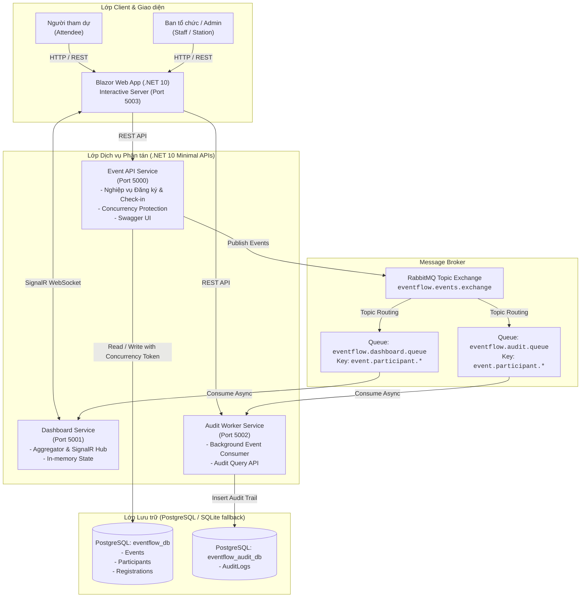
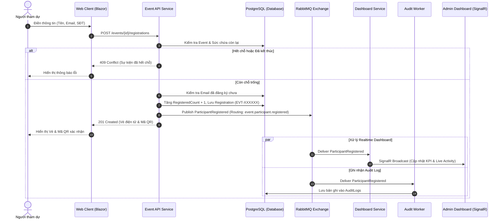
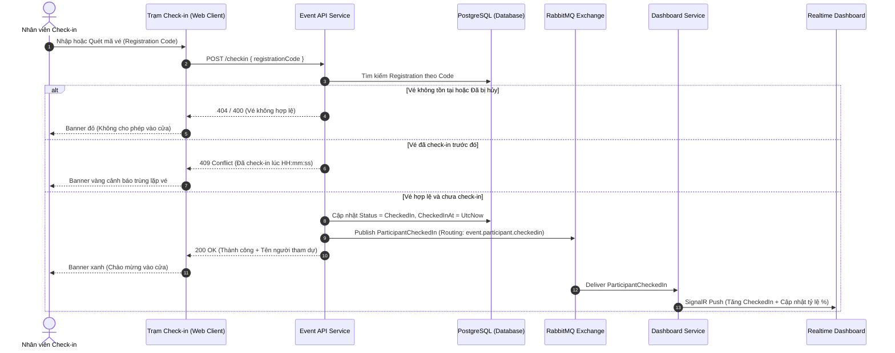
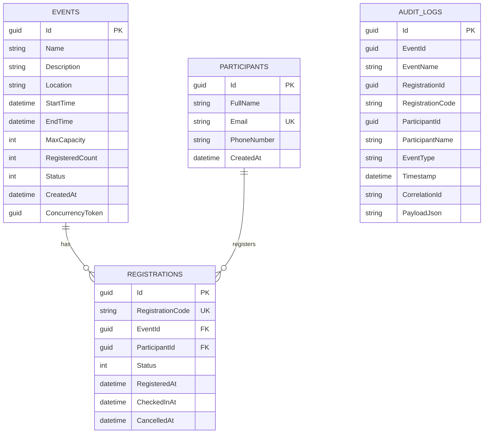

# EventFlow – Distributed Event Registration & Check-in System
## Đề tài 18: Hệ thống Đăng ký Sự kiện và Check-in Phân tán

Hệ thống phân tán hoàn chỉnh phục vụ bài tập lớn môn **Phát triển ứng dụng phân tán**, được thiết kế và triển khai bởi sinh viên **Phan Quang Tùng** (Mã sinh viên: **dtc245200250**).

---

## 1. Giới thiệu Tổng quan

**EventFlow** là một nền tảng quản lý sự kiện, đăng ký tham dự và check-in vé thời gian thực được xây dựng trên nền tảng **C# / .NET 10** theo mô hình kiến trúc phân tán hướng sự kiện (**Event-Driven Architecture**).

Hệ thống giải quyết triệt để các thách thức trong ứng dụng phân tán:
1. **Kiểm soát sức chứa đồng thời (Concurrency Control):** Ngăn chặn hoàn toàn tình trạng overselling (vượt quá sức chứa sự kiện) khi nhiều người dùng đăng ký cùng một thời điểm thông qua cơ chế khóa lạc quan (*Optimistic Concurrency Token*) và giao dịch database.
2. **Xuất bản & Đăng ký sự kiện bất đồng bộ (Pub/Sub):** Tách biệt tầng xử lý nghiệp vụ chính với tầng phân tích, giám sát và kiểm toán thông qua **RabbitMQ Topic Exchange**.
3. **Giám sát thời gian thực (Real-time Dashboard):** Cập nhật các chỉ số KPI và luồng hoạt động trực tiếp đến trình duyệt người dùng qua **ASP.NET Core SignalR** mà không cần tải lại trang.
4. **Kiểm toán độc lập (Audit Trail):** Ghi nhận đầy đủ lịch sử thay đổi trạng thái vé kèm Correlation ID phục vụ truy vết phân tán.

---

## 2. Kiến trúc Hệ thống (System Architecture)



---

## 3. Mô hình Pub/Sub và Topic Routing

Hệ thống sử dụng **RabbitMQ Topic Exchange** với định tuyến linh hoạt:

| Tên sự kiện | Routing Key | Exchange | Mục đích |
|---|---|---|---|
| `ParticipantRegistered` | `event.participant.registered` | `eventflow.events.exchange` | Phát ra khi người tham dự đăng ký thành công |
| `ParticipantCancelled` | `event.participant.cancelled` | `eventflow.events.exchange` | Phát ra khi người tham dự hủy vé, hoàn trả chỗ trống |
| `ParticipantCheckedIn` | `event.participant.checkedin` | `eventflow.events.exchange` | Phát ra khi người tham dự check-in hợp lệ tại trạm |

### Hàng đợi và Liên kết (Queues & Bindings)
- **`eventflow.dashboard.queue`:** Đăng ký lắng nghe mẫu `event.participant.*`. Khi nhận tin nhắn, `DashboardService` cập nhật số liệu thống kê trong bộ nhớ và phát tín hiệu qua SignalR Hub `/hubs/dashboard`.
- **`eventflow.audit.queue`:** Đăng ký độc lập cùng mẫu `event.participant.*`. Khi nhận tin nhắn, `AuditWorker` ghi nhận nhật ký vào bảng `AuditLogs`.
- **Tính độc lập:** Hai Subscriber hoạt động hoàn toàn độc lập trên 2 tiến trình riêng biệt. Khi `AuditWorker` tạm dừng, `DashboardService` vẫn tiếp tục hoạt động bình thường và ngược lại. Khi khởi động lại, subscriber tự động tiêu thụ các message tồn đọng trong queue bền vững (*Durable Queue*).

---

## 4. Sơ đồ Luồng Nghiệp vụ (Sequence Diagrams)

### 4.1. Quy trình Đăng ký Tham dự (Registration Flow)



### 4.2. Quy trình Check-in (Check-in Flow)



---

## 5. Thiết kế Cơ sở dữ liệu (Database Schema)



---

## 6. Cấu trúc Dự án (Solution Structure)

```text
DeTai18_EventFlow/
├── docker-compose.yml              # Cấu hình triển khai toàn bộ hệ thống bằng Docker
├── .env.example                    # File mẫu biến môi trường
├── .gitignore                      # Loại trừ build artifacts, SQLite db, secrets
├── EventFlow.slnx                  # Solution file .NET 10
├── run-local.ps1                   # Kịch bản khởi chạy 4 service local tức thì
├── stop-local.ps1                  # Kịch bản dừng các tiến trình local
├── README.md                       # Tài liệu kiến trúc và hướng dẫn toàn diện
│
├── src/
│   ├── EventFlow.Shared/           # Class Library dùng chung
│   │   ├── Messaging/              # IEventMessage, message contracts, RabbitMqConstants
│   │   └── Models/                 # DTOs (EventDto, RegistrationDto, DashboardDto, v.v.)
│   │
│   ├── EventFlow.EventApi/         # Minimal API Service (Port 5000)
│   │   ├── Data/                   # EventFlowDbContext, Entity configurations, Data Seeder
│   │   ├── Entities/               # Event, Participant, Registration
│   │   ├── Services/               # IRabbitMqPublisher, RabbitMqPublisher resilient
│   │   ├── Program.cs              # REST API endpoints, Concurrency handling, Swagger
│   │   └── Dockerfile              # Multi-stage Docker build cho Event API
│   │
│   ├── EventFlow.DashboardService/ # Real-time Aggregator (Port 5001)
│   │   ├── Hubs/                   # DashboardHub (SignalR WebSockets)
│   │   ├── Services/               # DashboardRabbitMqConsumer, DashboardStateService
│   │   ├── Program.cs              # Map SignalR Hub & Stats API
│   │   └── Dockerfile              # Multi-stage Docker build cho Dashboard Service
│   │
│   ├── EventFlow.AuditWorker/      # Independent Audit Consumer (Port 5002)
│   │   ├── Data/                   # AuditDbContext
│   │   ├── Entities/               # AuditLog
│   │   ├── Services/               # AuditRabbitMqConsumer
│   │   ├── Program.cs              # Audit Query REST API
│   │   └── Dockerfile              # Multi-stage Docker build cho Audit Worker
│   │
│   └── EventFlow.WebClient/        # Blazor Web App Interactive Server (Port 5003)
│       ├── Components/
│       │   ├── Layout/             # MainLayout, NavMenu (Clean SaaS Light Theme)
│       │   └── Pages/              # 9 Màn hình chức năng hoàn chỉnh
│       │       ├── Home.razor              # Trang chủ / Khám phá sự kiện
│       │       ├── EventDetail.razor       # Chi tiết sự kiện & Form đăng ký
│       │       ├── RegistrationSuccess.razor# Vé điện tử & QR Code SVG
│       │       ├── MyRegistrations.razor   # Tra cứu vé & Hủy vé có xác nhận
│       │       ├── AdminDashboard.razor    # Realtime Dashboard 6 KPI qua SignalR
│       │       ├── AdminEvents.razor       # Quản lý & Tạo mới sự kiện
│       │       ├── AdminRegistrations.razor# Danh sách người tham dự & lọc
│       │       ├── AdminCheckin.razor      # Trạm check-in & quét mã QR
│       │       └── AdminAudit.razor        # Xem nhật ký hoạt động phân tán
│       ├── Services/               # EventApiClient, AuditApiClient, DashboardSignalRClient, QrCodeHelper
│       ├── wwwroot/app.css         # Hệ thống Design System SaaS chuyên nghiệp
│       └── Dockerfile              # Multi-stage Docker build cho WebClient
│
└── tests/
    └── EventFlow.Tests/            # Bộ kiểm thử tự động (xUnit, Moq, WebApplicationFactory)
        ├── EventApiIntegrationTests.cs     # Kiểm thử API, giới hạn sức chứa, chống check-in đúp
        ├── DashboardServiceTests.cs       # Kiểm thử tính toán KPI và Realtime broadcast
        └── MessageSerializationTests.cs   # Kiểm thử tuần tự hóa JSON và Topic routing pattern
```

---

## 7. Danh sách RESTful API và Swagger

Khi khởi chạy `EventFlow.EventApi`, truy cập Swagger UI tại: **`http://localhost:5000/swagger`**.

| Method | Endpoint | Mô tả |
|---|---|---|
| `GET` | `/events` | Lấy danh sách sự kiện kèm bộ lọc tìm kiếm và trạng thái |
| `GET` | `/events/{id}` | Lấy thông tin chi tiết của một sự kiện |
| `POST` | `/events` | Tạo sự kiện mới |
| `PUT` | `/events/{id}` | Cập nhật thông tin hoặc sức chứa sự kiện |
| `POST` | `/events/{id}/registrations` | Đăng ký tham gia (có kiểm soát sức chứa đồng thời & phát message) |
| `DELETE` | `/registrations/{id}` | Hủy lượt đăng ký (hoàn trả số chỗ cho sự kiện) |
| `POST` | `/checkin` | Check-in bằng mã Registration Code |
| `POST` | `/registrations/{id}/checkin` | Check-in theo Registration ID |
| `GET` | `/events/{id}/registrations` | Lấy danh sách người đăng ký của một sự kiện cụ thể |
| `GET` | `/registrations` | Lấy tất cả lượt đăng ký kèm tìm kiếm và phân loại |
| `GET` | `/registrations/code/{code}` | Tra cứu chi tiết lượt đăng ký theo mã vé (phục vụ QR scan) |
| `GET` | `/api/dashboard/stats` | Thống kê số liệu trực tiếp từ Database |
| `GET` | `/health` | Kiểm tra tình trạng sức khỏe của service |

---

## 8. Hướng dẫn Cài đặt & Chạy Hệ thống

### 8.1. Chạy bằng Docker Compose (Khuyên dùng trong Production/Đánh giá)

Chỉ cần một lệnh duy nhất để khởi động toàn bộ cụm phân tán gồm PostgreSQL, RabbitMQ và 4 dịch vụ .NET:

```bash
docker compose up --build
```

Sau khi toàn bộ dịch vụ khởi động thành công:
- **Web Client UI:** `http://localhost:5003`
- **Event API Swagger:** `http://localhost:5000/swagger`
- **Dashboard Service:** `http://localhost:5001/hubs/dashboard`
- **Audit Worker API:** `http://localhost:5002/api/audit/logs`
- **RabbitMQ Management UI:** `http://localhost:15672` *(Tài khoản: guest / guest)*

---

### 8.2. Chạy Trực tiếp bằng .NET CLI (Local Development)

Nếu bạn chưa cài đặt Docker hoặc muốn chạy kiểm thử nhanh trên máy cá nhân:

1. **Khởi chạy đồng thời 4 service bằng script:**
   ```powershell
   .\run-local.ps1
   ```

2. **Hoặc chạy thủ công từng service trên các cửa sổ dòng lệnh riêng biệt:**
   ```bash
   # Terminal 1: Event API
   dotnet run --project src/EventFlow.EventApi --urls http://localhost:5000

   # Terminal 2: Dashboard Service
   dotnet run --project src/EventFlow.DashboardService --urls http://localhost:5001

   # Terminal 3: Audit Worker
   dotnet run --project src/EventFlow.AuditWorker --urls http://localhost:5002

   # Terminal 4: Web Client
   dotnet run --project src/EventFlow.WebClient --urls http://localhost:5003
   ```

3. **Dừng các tiến trình local:**
   ```powershell
   .\stop-local.ps1
   ```

---

## 9. Kết quả Kiểm thử Tự động (Automated Testing)

Chạy bộ test xUnit cho toàn bộ hệ thống:

```bash
dotnet test EventFlow.slnx
```

**Kết quả kiểm thử:**
```text
Passed!  - Failed: 0, Passed: 15, Skipped: 0, Total: 15, Duration: 4 s - EventFlow.Tests.dll (net10.0)
```

### Các kịch bản được kiểm thử nghiêm ngặt:
1. `GetEvents_ReturnsSuccessAndSeededEvents`: Đọc dữ liệu sự kiện đã khởi tạo mẫu.
2. `RegisterParticipant_ValidRequest_CreatesRegistrationAndPublishesMessage`: Đăng ký hợp lệ, sinh mã `EVT-XXXXXX` duy nhất và gửi message lên RabbitMQ Topic Exchange.
3. `RegisterParticipant_WhenCapacityReached_ReturnsConflict_PreventsOverselling`: **Chặn đứng overselling** khi số lượng đăng ký đạt ngưỡng sức chứa tối đa (trả về HTTP 409 Conflict).
4. `RegisterParticipant_DuplicateActiveRegistration_ReturnsConflict`: Ngăn chặn đăng ký trùng lặp một sự kiện với cùng địa chỉ email.
5. `CheckIn_ValidCode_Succeeds_AndSecondCheckIn_FailsWithConflict`: Check-in hợp lệ thành công và **từ chối check-in lần 2** trên cùng một mã vé để tránh gian lận vào cửa.
6. `CancelRegistration_Valid_RestoresCapacityAndPublishesMessage`: Hủy vé thành công, hoàn trả chỗ trống cho sự kiện và phát sự kiện `ParticipantCancelled`.
7. `DashboardServiceTests`: Kiểm thử tính toán 6 chỉ số KPI, tỷ lệ check-in và ghi nhận luồng hoạt động.
8. `MessageSerializationTests`: Kiểm thử tuần tự hóa JSON các message hợp đồng và tính khớp của Topic routing key pattern.

---

## 10. Tiêu chuẩn Thiết kế UI/UX (Design System)

Giao diện người dùng được xây dựng tuân thủ nghiêm ngặt các nguyên tắc thiết kế **Modern SaaS Dashboard**:
- **Bảng màu chủ đạo:**
  - `Primary`: `#2563EB` (Xanh dương nhận diện)
  - `Primary Light`: `#EFF6FF` (Nền nút chọn, badge)
  - `Background`: `#F8FAFC` (Màu nền toàn trang sáng sủa, thanh lịch)
  - `Surface`: `#FFFFFF` (Nền các Card và Khung bảng)
  - `Text Primary`: `#1E293B` & `Text Secondary`: `#64748B`
  - `Success`: `#16A34A`, `Warning`: `#D97706`, `Danger`: `#DC2626`
- **Biểu tượng:** Sử dụng 100% SVG Icons chuẩn hóa, **tuyệt đối không dùng emoji** thay thế cho các nút bấm và icon chức năng.
- **Tính phản hồi (Responsive):** Tương thích tốt trên Desktop, Tablet và màn hình điện thoại di động với thanh Sidebar có thể thu gọn linh hoạt.
