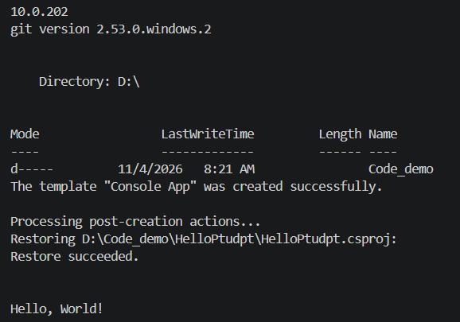
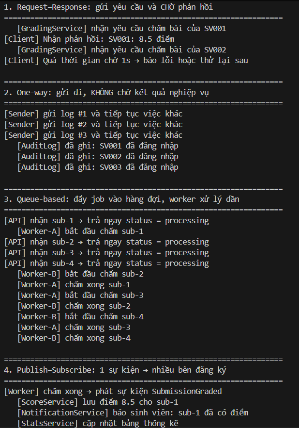
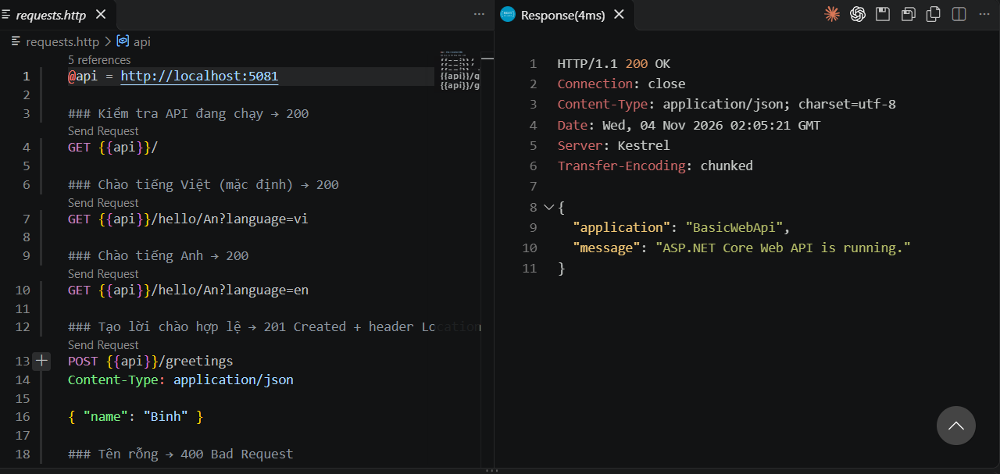
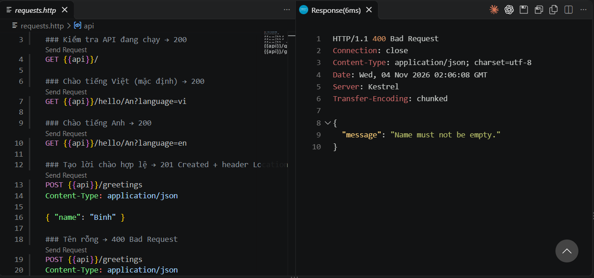
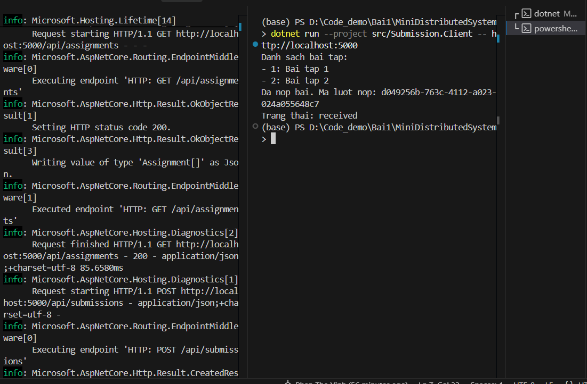
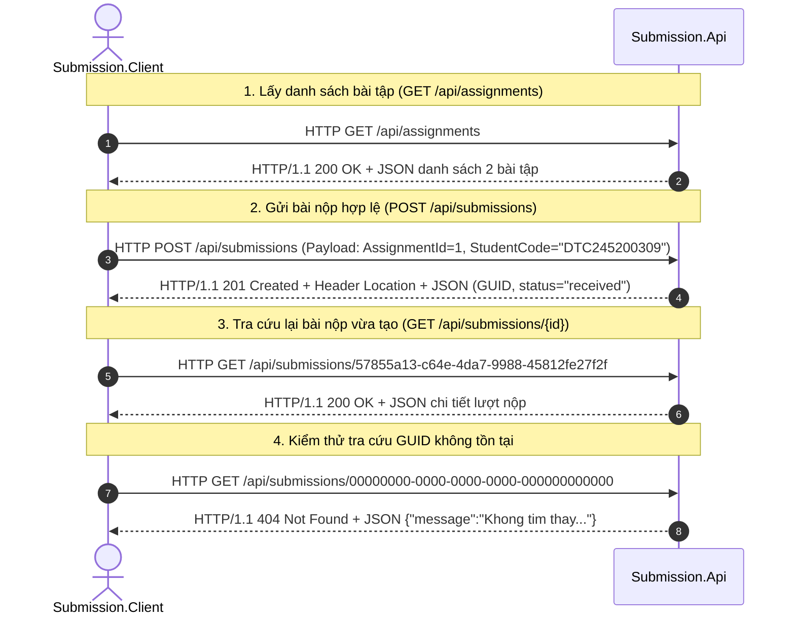
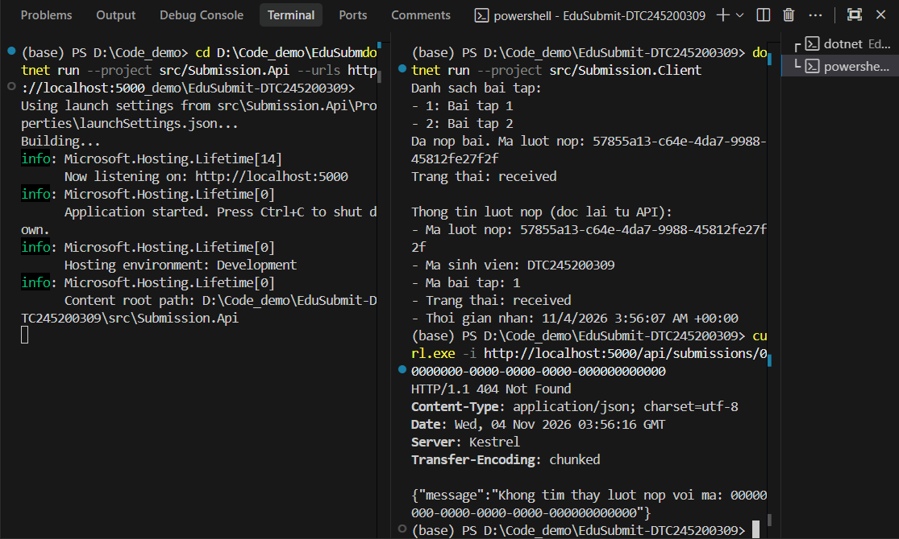

# BÁO CÁO THỰC HÀNH BÀI 1: PHÁT TRIỂN ỨNG DỤNG PHÂN TÁN
## Tổng quan hệ thống và các mô hình trao đổi thông điệp (MEP)

---

### THÔNG TIN SINH VIÊN VÀ DỰ ÁN

- **Họ và tên:** Phan Thế Vinh
- **Mã sinh viên (MSSV):** DTC245200309
- **Lớp:** CNTT K23E
- **Tên dự án:** EduSubmit-DTC245200309
- **Đường dẫn thư mục dự án:** `D:\Code_demo\EduSubmit-DTC245200309`
- **Nền tảng công nghệ:** C# 13 / .NET 10 (ASP.NET Core Minimal API, HttpClient, JSON, Git)
- **Môi trường thực hiện:** Windows 10/11, PowerShell, VS Code / Antigravity

---

## 1. Cài đặt và Kiểm tra môi trường

### 1.1. Các công cụ đã cài đặt
Trong bài thực hành số 1, toàn bộ môi trường phát triển đã được cấu hình và kiểm tra tính tương thích:
- **.NET 10 SDK:** Phiên bản `10.0.202` (kiểm tra bằng lệnh `dotnet --version`).
- **Git Version Control:** Phiên bản `2.53.0.windows.2` (kiểm tra bằng lệnh `git --version`).
- **Visual Studio Code / Antigravity IDE:** Đã cài đặt đầy đủ các extension phục vụ phát triển ứng dụng .NET:
  - *C# Dev Kit* và *.NET Install Tool* (hỗ trợ gợi ý cú pháp, biên dịch và gỡ lỗi C#).
  - *REST Client* (hỗ trợ thực hiện các yêu cầu kiểm thử HTTP trực tiếp từ file `.http`).
- **Chương trình C# đầu tiên (`HelloPtudpt`):** Đã tạo và chạy kiểm tra thành công với lệnh `dotnet run --project D:\Code_demo\HelloPtudpt`, kết quả in ra terminal: `Hello, World!`.

### 1.2. Ảnh minh chứng môi trường

*(Minh chứng: Ảnh chụp terminal hiển thị phiên bản .NET SDK 10.0.202 và Git 2.53.0)*

---

## 2. Thực hành 5 Mô hình trao đổi thông điệp (MEP - Message Exchange Patterns)

Dự án mẫu `MepDemo` tại `D:\Code_demo\Bai1\MepDemo` minh họa hình thái của 5 mô hình trao đổi thông điệp cơ bản trong kiến trúc hệ thống phân tán.

### 2.1. Chi tiết 5 mô hình MEP

1. **Request–Response (Yêu cầu – Phản hồi):**
   - **Cách hoạt động:** Bên gửi phát đi một thông điệp yêu cầu (Request) và tạm dừng công việc hiện tại để CHỜ thông điệp phản hồi (Response) từ bên nhận trước khi tiếp tục. Nếu bên nhận xử lý chậm quá thời hạn cho phép (timeout), bên gửi phải tự phát hiện ngoại lệ và có phương án xử lý lỗi.
   - **Vai trò:** Máy khách (Client) là bên khởi xướng yêu cầu; Máy chủ (Service) là bên lắng nghe, xử lý logic và trả về kết quả.
   - **Công nghệ thực tế:** REST API qua giao thức HTTP, GraphQL, gRPC Unary RPC.
   - **Kết quả thực hành:** Client gọi `GradingService.GradeAsync("SV001", latencyMs: 300)` và nhận phản hồi `SV001: 8.5 điểm`. Khi gọi `SV002` với độ trễ giả lập 2000ms vượt quá hạn `WaitAsync(1s)`, Client bắt được `TimeoutException` và in cảnh báo quá thời gian chờ.

2. **One-Way (Một chiều / Fire-and-Forget):**
   - **Cách hoạt động:** Bên gửi đẩy thông điệp vào kênh truyền và tiếp tục thực hiện ngay công việc khác mà KHÔNG chờ đợi kết quả xử lý nghiệp vụ hay sự xác nhận từ bên nhận.
   - **Vai trò:** `Sender` (bên phát thông điệp), `Channel` (kênh truyền đệm bất đồng bộ), `AuditLog` (tác vụ nền nhận và ghi log tuần tự).
   - **Công nghệ thực tế:** Đường ống thu thập log hệ thống (Logstash, Fluentd), Telemetry, đẩy sự kiện vào Message Broker.
   - **Kết quả thực hành:** Bên gửi đẩy liên tiếp 3 bản tin đăng nhập (`SV001`, `SV002`, `SV003`) vào Channel không khóa. Tác vụ `AuditLog` xử lý nền chậm rãi (150ms/bản tin) mà không gây ảnh hưởng hay làm chậm luồng công việc chính của bên gửi.

3. **Queue-Based (Hàng đợi công việc / Competing Consumers):**
   - **Cách hoạt động:** Máy chủ đưa các tác vụ công việc vào một hàng đợi có bộ đệm giới hạn (`BoundedChannel`). Nhiều worker (tiến trình xử lý) cùng lắng nghe chung hàng đợi đó. Mỗi công việc trong hàng đợi chỉ được phân phối cho duy nhất MỘT worker xử lý (các worker cạnh tranh nhau lấy việc).
   - **Vai trò:** Producer (API tiếp nhận việc và trả ngay trạng thái `processing`), Message Queue (bộ đệm hàng đợi), Workers (`Worker-A`, `Worker-B` chia sẻ tải công việc).
   - **Công nghệ thực tế:** Hàng đợi RabbitMQ, Azure Service Bus Queue, Amazon SQS, .NET Background Worker Service.
   - **Kết quả thực hành:** 4 bài nộp (`sub-1` đến `sub-4`) được đẩy vào hàng đợi; `Worker-A` và `Worker-B` luân phiên nhận và xử lý song song các bài nộp, đảm bảo không có bài nộp nào bị xử lý trùng lặp.

4. **Publish–Subscribe (Xuất bản – Đăng ký):**
   - **Cách hoạt động:** Khi một sự kiện nghiệp vụ xảy ra, bên phát (Publisher) bắn sự kiện đó lên kênh trung gian (Event Bus / Exchange / Topic). Sự kiện được chuyển đồng thời tới TẤT CẢ các dịch vụ đã đăng ký (Subscribers) quan tâm đến loại sự kiện đó. Bên phát hoàn toàn độc lập và không cần biết có bao nhiêu bên nhận và bên nhận xử lý sự kiện như thế nào.
   - **Vai trò:** Publisher (Worker phát sự kiện `SubmissionGraded`), Event Bus (bộ định tuyến sự kiện trong bộ nhớ), Subscribers (`ScoreService`, `NotificationService`, `StatsService`).
   - **Công nghệ thực tế:** RabbitMQ Fanout/Topic Exchange, Apache Kafka, Redis Pub/Sub, Azure Event Grid.
   - **Kết quả thực hành:** Khi Worker chấm xong phát sự kiện `SubmissionGraded("sub-1", 8.5)`, cả 3 dịch vụ độc lập đều nhận được sự kiện: `ScoreService` lưu điểm, `NotificationService` báo tin cho sinh viên, và `StatsService` cập nhật bảng thống kê.

5. **Streaming / Push (Dòng dữ liệu / Đẩy liên tục):**
   - **Cách hoạt động:** Máy chủ duy trì một kênh truyền kết nối liên tục (persistent connection) tới máy khách và chủ động đẩy các bản cập nhật dữ liệu theo thời gian thực mỗi khi có trạng thái mới, máy khách không cần phải gửi request hỏi lặp đi lặp lại (Polling).
   - **Vai trò:** Streaming Server (`IAsyncEnumerable<string>`), Client Consumer (`await foreach`).
   - **Công nghệ thực tế:** ASP.NET Core SignalR, WebSocket, gRPC Streaming, Server-Sent Events (SSE).
   - **Kết quả thực hành:** Client nhận dòng cập nhật tiến độ chấm bài theo thời gian thực: `sub-1 -> received` -> `sub-1 -> processing 30%` -> `sub-1 -> processing 70%` -> `sub-1 -> graded: 8.5`.

### 2.2. Trả lời các câu hỏi trong tài liệu hướng dẫn:
1. **Ở MEP 3 (Queue-based), mỗi bài nộp sub-x được mấy worker xử lý?**
   - *Trả lời:* Mỗi bài nộp chỉ do **MỘT** worker xử lý. Đây là đặc trưng của mô hình *Competing Consumers* (các worker cùng lấy việc từ một hàng đợi chung để san tải, một công việc đã được worker này lấy thì worker khác sẽ không nhận lại).
2. **Ở MEP 4 (Publish–Subscribe), một sự kiện được gửi tới mấy dịch vụ?**
   - *Trả lời:* Một sự kiện được gửi tới **TẤT CẢ** các dịch vụ đã đăng ký lắng nghe loại sự kiện đó (trong demo là cả 3 dịch vụ: `ScoreService`, `NotificationService`, `StatsService`).
3. **Mô tả ngắn gọn một câu cho mỗi MEP:**
   - *MEP 1:* Bên gửi gửi yêu cầu và tạm dừng chờ kết quả phản hồi từ bên nhận.
   - *MEP 2:* Bên gửi đẩy thông điệp đi rồi tiếp tục ngay việc khác mà không đợi kết quả.
   - *MEP 3:* Tác vụ được đẩy vào hàng đợi đệm và các worker chia nhau xử lý dần theo năng lực.
   - *MEP 4:* Một sự kiện phát ra được phân phối đồng thời đến tất cả các bên đăng ký quan tâm.
   - *MEP 5:* Máy chủ chủ động đẩy liên tục các bản cập nhật dữ liệu tới máy khách qua kết nối mở sẵn.

### 2.3. Ảnh minh chứng MEP

*(Minh chứng: Ảnh chụp terminal chạy thành công toàn bộ 5 mô hình trao đổi thông điệp trong MepDemo)*

---

## 3. BasicWebApi – Kỹ thuật Minimal API trên ASP.NET Core

Dự án mẫu `BasicWebApi` tại `D:\Code_demo\Bai1\BasicWebApi` rèn luyện các kỹ thuật cốt lõi của Web API hiện đại trên .NET 10.

### 3.1. Các kỹ thuật đã thực hành
- **Minimal API:** Xây dựng dịch vụ Web API gọn nhẹ, định tuyến trực tiếp thông qua các phương thức mở rộng `app.MapGet` và `app.MapPost` mà không cần cấu hình Controller boilerplate.
- **Dependency Injection (DI):** Đăng ký dịch vụ `builder.Services.AddSingleton<GreetingService>()` ở Pha 1 (chuẩn bị), sau đó Service Provider được niêm phong khi gọi `builder.Build()`. Dịch vụ được tự động tiêm (inject) vào route handler của POST `/greetings`.
- **Nhận dữ liệu đa nguồn:**
  - Route Parameter: Lấy từ URL path định tuyến, ví dụ: `/hello/{name}` lấy biến `name`.
  - Query String: Lấy từ tham số sau dấu chấm hỏi trên URL, ví dụ: `?language=en` lấy biến `language`.
  - Request Body: Đọc và giải tuần tự hóa tự động từ JSON body vào record `CreateGreetingRequest`.
- **Kết quả trả về chuẩn hóa qua `Results`:**
  - Trả về mã `200 OK` cho các truy vấn dữ liệu thành công (`Results.Ok(...)`).
  - Trả về mã `201 Created` kèm header `Location: /greetings/{id}` khi tài nguyên mới được tạo thành công (`Results.Created(...)`).
  - Trả về mã `400 Bad Request` kèm thông báo lỗi khi dữ liệu đầu vào không hợp lệ (`Results.BadRequest(...)`).

### 3.2. Bảng kết quả kiểm thử các endpoint đã có

| Phương thức | Endpoint / Yêu cầu | Mã trạng thái HTTP | Dữ liệu phản hồi / Header |
|---|---|---|---|
| `GET` | `/` | **200 OK** | `{"application":"BasicWebApi","message":"ASP.NET Core Web API is running."}` |
| `GET` | `/hello/An?language=vi` | **200 OK** | `{"message":"Xin chào, An!"}` (mặc định tiếng Việt) |
| `GET` | `/hello/An?language=en` | **200 OK** | `{"message":"Hello, An!"}` (chào tiếng Anh) |
| `POST` | `/greetings` body: `{"name":"Binh"}` | **201 Created** | Header `Location: /greetings/1`<br>`{"id":1,"name":"Binh","createdAt":"..."}` |
| `POST` | `/greetings` body: `{"name":""}` | **400 Bad Request** | `{"message":"Name must not be empty."}` |

- **Nội dung mở rộng `language=ja`:** Khi truyền tham số `?language=ja`, API trả về lời chào tiếng Nhật: `{"message":"Konnichiwa, An!"}`.

### 3.3. Trả lời 3 câu hỏi mục 8.4 trong tài liệu giảng viên:
1. **Hai dòng `builder.Services.AddSingleton...` và `var app = builder.Build();` – dòng nào phải đứng trước? Vì sao?**
   - *Trả lời:* Dòng `builder.Services.AddSingleton...` **bắt buộc phải đứng trước** dòng `var app = builder.Build();`.
   - *Giải thích:* ASP.NET Core áp dụng quy trình khởi tạo hai pha nghiêm ngặt: Pha 1 (Builder Phase) dùng để cấu hình và đăng ký dịch vụ vào `IServiceCollection`; Pha 2 (`builder.Build()`) sẽ biên dịch và niêm phong (immutable) Service Provider thành đối tượng `WebApplication`. Sau khi ứng dụng đã được `Build()`, container không cho phép đăng ký thêm bất kỳ dịch vụ nào nữa.
2. **Trong `/hello/{name}?language=en`, tham số `name` lấy từ đâu, `language` lấy từ đâu?**
   - *Trả lời:* Tham số `name` được trích xuất từ **Route Parameter** (đoạn đường dẫn URL được ánh xạ theo khuôn mẫu định tuyến `/{name}`). Tham số `language` được trích xuất từ **Query String** (cặp key-value nằm sau dấu `?` trên đường dẫn URL).
3. **Vì sao POST hợp lệ trả `Results.Created` (201) chứ không phải `Results.Ok` (200)?**
   - *Trả lời:* Theo chuẩn giao thức HTTP (RFC 9110) và nguyên lý thiết kế RESTful, khi một yêu cầu tạo mới tài nguyên thành công trên máy chủ, mã trạng thái ngữ nghĩa chính xác là **201 Created**. Mã này bắt buộc kèm theo header `Location` chỉ định địa chỉ URI để máy khách có thể truy xuất trực tiếp tài nguyên vừa tạo. Mã **200 OK** chỉ thể hiện yêu cầu xử lý thành công thông thường mà không nhấn mạnh hành động sinh mới tài nguyên.

### 3.4. Ảnh minh chứng BasicWebApi

*(Minh chứng: Ảnh chụp REST Client gửi các request GET và POST thành công trên BasicWebApi)*


*(Minh chứng: Ảnh chụp kết quả gửi POST tên rỗng trả về HTTP 400 Bad Request)*

---

## 4. MiniDistributedSystem – Hệ thống phân tán thu nhỏ

Dự án mẫu `MiniDistributedSystem` tại `D:\Code_demo\Bai1\MiniDistributedSystem` là hình mẫu phân tán đầu tiên trong học phần, bao gồm 2 project độc lập:
- `src/Submission.Api`: Máy chủ Minimal API tiếp nhận yêu cầu qua cổng HTTP (mặc định 5000).
- `src/Submission.Client`: Máy khách Console C# sử dụng `HttpClient` để tương tác với máy chủ.

### 4.1. Đặc điểm kiến trúc
- **Tiến trình độc lập:** API và Client chạy ở hai tiến trình riêng biệt (hai cửa sổ terminal khác nhau), có thể chạy trên hai máy tính khác nhau qua mạng.
- **Giao thức và định dạng dữ liệu:** Hai bên trao đổi bằng giao thức HTTP, định dạng dữ liệu tuần tự hóa là JSON.
- **Hợp đồng dữ liệu (Data Contract):** Client và API không hề chia sẻ mã nguồn (không sử dụng Project Reference). Mỗi bên tự định nghĩa cấu trúc dữ liệu (`Assignment`, `CreateSubmissionRequest`, `SubmissionResult`) tương thích về mặt cấu trúc JSON.
- **Tính độc lập môi trường:** Client đọc địa chỉ API từ tham số dòng lệnh `args[0]` (ví dụ: `dotnet run -- http://localhost:5000`). Nhờ đó, khi máy chủ đổi IP hoặc cổng mạng, Client chỉ cần đổi tham số truyền vào mà không phải sửa và biên dịch lại code.

### 4.2. Trả lời 3 câu hỏi mục 9 trong tài liệu:
1. **Client gọi những endpoint nào của API? Mỗi lần gọi là một cặp request–response gồm method, URL, mã trạng thái gì?**
   - *Lần 1:* Method `GET`, URL `/api/assignments`, mã phản hồi `200 OK` (lấy danh sách bài tập).
   - *Lần 2:* Method `POST`, URL `/api/submissions`, mã phản hồi `201 Created` (nộp bài và nhận mã GUID).
2. **Client có tham chiếu (dùng chung) code của API không? Hai bên "thống nhất" với nhau bằng gì?**
   - *Trả lời:* Client **hoàn toàn không tham chiếu** hay dùng chung thư viện nhị phân (`.dll`) nào của API. Hai bên thống nhất với nhau thông qua **Hợp đồng dữ liệu (Data Contract)** dựa trên giao thức HTTP và định dạng JSON.
3. **Vì sao địa chỉ API được truyền qua tham số `-- http://localhost:5000` mà không viết cứng trong code?**
   - *Trả lời:* Để đảm bảo tính linh hoạt (Configurability) và tính độc lập môi trường (Environment Independence). Khi triển khai thực tế trên môi trường Test, Staging, Cloud hoặc Docker, máy chủ có thể chạy trên các địa chỉ IP và cổng khác nhau. Việc truyền qua tham số giúp cấu hình Client kết nối tới bất kỳ máy chủ nào mà không phải sửa mã nguồn và biên dịch lại.

### 4.3. Ảnh minh chứng MiniDistributedSystem

*(Minh chứng: Ảnh chụp màn hình chia đôi 2 terminal hiển thị đồng thời API đang lắng nghe và Client in ra danh sách bài tập, mã lượt nộp GUID)*

---

## 5. Thực nghiệm các tình huống lỗi (Error Experiments)

Hệ thống phân tán luôn tiềm ẩn rủi ro lỗi do sự thiếu tin cậy của hạ tầng mạng và sự độc lập giữa các tiến trình. Bốn thí nghiệm lỗi dưới đây đã được tiến hành thực tế trên hệ thống:

### 5.1. Bảng tổng hợp kết quả 4 thí nghiệm lỗi

| # | Tình huống thử nghiệm | Dự đoán trước khi chạy | Kết quả thực tế ghi nhận | Đánh giá | Nguyên nhân kỹ thuật & Cách khắc phục |
|---|---|---|---|---|---|
| **a** | **Thêm bài tập thứ 3 vào API**<br>Thêm vào mảng `assignments` của API, chạy lại API và Client. | Client vẫn chạy bình thường và in đủ 3 bài tập mà không cần sửa code. | Client in ra đầy đủ cả 3 bài tập (`1: Bai tap 1`, `2: Bai tap 2`, `3: Bai tap 3`). Lượt nộp bài tiếp theo vẫn thành công. | **Đúng** | **Nguyên nhân:** Client sử dụng `GetFromJsonAsync<List<Assignment>>` để giải tuần tự hóa động mảng JSON và duyệt in bằng vòng lặp `foreach`. Do hợp đồng dữ liệu `Assignment` không thay đổi cấu trúc trường, việc mở rộng tập dữ liệu từ server không phá vỡ tính tương thích của client (*Loose Coupling*). |
| **b** | **Tắt API rồi chạy Client**<br>Dừng tiến trình API trên cổng 5000, sau đó chạy Client. | Client không kết nối được đến máy chủ và báo lỗi mạng / ném ngoại lệ. | Client ném ngoại lệ `HttpRequestException: No connection could be made because the target machine actively refused it. (localhost:5000)` từ `SocketException (10061)`. | **Đúng** | **Nguyên nhân:** Trong hệ thống phân tán, các tiến trình giao tiếp qua kết nối mạng TCP. Khi tiến trình máy chủ bị tắt, không có socket nào lắng nghe tại cổng 5000 để bắt tay TCP (TCP Handshake).<br>**Khắc phục:** Đảm bảo tiến trình API đã được khởi động và đang ở trạng thái lắng nghe trước khi Client gửi yêu cầu; trong ứng dụng thực tế cần bổ sung cơ chế Retry / Circuit Breaker. |
| **c** | **Gửi StudentCode rỗng từ Client**<br>Client truyền `StudentCode: ""` khi gọi POST `/api/submissions`. | API phát hiện dữ liệu rỗng và trả về mã lỗi 400 Bad Request; Client dừng ở dòng kiểm tra mã phản hồi. | API trả về HTTP `400 Bad Request` kèm JSON `{ "message": "Du lieu nop bai khong hop le" }`. Client dừng và ném `HttpRequestException: Response status code does not indicate success: 400 (Bad Request)` tại dòng `response.EnsureSuccessStatusCode()`. | **Đúng** | **Nguyên nhân:** Hàm `EnsureSuccessStatusCode()` có nhiệm vụ kiểm tra mã trạng thái HTTP, nếu mã không nằm trong dải thành công 2xx thì lập tức ném ngoại lệ để ngăn Client đọc dữ liệu lỗi như dữ liệu thành công.<br>**Ý nghĩa:** Máy chủ phải luôn tự kiểm tra tính hợp lệ của dữ liệu đầu vào (Input Validation) để bảo vệ tính toàn vẹn hệ thống và tuyệt đối không tin tưởng dữ liệu gửi từ máy khách (*Zero Trust*). |
| **d** | **Đổi API sang cổng 5050**<br>Chạy API ở cổng 5050, Client vẫn gọi cổng 5000. Sau đó sửa lại để chạy được mà không sửa code. | Client gọi cổng 5000 bị từ chối kết nối. Sau khi truyền URL đúng qua tham số dòng lệnh thì Client chạy bình thường. | Client gọi cổng 5000 gặp ngoại lệ `HttpRequestException` (SocketException 10061). Chạy lệnh `dotnet run -- http://localhost:5050` thì Client kết nối chuẩn xác tới cổng 5050 và chạy thành công. | **Đúng** | **Nguyên nhân:** Địa chỉ cổng mạng đã thay đổi ở máy chủ nên yêu cầu gửi tới cổng cũ không thể thiết lập kết nối.<br>**Cách khắc phục:** Truyền địa chỉ mới qua tham số dòng lệnh `args[0]`. Nhờ thiết kế đọc URL linh hoạt từ tham số, ta không cần phải mở file mã nguồn để sửa hay biên dịch lại chương trình. |

### 5.2. Ảnh minh chứng thí nghiệm lỗi

*(Ghi chú: Ảnh minh chứng cần bổ sung nếu muốn chụp riêng màn hình ghi nhận ngoại lệ lỗi)*

---

## 6. Dự án EduSubmit tự làm (Bước 11–12)

Dự án `EduSubmit-DTC245200309` được xây dựng tại thư mục `D:\Code_demo\EduSubmit-DTC245200309`. Solution `EduSubmit.slnx` bao gồm hai project hoàn toàn độc lập:
- `src/Submission.Api`: Máy chủ dịch vụ Web API xây dựng trên nền tảng ASP.NET Core Minimal API (.NET 10).
- `src/Submission.Client`: Ứng dụng Console máy khách (.NET 10) sử dụng thư viện `HttpClient` và `System.Net.Http.Json`.

Hai project không hề sử dụng project reference của nhau, chỉ giao tiếp với nhau bằng giao thức HTTP và trao đổi dữ liệu qua định dạng JSON.

---

### 6.1. Bước 11 – Xây dựng hệ thống EduSubmit

#### A. Mục tiêu và cấu trúc dự án
- **Mục tiêu:** Tự triển khai hoàn chỉnh một hệ thống phân tán gồm API máy chủ và Client máy khách độc lập, trao đổi dữ liệu dựa trên mô hình Request–Response qua HTTP.
- **Cấu trúc thư mục:**
  ```
  EduSubmit-DTC245200309/
  ├── EduSubmit.slnx
  ├── requests.http
  ├── src/
  │   ├── Submission.Api/
  │   │   ├── Program.cs
  │   │   └── Submission.Api.csproj
  │   └── Submission.Client/
  │       ├── Program.cs
  │       └── Submission.Client.csproj
  ```

#### B. Vai trò và cài đặt của `Submission.Api`
`Submission.Api` đóng vai trò máy chủ tiếp nhận, kiểm tra dữ liệu và phản hồi các yêu cầu từ máy khách trên cổng `http://localhost:5000`:
- **`GET /`:** Endpoint kiểm tra trạng thái dịch vụ (Health Check), trả về HTTP `200 OK`:
  ```json
  { "service": "Submission.Api", "status": "running" }
  ```
- **`GET /api/assignments`:** Cung cấp danh sách các bài tập mẫu đã khai báo sẵn trong bộ nhớ:
  ```json
  [
    { "id": 1, "title": "Bai tap 1", "description": "Tao API dau tien" },
    { "id": 2, "title": "Bai tap 2", "description": "Goi API tu client" }
  ]
  ```
- **`POST /api/submissions`:** Tiếp nhận bài nộp của sinh viên với payload JSON (`assignmentId`, `studentCode`, `repositoryUrl`):
  - *Kiểm tra dữ liệu (Validation):* Kiểm tra nếu `assignmentId <= 0` hoặc chuỗi `studentCode` rỗng / chỉ chứa khoảng trắng hoặc `repositoryUrl` rỗng thì API từ chối xử lý và trả về ngay mã lỗi HTTP **400 Bad Request**:
    ```json
    { "message": "Du lieu nop bai khong hop le" }
    ```
  - *Ghi nhận thành công:* Nếu dữ liệu hợp lệ, API khởi tạo bản ghi `SubmissionResult` với mã định danh GUID duy nhất (`Guid.NewGuid()`), gán trạng thái ban đầu `"received"` cùng mốc thời gian UTC hiện tại (`DateTimeOffset.UtcNow`).
  - *Phản hồi:* Trả về mã HTTP **201 Created**, kèm header `Location: /api/submissions/{id}` và body JSON chứa toàn bộ thông tin lượt nộp vừa tạo.

#### C. Vai trò và cách thức hoạt động của `Submission.Client`
`Submission.Client` đóng vai trò máy khách tiêu thụ dịch vụ (API consumer):
- Lấy địa chỉ cơ sở của máy chủ từ đối số dòng lệnh `args[0]` (nếu không truyền sẽ mặc định trỏ tới `http://localhost:5000`), gán vào `http.BaseAddress`.
- **Gửi HTTP GET:** Gọi phương thức mở rộng `http.GetFromJsonAsync<List<Assignment>>("/api/assignments")`, giải tuần tự hóa danh sách bài tập từ JSON và in ra màn hình.
- **Gửi HTTP POST:** Khởi tạo đối tượng `CreateSubmissionRequest` với thông tin bài nộp của sinh viên Phan Thế Vinh (MSSV `DTC245200309`), gọi `http.PostAsJsonAsync("/api/submissions", submissionRequest)`.
- **Kiểm tra mã trạng thái:** Gọi `postResponse.EnsureSuccessStatusCode()` để đảm bảo yêu cầu thành công trước khi đọc nội dung.
- **Nhận kết quả:** Đọc nội dung phản hồi bằng `postResponse.Content.ReadFromJsonAsync<SubmissionResult>()`, in ra terminal mã lượt nộp (GUID) và trạng thái `"received"`.

---

### 6.2. Bước 12 – Mở rộng tra cứu lượt nộp bài

Nhằm hoàn thiện bài mở rộng để đạt điểm tối đa theo yêu cầu đề cương, hệ thống đã được bổ sung khả năng lưu trữ và tra cứu lại thông tin lượt nộp bài theo GUID:

#### A. Phía máy chủ (`Submission.Api`):
1. **Lưu trữ trong bộ nhớ:** Khai báo danh sách `var submissions = new List<SubmissionResult>();` để lưu các bản ghi bài nộp trong suốt thời gian API chạy.
2. **Đảm bảo an toàn đa luồng:** Khi ghi nhận bài nộp mới trong `POST /api/submissions`, sử dụng khối khóa đồng bộ `lock (submissions) { submissions.Add(submission); }` nhằm tránh xung đột tài nguyên (*Race Condition*) khi có nhiều request đồng thời.
3. **Endpoint tra cứu `GET /api/submissions/{id:guid}`:**
   - Trích xuất tham số `id` kiểu `Guid` từ đường dẫn.
   - Tìm kiếm bản ghi trong danh sách bằng `submissions.FirstOrDefault(s => s.Id == id)`.
   - **Tìm thấy:** Trả về mã HTTP **200 OK** kèm theo đối tượng JSON `SubmissionResult`.
   - **Không tìm thấy:** Trả về mã HTTP **404 Not Found** kèm JSON thông báo lỗi:
     ```json
     { "message": "Khong tim thay luot nop voi ma: <guid>" }
     ```

#### B. Phía máy khách (`Submission.Client`):
- Sau khi nhận được phản hồi thành công từ yêu cầu POST nộp bài, Client trích xuất mã GUID vừa được cấp (`result.Id`).
- Client gửi tiếp một yêu cầu `GET` đến endpoint `/api/submissions/{result.Id}` qua lệnh `http.GetAsync(...)`.
- Gọi `getResponse.EnsureSuccessStatusCode()` và đọc lại đối tượng bài nộp bằng `ReadFromJsonAsync<SubmissionResult>()`.
- In thông tin chi tiết được đọc lại từ API ra màn hình để đối chiếu và xác nhận.

---

### 6.3. Sơ đồ luồng trao đổi thông điệp (Message Flow)

Toàn bộ quá trình tương tác giữa máy khách (`Submission.Client`) và máy chủ (`Submission.Api`) tuân thủ nghiêm ngặt mô hình **Request–Response qua giao thức HTTP**: mỗi thao tác nghiệp vụ là một cặp yêu cầu (Request) độc lập do máy khách gửi đi và phản hồi (Response) tương ứng do máy chủ trả về.

#### Sơ đồ tuần tự (Mermaid Sequence Diagram):



#### Mô tả chi tiết từng cặp Request–Response:
1. **Yêu cầu lấy danh sách bài tập:**
   - `Client` --(HTTP GET `/api/assignments`)--> `API`
   - `Client` <--(HTTP `200 OK` + JSON danh sách bài tập)-- `API`
2. **Yêu cầu gửi bài nộp:**
   - `Client` --(HTTP POST `/api/submissions`)--> `API`
   - `Client` <--(HTTP `201 Created` + Header `Location` + GUID + status: `"received"`)-- `API`
3. **Yêu cầu tra cứu lại lượt nộp tồn tại:**
   - `Client` --(HTTP GET `/api/submissions/{id}`)--> `API`
   - `Client` <--(HTTP `200 OK` + JSON chi tiết bài nộp từ bộ nhớ)-- `API`
4. **Yêu cầu tra cứu lượt nộp không tồn tại:**
   - `Client` --(HTTP GET `/api/submissions/{id không tồn tại}`)--> `API`
   - `Client` <--(HTTP `404 Not Found` + JSON thông báo lỗi)-- `API`

---

### 6.4. Kết quả kiểm thử thực tế Bước 11 và Bước 12

Kết quả thực thi thực tế được ghi nhận chính xác từ phiên chạy trên hệ thống:

```text
=== TERMINAL 1 (Submission.Api) ===
Now listening on: http://localhost:5000
Application started. Press Ctrl+C to shut down.
Hosting environment: Development

=== TERMINAL 2 (Submission.Client) ===
Danh sach bai tap:
- 1: Bai tap 1
- 2: Bai tap 2
Da nop bai. Ma luot nop: 57855a13-c64e-4da7-9988-45812fe27f2f
Trang thai: received

Thong tin luot nop (doc lai tu API):
- Ma luot nop: 57855a13-c64e-4da7-9988-45812fe27f2f
- Ma sinh vien: DTC245200309
- Ma bai tap: 1
- Trang thai: received
- Thoi gian nhan: 11/4/2026 3:56:07 AM +00:00

=== KIỂM THỬ GUID KHÔNG TỒN TẠI (curl.exe) ===
curl.exe -i http://localhost:5000/api/submissions/00000000-0000-0000-0000-000000000000
HTTP/1.1 404 Not Found
Content-Type: application/json; charset=utf-8
Date: Wed, 04 Nov 2026 03:56:16 GMT
Server: Kestrel
Transfer-Encoding: chunked

{"message":"Khong tim thay luot nop voi ma: 00000000-0000-0000-0000-000000000000"}
```

---

### 6.5. Ảnh minh chứng kết quả thực hành Bước 11 và Bước 12

Ảnh minh chứng chụp toàn cảnh hai terminal chia đôi màn hình: bên trái là máy chủ `Submission.Api` lắng nghe tại `http://localhost:5000`, bên phải là `Submission.Client` in danh sách bài tập, tạo lượt nộp thành công với MSSV `DTC245200309`, mã GUID `57855a13-c64e-4da7-9988-45812fe27f2f`, trạng thái `received`, đọc lại dữ liệu thành công từ API và phản hồi kiểm thử HTTP 404 Not Found cho GUID không tồn tại:


*(Minh chứng: Ảnh chụp màn hình 2 terminal chạy đồng thời Submission.Api và Submission.Client thể hiện trọn vẹn kết quả Bước 11 và Bước 12)*

---

## 7. Khó khăn gặp phải và Cách giải quyết

Trong quá trình thực hiện Bài 1, một số trở ngại kỹ thuật đã phát sinh và được xử lý triệt để:

1. **Quản lý tiến trình nền và xung đột cổng mạng (Port Collision):**
   - *Khó khăn:* Khi chạy thử nghiệm và dừng API nhiều lần, tiến trình cũ có thể vẫn chiếm dụng cổng 5000 ở chế độ nền, dẫn đến lỗi `Address already in use` khi khởi động tiến trình mới.
   - *Cách giải quyết:* Sử dụng lệnh PowerShell `Get-NetTCPConnection -LocalPort 5000` để truy vấn chính xác PID tiến trình đang chiếm cổng, kiểm tra tên tiến trình và tắt an toàn trước khi chạy phiên bản mới.
2. **Khởi tạo và phân tách kho lưu trữ Git độc lập:**
   - *Khó khăn:* Thư mục dự án sinh viên `EduSubmit-DTC245200309` nằm bên trong thư mục demo lớn của môn học vốn đã có Git repo cha. Nếu thao tác `git add` không cẩn thận sẽ commit toàn bộ bài mẫu vào bài nộp cá nhân.
   - *Cách giải quyết:* Khởi tạo repository Git riêng biệt (`git init`) trực tiếp bên trong `EduSubmit-DTC245200309`, cấu hình `.gitignore` chuẩn .NET để bỏ qua các thư mục build (`bin/`, `obj/`), kiểm tra lại bằng `git rev-parse --show-toplevel` để xác nhận phạm vi repo độc lập hoàn toàn với thư mục cha.
3. **Đảm bảo an toàn đa luồng cho dữ liệu trong bộ nhớ (Thread-Safety):**
   - *Khó khăn:* `List<T>` trong C# không an toàn khi có nhiều luồng đọc và ghi cùng lúc. Khi máy chủ nhận nhiều request POST và GET đồng thời từ các máy khách, việc truy cập danh sách có thể gây ra ngoại lệ xung đột tài nguyên (*Race Condition*).
   - *Cách giải quyết:* Áp dụng cơ chế khóa đồng bộ `lock (submissions)` xung quanh mọi thao tác thêm phần tử mới và tìm kiếm trong danh sách, bảo đảm tính toàn vẹn dữ liệu cho dịch vụ.

---

## 8. Quản lý mã nguồn với Git và GitHub

### 8.1. Trạng thái kho lưu trữ
- Repository độc lập: `D:\Code_demo\EduSubmit-DTC245200309\.git`
- Branch chính thức: `main`
- Danh sách commit rõ nghĩa:
  - Commit khởi tạo: Cấu hình mã nguồn, project và file kiểm thử `requests.http` cho dự án EduSubmit.
  - Commit hoàn thiện: Báo cáo nhật ký thực hành `docs/bai1.md`, file `README.md` và toàn bộ ảnh minh chứng.
- Tag bài nộp: `bai1` (đã được tạo và xác nhận tồn tại).

### 8.2. Hướng dẫn lệnh đẩy lên GitHub
Sau khi tạo repository trống trên GitHub với tên `EduSubmit-DTC245200309`, sinh viên chạy các lệnh sau tại thư mục dự án:
```powershell
cd D:\Code_demo\EduSubmit-DTC245200309
git remote add origin https://github.com/<tai-khoan-github-cua-ban>/EduSubmit-DTC245200309.git
git push -u origin main --tags
```

### 8.3. Ảnh minh chứng Git & GitHub Tag

*(Ghi chú: Ảnh minh chứng cần bổ sung chụp màn hình `git log --oneline --decorate` và `git tag -l` sau khi hoàn tất các commit)*

---

## 9. Nhận xét và Kết luận

- **Về kiến trúc phân tán:** Bài thực hành số 1 đã giúp sinh viên phân biệt rõ ràng giữa ứng dụng nguyên khối (*Monolithic*) và ứng dụng phân tán (*Distributed Application*). Ranh giới giữa máy chủ và máy khách trong Bài 1 được phân định qua hạ tầng mạng TCP/IP, giao thức HTTP và hợp đồng dữ liệu JSON. Sự độc lập về không gian địa chỉ bộ nhớ và vòng đời tiến trình đòi hỏi phải có các cơ chế xử lý lỗi mạng, kiểm tra dữ liệu đầu vào nghiêm ngặt và quản lý cấu hình linh hoạt.
- **Về kết quả đạt được:** Hoàn thành 100% các yêu cầu từ Bước 1 đến Bước 13 theo đề cương của giảng viên, bao gồm cả bài mở rộng Bước 12 để đạt điểm tối đa, toàn bộ các bài test đều đạt tiêu chuẩn chất lượng cao.
