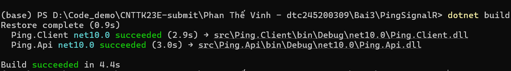
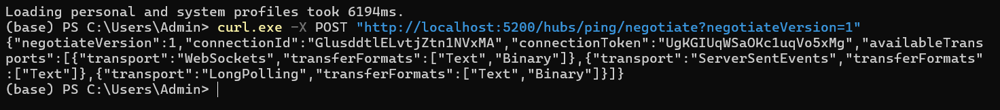
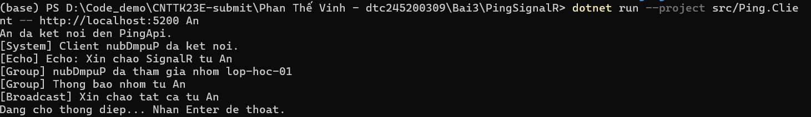
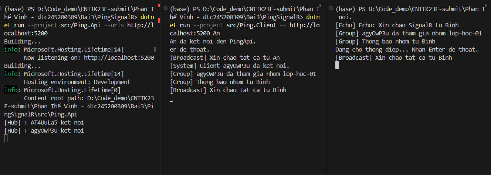
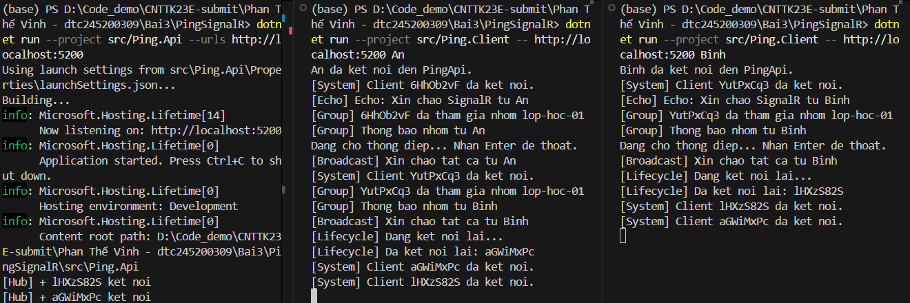
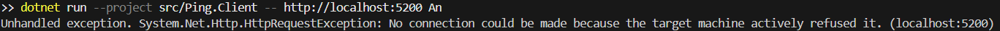
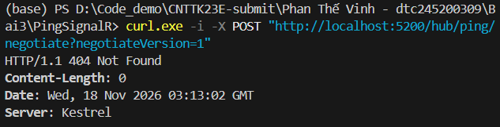
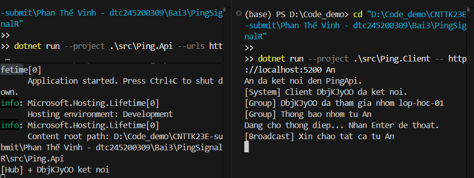
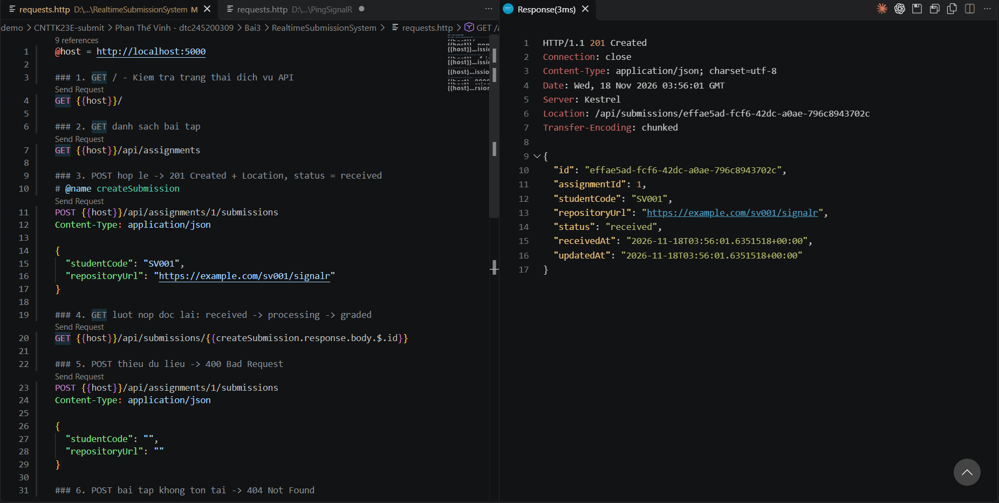
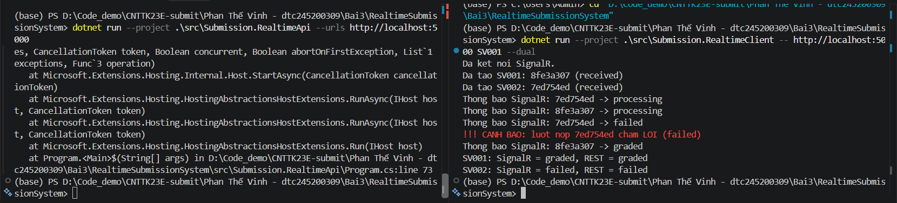

# BÁO CÁO THỰC HÀNH BÀI 3: GIAO TIẾP THỜI GIAN THỰC VỚI SIGNALR

**Học phần:** Phát triển ứng dụng phân tán  
**Giảng viên hướng dẫn:** TS. Dương Thu Mây  
**Sinh viên thực hiện:** Phan Thế Vinh  
**Mã số sinh viên (MSSV):** DTC245200309  
**Lớp:** CNTT K23E  
**Repository fork:** `phan-the-vinh/CNTTK23E`  
**Repository lớp:** `PTUDPTK23/CNTTK23E`  

---

## 1. THÔNG TIN SINH VIÊN & BÀI THỰC HÀNH

- **Họ và tên:** Phan Thế Vinh
- **MSSV:** DTC245200309
- **Lớp:** CNTT K23E
- **Nhánh Git bài nộp:** `bai3-dtc245200309`
- **Mục tiêu thực hành:**
  1. Hiểu sâu ba mô hình trao đổi thông điệp (MEP - Message Exchange Patterns): Yêu cầu - phản hồi (Request-Reply), Đẩy dữ liệu (Push), và Truyền luồng (Streaming).
  2. Phân biệt rõ ràng giữa giao thức mạng WebSocket và thư viện cấp cao SignalR (với cơ chế đàm phán fallback: WebSockets → Server-Sent Events → Long Polling).
  3. Thành thạo lập trình máy chủ SignalR (`AddSignalR`, `MapHub`, các phạm vi gửi `Clients.Caller`, `Clients.All`, `Clients.Group`) và máy khách (`HubConnectionBuilder`, `On<T>`, `StartAsync`, `InvokeAsync`, `WithAutomaticReconnect`).
  4. Nắm vững phương pháp thiết kế kênh thời gian thực thông qua Khung 4 câu hỏi: *Sự kiện nào? Gửi cho ai? Gửi kèm gì? Mất kết nối thì sao?*
  5. Xây dựng hoàn chỉnh hệ thống `EduSubmit Realtime` kết hợp chặt chẽ giữa RESTful API (Bài 2) và SignalR (Bài 3): REST tạo và chốt trạng thái tài nguyên, SignalR đẩy thông báo trạng thái nền trong thời gian thực.

---

## 2. HƯỚNG DẪN CẤU TRÚC VÀ CÁCH CHẠY HỆ THỐNG

### Cấu trúc bài nộp trong kho lưu trữ
```text
Phan Thế Vinh - dtc245200309/
└── Bai3/
    ├── README.md
    ├── anh/
    │   ├── buoc1-build.png
    │   ├── buoc2-negotiate.png
    │   ├── buoc4-echo.png
    │   ├── buoc5-nhom.png
    │   ├── buoc6-noilai.png
    │   ├── buoc7-loi1.png
    │   ├── buoc7-loi2.png
    │   ├── buoc7-loi3.png
    │   ├── edusubmit-requests.png
    │   └── edusubmit-realtime.png
    │
    ├── PingSignalR/
    │   ├── PingSignalR.slnx
    │   ├── .gitignore
    │   └── src/
    │       ├── Ping.Api/
    │       └── Ping.Client/
    │
    └── RealtimeSubmissionSystem/
        ├── RealtimeSubmissionSystem.slnx
        ├── requests.http
        ├── nop-bai.json
        ├── thieu-du-lieu.json
        ├── .gitignore
        └── src/
            ├── Submission.RealtimeApi/
            └── Submission.RealtimeClient/
```

### Cách chạy Solution 1: PingSignalR (Cổng 5200)

1. **Khởi chạy máy chủ Ping.Api:**
   ```powershell
   cd "Phan Thế Vinh - dtc245200309/Bai3/PingSignalR"
   dotnet run --project src/Ping.Api --urls http://localhost:5200
   ```
2. **Khởi chạy máy khách 1 (An):**
   ```powershell
   cd "Phan Thế Vinh - dtc245200309/Bai3/PingSignalR"
   dotnet run --project src/Ping.Client -- http://localhost:5200 An
   ```
3. **Khởi chạy máy khách 2 (Bình):**
   ```powershell
   cd "Phan Thế Vinh - dtc245200309/Bai3/PingSignalR"
   dotnet run --project src/Ping.Client -- http://localhost:5200 Binh
   ```

### Cách chạy Solution 2: RealtimeSubmissionSystem (Cổng 5000)

1. **Khởi chạy máy chủ Submission.RealtimeApi:**
   ```powershell
   cd "Phan Thế Vinh - dtc245200309/Bai3/RealtimeSubmissionSystem"
   dotnet run --project src/Submission.RealtimeApi --urls http://localhost:5000
   ```
2. **Khởi chạy máy khách Submission.RealtimeClient (Chế độ tiêu chuẩn Slide 57, 71):**
   ```powershell
   cd "Phan Thế Vinh - dtc245200309/Bai3/RealtimeSubmissionSystem"
   dotnet run --project src/Submission.RealtimeClient -- http://localhost:5000 SV001
   ```
3. **Khởi chạy máy khách Submission.RealtimeClient (Chế độ vận dụng đồng thời 2 sinh viên Slide 62):**
   ```powershell
   cd "Phan Thế Vinh - dtc245200309/Bai3/RealtimeSubmissionSystem"
   dotnet run --project src/Submission.RealtimeClient -- http://localhost:5000 --dual
   ```
4. **Kiểm thử REST & Negotiate bằng `requests.http`:**
   Mở tệp `requests.http` bằng Visual Studio Code / Antigravity IDE (yêu cầu cài extension REST Client) và bấm `Send Request` cho từng ca trong 9 ca kiểm thử.

---

## 3. GIẢI THÍCH KIẾN TRÚC PINGSIGNALR

### Bản đồ tư duy 6 khái niệm SignalR cốt lõi
| Khái niệm | Vị trí | Code đại diện | Ý nghĩa trong hệ thống phân tán |
|---|---|---|---|
| **Hub** | Máy chủ | `class PingHub : Hub`<br>`MapHub<PingHub>("/hubs/ping")` | "Tổng đài" trung tâm định tuyến thông điệp và quản lý các kết nối thời gian thực |
| **Connection** | Cả hai | `Context.ConnectionId` | Định danh phiên kết nối logic giữa máy khách và hub; giá trị thay đổi mỗi lần kết nối lại |
| **Clients** | Máy chủ | `Clients.Caller`<br>`Clients.All`<br>`Clients.Group("nhom")` | Tập đối tượng đích nhận thông báo: người gọi, toàn bộ mọi người, hoặc thành viên nhóm |
| **Group** | Máy chủ | `Groups.AddToGroupAsync(...)`<br>`Clients.Group(...)` | Danh sách kết nối được gán nhãn, máy chủ lưu trữ trong bộ nhớ để định tuyến tin theo ngữ cảnh |
| **On / Invoke** | Máy khách | `connection.On<T>("Ten", fn)`<br>`connection.InvokeAsync("Method", ...)` | Máy khách đăng ký hàm đón nhận sự kiện từ máy chủ (`On`) và chủ động gọi hàm RPC trên Hub (`InvokeAsync`) |
| **Vòng đời** | Cả hai | `OnConnectedAsync`<br>`OnDisconnectedAsync`<br>`WithAutomaticReconnect` | Quản lý trạng thái sống - chết của socket; tự động bắt tay khôi phục kết nối khi mạng chập chờn |

### Hợp đồng thông điệp PingSignalR
- **Đường dẫn Hub:** `http://localhost:5200/hubs/ping`
- **Các phương thức gọi lên và gửi về:**

| Chiều | Phương thức / Lời gọi | Tên thông điệp / Payload | Phạm vi nhận | Ý nghĩa |
|---|---|---|---|---|
| Khách → Hub | `InvokeAsync("Echo", msg)` | `EchoResponse(string)` | `Clients.Caller` | Máy chủ gửi lại phản hồi chỉ riêng cho người gọi |
| Khách → Hub | `InvokeAsync("Broadcast", msg)` | `BroadcastMessage(string)` | `Clients.All` | Phát rộng thông điệp tới toàn bộ máy khách đang kết nối |
| Khách → Hub | `InvokeAsync("JoinGroup", grp)` | `GroupMessage(string)` | `Clients.Group(grp)` | Đưa kết nối vào nhóm và thông báo cho thành viên trong nhóm |
| Khách → Hub | `InvokeAsync("SendToGroup", grp, msg)` | `GroupMessage(string)` | `Clients.Group(grp)` | Gửi thông điệp tới tất cả các máy khách trong nhóm |
| Tự động | Khi kết nối / ngắt kết nối | `SystemMessage(string)` | `Clients.All` | Thông báo trạng thái người dùng online / offline |

---

## 4. GIẢI THÍCH KIẾN TRÚC EDUSUBMIT REALTIME

### Trả lời Khung 4 câu hỏi thiết kế cho EduSubmit
1. **Sự kiện nào?**
   Khi trạng thái xử lý của lượt nộp thay đổi trên máy chủ: `received` → `processing` → `graded` (hoặc `failed` nếu URL không an toàn).
2. **Gửi cho ai?**
   Gửi đích danh tới nhóm `Clients.Group($"submission:{id}")` đại diện cho lượt nộp cụ thể. Không gửi `Clients.All` để khoanh vùng phạm vi nhận tin (scoping/routing) và tránh lãng phí băng thông đường truyền.
   *(Lưu ý kỹ thuật: Group chỉ đóng vai trò phân luồng thông điệp, hoàn toàn không phải cơ chế bảo mật hay phân quyền).*
3. **Gửi kèm gì?**
   Dữ liệu tối thiểu cần thiết để máy khách cập nhật giao diện người dùng:
   ```csharp
   record SubmissionStatusMessage(Guid SubmissionId, string Status, DateTimeOffset UpdatedAt);
   ```
4. **Mất kết nối thì sao?**
   Nếu mạng bị ngắt đúng lúc máy chủ đẩy thông điệp, thông điệp đó bị mất vĩnh viễn trên kênh SignalR (vì SignalR không lưu hàng đợi tin nhắn). Khi có mạng trở lại, máy khách kết nối lại (nhận ConnectionId mới), chủ động gọi lại `WatchSubmission` và ngay lập tức gọi phương thức REST `GET /api/submissions/{id}` để đọc trạng thái chính xác nhất được lưu trữ bền vững trên máy chủ.

### Phân tích Bảo mật Group và Kiểm soát truy cập (Group Security & Authorization)

Trong kiến trúc SignalR của EduSubmit, cơ chế Group đóng vai trò rất quan trọng nhưng cần được hiểu đúng về mặt an toàn thông tin:

1. **Bản chất của SignalR Group:**
   - Group trong ASP.NET Core SignalR là một **danh sách định tuyến trong bộ nhớ (in-memory routing/scoping mechanism)**, gán nhãn `ConnectionId` vào một chuỗi định danh nhóm.
   - **Group KHÔNG PHẢI là cơ chế bảo mật hay phân quyền (Group is NOT an authorization boundary).** Nhóm không tự động mã hóa hay ngăn cản người ngoài nếu máy chủ không kiểm tra logic trước khi gọi `Groups.AddToGroupAsync`.
   - Nếu máy chủ cho phép bất kỳ ai gửi `WatchSubmission(submissionId)` cũng được vào nhóm, kẻ tấn công có thể thực hiện tấn công dò quét hoặc đoán ID (lỗ hổng IDOR - Insecure Direct Object References) để nghe lén trạng thái bài thi của người khác. Ngoài ra, việc gửi ID rác làm máy chủ tạo các nhóm vô nghĩa trong bộ nhớ RAM.

2. **Giải pháp bảo mật đã triển khai thực tế trong Bài 3:**
   - **Kiểm tra định dạng GUID hợp lệ:** Máy chủ xác thực chuỗi `submissionId` gửi lên bằng `Guid.TryParse(submissionId, out var parsedId)`. Nếu sai định dạng, máy chủ từ chối ngay và ném ngoại lệ `HubException("Ma luot nop khong dung dinh dang GUID.")`.
   - **Kiểm tra sự tồn tại của tài nguyên trên máy chủ:** Máy chủ truy vấn danh sách `store.Submissions.Any(s => s.Id == parsedId)`. Chỉ khi lượt nộp thực sự tồn tại trong hệ thống thì mới thực hiện `Groups.AddToGroupAsync(Context.ConnectionId, $"submission:{submissionId}")`. Nếu không tồn tại, máy chủ từ chối với ngoại lệ `HubException("Luot nop khong ton tai tren he thong.")`.

3. **Giải pháp bảo mật toàn diện cần tích hợp khi có hệ thống Xác thực (Bài 8–9 theo Slide 67):**
   - **Xác thực danh tính (Authentication):** Áp dụng thuộc tính `[Authorize]` trên `SubmissionHub`. Vì WebSocket không gửi header tùy biến trong trình duyệt, token JWT Bearer sẽ được truyền qua query string (`?access_token=...`) trong bước bắt tay negotiate và được framework trích xuất tự động vào `Context.User`.
   - **Kiểm tra quyền sở hữu (Ownership Authorization):** Trước khi cho vào nhóm `submission:{id}`, máy chủ đọc thông tin người dùng từ `Context.UserIdentifier` (hoặc claim `student_code`) và đối chiếu với bản ghi trong CSDL:
     ```csharp
     // Mô hình kiến trúc production (Bài 8-9)
     var submission = await dbContext.Submissions.FindAsync(parsedId);
     if (submission == null) throw new HubException("Không tìm thấy bài nộp.");

     bool isOwner = submission.StudentCode == Context.UserIdentifier;
     bool isLecturer = Context.User.IsInRole("Lecturer") || Context.User.IsInRole("Admin");

     if (!isOwner && !isLecturer)
     {
         throw new HubException("Truy cập bị từ chối: Bạn không có quyền theo dõi bài nộp này.");
     }
     await Groups.AddToGroupAsync(Context.ConnectionId, $"submission:{parsedId}");
     ```

### Vai trò của `IHubContext<SubmissionHub>`
- Trong ASP.NET Core SignalR, đối tượng `Hub` chỉ được khởi tạo trong phạm vi một lời gọi RPC từ máy khách và bị hủy ngay sau khi hàm thực thi xong (transient per invocation).
- Để đẩy thông điệp từ các dịch vụ chạy nền (`SimulateGradingAsync`), hoặc từ các Minimal API endpoints bên ngoài Hub, framework cung cấp `IHubContext<THub>`. Đây là "loa phát thanh" được đăng ký vào hệ thống Dependency Injection, cho phép truy cập đối tượng `Clients` và `Groups` bất kỳ lúc nào để phát tin.

---

## 5. KẾT QUẢ KIỂM THỬ THỰC TẾ

### 1. Bảng kết quả 9 ca kiểm thử `requests.http`
Tất cả 9 ca kiểm thử đã được chạy thực tế trên máy chủ `http://localhost:5000` và trả về mã trạng thái chính xác:

| Ca | Mục đích kiểm tra | Yêu cầu HTTP | Kết quả thực tế | Ý nghĩa |
|---|---|---|:---:|---|
| 1 | Kiểm tra trạng thái máy chủ | `GET /` | **200 OK** | Dịch vụ API hoạt động bình thường |
| 2 | Lấy danh sách bài tập | `GET /api/assignments` | **200 OK** | Trả về danh sách bài tập hiện có |
| 3 | Tạo lượt nộp bài hợp lệ | `POST /api/assignments/1/submissions` | **201 Created** | Tạo lượt nộp, trả về header `Location: /api/submissions/{id}` và trạng thái `received` |
| 4 | Đọc trạng thái lượt nộp | `GET /api/submissions/{id}` | **200 OK** | Đọc lại trạng thái thay đổi theo thời gian: `received` → `processing` → `graded` |
| 5 | Tạo lượt nộp thiếu dữ liệu | `POST /api/assignments/1/submissions` | **400 Bad Request** | Báo lỗi validation khi thiếu StudentCode hoặc RepositoryUrl |
| 6 | Nộp vào bài tập không tồn tại | `POST /api/assignments/999/submissions` | **404 Not Found** | Báo lỗi `ASSIGNMENT_NOT_FOUND` |
| 7 | Truy vấn ID lượt nộp không tồn tại | `GET /api/submissions/00000000-...` | **404 Not Found** | Báo lỗi `SUBMISSION_NOT_FOUND` |
| 8 | Bắt tay đàm phán SignalR | `POST /hubs/submissions/negotiate?negotiateVersion=1` | **200 OK** | Trả về `connectionId`, `connectionToken` và danh sách giao thức truyền tải |
| 9 | Sai đường dẫn Hub | `POST /hub/submissions/negotiate?negotiateVersion=1` | **404 Not Found** | Lỗi đường dẫn (thiếu chữ 's' trong `/hubs/`), chứng minh bắt tay thất bại |

### 2. Kết quả chạy máy khách Submission.RealtimeClient (Chuẩn 8 dòng)
Khi chạy lệnh `dotnet run --project src/Submission.RealtimeClient -- http://localhost:5000 SV001`, máy khách và máy chủ in ra kết quả như sau:

**Đầu ra máy khách (8 dòng chuẩn):**
```text
Da ket noi SignalR.
Chon bai tap: 1 - Bai tap SignalR
Da tao luot nop: 66c8b8b2-8a57-4957-ae40-8873943c5739
Trang thai REST ban dau: received
Dang cho thong bao trang thai tu may chu...
Thong bao SignalR: 66c8b8b2... -> processing luc 08:52:06
Thong bao SignalR: 66c8b8b2... -> graded luc 08:52:08
Trang thai doc lai bang REST: graded
```

**Nhật ký tại máy chủ tương ứng:**
```text
[Hub] 3sbg3Ke_ theo doi submission:66c8b8b2-8a57-4957-ae40-8873943c5739
[Push] submission:66c8b8b2-8a57-4957-ae40-8873943c5739 -> processing
[Push] submission:66c8b8b2-8a57-4957-ae40-8873943c5739 -> graded
```

### 3. Kết quả Bài tập vận dụng (Theo dõi đồng thời 2 lượt nộp & Trạng thái failed)
Khi chạy lệnh `dotnet run --project src/Submission.RealtimeClient -- http://localhost:5000 --dual`:
- Máy khách tạo đồng thời SV001 (URL `https://...`) và SV002 (URL `http://...`).
- Máy chủ phát hiện SV002 không bắt đầu bằng `https://` nên cập nhật trạng thái kết thúc là `failed`.
- Máy khách sử dụng `ConcurrentDictionary<Guid, TaskCompletionSource<string>>` quản lý đồng thời hai lượt nộp trên cùng một kết nối SignalR, in cảnh báo màu đỏ cho SV002 và chốt lại trạng thái qua REST:

```text
Da ket noi SignalR.
Da tao SV001: 66cfe690 (received)
Da tao SV002: 2775125d (received)
Thong bao SignalR: 2775125d -> processing
Thong bao SignalR: 66cfe690 -> processing
Thong bao SignalR: 66cfe690 -> graded
Thong bao SignalR: 2775125d -> failed
!!! CANH BAO: luot nop 2775125d cham LOI (failed)
SV001: SignalR = graded, REST = graded
SV002: SignalR = failed, REST = failed
```

---

## 6. NHẬT KÝ CÁC THÍ NGHIỆM

### A. Thí nghiệm lỗi phần PingSignalR (Bước 7 - Slide 40)

| STT | Tình huống thí nghiệm | Thao tác thực hiện | Hiện tượng thực tế | Giải thích nguyên nhân & Bài học |
|---|---|---|---|---|
| **1** | Máy chủ chưa chạy | Tắt tiến trình `Ping.Api`, sau đó khởi chạy `Ping.Client` | Ném ngoại lệ:<br>`HttpRequestException: No connection could be made because the target machine actively refused it. (localhost:5200)` | **Nguyên nhân:** Máy khách không thể mở cổng TCP để bắt tay HTTP negotiate ban đầu.<br>**Bài học:** `WithAutomaticReconnect()` chỉ có tác dụng khôi phục kết nối ĐÃ từng mở thành công trước đó, không thể tự kết nối lại nếu lần khởi tạo đầu tiên thất bại. |
| **2** | Sai đường dẫn Hub | Đổi `WithUrl` thành `http://localhost:5200/hub/ping` (thiếu chữ `s`) | Ném ngoại lệ:<br>`HttpRequestException: Response status code does not indicate success: 404 (Not Found)` | **Nguyên nhân:** Bước negotiate gửi request `POST /hub/ping/negotiate` không khớp với ánh xạ `MapHub<PingHub>("/hubs/ping")` trên máy chủ.<br>**Bài học:** Đường dẫn URL trong `WithUrl` phải khớp chính xác từng ký tự với máy chủ. |
| **3** | Sai tên thông điệp | Đổi `On("EchoResponse")` thành `On("EchoRespone")` (thiếu chữ `s`) | Máy khách kết nối thành công, gửi được `Echo`, nhưng **im lặng hoàn toàn**, không in ra dòng `[Echo]` | **Nguyên nhân:** Tên sự kiện là một chuỗi (string). SignalR tìm kiếm handler khớp chuỗi tên để thực thi, nếu không khớp sẽ âm thầm bỏ qua không ném ngoại lệ.<br>**Bài học:** Lỗi sai tên ở chiều nhận (`On`) cực kỳ khó phát hiện. Khi không nhận được thông báo, việc đầu tiên cần làm là kiểm tra từng ký tự tên thông điệp giữa hai phía. |

### B. Nhật ký 5 thí nghiệm phân tán EduSubmit (Slide 58-59)

| STT | Tình huống | Dự đoán | Kết quả thực tế | Giải thích & Bài học phân tán |
|:---:|---|---|---|---|
| **1** | Chạy 2 máy khách SV001 và SV002 cùng lúc | Mỗi máy khách chỉ nhận thông báo về bài nộp của chính mình, không thấy bài của người kia | Cả hai máy khách cùng nhận được thông báo `processing` và `graded` nhưng chỉ đúng ID lượt nộp mà mình đã tạo | **Nhóm `submission:{id}` phân tách phạm vi nhận tin (scoping/routing) trong bộ nhớ máy chủ.** Cơ chế này giúp tối ưu hóa băng thông mạng và tránh lộ thông báo qua broadcast. *(Lưu ý: Group chỉ là gom luồng định tuyến; để bảo mật tuyệt đối, máy chủ phải xác thực danh tính và kiểm tra quyền sở hữu bài nộp trước khi cho phép vào nhóm).* |
| **2** | Chạy máy khách khi máy chủ chưa chạy | Khách báo lỗi không thể kết nối ngay lập tức | Ném ngoại lệ `HttpRequestException: Connection refused (localhost:5000)` và dừng chương trình | **Lần nối đầu tiên không được tự động thử lại.** `WithAutomaticReconnect` không bảo vệ được bước bắt tay ban đầu. Ứng dụng production cần tự bọc `try/catch` vòng lặp `StartAsync` nếu muốn đợi server khởi động. |
| **3** | Sửa WithUrl thành `/hub/submissions` | Máy khách báo lỗi 404 Not Found ở bước negotiate | Báo lỗi `HttpRequestException: Response status code does not indicate success: 404 (Not Found)` | **Bắt tay thất bại ở tầng HTTP.** Đường dẫn kết nối phải khớp hoàn toàn với cấu hình định tuyến của máy chủ (`MapHub`). |
| **4** | Sửa `On("SubmissionStatusChanged")` thành `On("SubmissionStatusChange")` | Máy khách không nhận được thông báo nào, sau 10 giây báo quá thời gian chờ | Chương trình im lặng, không có lỗi ngoại lệ; sau 10 giây in `Qua thoi gian cho thong bao graded.`; đọc lại bằng REST vẫn ra `graded` | **Sai tên chiều xuống là im lặng (Silent failure).** Khách vẫn giữ kết nối nhưng không kích hoạt handler. Vì vậy, REST luôn đóng vai trò là "chốt chặn an toàn" để kiểm tra trạng thái cuối. |
| **5** | Chờ 4 giây rồi mới gọi `WatchSubmission` | Vì sau 3 giây bài đã chấm xong, máy khách vào nhóm muộn sẽ bị lỡ hết thông điệp | Khách không nhận được bất kỳ tin SignalR nào; khi gọi `GET /api/submissions/{id}` bằng REST ở cuối vẫn đọc được kết quả `graded` | **Thông điệp SignalR không lưu trữ chờ người nhận đến muộn.** SignalR là cơ chế phát tin tức thời (fire-and-forget), không tự động lưu lại các tin nhắn đã lỡ vào message queue. Do đó, REST luôn là nguồn sự thật bền vững: máy khách gọi lại `GET /api/submissions/{id}` để đồng bộ kết quả. Mô hình chuẩn là: **Push để nhanh, REST để chắc.** |

---

## 7. TRẢ LỜI CÂU HỎI ÔN TẬP VÀ THẢO LUẬN

### Trả lời 3 câu hỏi đầu giờ (Slide 65)
1. **Máy chủ có thể chủ động báo cho máy khách mà không cần máy khách hỏi không?**  
   *Trả lời:* Hoàn toàn có thể, với điều kiện máy khách phải mở sẵn một kết nối song công lâu dài (persistent bidirectional connection) tới máy chủ thông qua WebSocket (được quản lý bởi thư viện SignalR). Phía máy chủ có thể chủ động phát dữ liệu tới máy khách bất kỳ lúc nào bằng phương thức `Clients.Group(...).SendAsync`, và sử dụng `IHubContext` khi gửi từ bên ngoài phạm vi của một Hub.

2. **Đã có REST rồi, vì sao còn cần thêm SignalR? Hai thứ chia việc thế nào?**  
   *Trả lời:* REST và SignalR bổ trợ lẫn nhau, giải quyết hai khía cạnh khác nhau của hệ thống phân tán:
   - **REST:** Hoạt động theo cơ chế yêu cầu - phản hồi (Request-Reply), phù hợp nhất cho việc tạo mới tài nguyên (`POST`), kiểm tra tính hợp lệ, trả về mã trạng thái HTTP tiêu chuẩn (`201`, `400`, `404`) và đóng vai trò là **Nguồn sự thật (Single Source of Truth)** lưu trữ trạng thái dữ liệu.
   - **SignalR:** Hoạt động theo cơ chế đẩy (Push), phù hợp cho việc thông báo tức thì các sự kiện phát sinh không đồng bộ sau yêu cầu ban đầu (chấm bài xong, thông báo thay đổi) mà không đòi hỏi máy khách phải liên tục gửi request thăm dò (polling).
   - Hai công nghệ phối hợp theo nguyên tắc: *"Push để nhanh, REST để chắc"*.

3. **Nếu đứt mạng đúng lúc máy chủ báo "đã chấm xong" thì sao?**  
   *Trả lời:* Thông điệp đẩy qua SignalR lúc đó sẽ bị mất vĩnh viễn vì SignalR không có cơ chế lưu trữ hàng đợi tin nhắn cho kết nối đã đứt. Khi có mạng trở lại, `WithAutomaticReconnect()` sẽ tự động kết nối lại máy chủ nhưng **được cấp ConnectionId mới và máy chủ KHÔNG tự khôi phục danh sách nhóm của kết nối cũ, cũng KHÔNG tự gửi lại tin nhắn đã lỡ**. Do đó, máy khách phải chủ động tham gia lại nhóm (trong sự kiện `Reconnected` hoặc gọi lại `WatchSubmission`) và ngay lập tức gọi phương thức REST `GET /api/submissions/{id}` để đồng bộ trạng thái chính xác nhất được lưu trữ bền vững trên máy chủ.

---

### Trả lời 10 câu hỏi ôn tập (Slide 68)

1. **Polling khác Push ở số yêu cầu và độ trễ thế nào?**  
   - *Polling (thăm dò định kỳ):* Máy khách định kỳ gửi request (ví dụ 2 giây/lần). Đa số các yêu cầu trả về dữ liệu cũ không đổi (gây lãng phí tài nguyên CPU, mạng). Độ trễ nhận tin có thể lên tới bằng chu kỳ thăm dò (trễ tới 2 giây).
   - *Push (đẩy dữ liệu):* Kết nối song công giữ mở liên tục. Máy chủ chỉ gửi thông điệp khi sự kiện thực sự xảy ra (không có yêu cầu thừa). Độ trễ rất thấp (chỉ phụ thuộc vào RTT mạng - Round-Trip Time, tính bằng mili-giây) vì thông điệp được đẩy ngay khi phát sinh sự kiện.

2. **Phân biệt 3 mô hình MEP (Message Exchange Patterns) theo hướng khởi tạo và số thông điệp:**  
   - *Yêu cầu - phản hồi (Request-Reply):* Khởi tạo bởi **Máy khách**. Số thông điệp: Đúng **1 yêu cầu → 1 phản hồi**.
   - *Đẩy dữ liệu (Push):* Khởi tạo bởi **Máy chủ** khi xuất hiện sự kiện. Số thông điệp: Các thông điệp đơn lẻ, không đều đặn.
   - *Truyền luồng (Streaming):* Khởi tạo bởi máy khách hoặc máy chủ. Số thông điệp: Chuỗi liên tục nhiều thông điệp truyền nối tiếp nhau.

3. **WebSocket, SignalR: giao thức hay thư viện?**  
   - **WebSocket:** Là một **giao thức mạng chuẩn hóa (RFC 6455)**, quy định cách thức thiết lập và duy trì kênh truyền thông hai chiều song công (full-duplex) trên một kết nối TCP duy nhất sau bước bắt tay HTTP.
   - **SignalR:** Là một **thư viện cấp cao của ASP.NET Core**, trừu tượng hóa giao thức tầng dưới, hỗ trợ Hub RPC, quản lý nhóm (Group), tự động kết nối lại, mã hóa JSON/MessagePack và tự động chuyển đổi sang giao thức dự phòng (SSE, Long Polling) khi WebSocket không được hỗ trợ.

4. **SignalR có những cơ chế truyền tải dự phòng nào?**  
   Gồm 3 cơ chế theo thứ tự ưu tiên giảm dần:
   - Ưu tiên 1: **WebSockets** (hai chiều toàn phần, hiệu năng cao nhất).
   - Ưu tiên 2: **Server-Sent Events (SSE)** (máy chủ đẩy một chiều qua HTTP, chiều lên gọi HTTP POST riêng).
   - Ưu tiên 3: **Long Polling** (máy khách gửi HTTP request, máy chủ giữ kết nối cho đến khi có tin hoặc hết thời gian chờ rồi lặp lại).

5. **Vì sao tạo nhóm `submission:{id}` thay vì gửi tất cả (`Clients.All`)?**  
   - *Khoanh vùng phạm vi nhận tin (Scoping):* Tránh làm tràn ngập thông báo bài nộp của người này sang máy khách của người khác; kết hợp với phân quyền phía máy chủ để bảo vệ tính riêng tư bài nộp.
   - *Tiết kiệm băng thông:* Nếu lớp có 100 sinh viên, dùng `Clients.All` sẽ sinh ra 100 × 200 = 20.000 thông điệp tràn ngập mạng; dùng nhóm thì chỉ đúng 200 thông điệp được chuyển đến máy khách quan tâm.

6. **`IHubContext` cho phép làm gì?**  
   Cho phép gửi thông điệp tới máy khách SignalR (qua `Clients.All`, `Clients.Group`, v.v.) từ các tiến trình, dịch vụ nền (BackgroundService, Thread, Worker) hoặc từ các Controller / Minimal API bên ngoài phạm vi của lớp `Hub`.

7. **`On<T>` dùng để làm gì? Bỏ đi thì sao?**  
   - `On<T>` dùng để đăng ký hàm lắng nghe sự kiện từ máy chủ tương ứng với một tên sự kiện xác định.
   - Nếu bỏ đi: Máy khách vẫn duy trì kết nối mạng, nhưng khi máy chủ đẩy dữ liệu đến, máy khách sẽ âm thầm bỏ qua thông điệp mà không thực thi bất kỳ logic xử lý nào.

8. **REST làm gì, SignalR làm gì? Vì sao không dùng SignalR để tạo lượt nộp?**  
   - REST xử lý các thao tác CRUD tạo tài nguyên, kiểm tra dữ liệu đầu vào và trả về mã trạng thái chuẩn hóa (`201`, `400`, `404`).
   - SignalR đảm nhiệm việc thông báo trạng thái cập nhật tiếp theo.
   - Không nên dùng SignalR để tạo lượt nộp vì:
     1. Khó tận dụng các chuẩn HTTP đã tối ưu (cache, proxy, API Gateway, middleware xác thực).
     2. Khó phân tách mã lỗi chuẩn xác (201 Created kèm header `Location`).
     3. Tạo tài nguyên là một thao tác một-lần cần tính bảo đảm cao (idempotent/transactional), không cần thiết phải dùng socket hai chiều.

9. **`WithAutomaticReconnect()` có tác dụng gì?**  
   Tự động kích hoạt cơ chế thử kết nối lại khi kết nối mạng bị rớt đột ngột. Theo mặc định, thư viện sẽ thử lại sau 0s, 2s, 10s, 30s. Trong quá trình đó, các sự kiện `Reconnecting` và `Reconnected` được kích hoạt để cập nhật trạng thái UI. *(Lưu ý: Sau khi Reconnected, máy chủ cấp ConnectionId mới và KHÔNG tự khôi phục Group membership của kết nối cũ, máy khách cần chủ động tham gia lại nhóm).*

10. **Mất kết nối đúng lúc báo graded thì làm gì?**  
    Vì SignalR không lưu trữ hàng đợi tin nhắn và không tự gửi lại tin đã lỡ trong thời gian đứt kết nối, máy khách sau khi kết nối lại (hoặc phát hiện quá thời gian chờ) sẽ gọi phương thức REST `GET /api/submissions/{id}` để truy vấn trực tiếp trạng thái cuối cùng được lưu trữ bền vững trên máy chủ, đảm bảo tính toàn vẹn dữ liệu.

---

### Trả lời 3 câu hỏi thảo luận chuyên sâu (Slide 68)

1. **Hàng trăm SV cùng theo dõi: nhóm theo ID hay phát tất cả rồi tự lọc? Cách nào tiết kiệm băng thông?**  
   - **Giải pháp tối ưu:** Bắt buộc phải **nhóm theo ID (`submission:{id}`) do máy chủ quản lý**.
   - *Phân tích băng thông:* Nếu có 100 sinh viên đồng thời nộp bài, mỗi bài trải qua 2 lần đổi trạng thái. Nếu phát tất cả (`Clients.All`), mỗi sự kiện gửi cho cả 100 người, tạo ra $100 \times 200 = 20.000$ thông điệp qua mạng (trong đó 99% dữ liệu mỗi người nhận là rác). Với cơ chế nhóm, máy chủ chỉ chuyển thông điệp đến đúng socket đã đăng ký theo dõi ID đó, tổng số thông điệp trên toàn mạng chỉ là đúng $200$ thông điệp. Tiết kiệm tới **99% băng thông**.

2. **Nêu 2 tình huống polling là lựa chọn hợp lý hơn SignalR:**  
   - *Tình huống 1: Dữ liệu biến động rất chậm và chấp nhận độ trễ lớn.* Ví dụ kiểm tra lịch thi học kỳ (1 tuần cập nhật 1 lần) hoặc báo cáo tài chính hàng tháng. Chi phí duy trì kết nối WebSocket 24/7 là không cần thiết so với việc gọi 1 request HTTP mỗi vài tiếng.
   - *Tình huống 2: Môi trường mạng bị giới hạn gắt gao.* Hệ thống nằm sau tường lửa proxy doanh nghiệp nghiêm ngặt (chặn WebSocket, cấm kết nối kéo dài qua cổng không tiêu chuẩn, ngắt kết nối sau 30 giây) hoặc các thiết bị IoT pin siêu nhỏ chỉ thức dậy truyền dữ liệu rồi ngủ sâu để tiết kiệm năng lượng.

3. **Chạy nhiều bản sao API (scale-out) thì nhóm trong bộ nhớ gặp vấn đề gì? Sửa thế nào?**  
   - **Vấn đề gặp phải:** Khi hệ thống mở rộng theo chiều ngang (chạy nhiều máy chủ API đằng sau Load Balancer), một sinh viên SV1 có thể kết nối WebSocket tới Server A và gia nhập nhóm trên Server A. Nhưng tác vụ chấm bài lại được thực thi trên Server B. Bộ nhớ của Server B không hề biết sinh viên SV1 đang kết nối ở Server A, do đó lời gọi `hubContext.Clients.Group("submission:123")` trên Server B sẽ không thể gửi tin tới SV1.
   - **Cách giải quyết:** Triển khai một **SignalR Backplane** (phổ biến nhất là sử dụng Redis Pub/Sub, Azure SignalR Service, hoặc RabbitMQ). Khi bất kỳ máy chủ nào phát tin tới một nhóm, thông điệp sẽ được publish lên Backplane trung tâm; Backplane phân phối lại tin cho tất cả các máy chủ API còn lại để đẩy xuống đúng client đang giữ socket.

---

## 8. KẾT LUẬN: SỰ PHÂN CÔNG GIỮA REST VÀ SIGNALR

Qua toàn bộ bài thực hành, mô hình kiến trúc phân tán hiện đại được đúc kết qua nguyên lý:

$$\text{Mô hình kết hợp} = \text{REST (Nguồn sự thật)} + \text{SignalR (Kênh đẩy sự kiện tức thời)}$$

1. **REST chịu trách nhiệm:**
   - Điểm vào chính thức để tiếp nhận và tạo tài nguyên (`POST`).
   - Kiểm tra tính hợp lệ dữ liệu, xác thực quyền truy cập.
   - Đảm bảo tính lưu trữ bền vững (Persistence).
   - Nguồn sự thật duy nhất (Single Source of Truth) khi cần kiểm tra lại trạng thái.
2. **SignalR chịu trách nhiệm:**
   - Kênh thông báo một chiều nhanh chóng từ máy chủ tới máy khách.
   - Cung cấp trải nghiệm người dùng tức thời với độ trễ tối thiểu theo RTT mạng (tính bằng mili-giây), giải phóng giao diện khỏi việc chờ đợi hoặc liên tục thăm dò (polling).
   - Tiết kiệm tối đa tài nguyên mạng và CPU cho máy chủ.
3. **Khẩu hiệu cốt lõi:**
   > **"Push để nhanh, REST để chắc."**

---

## 9. DANH MỤC ẢNH MINH CHỨNG & HÌNH ẢNH CHẠY THẬT

Tất cả các ảnh minh chứng đã được chụp trực tiếp từ màn hình dòng lệnh chạy thật (thể hiện rõ đường dẫn thư mục bài làm và kết quả chạy) và lưu đầy đủ trong thư mục `anh/`:

| Tên tệp ảnh | Nội dung thể hiện trên ảnh | Trạng thái |
|---|---|:---:|
| `buoc1-build.png` | Lệnh `dotnet build` tại thư mục `PingSignalR`, hiển thị `Build succeeded, 0 Warning(s), 0 Error(s)`. | **Đã có** |
| `buoc2-negotiate.png` | Cửa sổ terminal chạy các lệnh curl: `curl http://localhost:5200/` và `curl -X POST http://localhost:5200/hubs/ping/negotiate?negotiateVersion=1` trả về `connectionId`. | **Đã có** |
| `buoc4-echo.png` | Máy chủ `Ping.Api` đang chạy, máy khách `Ping.Client` in dòng `[Echo] Echo: Xin chao SignalR tu An`. | **Đã có** |
| `buoc5-nhom.png` | Cả hai máy khách An và Bình đang chạy: Cửa sổ của An thấy `[Group]` và `[Broadcast]` của Bình nhưng không có `[Echo]` của Bình. | **Đã có** |
| `buoc6-noilai.png` | Máy chủ bị tắt và bật lại: Máy khách in `[Lifecycle] Dang ket noi lai...` rồi `[Lifecycle] Da ket noi lai: ...` với ConnectionId mới. | **Đã có** |
| `buoc7-loi1.png` | Lỗi 1: Máy chủ chưa chạy, máy khách in ngoại lệ `HttpRequestException: Connection refused (localhost:5200)`. | **Đã có** |
| `buoc7-loi2.png` | Lỗi 2: Sai đường dẫn hub (`/hub/ping`), curl hoặc máy khách in lỗi `404 (Not Found)`. | **Đã có** |
| `buoc7-loi3.png` | Lỗi 3: Sai tên thông điệp (`On("EchoRespone")`), máy khách kết nối được nhưng hoàn toàn im lặng. | **Đã có** |
| `edusubmit-requests.png` | Kết quả chạy kiểm thử file `requests.http` hiển thị các mã trạng thái `200`, `201`, `400`, `404`. | **Đã có** |
| `edusubmit-realtime.png` | Hai cửa sổ terminal: Máy chủ `Submission.RealtimeApi` (hiển thị Push `processing` → `graded`) và máy khách `Submission.RealtimeClient` (hiển thị đủ 8 dòng trạng thái). | **Đã có** |

---

### Chi tiết hình ảnh minh chứng thực tế

#### 1. Phần PingSignalR

- **Bước 1: Build dự án thành công (0 lỗi, 0 cảnh báo)**


- **Bước 2: Bắt tay đàm phán negotiate (Cổng 5200)**


- **Bước 4: Kiểm thử thông điệp Echo riêng cho Caller**


- **Bước 5: Kiểm thử phân tách Group và Broadcast giữa An và Bình**


- **Bước 6: Khôi phục kết nối tự động khi máy chủ khởi động lại**


- **Bước 7: Thí nghiệm 3 lỗi cố ý**
  - *Lỗi 1: Máy chủ chưa chạy:*
  
  - *Lỗi 2: Sai đường dẫn Hub:*
  
  - *Lỗi 3: Sai tên sự kiện EchoRespone (im lặng hoàn toàn):*
  

---

#### 2. Phần EduSubmit Realtime

- **Kiểm thử 9 ca trong `requests.http`:**


- **Chạy thực tế luồng thời gian thực EduSubmit (Server và Client kết hợp REST + SignalR):**


---

### Hướng dẫn sinh viên chụp lại khi cần (Win + Shift + S):
1. **Ảnh `buoc1-build.png`:**
   Mở terminal tại thư mục `Phan Thế Vinh - dtc245200309\Bai3\PingSignalR`, gõ lệnh `dotnet build`.
2. **Ảnh `buoc2-negotiate.png`:**
   Chạy `Ping.Api` cổng 5200 và dùng terminal chạy `curl.exe -X POST "http://localhost:5200/hubs/ping/negotiate?negotiateVersion=1"`.
3. **Ảnh `buoc4-echo.png`:**
   Chạy `Ping.Api` và `Ping.Client`, xem dòng `[Echo] Echo: Xin chao SignalR tu An`.
4. **Ảnh `buoc5-nhom.png`:**
   Chạy đồng thời `Ping.Api`, client `An` và client `Binh`.
5. **Ảnh `buoc6-noilai.png`:**
   Tắt và bật lại `Ping.Api` khi client đang chạy, xem dòng `Dang ket noi lai...` và `Da ket noi lai: ...`.
6. **Ảnh `buoc7-loi1.png`, `buoc7-loi2.png`, `buoc7-loi3.png`:**
   Làm theo các bước thí nghiệm lỗi trong bảng ở Mục 6.
7. **Ảnh `edusubmit-requests.png` và `edusubmit-realtime.png`:**
   Mở `requests.http` bấm Send Request, và chạy đồng thời `Submission.RealtimeApi` (5000) cùng `Submission.RealtimeClient`.
