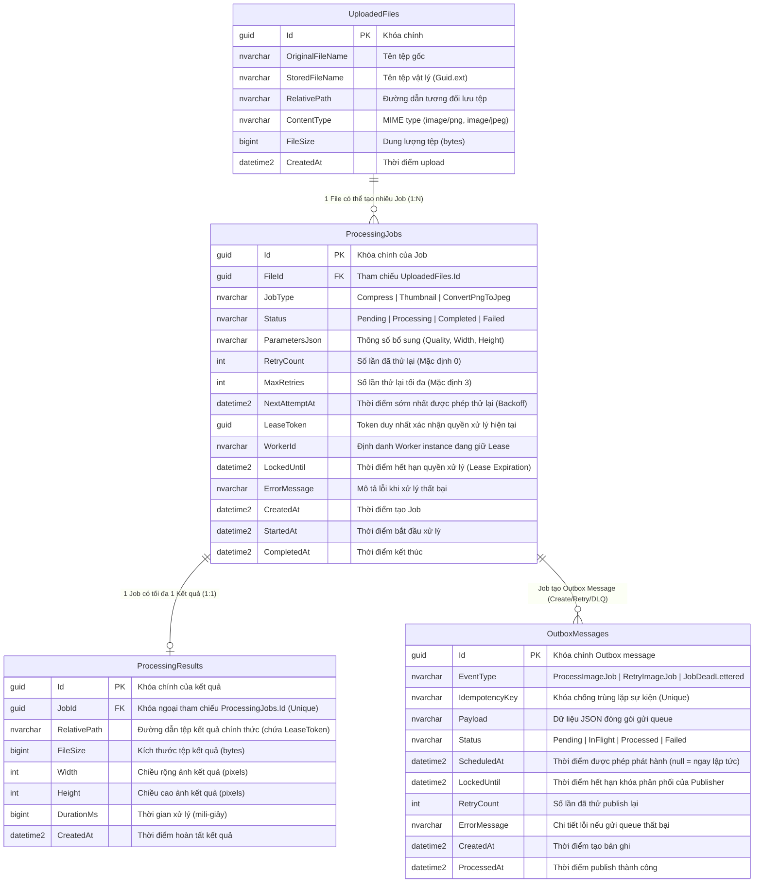
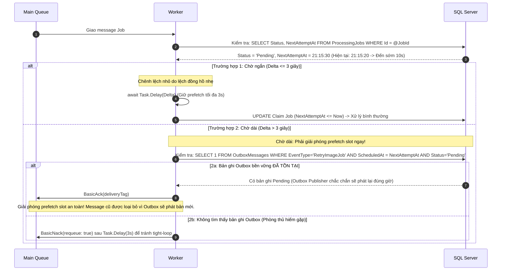
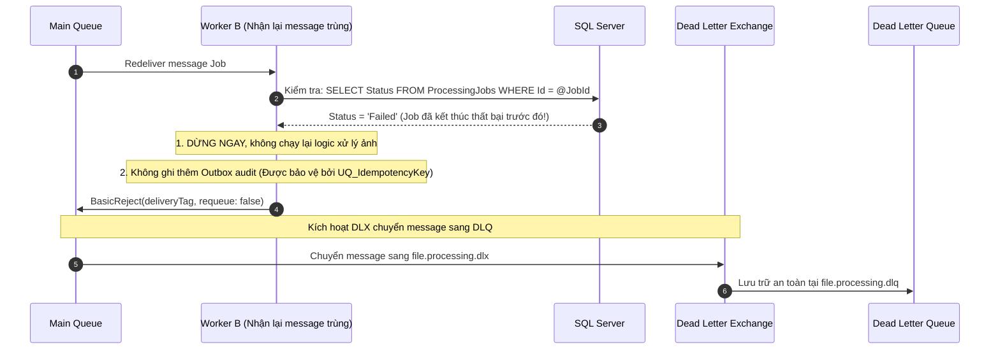
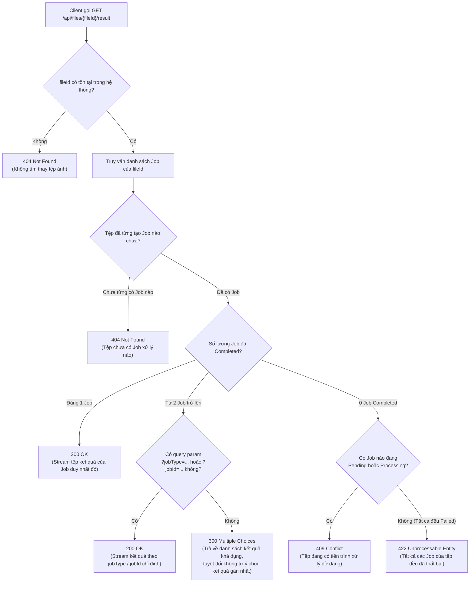

# TÀI LIỆU THIẾT KẾ KIẾN TRÚC HỆ THỐNG XỬ LÝ TỆP BẤT ĐỒNG BỘ
**Dự án:** Hệ thống xử lý tệp bất đồng bộ (Đề tài 05)  
**Nền tảng:** .NET 10 | ASP.NET Core Web API | Worker Service | EF Core 10 | SQL Server | RabbitMQ  
**Thư mục gốc:** `D:\XuLyTepBatDongBo`  
**Giai đoạn:** Giai đoạn 2 – Rà soát và Hoàn thiện Thiết kế Kiến trúc (Bản đặc tả kỹ thuật hoàn chỉnh)

---

## 1. Tổng quan nghiệp vụ

### 1.1. Nghiệp vụ trọng tâm: Xử lý ảnh số (Image Processing)
Hệ thống sử dụng **Xử lý ảnh số** làm nghiệp vụ minh họa chính, bao gồm 3 chức năng độc lập:
1. **Nén ảnh (Image Compression):** Giảm dung lượng tệp ảnh PNG/JPEG với tham số chất lượng (Quality: 1 - 100), cân bằng giữa dung lượng lưu trữ và độ sắc nét thị giác.
2. **Tạo ảnh thu nhỏ (Thumbnail Generation):** Thay đổi kích thước ảnh theo kích thước mục tiêu (ví dụ: $150 \times 150$, $300 \times 300$, hoặc giữ nguyên aspect ratio), phục vụ hiển thị preview trên giao diện người dùng.
3. **Chuyển đổi định dạng (Format Conversion):** Chuyển đổi định dạng tệp từ PNG sang JPEG (tự động xử lý kênh Alpha trong suốt thành nền trắng hoặc màu chỉ định) để tối ưu hóa hiển thị web.

### 1.2. Lý do áp dụng kiến trúc bất đồng bộ
* Xử lý ảnh là tác vụ tiêu tốn nhiều CPU và bộ nhớ (CPU-bound) cùng với các thao tác đọc/ghi tệp nhị phân lớn (I/O-bound).
* Nếu thực hiện đồng bộ trên luồng HTTP Request của Web Server:
  * Gây nghẽn luồng tiếp nhận (Thread Starvation), giảm mạnh thông lượng xử lý của API.
  * Nguy cơ Request Timeout phía Client khi kích thước ảnh lớn hoặc lưu lượng tăng đột biến.
* Mô hình bất đồng bộ giúp **giải phóng HTTP Request ngay lập tức** sau khi nhận tệp và đưa công việc vào hàng đợi để Worker xử lý tuần tự, có kiểm soát, có khả năng phục hồi lỗi và mở rộng quy mô.

---

## 2. Kiến trúc hệ thống và Trách nhiệm các thành phần

Hệ thống được tổ chức theo kiến trúc Clean Architecture kết hợp Message-Driven Architecture:

```mermaid
graph TD
    Client["Client / Web UI / Postman"]
    API["FileProcessing.Api<br/>(ASP.NET Core Web API)"]
    OutboxPub["Background Outbox Publisher<br/>(Claim nguyên tử: UPDLOCK, READPAST)"]
    Worker["FileProcessing.Worker<br/>(Background Worker Service)"]
    Core["FileProcessing.Core<br/>(Domain Entities, Enums, Contracts)"]
    Infra["FileProcessing.Infrastructure<br/>(EF Core, SQL Server, RabbitMQ, Storage)"]
    
    Queue[("RabbitMQ<br/>(Main Queue & Dead Letter Queue)")]
    DB[("SQL Server<br/>(Files, Jobs, Results, Outbox)")]
    Storage[("Local File Storage<br/>(uploads/, temp/, results/)")]

    Client -->|1. POST Upload / POST Job / GET Status| API
    API -->|Validate & Điều phối Transaction| Core
    API -->|Ghi Metadata, Job & Outbox trong 1 SQL Tx| Infra
    Infra -->|Lưu file gốc| Storage
    Infra -->|Commit DB Transaction| DB

    OutboxPub -->|2. Claim nguyên tử khi đến hạn ScheduledAt| DB
    OutboxPub -->|3. Publish message an toàn (Publisher Confirms)| Queue

    Worker -->|4. Consume message (Manual Ack)| Queue
    Worker -->|5. Claim Job nguyên tử + sinh LeaseToken| DB
    Worker -->|6. Định kỳ gia hạn Lease (Heartbeat)| DB
    Worker -->|7. Đọc file gốc & ghi file kết quả tạm theo LeaseToken| Storage
    Worker -->|8. Commit kết quả kiểm tra LeaseToken / Outbox Retry| DB
    Worker -->|9. BasicAck / Reject sang DLQ| Queue
```

### 2.1. Phân định trách nhiệm 4 Projects

1. **`FileProcessing.Core` (Class Library):**
   * Tầng trung tâm, không phụ thuộc vào bất kỳ thư viện bên ngoài nào.
   * **Entities:** `UploadedFile`, `ProcessingJob`, `ProcessingResult`, `OutboxMessage`.
   * **Enums:** `JobStatus` (`Pending`, `Processing`, `Completed`, `Failed`), `JobType` (`Compress`, `Thumbnail`, `ConvertPngToJpeg`).
   * **Contracts:** `ProcessImageJobMessage`, `RetryImageJobMessage`.
   * **Interfaces:** `IFileStorageService`, `IImageProcessor`, `IJobRepository`, `IOutboxRepository`.

2. **`FileProcessing.Infrastructure` (Class Library):**
   * Cài đặt các giao tiếp kỹ thuật và tương tác hạ tầng bên ngoài.
   * **EF Core:** `AppDbContext`, Fluent API Configurations, Migrations.
   * **Repositories:** Thao tác dữ liệu, quản lý SQL Transactions, tối ưu query.
   * **Storage:** `LocalFileStorageService` quản lý đọc/ghi file nhị phân, kiểm tra dung lượng ổ đĩa.
   * **RabbitMQ Client:** Khai báo Exchanges, Main Queue, DLX, DLQ.
   * **Background Outbox Publisher:** Service chạy nền định kỳ quét `OutboxMessages` bằng kỹ thuật **Claim nguyên tử (`UPDLOCK, READPAST`)** khi `ScheduledAt <= SYSDATETIME()`, xuất bản message vào RabbitMQ với Publisher Confirms.

3. **`FileProcessing.Api` (ASP.NET Core Web API):**
   * Tiếp nhận request từ Client qua RESTful HTTP endpoints.
   * Xác thực tệp đầu vào (Dung lượng, Content-Type, Magic bytes).
   * Điều phối Transactional Outbox: Lưu `ProcessingJob` và `OutboxMessage` trong cùng một Database Transaction khi tạo Job.
   * Cung cấp các API tra cứu trạng thái Job và Streaming tải tệp kết quả.

4. **`FileProcessing.Worker` (.NET Worker Service):**
   * Tiến trình độc lập (chạy dưới dạng BackgroundService).
   * Thiết lập Consumer lắng nghe RabbitMQ (`autoAck = false`).
   * Thực hiện **Claim Job nguyên tử và quản lý `LeaseToken`** trước khi xử lý.
   * Duy trì **Heartbeat gia hạn Lease định kỳ** trong suốt quá trình xử lý ảnh.
   * Sử dụng đường dẫn kết quả bất biến, ghi file tạm cô lập theo `LeaseToken`, cam kết kết quả trong 1 transaction có kiểm tra token.
   * Xử lý trường hợp message đến sớm (Early Arrival) không làm cạn kiệt prefetch và không gây vòng lặp redelivery.
   * Áp dụng Transactional Outbox cho luồng Retry khi gặp lỗi tạm thời và chuyển DLQ khi hết số lần retry.

---

## 3. Thiết kế Database chi tiết

Hệ thống sử dụng SQL Server với 4 bảng chuẩn hóa:



### 3.1. Chi tiết các trường và Ràng buộc kỹ thuật

#### Bảng `UploadedFiles`
* `Id` (uniqueidentifier, PK, Clustered Index): Mã định danh tệp.
* `OriginalFileName` (nvarchar(255), Not Null): Tên tệp gốc từ phía client.
* `StoredFileName` (nvarchar(255), Not Null): Tên tệp vật lý sinh ngẫu nhiên tránh trùng lặp (`{Guid}.ext`).
* `RelativePath` (nvarchar(500), Not Null): Đường dẫn tương đối từ thư mục gốc lưu trữ (ví dụ: `uploads/2026/11/16/abc.png`). Không lưu đường dẫn tuyệt đối.
* `ContentType` (nvarchar(100), Not Null): MIME type.
* `FileSize` (bigint, Not Null): Kích thước file tính theo byte.
* `CreatedAt` (datetime2(3), Not Null): Thời điểm tải lên.
* **Quy tắc xóa:** `ON DELETE RESTRICT` (không cho xóa tệp gốc nếu đang có Job tham chiếu đến).

#### Bảng `ProcessingJobs`
* `Id` (uniqueidentifier, PK, Clustered Index): Mã định danh Job.
* `FileId` (uniqueidentifier, FK, Not Null): Khóa ngoại liên kết tới `UploadedFiles(Id)`.
* `JobType` (nvarchar(50), Not Null): Tên nghiệp vụ (`Compress`, `Thumbnail`, `ConvertPngToJpeg`).
* `Status` (nvarchar(30), Not Null): 4 trạng thái (`Pending`, `Processing`, `Completed`, `Failed`).
* `ParametersJson` (nvarchar(max), Nullable): Cấu hình tham số JSON (ví dụ: `{"quality": 75, "width": 300}`).
* `RetryCount` (int, Not Null, Default 0): Số lần đã thực hiện retry.
* `MaxRetries` (int, Not Null, Default 3): Ngưỡng retry tối đa cho phép.
* `NextAttemptAt` (datetime2(3), Nullable): Thời điểm sớm nhất Worker được phép nhận lại Job (áp dụng Backoff Delay).
* **`LeaseToken` (uniqueidentifier, Nullable):** Token sinh ngẫu nhiên duy nhất cho mỗi phiên claim thành công. Dùng để xác thực quyền ghi kết quả và gia hạn Lease.
* `WorkerId` (nvarchar(100), Nullable): Định danh instance Worker đang giữ Lease.
* `LockedUntil` (datetime2(3), Nullable): Thời điểm hết hạn Lease.
* `ErrorMessage` (nvarchar(max), Nullable): Nội dung lỗi khi Job thất bại.
* `CreatedAt` (datetime2(3), Not Null): Thời gian tạo Job.
* `StartedAt` (datetime2(3), Nullable): Thời gian Worker bắt đầu xử lý.
* `CompletedAt` (datetime2(3), Nullable): Thời gian hoàn tất.
* **Indexes:**
  * Non-clustered Index trên `(Status, NextAttemptAt, CreatedAt)` phục vụ Worker quét claim và API Polling.
  * Non-clustered Index trên `(FileId)` phục vụ tìm kiếm các Job thuộc về một tệp.

#### Bảng `ProcessingResults`
* `Id` (uniqueidentifier, PK, Clustered Index): Khóa chính bản ghi kết quả.
* `JobId` (uniqueidentifier, FK, Not Null): Tham chiếu tới `ProcessingJobs(Id)`.
* `RelativePath` (nvarchar(500), Not Null): Đường dẫn tệp kết quả bất biến (chứa cả JobId và LeaseToken: `results/2026/11/16/{jobId}_{leaseToken}.jpg`).
* `FileSize` (bigint, Not Null): Dung lượng tệp đầu ra.
* `Width` (int, Not Null): Chiều rộng ảnh sau xử lý.
* `Height` (int, Not Null): Chiều cao ảnh sau xử lý.
* `DurationMs` (bigint, Not Null): Thời gian xử lý tính bằng mili-giây.
* `CreatedAt` (datetime2(3), Not Null): Thời điểm sinh kết quả.
* **Ràng buộc duy nhất (Unique Constraint):**
  * `UQ_ProcessingResults_JobId` trên cột `JobId`. Đảm bảo mỗi Job chỉ có **duy nhất 1 bản ghi kết quả**.
* **Quy tắc xóa:** `ON DELETE CASCADE` khi Job tương ứng bị xóa.

#### Bảng `OutboxMessages`
* `Id` (uniqueidentifier, PK, Clustered Index): Mã định danh message (cũng là `MessageId` của RabbitMQ).
* `EventType` (nvarchar(100), Not Null): `ProcessImageJob`, `RetryImageJob`, `JobDeadLettered`.
* **`IdempotencyKey` (nvarchar(100), Nullable):** Khóa chống trùng lặp sự kiện (ví dụ: `RETRY_{jobId}_{retryCount}` hoặc `DLQ_{jobId}`).
* `Payload` (nvarchar(max), Not Null): Chuỗi JSON đóng gói gửi vào queue.
* `Status` (nvarchar(30), Not Null): `Pending`, `InFlight`, `Processed`, `Failed`.
* **`ScheduledAt` (datetime2(3), Nullable):** Thời điểm sớm nhất được phép phát hành message ra RabbitMQ (dùng để đồng bộ lịch Retry).
* **`LockedUntil` (datetime2(3), Nullable):** Thời điểm hết hạn khóa phân phối của Outbox Publisher (ngăn chặn nhiều instance cùng gửi).
* `RetryCount` (int, Not Null, Default 0): Số lần thử publish lại.
* `ErrorMessage` (nvarchar(max), Nullable): Chi tiết lỗi nếu gửi queue thất bại.
* `CreatedAt` (datetime2(3), Not Null): Thời điểm tạo.
* `ProcessedAt` (datetime2(3), Nullable): Thời điểm publish thành công và nhận ack từ RabbitMQ.
* **Indexes & Constraints:**
  * Unique Non-clustered Index trên `(IdempotencyKey)` với điều kiện `WHERE IdempotencyKey IS NOT NULL` để ngăn chặn ghi trùng sự kiện.
  * Non-clustered Index trên `(Status, ScheduledAt, LockedUntil, CreatedAt)` phục vụ Outbox Publisher claim nguyên tử.

---

## 4. Cơ chế Bảo vệ Kết quả bằng `LeaseToken`, Giới hạn Heartbeat và Dọn dẹp Tệp An toàn

### 4.1. Bảo vệ Kết quả bằng `LeaseToken` duy nhất và Đường dẫn Bất biến
Để ngăn chặn hoàn toàn tình trạng Worker cũ "tỉnh lại" sau khi mất quyền và ghi đè tệp kết quả của Worker mới:
1. **Sinh `LeaseToken` duy nhất cho mỗi phiên claim:**
   Mỗi lần Worker claim Job thành công, hệ thống sinh một `LeaseToken` mới (Guid ngẫu nhiên).
2. **Cô lập đường dẫn tệp trên đĩa:**
   * Tệp tạm trung gian: `storage/temp/{jobId}_{leaseToken}.tmp`.
   * Tệp kết quả chính thức: Lưu theo đường dẫn **bất biến (Immutable Path)** chứa cả `JobId` và `LeaseToken`:
     `storage/results/{yyyy}/{MM}/{dd}/{jobId}_{leaseToken}.jpg`.
3. **Ý nghĩa an toàn:** Ngay cả khi Worker A hoàn thành muộn sau khi mất quyền, tệp ảnh mà Worker A ghi ra là `{jobId}_{TokenA}.jpg`, hoàn toàn tách biệt với tệp `{jobId}_{TokenB}.jpg` của Worker B. Worker A **không thể ghi đè** lên tệp nhị phân của Worker B trên hệ thống tệp.

### 4.2. Giới hạn thực tế của Heartbeat và Tính bất khả hủy tức thì (Cooperative Cancellation)
* **Thực tế kỹ thuật:** Cơ chế `CancellationToken` trong .NET là cơ chế **hủy mang tính hợp tác (Cooperative Cancellation)**. Nó không phải là lệnh hủy luồng cưỡng bức (như `Thread.Abort()` cũ).
* Trong quá trình xử lý ảnh (sử dụng các thư viện như `SixLabors.ImageSharp` hoặc `SkiaSharp`), các thuật toán giải mã pixel phức tạp hoặc vòng lặp nén entropy sâu ở tầng native/CPU **không thể bị ngắt ngay lập tức ở mức từng micro-giây** nếu thư viện chưa kiểm tra token giữa các chu kỳ render.
* **Thiết kế phòng vệ đa tầng (Multi-layer Defense):**
  1. **Tầng 1 (Yêu cầu hủy hợp tác):** Khi Heartbeat thất bại (không gia hạn được Lease), Worker kích hoạt `CancellationTokenSource.Cancel()`. Nếu thư viện có hỗ trợ kiểm tra token ở các bước kế tiếp, tiến trình sẽ thoát sớm.
  2. **Tầng 2 (Chốt chặn kiểm tra `LeaseToken` trước khi Commit DB):** Ngay cả khi thư viện xử lý ảnh chạy đến cùng và hoàn thành bức ảnh, Worker **bắt buộc phải kiểm tra lại `LeaseToken` và `LockedUntil` trước khi ghi nhận kết quả vào Database**:
     ```sql
     BEGIN TRANSACTION;

     UPDATE ProcessingJobs
     SET Status = 'Completed', CompletedAt = SYSDATETIME(), LockedUntil = NULL, WorkerId = NULL, LeaseToken = NULL
     WHERE Id = @JobId 
       AND LeaseToken = @MyLeaseToken 
       AND Status = 'Processing' 
       AND LockedUntil >= SYSDATETIME();

     IF @@ROWCOUNT = 1
     BEGIN
         INSERT INTO ProcessingResults (Id, JobId, RelativePath, FileSize, Width, Height, DurationMs, CreatedAt)
         VALUES (NEWID(), @JobId, @FinalRelativePath, @FileSize, @Width, @Height, @DurationMs, SYSDATETIME());
         COMMIT TRANSACTION;
     END
     ELSE
     BEGIN
         -- Worker đã mất Lease trong quá trình xử lý!
         ROLLBACK TRANSACTION;
     END
     ```
     Nếu `@@ROWCOUNT == 0`, Worker biết mình đã mất quyền, lập tức ROLLBACK, xóa tệp kết quả của mình và không gửi Ack.

### 4.3. Cơ chế Dọn dẹp Tệp Mồ côi An toàn (Safe Background Cleanup)
* **Nguyên tắc cốt lõi:** **"Thà giữ nhầm tệp mồ côi còn hơn xóa nhầm tệp đang được xử lý" (Prefer retention over accidental deletion)**.
* **Nguy cơ cần triệt tiêu:** Tránh trường hợp Worker đã ghi tệp ra đĩa nhưng đang trong độ trễ vài giây để chuẩn bị commit SQL Transaction mà Background Cleanup lại xóa mất tệp!
* **Quy trình kiểm tra đa điều kiện trước khi xóa:**
  1. **Khoảng đệm an toàn về thời gian (Grace Period):**
     Hệ thống chỉ quét các tệp có thời gian sửa đổi cuối cùng cũ hơn $24\text{ giờ}$ (`LastWriteTime < SYSDATETIME() - 24h`). Không có tác vụ nén ảnh nào được phép chạy quá 24 giờ.
  2. **Đối chiếu trạng thái Database trước khi xóa:**
     * Đối với tệp tạm `storage/temp/{jobId}_{leaseToken}.tmp`:
       Truy vấn Database:
       ```sql
       SELECT Status, LeaseToken, LockedUntil 
       FROM ProcessingJobs 
       WHERE Id = @JobId;
       ```
       * Nếu `Status == 'Processing'` VÀ `LeaseToken == @FileLeaseToken` VÀ `LockedUntil >= SYSDATETIME()`:
         $\to$ **TUYỆT ĐỐI KHÔNG XÓA**. Tệp đang thuộc về phiên xử lý có Lease hợp lệ!
       * Chỉ xóa tệp tạm nếu: Tệp cũ hơn 24 giờ VÀ Job đã kết thúc (`Completed` / `Failed`) HOẶC Lease của token đó đã hết hạn trên 24 giờ.
     * Đối với tệp kết quả `storage/results/{yyyy}/{MM}/{dd}/{jobId}_{leaseToken}.jpg`:
       Truy vấn Database:
       ```sql
       SELECT 1 FROM ProcessingResults WHERE RelativePath = @FilePath;
       ```
       * Nếu đường dẫn **tồn tại trong `ProcessingResults`**: $\to$ **TUYỆT ĐỐI KHÔNG XÓA** (Đây là kết quả chính thức đang phục vụ người dùng tải về).
       * Nếu đường dẫn **không tồn tại trong `ProcessingResults`**:
         Kiểm tra tiếp `ProcessingJobs`: Nếu Job đang `Processing` với `LeaseToken` này $\to$ **TUYỆT ĐỐI KHÔNG XÓA**.
         Chỉ xóa nếu: Không có trong `ProcessingResults`, Job không giữ Lease này, và tệp đã mồ côi trên 24 giờ.
  3. **Quy tắc phòng ngừa sự cố mạng (Fail-Safe):**
     Nếu tiến trình Cleanup mất kết nối tới SQL Server hoặc gặp lỗi timeout query $\to$ **Hủy bỏ đợt dọn dẹp, giữ nguyên toàn bộ tệp**.

---

## 5. Đồng bộ Thời điểm Retry, Xử lý Early Arrival và Trùng lặp Message

### 5.1. SQL Server & Outbox Publisher là Nguồn chân lý duy nhất cho Thời điểm Retry
* **Quyết định kiến trúc:** Loại bỏ cơ chế Retry Queue TTL cố định trên RabbitMQ vì gây lệch pha với `NextAttemptAt`.
* **Cơ chế hoạt động:**
  1. Khi gặp lỗi tạm thời, Worker lưu đồng thời:
     * `ProcessingJobs.NextAttemptAt = SYSDATETIME() + BackoffDelay`
     * `OutboxMessages.ScheduledAt = ProcessingJobs.NextAttemptAt`
     *(trong cùng 1 SQL Transaction)*.
  2. Outbox Publisher chỉ quét và phát hành message khi `ScheduledAt <= SYSDATETIME()`.
  3. Message Retry được phát hành thẳng vào **Main Queue** khi đến hạn.

### 5.2. Xử lý Message đến sớm (Early Arrival Handling) & Tránh cạn kiệt Prefetch

#### Nguy cơ của `BasicNack(requeue: true)`:
Nếu Worker nhận được message trước `NextAttemptAt` mà gọi ngay `BasicNack(requeue: true)`, RabbitMQ sẽ đẩy message về đầu hàng đợi và giao lại ngay lập tức cho Worker trong chu kỳ kế tiếp $\to$ Tạo thành **vòng lặp vô tận (tight loop) ngốn 100% CPU** và làm nghẽn broker.

#### Nguy cơ của việc giữ message quá lâu:
Nếu Worker dùng `Task.Delay` chờ 30 giây để xử lý, nó sẽ chiếm dụng 1 slot `prefetch_count`. Nếu nhiều message đến sớm cùng lúc, toàn bộ prefetch slots sẽ bị nghẽn $\to$ Worker không thể nhận các Job mới đang sẵn sàng!

#### Chiến lược xử lý 2 tầng (Two-Tier Early Arrival Resolution):



* **Tầng 1 (Chờ ngắn $\Delta t \le 3\text{ giây}$):**
  Do sai lệch đồng hồ nhẹ giữa các server. Worker thực thi `await Task.Delay(\Delta t)`. Do thời gian $\le 3\text{s}$, ảnh hưởng lên prefetch là không đáng kể. Sau 3s, Worker claim Job bình thường.
* **Tầng 2 (Chờ dài $\Delta t > 3\text{ giây}$):**
  Message đến sớm là do RabbitMQ redeliver message cũ sau khi Worker trước bị crash.
  Worker kiểm tra Database: Do giao dịch Retry trước đó đã ghi nhận bản ghi `OutboxMessages` với `ScheduledAt = NextAttemptAt` (đang ở trạng thái `Pending`), Outbox Publisher có **nghĩa vụ bền vững chắc chắn sẽ phát hành một message mới khi đến hạn**.
  Do đó, Worker có thể **gọi `BasicAck(deliveryTag)` trên message cũ đến sớm này một cách an toàn tuyệt đối** để giải phóng ngay lập tức prefetch slot, không làm nghẽn luồng xử lý và triệt tiêu hoàn toàn vòng lặp redelivery!

### 5.3. Xử lý Message trùng khi Job đã `Failed`

#### Tình huống:
Worker A xử lý lỗi lần 3, đã commit DB chuyển Job thành `Failed` và tạo Outbox audit `JobDeadLettered`, nhưng Worker A crash **ngay trước khi gọi `BasicReject(requeue: false)`**. RabbitMQ redeliver message cho Worker B.



#### Quy tắc giải quyết triệt để:
1. **Dừng xử lý:** Worker B đọc DB thấy `Status == 'Failed'`, lập tức dừng lại, không xử lý ảnh.
2. **Kích hoạt DLX:** Worker B gọi **`BasicReject(deliveryTag, requeue: false)`** để hoàn tất việc chuyển giao message gốc sang Dead Letter Queue (`file.processing.dlq`) thông qua DLX (`file.processing.dlx`).
3. **Chống ghi trùng Audit:** Ràng buộc `UQ_OutboxMessages_IdempotencyKey` với `IdempotencyKey = 'DLQ_{jobId}'` ngăn chặn tuyệt đối việc sinh ra bản ghi audit trùng lặp.

### 5.4. Outbox Publisher Concurrency & Cam kết Vận chuyển (Transport Guarantees)

#### Cơ chế Claim bản ghi Outbox nguyên tử (`UPDLOCK, READPAST`):
Để nhiều instance của Outbox Publisher có thể chạy song song (trong mô hình scale API đa node) mà không gửi trùng một bản ghi, Publisher thực hiện truy vấn claim nguyên tử:
```sql
WITH NextBatch AS (
    SELECT TOP (50) *
    FROM OutboxMessages WITH (UPDLOCK, READPAST)
    WHERE Status = 'Pending'
      AND (ScheduledAt IS NULL OR ScheduledAt <= SYSDATETIME())
      AND (LockedUntil IS NULL OR LockedUntil < SYSDATETIME())
    ORDER BY CreatedAt ASC
)
UPDATE NextBatch
SET Status = 'InFlight',
    LockedUntil = DATEADD(minute, 2, SYSDATETIME())
OUTPUT INSERTED.*;
```
* `UPDLOCK`: Khóa các bản ghi được chọn để cập nhật.
* `READPAST`: Bỏ qua các bản ghi đang bị instance khác khóa, giúp Instance 2 đọc ngay các bản ghi kế tiếp mà không bị block.
* Sau khi nhận được **Publisher Confirm** từ RabbitMQ, Publisher mới cập nhật `Status = 'Processed'`, `ProcessedAt = SYSDATETIME()`.
* Nếu Publisher crash khi đang gửi, sau 2 phút `LockedUntil` hết hạn, instance khác sẽ tự động nhận lại bản ghi để gửi.

#### Cam kết vận chuyển thực tế:
* **Tuyên bố trung thực:** Không có hệ thống phân tán nào đảm bảo được *Exactly-Once Delivery* tuyệt đối qua mạng mà không có chi phí 2PC cực lớn.
* Hệ thống cam kết:
  1. **Tầng mạng & Hàng đợi:** Đạt chuẩn **At-Least-Once Delivery** (Không bao giờ mất message).
  2. **Tầng ứng dụng & Xử lý:** Đạt chuẩn **Effective Exactly-Once Processing** nhờ sự kết hợp của:
     * `MessageId` ổn định tương ứng với `OutboxMessages.Id`.
     * Claim Job nguyên tử với `LeaseToken` duy nhất.
     * Ràng buộc duy nhất `UQ_ProcessingResults_JobId` và `UQ_OutboxMessages_IdempotencyKey`.

---

## 6. Thiết kế API và Chuẩn hóa Mã phản hồi HTTP (RFC 9110 & RFC 9457)

### 6.1. Endpoint chính thức: `GET /api/jobs/{jobId}/result`
* **Path:** `/api/jobs/{jobId}/result`
* **Method:** `GET`
* **Mô tả:** Truy xuất tệp kết quả của một Job cụ thể.
* **Headers:** `Content-Type: image/jpeg` hoặc `image/png`, `Content-Disposition: attachment; filename="result_{jobId}.jpg"`.
* **Phản hồi:**
  * `200 OK`: Trả về luồng dữ liệu nhị phân của tệp ảnh kết quả.
  * `400 Bad Request`: Job chưa hoàn tất (đang ở trạng thái `Pending` hoặc `Processing`).
  * `404 Not Found`: Không tìm thấy Job hoặc tệp kết quả vật lý không tồn tại trên ổ đĩa.
  * `422 Unprocessable Entity`: Job đã kết thúc nhưng ở trạng thái `Failed`.

---

### 6.2. Endpoint tương thích: `GET /api/files/{fileId}/result`

Quy tắc phân xử trạng thái chuẩn RESTful tuân thủ **RFC 9110** và **RFC 9457 (Problem Details)**:



#### Chi tiết Payload phản hồi cho từng trường hợp:

#### 1. Không tìm thấy tệp (`404 Not Found`)
* **Điều kiện:** `fileId` không tồn tại trong bảng `UploadedFiles`.
* **Response Body (`application/problem+json`):**
  ```json
  {
    "type": "https://tools.ietf.org/html/rfc9110#section-15.5.5",
    "title": "Not Found",
    "status": 404,
    "detail": "Không tìm thấy tệp ảnh với mã định danh đã cung cấp."
  }
  ```

#### 2. Tệp tồn tại nhưng chưa từng tạo Job nào (`404 Not Found`)
* **Điều kiện:** Tệp có trong `UploadedFiles`, nhưng chưa có bản ghi nào trong `ProcessingJobs`.
* **Response Body (`application/problem+json`):**
  ```json
  {
    "type": "https://tools.ietf.org/html/rfc9110#section-15.5.5",
    "title": "Not Found",
    "status": 404,
    "detail": "Tệp đã được tải lên nhưng chưa có bất kỳ công việc xử lý (Job) nào được tạo."
  }
  ```

#### 3. Đang trong quá trình xử lý (`409 Conflict`)
* **Điều kiện:** Chưa có Job nào `Completed`, nhưng đang có ít nhất một Job ở trạng thái `Pending` hoặc `Processing`.
* **Response Body (`application/problem+json`):**
  ```json
  {
    "type": "https://tools.ietf.org/html/rfc9110#section-15.5.10",
    "title": "Conflict",
    "status": 409,
    "detail": "Tệp đang có tiến trình xử lý chưa hoàn tất. Vui lòng kiểm tra lại sau.",
    "activeJobs": [
      {
        "jobId": "8b1a3290-7f28-4e3a-b8b2-540192ea6010",
        "jobType": "Thumbnail",
        "status": "Processing",
        "startedAt": "2026-11-16T21:10:00Z"
      }
    ]
  }
  ```

#### 4. Tất cả các Job đều thất bại (`422 Unprocessable Entity`)
* **Điều kiện:** Tệp có Job xử lý, không có Job nào đang chạy, nhưng **toàn bộ các Job đều kết thúc ở trạng thái `Failed`**.
* **Response Body (`application/problem+json`):**
  ```json
  {
    "type": "https://tools.ietf.org/html/rfc9110#section-15.5.21",
    "title": "Unprocessable Entity",
    "status": 422,
    "detail": "Tất cả các tiến trình xử lý ảnh cho tệp này đều đã thất bại.",
    "failedJobs": [
      {
        "jobId": "f2c90412-11bb-4592-80ea-312984628190",
        "jobType": "Compress",
        "failedAt": "2026-11-16T21:12:00Z",
        "errorMessage": "Tệp ảnh bị hỏng cấu trúc header, không thể giải mã pixel."
      }
    ]
  }
  ```

#### 5. Có nhiều kết quả xử lý hoàn tất (`300 Multiple Choices`)
* **Điều kiện:** Tệp có từ 2 Job `Completed` trở lên và Client gọi endpoint mà **không truyền query param** `jobType` hoặc `jobId`.
* **Response Body (`application/json`):**
  ```json
  {
    "title": "Multiple Choices",
    "status": 300,
    "detail": "Tệp có nhiều kết quả xử lý hoàn tất. Vui lòng chỉ định rõ 'jobType' qua query parameter hoặc sử dụng đường dẫn tải trực tiếp theo JobId.",
    "choices": [
      {
        "jobId": "8b1a3290-7f28-4e3a-b8b2-540192ea6010",
        "jobType": "Thumbnail",
        "completedAt": "2026-11-16T20:46:05Z",
        "downloadUrl": "/api/jobs/8b1a3290-7f28-4e3a-b8b2-540192ea6010/result"
      },
      {
        "jobId": "f2c90412-11bb-4592-80ea-312984628190",
        "jobType": "Compress",
        "completedAt": "2026-11-16T20:50:12Z",
        "downloadUrl": "/api/jobs/f2c90412-11bb-4592-80ea-312984628190/result"
      }
    ]
  }
  ```

#### 6. Xác định chính xác kết quả duy nhất (`200 OK`)
* **Điều kiện:** Tệp chỉ có đúng 1 Job `Completed`, HOẶC Client có truyền query param hợp lệ (`?jobType=Thumbnail` hoặc `?jobId=...`).
* **Response:** Stream tệp nhị phân của ảnh (`image/jpeg` hoặc `image/png`) kèm Header `Content-Disposition: attachment; filename="result_...jpg"`.

---

## 7. Môi trường triển khai (Windows Context)

* **Hiện trạng hệ thống:**
  * .NET 10 SDK (`10.0.202`) và Git (`2.53.0`) đã sẵn sàng.
  * SQL Server: Dịch vụ `MSSQLSERVER` đã cài đặt (trạng thái `Stopped`). `MSSQLLocalDB` có sẵn.
  * Docker Desktop: Chưa cài đặt.
  * RabbitMQ: Chưa cài đặt.
* **Phương án đề xuất trước khi bước vào Giai đoạn 3:**
  1. **RabbitMQ:** Cài đặt **Docker Desktop** để chạy RabbitMQ Management container (`docker run -d --name rabbitmq -p 5672:5672 -p 15672:15672 rabbitmq:3-management`) có giao diện Web UI quản lý trực quan cổng 15672.
  2. **SQL Server:** Kích hoạt dịch vụ `MSSQLSERVER` có sẵn trên máy bằng lệnh PowerShell `Start-Service MSSQLSERVER`.

---

## 8. Kế hoạch triển khai các giai đoạn tiếp theo

* **Giai đoạn 3: Thiết kế Chi tiết & Cài đặt Hạ tầng (Core & Infrastructure):**
  * Định nghĩa Domain Entities (`UploadedFile`, `ProcessingJob`, `ProcessingResult`, `OutboxMessage`) với đầy đủ các trường `LeaseToken`, `LockedUntil`, `NextAttemptAt`, `ScheduledAt`, `IdempotencyKey`.
  * Cài đặt EF Core 10 (`Microsoft.EntityFrameworkCore.SqlServer`) trong `FileProcessing.Infrastructure`.
  * Cấu hình Fluent API mapping (Unique constraints `UQ_ProcessingResults_JobId`, `UQ_OutboxMessages_IdempotencyKey`, Indexes tối ưu).
  * Cài đặt `LocalFileStorageService` (tạo thư mục `storage/uploads`, `storage/temp`, `storage/results`, Background Cleanup Service dọn dẹp file mồ côi).
  * Cài đặt RabbitMQ Client wrapper, khai báo topology hàng đợi (Main Queue, DLX, DLQ).
  * Cài đặt Background Outbox Publisher Service hỗ trợ phát hành theo lịch `ScheduledAt` với cơ chế claim nguyên tử (`UPDLOCK, READPAST`) và Publisher Confirms.
* **Giai đoạn 4: Triển khai Web API và Worker Service:**
  * Cài đặt thư viện xử lý ảnh `SixLabors.ImageSharp` tương thích .NET 10.
  * Cài đặt `FilesController` và `JobsController` trong `FileProcessing.Api` (áp dụng Problem Details, mã lỗi 300, 404, 409, 422).
  * Cài đặt Worker Consumer với thuật toán claim nguyên tử có `LeaseToken`, Heartbeat gia hạn Lease, cơ chế kiểm tra `LeaseToken` trước khi commit, Transactional Outbox cho Retry và chuyển DLQ.
* **Giai đoạn 5: Kiểm thử, Tối ưu và Đóng gói:**
  * Viết Unit/Integration Tests kiểm tra các ca biên: Message đến sớm trước `NextAttemptAt`, message trùng khi Job đã `Failed`, Worker mất Lease trong quá trình nén ảnh, Outbox Retry tự động.
  * Tài liệu hóa OpenAPI Swagger.

---

## 9. Các quyết định cần người dùng xác nhận trước Giai đoạn 3

1. **Phương án môi trường RabbitMQ:** Bạn sẽ cài đặt **Docker Desktop** để chạy container RabbitMQ (Khuyến nghị), hay muốn cài **Erlang OTP + RabbitMQ Windows Service** trực tiếp?
2. **Phương án kết nối SQL Server:** Bạn xác nhận sẽ sử dụng dịch vụ **`MSSQLSERVER`** cục bộ có sẵn trên máy hay muốn dùng **`MSSQLLocalDB`**?
