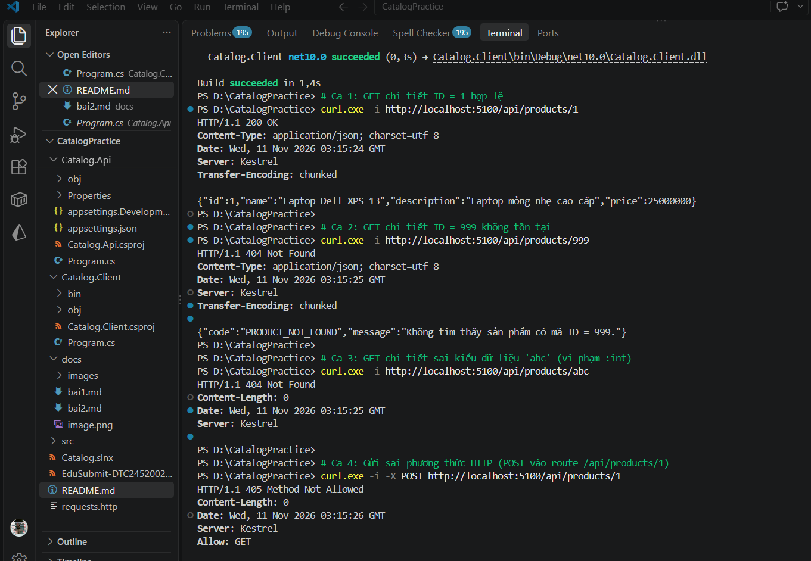
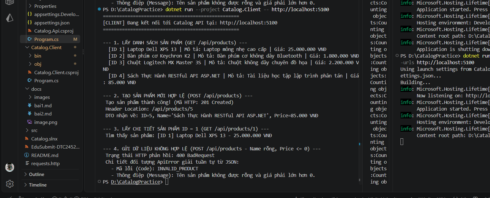
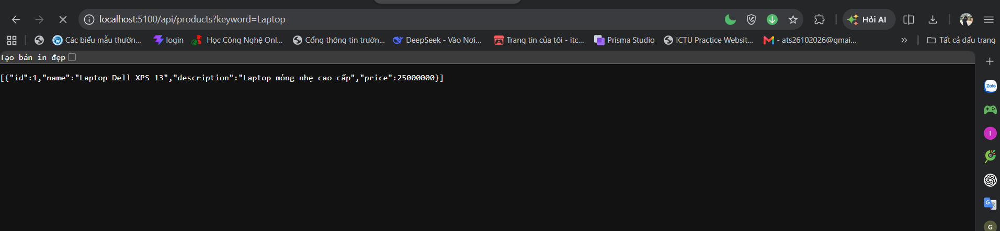
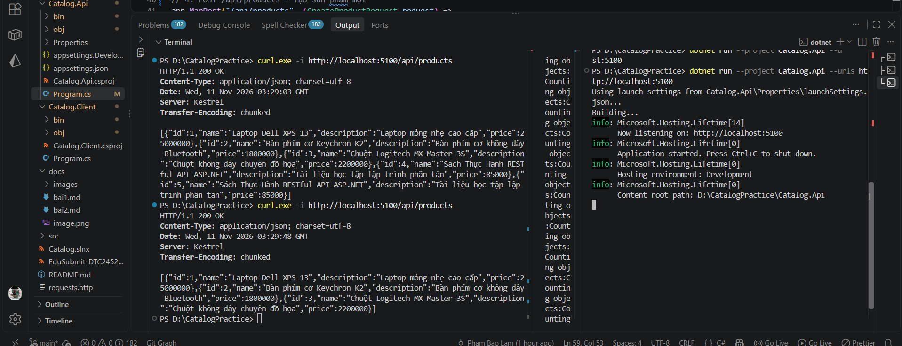
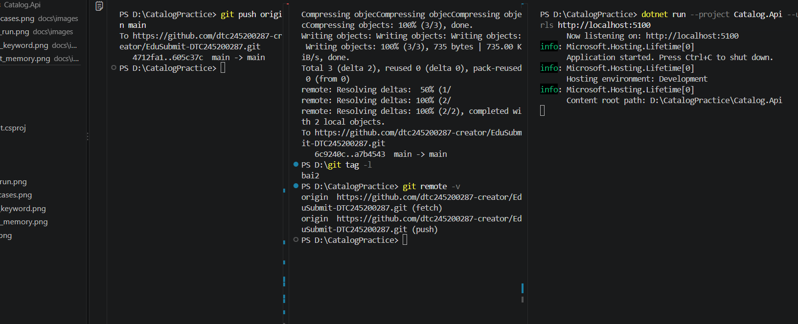

# Bài 2 – RESTful API Catalog API

- **Họ và tên:** Phạm Bảo Lâm
- **MSSV:** DTC245200287
- **Lớp:** CNTTK23E

---

## 1. Lệnh đã chạy

### Khởi chạy API Server (Catalog.Api)
```bash
dotnet run --project Catalog.Api
```

### Khởi chạy Console Client (Catalog.Client ở terminal thứ hai)
```bash
dotnet run --project Catalog.Client
```

### Kiểm thử các endpoint qua curl
```bash
curl -i http://localhost:5100/api/products
curl -i http://localhost:5100/api/products/1
curl -i -X POST http://localhost:5100/api/products -H "Content-Type: application/json" -d "{\"name\":\"Ban phim co\",\"price\":1200000}"
curl -i "http://localhost:5100/api/products?keyword=Laptop"
```

---

## 2. Ảnh kết quả

### Thử nghiệm 4 ca HTTP chi tiết bằng curl


### Chạy ứng dụng Catalog.Api và Catalog.Client


### Lọc sản phẩm theo Query String (keyword)


### So sánh dữ liệu In-Memory trước và sau khi khởi động lại Server


### Minh chứng Git commit & tag bai2


---

## 3. Bảng phá thử

| Ca thử | Mong đợi | Thực tế |
|---|---|---|
| GET /api/products (lấy toàn bộ danh sách sản phẩm) | Trả về 200 OK cùng mảng JSON danh sách sản phẩm hiện có | Trả về 200 OK kèm danh sách sản phẩm dạng JSON khớp DTO |
| POST /api/products với dữ liệu hợp lệ (name, price > 0) | Trả về 201 Created, header Location: /api/products/{id} và đối tượng sản phẩm mới | Trả về 201 Created, có đầy đủ header Location và JSON sản phẩm vừa tạo |
| POST /api/products với name = "" (tên rỗng) | Trả về 400 Bad Request kèm body lỗi ApiError (INVALID_PRODUCT) | Trả về 400 Bad Request kèm thông báo lỗi dữ liệu đầu vào không hợp lệ |
| POST /api/products với price = -50000 (giá âm) | Trả về 400 Bad Request kèm body lỗi ApiError (INVALID_PRODUCT) | Trả về 400 Bad Request do server kiểm tra điều kiện giá phải lớn hơn 0 |
| GET /api/products/999 (ID kiểu số nguyên nhưng không tồn tại) | Trả về 404 Not Found kèm JSON ApiError (PRODUCT_NOT_FOUND) | Trả về 404 Not Found kèm thông báo không tìm thấy sản phẩm có ID 999 |
| GET /api/products/abc (ID sai kiểu dữ liệu, vi phạm :int) | Trả về 404 Not Found với body rỗng (Content-Length: 0) do route constraint chặn | Trả về 404 Not Found, body rỗng ngay từ tầng định tuyến của ASP.NET Core |
| GET /api/products?keyword=Laptop (lọc theo từ khóa) | Trả về 200 OK cùng mảng các sản phẩm có tên/mô tả chứa từ khóa | Trả về 200 OK và lọc chính xác danh sách sản phẩm chứa từ khóa |
| Chạy Catalog.Client khi Catalog.Api chưa bật / đã tắt | Client bắt được ngoại lệ kết nối (HttpRequestException / Connection refused) | Client hiển thị thông báo không thể kết nối tới API server |

---

## 4. Trả lời 3 câu hỏi giải thích

### Câu 1: Vì sao URI dùng danh từ, còn hành động do phương thức HTTP đảm nhận?
- **URI đại diện cho tài nguyên (Resource):** Trong kiến trúc REST, mọi thực thể nghiệp vụ (như sản phẩm /api/products, sản phẩm cụ thể /api/products/1) đều được coi là một tài nguyên tĩnh, do đó URI dùng **danh từ số nhiều** để định danh nhất quán địa chỉ của tài nguyên đó trên mạng.
- **Phương thức HTTP biểu diễn hành động (Verb):** Giao thức HTTP đã định nghĩa sẵn ngữ nghĩa chuẩn cho các thao tác CRUD (GET để đọc, POST để tạo mới, PUT để cập nhật, DELETE để xóa). Việc tách biệt danh từ vào URI và động từ vào HTTP method giúp API gọn gàng, tránh sinh ra hàng loạt đường dẫn rối rắm kiểu /getProducts, /createProduct, /deleteProduct, đồng thời giúp các thành phần trung gian (cache, proxy, firewall) hiểu đúng bản chất yêu cầu để tối ưu hóa và phân quyền.

### Câu 2: "Stateless" thể hiện ở đâu trong code đã viết?
- **Không lưu phiên làm việc (Session) hay trạng thái riêng của từng Client trên Server:** Trong Catalog.Api, server không dùng Session, không lưu lịch sử người dùng nào đang đăng nhập hay đã gọi API trước đó; mọi request gửi lên đều được xử lý độc lập qua các endpoint như MapGet và MapPost.
- **Mỗi request tự mang đầy đủ thông tin cần thiết:** Khi client gọi GET /api/products/1, GET /api/products?keyword=Laptop hay gửi body JSON trong POST /api/products, toàn bộ tham số định danh và dữ liệu đầu vào đều nằm trọn trong chính request đó (route parameter, query string, request body) để server xử lý và trả về response ngay lập tức mà không phụ thuộc vào các request trước đó.

### Câu 3: Vì sao client và server mỗi bên khai báo DTO riêng mà vẫn khớp nhau?
- **Giao tiếp dựa trên hợp đồng dữ liệu JSON (Data Contract) chứ không phụ thuộc mã nguồn:** Catalog.Client và Catalog.Api là hai tiến trình độc lập, không tham chiếu project của nhau; thứ duy nhất hai bên thống nhất là cấu trúc bản tin HTTP và định dạng dữ liệu trao đổi (JSON).
- **Cơ chế Serialize / Deserialize ánh xạ theo tên thuộc tính:** Khi Catalog.Api trả về JSON (ví dụ {"id":1,"name":"...","price":...}), bộ System.Text.Json ở phía Catalog.Client tự động đọc các cặp key-value trong chuỗi JSON và khớp vào các thuộc tính tương ứng trên class/record DTO của client (mặc định không phân biệt chữ hoa/thường theo quy tắc camelCase – PascalCase). Chỉ cần tên trường và kiểu dữ liệu tương thích trong JSON thì hai bên hoàn toàn đọc hiểu được nhau dù khai báo ở hai namespace/project khác nhau.
