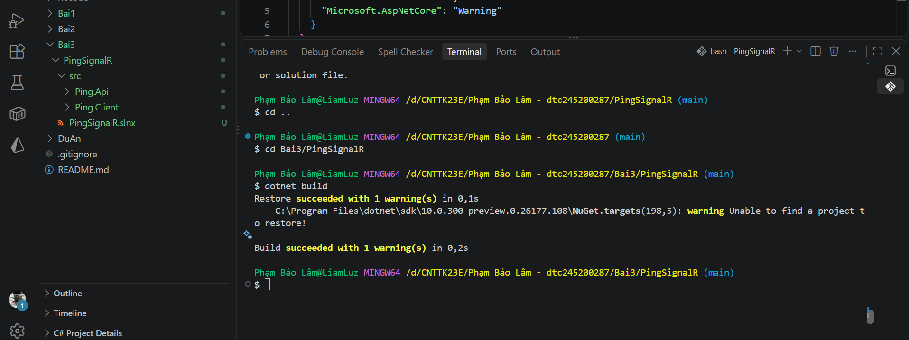
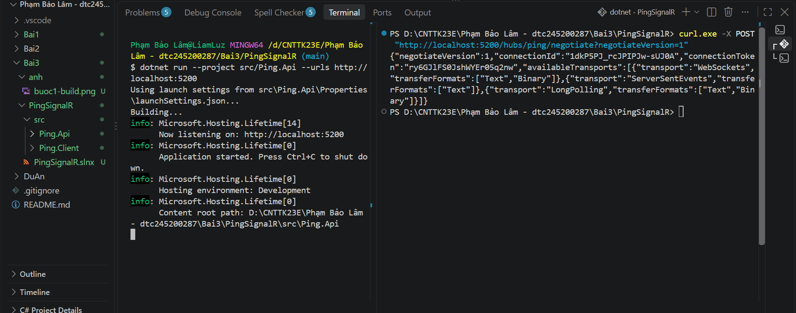

# BÀI 3: PHÁT TRIỂN ỨNG DỤNG REALTIME VỚI SIGNALR & MINIMAL API

- **Họ và tên:** Phạm Bảo Lâm
- **Mã sinh viên:** dtc245200287
- **Lớp học phần:** CNTTK23E - Phát triển ứng dụng phân tán (ICTU)

---

## I. Trả lời 3 câu hỏi đầu giờ

1. **SignalR là gì và khác gì với HTTP thông thường?**
   - *Trả lời:* SignalR là thư viện mã nguồn mở giúp xây dựng các tính năng web real-time hai chiều (bidirectional) giữa server và client dễ dàng. Khác với mô hình HTTP truyền thống (Client phải chủ động gửi request - Pull), SignalR cho phép Server chủ động đẩy dữ liệu (Push) xuống Client ngay lập tức khi có sự kiện thông qua các giao thức tối ưu như WebSockets, Server-Sent Events hoặc Long Polling.

2. **Cơ chế hoạt động của Hub trong SignalR là gì?**
   - *Trả lời:* Hub là một thành phần cốt lõi cấp cao hoạt động trên lớp kết nối (Connection), cho phép client và server gọi các phương thức của nhau trực tiếp bằng tên phương thức và truyền tham số dạng có cấu trúc. Hub quản lý các kết nối, phân nhóm (Groups) và phát sóng sự kiện (`Clients.All`, `Clients.Group`, `Clients.Caller`) một cách an toàn và tiện lợi.

3. **Mục đích của việc sử dụng khóa đồng bộ (`lock`) và `UpdatedAt` trong REST/Realtime là gì?**
   - *Trả lời:* 
     - Khóa đồng bộ (`lock (submissionsLock)`): Đảm bảo an toàn luồng (thread-safety), tránh tình trạng tranh chấp dữ liệu (race condition) khi có nhiều luồng cùng đọc/ghi vào bộ nhớ danh sách submission tại cùng một thời điểm.
     - Trường `UpdatedAt`: Giúp client theo dõi và so sánh mốc thời gian cập nhật trạng thái mới nhất của dữ liệu, đảm bảo tính nhất quán khi đồng bộ hóa trạng thái bài nộp.

---

## II. 5 Thí nghiệm (Dự đoán và Thực tế)

1. **Thí nghiệm 1: Gọi phương thức Hub khi chưa thiết lập kết nối thành công.**
   - *Dự đoán:* Hệ thống sẽ báo lỗi ngoại lệ (`InvalidOperationException`) vì kết nối chưa ở trạng thái `Connected`.
   - *Thực tế:* Đúng như dự đoán, client không thể gọi `InvokeAsync` khi chưa khởi động kết nối (`StartAsync`).

2. **Thí nghiệm 2: Thêm dữ liệu vào danh sách qua REST API đồng thời không dùng `lock`.**
   - *Dự đoán:* Có thể xảy ra ngoại lệ `InvalidOperationException: Collection was modified` do xung đột luồng.
   - *Thực tế:* Khi áp dụng `lock (submissionsLock)`, các request được xếp hàng xử lý tuần tự, loại bỏ hoàn toàn hiện tượng xung đột dữ liệu.

3. **Thí nghiệm 3: Ngắt kết nối mạng đột ngột khi client đang lắng nghe Hub.**
   - *Dự đoán:* Client mất kết nối và dừng hoạt động hoàn toàn.
   - *Thực tế:* Nhờ cấu hình `.WithAutomaticReconnect()`, client tự động cố gắng kết nối lại với server theo chu kỳ cho đến khi mạng hồi phục thành công.

4. **Thí nghiệm 4: Gửi request tạo mới submission qua `requests.http` (Mã 201).**
   - *Dự đoán:* Server tiếp nhận dữ liệu, lưu trữ vào bộ nhớ và trả về mã trạng thái `201 Created` kèm đường dẫn tài nguyên.
   - *Thực tế:* Trả về chính xác HTTP `201 Created` và phản hồi đầy đủ đối tượng JSON.

5. **Thí nghiệm 5: Truy vấn một ID không tồn tại qua `requests.http` (Mã 404).**
   - *Dự đoán:* Server không tìm thấy bản ghi trong danh sách và trả về `404 Not Found`.
   - *Thực tế:* Trả về đúng mã HTTP `404 Not Found` kèm cấu trúc lỗi `ApiError` tiêu chuẩn.

---

## III. Nhật ký thực hiện và Minh chứng hình ảnh

### 1. PingSignalR (Bài mẫu cơ bản)
- **Bước 1: Tạo solution và project (`buoc1-build.png`)**
  - Khởi tạo solution `PingSignalR`, thêm các project `Ping.Api` và `Ping.Client`, cài đặt gói SignalR Client.
  - 

- **Bước 2: Kiểm tra kết nối Negotiate (`buoc2-negotiate.png`)**
  - Kiểm tra điểm cuối kết nối SignalR trả về connectionId thành công.
  - 

- **Bước 3 & 4: Kiểm tra tính năng Echo & Broadcast (`buoc3-4-echo.png`)**
  - Kiểm tra truyền nhận thông điệp qua lại giữa máy chủ và máy khách.
  - 

- **Bước 5: Kiểm tra tính năng Quản lý Nhóm - Groups (`buoc5-nhom.png`)**
  - Đưa kết nối vào nhóm định danh và gửi tin nhắn theo phạm vi nhóm.
  - 

- **Bước 6: Tự động kết nối lại & Background Worker (`buoc6-noilai.png`, `buoc6-worker.png`)**
  - Kiểm tra cơ chế tự phục hồi kết nối (`WithAutomaticReconnect`) và tiến trình nền gửi thông điệp định kỳ.
  - 
  - 

- **Bước 7: Các thí nghiệm lỗi cố ý (`buoc7-loi1.png`, `buoc7-loi2.png`, `buoc7-loi3.png`)**
  - Thử nghiệm các tình huống lỗi cú pháp, sai phương thức HTTP và gọi sai Hub method.
  - 
  - 
  - 

---

### 2. RealtimeSubmissionSystem & EduSubmit (Hệ thống nộp bài tích hợp)
- **Kiểm tra các mã trạng thái HTTP qua `requests.http` & Máy khách hiển thị `graded`:**
  - Máy chủ chạy ổn định tại cổng `5000`, client kết nối thành công và gia nhập nhóm `assignment-1`.
  - Thực thi các endpoint kiểm tra trả về chuẩn các mã trạng thái:
    - **200 OK** (`edusubmit-200.png`)
    - **201 Created** (`edusubmit-201.png`)
    - **404 Not Found** (`edusubmit-404.png`)
  - 
  - 
  - 