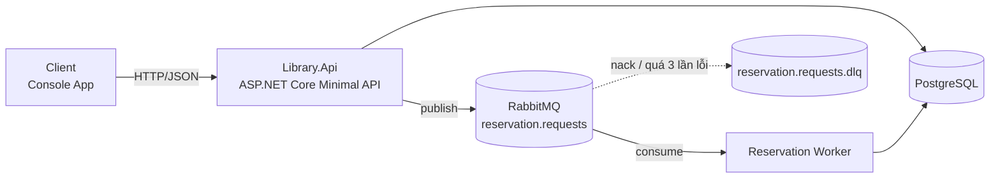
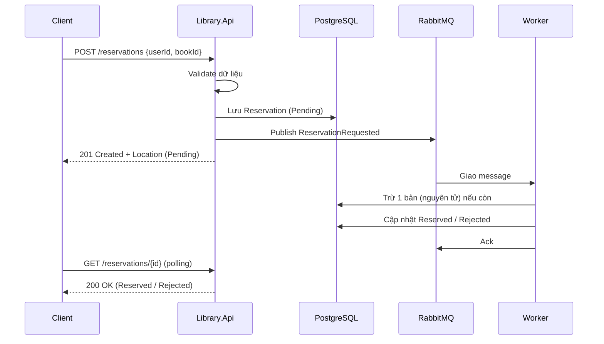
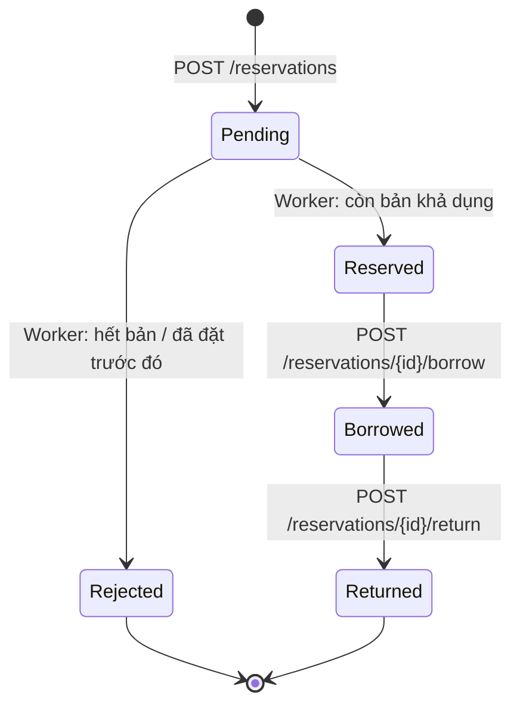

# Hệ thống thư viện và đặt mượn sách phân tán

> Bài tập lớn học phần **Phát triển ứng dụng phân tán** — Đề tài 20.
> Sinh viên: `<Họ tên>` — MSSV: `<MSSV>` — Lớp: `<Lớp>`

Hệ thống cho phép người dùng tra cứu sách, gửi yêu cầu đặt mượn và theo dõi trạng thái xử lý.
Yêu cầu đặt mượn được **xử lý bất đồng bộ** qua RabbitMQ: API nhận yêu cầu và trả kết quả ngay,
một Worker độc lập sẽ kiểm tra số bản còn khả dụng rồi xác nhận hoặc từ chối.

## Mục lục

1. [Kiến trúc](#1-kiến-trúc)
2. [Công nghệ](#2-công-nghệ)
3. [Chức năng](#3-chức-năng)
4. [Yêu cầu cài đặt](#4-yêu-cầu-cài-đặt)
5. [Cài đặt và chạy nhanh bằng Docker](#5-cài-đặt-và-chạy-nhanh-bằng-docker)
6. [Cấu hình (biến môi trường)](#6-cấu-hình-biến-môi-trường)
7. [Tài liệu API](#7-tài-liệu-api)
8. [Kịch bản kiểm thử bằng curl](#8-kịch-bản-kiểm-thử-bằng-curl)
9. [Chạy Console Client](#9-chạy-console-client)
10. [Chạy từng thành phần bằng dotnet run (phát triển)](#10-chạy-từng-thành-phần-bằng-dotnet-run-phát-triển)
11. [Cơ chế giao tiếp phân tán và khả năng chịu lỗi](#11-cơ-chế-giao-tiếp-phân-tán-và-khả-năng-chịu-lỗi)
12. [Cấu trúc thư mục](#12-cấu-trúc-thư-mục)
13. [Xử lý sự cố thường gặp](#13-xử-lý-sự-cố-thường-gặp)
14. [Quy trình Git](#14-quy-trình-git)

---

## 1. Kiến trúc



Các thành phần chạy độc lập, mỗi thành phần .NET có Dockerfile riêng và giao tiếp với nhau
qua Docker network `library-net` bằng **service name** (`postgres`, `rabbitmq`, `api`).

| Thành phần | Vai trò |
|---|---|
| **Library.Client** | Console app gọi REST API, gửi yêu cầu đặt mượn rồi hỏi lại (polling) trạng thái |
| **Library.Api** | REST API: tra cứu sách, nhận yêu cầu đặt mượn, ghi `Pending` vào DB, đưa message vào RabbitMQ |
| **RabbitMQ** | Message broker, hàng đợi `reservation.requests` (durable) và `reservation.requests.dlq` |
| **Library.Worker** | Lấy message, kiểm tra số bản khả dụng, cập nhật `Reserved` hoặc `Rejected` |
| **PostgreSQL** | Lưu sách, số bản, người dùng, yêu cầu đặt mượn |
| **Library.Shared** | Thư viện dùng chung: entity, `DbContext`, định nghĩa message, khai báo queue |

### Luồng xử lý một yêu cầu đặt mượn



### Trạng thái của yêu cầu đặt mượn



### Mô hình dữ liệu

| Bảng | Cột chính |
|---|---|
| `Books` | `Id`, `Title`, `Author`, `TotalCopies`, `AvailableCopies` |
| `Users` | `Id`, `Name` |
| `Reservations` | `Id` (GUID), `UserId`, `BookId` (FK → Books), `Status`, `Reason`, `CreatedAt`, `UpdatedAt` |

Dữ liệu mẫu (4 cuốn sách, 3 người dùng) được nạp tự động khi API khởi động lần đầu.

## 2. Công nghệ

- Ngôn ngữ **C#**, nền tảng **.NET 10**
- **ASP.NET Core Minimal API** (REST/JSON)
- **RabbitMQ** (`RabbitMQ.Client` 7.x) — giao tiếp bất đồng bộ
- **PostgreSQL 17** + Entity Framework Core (Npgsql)
- **Docker** và **Docker Compose**
- **Git/GitHub** (Fork và Pull Request)

## 3. Chức năng

- Tra cứu danh sách sách (có tìm kiếm theo từ khóa) và chi tiết sách
- Tra cứu số bản đang khả dụng
- Gửi yêu cầu đặt mượn → đưa vào RabbitMQ
- Worker kiểm tra số bản khả dụng, xác nhận hoặc từ chối
- Trạng thái: `Pending`, `Reserved`, `Rejected`, `Borrowed`, `Returned`
- Tra cứu trạng thái yêu cầu; tra cứu các yêu cầu của một người dùng (có lọc theo trạng thái)
- Thủ thư xác nhận cho mượn (`borrow`) và nhận trả (`return`)

**Phần mở rộng đã thực hiện:** retry, dead-letter queue, idempotent consumer, health endpoint `/health`,
logging theo `ReservationId` (đóng vai trò correlation id).

## 4. Yêu cầu cài đặt

| Công cụ | Dùng để | Kiểm tra |
|---|---|---|
| [Docker Desktop](https://www.docker.com/products/docker-desktop/) | Chạy toàn bộ hệ thống | `docker --version` |
| [Git](https://git-scm.com/) (kèm Git Bash trên Windows) | Quản lý mã nguồn, chạy curl | `git --version` |
| [.NET 10 SDK](https://dotnet.microsoft.com/download) | Chỉ cần khi chạy hoặc build ngoài Docker | `dotnet --version` |

## 5. Cài đặt và chạy nhanh bằng Docker

```bash
# 1. Lấy mã nguồn
git clone https://github.com/<tai-khoan>/<ten-repo>.git
cd <ten-repo>

# 2. Tạo file cấu hình môi trường
cp .env.example .env

# 3. Build và chạy toàn bộ hệ thống (postgres, rabbitmq, api, worker)
docker compose up --build -d

# 4. Kiểm tra
docker compose ps
curl http://localhost:8080/health
curl http://localhost:8080/books
```

Sau khi chạy:

| Dịch vụ | Địa chỉ |
|---|---|
| Library API | http://localhost:8080 |
| RabbitMQ Management UI | http://localhost:15672 (đăng nhập bằng `RABBITMQ_USER` / `RABBITMQ_PASS` trong `.env`) |

Các lệnh hữu ích:

```bash
docker compose logs -f api worker     # xem log luồng xử lý
docker compose stop worker            # tắt riêng một thành phần
docker compose start worker           # bật lại
docker compose down                   # dừng hệ thống (giữ dữ liệu)
docker compose down -v                # dừng và XÓA dữ liệu để về trạng thái ban đầu
```

## 6. Cấu hình (biến môi trường)

Mọi cấu hình phụ thuộc môi trường nằm ngoài mã nguồn: file `.env` (cho Docker Compose) và các biến
môi trường được truyền vào container. Trong .NET, dấu `__` tương ứng với dấu `:` của cấu hình phân cấp.

| Biến trong `.env` | Ý nghĩa | Giá trị mẫu |
|---|---|---|
| `POSTGRES_DB` | Tên database | `library` |
| `POSTGRES_USER` | Tài khoản PostgreSQL | `library` |
| `POSTGRES_PASSWORD` | Mật khẩu PostgreSQL | `library_dev` |
| `RABBITMQ_USER` | Tài khoản RabbitMQ | `library` |
| `RABBITMQ_PASS` | Mật khẩu RabbitMQ | `library_dev` |
| `API_PORT` | Cổng API trên máy chủ | `8080` |

| Biến trong container | Dùng bởi | Ý nghĩa |
|---|---|---|
| `ConnectionStrings__Library` | api, worker | Chuỗi kết nối PostgreSQL (host là `postgres`) |
| `RabbitMq__Host` / `__User` / `__Password` | api, worker | Địa chỉ và tài khoản RabbitMQ (host là `rabbitmq`) |
| `LIBRARY_API_URL` | client | URL của API (`http://api:8080` trong Docker) |

> File `.env` đã nằm trong `.gitignore`. Chỉ commit `.env.example`.
> Mật khẩu trong `.env.example` chỉ là giá trị minh họa cho môi trường học tập.

## 7. Tài liệu API

Địa chỉ gốc: `http://localhost:8080`. Dữ liệu trao đổi là JSON.

| Method | Đường dẫn | Mô tả | Mã trả về |
|---|---|---|---|
| GET | `/health` | Kiểm tra API còn sống | 200 |
| GET | `/books?keyword=` | Danh sách sách, tìm theo tên hoặc tác giả | 200 |
| GET | `/books/{id}` | Chi tiết sách (kèm số bản khả dụng) | 200, 404 |
| POST | `/reservations` | Gửi yêu cầu đặt mượn | 201, 400, 404, 503 |
| GET | `/reservations/{id}` | Trạng thái một yêu cầu | 200, 404 |
| GET | `/users/{userId}/reservations?status=` | Yêu cầu của một người dùng | 200, 400, 404 |
| POST | `/reservations/{id}/borrow` | Thủ thư xác nhận cho mượn (`Reserved` → `Borrowed`) | 200, 404, 409 |
| POST | `/reservations/{id}/return` | Nhận trả sách (`Borrowed` → `Returned`, cộng lại 1 bản) | 200, 404, 409 |

Tham số `{id}` của sách có ràng buộc `int` tối thiểu 1; `{id}` của yêu cầu có ràng buộc `guid`.
Sai định dạng thì route không khớp và trả `404`.

### `GET /books/2`

```json
{
  "id": 2,
  "title": "Designing Data-Intensive Applications",
  "author": "Martin Kleppmann",
  "totalCopies": 1,
  "availableCopies": 1
}
```

### `POST /reservations`

Request:

```json
{ "userId": 1, "bookId": 2 }
```

Response `201 Created` (header `Location: /reservations/{id}`):

```json
{
  "id": "3f1c2d4e-8b7a-4c55-9e0a-6d2f1b9a7c10",
  "userId": 1,
  "bookId": 2,
  "bookTitle": "Designing Data-Intensive Applications",
  "status": "Pending",
  "reason": null,
  "createdAt": "2026-11-15T08:00:00Z",
  "updatedAt": "2026-11-15T08:00:00Z"
}
```

Response `400 Bad Request` khi dữ liệu không hợp lệ:

```json
{
  "title": "One or more validation errors occurred.",
  "status": 400,
  "errors": { "userId": ["userId phải lớn hơn 0"] }
}
```

### `GET /reservations/{id}` (sau khi Worker xử lý)

```json
{
  "id": "3f1c2d4e-8b7a-4c55-9e0a-6d2f1b9a7c10",
  "userId": 1,
  "bookId": 2,
  "bookTitle": "Designing Data-Intensive Applications",
  "status": "Reserved",
  "reason": null,
  "createdAt": "2026-11-15T08:00:00Z",
  "updatedAt": "2026-11-15T08:00:01Z"
}
```

Khi bị từ chối: `"status": "Rejected"`, `"reason": "Hết bản khả dụng"`.

### Quy ước mã trạng thái HTTP

| Mã | Khi nào |
|---|---|
| 200 OK | Lấy dữ liệu / thao tác thành công |
| 201 Created | Tạo yêu cầu đặt mượn (bản ghi `Pending` đã được tạo, kèm header `Location`) |
| 400 Bad Request | Dữ liệu gửi lên không hợp lệ |
| 404 Not Found | Không tìm thấy sách, người dùng hoặc yêu cầu |
| 409 Conflict | Chuyển trạng thái không hợp lệ (ví dụ trả sách chưa mượn) |
| 503 Service Unavailable | RabbitMQ không khả dụng, không nhận được yêu cầu |

## 8. Kịch bản kiểm thử bằng curl

> Trên Windows hãy chạy trong **Git Bash** (đi kèm Git for Windows) để dùng đúng cú pháp.
> Dữ liệu được lưu lại giữa các lần chạy; muốn về trạng thái ban đầu hãy chạy `docker compose down -v`
> rồi `docker compose up -d`.

**8.1. Tra cứu và kiểm tra lỗi**

```bash
curl -i http://localhost:8080/books                         # 200, kèm availableCopies
curl -i "http://localhost:8080/books?keyword=clean"         # tìm kiếm
curl -i http://localhost:8080/books/2                       # 200
curl -i http://localhost:8080/books/999                     # 404
curl -i http://localhost:8080/books/abc                     # 404 (route constraint)

curl -i -X POST http://localhost:8080/reservations -H "Content-Type: application/json" \
  -d '{"userId":0,"bookId":2}'                              # 400
curl -i -X POST http://localhost:8080/reservations -H "Content-Type: application/json" \
  -d '{"userId":1,"bookId":999}'                            # 404
```

**8.2. Đặt mượn thành công**

```bash
curl -i -X POST http://localhost:8080/reservations -H "Content-Type: application/json" \
  -d '{"userId":1,"bookId":2}'                              # 201, status Pending, ghi lại id
curl http://localhost:8080/reservations/<id>                # Reserved
curl http://localhost:8080/books/2                          # availableCopies = 0
curl http://localhost:8080/users/1/reservations             # danh sách của user 1
```

**8.3. Hết sách thì bị từ chối** (sách số 2 chỉ có 1 bản, đã bị user 1 giữ)

```bash
curl -X POST http://localhost:8080/reservations -H "Content-Type: application/json" \
  -d '{"userId":2,"bookId":2}'
curl http://localhost:8080/reservations/<id>                # Rejected, "Hết bản khả dụng"
```

**8.4. Tranh chấp đồng thời** (sách số 4 có 1 bản, 3 người đặt cùng lúc)

```bash
for u in 1 2 3; do
  curl -s -X POST http://localhost:8080/reservations -H "Content-Type: application/json" \
    -d "{\"userId\":$u,\"bookId\":4}" &
done; wait
# Sau đó kiểm tra: đúng 1 yêu cầu Reserved và 2 yêu cầu Rejected
curl http://localhost:8080/books/4                          # availableCopies = 0, không bị âm
```

**8.5. Mượn và trả sách**

```bash
curl -X POST http://localhost:8080/reservations/<id>/borrow     # Reserved -> Borrowed
curl -X POST http://localhost:8080/reservations/<id>/return     # Borrowed -> Returned, availableCopies +1
curl -i -X POST http://localhost:8080/reservations/<id>/return  # 409 (đã trả rồi)
```

**8.6. Khả năng chịu lỗi**

```bash
# Worker dừng: API vẫn nhận yêu cầu, yêu cầu nằm chờ trong queue
docker compose stop worker
curl -i -X POST http://localhost:8080/reservations -H "Content-Type: application/json" \
  -d '{"userId":3,"bookId":3}'                              # 201, Pending
docker compose start worker                                 # Worker chạy lại và xử lý yêu cầu đang chờ
curl http://localhost:8080/reservations/<id>                # Reserved

# RabbitMQ dừng: API báo 503, các API chỉ đọc vẫn hoạt động
docker compose stop rabbitmq
curl -i -X POST http://localhost:8080/reservations -H "Content-Type: application/json" \
  -d '{"userId":3,"bookId":1}'                              # 503
curl -i http://localhost:8080/books                         # vẫn 200
docker compose start rabbitmq                               # API và Worker tự kết nối lại
```

## 9. Chạy Console Client

```bash
docker compose run --rm client
# hoặc, nếu đã cài .NET 10 SDK và API đang chạy ở cổng 8080:
dotnet run --project src/Library.Client
```

Menu: danh sách sách, chi tiết sách, đặt mượn (client tự hỏi lại trạng thái tối đa 10 giây),
tra cứu trạng thái, tra cứu yêu cầu của một người dùng. Có thể đổi địa chỉ API bằng biến môi trường
`LIBRARY_API_URL`.

## 10. Chạy từng thành phần bằng dotnet run (phát triển)

Dùng khi muốn debug trong IDE. Chỉ chạy hạ tầng bằng Docker, còn API và Worker chạy trên máy:

```bash
cp .env.example .env
docker compose up -d postgres rabbitmq         # hạ tầng (đã mở cổng 5432, 5672 ra máy)

dotnet run --project src/Library.Api --urls http://localhost:8080   # terminal 1
dotnet run --project src/Library.Worker        # terminal 2
```

Cấu hình khi chạy local nằm ở `appsettings.Development.json` của từng project (trỏ tới `localhost`).
Nếu bạn đổi mật khẩu trong `.env`, hãy đổi tương ứng trong hai file này.
Tham số `--urls` ép API chạy ở cổng 8080 để khớp với địa chỉ mặc định của Client.

## 11. Cơ chế giao tiếp phân tán và khả năng chịu lỗi

| Cơ chế | Cách thực hiện | Mục đích |
|---|---|---|
| REST đồng bộ | Client → API qua HTTP/JSON | Tra cứu và gửi yêu cầu |
| Hàng đợi bất đồng bộ | API publish, Worker consume qua RabbitMQ | Tách việc xử lý khỏi request, chịu tải đột biến |
| Queue **durable** + message **persistent** | `durable: true`, `Persistent = true` | RabbitMQ restart không mất yêu cầu |
| Publisher confirms | `publisherConfirmationsEnabled` | API biết broker đã nhận message |
| **Manual ack** | `autoAck: false`, ack sau khi ghi DB xong | Worker chết giữa chừng thì message được giao lại |
| **Idempotent consumer** | Chỉ xử lý khi `Status == Pending` | Message giao lại không làm trừ sách hai lần |
| **Cập nhật nguyên tử** | `UPDATE ... WHERE AvailableCopies > 0` | Không bán vượt số bản dù nhiều worker chạy song song |
| **Retry** | Thử lại tối đa 3 lần với thời gian chờ tăng dần | Chịu lỗi tạm thời của DB |
| **Dead-letter queue** | `x-dead-letter-*`, nack `requeue: false` | Message hỏng không lặp vô hạn, được giữ lại để kiểm tra |
| Tự kết nối lại | `AutomaticRecoveryEnabled` (Worker), kết nối lười (API) | RabbitMQ khởi động lại thì hệ thống tự phục hồi |
| Docker | `depends_on` + healthcheck, `restart: unless-stopped` | Khởi động đúng thứ tự, tự chạy lại khi container chết |

**Đánh đổi đã biết:** API ghi DB rồi mới publish. Nếu publish lỗi, yêu cầu được đánh dấu `Rejected` và API trả
`503`. Hướng cải thiện là **Outbox pattern** (ghi message vào bảng cùng transaction rồi một tiến trình gửi sang
RabbitMQ). Client dùng polling; có thể thay bằng SignalR để đẩy kết quả về client.

## 12. Cấu trúc thư mục

```
.
├── docker-compose.yml
├── .env.example              # mẫu cấu hình (commit)
├── .dockerignore
├── .gitignore
├── README.md
└── src/
    ├── Library.Shared/       # entity, DbContext, message, khai báo queue
    ├── Library.Api/          # Minimal API + Dockerfile
    ├── Library.Worker/       # consumer RabbitMQ + Dockerfile
    └── Library.Client/       # console client + Dockerfile
```

## 13. Xử lý sự cố thường gặp

| Triệu chứng | Nguyên nhân và cách xử lý |
|---|---|
| `docker compose` báo thiếu biến | Chưa tạo `.env`: chạy `cp .env.example .env` |
| Cổng 8080 / 5432 / 5672 đã bị chiếm | Đổi `API_PORT` trong `.env`, hoặc tắt chương trình đang dùng cổng |
| API log `DB chưa sẵn sàng` vài lần lúc đầu | Bình thường, API tự thử lại tối đa 10 lần |
| Đổi mật khẩu trong `.env` nhưng DB vẫn từ chối | Volume cũ giữ mật khẩu cũ: `docker compose down -v` rồi chạy lại |
| Yêu cầu mãi ở `Pending` | Worker chưa chạy: `docker compose ps`, `docker compose logs worker` |
| `POST /reservations` trả 503 | RabbitMQ chưa sẵn sàng: `docker compose logs rabbitmq` |
| Build Docker lỗi không tìm thấy `Library.Shared` | Phải build từ thư mục gốc (context `.`), dùng `docker compose build`, đừng build trong thư mục con |

## 14. Quy trình Git

- Làm việc trên nhánh `feature/library-reservation`, commit nhỏ sau mỗi bước hoàn thành
  (`feat(...)`, `build(...)`, `docs(...)`).
- Bản nộp được đánh dấu bằng tag `v1.0.0`.
- Mã nguồn đóng góp qua **Fork → Commit/Tag → Pull Request** để người quản lý kiểm duyệt trước khi gộp vào nhánh chính.
