### Bước 1: Tạo solution và build
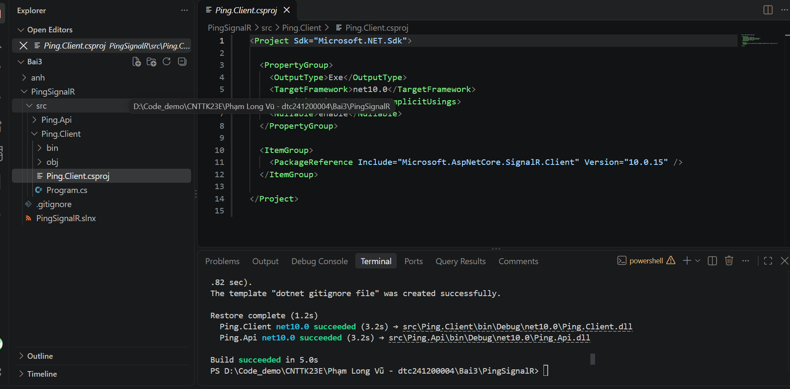
- Thấy: "dotnet build" báo "Build succeeded. 0 Warning(s), 0 Error(s)".
- Giải thích: Đã tạo solution "PingSignalR" gồm "Ping.Api" (web) và "Ping.Client" (console cài gói "Microsoft.AspNetCore.SignalR.Client" phiên bản "10.0.15").

### Bước 2: Kiểm tra negotiate bằng curl
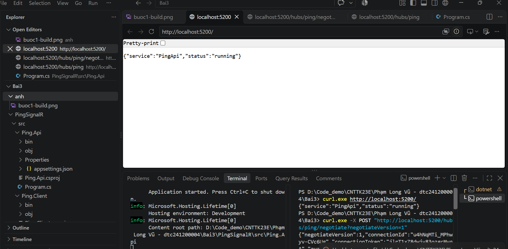
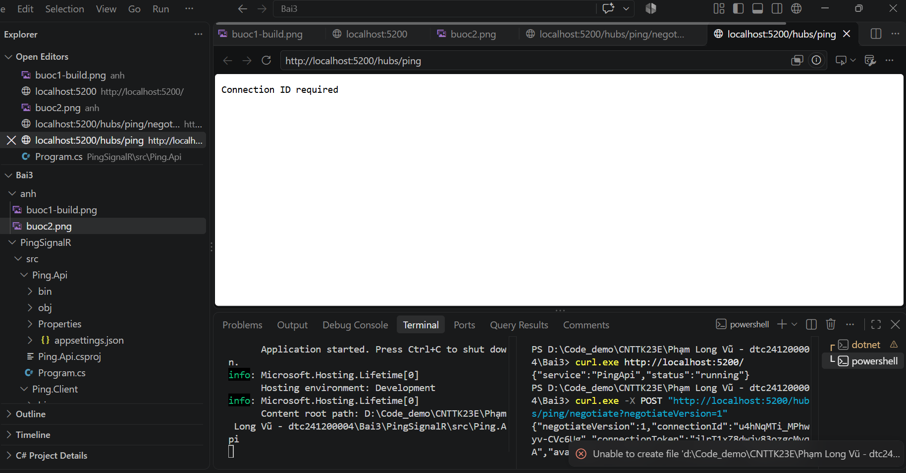
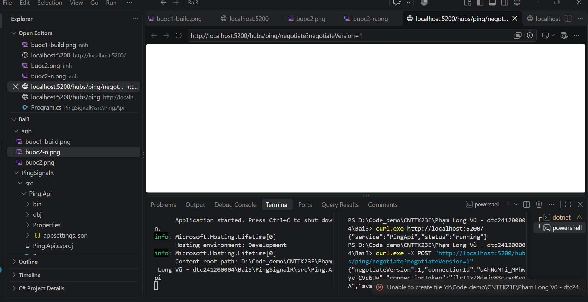
- Thấy: "curl.exe" gọi "POST /hubs/ping/negotiate?negotiateVersion=1" trả về "connectionId" và "availableTransports".
- Giải thích: Máy chủ đã ánh xạ hub "/hubs/ping" và báo các cơ chế truyền tải hỗ trợ ("WebSockets", "ServerSentEvents", "LongPolling").

### Bước 3–4: Máy khách kết nối và gọi Echo
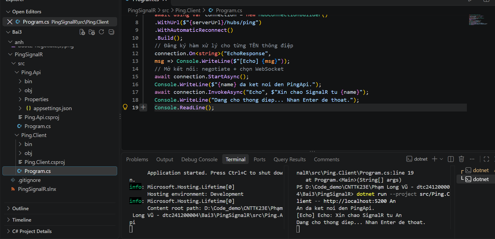
- Thấy: Máy chủ đang chạy ở cổng "5200", máy khách in "[Echo] Echo: Xin chao SignalR tu An".
- Giải thích: Máy khách mở kết nối qua "StartAsync()", gọi "InvokeAsync("Echo", ...)" lên hub và nhận phản hồi riêng qua "Clients.Caller.SendAsync("EchoResponse", ...)".

### Bước 5: Broadcast (All) và nhóm (Group)

- Thấy: Hai máy khách An và Bình nhận được "[Group]" và "[Broadcast]" của nhau, nhưng không nhận "[Echo]" của người kia.
- Giải thích: "Clients.All" gửi tới mọi kết nối, "Clients.Group" chỉ gửi tới thành viên trong nhóm "lop-hoc-01", còn "Clients.Caller" chỉ trả lời riêng người gọi.

### Bước 6: Vòng đời kết nối và tự kết nối lại
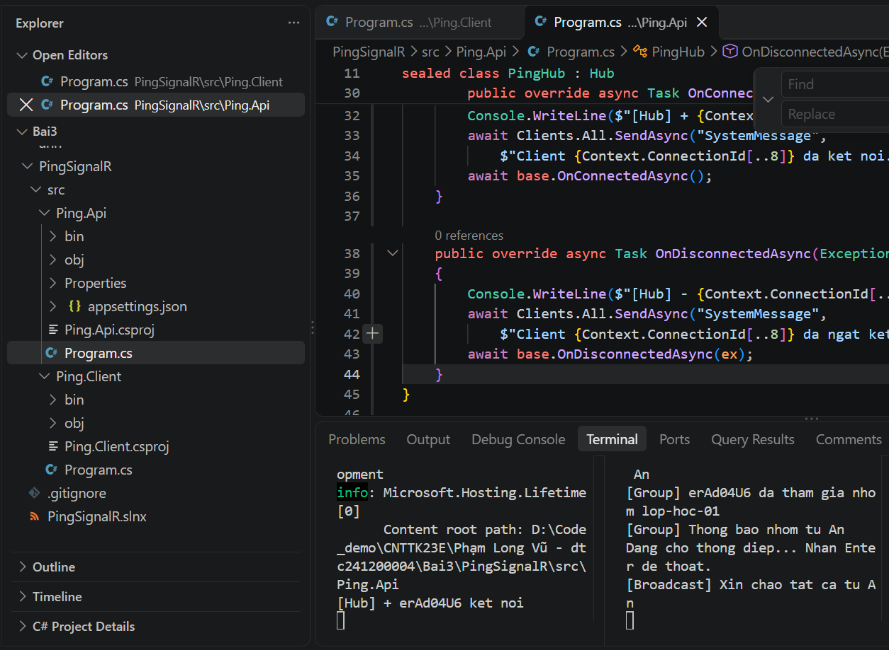
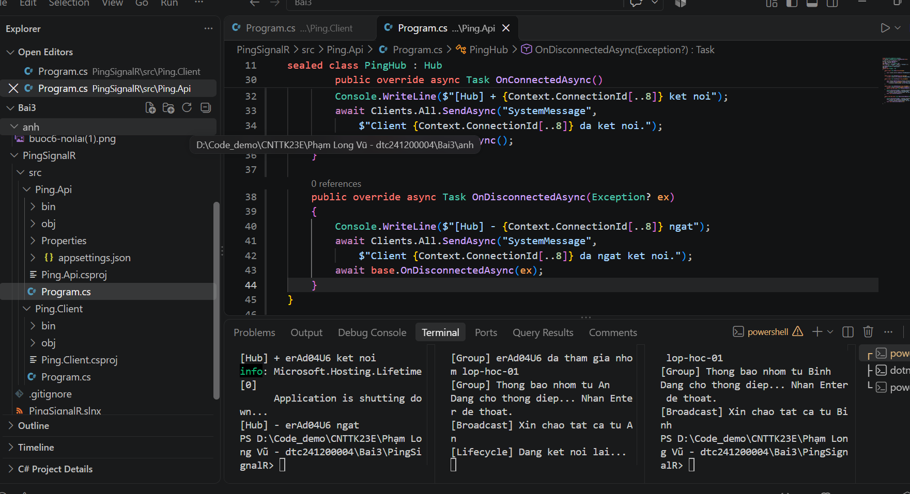
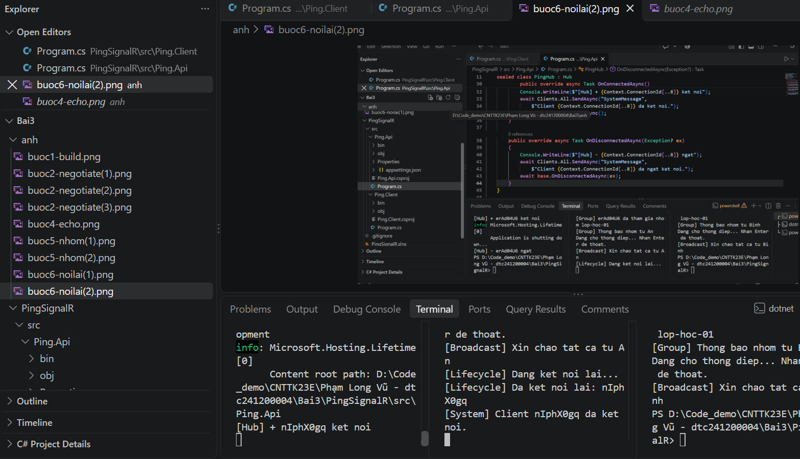
- Thấy: Khi tắt rồi bật lại máy chủ, máy khách in "[Lifecycle] Dang ket noi lai..." rồi "[Lifecycle] Da ket noi lai: ..." với "ConnectionId" mới.
- Giải thích: "WithAutomaticReconnect()" tự động nối lại khi kết nối đã mở bị rớt, nhưng "ConnectionId" thay đổi nên máy chủ xem đây là kết nối mới.

### Bước 7: Ba thí nghiệm lỗi

#### Lỗi 1: Máy chủ chưa chạy
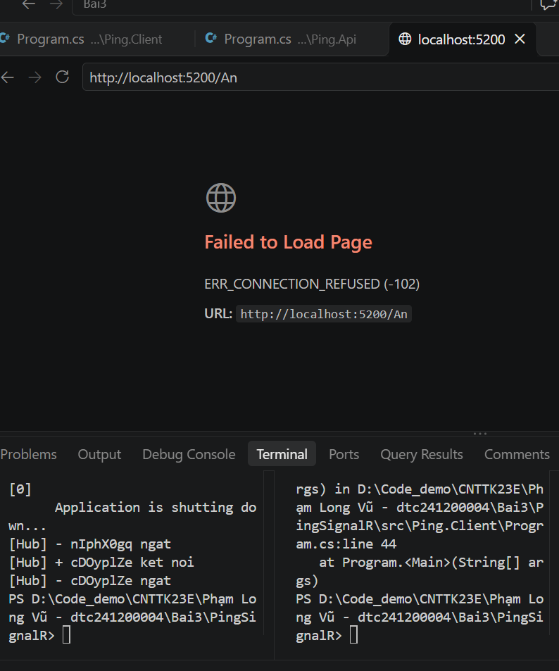
- Thực hiện: Tắt máy chủ  rồi chạy .
- Ta thấy: Chương trình văng ngoại lệ ERROR (-102).
- Giải thích: "StartAsync()" ném lỗi ngay khi lần kết nối đầu thất bại; "WithAutomaticReconnect()" chỉ tự nối lại cho kết nối đã mở thành công trước đó.

#### Lỗi 2: Sai đường dẫn hub
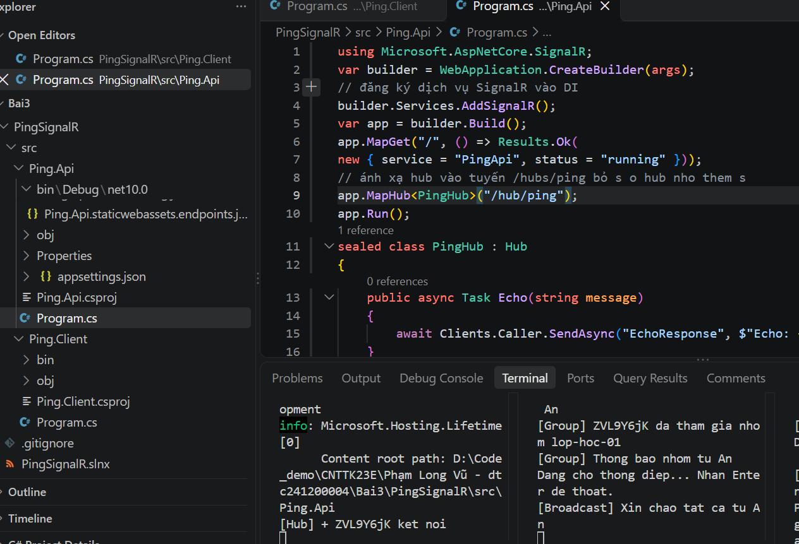
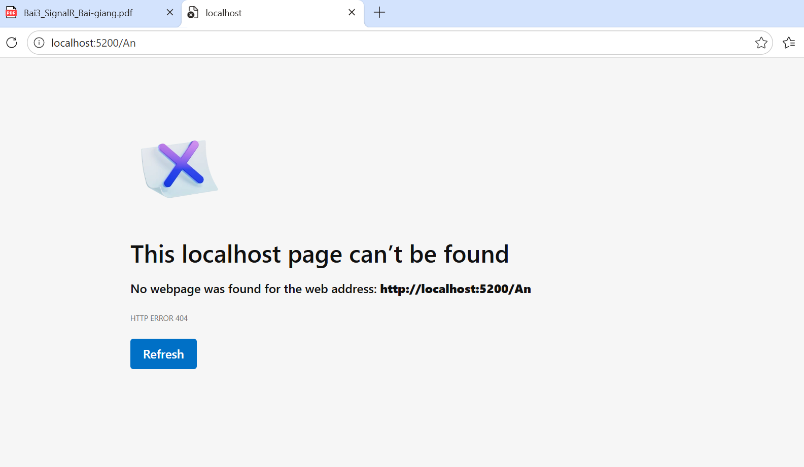
- Thực hiện: Sửa "WithUrl" của "Ping.Client" thành "/hub/ping" (thiếu "s") rồi chạy khi máy chủ đang bật.
- Ta thấy: Báo lỗi "HttpRequestException: Response status code does not indicate success: 404 (Not Found)".
- Giải thích: Lỗi xảy ra ngay ở bước bắt tay "negotiate" vì đường dẫn phía máy khách không khớp với "MapHub<PingHub>("/hubs/ping")" ở máy chủ.

#### Lỗi 3: Sai tên thông điệp
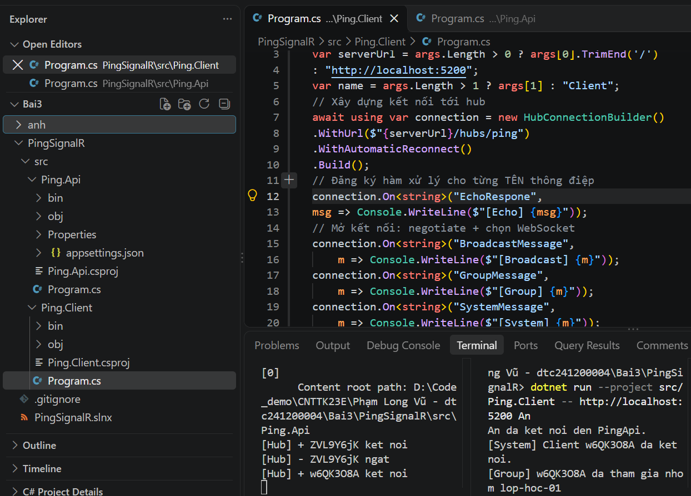
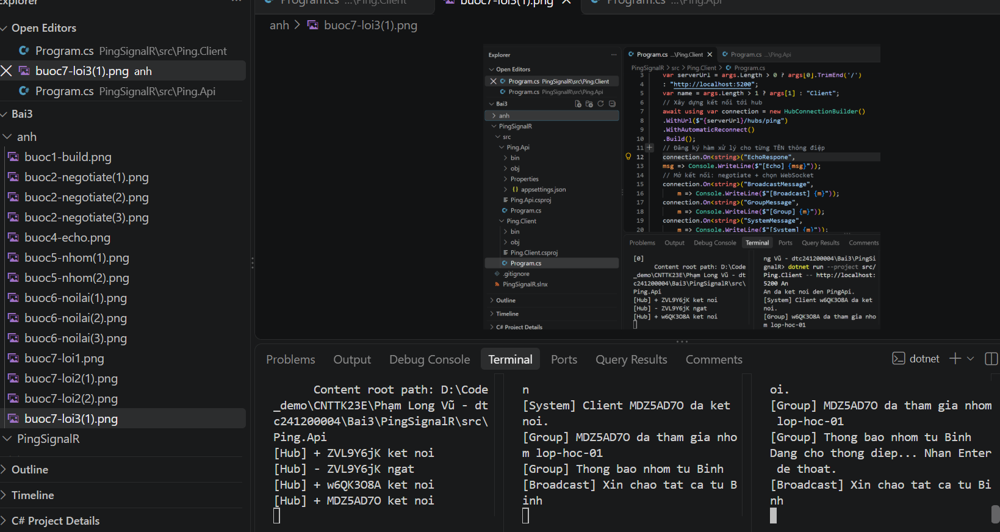
- Thực hiện: Sửa "connection.On<string>("EchoResponse", ...)" thành ""EchoRespone"" rồi chạy lại.
- Ta thấy: Không có thông báo lỗi nào (chương trình vẫn chạy bình thường), nhưng không in ra dòng "[Echo]".
- Giải thích: Sai tên thông điệp ở chiều từ hub đẩy xuống sẽ im lặng hoàn toàn (không lỗi biên dịch hay runtime). Khi không nhận được tin cần kiểm tra khớp tên giữa "SendAsync" và "On" đầu tiên.