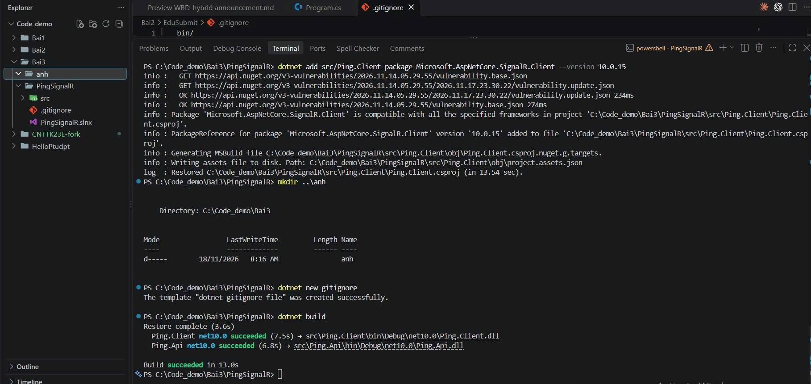
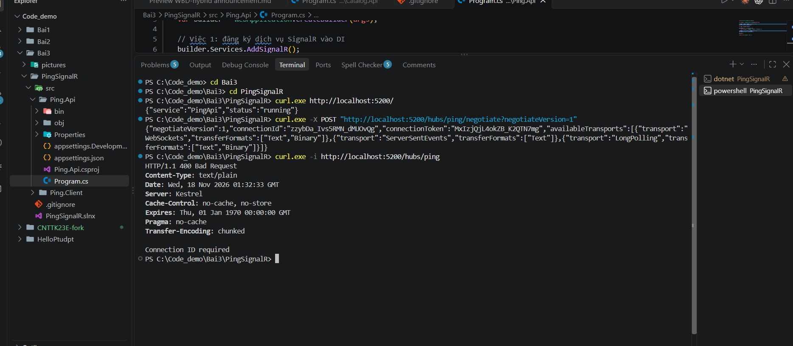
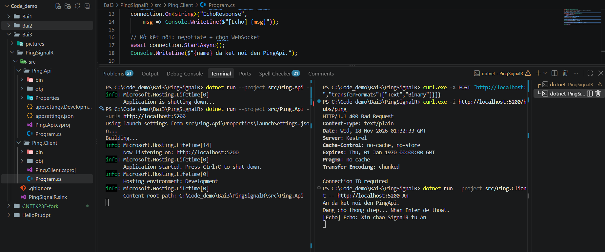
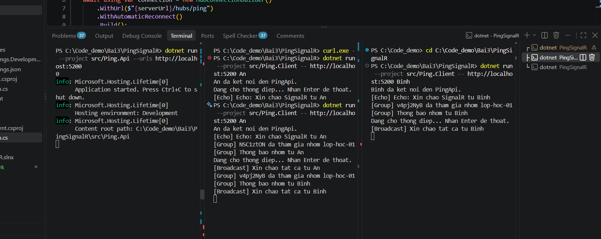
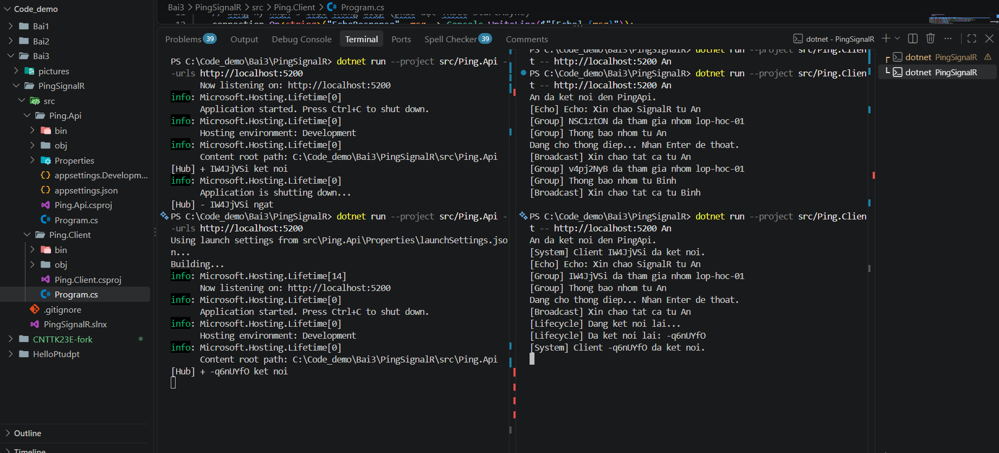
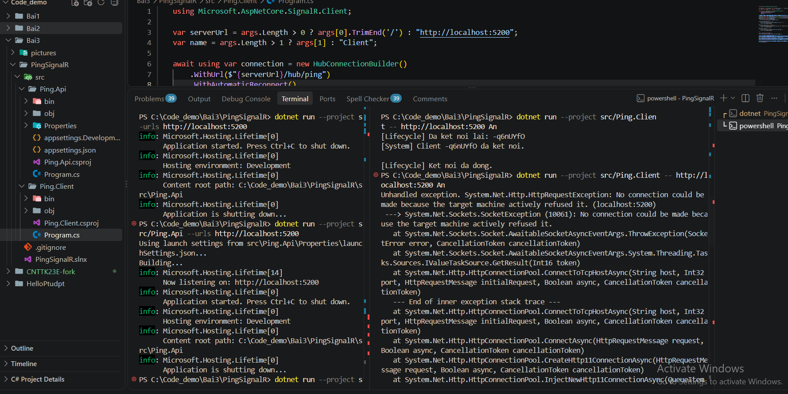
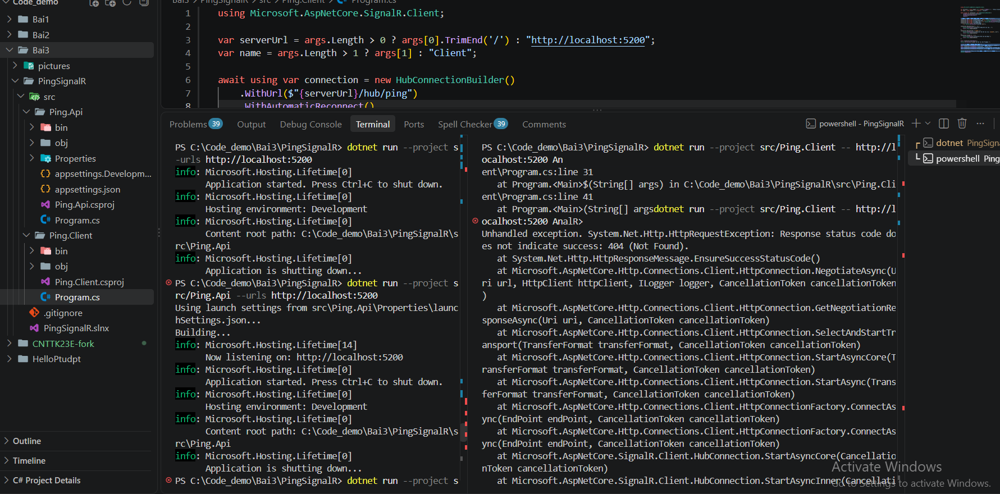
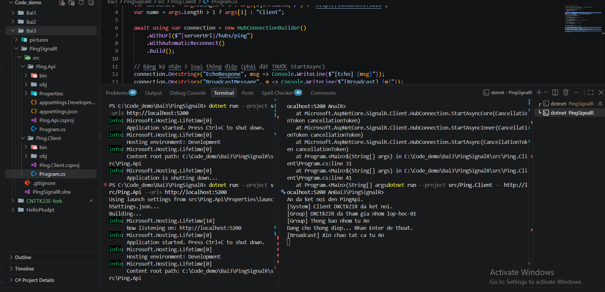
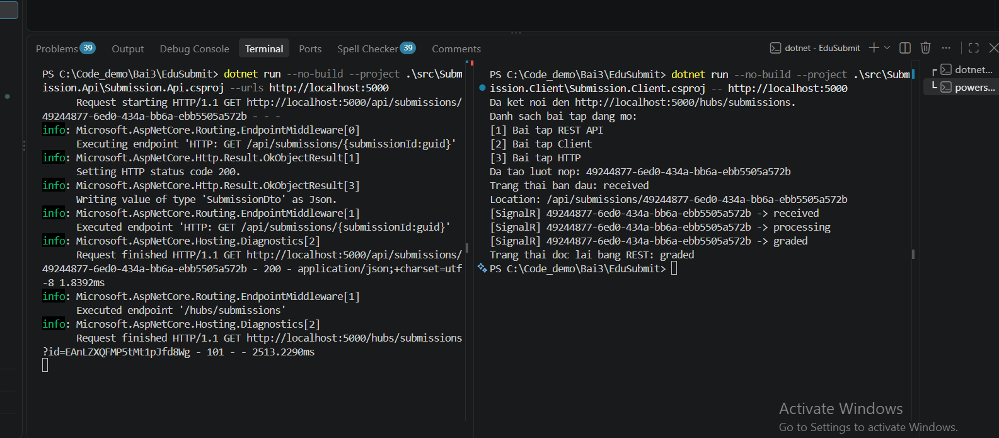
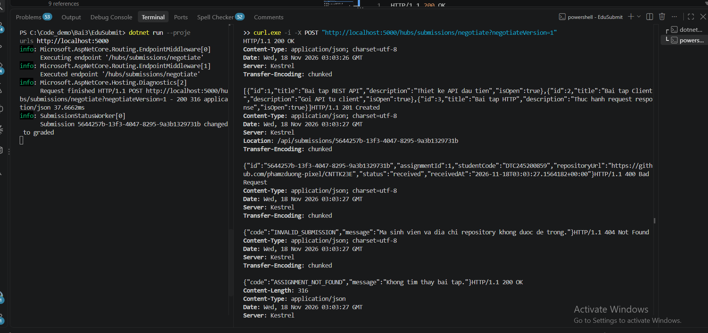

# Bài 3 – SignalR và thông báo trạng thái thời gian thực

## Thông tin sinh viên

- Họ và tên: **Phạm Văn Dương**
- MSSV: **DTC245200859**
- Môn học: Phát triển ứng dụng phân tán

## Cấu trúc bài làm

```text
Bai3/
├── pictures/
├── PingSignalR/
│   ├── src/Ping.Api/
│   └── src/Ping.Client/
└── EduSubmit/
    ├── src/Submission.Api/
    └── src/Submission.Client/
```

- `PingSignalR`: minh họa các kiểu gửi tin Caller, All và Group, cùng vòng đời kết nối.
- `EduSubmit`: giữ REST của Bài 2 và bổ sung SignalR để đẩy trạng thái submission.

## Phần A – Trả lời 3 câu hỏi đầu giờ

### 1. Polling khác gì đẩy thời gian thực?

HTTP polling là cách client chủ động gọi REST lặp lại theo chu kỳ để hỏi server xem dữ liệu có thay đổi hay chưa. Cách này dễ triển khai và phù hợp với dữ liệu không cần cập nhật liên tục, nhưng độ trễ tối thiểu phụ thuộc vào chu kỳ polling. Nếu chu kỳ quá ngắn, client tạo nhiều request rỗng, làm tăng băng thông và tải máy chủ; nếu chu kỳ dài, thông tin đến chậm.

SignalR sử dụng một kết nối lâu dài và ưu tiên WebSocket khi có thể. Server chủ động đẩy sự kiện ngay khi dữ liệu thay đổi nên độ trễ thấp hơn, không phải gửi các request hỏi lặp lại và dùng băng thông hiệu quả hơn khi có nhiều thời gian chờ. Đổi lại, hệ thống phải quản lý kết nối, reconnect, nhóm kết nối và các tình huống mất mạng.

### 2. Khi nào dùng REST và khi nào kết hợp SignalR?

REST phù hợp với các thao tác tài nguyên có request/response rõ ràng như tạo submission, đọc assignment, đọc chi tiết submission, kiểm tra lỗi và tích hợp với nhiều loại client. REST dễ cache, dễ kiểm thử và phù hợp với các thao tác cần nguồn dữ liệu chính thức.

SignalR nên được bổ sung khi client cần nhận thay đổi ngay mà không phải polling, chẳng hạn tiến độ xử lý, thông báo, trạng thái chấm bài hoặc cập nhật bảng điều khiển. Trong EduSubmit, REST vẫn tạo và đọc submission; SignalR chỉ làm kênh thông báo trạng thái `processing` và `graded` tới đúng nhóm `submission:{id}`.

### 3. `negotiate`, `ConnectionId` và `Group`

Trước khi truyền dữ liệu, client thực hiện bước `negotiate` để server và client thống nhất thông tin kết nối và transport. Sau đó SignalR tạo một kết nối với `ConnectionId` riêng để server nhận diện kết nối hiện tại.

`Group` là tập hợp logic của nhiều kết nối. Server có thể thêm một `ConnectionId` vào nhóm và gửi tin tới cả nhóm mà không cần biết từng client cụ thể. EduSubmit dùng nhóm `submission:{id}`, vì vậy thông báo của một lượt nộp không bị phát nhầm sang lượt nộp khác.

## Phần B – Minh chứng chạy thực tế

### Phần 1 – PingSignalR, cổng 5200

Build solution:

```powershell
cd C:\Code_demo\Bai3\PingSignalR
dotnet build
```

Chạy API ở terminal 1:

```powershell
dotnet run --project .\src\Ping.Api
```

Chạy client ở terminal 2:

```powershell
dotnet run --project .\src\Ping.Client -- http://localhost:5200 DTC245200859
```

Client đăng ký handler trước `StartAsync`, sau đó lần lượt minh họa:

- `Echo`: gửi riêng về `Caller`.
- `Broadcast`: phát tới `All`.
- `JoinGroup` và `SendToGroup`: phát tới đúng `Group`.
- `WithAutomaticReconnect`, `Reconnecting`, `Reconnected` và `Closed`: quan sát vòng đời kết nối.

#### Ảnh minh chứng PingSignalR











#### Ba thí nghiệm lỗi cố ý

1. **Chưa bật server:** client không thể kết nối, thường nhận `Connection refused` vì chưa có tiến trình lắng nghe.
2. **Sai đường dẫn `/hub/ping`:** đường dẫn đúng là `/hubs/ping`; request negotiate hoặc kết nối tới đường dẫn sai nhận `404 Not Found`.
3. **Sai tên sự kiện `EchoRespone`:** server vẫn gửi sự kiện `EchoResponse`, nhưng client đăng ký sai tên nên không chạy handler và không hiển thị phản hồi Echo.







### Phần 2 – EduSubmit, cổng 5000

Build solution:

```powershell
cd C:\Code_demo\Bai3\EduSubmit
dotnet build
```

Chạy API ở terminal 1:

```powershell
dotnet run --project .\src\Submission.Api
```

Chạy client ở terminal 2:

```powershell
dotnet run --project .\src\Submission.Client
```

Luồng xử lý:

1. Client tạo submission bằng `POST /api/assignments/1/submissions` và nhận `201 Created`, `Location`, trạng thái ban đầu `received`.
2. Client kết nối tới `/hubs/submissions` và gọi `WatchSubmission(submissionId)`.
3. Server đưa kết nối vào nhóm `submission:{id}`.
4. Background worker cập nhật và phát lần lượt `processing`, `graded` qua sự kiện `SubmissionStatusChanged`.
5. Client đọc lại `GET /api/submissions/{id}`; REST trả về trạng thái hiện tại `graded`.

#### Chín ca kiểm thử trong `requests.http`

| Ca | Thao tác | Mã mong đợi |
|---:|---|---:|
| 1 | `GET /` | 200 |
| 2 | `GET /api/assignments` | 200 |
| 3 | `POST /api/assignments/1/submissions` hợp lệ | 201 |
| 4 | `GET /api/submissions/{id}` theo ID của ca 3 | 200 |
| 5 | POST submission thiếu dữ liệu | 400 |
| 6 | POST vào assignment `999` | 404 |
| 7 | GET submission với ID rỗng | 404 |
| 8 | `POST /hubs/submissions/negotiate?negotiateVersion=1` | 200, có `connectionId` |
| 9 | POST sai đường dẫn `/hub/submissions/negotiate` | 404 |

Ca 4 cần gọi lại nhiều lần hoặc chờ khoảng hai giây để quan sát `received → processing → graded`.





## Phần C – Bảng tổng hợp 5 thí nghiệm kiểm thử EduSubmit

| STT | Thí nghiệm | Dự đoán | Kết quả thực tế | Giải thích nguyên nhân |
|---:|---|---|---|---|
| 1 | Chưa bật Server | Client và REST không kết nối được | `Connection refused` hoặc lỗi không thể kết nối | Không có tiến trình Kestrel lắng nghe cổng; chưa thể thực hiện HTTP hoặc SignalR handshake. |
| 2 | Sai đường dẫn Hub `/hub/submissions` | Không negotiate được | `404 Not Found` | API ánh xạ đúng tại `/hubs/submissions`; thiếu chữ `s` làm URL không khớp route. |
| 3 | Sai tên phương thức hoặc sự kiện | Không theo dõi được trạng thái | Gọi sai phương thức như `WatchSubmisson`/tên cũ sẽ lỗi invocation; đăng ký sai tên sự kiện không nhận được thông báo | Tên phương thức Hub và tên event là hợp đồng chuỗi, phải khớp tuyệt đối với `WatchSubmission` và `SubmissionStatusChanged`. |
| 4 | Assignment không tồn tại hoặc dữ liệu rỗng | Request bị từ chối | Assignment `999` trả `404`; dữ liệu rỗng trả `400` | Server kiểm tra tài nguyên trước, sau đó kiểm tra `studentCode` và `repositoryUrl`; worker không được xếp hàng cho request lỗi. |
| 5 | Tắt/bật lại Server khi đang chấm nền | Client mất kết nối rồi thử kết nối lại; REST dùng để kiểm tra trạng thái | Client phát lifecycle `Reconnecting`/`Reconnected` nếu server quay lại; `GET` là nguồn sự thật của trạng thái hiện tại | `WithAutomaticReconnect` chỉ khôi phục kết nối SignalR, không tự khôi phục dữ liệu. Bản demo dùng store trong bộ nhớ nên khởi động lại hẳn server sẽ mất submission cũ và GET có thể trả `404`; với kho lưu trữ bền vững, GET sẽ đọc lại trạng thái đã lưu. |

## Tệp kiểm thử và quy chuẩn

- API EduSubmit mặc định chạy tại `http://localhost:5000`.
- API PingSignalR mặc định chạy tại `http://localhost:5200`.
- `requests.http` dùng biến `@host = http://localhost:5000`.
- Hai solution có `.gitignore` loại trừ `bin/` và `obj/`.
- Dữ liệu EduSubmit là dữ liệu trong bộ nhớ, phù hợp mục đích minh họa SignalR của bài thực hành.
