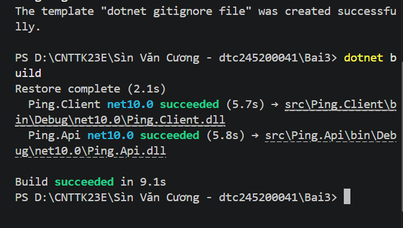
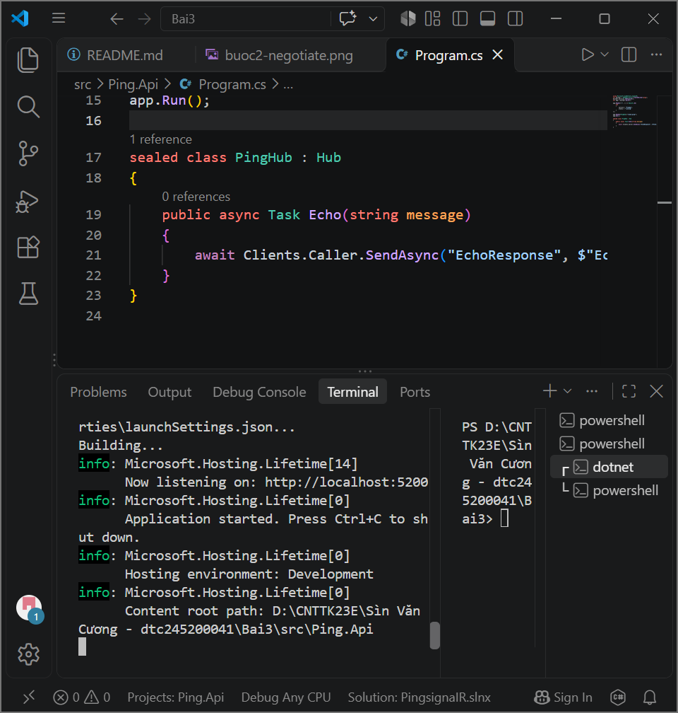
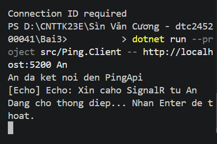
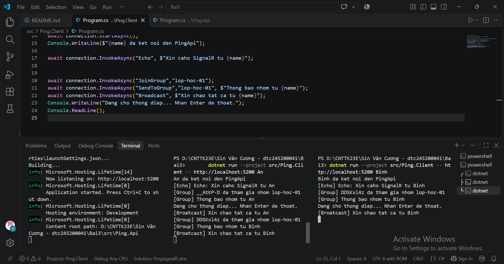
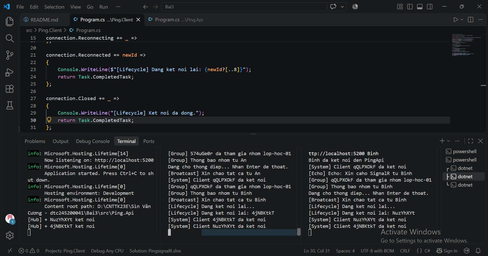
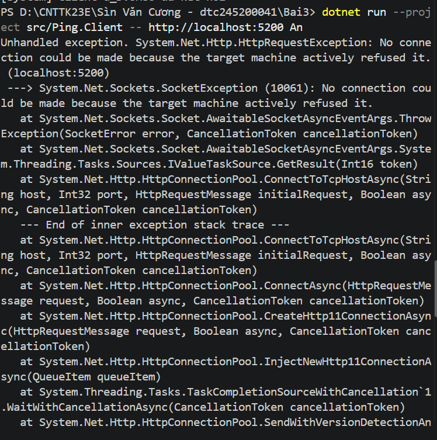
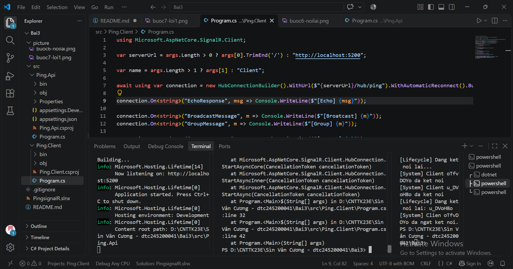
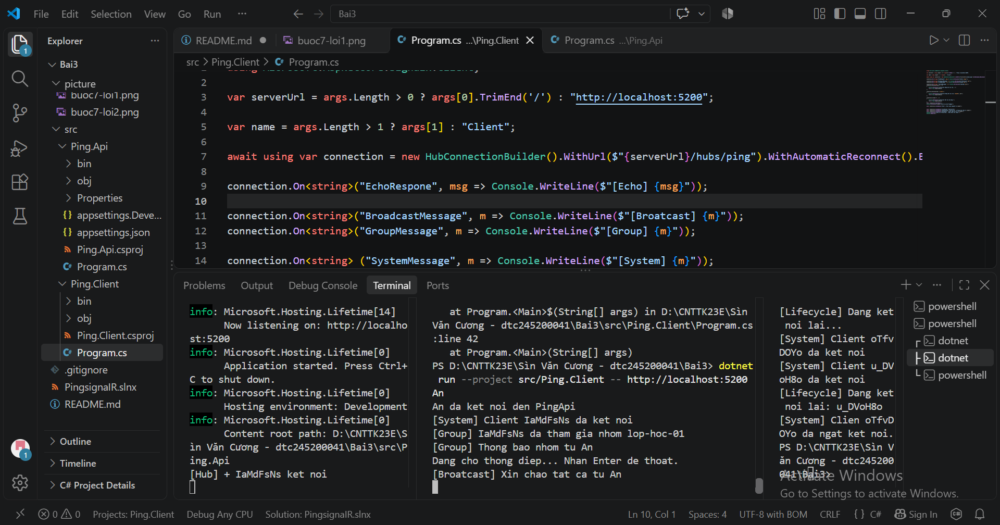

## Bài PingsignalR
## Bước 1: Hoàn thành tạo dự án

Thấy: Chạy build thành công.
Giải thích: Máy build thành công không lỗi.

## Bước 2: Hoàn thành tạo dự án

Thấy: Máy chủ chạy thành công và truy vấn hiện thông tin.
Giải thích: Máy chủ đã chạy và thông tin hiện đúng theo yêu cầu.

## Bước 3: Hoàn thành thêm code

Thấy: Máy chủ chạy thành công..
Giải thích: Máy chủ đã chạy.

## Bước 4: In [Echo] cho máy khách

Thấy: Chạy bên máy khách và in ra kết quả.
Giải thích: Kết nối An đến PingApi thành công.

## Bước 5: Chay nhom

Thấy: Chạy cả 3 máy và in ra kết quả đúng.
Giải thích: Cả 3 kết nối điều thành công.

## Bước 6: Ket noi lai

Thấy: Chạy và test thì nó in ra kết quả cần.
Giải thích: Kết nối trả kết quả đúng.

## Bước 7: 3 loi

## Bài Edusubmission

