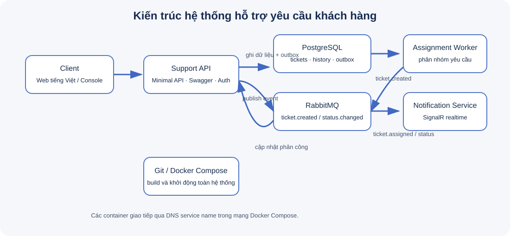
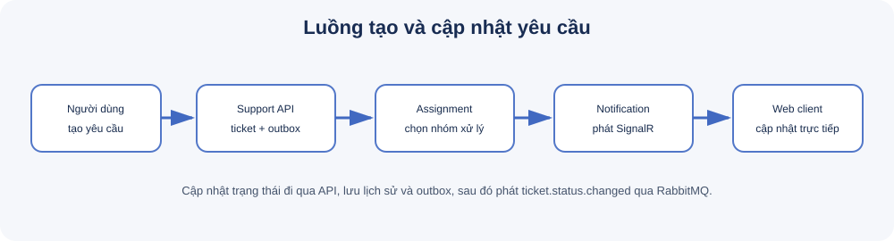

# BÁO CÁO ĐỒ ÁN – ĐỀ TÀI 07

## Hệ thống hỗ trợ yêu cầu khách hàng

**Sinh viên:** ........................................................  
**Mã sinh viên:** ....................................................  
**Lớp:** ............................................................  
**Giảng viên hướng dẫn:** ............................................  
**Ngày hoàn thiện:** .................................................

> Điền thông tin cá nhân và thêm ảnh chụp màn hình buổi chạy thực tế trước khi nộp. Báo cáo này không tự nhận đã có ảnh chụp hoặc số đo hiệu năng.

## Tóm tắt

Hệ thống tiếp nhận yêu cầu của khách hàng, lưu thông tin và lịch sử, phân công theo mức ưu tiên bằng dịch vụ nền, sau đó thông báo thay đổi theo thời gian thực. Kiến trúc gồm ASP.NET Core Minimal API, PostgreSQL, RabbitMQ, Assignment Worker, Notification Service dùng SignalR, giao diện web tiếng Việt và ứng dụng console. Các thành phần được đóng gói bằng Docker Compose.

## 1. Bài toán và mục tiêu

Khách hàng cần một nơi gửi yêu cầu và theo dõi tiến độ. Nhân viên hỗ trợ cần tìm kiếm, lọc, xem lịch sử và chuyển trạng thái. Hệ thống tách xử lý phân công khỏi request HTTP để có thể nhận yêu cầu ngay cả khi broker tạm gián đoạn.

Mục tiêu: tạo và tra cứu yêu cầu; phân công yêu cầu thường/cao ưu tiên vào nhóm phù hợp; quản lý trạng thái và lịch sử; xác thực theo vai trò; gửi thông báo realtime; chạy được toàn bộ bằng Compose.

## 2. Phân tích yêu cầu và thiết kế dữ liệu

### 2.1 Vai trò

| Vai trò | Quyền chính |
|---|---|
| Requester | Tạo yêu cầu, xem yêu cầu của chính mình và lịch sử |
| Agent | Xem/tìm yêu cầu, cập nhật trạng thái |
| Admin | Thao tác quản trị giống nhân viên trong bản demo |

### 2.2 Dữ liệu

Ticket gồm mã, người gửi, nội dung, mức ưu tiên, trạng thái, nhóm/nhân viên nhận xử lý, thời điểm tạo và cập nhật. TicketHistory ghi người thao tác, thay đổi, giá trị cũ/mới và thời điểm. OutboxMessage lưu sự kiện cần phát tới broker cùng giao dịch với thay đổi dữ liệu.

### 2.3 Quy tắc nghiệp vụ

- Ưu tiên `Normal` chuyển vào `GeneralSupport`; `High` vào `PrioritySupport`.
- Trạng thái gồm `New`, `Assigned`, `InProgress`, `Resolved`; API từ chối chuyển trạng thái không hợp lệ.
- Người gửi chỉ xem ticket của tài khoản mình; chỉ Agent/Admin được đổi trạng thái.
- Sự kiện tạo và đổi trạng thái được gửi qua outbox để tránh mất sự kiện khi RabbitMQ tạm ngừng.

## 3. Kiến trúc hệ thống

API cung cấp REST và Swagger. PostgreSQL lưu ticket, lịch sử và outbox. Outbox Publisher thử gửi sự kiện tới RabbitMQ và thử lại khi lỗi. Assignment Worker tiêu thụ `ticket.created`, cập nhật nhóm nhận. Notification Service tiêu thụ sự kiện và phát `TicketUpdated` qua SignalR đến người dùng liên quan. Giao diện web dùng API và SignalR; console client là client thay thế để gọi API.

Các container dùng DNS theo service name (`postgres`, `rabbitmq`, `support-api`, `notification-service`) trong mạng `support-net`. Cấu hình được truyền qua biến môi trường và tệp `.env`. Compose có healthcheck cho database/broker và chính sách tự khởi động lại.

## 4. Công nghệ và triển khai

- .NET 10, C#, ASP.NET Core Minimal API, EF Core/Npgsql.
- PostgreSQL 16, RabbitMQ 3.13 Management, SignalR.
- HTML/CSS/JavaScript cho web; .NET console cho client dòng lệnh.
- Dockerfile riêng cho API, Assignment Worker, Notification Service và frontend; `docker-compose.yml` điều phối dịch vụ.
- Git quản lý phiên bản source.

## 5. API tối thiểu

| Phương thức | Đường dẫn | Mục đích |
|---|---|---|
| POST | `/auth/login` | Đăng nhập, nhận Bearer token |
| POST | `/tickets` | Tạo yêu cầu |
| GET | `/tickets` | Danh sách, tìm theo `search`, lọc theo `status` |
| GET | `/tickets/{id}` | Chi tiết yêu cầu |
| PATCH | `/tickets/{id}/status` | Cập nhật trạng thái |
| GET | `/tickets/{id}/history` | Lịch sử thao tác |
| GET | `/users/{userId}/tickets` | Yêu cầu theo người gửi |
| GET | `/health` | Health endpoint |

Swagger UI ở `/swagger/index.html` qua cổng frontend.

## 6. Kết quả và kiểm tra

Các kiểm tra đã thực hiện trong quá trình hoàn thiện:

- Build solution .NET thành công, không có warning/error biên dịch.
- Kiểm tra cú pháp JavaScript và cấu hình Docker Compose.
- Khởi động stack Compose; kiểm tra API health, giao diện web và Swagger.
- Thử đăng nhập, tạo yêu cầu, phân công theo ưu tiên, tìm kiếm/lọc và cập nhật trạng thái.
- Thử quyền truy cập: chưa đăng nhập nhận 401, trạng thái không hợp lệ nhận 400.
- Thử RabbitMQ tạm dừng: API vẫn nhận yêu cầu, outbox phát lại sau khi broker hoạt động.
- Thử SignalR nhận thông báo cập nhật trạng thái.

**Ảnh minh chứng:** thêm ảnh chụp giao diện danh sách ticket, Swagger, RabbitMQ queue và log/container vào `docs/screenshots/` trong lần chạy trình diễn. Chú thích ảnh theo dữ liệu quan sát thực tế.

## 7. Cài đặt và trình diễn

Máy trình diễn cần Docker Desktop với Docker Compose; cần .NET 10 nếu muốn chạy console client. Sao chép `.env.example` thành `.env`, xem README để chạy và đăng nhập. Có thể tải/build ảnh Docker trước khi mất mạng bằng `.\scripts\prepare-offline.ps1`; sau đó ngắt Internet và chạy `.\scripts\start-offline.ps1`. Mở `http://localhost:3000`. Hướng dẫn đầy đủ ở `README.md`.

## 8. Đánh giá và giới hạn

Bản demo đáp ứng luồng chức năng và yêu cầu kiến trúc của đề. Phân quyền và token tự triển khai chỉ phù hợp môi trường học tập; triển khai thật cần OIDC/JWT chuẩn, mật khẩu băm, quản lý secrets, TLS, migration, chính sách DLQ/số lần thử và giám sát. Outbox có thể phát lại nên consumer cần xử lý lặp idempotent. Chưa có số đo tải; cần benchmark và kiểm thử nhiều người dùng trước khi kết luận về hiệu năng.

## 9. Đối chiếu checklist đề bài

| Yêu cầu | Thành phần đáp ứng |
|---|---|
| C#/.NET 10, Minimal API | `backend/src/Support.Api` |
| Client Web/Console | `frontend/web`, `frontend/Support.Client` |
| REST, SignalR, RabbitMQ | API, Notification Service, broker |
| Cơ sở dữ liệu | PostgreSQL + EF Core |
| Microservice và Dockerfile riêng | API, Worker, Notification, frontend |
| Compose khởi động hệ thống | `docker-compose.yml` |
| DNS service name, cấu hình môi trường | `support-net`, `.env.example` |
| Logging, phục hồi khi dịch vụ gián đoạn | ILogger, retry outbox/consumer, restart policy |
| Báo cáo, sơ đồ, hướng dẫn chạy | `docs/REPORT.md`, `docs/*.svg`, `README.md` |
| Mã nguồn và lịch sử phiên bản | Repository Git cục bộ |
| Trình diễn offline | `scripts/prepare-offline.ps1`, `scripts/start-offline.ps1` |

## Phụ lục: tài khoản demo

Tài khoản nằm trong `.env.example`; xem giá trị trong `.env` khi đăng nhập. Không dùng tài khoản demo cho hệ thống thật. Không đưa mật khẩu thật vào Git hoặc báo cáo.
