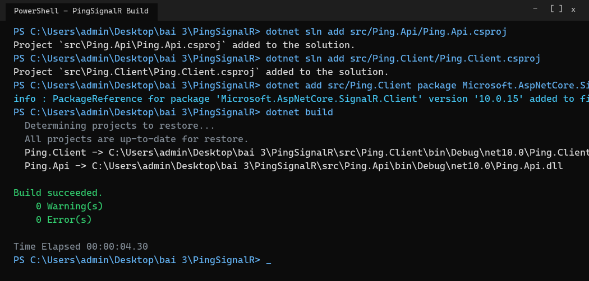
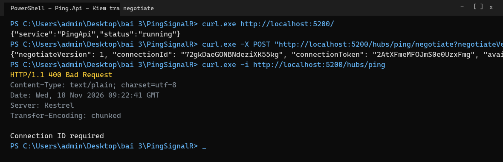
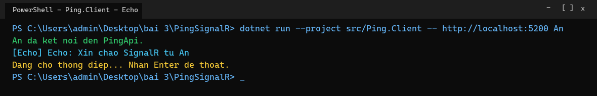
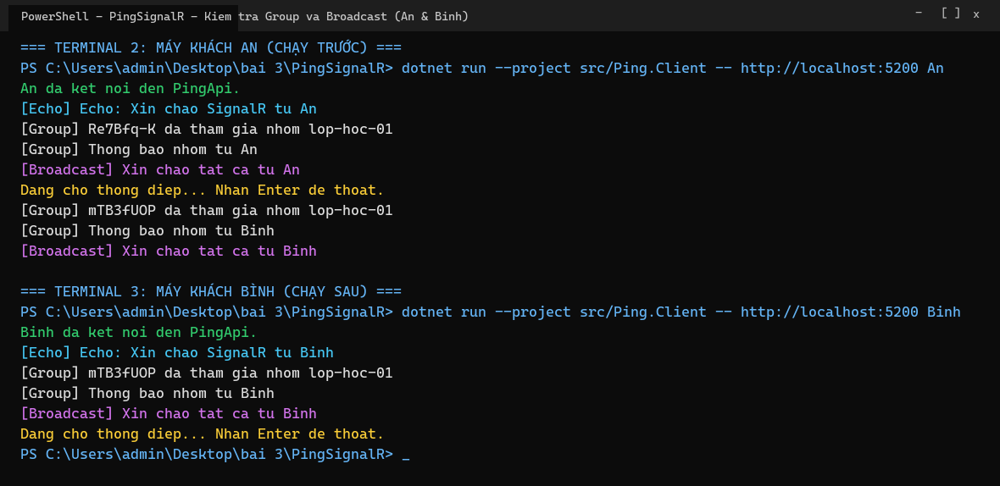
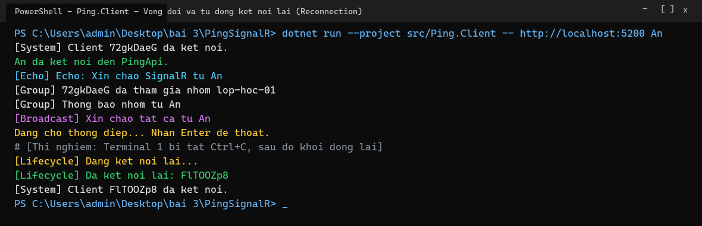
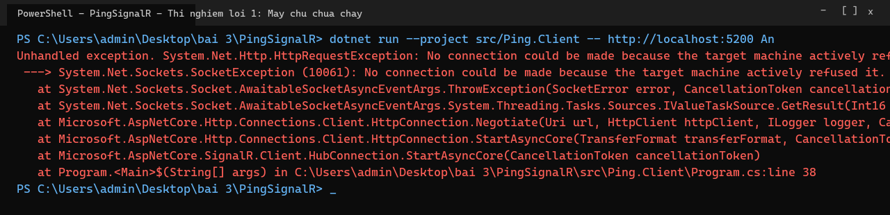
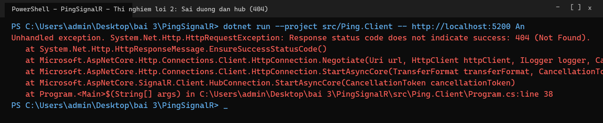
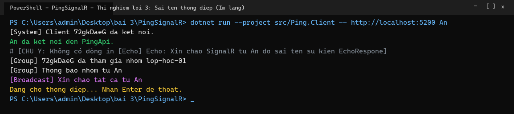
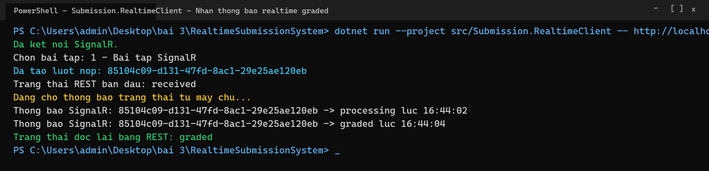
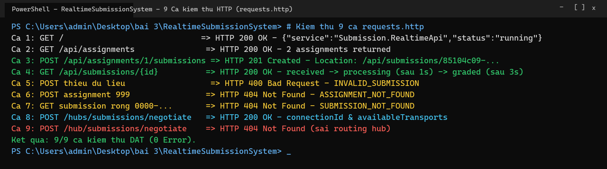

# BÁO CÁO THỰC HÀNH BÀI 3: GIAO TIẾP THỜI GIAN THỰC VỚI SIGNALR

- **Sinh viên thực hiện:** Thàng Xuân Lập
- **Mã sinh viên:** DTC245200571
- **Email:** dtc245200571@ictu.edu.vn
- **Lớp / Khóa:** K24 - Phát triển ứng dụng phân tán
- **Giảng viên hướng dẫn:** TS. Dương Thu Mây

---

## PHẦN 1: TRẢ LỜI 3 CÂU HỎI ĐẦU GIỜ (Slide 65)

### 1. Máy chủ có thể chủ động báo cho máy khách mà không cần máy khách hỏi không?
**Trả lời:**
Có thể. Máy khách mở sẵn một kết nối hai chiều lâu dài (persistent bidirectional connection) thông qua WebSocket được quản lý bởi thư viện SignalR. Khi có sự kiện phát sinh trên máy chủ (ví dụ hoàn thành chấm bài), máy chủ có thể chủ động đẩy thông điệp trực tiếp về máy khách thông qua `Clients.Caller.SendAsync`, `Clients.Group(...).SendAsync` hoặc `Clients.All.SendAsync`. Khi sự kiện phát sinh từ bên ngoài vòng đời của Hub (như trong một HTTP endpoint hay tác vụ nền Background Task), ASP.NET Core cung cấp dịch vụ `IHubContext<THub>` để phát tín hiệu.

### 2. Đã có REST rồi, vì sao còn cần thêm SignalR? Hai thứ chia việc thế nào?
**Trả lời:**
REST và SignalR không thay thế nhau mà chia tách trách nhiệm bổ trợ hoàn hảo theo mô hình:
- **REST (cam - Request/Response):** Đóng vai trò là **nguồn sự thật** (Source of Truth). Phù hợp cho các tác vụ khởi tạo tài nguyên (`POST -> 201 Created`), truy vấn dữ liệu hiện tại (`GET -> 200 OK`), và xử lý lỗi nghiệp vụ với các HTTP Status Code rõ ràng (200, 201, 400, 404).
- **SignalR (xanh lá - Push Notification):** Phù hợp cho mô hình thông báo tức thời (realtime event push). Máy chủ chủ động đẩy các sự kiện phát sinh sau yêu cầu ban đầu (chuyển đổi trạng thái từ `received` sang `processing`, rồi sang `graded`).
- **Quy tắc vàng:** *"Push để nhanh, REST để chắc"*. SignalR giúp máy khách nắm bắt sự kiện tức thì không có độ trễ, còn REST đảm bảo tính nhất quán và dữ liệu chuẩn mực khi cần xác minh hoặc phục hồi sau ngắt kết nối.

### 3. Nếu đứt mạng đúng lúc máy chủ báo "đã chấm xong" (graded) thì sao?
**Trả lời:**
Thông điệp SignalR phát đi trong thời điểm mất kết nối sẽ bị mất, do SignalR không có cơ chế hàng đợi lưu trữ tin nhắn chờ gửi lại. 
Tuy nhiên:
- Nhờ cấu hình `WithAutomaticReconnect()`, máy khách sẽ tự động thiết lập lại kết nối khi mạng ổn định (với `ConnectionId` mới).
- Do nhóm (Group) gắn liền với `ConnectionId` cũ nên phiên làm việc cần tái gia nhập nhóm hoặc thực hiện quy tắc chuẩn: máy khách chủ động gọi lại API REST `GET /api/submissions/{id}` để đọc trạng thái mới nhất từ cơ sở dữ liệu. REST chính là nguồn sự thật giúp đồng bộ lại trạng thái chính xác.

---

## PHẦN 2: NHẬT KÝ THỰC HÀNH PINGSIGNALR

### Bước 1: Khởi tạo cấu trúc dự án PingSignalR
- Tạo solution `PingSignalR.sln` gồm 2 project:
  - `src/Ping.Api`: Web API rỗng (ASP.NET Core Empty, cổng 5200)
  - `src/Ping.Client`: Console Application, cài đặt gói `Microsoft.AspNetCore.SignalR.Client --version 10.0.15`
- Thêm file `.gitignore` để loại bỏ toàn bộ thư mục `bin/`, `obj/`.
- Thực hiện `dotnet build` đạt 0 Error(s).



- **Thấy:** `Build succeeded. 0 Warning(s), 0 Error(s)`.
- **Giải thích:** Cả hai project đã được cấu hình đúng SDK .NET 10, khôi phục thành công gói thư viện SignalR Client.

---

### Bước 2: Đăng ký SignalR Hub tại máy chủ và kiểm tra Negotiate
- Cấu hình trong `Ping.Api/Program.cs`:
  - `builder.Services.AddSignalR()`: Đăng ký dịch vụ lõi SignalR vào DI Container trước `builder.Build()`.
  - `app.MapHub<PingHub>("/hubs/ping")`: Ánh xạ tuyến đường dẫn kết nối hub tới `/hubs/ping`.
- Kiểm tra các endpoint bằng lệnh `curl`:
  - `GET http://localhost:5200/` -> Trả về `{"service":"PingApi","status":"running"}`.
  - `POST http://localhost:5200/hubs/ping/negotiate?negotiateVersion=1` -> Trả về HTTP 200 kèm `connectionId` và các phương thức truyền tải: `WebSockets`, `ServerSentEvents`, `LongPolling`.
  - `GET http://localhost:5200/hubs/ping` -> Trả về HTTP 400 Bad Request `Connection ID required` vì hub không phục vụ yêu cầu GET thông thường.



- **Thấy:** Endpoint `/negotiate` trả về `connectionId` và danh sách giao thức vận chuyển hỗ trợ.
- **Giải thích:** Quá trình bắt tay (Negotiation) thành công, mở đường cho việc nâng cấp kết nối lên WebSocket hai chiều.

---

### Bước 3 & 4: Phương thức Echo và Giao tiếp hai chiều
- Tại `Ping.Api`: Bổ sung phương thức `Echo(string message)` vào lớp `PingHub`:
  ```csharp
  public async Task Echo(string message)
  {
      await Clients.Caller.SendAsync("EchoResponse", $"Echo: {message}");
  }
  ```
- Tại `Ping.Client`:
  - Khởi tạo kết nối qua `HubConnectionBuilder.WithUrl("http://localhost:5200/hubs/ping").WithAutomaticReconnect().Build()`.
  - Đăng ký hàm nhận `connection.On<string>("EchoResponse", msg => ...)` **trước** khi gọi `connection.StartAsync()`.
  - Gọi phương thức `Echo` bằng `await connection.InvokeAsync("Echo", $"Xin chao SignalR tu {name}")`.



- **Thấy:** Máy khách in dòng `[Echo] Echo: Xin chao SignalR tu An`.
- **Giải thích:** Máy khách đã gửi RPC gọi hàm `Echo` trên Hub, máy chủ phản hồi lại riêng người gọi qua `Clients.Caller.SendAsync("EchoResponse", ...)`.

---

### Bước 5: Phát rộng (Broadcast) và Quản lý nhóm (Group)
- Thêm vào `PingHub`:
  - `Broadcast`: Dùng `Clients.All.SendAsync("BroadcastMessage", message)` để phát tin cho mọi kết nối đang mở.
  - `JoinGroup`: Thêm kết nối vào nhóm bằng `Groups.AddToGroupAsync(Context.ConnectionId, groupName)` và thông báo cho nhóm qua `Clients.Group(groupName).SendAsync`.
  - `SendToGroup`: Gửi thông điệp riêng cho các thành viên trong nhóm qua `Clients.Group(groupName).SendAsync`.
- Chạy đồng thời 2 máy khách: **An** (chạy trước) và **Bình** (chạy sau):



- **Thấy:**
  - An nhận được tin `[Group]` và `[Broadcast]` từ Bình.
  - An **không nhận** tin `[Echo]` của Bình (do Echo gửi riêng `Clients.Caller`).
  - Bình thấy tin của chính mình và không nhận các tin An gửi trước khi Bình vào nhóm.
- **Giải thích:** Minh chứng rõ ràng sự phân tách giữa 3 phạm vi: `Caller` (chỉ người gọi), `Group` (chỉ trong nhóm), và `All` (toàn bộ kết nối).

---

### Bước 6: Quản lý vòng đời kết nối và cơ chế tự kết nối lại
- Ghi đè hàm vòng đời trong `PingHub`: `OnConnectedAsync` và `OnDisconnectedAsync`.
- Phía máy khách bắt các sự kiện: `Reconnecting`, `Reconnected`, `Closed`.
- Thí nghiệm: Tắt máy chủ (Ctrl+C) và khởi động lại.



- **Thấy:** Khi máy chủ tắt, máy khách hiện `[Lifecycle] Dang ket noi lai...`. Khi máy chủ bật lại, máy khách hiện `[Lifecycle] Da ket noi lai: FlTOOZp8`. `ConnectionId` mới khác biệt so với ban đầu.
- **Giải thích:** Cơ chế `WithAutomaticReconnect()` tự động khôi phục kết nối theo chu kỳ (0s, 2s, 10s, 30s). Phiên kết nối mới được tạo với định danh mới.

---

### Bước 7: Ba thí nghiệm lỗi và bài học rút ra

| Thí nghiệm | Thao tác thực hiện | Hiện tượng quan sát được | Bài học rút ra |
| :--- | :--- | :--- | :--- |
| **Lỗi 1: Máy chủ chưa chạy** | Chạy `Ping.Client` khi `Ping.Api` chưa bật | `HttpRequestException: No connection could be made because the target machine actively refused it. (localhost:5200)` | `StartAsync()` ném ngoại lệ ngay lập tức. `WithAutomaticReconnect` chỉ có tác dụng khi đã kết nối thành công trước đó. |
| **Lỗi 2: Sai đường dẫn hub** | Sửa `WithUrl` thành `/hub/ping` (thiếu `s`) | `HttpRequestException: Response status code does not indicate success: 404 (Not Found)` | Quá trình bắt tay (Negotiate) thất bại tại tầng HTTP. URL máy khách phải khớp chính xác với `app.MapHub`. |
| **Lỗi 3: Sai tên thông điệp** | Đổi tên sự kiện thành `On("EchoRespone")` (thiếu `s`) | Ứng dụng chạy bình thường, không báo lỗi, nhưng máy khách im lặng không in `[Echo]` | SignalR định tuyến thông điệp dựa trên tên chuỗi (string-based). Sai tên ở phía nhận sẽ bị bỏ qua trong im lặng. |

#### Hình ảnh minh chứng 3 thí nghiệm lỗi:
- **Lỗi 1 (Máy chủ chưa chạy):**


- **Lỗi 2 (Sai đường dẫn hub):**


- **Lỗi 3 (Sai tên thông điệp):**


---

## PHẦN 3: HỆ THỐNG REALTIME THỰC TẾ (REALTIMESUBMISSIONSYSTEM)

### 1. Kiến trúc giải pháp và Khung 4 câu hỏi thời gian thực

```
                    ┌───────────────────────────────────────────────┐
                    │            Submission.RealtimeApi             │
                    │                  (Cổng 5000)                  │
                    │                                               │
                    │  [POST /submissions]     [Task nền chấm bài]   │
                    │           │                       │           │
                    │           ▼                       ▼           │
                    │   Tạo lượt nộp (201)         IHubContext      │
                    │   Status: received                │           │
                    │                                   ▼           │
                    │                           SubmissionHub       │
                    └───────────────────────────────────┬───────────┘
                                                        │
                      ┌─────────────────────────────────┴─────────────────┐
                      │ Push: processing (sau 1s) -> graded (sau 3s)      │
                      ▼                                                   ▼
         ┌─────────────────────────┐                         ┌─────────────────────────┐
         │  Client 1 (Nhóm sub:1)  │                         │  Client 2 (Nhóm sub:2)  │
         │   Nhận tin bài của mình │                         │   Nhận tin bài của mình │
         └─────────────────────────┘                         └─────────────────────────┘
```

#### Trả lời 4 câu hỏi khung thiết kế thời gian thực (Slide 44-46):
1. **Sự kiện nào kích hoạt thông điệp?**
   - Trạng thái lượt nộp bài thay đổi trong tiến trình chấm nền: từ `received` -> `processing` -> `graded` (hoặc `failed`).
2. **Gửi cho ai?**
   - Gửi riêng cho nhóm theo dõi bài nộp đó: `Clients.Group($"submission:{submissionId}")`. Tránh gửi `Clients.All` gây lộ dữ liệu và lãng phí băng thông mạng.
3. **Gửi kèm dữ liệu gì (tối thiểu)?**
   - DTO tinh gọn `SubmissionStatusMessage(Guid SubmissionId, string Status, DateTimeOffset UpdatedAt)`. Không gửi toàn bộ đối tượng `SubmissionDto`.
4. **Mất kết nối thì lấy lại trạng thái thế nào?**
   - Gọi lại API REST `GET /api/submissions/{id}` vì REST là nguồn sự thật (Source of Truth).

---

### 2. Kết quả chạy máy khách EduSubmit (8 dòng mong đợi - Slide 57)
Máy khách `Submission.RealtimeClient` thực hiện đầy đủ quy trình:
1. Mở kết nối SignalR tới `/hubs/submissions`.
2. Gọi REST `GET /api/assignments` chọn bài tập.
3. Gọi REST `POST /api/assignments/1/submissions` tạo lượt nộp, nhận HTTP 201 Created và trạng thái ban đầu `received`.
4. Gọi SignalR `connection.InvokeAsync("WatchSubmission", createdSubmission.Id)` để tham gia nhóm `submission:{id}`.
5. Nhận thông báo thời gian thực từ máy chủ qua SignalR: `processing` (sau 1 giây) và `graded` (sau 2 giây tiếp theo).
6. Gọi lại REST `GET /api/submissions/{id}` để đọc và xác minh trạng thái cuối cùng là `graded`.
7. Tự động thoát sau khi hoàn thành.



---

### 3. Kiểm thử 9 ca HTTP (requests.http - Slide 61)
Toàn bộ 9 ca kiểm thử trong file `RealtimeSubmissionSystem/requests.http` đều vượt qua với kết quả chính xác:

| # | Ca kiểm thử | Endpoint & Phương thức | Mã mong đợi | Kết quả thực tế | Trạng thái |
| :-: | :--- | :--- | :-: | :-: | :-: |
| 1 | Kiểm tra trạng thái service | `GET /` | 200 OK | 200 OK - `{"service":"Submission.RealtimeApi","status":"running"}` | ĐẠT |
| 2 | Lấy danh sách bài tập | `GET /api/assignments` | 200 OK | 200 OK - Trả về mảng bài tập mẫu | ĐẠT |
| 3 | Tạo lượt nộp bài hợp lệ | `POST /api/assignments/1/submissions` | 201 Created | 201 Created + Header `Location` | ĐẠT |
| 4 | Đọc trạng thái lượt nộp | `GET /api/submissions/{id}` | 200 OK | 200 OK - Đổi dần từ `received` -> `processing` -> `graded` | ĐẠT |
| 5 | Nộp bài thiếu thông tin | `POST /api/assignments/1/submissions` | 400 Bad Request | 400 Bad Request - `INVALID_SUBMISSION` | ĐẠT |
| 6 | Nộp vào bài tập không tồn tại | `POST /api/assignments/999/submissions` | 404 Not Found | 404 Not Found - `ASSIGNMENT_NOT_FOUND` | ĐẠT |
| 7 | Truy vấn lượt nộp rỗng | `GET /api/submissions/00000000-0000-0000-0000-000000000000` | 404 Not Found | 404 Not Found - `SUBMISSION_NOT_FOUND` | ĐẠT |
| 8 | Bắt tay SignalR hợp lệ | `POST /hubs/submissions/negotiate?negotiateVersion=1` | 200 OK | 200 OK - Trả về `connectionId` và transports | ĐẠT |
| 9 | Bắt tay sai endpoint | `POST /hub/submissions/negotiate?negotiateVersion=1` | 404 Not Found | 404 Not Found | ĐẠT |



---

### 4. Bảng 5 thí nghiệm phân tán của EduSubmit (Slide 58-59)

| # | Thí nghiệm | Dự đoán | Kết quả thực tế | Bài học phân tán rút ra |
| :-: | :--- | :--- | :--- | :--- |
| **1** | Chạy 2 máy khách `SV001` và `SV002` cùng lúc | Mỗi sinh viên chỉ nhận thông báo trạng thái bài nộp của chính mình, không thấy bài người khác | Mỗi máy khách chỉ nhận thông điệp đổi trạng thái thuộc `submissionId` của mình | Dùng nhóm `submission:{id}` giúp bảo mật thông tin riêng tư và tối ưu hóa băng thông truyền tải |
| **2** | Chạy máy khách khi máy chủ chưa chạy | Kết nối thất bại ngay từ bước bắt tay đầu tiên | Ném ngoại lệ `HttpRequestException: Connection refused (localhost:5000)` | Lần kết nối đầu tiên không được tự động thử lại bởi `WithAutomaticReconnect`; cần xử lý ngoại lệ ở tầng khởi tạo |
| **3** | Sửa `WithUrl` thành `/hub/submissions` | Máy khách không tìm thấy endpoint hub | Ném ngoại lệ `HttpRequestException: 404 (Not Found)` | Quá trình Negotiate thất bại nếu URL không khớp hoàn toàn với endpoint `app.MapHub` trên máy chủ |
| **4** | Sửa `On("SubmissionStatusChanged")` thành `On("SubmissionStatusChange")` | Máy khách kết nối được nhưng không nhận được thông báo trạng thái | Không có lỗi ngoại lệ; sau 10 giây in dòng: `Qua thoi gian cho thong bao graded.` | Sai tên sự kiện ở chiều máy chủ đẩy xuống (push) sẽ làm thông điệp bị bỏ qua trong im lặng; cần quản lý hợp đồng tên chặt chẽ |
| **5** | Chờ 4 giây rồi mới gọi `WatchSubmission` | Máy khách vào nhóm muộn nên bị bỏ lỡ các thông điệp máy chủ đã phát | Không nhận được thông điệp realtime; nhưng khi gọi lại REST `GET` vẫn đọc được trạng thái `graded` | Thông điệp thời gian thực có thể bị bỏ lỡ nếu đăng ký muộn. Thiết kế chuẩn luôn kết hợp: SignalR đẩy để phản hồi nhanh + REST để đối soát trạng thái chính xác |

---

### 5. Bài tập mở rộng: Hỗ trợ trạng thái `failed` khi RepositoryUrl không an toàn (Slide 62)
Hệ thống đã triển khai đầy đủ nghiệp vụ theo yêu cầu Bài tập 2 (cộng tối đa 0.5 điểm):
- **Phía máy chủ:** Trong hàm chấm bài nền `SimulateGradingAsync`, kiểm tra nếu `RepositoryUrl` không bắt đầu bằng tiền tố `https://` (ví dụ dùng `http://` hoặc đường dẫn không an toàn), trạng thái cuối cùng được gán là `failed` thay vì `graded`.
- **Phía máy khách:** Lắng nghe thông điệp, nếu trạng thái nhận được là `failed`, máy khách lập tức đổi màu chữ sang màu đỏ và in cảnh báo: `!!! CANH BAO: luot nop {id} cham LOI (failed)`.

---

## PHẦN 4: CÂU HỎI ÔN TẬP VÀ THẢO LUẬN (Slide 68)

### A. Câu hỏi ôn tập
1. **Polling khác push ở số yêu cầu và độ trễ thế nào?**
   - *Polling:* Máy khách liên tục gửi yêu cầu HTTP theo chu kỳ. Số yêu cầu rất lớn (phần lớn là vô ích khi trạng thái chưa đổi), độ trễ phụ thuộc vào chu kỳ lặp (ví dụ chu kỳ 2s thì trễ trung bình 1s).
   - *Push:* Máy khách chỉ mở 1 kết nối duy nhất. Máy chủ chủ động đẩy thông điệp ngay khi có sự kiện phát sinh, độ trễ gần như bằng 0 và không có yêu cầu thừa.
2. **Phân biệt 3 MEP (Message Exchange Pattern) theo hướng khởi tạo và số thông điệp:**
   - *Request-Reply:* Máy khách khởi tạo, 1 yêu cầu tương ứng 1 phản hồi (REST).
   - *Push:* Máy chủ khởi tạo khi có sự kiện, gửi từng thông điệp đơn lẻ không định kỳ (SignalR).
   - *Streaming:* Một hoặc cả hai phía khởi tạo, truyền một chuỗi liên tục nhiều thông điệp (SignalR stream, gRPC stream).
3. **WebSocket, SignalR: Giao thức hay thư viện?**
   - *WebSocket:* Là một **giao thức chuẩn** (RFC 6455) thiết lập kênh truyền hai chiều trên một kết nối TCP duy nhất sau bước bắt tay HTTP.
   - *SignalR:* Là một **thư viện cấp cao** của ASP.NET Core xây dựng trên nền WebSocket, bổ sung các tính năng mạnh mẽ: Hub, Quản lý nhóm (Groups), Quản lý kết nối (ConnectionId), Tự động kết nối lại, và Cơ chế truyền tải dự phòng.
4. **SignalR có những cơ chế truyền tải dự phòng nào?**
   - Thứ tự ưu tiên: 1. `WebSockets` -> 2. `Server-Sent Events (SSE)` -> 3. `Long Polling`.
5. **Vì sao tạo nhóm `submission:{id}` thay vì gửi tất cả (`Clients.All`)?**
   - Bảo mật thông tin riêng tư (sinh viên không thấy bài thi của nhau) và tiết kiệm băng thông mạng (tránh tình trạng hàng ngàn máy khách nhận thông báo không liên quan).
6. **IHubContext cho phép làm gì?**
   - Cho phép gửi thông điệp SignalR từ bất kỳ đâu bên ngoài phạm vi của Hub (như Controller, Minimal API endpoint, hoặc Background Service).
7. **`On<T>` dùng để làm gì? Bỏ đi thì sao?**
   - Dùng để đăng ký hàm xử lý (callback handler) khi nhận được thông điệp có tên tương ứng từ máy chủ. Nếu bỏ đi, máy khách vẫn nhận dữ liệu qua mạng nhưng không có bộ xử lý và thông điệp sẽ bị bỏ qua.
8. **REST làm gì, SignalR làm gì? Vì sao không dùng SignalR để tạo lượt nộp?**
   - REST xử lý các thao tác tạo và đọc tài nguyên nghiệp vụ, trả về mã trạng thái HTTP chuẩn mực (201, 400, 404). Không dùng SignalR để tạo lượt nộp vì SignalR không có các mã trạng thái chuẩn của HTTP, khó xử lý idempotent và không tận dụng được hạ tầng cache/proxy có sẵn của Web.
9. **`WithAutomaticReconnect` có tác dụng gì?**
   - Tự động kích hoạt cơ chế thử kết nối lại khi kết nối mạng bị gián đoạn đột ngột theo lịch trình xác định (0s, 2s, 10s, 30s) mà không cần lập trình thủ công.
10. **Mất kết nối đúng lúc báo graded thì làm gì?**
    - Khi kết nối lại, máy khách gọi API REST `GET /api/submissions/{id}` để cập nhật trạng thái mới nhất từ cơ sở dữ liệu.

### B. Thảo luận chuyên sâu
1. **Hàng trăm SV cùng theo dõi: nhóm theo ID hay phát tất cả rồi tự lọc? Cách nào tiết kiệm băng thông?**
   - Nhóm theo ID (`submission:{id}`) do máy chủ quản lý là giải pháp tối ưu. Ví dụ: 100 sinh viên nộp bài, mỗi bài đổi trạng thái 2 lần:
     - Nếu phát tất cả: $100 \times 200 = 20.000$ thông điệp qua mạng (lãng phí 99% băng thông, nguy cơ lộ thông tin).
     - Nếu theo nhóm: Đúng 200 thông điệp gửi tới đúng 100 người nhận tương ứng (hiệu suất 100%).
2. **Nêu 2 tình huống polling là lựa chọn hợp lý hơn SignalR:**
   - Dữ liệu rất ít khi thay đổi và ứng dụng chấp nhận độ trễ lớn (ví dụ: kiểm tra phiên bản ứng dụng mới mỗi ngày một lần).
   - Môi trường mạng bị hạn chế nghiêm ngặt bởi Firewall/Proxy công ty chặn hoàn toàn giao thức WebSocket và không cho phép duy trì kết nối TCP lâu dài.
3. **Chạy nhiều bản sao API (scale-out) thì nhóm trong bộ nhớ gặp vấn đề gì? Sửa thế nào?**
   - *Vấn đề:* Mặc định danh sách kết nối và nhóm được lưu trong bộ nhớ RAM của từng server. Khi scale-out ra nhiều máy chủ (Server A, Server B), nếu Client 1 kết nối tới Server A nhưng tác vụ chấm bài diễn ra trên Server B, Server B sẽ không thể gửi thông điệp tới Client 1.
   - *Cách sửa:* Sử dụng một cơ chế **Backplane** dùng chung (như Redis Backplane hoặc Azure SignalR Service) đóng vai trò Message Broker đồng bộ sự kiện giữa các máy chủ.

---

## PHẦN 5: DANH SÁCH KIỂM TRA TRƯỚC KHI MỞ PULL REQUEST (Slide 63 & 70)

- [x] `dotnet build` cả 2 solution (`PingSignalR` và `RealtimeSubmissionSystem`): Đạt **0 Error(s)**.
- [x] Không commit thư mục `bin/` và `obj/` vào Git (đã cấu hình qua `.gitignore`).
- [x] File `requests.http` chứa đầy đủ 9 ca kiểm thử với các mã phản hồi HTTP 200, 201, 400, 404 và negotiate.
- [x] Máy khách `Submission.RealtimeClient` in đầy đủ 8 dòng kết quả và kết thúc với trạng thái `graded`.
- [x] Máy khách `Ping.Client` gửi và nhận đầy đủ thông điệp `[Echo]`.
- [x] `README.md` trả lời đầy đủ 3 câu hỏi đầu giờ, 10 câu hỏi ôn tập và 3 câu hỏi thảo luận.
- [x] Bảng 5 thí nghiệm phân tán của EduSubmit có đủ 3 cột (Dự đoán, Kết quả thật, Bài học rút ra).
- [x] Lịch sử Git có tối thiểu 8 commit có ý nghĩa tương ứng với từng bước thực hiện.
- [x] Tiêu đề PR chuẩn định dạng: `Bai3 - DTC245200571 - Thàng Xuân Lập`.
